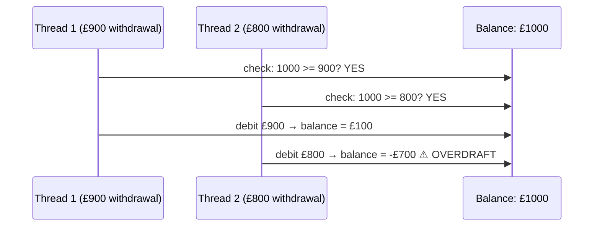
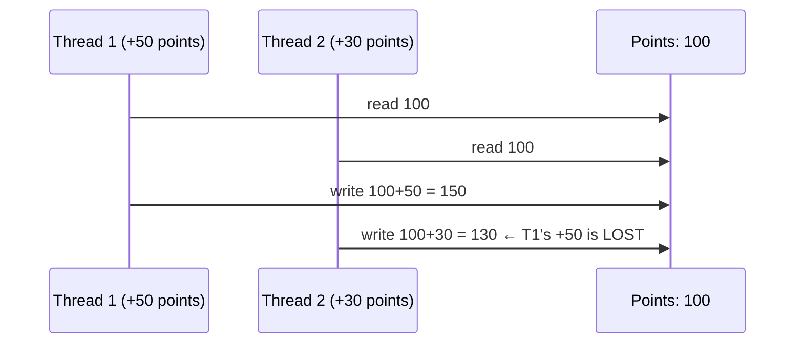
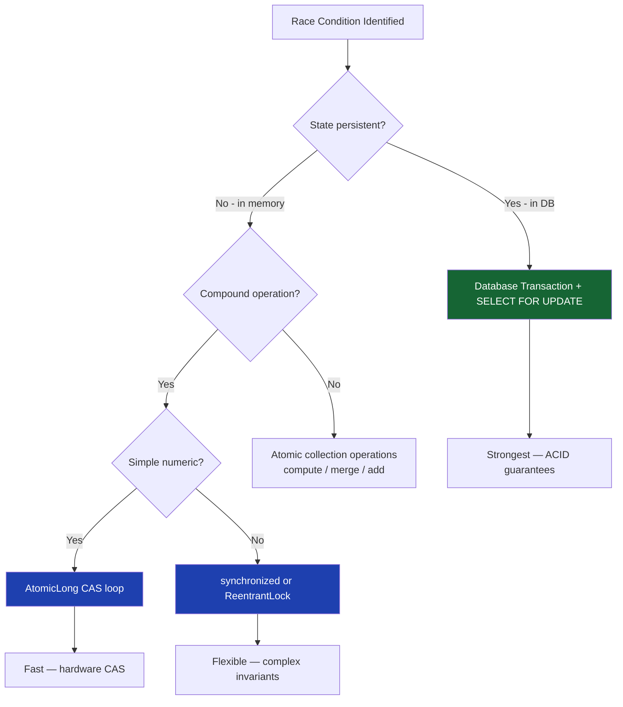

# حالات التسابق في الأنظمة المالية — الاكتشاف والوقاية

## نظرة عامة

**حالة التسابق** (race condition) خلل تعتمد فيه صحة البرنامج على التوقيت النسبي للعمليات أو تداخلها بين الخيوط. وحالات التسابق من أخطر العيوب في البرمجيات المالية: فهي متقطعة، وغالبًا لا تظهر في الاختبار، وقد تُنتج نتائج مالية خاطئة دون رمي أي استثناء.

ويظهر نمطا التسابق المعياريان — **افحص ثم تصرف** و**اقرأ-عدّل-اكتب** — في كل أنحاء معالجة المدفوعات، وإدارة الأرصدة، وكشف الاحتيال. ويشرّح هذا الدرس النمطين في سياقات مالية، ويُظهر كيف ينتجان سحبًا على المكشوف وخصومات مكررة حقيقية، ويغطي كل استراتيجيات العلاج المتاحة.

## أهداف التعلم

في نهاية هذا الدرس ستستطيع:

- التمييز بين **حالة التسابق** (مشكلة توقيت في المنطق عالي المستوى) و**سباق البيانات** (data race، انتهاك للرؤية في JMM)
- تحديد حالات تسابق "افحص ثم تصرف" و"اقرأ-عدّل-اكتب" في شيفرة الدفع
- شرح كيف يُنتج TOCTOU ‏(Time-Of-Check-To-Time-Of-Use) تلفًا في البيانات المالية
- تطبيق الإصلاح الصحيح لكل نمط تسابق
- استخدام القفل على مستوى قاعدة البيانات ومنع التكرار على مستوى التطبيق لمنع العمليات المالية المكررة
- اكتشاف حالات التسابق المحتملة في مراجعة الشيفرة

## حالة التسابق مقابل سباق البيانات

يُخلط بين المصطلحين كثيرًا — وهما عيبان مختلفان:

| | حالة التسابق | سباق البيانات |
|---|---|---|
| **التعريف** | صحة البرنامج تعتمد على توقيت الخيوط | قراءة وكتابة غير متزامنتين للمتغير نفسه |
| **انتهاك لـ JMM؟** | ليس بالضرورة | نعم — دائمًا انتهاك لـ JMM |
| **الإصلاح** | عمليات مركّبة ذرية، وأقفال، ومعاملات قاعدة بيانات | `volatile`، و`synchronized`، و`AtomicXxx` |
| **مرئي في مراجعة الشيفرة؟** | يتطلب فهم الثوابت (invariants) | يُعرف من أنماط الوصول إلى الحقول |
| **مثال** | فحص الرصيد ثم الخصم كعمليتين منفصلتين | قراءة `balance` دون علاقة "يحدث قبل" |

```java17
// DATA RACE — unsynchronised access to shared field
// (Addressed in Lesson 1 — JMM Fundamentals)
private long balance = 1000; // Thread 1 writes, Thread 2 reads — no sync

// RACE CONDITION — correct synchronisation on individual ops, but
// compound logic is not atomic
private final AtomicLong balance = new AtomicLong(1000);

public void processWithdrawal(long amount) {
    if (balance.get() >= amount) {    // Check (Thread A)
        // Thread B withdraws the entire balance here
        balance.addAndGet(-amount);   // Act (Thread A — balance may now be negative!)
    }
}
```

لا يوجد في المثال الثاني سباق بيانات — فـ `AtomicLong` متزامن بشكل صحيح. لكن تسلسل "افحص ثم تصرف" **المركّب** ليس ذريًا، فينتج حالة تسابق.

## النمط 1: افحص ثم تصرف

**افحص ثم تصرف** أشيع حالات التسابق في الأنظمة المالية. والنمط:

1. افحص شرطًا (هل الرصيد كافٍ؟)
2. تصرف بناءً على النتيجة (اخصم الرصيد)

فإذا عدّل خيط آخر الحالة بين الخطوة 1 والخطوة 2، تصبح نتيجة الفحص قديمة.

### حالة تسابق السحب على المكشوف



```java17
// RACE CONDITION: check and debit are not atomic
public class RacingAccount {

    private final AtomicLong balancePence = new AtomicLong(100_000); // £1000

    // BROKEN: check-then-act with a gap
    public void withdraw(long amountPence) {
        if (balancePence.get() >= amountPence) {              // Check
            // Any number of threads may pass this check simultaneously
            balancePence.addAndGet(-amountPence);              // Act — may go negative!
        } else {
            throw new InsufficientFundsException();
        }
    }
}
```

```java17
// FIX 1: CAS loop — atomic conditional debit
public class AtomicAccount {

    private final AtomicLong balancePence = new AtomicLong(100_000);

    public boolean withdraw(long amountPence) {
        while (true) {
            long current = balancePence.get();
            if (current < amountPence) return false; // Insufficient funds — no race
            // CAS: only subtract if balance hasn't changed
            if (balancePence.compareAndSet(current, current - amountPence)) {
                return true;
            }
            // Another thread changed balance — re-check and retry
        }
    }
}
```

```java17
// FIX 2: synchronized — simpler for complex multi-field updates
public class SynchronizedAccount {

    private final Object lock = new Object();
    private long balancePence = 100_000;

    public boolean withdraw(long amountPence) {
        synchronized (lock) {
            if (balancePence < amountPence) return false;
            balancePence -= amountPence; // Atomic within the synchronized block
            return true;
        }
    }
}
```

```java17
// FIX 3: Database with SELECT FOR UPDATE — preferred for persistent accounts
// @Transactional + pessimistic lock prevents the race at the database level
@Transactional
public boolean withdraw(String accountId, long amountPence) {
    AccountBalance account = accountRepository
        .findByIdForUpdate(accountId); // SELECT ... FOR UPDATE — row lock
    if (account.getBalancePence() < amountPence) return false;
    account.setBalancePence(account.getBalancePence() - amountPence);
    accountRepository.save(account);
    return true;
}
```

ثلاثة إصلاحات: حلقة CAS للخصم الشرطي الذري؛ و`synchronized` الأبسط للتحديثات المعقدة متعددة الحقول؛ و`SELECT FOR UPDATE` في قاعدة البيانات — المفضل للحسابات الدائمة.

## النمط 2: اقرأ-عدّل-اكتب

يحدث **اقرأ-عدّل-اكتب** عندما تقرأ عدة خيوط القيمة نفسها، وتعدّلها باستقلال، وتكتبها — فيكتب آخر كاتب فوق تغييرات من سبقه.

### التحديث المفقود لنقاط المكافآت



```java17
// RACE CONDITION: lost update in rewards service
public class RacingRewardsService {

    private final Map<String, Long> points = new ConcurrentHashMap<>();

    // BROKEN: read-then-write not atomic
    public void addPoints(String customerId, long amount) {
        Long current = points.getOrDefault(customerId, 0L);
        points.put(customerId, current + amount); // Lost update!
    }
}

// FIX: merge() — atomic read-modify-write
public class CorrectRewardsService {

    private final ConcurrentHashMap<String, Long> points = new ConcurrentHashMap<>();

    public void addPoints(String customerId, long amount) {
        points.merge(customerId, amount, Long::sum); // Atomic — no lost updates
    }

    public long getPoints(String customerId) {
        return points.getOrDefault(customerId, 0L);
    }
}
```

## TOCTOU — من وقت الفحص إلى وقت الاستخدام

**TOCTOU** الاسم الكامل لحالات تسابق "افحص ثم تصرف": تتغير الحالة بين وقت فحصها ووقت استخدامها. وفي الأنظمة المالية تُستغل ثغرات TOCTOU فعليًا.

### منع الدفع المكرر

```java17
// TOCTOU: idempotency check is not atomic with the payment processing
public class RacingPaymentService {

    private final Set<String> processedIds = ConcurrentHashMap.newKeySet();

    // BROKEN: check and insert are separate operations
    public PaymentResult process(String idempotencyKey, Payment payment) {
        if (processedIds.contains(idempotencyKey)) {   // Check
            return PaymentResult.duplicate();
        }
        // Another thread processes the same key between check and add!
        PaymentResult result = executePayment(payment);
        processedIds.add(idempotencyKey);               // Use — race window here
        return result;
    }
}
```

```java17
// FIX: putIfAbsent of a future — atomic check-and-insert, with the payment
// itself run OUTSIDE the map's lock. (computeIfAbsent(key, k -> executePayment(p))
// would hold the bucket lock during a slow remote call — see lesson 6.)
public class IdempotentPaymentService {

    private final ConcurrentHashMap<String, CompletableFuture<PaymentResult>> processed
        = new ConcurrentHashMap<>();

    public PaymentResult process(String idempotencyKey, Payment payment) {
        CompletableFuture<PaymentResult> mine = new CompletableFuture<>();
        CompletableFuture<PaymentResult> existing = processed.putIfAbsent(idempotencyKey, mine);
        if (existing != null) {
            return existing.join();          // another thread owns this key: wait for it
        }
        try {
            PaymentResult result = executePayment(payment);   // only one thread gets here
            mine.complete(result);
            return result;
        } catch (RuntimeException e) {
            processed.remove(idempotencyKey, mine);  // let a later retry try again
            mine.completeExceptionally(e);
            throw e;
        }
    }

    private PaymentResult executePayment(Payment payment) { /* ... */ return null; }
}
```

يُوضع `CompletableFuture` في الخريطة ذريًا بـ `putIfAbsent`، ويُنفّذ الدفع **خارج** قفل الخريطة. أما `computeIfAbsent(key, k -> executePayment(p))` فكان سيحتجز قفل الدلو أثناء استدعاء بعيد بطيء (انظر الدرس 6). وعند الفشل يُزال المدخل لتستطيع إعادة محاولة لاحقة المحاولة.

```java21
// FIX (Java 21 / Spring): database unique constraint — CLAIM FIRST
// The correct solution for distributed systems — in-memory maps don't survive
// restarts. Order matters: a "find, then execute, then save" version lets two
// requests both execute the payment before one hits the constraint.
@Service
public class IdempotentPaymentService {

    private final IdempotencyKeyRepository idempotencyRepository;
    private final TransactionTemplate tx;

    public PaymentResult process(String idempotencyKey, Payment payment) {
        // 1. Claim the key in its own committed transaction:
        //    INSERT ... (key, status = 'IN_PROGRESS') ON CONFLICT DO NOTHING
        boolean claimed = tx.execute(s -> idempotencyRepository.insertClaim(idempotencyKey));
        if (!claimed) {
            // Someone else owns this key: return their result, or 409 while in progress
            return idempotencyRepository.findByKey(idempotencyKey)
                .map(IdempotencyRecord::resultOrInProgress)
                .orElseThrow();
        }
        // 2. Only the claim winner executes the payment
        PaymentResult result = executePayment(payment, idempotencyKey);
        // 3. Store the result
        tx.executeWithoutResult(s -> idempotencyRepository.complete(idempotencyKey, result));
        return result;
    }
}
```

الحل الصحيح للأنظمة الموزعة قيد فريد في قاعدة البيانات مع **الحجز أولًا** — فالخرائط في الذاكرة لا تصمد بعد إعادة التشغيل. والترتيب مهم: نسخة "ابحث، ثم نفّذ، ثم احفظ" تسمح لطلبين بتنفيذ الدفع قبل أن يصطدم أحدهما بالقيد.

### حالة تسابق تجميد الحساب

```java17
// TOCTOU: check account status, then process payment — account may be frozen between checks
public class RacingPaymentProcessor {

    public void process(String accountId, Payment payment) {
        AccountStatus status = accountService.getStatus(accountId); // Check
        if (status == AccountStatus.FROZEN) throw new AccountFrozenException();
        // Account may be frozen between this check and the debit below!
        accountService.debit(accountId, payment.getAmount());         // Use
    }
}

// FIX: single atomic database operation — check and debit in one transaction
@Service
@Transactional
public class TransactionalPaymentProcessor {

    public void process(String accountId, Payment payment) {
        // Single SELECT FOR UPDATE: reads status and balance with row lock held
        // No other transaction can freeze or debit this account until ours commits
        Account account = accountRepository.findByIdForUpdate(accountId);
        if (account.getStatus() == AccountStatus.FROZEN) {
            throw new AccountFrozenException(accountId);
        }
        if (account.getBalancePence() < payment.getAmountPence()) {
            throw new InsufficientFundsException();
        }
        account.debit(payment.getAmountPence());
        accountRepository.save(account);
    }
}
```

يقرأ `SELECT FOR UPDATE` واحد الحالة والرصيد مع قفل الصف، فلا تستطيع أي معاملة أخرى تجميد الحساب أو الخصم منه حتى تلتزم معاملتنا.

## اكتشاف حالات التسابق

### قائمة مراجعة الشيفرة

ابحث عن هذه الأنماط في كل مراجعة شيفرة:

```java17
// RED FLAG 1: get-then-put on a shared map
Long value = map.get(key);           // ← Gap here
map.put(key, value == null ? 1 : value + 1); // ← Lost update possible
// FIX: map.merge(key, 1L, Long::sum);

// RED FLAG 2: contains-then-add
if (!set.contains(id)) {   // ← Gap here
    set.add(id);            // ← Duplicate add possible
    process(id);
}
// FIX: if (set.add(id)) { process(id); } — add() returns false if already present

// RED FLAG 3: size-based capacity check
if (queue.size() < MAX) {  // ← Gap here
    queue.add(item);        // ← May exceed MAX
}
// FIX: Use ArrayBlockingQueue.offer() — bounded and atomic

// RED FLAG 4: read-then-write to shared field without synchronisation
long balance = account.getBalance();  // ← Gap here
account.setBalance(balance - amount); // ← Lost update possible
// FIX: synchronized block or CAS or database transaction
```

### jcstress

```java17
// jcstress — write a stress test that reveals the race condition
// Run with: java -jar jcstress.jar -t CheckThenActTest

@JCStressTest
@Outcome(id = "-700", expect = Expect.FORBIDDEN,  desc = "Both debited — overdraft!")
@Outcome(id = "100",  expect = Expect.ACCEPTABLE, desc = "Thread 1 (900) won")
@Outcome(id = "200",  expect = Expect.ACCEPTABLE, desc = "Thread 2 (800) won")
@State
public class CheckThenActTest {

    private final AtomicLong balance = new AtomicLong(1000);

    @Actor
    public void thread1() {
        if (balance.get() >= 900) {
            balance.addAndGet(-900);
        }
    }

    @Actor
    public void thread2() {
        if (balance.get() >= 800) {
            balance.addAndGet(-800);
        }
    }

    // Runs after both actors: records the FINAL balance as the outcome
    @Arbiter
    public void arbiter(J_Result r) {
        r.r1 = balance.get();
    }
}
// jcstress reports the FORBIDDEN -700 outcome — the race condition
```

يشغّل jcstress الخيطين ملايين المرات بتداخلات مختلفة، ويسجّل الحَكَم (arbiter) الرصيد النهائي. وتظهر النتيجة -700 المحظورة — حالة التسابق.

## تسلسل علاج حالات التسابق المالية



| السيناريو | العلاج |
|---|---|
| خصم الرصيد (في الذاكرة) | حلقة CAS على `AtomicLong` |
| خصم الرصيد (قاعدة البيانات) | `SELECT ... FOR UPDATE` داخل `@Transactional` |
| منع الدفع المكرر (JVM واحدة) | `ConcurrentHashMap.putIfAbsent` لكائن `CompletableFuture` |
| منع الدفع المكرر (موزع) | قيد فريد في قاعدة البيانات على مفتاح منع التكرار |
| تجميع نقاط المكافآت | `ConcurrentHashMap.merge` |
| فحص منع التكرار + المعالجة | الحجز أولًا: إدراج ذري في قاعدة البيانات بقيد فريد، ثم المعالجة |
| تجميد الحساب + الخصم | معاملة قاعدة بيانات واحدة بقفل صف |
| تحديث لقطة الأسعار | `AtomicReference.set` على لقطة غير قابلة للتغيير |


<!-- KNOWLEDGE-CHECK [
  {
    "id": "kc-rc-01",
    "question": "يقرأ الخيط 1 رصيد الحساب 1,000 جنيه ويتحقق من توفر 900 جنيه. وقبل أن يخصم الخيط 1 مبلغ 900، يخصم الخيط 2 مبلغ 800. ثم يخصم الخيط 1 مبلغه 900. فيصبح الرصيد –700 جنيه. هل هذا سباق بيانات أم حالة تسابق؟",
    "options": [
      "سباق بيانات — يُوصل إلى حقل الرصيد دون مزامنة",
      "حالة تسابق — كل عملية منفردة متزامنة لكن الفحص والخصم المركّبين ليسا ذريين",
      "الاثنان — فهو سباق بيانات وحالة تسابق في الوقت نفسه",
      "لا هذا ولا ذاك — هذا سلوك صحيح؛ السحب على المكشوف مسموح"
    ],
    "correct": 1,
    "explanation": "إذا استُخدم AtomicLong للرصيد، فكل get() وaddAndGet() منفردة متزامنة بشكل صحيح — فلا سباق بيانات. لكن تسلسل 'افحص ثم تصرف' المركّب (اقرأ الرصيد؛ قرر الخصم؛ اخصم) ليس ذريًا. فيستطيع خيط آخر تعديل الرصيد في الفجوة بين الفحص والخصم. وهذه حالة تسابق. والحل حلقة CAS تعيد فحص الرصيد ذريًا قبل كل خصم."
  },
  {
    "id": "kc-rc-02",
    "question": "ماذا يضمن `ConcurrentHashMap.merge(key, 1L, Long::sum)` ولا يضمنه `map.put(key, map.getOrDefault(key, 0L) + 1)`؟",
    "options": [
      "‏merge() أسرع من get-ثم-put",
      "‏merge() يقرأ ويحسب ويكتب ذريًا كعملية واحدة — بلا تحديثات مفقودة",
      "يستخدم merge() معاملة قاعدة بيانات داخليًا",
      "يضمن merge() أن تكون القيمة 1 دائمًا"
    ],
    "correct": 1,
    "explanation": "‏get-ثم-put عملية مركّبة: اقرأ القيمة الحالية، واحسب القيمة الجديدة، واكتبها. وبين القراءة والكتابة قد يكتب خيط آخر قيمة جديدة — فتُكتب فوقها (تحديث مفقود). أما merge() فيحتجز قفلًا على دلو الخريطة طوال دورة القراءة-الحساب-الكتابة، فيجعلها ذرية. فلا يستطيع أي خيط رؤية حالة وسيطة أو التسبب في تحديث مفقود."
  },
  {
    "id": "kc-rc-03",
    "question": "تتحقق خدمة دفع من التكرار باستدعاء `processedIds.contains(id)` ثم `processedIds.add(id)` على `ConcurrentHashMap.newKeySet()`. ويرسل خيطان معرّف الدفع نفسه في الوقت نفسه. ماذا قد يحدث؟",
    "options": [
      "يحصل أحد الخيطين على ConcurrentModificationException",
      "يجتاز الخيطان فحص contains()، ويستدعي كلاهما add()، ويعالج كلاهما الدفعة — فيحدث خصم مكرر",
      "يفشل add() في الخيط الثاني بصمت لأن المفتاح موجود بالفعل",
      "يمنع ConcurrentHashMap.newKeySet() الإضافات المكررة تلقائيًا"
    ],
    "correct": 1,
    "explanation": "يستدعي الخيطان contains() قبل أن يستدعي أي منهما add(). فيرى كلاهما أن المفتاح غائب. ثم يتقدم كلاهما إلى add() ويعالج الدفعة — خصم مكرر. والحل: استخدم set.add(id) كحارس — فهي تعيد false إذا كان المفتاح موجودًا، وadd() نفسها ذرية. ولا يعالج الدفعة إلا الخيط الذي أعادت له add() القيمة true."
  },
  {
    "id": "kc-rc-04",
    "question": "طريقة `@Transactional` تقرأ حسابًا بـ `findById()`، وتفحص الرصيد، ثم تستدعي `save()`. ويعالج خيطان الحساب نفسه في الوقت نفسه. ما المشكلة وما الحل؟",
    "options": [
      "لا مشكلة — يمنع @Transactional الوصول المتزامن",
      "تحديث مفقود — تقرأ المعاملتان الرصيد نفسه وتكتبان تحديثات متعارضة؛ والحل SELECT FOR UPDATE أو القفل المتفائل بـ @Version",
      "جمود — والحل خفض العزل إلى READ_UNCOMMITTED",
      "لا مشكلة — يستخدم @Transactional في JPA عزل SERIALIZABLE افتراضيًا"
    ],
    "correct": 1,
    "explanation": "يستخدم @Transactional في Spring العزل الافتراضي لقاعدة البيانات — READ COMMITTED في PostgreSQL. فتستطيع معاملتان قراءة رصيد الحساب، والتحقق من كفايته، والمضي في الخصم — فيكتب save() اللاحق فوق الأول (تحديث مفقود). والحل: SELECT FOR UPDATE ‏(findByIdForUpdate()) يأخذ قفل صف فتنتظر المعاملة الثانية الأولى، أو القفل المتفائل بـ @Version الذي يجعل إحدى المعاملتين تفشل بـ OptimisticLockException عند التعارض."
  }
] -->


<!-- PRACTICAL-CHALLENGE {
  "id": "pc-race-conditions",
  "title": "مراجعة حالات التسابق: خدمة معالجة المدفوعات",
  "description": "راجع تنفيذ خدمة دفع فيها عدة حالات تسابق وأصلحها.",
  "tasks": [
    {
      "id": "pc-rc-01",
      "description": "راجع `RacingBalanceService` التالية وحدّد كل حالات التسابق: (1) ‏`checkAndDebit(accountId, amount)` تقرأ الرصيد من ConcurrentHashMap، وتفحص الكفاية، ثم تطرح — دون ذرية. (2) ‏`addBonus(accountId, amount)` تقرأ النقاط، وتضيف المكافأة، وتعيد الوضع. (3) ‏`closeAccount(accountId)` تفحص أن الرصيد == 0 ثم تزيله من الخريطة. أصلح الثلاث باستخدام العملية الذرية الصحيحة لكل منها."
    },
    {
      "id": "pc-rc-02",
      "description": "نفّذ معالج دفع آمنًا من التكرار مدعومًا بقاعدة بيانات. يجب أن **تحجز** `processPayment(idempotencyKey, payment)` المفتاح أولًا (إدراج يحميه قيد فريد، ملتزم في معاملته الخاصة)، ثم تنفّذ الدفع فقط إذا فاز الحجز، ثم تخزن النتيجة. واشرح لماذا يسمح الترتيب \"افحص، ثم نفّذ، ثم احفظ\" مع ذلك بدفع مكرر، وما الذي يجب أن يتلقاه المستدعون الذين خسروا الحجز."
    },
    {
      "id": "pc-rc-03",
      "description": "اكتب اختبار jcstress يُظهر بشكل موثوق حالة تسابق السحب على المكشوف في `RacingAccount.withdraw()` ('افحص ثم تصرف' مع AtomicLong). استخدم فاعلين يحاول كل منهما سحب 70% من الرصيد، وحَكَمًا يسجّل الرصيد النهائي، مع تعليم نتيجة الرصيد السالب كـ FORBIDDEN."
    },
    {
      "id": "pc-rc-04",
      "description": "لدى `FraudDetectionService` مجموعة `suspiciousAccounts: Set<String>` وطريقة `processSuspiciousIfNew(accountId)` تفحص `contains()` ثم تستدعي `add()` وتجدول مراجعة. حدّد نافذة TOCTOU ونفّذ الإصلاح الذري باستخدام القيمة المعادة من `Set.add()` كحارس."
    }
  ]
} -->
