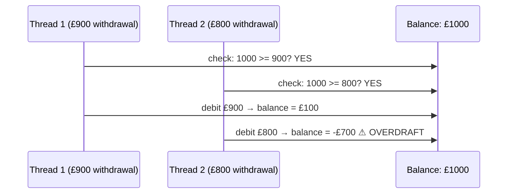
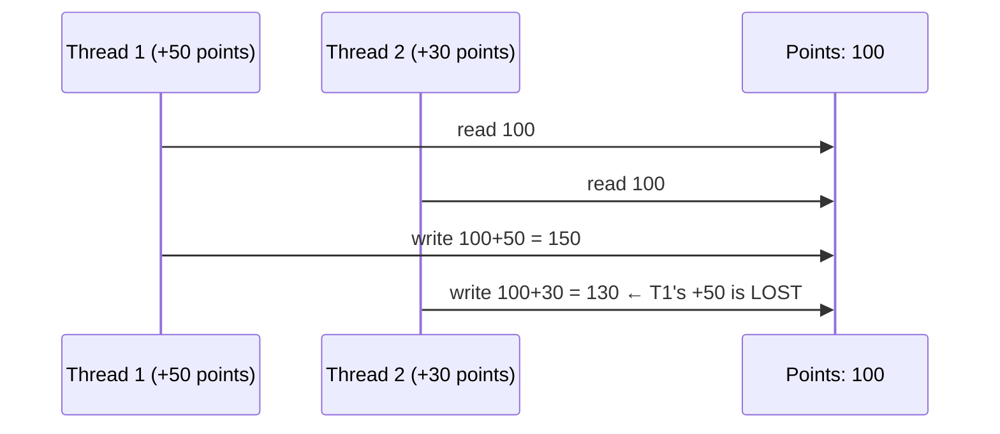
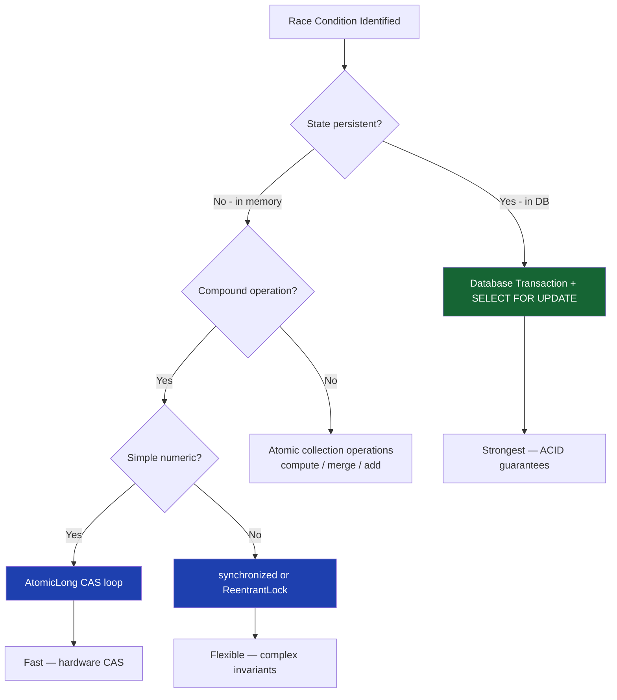

## Overview

A **race condition** is a defect where the correctness of a program depends on the relative timing or interleaving of operations across threads. Race conditions are among the most dangerous defects in financial software: they are intermittent, often not reproduced in testing, and can produce incorrect monetary outcomes with no exception thrown.

The two canonical race condition patterns — **check-then-act** and **read-modify-write** — appear throughout payment processing, balance management, and fraud detection. This lesson dissects both patterns in financial contexts, shows how they produce real overdrafts and duplicate charges, and covers every mitigation strategy available.

## Learning Objectives

By the end of this lesson you will be able to:

- Distinguish a **race condition** (high-level logic timing issue) from a **data race** (JMM visibility violation)
- Identify check-then-act and read-modify-write race conditions in payment code
- Explain how TOCTOU (Time-Of-Check-To-Time-Of-Use) produces financial data corruption
- Apply the correct fix for each race condition pattern
- Use database-level locking and application-level idempotency to prevent duplicate financial operations
- Detect potential race conditions in code review

## Race Condition vs Data Race

These two terms are often confused — they are distinct defects:

| | Race Condition | Data Race |
|---|---|---|
| **Definition** | Program correctness depends on thread timing | Unsynchronised read and write to same variable |
| **JMM violation?** | Not necessarily | Yes — always a JMM violation |
| **Fix** | Atomic compound operations, locks, DB transactions | `volatile`, `synchronized`, `AtomicXxx` |
| **Visible in code review?** | Requires understanding of invariants | Identifiable by field access patterns |
| **Example** | Balance check then debit across two separate ops | Reading `balance` from main memory without happens-before |

```java17
// DATA RACE — unsynchronised access to shared field
// (Addressed in Lesson 1 — JMM Fundamentals)
private long balance = 1000; // Thread 1 writes, Thread 2 reads — no sync

// RACE CONDITION — correct synchronisation on individual ops, but
// compound logic is not atomic
private final AtomicLong balance = new AtomicLong(1000);

public void processWithdrawal(long amount) {
    if (balance.get() >= amount) {    // Check (Thread A)
        // Thread B withdraws the entire balance here
        balance.addAndGet(-amount);   // Act (Thread A — balance may now be negative!)
    }
}
```

The second example has no data race — `AtomicLong` is properly synchronised. But the **compound** check-then-act sequence is not atomic, producing a race condition.

## Pattern 1: Check-Then-Act

**Check-then-act** is the most common race condition in financial systems. The pattern:

1. Check a condition (is the balance sufficient?)
2. Act based on the result (debit the balance)

If another thread modifies the state between step 1 and step 2, the check result is stale.

### The Overdraft Race Condition



```java17
// RACE CONDITION: check and debit are not atomic
public class RacingAccount {

    private final AtomicLong balancePence = new AtomicLong(100_000); // £1000

    // BROKEN: check-then-act with a gap
    public void withdraw(long amountPence) {
        if (balancePence.get() >= amountPence) {              // Check
            // Any number of threads may pass this check simultaneously
            balancePence.addAndGet(-amountPence);              // Act — may go negative!
        } else {
            throw new InsufficientFundsException();
        }
    }
}
```

```java17
// FIX 1: CAS loop — atomic conditional debit
public class AtomicAccount {

    private final AtomicLong balancePence = new AtomicLong(100_000);

    public boolean withdraw(long amountPence) {
        while (true) {
            long current = balancePence.get();
            if (current < amountPence) return false; // Insufficient funds — no race
            // CAS: only subtract if balance hasn't changed
            if (balancePence.compareAndSet(current, current - amountPence)) {
                return true;
            }
            // Another thread changed balance — re-check and retry
        }
    }
}
```

```java17
// FIX 2: synchronized — simpler for complex multi-field updates
public class SynchronizedAccount {

    private final Object lock = new Object();
    private long balancePence = 100_000;

    public boolean withdraw(long amountPence) {
        synchronized (lock) {
            if (balancePence < amountPence) return false;
            balancePence -= amountPence; // Atomic within the synchronized block
            return true;
        }
    }
}
```

```java17
// FIX 3: Database with SELECT FOR UPDATE — preferred for persistent accounts
// @Transactional + pessimistic lock prevents the race at the database level
@Transactional
public boolean withdraw(String accountId, long amountPence) {
    AccountBalance account = accountRepository
        .findByIdForUpdate(accountId); // SELECT ... FOR UPDATE — row lock
    if (account.getBalancePence() < amountPence) return false;
    account.setBalancePence(account.getBalancePence() - amountPence);
    accountRepository.save(account);
    return true;
}
```

## Pattern 2: Read-Modify-Write

**Read-modify-write** occurs when multiple threads read the same value, modify it independently, and write back — with the last writer overwriting the earlier writers' changes.

### The Reward Points Lost Update



```java17
// RACE CONDITION: lost update in rewards service
public class RacingRewardsService {

    private final Map<String, Long> points = new ConcurrentHashMap<>();

    // BROKEN: read-then-write not atomic
    public void addPoints(String customerId, long amount) {
        Long current = points.getOrDefault(customerId, 0L);
        points.put(customerId, current + amount); // Lost update!
    }
}

// FIX: merge() — atomic read-modify-write
public class CorrectRewardsService {

    private final ConcurrentHashMap<String, Long> points = new ConcurrentHashMap<>();

    public void addPoints(String customerId, long amount) {
        points.merge(customerId, amount, Long::sum); // Atomic — no lost updates
    }

    public long getPoints(String customerId) {
        return points.getOrDefault(customerId, 0L);
    }
}
```

## TOCTOU — Time-Of-Check-To-Time-Of-Use

**TOCTOU** is the full name for check-then-act race conditions: the state changes between the time it is checked and the time it is used. In financial systems, TOCTOU vulnerabilities are actively exploited.

### Payment Duplicate Prevention

```java17
// TOCTOU: idempotency check is not atomic with the payment processing
public class RacingPaymentService {

    private final Set<String> processedIds = ConcurrentHashMap.newKeySet();

    // BROKEN: check and insert are separate operations
    public PaymentResult process(String idempotencyKey, Payment payment) {
        if (processedIds.contains(idempotencyKey)) {   // Check
            return PaymentResult.duplicate();
        }
        // Another thread processes the same key between check and add!
        PaymentResult result = executePayment(payment);
        processedIds.add(idempotencyKey);               // Use — race window here
        return result;
    }
}
```

```java17
// FIX: computeIfAbsent — atomic check-and-insert
public class IdempotentPaymentService {

    private final ConcurrentHashMap<String, PaymentResult> processed
        = new ConcurrentHashMap<>();

    public PaymentResult process(String idempotencyKey, Payment payment) {
        // computeIfAbsent is atomic: only one thread executes the function
        // If key already exists, the existing result is returned immediately
        return processed.computeIfAbsent(idempotencyKey, k -> executePayment(payment));
    }

    private PaymentResult executePayment(Payment payment) { /* ... */ return null; }
}
```

```java21
// FIX (Java 21 / Spring): Database-level unique constraint + @Transactional
// The correct solution for distributed systems — in-memory maps don't survive restarts
@Service
@Transactional
public class IdempotentPaymentService {

    private final PaymentRepository repository;
    private final IdempotencyKeyRepository idempotencyRepository;

    public PaymentResult process(String idempotencyKey, Payment payment) {
        // Check for existing result (uses database index — fast)
        return idempotencyRepository.findByKey(idempotencyKey)
            .map(IdempotencyRecord::getResult) // Return cached result
            .orElseGet(() -> {
                // Unique constraint on idempotency_key column prevents duplicates
                // If two transactions try to insert same key, one gets a constraint violation
                PaymentResult result = executePayment(payment);
                idempotencyRepository.save(new IdempotencyRecord(idempotencyKey, result));
                return result;
            });
    }
}
```

### Account Freeze Race Condition

```java17
// TOCTOU: check account status, then process payment — account may be frozen between checks
public class RacingPaymentProcessor {

    public void process(String accountId, Payment payment) {
        AccountStatus status = accountService.getStatus(accountId); // Check
        if (status == AccountStatus.FROZEN) throw new AccountFrozenException();
        // Account may be frozen between this check and the debit below!
        accountService.debit(accountId, payment.getAmount());         // Use
    }
}

// FIX: single atomic database operation — check and debit in one transaction
@Service
@Transactional
public class TransactionalPaymentProcessor {

    public void process(String accountId, Payment payment) {
        // Single SELECT FOR UPDATE: reads status and balance with row lock held
        // No other transaction can freeze or debit this account until ours commits
        Account account = accountRepository.findByIdForUpdate(accountId);
        if (account.getStatus() == AccountStatus.FROZEN) {
            throw new AccountFrozenException(accountId);
        }
        if (account.getBalancePence() < payment.getAmountPence()) {
            throw new InsufficientFundsException();
        }
        account.debit(payment.getAmountPence());
        accountRepository.save(account);
    }
}
```

## Detecting Race Conditions

### Code Review Checklist

Look for these patterns in every code review:

```java17
// RED FLAG 1: get-then-put on a shared map
Long value = map.get(key);           // ← Gap here
map.put(key, value == null ? 1 : value + 1); // ← Lost update possible
// FIX: map.merge(key, 1L, Long::sum);

// RED FLAG 2: contains-then-add
if (!set.contains(id)) {   // ← Gap here
    set.add(id);            // ← Duplicate add possible
    process(id);
}
// FIX: if (set.add(id)) { process(id); } — add() returns false if already present

// RED FLAG 3: size-based capacity check
if (queue.size() < MAX) {  // ← Gap here
    queue.add(item);        // ← May exceed MAX
}
// FIX: Use ArrayBlockingQueue.offer() — bounded and atomic

// RED FLAG 4: read-then-write to shared field without synchronisation
long balance = account.getBalance();  // ← Gap here
account.setBalance(balance - amount); // ← Lost update possible
// FIX: synchronized block or CAS or database transaction
```

### ThreadSanitizer / jcstress

```java17
// jcstress — write a stress test that reveals the race condition
// Run with: java -jar jcstress.jar -t CheckThenActTest

@JCStressTest
@Outcome(id = "0",   expect = Expect.FORBIDDEN, desc = "Overdraft — race condition!")
@Outcome(id = "100", expect = Expect.ACCEPTABLE, desc = "Thread 1 won")
@Outcome(id = "200", expect = Expect.ACCEPTABLE, desc = "Thread 2 won")
@State
public class CheckThenActTest {

    private final AtomicLong balance = new AtomicLong(1000);

    @Actor
    public void thread1(I_Result r) {
        if (balance.get() >= 900) {
            balance.addAndGet(-900);
        }
    }

    @Actor
    public void thread2(I_Result r) {
        if (balance.get() >= 800) {
            balance.addAndGet(-800);
            r.r1 = (int) balance.get();
        }
    }
}
// jcstress reveals the -700 outcome — the race condition
```

## Financial Race Condition Mitigation Hierarchy



| Scenario | Mitigation |
|---|---|
| Balance debit (in-memory) | CAS loop on `AtomicLong` |
| Balance debit (database) | `SELECT ... FOR UPDATE` in `@Transactional` |
| Duplicate payment prevention (JVM) | `ConcurrentHashMap.computeIfAbsent` |
| Duplicate payment prevention (distributed) | DB unique constraint on idempotency key |
| Reward point accumulation | `ConcurrentHashMap.merge` |
| Idempotency check + process | Atomic DB insert with unique constraint |
| Account freeze + debit | Single DB transaction with row lock |
| Rate snapshot update | `AtomicReference.set` on immutable snapshot |

---

<!-- KNOWLEDGE-CHECK [
  {
    "id": "kc-rc-01",
    "question": "Thread 1 reads account balance as £1,000 and checks that £900 is available. Before Thread 1 debits £900, Thread 2 debits £800. Thread 1 then debits its £900. The balance is now -£700. Is this a data race or a race condition?",
    "options": [
      "Data race — the balance field is accessed without synchronization",
      "Race condition — each individual operation is synchronized but the compound check-debit is not atomic",
      "Both — it is simultaneously a data race and a race condition",
      "Neither — this is correct behaviour; overdrafts are permitted"
    ],
    "correct": 1,
    "explanation": "If AtomicLong is used for the balance, each individual get() and addAndGet() is properly synchronized — no data race. However, the compound check-then-act sequence (get balance; decide to debit; debit) is not atomic. Another thread can modify the balance in the gap between the check and the debit. This is a race condition. The fix is a CAS loop that re-checks the balance atomically before every debit."
  },
  {
    "id": "kc-rc-02",
    "question": "What does `ConcurrentHashMap.merge(key, 1L, Long::sum)` guarantee that `map.put(key, map.getOrDefault(key, 0L) + 1)` does not?",
    "options": [
      "merge() is faster than get-then-put",
      "merge() atomically reads, computes, and writes as a single operation — no lost updates",
      "merge() uses a database transaction internally",
      "merge() guarantees the value is always 1"
    ],
    "correct": 1,
    "explanation": "get-then-put is a compound operation: read the current value, compute the new value, write back. Between the read and the write, another thread may have written a new value — which is then overwritten (lost update). merge() internally holds a lock on the map bucket for the entire read-compute-write cycle, making it atomic. No thread can observe an intermediate state or cause a lost update."
  },
  {
    "id": "kc-rc-03",
    "question": "A payment service checks for a duplicate by calling `processedIds.contains(id)` then `processedIds.add(id)` on a `ConcurrentHashMap.newKeySet()`. Two threads submit the same payment ID simultaneously. What may happen?",
    "options": [
      "One thread gets a ConcurrentModificationException",
      "Both threads pass the contains() check, both call add(), and both process the payment — a duplicate charge occurs",
      "The second thread's add() fails silently because the key is already present",
      "ConcurrentHashMap.newKeySet() prevents duplicate adds automatically"
    ],
    "correct": 1,
    "explanation": "Both threads call contains() before either calls add(). Both see the key is absent. Both proceed to add() and process the payment — a duplicate charge. The fix: use set.add(id) as the guard — it returns false if the key was already present, and add() itself is atomic. Only the thread whose add() returns true should process the payment."
  },
  {
    "id": "kc-rc-04",
    "question": "A `@Transactional` method reads an account with `findById()`, checks the balance, then calls `save()`. Two threads process the same account simultaneously. What is the problem and what is the fix?",
    "options": [
      "No problem — @Transactional prevents concurrent access",
      "Lost update — both transactions read the same balance and write conflicting updates; fix with SELECT FOR UPDATE or @Version optimistic locking",
      "Deadlock — fix by reducing transaction isolation to READ_UNCOMMITTED",
      "No problem — JPA @Transactional uses SERIALIZABLE isolation by default"
    ],
    "correct": 1,
    "explanation": "Default Spring @Transactional uses READ_COMMITTED isolation. Two transactions can both read the account balance, both validate it as sufficient, and both proceed with a debit — the later save() overwrites the first. The fix: SELECT FOR UPDATE (findByIdForUpdate()) acquires a row lock preventing concurrent reads of the same row for update, or use @Version for optimistic locking which causes one transaction to fail with OptimisticLockException on conflict."
  }
] -->

---

<!-- PRACTICAL-CHALLENGE {
  "id": "pc-race-conditions",
  "title": "Race Condition Audit: Payment Processing Service",
  "description": "Review and fix a payment service implementation with multiple race conditions.",
  "tasks": [
    {
      "id": "pc-rc-01",
      "description": "Review the following `RacingBalanceService` and identify all race conditions: (1) `checkAndDebit(accountId, amount)` reads balance from a ConcurrentHashMap, checks sufficiency, then subtracts — not atomically. (2) `addBonus(accountId, amount)` reads points, adds the bonus, and puts back. (3) `closeAccount(accountId)` checks balance == 0 then removes from map. Fix all three using the correct atomic operation for each."
    },
    {
      "id": "pc-rc-02",
      "description": "Implement a database-backed idempotent payment processor. The `processPayment(idempotencyKey, payment)` method must: (1) check for existing result, (2) execute payment, (3) store result — all within a @Transactional boundary with a unique constraint on idempotency_key. Handle the ConstraintViolationException that occurs when two threads race to insert the same key."
    },
    {
      "id": "pc-rc-03",
      "description": "Write a jcstress test that reliably demonstrates the overdraft race condition in `RacingAccount.withdraw()` (check-then-act with AtomicLong). The test should have two actors each attempting to withdraw 70% of the balance simultaneously and an arbiter that checks for negative balance outcomes."
    },
    {
      "id": "pc-rc-04",
      "description": "A `FraudDetectionService` has a `suspiciousAccounts: Set<String>` and a `processSuspiciousIfNew(accountId)` method that checks `contains()` then calls `add()` and schedules a review. Identify the TOCTOU window and implement the atomic fix using `Set.add()` return value as the guard."
    }
  ]
} -->
