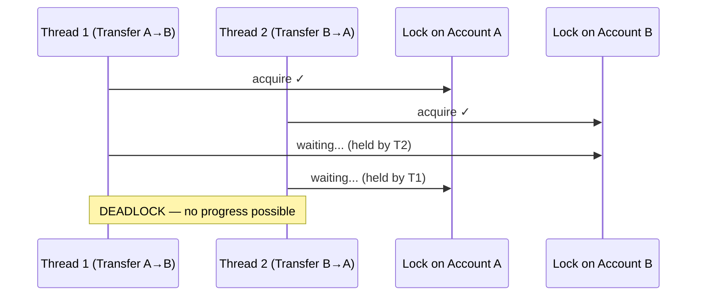
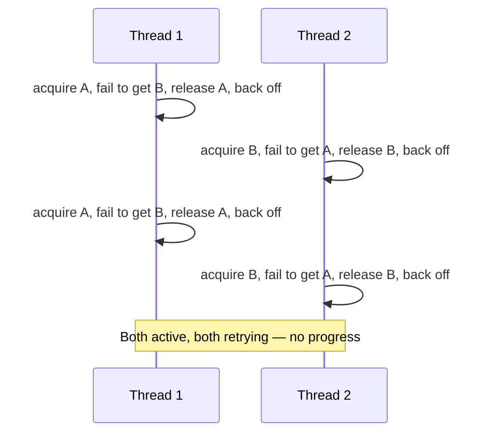
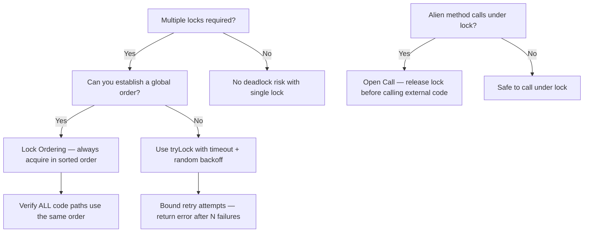

# الجمود (Deadlock) والجمود الحي (Livelock) والتجويع

## نظرة عامة

**الجمود** هو العطل النهائي في التزامن: مجموعة خيوط يملك كل منها موردًا وينتظر موردًا يملكه غيره — دورة بلا مخرج. ونظام معالجة المدفوعات المتجمد لا يتعطل، ولا يرمي استثناءات، ولا يُنتج أخطاء. إنه يتوقف ببساطة. فتتراكم المدفوعات في الطوابير. وتنتهي المهل. وتنطلق التنبيهات. وفي مكان ما، ينتظر خيطان بعضهما إلى الأبد.

والجمود، والجمود الحي، والتجويع هي أعطال الحيوية الثلاثة في الأنظمة المتزامنة. ويغطي هذا الدرس كيف ينشأ كل منها في الأنظمة المصرفية، وكيف تكتشفها في الإنتاج عبر تفريغ الخيوط، والانضباطات الهندسية التي تمنعها.

## أهداف التعلم

في نهاية هذا الدرس ستستطيع:

- ذكر الشروط الأربعة اللازمة للجمود (شروط Coffman)
- تحديد أنماط الشيفرة المعرضة للجمود في الخدمات المالية بلغة Java
- تطبيق ترتيب الأقفال، ومهل `tryLock`، والاستدعاءات المفتوحة لمنع الجمود
- تحليل تفريغ الخيوط لتحديد الخيوط المتجمدة
- التمييز بين الجمود الحي والجمود والتجويع
- تطبيق الأقفال المنصفة وسياسات أولوية الخيوط لمنع التجويع
- تشخيص الجمود في الإنتاج باستخدام `jstack` وasync-profiler

## شروط Coffman الأربعة

يتطلب الجمود تحقق الشروط الأربعة معًا. وإزالة أي منها تمنع الجمود:

| الشرط | الوصف | استراتيجية الإزالة |
|---|---|---|
| **الاستبعاد المتبادل** | المورد يملكه خيط واحد حصريًا | استخدم بنى خالية من الأقفال أو أقفال قراءة |
| **الاحتفاظ والانتظار** | يملك الخيط قفلًا ويطلب آخر | خذ كل الأقفال دفعة واحدة، أو استخدم tryLock |
| **عدم الانتزاع** | لا يمكن انتزاع الأقفال بالقوة | استخدم `tryLock` بمهلة — تخلَّ وأعد المحاولة |
| **الانتظار الدائري** | دورة من خيوط ينتظر كل منها التالي | ترتيب عام للأقفال |

وأكثر استراتيجيات الإزالة عملية في الأنظمة المالية هي **كسر الانتظار الدائري عبر ترتيب عام للأقفال**.

## الجمود المصرفي الكلاسيكي



```java17
// DEADLOCK: inconsistent lock ordering
// Thread 1: transfer(accountA, accountB, amount) → locks A then waits for B
// Thread 2: transfer(accountB, accountA, amount) → locks B then waits for A
public class DeadlockingTransferService {

    public void transfer(BankAccount from, BankAccount to, Money amount) {
        synchronized (from) {       // Thread 1: holds A
            synchronized (to) {     // Thread 1: waits for B; Thread 2: waits for A
                from.debit(amount);
                to.credit(amount);
            }
        }
    }
}
```

تُستخدم هذه الشيفرة في أنظمة مالية إنتاجية أكثر مما تتوقع. وهي تتجمد كلما نُفّذ تحويلان يخصان زوج الحسابات نفسه في اتجاهين متعاكسين في الوقت نفسه.

## استراتيجية المنع 1: ترتيب الأقفال

عيّن **ترتيبًا عامًا** لكل الأقفال وخذها دائمًا بذلك الترتيب. فإذا كان على الخيطين 1 و2 أخذ القفلين A وB، فأجبر الاثنين على أخذ A قبل B دائمًا.

```java17
// SAFE: always acquire locks in account ID order
public class SafeTransferService {

    public void transfer(BankAccount from, BankAccount to, Money amount) {
        // Determine acquisition order by stable global key (account ID string)
        int comparison = from.getId().compareTo(to.getId());

        if (comparison == 0) {
            throw new IllegalArgumentException("Cannot transfer to same account");
        }

        BankAccount first  = comparison < 0 ? from : to;
        BankAccount second = comparison < 0 ? to   : from;

        synchronized (first) {
            synchronized (second) {
                from.debit(amount);
                to.credit(amount);
            }
        }
    }
}
```

```java21
// Java 21 — same lock-ordering discipline; ReentrantLock avoids virtual-thread
// pinning on Java 21–23 (JDK 24+ no longer pins in synchronized)
public class SafeTransferService {

    public void transfer(BankAccount from, BankAccount to, Money amount)
            throws InterruptedException {

        int cmp = from.getId().compareTo(to.getId());
        if (cmp == 0) throw new IllegalArgumentException("Cannot transfer to same account");

        BankAccount first  = cmp < 0 ? from : to;
        BankAccount second = cmp < 0 ? to   : from;

        first.getLock().lock();
        try {
            second.getLock().lock();
            try {
                from.debit(amount);
                to.credit(amount);
            } finally {
                second.getLock().unlock();
            }
        } finally {
            first.getLock().unlock();
        }
    }
}
```

> [!IMPORTANT]
> **لا ينجح ترتيب الأقفال إلا إذا أخذ كل مسار في الشيفرة مجموعة الأقفال نفسها بالترتيب نفسه.** فكتلة `synchronized(to) { synchronized(from) { ... } }` واحدة في أي مكان من قاعدة الشيفرة تكسر الضمان. افرض ترتيب الأقفال في مراجعة الشيفرة ووثّق قاعدة الترتيب صراحة في الشيفرة.

## استراتيجية المنع 2: tryLock بمهلة

إذا لم يمكن أخذ الأقفال دائمًا بترتيب ثابت، فاستخدم `tryLock(timeout)`. فإذا لم يمكن أخذ القفل الثاني خلال المهلة، حرر القفل الأول وأعد المحاولة.

```java17
import java.util.concurrent.locks.ReentrantLock;

public class TryLockTransferService {

    private static final long LOCK_TIMEOUT_MS = 100;
    private static final long BACKOFF_MAX_MS  = 10;

    public boolean transfer(ReentrantLockAccount from, ReentrantLockAccount to,
                             Money amount) throws InterruptedException {

        // Retry loop — will not spin forever because tryLock has a timeout
        for (int attempt = 0; attempt < 10; attempt++) {
            if (from.getLock().tryLock(LOCK_TIMEOUT_MS, TimeUnit.MILLISECONDS)) {
                try {
                    if (to.getLock().tryLock(LOCK_TIMEOUT_MS, TimeUnit.MILLISECONDS)) {
                        try {
                            from.debit(amount);
                            to.credit(amount);
                            return true;
                        } finally {
                            to.getLock().unlock();
                        }
                    }
                    // Could not acquire second lock — release first and back off
                } finally {
                    from.getLock().unlock();
                }
            }
            // Random backoff — reduces livelock risk (see Livelock section)
            Thread.sleep(ThreadLocalRandom.current().nextLong(1, BACKOFF_MAX_MS));
        }
        return false; // Transfer failed after 10 attempts
    }
}
```

## استراتيجية المنع 3: الاستدعاءات المفتوحة

**الاستدعاء المفتوح** استدعاء طريقة يتم دون امتلاك أي قفل. وكثير من حالات الجمود تنشأ من استدعاء خدمات خارجية، أو دوال رد، أو إشعارات مستمعين أثناء امتلاك قفل — فإذا أخذت الشيفرة المستدعاة قفلًا آخر، قد تتكون دورة.

```java17
// DEADLOCK RISK: calling a listener while holding the account lock
public class RiskyAccountService {

    private final Object lock = new Object();
    private final List<AccountListener> listeners = new ArrayList<>();

    public void debit(Money amount) {
        synchronized (lock) {
            balance = balance.subtract(amount);
            // RISK: listener may acquire another lock (audit service, notification service)
            // If that other service also tries to acquire THIS lock, deadlock!
            listeners.forEach(l -> l.onDebit(amount)); // Alien method call under lock
        }
    }
}

// FIX: open call — notify listeners outside the lock
public class SafeAccountService {

    private final Object lock = new Object();
    // Iterated WITHOUT the lock now, so the list itself must be thread-safe
    private final List<AccountListener> listeners = new CopyOnWriteArrayList<>();

    public void debit(Money amount) {
        Money snapshot;
        synchronized (lock) {
            balance = balance.subtract(amount);
            snapshot = balance; // Capture snapshot under lock
        }
        // Open call — no lock held — listener can acquire any lock safely
        listeners.forEach(l -> l.onDebit(amount, snapshot));
    }
}
```

في الإصلاح يُلتقط الرصيد تحت القفل، ثم يُشعر المستمعون بعد تحريره. ولأن قائمة المستمعين تُكرر الآن دون القفل، يجب أن تكون القائمة نفسها آمنة للخيوط (`CopyOnWriteArrayList`).

## اكتشاف الجمود: تفريغ الخيوط

تفريغ الخيوط (thread dump) الأداة الأساسية لتشخيص الجمود في JVM إنتاجية. فالـ JVM المتجمدة لا تتعطل — بل يجب التحقيق فيها وهي تعمل.

### إنشاء تفريغ خيوط

```bash
# Method 1: jstack (JDK tool)
jstack <pid> > thread-dump.txt

# Method 2: kill signal on Unix
kill -3 <pid>

# Method 3: JConsole / VisualVM (GUI)
# Connect to JVM via JMX

# Method 4: HTTP endpoint (Spring Boot Actuator)
curl http://localhost:8080/actuator/threaddump

# Method 5 (Java 21+): jcmd — the only one that also lists VIRTUAL threads
jcmd <pid> Thread.dump_to_file -format=json threads.json
```

في Java 21 فما بعد، `jcmd ... Thread.dump_to_file` هو الوحيد الذي يسرد **الخيوط الافتراضية** أيضًا.

### قراءة جمود في تفريغ الخيوط

```
Found 1 deadlock:
=============================

"payment-processor-1":
  waiting to lock <0x000000076b3e1f68> (a BankAccount) [AccountB]
  which is held by "payment-processor-2"

"payment-processor-2":
  waiting to lock <0x000000076b3e1a40> (a BankAccount) [AccountA]
  which is held by "payment-processor-1"

"payment-processor-1" #42 prio=5 os_prio=0 tid=0x... nid=0x... waiting for monitor entry
   java.lang.Thread.State: BLOCKED (on object monitor)
        at com.bank.payment.TransferService.transfer(TransferService.java:28)
        - waiting to lock <0x000000076b3e1f68> (a com.bank.account.BankAccount)
        at com.bank.payment.TransferService.transfer(TransferService.java:25)
        - locked <0x000000076b3e1a40> (a com.bank.account.BankAccount)
```

يخبرك التفريغ:
- **أي الخيوط متجمدة** (`payment-processor-1`، و`payment-processor-2`)
- **أي الأقفال تملكها وأيها تنتظر** (AccountA، وAccountB)
- **السطر الدقيق في الشيفرة** الذي في حالة الحجب (`TransferService.java:28`)

```java17
// Armed with the thread dump, the fix is clear:
// TransferService.java:25 locks AccountA; :28 waits for AccountB
// The fix: compare account IDs and always lock the lower ID first
```

## الجمود الحي (Livelock)

يحدث **الجمود الحي** عندما تستمر الخيوط في تغيير حالتها استجابة لبعضها دون أن تتقدم أبدًا — عكس الجمود (الخيوط نشطة لا محجوبة) لكنه بالقدر نفسه من عدم الإنتاجية.

### الجمود الحي في التحويل



```java17
// LIVELOCK RISK: two threads with identical, deterministic backoff
// Both will back off for the same duration and retry at the same time — forever
public void livelockingTransfer(Account from, Account to, long amount) throws InterruptedException {
    while (true) {
        if (from.getLock().tryLock(50, TimeUnit.MILLISECONDS)) {
            try {
                if (to.getLock().tryLock(50, TimeUnit.MILLISECONDS)) {
                    try {
                        from.debit(amount); to.credit(amount); return;
                    } finally { to.getLock().unlock(); }
                }
            } finally { from.getLock().unlock(); }
        }
        Thread.sleep(100); // Fixed 100ms backoff — both threads sleep 100ms and retry together!
    }
}

// FIX: randomised backoff breaks the synchronisation between threads
Thread.sleep(ThreadLocalRandom.current().nextLong(10, 200)); // 10–200ms random
```

### لماذا ينجح التراجع العشوائي

يضمن التراجع العشوائي أن يستيقظ الخيطان المتنافسان في أوقات مختلفة. فيستيقظ أحدهما أولًا، ويأخذ القفلين، ويكمل التحويل، ويحررهما. ثم يأخذ الآخر القفلين في محاولته التالية.

## التجويع

يحدث **التجويع** عندما يُحرم خيط بشكل دائم من مورد يحتاجه للتقدم. وعلى خلاف الجمود (الخيوط تحجب بعضها) والجمود الحي (الخيوط تعيد المحاولة دون تقدم)، فالتجويع اتجاهي — بعض الخيوط تتقدم، وأخرى لا.

### التجويع بالقفل غير المنصف

```java17
// A non-fair ReentrantLock can starve a low-priority thread
// under sustained contention from many high-throughput threads

ReentrantLock unfairLock = new ReentrantLock();         // Default: non-fair
ReentrantLock fairLock   = new ReentrantLock(true);    // Fair: FIFO ordering

// With an unfair lock:
// - 400 short-lived payment threads acquire and release the lock rapidly
// - 1 long-running reconciliation thread never gets a chance to acquire
// - Reconciliation is starved

// With a fair lock:
// - Threads queue in FIFO order
// - Reconciliation thread is guaranteed to acquire the lock in turn
// - Throughput is lower (fair locks have higher overhead) but no starvation

// Rule: use fair locks only when starvation is a known problem
// The JDK documentation warns that fair locks often have much lower
// throughput. Note: untimed tryLock() ignores fairness and can still barge
```

مع قفل غير منصف، قد تأخذ 400 خيط دفع قصيرة العمر القفل وتحرره بسرعة، فلا يحصل خيط المطابقة الطويل على فرصة أبدًا. ومع قفل منصف تصطف الخيوط بترتيب FIFO فيحصل كل خيط على دوره، لكن الإنتاجية أقل — وتحذّر وثائق JDK من أن الأقفال المنصفة كثيرًا ما تكون أبطأ بكثير. ولاحظ أن `tryLock()` غير المؤقتة تتجاهل الإنصاف وقد تتجاوز الطابور.

### انعكاس الأولوية

**انعكاس الأولوية** شكل من التجويع يُحجب فيه خيط عالي الأولوية بانتظار مورد يملكه خيط منخفض الأولوية. فإذا استبق خيط متوسط الأولوية الخيط المنخفض وعمل باستمرار، يجوع الخيط العالي.

```java17
// Priority inversion scenario:
// - Low-priority thread L holds a lock (processing low-value batch payments)
// - High-priority thread H is waiting for the lock (processing urgent wire transfer)
// - Medium-priority thread M preempts L and runs continuously (CPU-bound work)
// - H waits indefinitely because M prevents L from releasing the lock

// Java does not have built-in priority inheritance (unlike real-time OS kernels)
// Java thread priorities are only hints — on Linux, HotSpot ignores them by
// default — so do not build correctness on them
// Mitigation: minimize time holding locks; use virtual threads (all same priority)

// Java 21 virtual thread note:
// All virtual threads run at the same priority (Thread.NORM_PRIORITY = 5)
// Priority inversion via thread priority is eliminated in pure virtual-thread systems
// Priority inversion via lock contention can still occur
```

لا تملك Java وراثة أولوية مدمجة (على خلاف أنوية أنظمة التشغيل اللحظية). وأولويات خيوط Java مجرد تلميحات — وفي Linux يتجاهلها HotSpot افتراضيًا — فلا تبنِ الصحة عليها. وكل الخيوط الافتراضية بالأولوية نفسها.

## ملخص منع الجمود



| الاستراتيجية | شرط Coffman المكسور | متى تُستخدم |
|---|---|---|
| ترتيب الأقفال | الانتظار الدائري | عدة أقفال على كائنات بمعرّفات ثابتة |
| ‏`tryLock` بمهلة | عدم الانتزاع | عندما لا يمكن ضمان الترتيب |
| الاستدعاءات المفتوحة | الاحتفاظ والانتظار | استدعاء خدمات خارجية أو دوال رد |
| قفل عام واحد | الانتظار الدائري (يوجد قفل واحد فقط) | تنافس منخفض وثوابت بسيطة |
| البنى الخالية من الأقفال | الاستبعاد المتبادل | العدّادات، والطوابير، وتبديل المراجع |
| معاملات قاعدة البيانات | تكتشف قاعدة البيانات الجمود وتلغي إحدى المعاملات — ويجب أن يعيدها التطبيق | الحالة الدائمة والعمليات متعددة الخطوات |


<!-- KNOWLEDGE-CHECK [
  {
    "id": "kc-dl-01",
    "question": "يملك الخيط 1 قفل AccountA وينتظر AccountB. ويملك الخيط 2 قفل AccountB وينتظر AccountA. كم شرطًا من شروط Coffman الأربعة متحقق؟",
    "options": [
      "‏1 — الانتظار الدائري فقط",
      "‏2 — الانتظار الدائري والاستبعاد المتبادل",
      "‏3 — الاستبعاد المتبادل، والاحتفاظ والانتظار، والانتظار الدائري",
      "‏4 — الأربعة كلها: الاستبعاد المتبادل، والاحتفاظ والانتظار، وعدم الانتزاع، والانتظار الدائري"
    ],
    "correct": 3,
    "explanation": "الشروط الأربعة متحققة: الاستبعاد المتبادل (كل قفل حساب يملكه خيط واحد)، والاحتفاظ والانتظار (كل خيط يملك قفلًا وينتظر الآخر)، وعدم الانتزاع (لا يمكن انتزاع أقفال synchronized بالقوة)، والانتظار الدائري (ينتظر الخيط 1 قفل الخيط 2، وينتظر الخيط 2 قفل الخيط 1). لذلك فالجمود حتمي دون منع."
  },
  {
    "id": "kc-dl-02",
    "question": "يستخدم خيطا تحويل `tryLock(100ms)` ويتراجعان دائمًا 100ms بالضبط عند الفشل. ويستمران في الفشل في أخذ القفلين معًا. ما اسم هذا وكيف يُصلح؟",
    "options": [
      "الجمود — يُصلح بترتيب الأقفال",
      "التجويع — يُصلح بقفل منصف",
      "الجمود الحي — يُصلح بمدة تراجع عشوائية",
      "انعكاس الأولوية — يُصلح برفع أولويات الخيوط"
    ],
    "correct": 2,
    "explanation": "يستيقظ الخيطان بعد 100ms بالضبط ويعيدان المحاولة في الوقت نفسه — فيستمران في التصادم. وهذا جمود حي: خيوط نشطة لا تتقدم. والحل التراجع العشوائي: ينام كل خيط مدة عشوائية (مثل 10–200ms) فيفقدان التزامن ويأخذ أحدهما القفلين قبل أن يعيد الآخر المحاولة."
  },
  {
    "id": "kc-dl-03",
    "question": "يُظهر تفريغ خيوط `payment-processor-7` في حالة `BLOCKED (on object monitor)` ينتظر قفلًا يملكه `payment-processor-3`، و`payment-processor-3` ينتظر قفلًا يملكه `payment-processor-7`. ما أقل تغيير لازم لمنع ذلك؟",
    "options": [
      "زيادة حجم مجمّع الخيوط",
      "تغيير عزل @Transactional إلى SERIALIZABLE",
      "إنشاء ترتيب ثابت لأخذ الأقفال مبني على مفتاح مستقر (مثل معرّف الحساب)",
      "استبدال synchronized بحقول volatile"
    ],
    "correct": 2,
    "explanation": "يُظهر تفريغ الخيوط جمودًا كلاسيكيًا بين خيطين. وأقل تغيير هو ترتيب الأقفال: قارن معرّفات الحسابات وخذ دائمًا قفل المعرّف الأصغر أولًا. فيأخذ الخيطان الأقفال بالترتيب نفسه دائمًا، فينكسر شرط الانتظار الدائري. ويتطلب ذلك مراجعة كل مسارات الشيفرة التي تأخذ عدة أقفال لضمان اتباعها كلها الترتيب نفسه."
  },
  {
    "id": "kc-dl-04",
    "question": "يُستخدم قفل منصف `ReentrantLock(true)` لمورد مشترك في معالجة المدفوعات. وتحت حمل مستمر من 400 خيط دفع، أصبح خيط المطابقة الليلي يتقدم الآن. لكن الإنتاجية الكلية انخفضت 40%. ما المفاضلة؟",
    "options": [
      "الأقفال المنصفة مناسبة فقط للاستخدام أحادي الخيط — ارجع إلى غير المنصف",
      "تضيف الأقفال المنصفة كلفة اصطفاف FIFO، فتقل الإنتاجية — استخدم الأقفال المنصفة فقط عندما يكون التجويع مشكلة إنتاجية مثبتة",
      "خيط المطابقة يستهلك دورات معالج كثيرة — خفّض أولويته",
      "‏400 خيط عدد كبير جدًا لقفل منصف — قلّل حجم مجمّع الخيوط"
    ],
    "correct": 1,
    "explanation": "يسلّم ReentrantLock المنصف القفل للخيوط المنتظرة بترتيب FIFO، فلا يستطيع خيط حرر القفل ثم طلبه فورًا أن يتجاوز الطابور. وهذا يزيل 'التجاوز' الرخيص الذي يجعل الأقفال غير المنصفة سريعة، وتحذّر وثائق JDK من أن الأقفال المنصفة كثيرًا ما تكون إنتاجيتها أقل بكثير. وفقدان الإنتاجية هو ثمن منع التجويع. استخدم الأقفال غير المنصفة افتراضيًا، وانتقل إلى المنصفة فقط عندما يكون التجويع مشكلة إنتاجية مؤكدة — لا قلقًا نظريًا."
  }
] -->


<!-- PRACTICAL-CHALLENGE {
  "id": "pc-deadlocks",
  "title": "خدمة تحويل خالية من الجمود",
  "description": "شخّص خدمة تحويل معرضة للجمود وأصلحها، ثم نفّذ النسخة الجاهزة للإنتاج.",
  "tasks": [
    {
      "id": "pc-dl-01",
      "description": "خذ `DeadlockingTransferService` المعروضة في هذا الدرس. واكتب اختبارًا يطلق الجمود بشكل موثوق خلال 5 ثوانٍ باستخدام خيطين ينفذان تحويلات متعاكسة الاتجاه في حلقة. وتحقق من الجمود بتأكيد أن الاختبار لا يكتمل أبدًا. ووثّق أي شرط من شروط Coffman ستزيله وكيف."
    },
    {
      "id": "pc-dl-02",
      "description": "أصلح خدمة التحويل باستخدام ترتيب الأقفال على معرّفات الحسابات. ويجب أن يعالج الإصلاح الحالة الحدية التي يكون فيها `from.getId().equals(to.getId())` (الحساب نفسه). واكتب اختبارًا بـ 100 خيط ينفذ تحويلات عشوائية A↔B في الوقت نفسه لمدة 10 ثوانٍ، وتحقق من ثابت الرصيد: مجموع أرصدة كل الحسابات يساوي المجموع الأولي."
    },
    {
      "id": "pc-dl-03",
      "description": "نفّذ `tryLockTransfer()` باستخدام `ReentrantLock.tryLock(100ms)` مع تراجع عشوائي (10–100ms). وحدّ المحاولات بخمس. وأعد `TransferResult` ‏(SUCCESS، أو INSUFFICIENT_FUNDS، أو TIMEOUT_EXCEEDED). واكتب اختبار إجهاد بـ 50 خيطًا وتحقق من أن أي تشغيل للاختبار لا يتعلق أكثر من ثانيتين."
    },
    {
      "id": "pc-dl-04",
      "description": "أعد هيكلة `AccountEventPublisher.publish(event)` لتستخدم نمط الاستدعاء المفتوح. فالأصل يحتجز `synchronized(this)` أثناء إشعار المستمعين. حدّد لماذا هذا معرض للجمود ونفّذ الإصلاح: التقط لقطة من المستمعين تحت القفل، ثم أشعرهم بعد التحرير."
    },
    {
      "id": "pc-dl-05",
      "description": "أنشئ تفريغ خيوط من JVM متجمدة عمدًا (استخدم الاختبار من المهمة 1). وحلّل التفريغ واكتب سكربت تنبيه مراقبة (أو مؤشر صحة في Spring Boot) يكتشف الخيوط المتجمدة عبر `ThreadMXBean.findDeadlockedThreads()` ويطلق تنبيهًا إذا وُجدت."
    }
  ]
} -->
