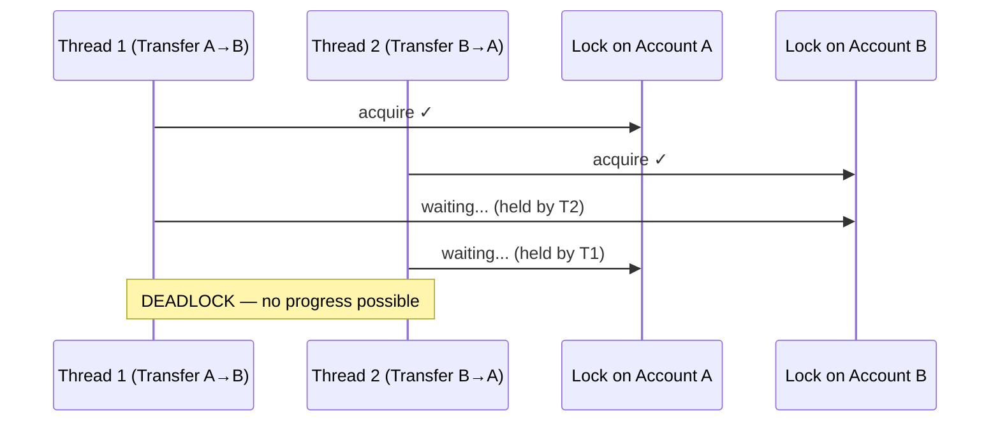
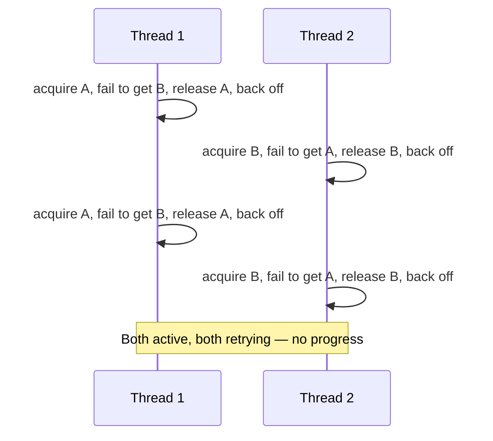
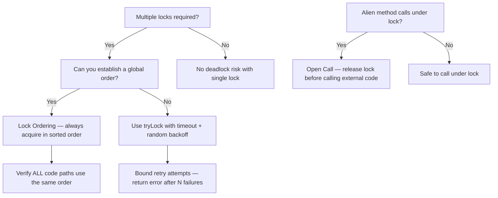

## Overview

A **deadlock** is the terminal concurrency failure: a set of threads each holding a resource and waiting for a resource held by another — a cycle with no exit. A deadlocked payment processing system does not crash, throw exceptions, or produce errors. It simply stops. Payments queue up. Timeouts fire. Alerts trigger. And somewhere, two threads are waiting for each other forever.

Deadlocks, livelocks, and starvation are the three liveness failures of concurrent systems. This lesson covers how each arises in banking systems, how to detect them in production via thread dumps, and the engineering disciplines that prevent them.

## Learning Objectives

By the end of this lesson you will be able to:

- State the four necessary conditions for deadlock (Coffman conditions)
- Identify deadlock-prone code patterns in Java financial services
- Apply lock ordering, tryLock timeouts, and open calls to prevent deadlocks
- Analyse a thread dump to identify deadlocked threads
- Distinguish livelock from deadlock and starvation
- Apply fair locking and thread priority policies to prevent starvation
- Diagnose deadlocks in production using `jstack` and async-profiler

## The Four Coffman Conditions

Deadlock requires all four conditions simultaneously. Eliminating any one prevents deadlock:

| Condition | Description | Elimination Strategy |
|---|---|---|
| **Mutual Exclusion** | Resources held exclusively by one thread | Use lock-free structures or read locks |
| **Hold and Wait** | Thread holds one lock while requesting another | Acquire all locks at once, or use tryLock |
| **No Preemption** | Locks cannot be forcibly taken away | Use timed `tryLock` — abandon and retry |
| **Circular Wait** | A cycle of threads each waiting for the next | Global lock ordering |

The most practical elimination strategy for financial systems is **breaking circular wait via global lock ordering**.

## The Classic Banking Deadlock



```java17
// DEADLOCK: inconsistent lock ordering
// Thread 1: transfer(accountA, accountB, amount) → locks A then waits for B
// Thread 2: transfer(accountB, accountA, amount) → locks B then waits for A
public class DeadlockingTransferService {

    public void transfer(BankAccount from, BankAccount to, Money amount) {
        synchronized (from) {       // Thread 1: holds A
            synchronized (to) {     // Thread 1: waits for B; Thread 2: waits for A
                from.debit(amount);
                to.credit(amount);
            }
        }
    }
}
```

This code is used in production financial systems more often than you would expect. It deadlocks whenever two transfers involving the same pair of accounts execute concurrently in opposite directions.

## Prevention Strategy 1: Lock Ordering

Assign a **global order** to all locks and always acquire them in that order. If Thread 1 and Thread 2 must both acquire locks A and B, force both to always acquire A before B.

```java17
// SAFE: always acquire locks in account ID order
public class SafeTransferService {

    public void transfer(BankAccount from, BankAccount to, Money amount) {
        // Determine acquisition order by stable global key (account ID string)
        int comparison = from.getId().compareTo(to.getId());

        if (comparison == 0) {
            throw new IllegalArgumentException("Cannot transfer to same account");
        }

        BankAccount first  = comparison < 0 ? from : to;
        BankAccount second = comparison < 0 ? to   : from;

        synchronized (first) {
            synchronized (second) {
                from.debit(amount);
                to.credit(amount);
            }
        }
    }
}
```

```java21
// Java 21 — same lock-ordering discipline; use ReentrantLock for virtual-thread safety
public class SafeTransferService {

    public void transfer(BankAccount from, BankAccount to, Money amount)
            throws InterruptedException {

        int cmp = from.getId().compareTo(to.getId());
        if (cmp == 0) throw new IllegalArgumentException("Cannot transfer to same account");

        BankAccount first  = cmp < 0 ? from : to;
        BankAccount second = cmp < 0 ? to   : from;

        first.getLock().lock();
        try {
            second.getLock().lock();
            try {
                from.debit(amount);
                to.credit(amount);
            } finally {
                second.getLock().unlock();
            }
        } finally {
            first.getLock().unlock();
        }
    }
}
```

> [!IMPORTANT]
> **Lock ordering only works when every code path acquires the same set of locks in the same order.** One `synchronized(to) { synchronized(from) { ... } }` somewhere in the codebase breaks the guarantee. Enforce lock ordering in code review and document the ordering rule explicitly in the code.

## Prevention Strategy 2: Timed tryLock

If locks cannot always be acquired in a consistent order, use `tryLock(timeout)`. If the second lock cannot be acquired within the timeout, release the first lock and retry.

```java17
import java.util.concurrent.locks.ReentrantLock;

public class TryLockTransferService {

    private static final long LOCK_TIMEOUT_MS = 100;
    private static final long BACKOFF_MAX_MS  = 10;

    public boolean transfer(ReentrantLockAccount from, ReentrantLockAccount to,
                             Money amount) throws InterruptedException {

        // Retry loop — will not spin forever because tryLock has a timeout
        for (int attempt = 0; attempt < 10; attempt++) {
            if (from.getLock().tryLock(LOCK_TIMEOUT_MS, TimeUnit.MILLISECONDS)) {
                try {
                    if (to.getLock().tryLock(LOCK_TIMEOUT_MS, TimeUnit.MILLISECONDS)) {
                        try {
                            from.debit(amount);
                            to.credit(amount);
                            return true;
                        } finally {
                            to.getLock().unlock();
                        }
                    }
                    // Could not acquire second lock — release first and back off
                } finally {
                    from.getLock().unlock();
                }
            }
            // Random backoff — reduces livelock risk (see Livelock section)
            Thread.sleep(ThreadLocalRandom.current().nextLong(1, BACKOFF_MAX_MS));
        }
        return false; // Transfer failed after 10 attempts
    }
}
```

## Prevention Strategy 3: Open Calls

An **open call** is a method call made without holding any lock. Many deadlocks arise from calling external services, callbacks, or listener notifications while holding a lock — if the called code acquires another lock, a cycle can form.

```java17
// DEADLOCK RISK: calling a listener while holding the account lock
public class RiskyAccountService {

    private final Object lock = new Object();
    private final List<AccountListener> listeners = new ArrayList<>();

    public void debit(Money amount) {
        synchronized (lock) {
            balance = balance.subtract(amount);
            // RISK: listener may acquire another lock (audit service, notification service)
            // If that other service also tries to acquire THIS lock, deadlock!
            listeners.forEach(l -> l.onDebit(amount)); // Alien method call under lock
        }
    }
}

// FIX: open call — notify listeners outside the lock
public class SafeAccountService {

    private final Object lock = new Object();
    private final List<AccountListener> listeners = new ArrayList<>();

    public void debit(Money amount) {
        Money snapshot;
        synchronized (lock) {
            balance = balance.subtract(amount);
            snapshot = balance; // Capture snapshot under lock
        }
        // Open call — no lock held — listener can acquire any lock safely
        listeners.forEach(l -> l.onDebit(amount, snapshot));
    }
}
```

## Deadlock Detection: Thread Dumps

Thread dumps are the primary tool for diagnosing deadlocks in production JVMs. A deadlocked JVM does not crash — it must be investigated while running.

### Generating a Thread Dump

```bash
# Method 1: jstack (JDK tool)
jstack <pid> > thread-dump.txt

# Method 2: kill signal on Unix
kill -3 <pid>

# Method 3: JConsole / VisualVM (GUI)
# Connect to JVM via JMX

# Method 4: HTTP endpoint (Spring Boot Actuator)
curl http://localhost:8080/actuator/threaddump
```

### Reading a Deadlock in a Thread Dump

```
Found 1 deadlock:
=============================

"payment-processor-1":
  waiting to lock <0x000000076b3e1f68> (a BankAccount) [AccountB]
  which is held by "payment-processor-2"

"payment-processor-2":
  waiting to lock <0x000000076b3e1a40> (a BankAccount) [AccountA]
  which is held by "payment-processor-1"

"payment-processor-1" #42 prio=5 os_prio=0 tid=0x... nid=0x... waiting for monitor entry
   java.lang.Thread.State: BLOCKED (on object monitor)
        at com.bank.payment.TransferService.transfer(TransferService.java:28)
        - waiting to lock <0x000000076b3e1f68> (a com.bank.account.BankAccount)
        at com.bank.payment.TransferService.transfer(TransferService.java:25)
        - locked <0x000000076b3e1a40> (a com.bank.account.BankAccount)
```

The dump tells you:
- **Which threads are deadlocked** (`payment-processor-1`, `payment-processor-2`)
- **Which locks they hold and which they're waiting for** (AccountA, AccountB)
- **Exactly which line of code** is in the blocked state (`TransferService.java:28`)

```java17
// Armed with the thread dump, the fix is clear:
// TransferService.java:25 locks AccountA; :28 waits for AccountB
// The fix: compare account IDs and always lock the lower ID first
```

## Livelock

A **livelock** occurs when threads keep changing their state in response to each other but never make progress — the opposite of deadlock (threads are active, not blocked) but equally non-productive.

### Transfer Livelock



```java17
// LIVELOCK RISK: two threads with identical, deterministic backoff
// Both will back off for the same duration and retry at the same time — forever
public void livelockingTransfer(Account from, Account to, long amount) throws InterruptedException {
    while (true) {
        if (from.getLock().tryLock(50, TimeUnit.MILLISECONDS)) {
            try {
                if (to.getLock().tryLock(50, TimeUnit.MILLISECONDS)) {
                    try {
                        from.debit(amount); to.credit(amount); return;
                    } finally { to.getLock().unlock(); }
                }
            } finally { from.getLock().unlock(); }
        }
        Thread.sleep(100); // Fixed 100ms backoff — both threads sleep 100ms and retry together!
    }
}

// FIX: randomised backoff breaks the synchronisation between threads
Thread.sleep(ThreadLocalRandom.current().nextLong(10, 200)); // 10–200ms random
```

### Why Random Backoff Works

Random backoff ensures the two competing threads wake up at different times. One wakes first, acquires both locks, completes the transfer, and releases. The other then acquires both locks on its next attempt.

## Starvation

**Starvation** occurs when a thread is permanently denied access to a resource it needs to make progress. Unlike deadlock (threads block each other) and livelock (threads keep retrying without progress), starvation is directional — some threads make progress, others do not.

### Unfair Lock Starvation

```java17
// A non-fair ReentrantLock can starve a low-priority thread
// under sustained contention from many high-throughput threads

ReentrantLock unfairLock = new ReentrantLock();         // Default: non-fair
ReentrantLock fairLock   = new ReentrantLock(true);    // Fair: FIFO ordering

// With an unfair lock:
// - 400 short-lived payment threads acquire and release the lock rapidly
// - 1 long-running reconciliation thread never gets a chance to acquire
// - Reconciliation is starved

// With a fair lock:
// - Threads queue in FIFO order
// - Reconciliation thread is guaranteed to acquire the lock in turn
// - Throughput is lower (fair locks have higher overhead) but no starvation

// Rule: use fair locks only when starvation is a known problem
// Fair locks have 2–10x higher overhead than non-fair locks
```

### Thread Priority Inversion

**Priority inversion** is a form of starvation where a high-priority thread is blocked waiting for a resource held by a low-priority thread. If a medium-priority thread pre-empts the low-priority thread and runs continuously, the high-priority thread starves.

```java17
// Priority inversion scenario:
// - Low-priority thread L holds a lock (processing low-value batch payments)
// - High-priority thread H is waiting for the lock (processing urgent wire transfer)
// - Medium-priority thread M preempts L and runs continuously (CPU-bound work)
// - H waits indefinitely because M prevents L from releasing the lock

// Java does not have built-in priority inheritance (unlike real-time OS kernels)
// Mitigation: minimize time holding locks; use virtual threads (all same priority)

// Java 21 virtual thread note:
// All virtual threads run at the same priority (Thread.NORM_PRIORITY = 5)
// Priority inversion via thread priority is eliminated in pure virtual-thread systems
// Priority inversion via lock contention can still occur
```

## Deadlock Prevention Summary



| Strategy | Coffman Condition Broken | When to Use |
|---|---|---|
| Lock ordering | Circular wait | Multiple locks on objects with stable IDs |
| `tryLock` with timeout | No preemption | Cannot guarantee ordering |
| Open calls | Hold and wait | Calling external services / callbacks |
| Single global lock | Mutual exclusion reduced | Low contention, simple invariants |
| Lock-free structures | Mutual exclusion | Counters, queues, reference swaps |
| Database transactions | Managed by DB | Persistent state, multi-step operations |

---

<!-- KNOWLEDGE-CHECK [
  {
    "id": "kc-dl-01",
    "question": "Thread 1 holds the lock on AccountA and waits for AccountB. Thread 2 holds the lock on AccountB and waits for AccountA. How many of the four Coffman conditions are satisfied?",
    "options": [
      "1 — only circular wait",
      "2 — circular wait and mutual exclusion",
      "3 — mutual exclusion, hold-and-wait, circular wait",
      "4 — all four: mutual exclusion, hold-and-wait, no-preemption, circular wait"
    ],
    "correct": 3,
    "explanation": "All four Coffman conditions are met: Mutual exclusion (each account lock is held by one thread), Hold-and-wait (each thread holds one lock and waits for the other), No preemption (synchronized locks cannot be forcibly taken away), Circular wait (Thread 1 waits for Thread 2's lock; Thread 2 waits for Thread 1's lock). Deadlock is therefore inevitable without prevention."
  },
  {
    "id": "kc-dl-02",
    "question": "Two transfer threads use `tryLock(100ms)` and always back off for exactly 100ms on failure. They keep failing to acquire both locks simultaneously. What is this called and how is it fixed?",
    "options": [
      "Deadlock — fixed by using lock ordering",
      "Starvation — fixed by using a fair lock",
      "Livelock — fixed by using randomised backoff duration",
      "Priority inversion — fixed by raising thread priorities"
    ],
    "correct": 2,
    "explanation": "Both threads wake up after exactly 100ms and try again simultaneously — they keep colliding. This is livelock: active threads making no progress. The fix is randomised backoff: each thread sleeps for a random duration (e.g., 10–200ms) so they desynchronise and one acquires both locks before the other retries."
  },
  {
    "id": "kc-dl-03",
    "question": "A thread dump shows `payment-processor-7` in state `BLOCKED (on object monitor)` waiting for a lock held by `payment-processor-3`, and `payment-processor-3` waiting for a lock held by `payment-processor-7`. What is the minimum change needed to prevent this?",
    "options": [
      "Increase thread pool size",
      "Change @Transactional isolation to SERIALIZABLE",
      "Establish a consistent lock acquisition order based on a stable key (e.g., account ID)",
      "Replace synchronized with volatile fields"
    ],
    "correct": 2,
    "explanation": "The thread dump shows a classic two-thread deadlock. The minimum change is lock ordering: compare account IDs and always acquire the lower ID's lock first. Both threads will then always acquire locks in the same order, breaking the circular wait condition. This requires auditing all code paths that acquire multiple locks to ensure they all follow the same order."
  },
  {
    "id": "kc-dl-04",
    "question": "A `ReentrantLock(true)` fair lock is used for a payment processing shared resource. Under sustained load from 400 payment threads, the nightly reconciliation thread is now making progress. However, overall throughput dropped 40%. What is the trade-off?",
    "options": [
      "Fair locks are only suitable for single-threaded use — revert to non-fair",
      "Fair locks add FIFO queueing overhead, reducing throughput — use fair locks only when starvation is a proven production problem",
      "The reconciliation thread is consuming too many CPU cycles — reduce its priority",
      "400 threads is too many for a fair lock — reduce thread pool size"
    ],
    "correct": 1,
    "explanation": "Fair ReentrantLock maintains a FIFO queue of waiting threads, which requires additional synchronization overhead (CAS operations on the queue) compared to non-fair locks where any waiting thread can compete. The throughput reduction (commonly 2–10x) is the cost of preventing starvation. The correct approach: use non-fair locks by default, switch to fair only if starvation is a confirmed production incident — not a theoretical concern."
  }
] -->

---

<!-- PRACTICAL-CHALLENGE {
  "id": "pc-deadlocks",
  "title": "Deadlock-Free Transfer Service",
  "description": "Diagnose and fix a deadlock-prone transfer service, then implement the production-ready version.",
  "tasks": [
    {
      "id": "pc-dl-01",
      "description": "Take the `DeadlockingTransferService` shown in this lesson. Write a test that reliably triggers the deadlock within 5 seconds using two threads running opposite-direction transfers in a loop. Verify the deadlock by confirming the test never completes. Document which Coffman condition you would eliminate and how."
    },
    {
      "id": "pc-dl-02",
      "description": "Fix the transfer service using lock ordering on account IDs. The fix must handle the edge case where `from.getId().equals(to.getId())` (same account). Write a test with 100 threads running random A↔B transfers simultaneously for 10 seconds and verify the balance invariant: sum of all account balances equals the initial total."
    },
    {
      "id": "pc-dl-03",
      "description": "Implement `tryLockTransfer()` using `ReentrantLock.tryLock(100ms)` with random backoff (10–100ms). Bound retries to 5 attempts. Return a `TransferResult` (SUCCESS, INSUFFICIENT_FUNDS, TIMEOUT_EXCEEDED). Write a stress test with 50 threads and verify no test run ever hangs for more than 2 seconds."
    },
    {
      "id": "pc-dl-04",
      "description": "Refactor `AccountEventPublisher.publish(event)` to use an open call pattern. The original holds `synchronized(this)` while notifying listeners. Identify why this is deadlock-prone and implement the fix: capture a snapshot of listeners under the lock, then notify after releasing."
    },
    {
      "id": "pc-dl-05",
      "description": "Generate a thread dump from a deliberately deadlocked JVM (use the test from task 1). Parse the thread dump and write a monitoring alert script (or Spring Boot health indicator) that detects deadlocked threads via `ThreadMXBean.findDeadlockedThreads()` and fires an alert if any are found."
    }
  ]
} -->
