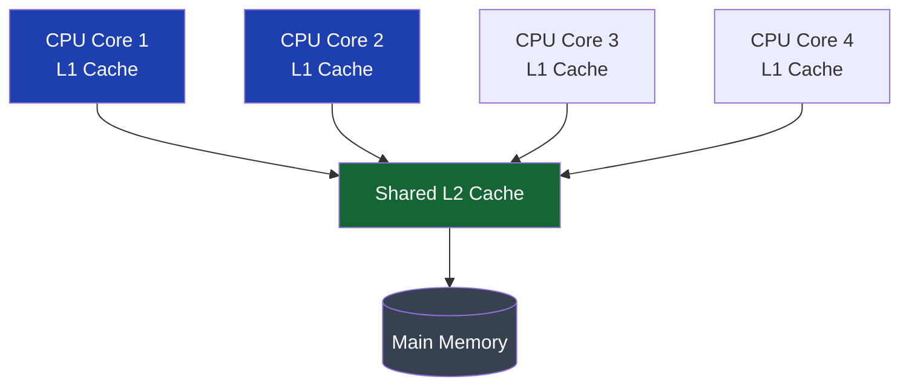
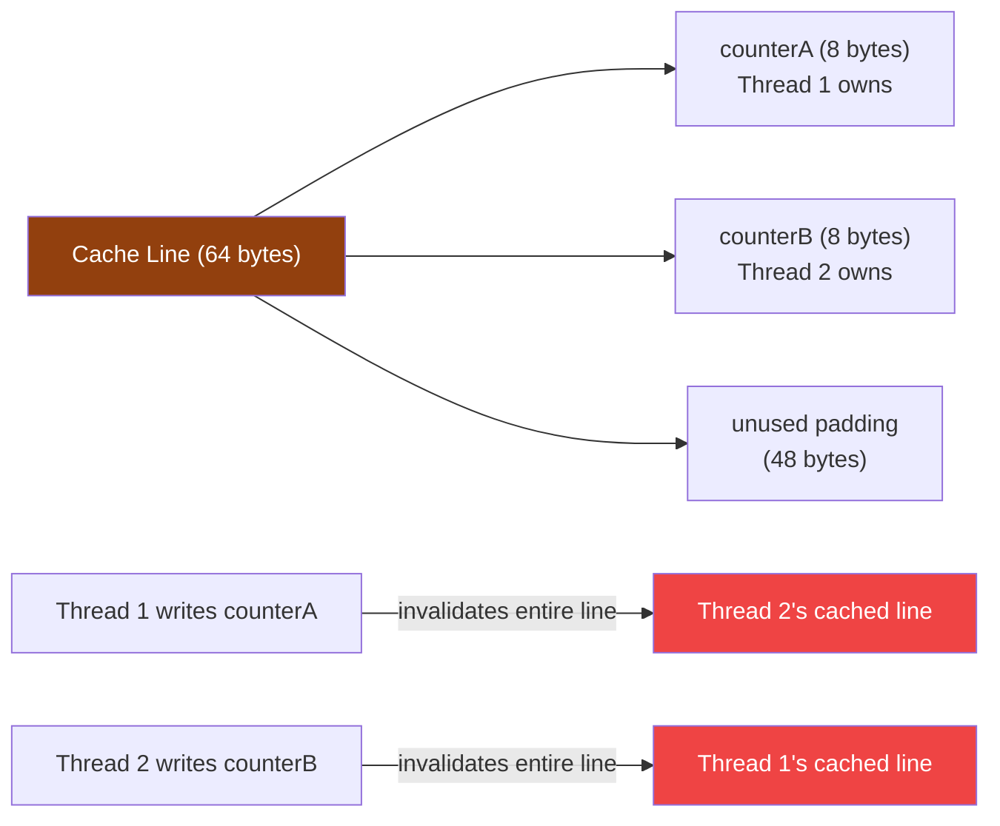

# المشاركة الزائفة (False Sharing) والتنافس على خطوط ذاكرة المعالج

## نظرة عامة

يحكم نموذج ذاكرة Java رؤية الخيوط على مستوى اللغة. لكن هناك كلفة رؤية على مستوى العتاد لا يكشفها JMM: **المشاركة الزائفة**. فخيطان يحدّثان متغيرين منفصلين تمامًا قد يدمّران أداء بعضهما إذا وقع المتغيران في خط ذاكرة المعالج المؤقتة نفسه — دون أي بيانات مشتركة إطلاقًا.

وفي بوابة دفع عالية الإنتاجية بعدّادات لكل خيط، قد تخفض المشاركة الزائفة الإنتاجية بمرتبة عشرية كاملة. والحل هو الحشو (padding) أو التعليق `@Contended` — تغييرات غير مرئية لـ JMM لكنها حاسمة للأداء الفعلي.

## أهداف التعلم

في نهاية هذا الدرس ستستطيع:

- شرح كيف تعمل ذاكرات المعالج المؤقتة وما خط الذاكرة المؤقتة (cache line)
- وصف المشاركة الزائفة ولماذا تحدث دون أي مشاركة منطقية في البيانات
- تحديد المشاركة الزائفة في بنى البيانات المتزامنة
- تطبيق حشو خطوط الذاكرة المؤقتة يدويًا بمصفوفات long
- استخدام `@jdk.internal.vm.annotation.Contended` للحشو على مستوى JVM
- قياس كلفة المشاركة الزائفة بـ JMH
- شرح كيف يتجنب `LongAdder` المشاركة الزائفة داخليًا

## بنية ذاكرة المعالج المؤقتة

لا تقرأ المعالجات الحديثة بايتات منفردة من الذاكرة الرئيسية. بل تحمّل البيانات في كتل ثابتة الحجم تُسمى **خطوط الذاكرة المؤقتة** — عادة 64 بايت في x86 وARM. وعندما يعدّل خيط خط ذاكرة مؤقتة، **يُبطَل** ذلك الخط في ذاكرة كل معالج آخر.



**بروتوكول اتساق الذاكرة المؤقتة (MESI):** عندما تكتب النواة 1 في موقع ذاكرة، تعلّم خطها على أنه **معدَّل** (Modified) وترسل رسالة إبطال إلى كل الأنوية الأخرى. وأي نواة تقرأ ذلك الموقع لاحقًا يجب أن تجلب الخط المحدّث — بكلفة زمنية 60–300 دورة مقابل نحو 4 دورات لإصابة L1.

## ما المشاركة الزائفة؟

تحدث **المشاركة الزائفة** عندما يعدّل خيطان **متغيرين مختلفين** يقعان في **خط الذاكرة المؤقتة نفسه**. فرغم عدم وجود مشاركة منطقية، تُبطل كل كتابة من أحد الخيطين النسخة المخزنة لدى الخيط الآخر من الخط كله (64 بايت).



العدّادان مستقلان تمامًا — لكنهما يتشاركان خط ذاكرة مؤقتة. فكل كتابة من أي خيط تجبر الآخر على إعادة تحميل الخط كله. ويتصرف هذا كقفل يعمل مع كل كتابة رغم عدم وجود أي مزامنة في الشيفرة.

## إظهار المشاركة الزائفة

```java17
// Naive per-thread counter array — severe false sharing
// All 4 counters fit in a single 64-byte cache line (4 × 8 = 32 bytes)
public class FalseSharingCounters {

    private long[] counters = new long[4]; // Indices 0-3

    // Each thread increments its own counter — but all counters share a cache line!
    public void increment(int threadIndex) {
        counters[threadIndex]++;
    }

    public long get(int threadIndex) {
        return counters[threadIndex];
    }
}

// Fixed version: one array, each counter 8 longs (64 bytes) apart
// (index 0, 8, 16, 24) → no two counters share a cache line.
// A single array is laid out contiguously, so the spacing is guaranteed —
// unlike separate objects, whose placement the JVM decides
public class PaddedCounters {

    private static final int STRIDE = 8;                    // 8 × 8 bytes = 64 bytes
    private final long[] counters = new long[4 * STRIDE + STRIDE];

    public void increment(int threadIndex) {
        counters[(threadIndex + 1) * STRIDE]++;              // +1: keep away from the array header
    }

    public long get(int threadIndex) {
        return counters[(threadIndex + 1) * STRIDE];
    }
}
```

في النسخة المصلحة توضع العدّادات في مصفوفة واحدة على بعد 8 عناصر (64 بايت) من بعضها. فالمصفوفة الواحدة مرتبة في الذاكرة بشكل متصل، فتكون المسافة مضمونة — على خلاف الكائنات المنفصلة التي تقرر JVM مكانها.

```java17
// JMH benchmark showing the performance difference
// Each thread must use its OWN index — if all threads incremented index 0,
// they would share the same variable (true sharing), not just the cache line
@BenchmarkMode(Mode.Throughput)
@OutputTimeUnit(TimeUnit.MILLISECONDS)
@State(Scope.Benchmark)
@Threads(4)
public class FalseSharingBenchmark {

    FalseSharingCounters  shared  = new FalseSharingCounters();
    PaddedCounters        padded  = new PaddedCounters();

    @Benchmark
    public void withFalseSharing(ThreadParams tp) {
        shared.increment(tp.getThreadIndex());   // neighbours on one cache line
    }

    @Benchmark
    public void withPadding(ThreadParams tp) {
        padded.increment(tp.getThreadIndex());   // each thread on its own line
    }
}
// Illustrative result (varies widely by CPU):
// withFalseSharing:  ~12,000 ops/ms  (cache line bouncing between cores)
// withPadding:      ~180,000 ops/ms
```

يجب أن يستخدم كل خيط فهرسه **الخاص** — فلو زاد كل الخيوط الفهرس 0، لتشاركوا المتغير نفسه (مشاركة حقيقية)، لا خط الذاكرة فقط. والأرقام توضيحية وتختلف كثيرًا حسب المعالج.

## @Contended — حشو تديره JVM

الحشو اليدوي ينجح لكنه هش — فقد تبطله إصدارات JVM المختلفة أو تخطيطات الكائنات. وقدّمت Java 8 التعليق `@sun.misc.Contended`، الذي نُقل في Java 9 إلى `@jdk.internal.vm.annotation.Contended`، لتدع JVM تُدرج الحشو تلقائيًا.

```java17
// Using @Contended outside the JDK requires:
//   compile:  --add-exports java.base/jdk.internal.vm.annotation=ALL-UNNAMED
//   run:      -XX:-RestrictContended (otherwise the annotation is ignored)
import jdk.internal.vm.annotation.Contended;

public class ContendedCounters {

    @Contended  // JVM inserts 128 bytes of padding around this field
    private volatile long counterA;

    @Contended
    private volatile long counterB;

    @Contended
    private volatile long counterC;

    @Contended
    private volatile long counterD;
}
```

يتطلب استخدام `@Contended` خارج JDK خيار الترجمة `--add-exports java.base/jdk.internal.vm.annotation=ALL-UNNAMED` وخيار التشغيل `-XX:-RestrictContended` (وإلا يُتجاهل التعليق).

> [!NOTE]
> ‏`@Contended` تعليق داخلي في JVM. وفي شيفرة التطبيقات، فضّل `LongAdder` (الذي يستخدم `@Contended` داخليًا) على تعليم الحقول يدويًا. ويكون `@Contended` مفيدًا أكثر عند بناء مكتبات تزامن منخفضة المستوى، أو عندما يكشف التحليل مشاركة زائفة في بنى بياناتك.

## LongAdder — المشاركة الزائفة محلولة بالتصميم

يستخدم `LongAdder` من `java.util.concurrent.atomic` (منذ Java 8) مصفوفة خلايا `Cell` داخلية، كل خلية فيها معلّمة بـ `@Contended`:

```java17
// LongAdder internal implementation sketch (simplified)
// Each Cell is padded to its own cache line via @Contended
@Contended
static final class Cell {
    volatile long value;
    Cell(long x) { value = x; }
    final boolean cas(long cmp, long val) {
        return VALUE.compareAndSet(this, cmp, val);
    }
}

// When threads contend on the base CAS, they are assigned to different Cells
// Each Cell on its own cache line — no false sharing between threads
```

لهذا يتفوق `LongAdder` على `AtomicLong` تحت التنافس العالي — فهو يلغي عواصف CAS (بالتوزيع) والمشاركة الزائفة (بحشو `@Contended`) معًا.

## نمط واقعي: مجمّعات مقاييس لكل خيط

```java17
// Payment gateway: per-thread latency accumulators
// Without padding, all accumulators share cache lines → severe contention
public class PaymentMetricsCollector {

    // WRONG: array of longs — all in adjacent memory, sharing cache lines
    private final long[] totalLatencyNs;
    private final long[] callCounts;
    private final int    numThreads;

    public PaymentMetricsCollector(int numThreads) {
        this.numThreads    = numThreads;
        this.totalLatencyNs = new long[numThreads]; // False sharing!
        this.callCounts    = new long[numThreads];  // False sharing!
    }

    public void record(int threadIndex, long latencyNs) {
        totalLatencyNs[threadIndex] += latencyNs; // Invalidates neighbours' cache lines
        callCounts[threadIndex]++;
    }
}
```

```java17
// CORRECT: each thread's metrics are padded to their own cache line
public class PaddedMetricsCollector {

    // Each MetricsSlot is padded to (at least) a cache line.
    // Caveats: the JVM may reorder fields, so check the real layout with
    // JOL (Java Object Layout); and the fields are plain longs, so another
    // thread reading them may see slightly stale values — fine for metrics
    static final class MetricsSlot {
        // Actual data (16 bytes)
        long totalLatencyNs;
        long callCount;
        // Padding to reach 64-byte cache line boundary (6 × 8 = 48 bytes padding)
        long p1, p2, p3, p4, p5, p6;
    }

    private final MetricsSlot[] slots;

    public PaddedMetricsCollector(int numThreads) {
        this.slots = new MetricsSlot[numThreads];
        for (int i = 0; i < numThreads; i++) slots[i] = new MetricsSlot();
    }

    public void record(int threadIndex, long latencyNs) {
        MetricsSlot slot = slots[threadIndex];
        slot.totalLatencyNs += latencyNs; // Only invalidates this thread's cache line
        slot.callCount++;
    }

    public double getAverageLatencyMs(int threadIndex) {
        MetricsSlot slot = slots[threadIndex];
        if (slot.callCount == 0) return 0;
        return slot.totalLatencyNs / (double) slot.callCount / 1_000_000.0;
    }
}
```

تحذيرات: قد تعيد JVM ترتيب الحقول، فتحقق من التخطيط الفعلي بأداة JOL ‏(Java Object Layout)؛ والحقول long عادية، فقد يرى خيط آخر يقرؤها قيمًا قديمة قليلًا — وهذا مقبول للمقاييس.

```java21
// Java 21 — same pattern; @Contended is still the preferred JVM approach
// For application-level per-thread accumulators, prefer LongAdder or ThreadLocal
// ThreadLocal completely eliminates sharing (not just false sharing) — but with
// virtual threads every task gets its own copy, which defeats accumulation
public class ThreadLocalMetrics {

    private final ThreadLocal<long[]> metrics = ThreadLocal.withInitial(() -> new long[2]);
    // metrics[0] = totalLatencyNs, metrics[1] = callCount

    public void record(long latencyNs) {
        long[] m = metrics.get();
        m[0] += latencyNs;
        m[1]++;
    }

    // Drawback: cannot aggregate across threads without coordination
    // Best for: metrics collected per-request, not shared across threads
}
```

يلغي `ThreadLocal` المشاركة كليًا (لا المشاركة الزائفة فقط) — لكن مع الخيوط الافتراضية تحصل كل مهمة على نسختها الخاصة، فلا يتحقق التجميع.

## اكتشاف المشاركة الزائفة في الإنتاج

المشاركة الزائفة غير مرئية في مراجعة الشيفرة — فهي أثر عتادي لتخطيط الكائنات. وطرق الاكتشاف:

| الأداة | الطريقة |
|---|---|
| **JMH** | قِس بأعداد خيوط مختلفة؛ إذا انخفضت الإنتاجية أسرع من المتوقع فاشتبه في المشاركة الزائفة |
| **Linux `perf`** | ‏`perf stat -e cache-misses,cache-references ./java-app` — نسبة إخفاق عالية في الذاكرة المؤقتة |
| **Intel VTune** | تحليل الوصول إلى الذاكرة يُظهر نقاط المشاركة الزائفة |
| **async-profiler** | وضع أحداث perf: ‏`asprof -e cache-misses -d 30 <pid>` |
| **Linux `perf c2c`** | ‏`perf c2c record` / `perf c2c report` — يجد خطوط الذاكرة المتنقلة بين الأنوية (أحداث HITM): الكاشف المباشر للمشاركة الزائفة |
| **JOL** | تطبع Java Object Layout إزاحات الحقول، فترى أي الحقول تتشارك خطًا |

```java17
// Quick code-level false sharing audit:
// Look for: arrays of primitives accessed by different threads via index
// Look for: adjacent fields in a class accessed by different threads
// Look for: counters stored in a List or array — especially long[], int[]

// Example audit finding:
public class PaymentRouter {
    // RISK: these two counters will likely share a cache line if the object
    // is small enough to fit in 64 bytes total
    private long successCount;  // Thread A increments
    private long failureCount;  // Thread B increments
    // Fix: use LongAdder for each, or pad with @Contended
}
```


<!-- KNOWLEDGE-CHECK [
  {
    "id": "kc-fs-01",
    "question": "يزيد الخيط 1 العنصر `counters[0]` ويزيد الخيط 2 العنصر `counters[1]` في مصفوفة `long[]`. ولا توجد مزامنة بينهما. وتحت حمل متزامن كثيف يكون الأداء أسوأ من المتوقع بعشرين مرة. ما السبب الأرجح؟",
    "options": [
      "حالة تسابق — المصفوفة غير آمنة للخيوط",
      "مشاركة زائفة — العدّادان في خط الذاكرة المؤقتة نفسه (64 بايت)، فيُبطل الخط باستمرار",
      "سباق بيانات — يلزم volatile على عناصر المصفوفة",
      "تنافس على الأقفال — يلزم synchronized على كل وصول للمصفوفة"
    ],
    "correct": 1,
    "explanation": "يشغل عنصران long متجاوران 16 بايت — أقل بكثير من خط الذاكرة المؤقتة البالغ 64 بايت. ففي كل مرة يكتب الخيط 1 في counters[0]، يُبطل الخط كله (بما فيه counters[1]) في ذاكرة L1 لدى الخيط 2. فيجب على الخيط 2 إعادة التحميل في كل وصول — بكلفة 60–300 دورة. وهذه مشاركة زائفة: لا مشاركة منطقية، لكن تنافس على مستوى العتاد. والحل حشو كل عدّاد ليشغل خط ذاكرة مؤقتة خاصًا به."
  },
  {
    "id": "kc-fs-02",
    "question": "لماذا يتفوق `LongAdder` على `AtomicLong` تحت تنافس الخيوط العالي، لكن أداءه مماثل تحت التنافس المنخفض؟",
    "options": [
      "يستخدم LongAdder نوع بيانات أكبر داخليًا",
      "يوزع LongAdder على خلايا Cell معلّمة بـ @Contended فيلغي عواصف CAS والمشاركة الزائفة معًا؛ وتحت التنافس المنخفض يستخدم قيمة الأساس فقط مثل AtomicLong",
      "يستخدم LongAdder كتل synchronized الأسرع من CAS تحت التنافس المنخفض",
      "يخصص LongAdder الذاكرة مسبقًا عند البدء فيقلل ضغط جمع النفايات"
    ],
    "correct": 1,
    "explanation": "تحت التنافس المنخفض يتصرف LongAdder مثل AtomicLong — يستخدم CAS واحدة على قيمة الأساس. وعندما يُكتشف تنافس CAS (فشل CAS)، يخصص LongAdder مصفوفة خلايا كل منها معلّمة بـ @Contended (محشوة لتشغل خطها الخاص). فتحدّث الخيوط خلاياها بتنافس ضئيل. ويجمع sum() الأساس وكل الخلايا. وتحت التنافس المنخفض لا تُخصص مصفوفة الخلايا أبدًا."
  },
  {
    "id": "kc-fs-03",
    "question": "إضافة 6 حقول حشو `long` إلى بنية بيانات أصلحت المشاركة الزائفة. وبعد ترقية JVM توقف الإصلاح عن العمل وعادت المشاركة الزائفة. ما الذي حدث على الأرجح؟",
    "options": [
      "أزالت JVM حقول الحشو أثناء حذف الشيفرة الميتة",
      "تغير تخطيط الكائن — فقد وضع إعادة ترتيب الحقول في JVM حقول البيانات بمحاذاة مختلفة لخطوط الذاكرة، فصار الحشو اليدوي غير فعال",
      "حقول long أصبحت volatile افتراضيًا في إصدارات JVM الأحدث",
      "زاد حجم خط الذاكرة المؤقتة إلى 128 بايت في إصدار JVM الجديد"
    ],
    "correct": 1,
    "explanation": "‏JVM حرة في إعادة ترتيب الحقول داخل الكائن لكفاءة المحاذاة. فقد يتغير التخطيط الفعلي لصنفك (أي حقل في أي إزاحة بايت) بين إصدارات JVM، فيصبح الحشو اليدوي المبني على تخطيط مفترض غير موثوق. أما @Contended فمتين لأن JVM تُدرج الحشو تلقائيًا بناءً على معرفتها بالتخطيط الفعلي. ولإصلاحات مستوى التطبيق، يكون LongAdder أو ThreadLocal أكثر موثوقية من الحشو اليدوي."
  }
] -->


<!-- PRACTICAL-CHALLENGE {
  "id": "pc-false-sharing",
  "title": "تحسين خطوط الذاكرة المؤقتة لمقاييس المدفوعات",
  "description": "حلّل المشاركة الزائفة واكتشفها وأصلحها في جامع مقاييس لبوابة دفع.",
  "tasks": [
    {
      "id": "pc-fs-01",
      "description": "نفّذ اختبار أداء JMH يُظهر المشاركة الزائفة: أنشئ مصفوفة `long[]` من 4 عناصر وقِس 4 خيوط يزيد كل منها فهرسه الخاص، مقابل نسخة محشوة يكون فيها كل عدّاد في الفهرس i*8 (نمط وصول بخطوة 8). وقِس الإنتاجية وأبلغ عنها مع 1 و2 و4 و8 خيوط."
    },
    {
      "id": "pc-fs-02",
      "description": "نفّذ `PaymentLatencyCollector` بخانات لكل خيط. النسخة 1: مصفوفة `long[][]` ساذجة. النسخة 2: صنف `MetricsSlot` محشو بحقول حشو صريحة. النسخة 3: مصفوفة `LongAdder[]`. وقِس الثلاث مع 8 خيوط واشرح أيها يفوز ولماذا."
    },
    {
      "id": "pc-fs-03",
      "description": "لدى الصنف `PaymentRouter` حقلان `long successCount` و`long failureCount` تحدّثهما خيوط مختلفة. أعد هيكلته ليستخدم `LongAdder` للحقلين. واشرح لماذا قد تتشارك الحقول المتجاورة في الكائن نفسه زائفًا، ولماذا يحل تصميم خلايا Cell المعلّمة بـ @Contended في LongAdder ذلك."
    }
  ]
} -->
