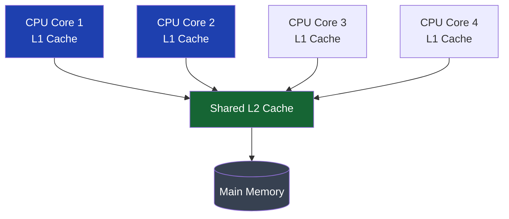
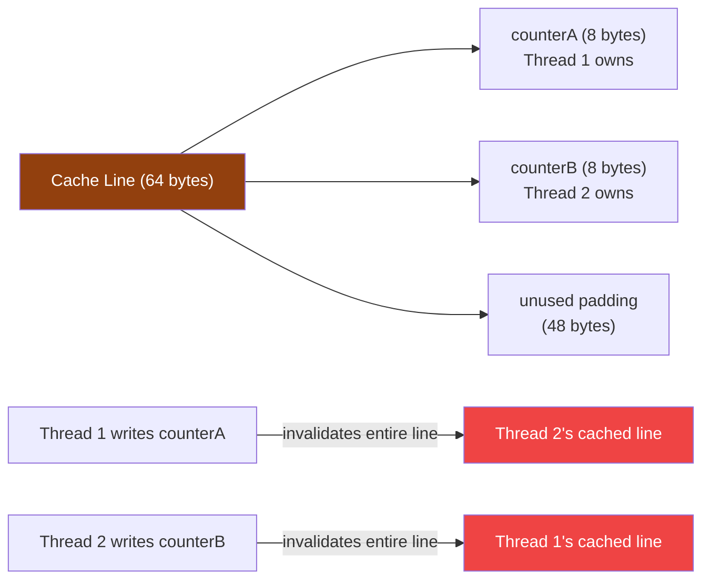

## Overview

The Java Memory Model governs thread visibility at the language level. But there is a hardware-level visibility cost that the JMM does not expose: **false sharing**. Two threads updating entirely separate variables can destroy each other's performance if those variables happen to occupy the same CPU cache line — without any shared data at all.

In a high-throughput payment gateway with per-thread counters, false sharing can reduce throughput by 10–40x. The fix is padding or the `@Contended` annotation — changes invisible to the JMM but critical to real-world performance.

## Learning Objectives

By the end of this lesson you will be able to:

- Explain how CPU caches work and what a cache line is
- Describe false sharing and why it occurs without any logical data sharing
- Identify false sharing in concurrent data structures
- Apply cache line padding manually with long arrays
- Use `@jdk.internal.vm.annotation.Contended` for JVM-level padding
- Measure false sharing overhead with JMH
- Explain how `LongAdder` avoids false sharing internally

## CPU Cache Architecture

Modern CPUs do not read individual bytes from main memory. They load data in fixed-size blocks called **cache lines** — typically 64 bytes on x86 and ARM. When one thread modifies a cache line, that line is **invalidated** in every other CPU's cache.



**Cache coherence protocol (MESI):** When CPU Core 1 writes to a memory location, it marks its cache line as **Modified** and broadcasts an invalidation message to all other cores. Any other core that subsequently reads that location must fetch the updated cache line from L2/L3 or main memory — a latency penalty of 60–300 cycles versus ~4 cycles for an L1 hit.

## What is False Sharing?

**False sharing** occurs when two threads modify **different variables** that happen to reside on the **same cache line**. Despite no logical sharing, every write by one thread invalidates the other thread's cached copy of the entire 64-byte line.



The two counters are entirely independent — but they share a cache line. Every write by either thread forces the other thread to reload the entire 64-byte line from L2/L3. This behaves like a lock that fires on every write even though there is no code-level synchronisation.

## Demonstrating False Sharing

```java17
// Naive per-thread counter array — severe false sharing
// All 4 counters fit in a single 64-byte cache line (4 × 8 = 32 bytes)
public class FalseSharingCounters {

    private long[] counters = new long[4]; // Indices 0-3

    // Each thread increments its own counter — but all counters share a cache line!
    public void increment(int threadIndex) {
        counters[threadIndex]++;
    }

    public long get(int threadIndex) {
        return counters[threadIndex];
    }
}

// Fixed version: pad each counter to its own cache line
// Each counter occupies 64 bytes → no two counters share a line
public class PaddedCounters {

    // 7 padding longs + 1 counter long = 8 × 8 = 64 bytes per slot
    private long[][] paddedCounters = new long[4][8]; // [threadIndex][0=counter, 1-7=padding]

    public void increment(int threadIndex) {
        paddedCounters[threadIndex][0]++;
    }

    public long get(int threadIndex) {
        return paddedCounters[threadIndex][0];
    }
}
```

```java17
// JMH benchmark showing the performance difference
@BenchmarkMode(Mode.Throughput)
@OutputTimeUnit(TimeUnit.MILLISECONDS)
@State(Scope.Benchmark)
@Threads(4)
public class FalseSharingBenchmark {

    FalseSharingCounters  shared  = new FalseSharingCounters();
    PaddedCounters        padded  = new PaddedCounters();

    @Benchmark
    public void withFalseSharing(Blackhole bh) {
        shared.increment(0); // All 4 threads → false sharing
    }

    @Benchmark
    public void withPadding(Blackhole bh) {
        padded.increment(0); // Each thread → isolated cache line
    }
}
// Typical result:
// withFalseSharing:  ~12,000 ops/ms  (severe cache line bouncing)
// withPadding:      ~180,000 ops/ms  (15× improvement)
```

## @Contended — JVM-Managed Padding

Manual padding works but is fragile — different JVM versions or object layouts could invalidate it. Java 8 introduced `@jdk.internal.vm.annotation.Contended` (and its public equivalent in some JDKs) to let the JVM insert padding automatically.

```java17
// Using @Contended requires: -XX:-RestrictContended JVM flag
// (or run as JDK internal code)
import jdk.internal.vm.annotation.Contended;

public class ContendedCounters {

    @Contended  // JVM inserts 128 bytes of padding around this field
    private volatile long counterA;

    @Contended
    private volatile long counterB;

    @Contended
    private volatile long counterC;

    @Contended
    private volatile long counterD;
}
```

> [!NOTE]
> `@Contended` is a JVM-internal annotation. In application code, prefer `LongAdder` (which uses `@Contended` internally) over manually annotating fields. `@Contended` is most useful when building low-level concurrency libraries or when profiling reveals false sharing in your own data structures.

## LongAdder — False Sharing Solved by Design

`LongAdder` from `java.util.concurrent.atomic` was introduced in Java 8 specifically to address false sharing in high-contention counters. Its internal `Cell` array uses `@Contended` on each cell:

```java17
// LongAdder internal implementation sketch (simplified)
// Each Cell is padded to its own cache line via @Contended
@Contended
static final class Cell {
    volatile long value;
    Cell(long x) { value = x; }
    final boolean cas(long cmp, long val) {
        return VALUE.compareAndSet(this, cmp, val);
    }
}

// When threads contend on the base CAS, they are assigned to different Cells
// Each Cell on its own cache line — no false sharing between threads
```

This is why `LongAdder` outperforms `AtomicLong` under high contention — it eliminates both CAS storms (via striping) and false sharing (via `@Contended` padding).

## Real-World Pattern: Per-Thread Metric Accumulators

```java17
// Payment gateway: per-thread latency accumulators
// Without padding, all accumulators share cache lines → severe contention
public class PaymentMetricsCollector {

    // WRONG: array of longs — all in adjacent memory, sharing cache lines
    private final long[] totalLatencyNs;
    private final long[] callCounts;
    private final int    numThreads;

    public PaymentMetricsCollector(int numThreads) {
        this.numThreads    = numThreads;
        this.totalLatencyNs = new long[numThreads]; // False sharing!
        this.callCounts    = new long[numThreads];  // False sharing!
    }

    public void record(int threadIndex, long latencyNs) {
        totalLatencyNs[threadIndex] += latencyNs; // Invalidates neighbours' cache lines
        callCounts[threadIndex]++;
    }
}
```

```java17
// CORRECT: each thread's metrics are padded to their own cache line
public class PaddedMetricsCollector {

    // Each MetricsSlot is aligned to its own cache line
    static final class MetricsSlot {
        // Actual data (16 bytes)
        long totalLatencyNs;
        long callCount;
        // Padding to reach 64-byte cache line boundary (6 × 8 = 48 bytes padding)
        long p1, p2, p3, p4, p5, p6;
    }

    private final MetricsSlot[] slots;

    public PaddedMetricsCollector(int numThreads) {
        this.slots = new MetricsSlot[numThreads];
        for (int i = 0; i < numThreads; i++) slots[i] = new MetricsSlot();
    }

    public void record(int threadIndex, long latencyNs) {
        MetricsSlot slot = slots[threadIndex];
        slot.totalLatencyNs += latencyNs; // Only invalidates this thread's cache line
        slot.callCount++;
    }

    public double getAverageLatencyMs(int threadIndex) {
        MetricsSlot slot = slots[threadIndex];
        if (slot.callCount == 0) return 0;
        return slot.totalLatencyNs / (double) slot.callCount / 1_000_000.0;
    }
}
```

```java21
// Java 21 — same pattern; @Contended is still the preferred JVM approach
// For application-level per-thread accumulators, prefer LongAdder or ThreadLocal
// ThreadLocal completely eliminates sharing (not just false sharing)
public class ThreadLocalMetrics {

    private final ThreadLocal<long[]> metrics = ThreadLocal.withInitial(() -> new long[2]);
    // metrics[0] = totalLatencyNs, metrics[1] = callCount

    public void record(long latencyNs) {
        long[] m = metrics.get();
        m[0] += latencyNs;
        m[1]++;
    }

    // Drawback: cannot aggregate across threads without coordination
    // Best for: metrics collected per-request, not shared across threads
}
```

## Identifying False Sharing in Production

False sharing is invisible in code review — it is a hardware-level artefact of object layout. Detection approaches:

| Tool | Method |
|---|---|
| **JMH** | Benchmark with varying thread counts; throughput drops faster than expected → false sharing suspect |
| **Linux `perf`** | `perf stat -e cache-misses,cache-references ./java-app` — high cache miss rate |
| **Intel VTune** | Memory access analysis shows false sharing hotspots |
| **async-profiler** | Perf events mode: `asprof -e cache-misses -d 30 <pid>` |
| **JVM flags** | `-XX:+PrintCompilation -XX:+PrintAssembly` — see JIT output for memory access patterns |

```java17
// Quick code-level false sharing audit:
// Look for: arrays of primitives accessed by different threads via index
// Look for: adjacent fields in a class accessed by different threads
// Look for: counters stored in a List or array — especially long[], int[]

// Example audit finding:
public class PaymentRouter {
    // RISK: these two counters will likely share a cache line if the object
    // is small enough to fit in 64 bytes total
    private long successCount;  // Thread A increments
    private long failureCount;  // Thread B increments
    // Fix: use LongAdder for each, or pad with @Contended
}
```

---

<!-- KNOWLEDGE-CHECK [
  {
    "id": "kc-fs-01",
    "question": "Thread 1 increments `counters[0]` and Thread 2 increments `counters[1]` in a `long[]` array. No synchronisation exists between them. Under heavy concurrent load, performance is 20x worse than expected. What is the most likely cause?",
    "options": [
      "A race condition — the array is not thread-safe",
      "False sharing — both counters reside on the same 64-byte cache line, causing constant cache line invalidation",
      "A data race — volatile is required on array elements",
      "Lock contention — synchronized is needed on each array access"
    ],
    "correct": 1,
    "explanation": "Two adjacent longs occupy 16 bytes — well within a 64-byte cache line. Every time Thread 1 writes counters[0], the entire cache line (including counters[1]) is invalidated in Thread 2's L1 cache. Thread 2 must reload from L2/L3 on every access — a 60–300 cycle penalty. This is false sharing: no logical sharing, but hardware-level cache contention. The fix is padding each counter to occupy its own 64-byte cache line."
  },
  {
    "id": "kc-fs-02",
    "question": "Why does `LongAdder` outperform `AtomicLong` under high thread contention, but have similar performance at low contention?",
    "options": [
      "LongAdder uses a larger data type internally",
      "LongAdder stripes across @Contended Cell objects eliminating both CAS storms and false sharing; at low contention it uses only the base value like AtomicLong",
      "LongAdder uses synchronized blocks which are faster than CAS under low contention",
      "LongAdder pre-allocates memory at startup reducing GC pressure"
    ],
    "correct": 1,
    "explanation": "At low contention, LongAdder behaves similarly to AtomicLong — it uses a single base CAS. When CAS contention is detected (a CAS failure), LongAdder allocates a Cell array where each Cell is annotated @Contended (padded to its own cache line). Threads then update their own Cell with minimal contention. sum() aggregates base + all cells. At low contention, the Cell array is never allocated."
  },
  {
    "id": "kc-fs-03",
    "question": "Adding 6 padding `long` fields to a data structure fixes false sharing. After a JVM upgrade, the fix stops working and false sharing returns. What likely happened?",
    "options": [
      "The JVM removed the padding fields during dead code elimination",
      "Object layout changed — the JVM's field reordering placed the data fields on a different cache line alignment, making the manual padding ineffective",
      "long fields are volatile by default in newer JVM versions",
      "Cache line size increased to 128 bytes in the new JVM version"
    ],
    "correct": 1,
    "explanation": "The JVM is free to reorder fields within an object for alignment efficiency. The effective layout of your class (which field is at which byte offset) can change between JVM versions, making manual padding based on a specific assumed layout unreliable. @Contended is robust because the JVM inserts padding automatically based on its knowledge of the actual layout. For application-level fixes, LongAdder or ThreadLocal are more reliable than manual padding."
  }
] -->

---

<!-- PRACTICAL-CHALLENGE {
  "id": "pc-false-sharing",
  "title": "Cache Line Optimisation for Payment Metrics",
  "description": "Profile, detect, and fix false sharing in a payment gateway metrics collector.",
  "tasks": [
    {
      "id": "pc-fs-01",
      "description": "Implement a JMH benchmark that demonstrates false sharing: create a `long[]` array of 4 elements and benchmark 4 threads each incrementing their own index versus a padded version where each counter is at index i*8 (stride-8 access pattern). Measure and report throughput at 1, 2, 4, and 8 threads."
    },
    {
      "id": "pc-fs-02",
      "description": "Implement `PaymentLatencyCollector` with per-thread slots. Version 1: naive `long[][]` array. Version 2: padded `MetricsSlot` class with explicit padding fields. Version 3: `LongAdder[]` array. Benchmark all three with 8 threads and explain which wins and why."
    },
    {
      "id": "pc-fs-03",
      "description": "A `PaymentRouter` class has fields `long successCount` and `long failureCount` updated by different threads. Refactor it to use `LongAdder` for both fields. Explain why adjacent fields in the same object can false-share and why LongAdder's @Contended Cell design solves it."
    }
  ]
} -->
