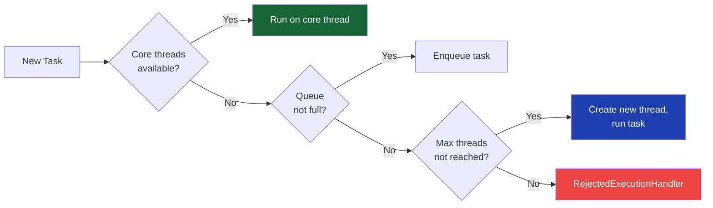
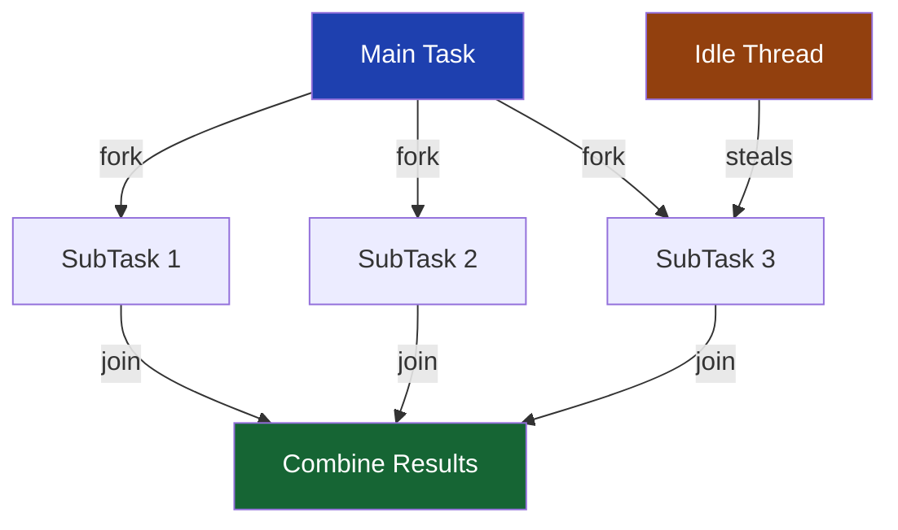
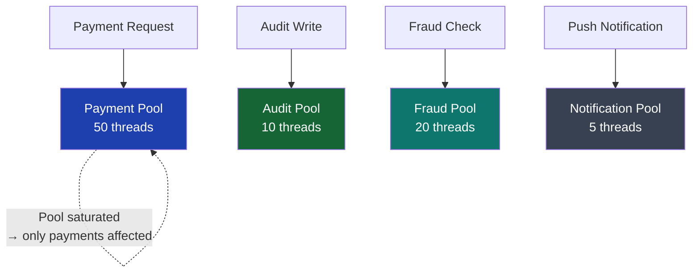

# تصميم مجمّعات الخيوط — ThreadPoolExecutor وForkJoinPool

## نظرة عامة

مجمّعات الخيوط هي العمود الفقري للتنفيذ في كل خدمة مالية بلغة Java. والفرق بين `ThreadPoolExecutor` مضبوط الحجم والإعداد وآخر مختار بسذاجة هو الفرق بين خدمة تتعامل مع 10,000 طلب في الثانية وأخرى تنفد خيوطها، أو تتراكم طوابيرها بلا حد، أو ترفض العمل في الذروة.

يغطي هذا الدرس مساحة إعداد `ThreadPoolExecutor` كاملة — كل معامل، وما يعنيه، ولماذا يهم لمعالجة المدفوعات. ثم يغطي `ForkJoinPool` للعمل المتوازي كثيف المعالجة، وعزل المنفّذات كنمط حواجز (bulkhead)، وكيف تغيّر الخيوط الافتراضية في Java 21 الحسابات كليًا.

## أهداف التعلم

في نهاية هذا الدرس ستستطيع:

- شرح معاملات مُنشئ `ThreadPoolExecutor` السبعة كلها
- تطبيق صيغة تحديد حجم المجمّع لأحمال الإدخال/الإخراج وأحمال المعالجة
- اختيار نوع الطابور وسعته المناسبين لمعالجة المدفوعات
- اختيار سياسة الرفض الصحيحة للخدمات المالية وتنفيذها
- تصميم مجمّعات منفّذات معزولة كحواجز لمنع الأعطال المتتالية
- شرح متى تستخدم `ForkJoinPool` مقابل `ThreadPoolExecutor`
- وصف كيف تجعل الخيوط الافتراضية في Java 21 تحديد حجم المجمّع غير لازم غالبًا لعمل الإدخال/الإخراج

## ThreadPoolExecutor: المعاملات السبعة

```java17
new ThreadPoolExecutor(
    int     corePoolSize,          // Minimum live threads, even if idle
    int     maximumPoolSize,       // Maximum threads ever created
    long    keepAliveTime,         // How long idle threads above core survive
    TimeUnit unit,                 // Unit for keepAliveTime
    BlockingQueue<Runnable> workQueue,  // Task buffer when all core threads busy
    ThreadFactory threadFactory,   // Creates new threads (naming, daemon flag)
    RejectedExecutionHandler handler    // What to do when queue is full + max threads reached
);
```



> [!WARNING]
> **يمتلئ الطابور قبل بلوغ `maximumPoolSize`.** مفهوم خاطئ شائع: لا تُضاف خيوط فوق `corePoolSize` إلا عندما يكون الطابور **ممتلئًا**. فإذا استخدمت `LinkedBlockingQueue` غير محدود، لن يُبلغ `maximumPoolSize` أبدًا لأن الطابور لا يمتلئ أبدًا. اضبط سعة الطابور عن قصد.

## تحديد حجم مجمّع الخيوط

### الصيغة

لأحمال **الإدخال/الإخراج** (استدعاءات قاعدة البيانات، وطلبات HTTP، وإدخال/إخراج الملفات):

```
threads = cores × (1 + wait_time / compute_time)
```

ولأحمال **المعالجة** (التشفير، والضغط، والحساب):

```
threads = cores + 1  (one extra for when a thread is momentarily paused)
```

### التحديد لمعالجة المدفوعات

```java17
// Gather system information
int cpuCores = Runtime.getRuntime().availableProcessors();

// Payment processing service characteristics:
// - Each thread spends 95% waiting for database (I/O time)
// - 5% doing validation/serialisation (compute time)
// wait/compute ratio = 0.95 / 0.05 = 19

// Thread count = cores × (1 + 19) = cores × 20
// On 8-core machine: 8 × 20 = 160 threads

int paymentPoolSize = cpuCores * 20; // I/O-heavy payment processing

// FX rate calculation (CPU-bound: matrix operations, pricing models)
// Thread count = cores + 1
int calculationPoolSize = cpuCores + 1; // CPU-bound computation
```

إذا قضى كل خيط 95% من وقته ينتظر قاعدة البيانات و5% في الحساب، فنسبة الانتظار إلى الحساب 19، والحجم = الأنوية × 20 (160 خيطًا على 8 أنوية). أما حساب أسعار الصرف كثيف المعالجة فيكفيه عدد الأنوية + 1.

> [!IMPORTANT]
> صيغ تحديد الحجم **نقطة بداية، لا إجابة نهائية**. تحقق دائمًا باختبار الحمل. والمقاييس الأساسية التي تراقبها: عمق الطابور، وعدد الخيوط النشطة، ونسبة رفض المهام، وزمن انتظار المهمة عند المئين 99. فإذا كان الطابور فارغًا دائمًا فلديك خيوط كثيرة جدًا. وإذا نما بلا حد فلديك خيوط قليلة جدًا.

## أنواع الطوابير وسعتها

يشكّل اختيار `workQueue` سلوك المجمّع جوهريًا:

| الطابور | محدود؟ | السلوك |
|---|---|---|
| `SynchronousQueue` | سعة 0 | تسليم مباشر — يأخذ خيط خامل المهمة، أو يُنشأ خيط جديد (حتى الحد الأقصى)، أو تُرفض |
| `ArrayBlockingQueue(n)` | نعم | ‏FIFO، سعة ثابتة، ضغط عكسي، يسمح بالنمو إلى `maximumPoolSize` |
| `LinkedBlockingQueue()` | لا (Integer.MAX_VALUE) | غير محدود — لا يُبلغ `maximumPoolSize` أبدًا |
| `LinkedBlockingQueue(n)` | نعم | ‏FIFO، محدود، مثل Array لكن بعقد مترابطة |
| `PriorityBlockingQueue` | لا | مرتب بالأولوية — المهام الأعلى أولوية تعمل أولًا |

### إعداد مجمّع مدفوعات إنتاجي

```java17
import java.util.concurrent.*;
import java.util.concurrent.atomic.AtomicInteger;

public class PaymentExecutorConfig {

    public static ThreadPoolExecutor buildPaymentPool() {
        int cores = Runtime.getRuntime().availableProcessors();

        return new ThreadPoolExecutor(
            cores * 10,                           // Core: enough for steady-state load
            cores * 20,                           // Max: burst capacity
            60L, TimeUnit.SECONDS,                // Idle threads above core are reaped after 60s
            new ArrayBlockingQueue<>(5_000),      // Bounded: applies back-pressure under overload
            new PaymentThreadFactory("payment"),  // Named threads for thread dumps
            new MetricRecordingRejectionHandler() // Reject + alert, never silently discard
        );
    }

    // Named thread factory — critical for diagnosing thread dumps
    static class PaymentThreadFactory implements ThreadFactory {
        private final String prefix;
        private final AtomicInteger count = new AtomicInteger(0);

        PaymentThreadFactory(String prefix) { this.prefix = prefix; }

        @Override
        public Thread newThread(Runnable r) {
            Thread t = new Thread(r, prefix + "-" + count.incrementAndGet());
            // NOT daemon: daemon threads are killed mid-task when the JVM exits.
            // Payment threads should finish their work during a graceful
            // shutdown (executor.shutdown() + awaitTermination(...))
            t.setDaemon(false);
            return t;
        }
    }

    // Rejection handler that records a metric and throws — never silently drops
    static class MetricRecordingRejectionHandler implements RejectedExecutionHandler {
        @Override
        public void rejectedExecution(Runnable r, ThreadPoolExecutor executor) {
            // Increment a circuit-breaker counter / fire an alert
            MetricsRegistry.increment("payment.pool.rejected");
            throw new RejectedExecutionException(
                "Payment pool saturated: queue=" + executor.getQueue().size() +
                " active=" + executor.getActiveCount());
        }
    }
}
```

خيوط مسمّاة لتشخيص تفريغ الخيوط، وطابور محدود يطبق ضغطًا عكسيًا عند الحمل الزائد، ومعالج رفض يسجّل مقياسًا ويرمي استثناء — لا يتخلص من شيء بصمت. والخيوط **ليست** خيوطًا خفية (daemon): فالخيوط الخفية تُقتل في منتصف المهمة عند خروج JVM، أما خيوط الدفع فيجب أن تنهي عملها أثناء الإيقاف المنظم (`shutdown()` ثم `awaitTermination(...)`).

```java21
// Java 21 — for I/O-bound workloads, virtual threads replace thread pools entirely
// No sizing calculation needed: one virtual thread per request
public class PaymentExecutorConfig {

    // Java 21: virtual thread per task executor
    // The JVM manages scheduling — no pool sizing required
    public static ExecutorService buildVirtualThreadExecutor() {
        return Executors.newVirtualThreadPerTaskExecutor();
    }

    // For CPU-bound work, platform thread pool still appropriate
    public static ThreadPoolExecutor buildCpuBoundPool() {
        int cores = Runtime.getRuntime().availableProcessors();
        return new ThreadPoolExecutor(
            cores + 1, cores + 1,     // Fixed size for CPU-bound
            0L, TimeUnit.MILLISECONDS,
            new ArrayBlockingQueue<>(500),
            Thread.ofPlatform().name("cpu-worker-", 0).factory(),
            new ThreadPoolExecutor.CallerRunsPolicy()
        );
    }
}
```

لأحمال الإدخال/الإخراج في Java 21، تحل الخيوط الافتراضية محل مجمّعات الخيوط: خيط افتراضي لكل طلب دون حساب للحجم. أما العمل كثيف المعالجة فما زال يناسبه مجمّع خيوط منصة.

## سياسات الرفض

عندما يمتلئ الطابور ويعمل `maximumPoolSize` خيطًا، يُطلق كل إرسال جديد `RejectedExecutionHandler`:

| السياسة | السلوك | الاستخدام في الأنظمة المالية |
|---|---|---|
| `AbortPolicy` (الافتراضية) | ترمي `RejectedExecutionException` | ✓ للمدفوعات — لا تخلّص صامت أبدًا |
| `CallerRunsPolicy` | خيط المستدعي ينفّذ المهمة | ✓ للعمل كثيف المعالجة — تبطيء طبيعي |
| `DiscardPolicy` | تُسقط المهمة بصمت | ✗ أبدًا للعمليات المالية |
| `DiscardOldestPolicy` | تُسقط أقدم مهمة في الطابور | ✗ أبدًا للمدفوعات — فقدان بيانات صامت |
| مخصصة | تسجيل مقياس + تنبيه + رفض | ✓ أفضل ممارسة للإنتاج |

> [!WARNING]
> **لا تستخدم أبدًا `DiscardPolicy` أو `DiscardOldestPolicy` لمعالجة المدفوعات.** فكلتاهما تُسقط المهام بصمت دون استثناء، ولا سجل، ولا مقياس. والدفعة المُسقطة بصمت دفعة ضائعة — حادث تنظيمي وتجاري. استخدم دائمًا `AbortPolicy` أو معالجًا مخصصًا يسجّل المقاييس قبل الرمي.

## سياسة الرفض CallerRunsPolicy

‏`CallerRunsPolicy` ممتازة للمعالجة الدفعية ومسارات ETL: عندما يمتلئ المجمّع، ينفّذ الخيط المُرسل المهمة بنفسه — فيبطئ المنتج طبيعيًا. وهذا **ضغط عكسي ضمني**:

```java17
// ETL batch job: CallerRunsPolicy provides natural throttling
// If processor pool is saturated, reader thread runs a batch itself
// slowing down reading from source — prevents unbounded queue growth
ThreadPoolExecutor batchProcessor = new ThreadPoolExecutor(
    8, 16,
    30L, TimeUnit.SECONDS,
    new ArrayBlockingQueue<>(200),
    Executors.defaultThreadFactory(),
    new ThreadPoolExecutor.CallerRunsPolicy() // Throttles reader — OK for batch
);
```

## ForkJoinPool

يستخدم `ForkJoinPool` خوارزمية **سرقة العمل** (work-stealing): الخيوط الخاملة تسرق المهام من الطوابير المحلية للخيوط المشغولة. وهذا مثالي لأحمال "فرّق تسد" التي تولّد فيها المهام مهامًا فرعية بشكل متكرر.



### حساب أسعار الصرف بالتوازي

```java17
import java.util.concurrent.ForkJoinPool;
import java.util.concurrent.RecursiveTask;

// CPU-bound: calculate forward rates for 10,000 currency pairs in parallel
public class FxRateCalculationTask extends RecursiveTask<Map<CurrencyPair, Double>> {

    private static final int THRESHOLD = 100; // Calculate serially if ≤ 100 pairs
    private final List<CurrencyPair> pairs;
    private final RateModel model;

    public FxRateCalculationTask(List<CurrencyPair> pairs, RateModel model) {
        this.pairs = pairs;
        this.model = model;
    }

    @Override
    protected Map<CurrencyPair, Double> compute() {
        if (pairs.size() <= THRESHOLD) {
            // Base case: compute serially
            Map<CurrencyPair, Double> result = new HashMap<>();
            for (CurrencyPair pair : pairs) {
                result.put(pair, model.calculateForwardRate(pair));
            }
            return result;
        }

        // Fork: split into two halves
        int mid = pairs.size() / 2;
        FxRateCalculationTask left  = new FxRateCalculationTask(pairs.subList(0, mid), model);
        FxRateCalculationTask right = new FxRateCalculationTask(pairs.subList(mid, pairs.size()), model);

        left.fork();                        // Schedule left asynchronously
        Map<CurrencyPair, Double> rightResult = right.compute(); // Run right in this thread
        Map<CurrencyPair, Double> leftResult  = left.join();     // Wait for left

        rightResult.putAll(leftResult);
        return rightResult;
    }
}

// Usage
ForkJoinPool pool = new ForkJoinPool(Runtime.getRuntime().availableProcessors());
Map<CurrencyPair, Double> allRates = pool.invoke(
    new FxRateCalculationTask(currencyPairs, rateModel)
);
```

تُقسم المهمة إلى نصفين حتى تصل إلى حد (100 زوج عملات)، فيُجدول النصف الأيسر بشكل غير متزامن، ويُحسب الأيمن في الخيط الحالي، ثم تُجمع النتائج.

```java17
// Simpler: use parallel streams (backed by ForkJoinPool.commonPool())
// Good for data parallel transformations without explicit task splitting
Map<CurrencyPair, Double> rates = currencyPairs.parallelStream()
    .collect(Collectors.toMap(
        pair -> pair,
        pair -> rateModel.calculateForwardRate(pair)
    ));
// WARNING: parallel streams use the common ForkJoinPool
// Blocking operations in parallel stream tasks block common pool threads
// Use a custom ForkJoinPool for tasks that may block
```

تستخدم التدفقات المتوازية `ForkJoinPool.commonPool()` المشترك. والعمليات الحاجبة داخلها تحجب خيوط المجمّع المشترك، فاستخدم `ForkJoinPool` مخصصًا للمهام التي قد تُحجب.

### ForkJoinPool مقابل ThreadPoolExecutor

| الخاصية | `ThreadPoolExecutor` | `ForkJoinPool` |
|---|---|---|
| توزيع العمل | طابور مركزي | طابور مزدوج لكل خيط مع سرقة العمل |
| اعتماديات المهام | مهام مستقلة فقط | يمكن للمهام تفريع مهام فرعية وانتظارها |
| الإدخال/الإخراج الحاجب | لا بأس — تنتظر الخيوط | مشكلة — يقلل التوازي |
| الحمل الأمثل | خدمات الإدخال/الإخراج | مهام "فرّق تسد" كثيفة المعالجة |
| الكلفة لكل مهمة | منخفضة | أعلى قليلًا (إدارة الطوابير المزدوجة) |
| الدور في الخيوط الافتراضية (Java 21) | لا شيء | المجدول الافتراضي للخيوط الافتراضية `ForkJoinPool` من خيوط الحمل |

## عزل المنفّذات — نمط الحواجز (Bulkhead)

مجمّع خيوط مشترك واحد يعني أن اعتمادية بطيئة واحدة قد تشبع كل الخيوط وتمنع تنفيذ عمل غير مرتبط بها. و**عزل المنفّذات** (نمط الحواجز) يخصص مجمّعات منفصلة لاهتمامات مختلفة.



```java17
@Configuration
public class ExecutorConfig {

    @Bean("paymentExecutor")
    public ThreadPoolExecutor paymentExecutor() {
        return new ThreadPoolExecutor(
            20, 50, 60L, TimeUnit.SECONDS,
            new ArrayBlockingQueue<>(5_000),
            namedFactory("payment"),
            new AbortAndAlertPolicy("payment")
        );
    }

    @Bean("fraudExecutor")
    public ThreadPoolExecutor fraudExecutor() {
        // Fraud checks are CPU-intensive — smaller, fixed pool
        int cores = Runtime.getRuntime().availableProcessors();
        return new ThreadPoolExecutor(
            cores, cores, 0L, TimeUnit.MILLISECONDS,
            new ArrayBlockingQueue<>(500),
            namedFactory("fraud"),
            new AbortAndAlertPolicy("fraud")
        );
    }

    @Bean("auditExecutor")
    public ThreadPoolExecutor auditExecutor() {
        // Audit writes can be slow — keep isolated so slow DB doesn't affect payments
        return new ThreadPoolExecutor(
            5, 15, 60L, TimeUnit.SECONDS,
            new ArrayBlockingQueue<>(10_000), // Large queue — audit may lag a little
            namedFactory("audit"),
            // NEVER discard audit records: a gap in the audit trail is a
            // compliance failure. CallerRunsPolicy slows the submitter instead.
            // (Better still: write audit events to an outbox table in the
            // business transaction, and ship them asynchronously.)
            new ThreadPoolExecutor.CallerRunsPolicy()
        );
    }

    private ThreadFactory namedFactory(String prefix) {
        AtomicInteger count = new AtomicInteger();
        return r -> {
            Thread t = new Thread(r, prefix + "-" + count.incrementAndGet());
            t.setDaemon(false);   // let in-flight work finish on graceful shutdown
            return t;
        };
    }
}
```

لا تُسقط سجلات التدقيق أبدًا: فالفجوة في سجل التدقيق فشل امتثالي. وتبطئ `CallerRunsPolicy` المُرسل بدلًا من ذلك. والأفضل: اكتب أحداث التدقيق في جدول outbox ضمن معاملة العمل، وأرسلها بشكل غير متزامن.

```java21
// Java 21: virtual threads simplify I/O-bound executor isolation
// Each service still gets its own executor for observability and bulkhead isolation
// But sizing is no longer a concern — virtual threads scale automatically

@Configuration
public class ExecutorConfig {

    @Bean("paymentExecutor")
    public ExecutorService paymentExecutor() {
        // Virtual thread per task — JVM schedules on carrier threads automatically
        // No pool sizing and no queue — but concurrency is now UNBOUNDED, so
        // protect scarce downstream resources (DB connections, partner API
        // rate limits) with a Semaphore or the connection pool's own limit
        return Executors.newVirtualThreadPerTaskExecutor();
    }

    @Bean("fraudExecutor")
    public ThreadPoolExecutor fraudExecutor() {
        // CPU-bound fraud scoring — platform threads still appropriate
        int cores = Runtime.getRuntime().availableProcessors();
        return new ThreadPoolExecutor(
            cores, cores, 0L, TimeUnit.MILLISECONDS,
            new ArrayBlockingQueue<>(500),
            Thread.ofPlatform().name("fraud-", 0).factory(),
            new ThreadPoolExecutor.AbortPolicy()
        );
    }
}
```

مع الخيوط الافتراضية لا يلزم تحديد حجم المجمّع ولا طابور — لكن التزامن يصبح **غير محدود**، فاحمِ الموارد اللاحقة الشحيحة (اتصالات قاعدة البيانات، وحدود معدّل واجهات الشركاء) بـ `Semaphore` أو بحد مجموعة الاتصالات نفسها.

## Java 21: الخيوط الافتراضية ومجمّعات الخيوط

تغيّر الخيوط الافتراضية في Java 21 نموذج مجمّع الخيوط جذريًا لعمل الإدخال/الإخراج:

| الجانب | مجمّع خيوط المنصة | منفّذ الخيوط الافتراضية |
|---|---|---|
| تحديد الحجم | صيغة يدوية مطلوبة | تلقائي — تديره JVM |
| إدارة الطابور | سعة وسياسة يدويتان | لا طابور للمجمّع — قيّد الوصول إلى الموارد الشحيحة بالإشارات (semaphores) |
| الذاكرة لكل خيط | مكدس نحو 1 MB | بضعة KB |
| الإدخال/الإخراج الحاجب | يحجب خيط نظام التشغيل | يوقف الخيط الافتراضي |
| الأمثل لـ | المعالجة والأحمال المختلطة | أحمال الإدخال/الإخراج |
| كتل `synchronized` | لا بأس | تثبّت خيط الحمل عند الحجب (Java 21–23؛ أُصلح في JDK 24) |
| سقف الإنتاجية | حجم المجمّع × 1/نسبة الحجب | شبه غير محدود |

> [!IMPORTANT]
> **لا تُنشئ `ThreadPoolExecutor` من الخيوط الافتراضية.** فقد صُممت الخيوط الافتراضية لتُنشأ لكل مهمة باستخدام `Executors.newVirtualThreadPerTaskExecutor()` أو `Thread.ofVirtual().start(task)`. وتجميعها يلغي فوائدها — فهي رخيصة بما يكفي لإنشائها عند الطلب.


<!-- KNOWLEDGE-CHECK [
  {
    "id": "kc-tp-01",
    "question": "يُنشأ `ThreadPoolExecutor` بقيم corePoolSize=10 وmaximumPoolSize=50 وطابور `LinkedBlockingQueue` غير محدود. تحت حمل مستمر، كم خيطًا سينشئ؟",
    "options": [
      "حتى 50 — ينمو إلى maximumPoolSize تحت الحمل",
      "‏10 بالضبط — يمتص الطابور كل المهام قبل بلوغ maximumPoolSize",
      "صفر — الطوابير غير المحدودة تمنع إنشاء الخيوط",
      "يعتمد على keepAliveTime"
    ],
    "correct": 1,
    "explanation": "مع LinkedBlockingQueue غير محدود لا يمتلئ الطابور أبدًا. ولا ينشئ ThreadPoolExecutor خيوطًا فوق corePoolSize إلا عندما يكون الطابور ممتلئًا. ولأن الطابور لا يمتلئ أبدًا، لا ينمو المجمّع فوق corePoolSize=10. فضبط maximumPoolSize على 50 مع طابور غير محدود بلا معنى فعليًا. استخدم طابورًا محدودًا (ArrayBlockingQueue) للسماح بالنمو إلى maximumPoolSize."
  },
  {
    "id": "kc-tp-02",
    "question": "تعمل خدمة معالجة مدفوعات على خادم بأربع أنوية. ويقضي كل طلب 90ms منتظرًا قاعدة البيانات (إدخال/إخراج) و10ms في التحقق (معالجة). ما الحجم الأمثل لمجمّع الخيوط؟",
    "options": [
      "‏4 — خيط لكل نواة معالج",
      "‏5 — الأنوية + 1 للمهام كثيفة المعالجة",
      "‏40 — الأنوية × (1 + الانتظار/الحساب) = 4 × (1 + 9) = 40",
      "‏100 — أنظمة الدفع تحتاج مجمّعات خيوط كبيرة لإنتاجية عالية"
    ],
    "correct": 2,
    "explanation": "صيغة تحديد حجم المجمّع لأحمال الإدخال/الإخراج: الخيوط = الأنوية × (1 + زمن الانتظار/زمن الحساب). مع 4 أنوية، وانتظار 90ms، وحساب 10ms: ‏4 × (1 + 90/10) = 4 × 10 = 40 خيطًا. وهذا يُبقي الأنوية الأربع مشغولة رغم أن كل خيط خامل 90% من الوقت. ملاحظة: هذه نقطة بداية — تحقق باختبار الحمل. وتلغي الخيوط الافتراضية في Java 21 هذا الحساب كليًا لعمل الإدخال/الإخراج."
  },
  {
    "id": "kc-tp-03",
    "question": "يستخدم مجمّع مدفوعات `DiscardOldestPolicy`. وتحت حمل الذروة يمتلئ المجمّع ويبدأ في الإسقاط. ما الأثر التشغيلي؟",
    "options": [
      "تكتمل أقدم المدفوعات قبل الجديدة، فيُحفظ ترتيب FIFO",
      "تُسقط المدفوعات بصمت دون استثناء أو مدخل سجل أو مقياس — حادث فقدان بيانات",
      "يُعاد تلقائيًا محاولة المدفوعات المُسقطة بعد 30 ثانية",
      "ينفّذ خيط المستدعي المهمة المُسقطة بدلًا من ذلك"
    ],
    "correct": 1,
    "explanation": "تزيل DiscardOldestPolicy بصمت أقدم مهمة في الطابور (دفعة) دون استثناء، ولا رسالة سجل، ولا مقياس. ولا يتلقى الخيط المُرسل أي دلالة على إسقاط الدفعة. وفي العمليات المالية هذا حادث فقدان بيانات — دفعة أُرسلت ثم اختفت ببساطة. استخدم دائمًا AbortPolicy أو معالجًا مخصصًا يرمي ويسجّل مقياسًا لمنفّذات المهام المالية."
  },
  {
    "id": "kc-tp-04",
    "question": "تستخدم خدمة كشف الاحتيال مجمّع الخيوط نفسه الذي تستخدمه خدمة معالجة المدفوعات. ويبدأ استعلام بطيء في قاعدة بيانات الاحتيال باستغراق 30 ثانية. ماذا يحدث لمعالجة المدفوعات؟",
    "options": [
      "لا تتأثر معالجة المدفوعات — كشف الاحتيال يعمل على خيوط منفصلة",
      "يمتلئ المجمّع المشترك بخيوط احتيال محجوبة، فتتراكم مهام الدفع وتنتهي مهلتها — عطل متتالٍ",
      "تتسارع معالجة المدفوعات لأن كشف الاحتيال أبطأ",
      "تعزل JVM المجمّعات تلقائيًا لمنع العطل المتتالي"
    ],
    "correct": 1,
    "explanation": "مع مجمّع خيوط مشترك، تستهلك خيوط الاحتيال المحجوبة 30 ثانية كل الخيوط المتاحة. فتصل مهام الدفع أسرع من تحرر الخيوط، فيمتلئ الطابور، وتبدأ المدفوعات بالرفض أو انتهاء المهلة — عطل متتالٍ سببته خدمة غير مرتبطة. والحل عزل المنفّذات (نمط الحواجز): مجمّعات خيوط منفصلة لمعالجة المدفوعات، وكشف الاحتيال، والتدقيق، حتى لا تؤثر قاعدة بيانات الاحتيال البطيئة في إنتاجية المدفوعات."
  }
] -->


<!-- PRACTICAL-CHALLENGE {
  "id": "pc-thread-pool-design",
  "title": "بنية مجمّعات الخيوط لبوابة دفع",
  "description": "صمّم ونفّذ إعداد مجمّعات خيوط بمستوى إنتاجي لبوابة دفع متعددة الخدمات.",
  "tasks": [
    {
      "id": "pc-tp-01",
      "description": "تجري خدمة دفع على خادم بثماني أنوية استدعاءات قاعدة بيانات متوسطها 80ms، وتقضي 20ms في منطق العمل. احسب الحجم الأمثل لمجمّع الخيوط. ونفّذ المجمّع بـ: خيوط مسمّاة، وطابور ArrayBlockingQueue محدود يتسع لتراكم 5 ثوانٍ عند ذروة 500 معاملة في الثانية، ومعالج رفض مخصص يزيد عدّاد Micrometer ويرمي استثناء."
    },
    {
      "id": "pc-tp-02",
      "description": "نفّذ ثلاثة منفّذات معزولة: `paymentExecutor` (إدخال/إخراج، محدد الحجم للإنتاجية)، و`fxCalculationExecutor` (معالجة، بحجم الأنوية+1)، و`auditExecutor` (إدخال/إخراج، طابور كبير، وCallerRunsPolicy مقبولة). واربط كلًا منها بخدمة Spring المقابلة باستخدام @Async أو حقن ExecutorService صريح."
    },
    {
      "id": "pc-tp-03",
      "description": "نفّذ `ThreadPoolHealthIndicator` لـ Spring Boot Actuator يعرض: عمق الطابور، وعدد الخيوط النشطة، وعدد المهام المكتملة، وعدد مرات الرفض لكل مجمّع معزول. وأضف عتبة تنبيه: WARN إذا تجاوز عمق الطابور 80% من السعة، وDOWN إذا كان عدد مرات الرفض أكبر من 0 في آخر 60 ثانية."
    },
    {
      "id": "pc-tp-04",
      "description": "قارن Java 17 (مجمّع خيوط منصة) مع Java 21 (منفّذ خيوط افتراضية) لخدمة دفع محاكاة كثيفة الإدخال/الإخراج: كل مهمة تنام 50ms (محاكاة استدعاء قاعدة بيانات). وشغّل 10,000 مهمة متزامنة بالأسلوبين. وقِس زمن الإكمال الكلي، وذروة الذاكرة، وكلفة إنشاء الخيوط. ووثّق متى تجعل الخيوط الافتراضية صيغة تحديد الحجم غير ذات صلة."
    }
  ]
} -->
