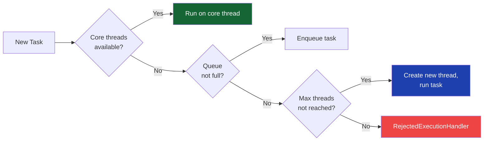
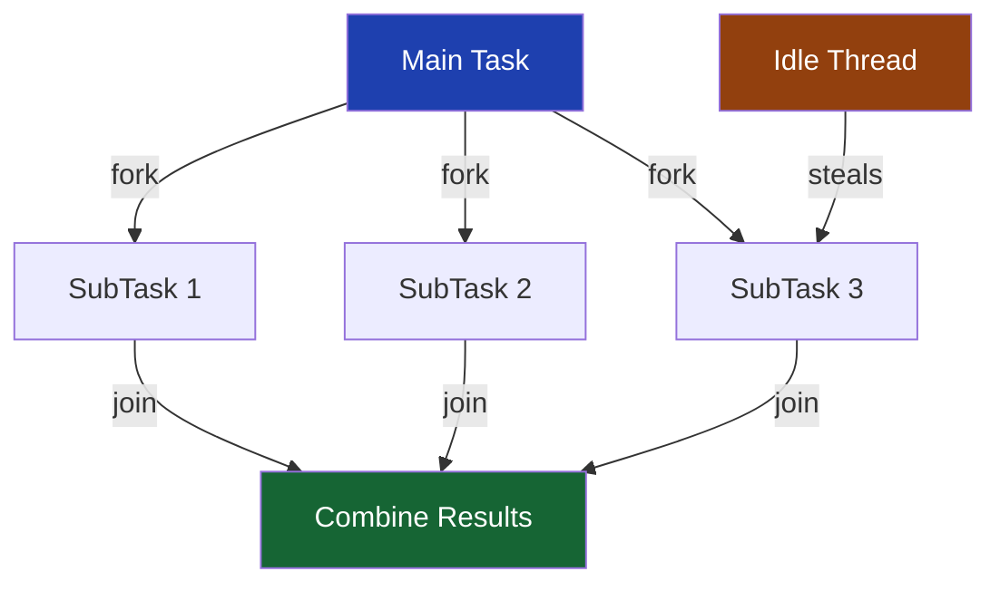
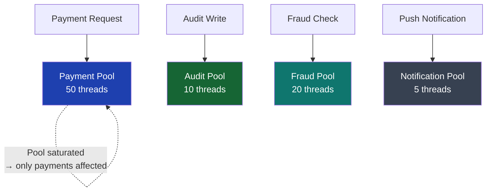

## Overview

Thread pools are the execution backbone of every Java financial service. The difference between a correctly sized and configured `ThreadPoolExecutor` and a naïvely chosen one is the difference between a service that handles 10,000 requests per second and one that runs out of threads, queues indefinitely, or rejects work under peak load.

This lesson covers the full `ThreadPoolExecutor` configuration space — every parameter, what it means, and why it matters for payment processing. It then covers `ForkJoinPool` for CPU-bound parallel work, executor isolation as a bulkhead pattern, and how Java 21 virtual threads change the calculus entirely.

## Learning Objectives

By the end of this lesson you will be able to:

- Explain all seven `ThreadPoolExecutor` constructor parameters
- Apply the thread pool sizing formula for I/O-bound and CPU-bound workloads
- Choose the right queue type and capacity for payment processing
- Select and implement the correct rejection policy for financial services
- Design isolated executor pools as bulkheads to prevent cascade failures
- Explain when to use `ForkJoinPool` vs `ThreadPoolExecutor`
- Describe how Java 21 virtual threads make thread pool sizing largely obsolete for I/O-bound work

## ThreadPoolExecutor: The Seven Parameters

```java17
new ThreadPoolExecutor(
    int     corePoolSize,          // Minimum live threads, even if idle
    int     maximumPoolSize,       // Maximum threads ever created
    long    keepAliveTime,         // How long idle threads above core survive
    TimeUnit unit,                 // Unit for keepAliveTime
    BlockingQueue<Runnable> workQueue,  // Task buffer when all core threads busy
    ThreadFactory threadFactory,   // Creates new threads (naming, daemon flag)
    RejectedExecutionHandler handler    // What to do when queue is full + max threads reached
);
```



> [!WARNING]
> **The queue fills before `maximumPoolSize` is reached.** A common misconception: threads are added beyond `corePoolSize` only when the queue is **full**. If you use an unbounded `LinkedBlockingQueue`, `maximumPoolSize` is never reached because the queue never fills. Set queue capacity deliberately.

## Thread Pool Sizing

### The Formula

For **I/O-bound workloads** (database calls, HTTP requests, file I/O):

```
threads = cores × (1 + wait_time / compute_time)
```

For **CPU-bound workloads** (encryption, compression, computation):

```
threads = cores + 1  (one extra for when a thread is momentarily paused)
```

### Sizing for Payment Processing

```java17
// Gather system information
int cpuCores = Runtime.getRuntime().availableProcessors();

// Payment processing service characteristics:
// - Each thread spends 95% waiting for database (I/O time)
// - 5% doing validation/serialisation (compute time)
// wait/compute ratio = 0.95 / 0.05 = 19

// Thread count = cores × (1 + 19) = cores × 20
// On 8-core machine: 8 × 20 = 160 threads

int paymentPoolSize = cpuCores * 20; // I/O-heavy payment processing

// FX rate calculation (CPU-bound: matrix operations, pricing models)
// Thread count = cores + 1
int calculationPoolSize = cpuCores + 1; // CPU-bound computation
```

> [!IMPORTANT]
> Thread pool sizing formulae give a **starting point, not a final answer**. Always validate with load testing. Key metrics to watch: queue depth, thread active count, task rejection rate, and 99th-percentile task wait time. If the queue is always empty, you have too many threads. If it grows unboundedly, you have too few.

## Queue Types and Capacity

The `workQueue` choice fundamentally shapes pool behaviour:

| Queue | Bounded? | Behaviour |
|---|---|---|
| `SynchronousQueue` | No | Direct handoff — task runs or creates new thread immediately |
| `ArrayBlockingQueue(n)` | Yes | FIFO, fixed capacity, back-pressure, allows `maximumPoolSize` growth |
| `LinkedBlockingQueue()` | No (Integer.MAX_VALUE) | Unbounded — `maximumPoolSize` never reached |
| `LinkedBlockingQueue(n)` | Yes | FIFO, bounded, same as Array but linked nodes |
| `PriorityBlockingQueue` | No | Priority-ordered — highest-priority tasks run first |

### Production Payment Pool Configuration

```java17
import java.util.concurrent.*;
import java.util.concurrent.atomic.AtomicInteger;

public class PaymentExecutorConfig {

    public static ThreadPoolExecutor buildPaymentPool() {
        int cores = Runtime.getRuntime().availableProcessors();

        return new ThreadPoolExecutor(
            cores * 10,                           // Core: enough for steady-state load
            cores * 20,                           // Max: burst capacity
            60L, TimeUnit.SECONDS,                // Idle threads above core are reaped after 60s
            new ArrayBlockingQueue<>(5_000),      // Bounded: applies back-pressure under overload
            new PaymentThreadFactory("payment"),  // Named threads for thread dumps
            new MetricRecordingRejectionHandler() // Reject + alert, never silently discard
        );
    }

    // Named thread factory — critical for diagnosing thread dumps
    static class PaymentThreadFactory implements ThreadFactory {
        private final String prefix;
        private final AtomicInteger count = new AtomicInteger(0);

        PaymentThreadFactory(String prefix) { this.prefix = prefix; }

        @Override
        public Thread newThread(Runnable r) {
            Thread t = new Thread(r, prefix + "-" + count.incrementAndGet());
            t.setDaemon(true); // Don't prevent JVM shutdown
            return t;
        }
    }

    // Rejection handler that records a metric and throws — never silently drops
    static class MetricRecordingRejectionHandler implements RejectedExecutionHandler {
        @Override
        public void rejectedExecution(Runnable r, ThreadPoolExecutor executor) {
            // Increment a circuit-breaker counter / fire an alert
            MetricsRegistry.increment("payment.pool.rejected");
            throw new RejectedExecutionException(
                "Payment pool saturated: queue=" + executor.getQueue().size() +
                " active=" + executor.getActiveCount());
        }
    }
}
```

```java21
// Java 21 — for I/O-bound workloads, virtual threads replace thread pools entirely
// No sizing calculation needed: one virtual thread per request
public class PaymentExecutorConfig {

    // Java 21: virtual thread per task executor
    // The JVM manages scheduling — no pool sizing required
    public static ExecutorService buildVirtualThreadExecutor() {
        return Executors.newVirtualThreadPerTaskExecutor();
    }

    // For CPU-bound work, platform thread pool still appropriate
    public static ThreadPoolExecutor buildCpuBoundPool() {
        int cores = Runtime.getRuntime().availableProcessors();
        return new ThreadPoolExecutor(
            cores + 1, cores + 1,     // Fixed size for CPU-bound
            0L, TimeUnit.MILLISECONDS,
            new ArrayBlockingQueue<>(500),
            Thread.ofPlatform().name("cpu-worker-", 0).factory(),
            new ThreadPoolExecutor.CallerRunsPolicy()
        );
    }
}
```

## Rejection Policies

When the queue is full and `maximumPoolSize` threads are running, every new submission triggers the `RejectedExecutionHandler`:

| Policy | Behaviour | Use in Financial Systems |
|---|---|---|
| `AbortPolicy` (default) | Throws `RejectedExecutionException` | ✓ For payments — never silently discard |
| `CallerRunsPolicy` | Caller thread runs the task | ✓ For CPU-bound — natural throttling |
| `DiscardPolicy` | Silently drops the task | ✗ Never for financial operations |
| `DiscardOldestPolicy` | Drops oldest queued task | ✗ Never for payments — silent data loss |
| Custom | Record metric + alert + abort | ✓ Best practice for production |

> [!WARNING]
> **Never use `DiscardPolicy` or `DiscardOldestPolicy` for payment processing.** Both silently drop tasks with no exception, no log, and no metric. A payment silently discarded is a payment lost — a regulatory and business incident. Always use `AbortPolicy` or a custom handler that records metrics before throwing.

## Rejection Policy for CallerRunsPolicy

`CallerRunsPolicy` is excellent for batch processing and ETL pipelines: when the pool is full, the submitting thread runs the task itself — naturally slowing down the producer. This is **implicit back-pressure**:

```java17
// ETL batch job: CallerRunsPolicy provides natural throttling
// If processor pool is saturated, reader thread runs a batch itself
// slowing down reading from source — prevents unbounded queue growth
ThreadPoolExecutor batchProcessor = new ThreadPoolExecutor(
    8, 16,
    30L, TimeUnit.SECONDS,
    new ArrayBlockingQueue<>(200),
    Executors.defaultThreadFactory(),
    new ThreadPoolExecutor.CallerRunsPolicy() // Throttles reader — OK for batch
);
```

## ForkJoinPool

`ForkJoinPool` uses a **work-stealing** algorithm: idle threads steal tasks from busy threads' local queues. This is optimal for divide-and-conquer workloads where tasks recursively spawn subtasks.



### Parallel FX Rate Calculation

```java17
import java.util.concurrent.ForkJoinPool;
import java.util.concurrent.RecursiveTask;

// CPU-bound: calculate forward rates for 10,000 currency pairs in parallel
public class FxRateCalculationTask extends RecursiveTask<Map<CurrencyPair, Double>> {

    private static final int THRESHOLD = 100; // Calculate serially if ≤ 100 pairs
    private final List<CurrencyPair> pairs;
    private final RateModel model;

    public FxRateCalculationTask(List<CurrencyPair> pairs, RateModel model) {
        this.pairs = pairs;
        this.model = model;
    }

    @Override
    protected Map<CurrencyPair, Double> compute() {
        if (pairs.size() <= THRESHOLD) {
            // Base case: compute serially
            Map<CurrencyPair, Double> result = new HashMap<>();
            for (CurrencyPair pair : pairs) {
                result.put(pair, model.calculateForwardRate(pair));
            }
            return result;
        }

        // Fork: split into two halves
        int mid = pairs.size() / 2;
        FxRateCalculationTask left  = new FxRateCalculationTask(pairs.subList(0, mid), model);
        FxRateCalculationTask right = new FxRateCalculationTask(pairs.subList(mid, pairs.size()), model);

        left.fork();                        // Schedule left asynchronously
        Map<CurrencyPair, Double> rightResult = right.compute(); // Run right in this thread
        Map<CurrencyPair, Double> leftResult  = left.join();     // Wait for left

        rightResult.putAll(leftResult);
        return rightResult;
    }
}

// Usage
ForkJoinPool pool = new ForkJoinPool(Runtime.getRuntime().availableProcessors());
Map<CurrencyPair, Double> allRates = pool.invoke(
    new FxRateCalculationTask(currencyPairs, rateModel)
);
```

```java17
// Simpler: use parallel streams (backed by ForkJoinPool.commonPool())
// Good for data parallel transformations without explicit task splitting
Map<CurrencyPair, Double> rates = currencyPairs.parallelStream()
    .collect(Collectors.toMap(
        pair -> pair,
        pair -> rateModel.calculateForwardRate(pair)
    ));
// WARNING: parallel streams use the common ForkJoinPool
// Blocking operations in parallel stream tasks block common pool threads
// Use a custom ForkJoinPool for tasks that may block
```

### ForkJoinPool vs ThreadPoolExecutor

| Characteristic | `ThreadPoolExecutor` | `ForkJoinPool` |
|---|---|---|
| Work distribution | Central queue | Per-thread deque with work-stealing |
| Task dependencies | Independent tasks only | Tasks can fork/join subtasks |
| Blocking I/O | Fine — threads wait | Problematic — reduces parallelism |
| Optimal workload | I/O-bound services | CPU-bound divide-and-conquer |
| Overhead per task | Low | Slightly higher (deque management) |
| Virtual threads (Java 21) | ✗ Platform threads only | ✗ Platform threads only |

## Executor Isolation — Bulkhead Pattern

A single shared thread pool means one slow dependency can saturate all threads and prevent unrelated work from executing. **Executor isolation** (the Bulkhead pattern) assigns separate pools to different concerns.



```java17
@Configuration
public class ExecutorConfig {

    @Bean("paymentExecutor")
    public ThreadPoolExecutor paymentExecutor() {
        return new ThreadPoolExecutor(
            20, 50, 60L, TimeUnit.SECONDS,
            new ArrayBlockingQueue<>(5_000),
            namedFactory("payment"),
            new AbortAndAlertPolicy("payment")
        );
    }

    @Bean("fraudExecutor")
    public ThreadPoolExecutor fraudExecutor() {
        // Fraud checks are CPU-intensive — smaller, fixed pool
        int cores = Runtime.getRuntime().availableProcessors();
        return new ThreadPoolExecutor(
            cores, cores, 0L, TimeUnit.MILLISECONDS,
            new ArrayBlockingQueue<>(500),
            namedFactory("fraud"),
            new AbortAndAlertPolicy("fraud")
        );
    }

    @Bean("auditExecutor")
    public ThreadPoolExecutor auditExecutor() {
        // Audit writes can be slow — keep isolated so slow DB doesn't affect payments
        return new ThreadPoolExecutor(
            5, 15, 60L, TimeUnit.SECONDS,
            new ArrayBlockingQueue<>(10_000), // Large queue — audit is durable, can lag
            namedFactory("audit"),
            new DiscardAndLogPolicy("audit") // Audit lag is acceptable; payment lag is not
        );
    }

    private ThreadFactory namedFactory(String prefix) {
        AtomicInteger count = new AtomicInteger();
        return r -> {
            Thread t = new Thread(r, prefix + "-" + count.incrementAndGet());
            t.setDaemon(true);
            return t;
        };
    }
}
```

```java21
// Java 21: virtual threads simplify I/O-bound executor isolation
// Each service still gets its own executor for observability and bulkhead isolation
// But sizing is no longer a concern — virtual threads scale automatically

@Configuration
public class ExecutorConfig {

    @Bean("paymentExecutor")
    public ExecutorService paymentExecutor() {
        // Virtual thread per task — JVM schedules on carrier threads automatically
        // No pool sizing. No queue capacity. No rejection policy needed.
        return Executors.newVirtualThreadPerTaskExecutor();
    }

    @Bean("fraudExecutor")
    public ThreadPoolExecutor fraudExecutor() {
        // CPU-bound fraud scoring — platform threads still appropriate
        int cores = Runtime.getRuntime().availableProcessors();
        return new ThreadPoolExecutor(
            cores, cores, 0L, TimeUnit.MILLISECONDS,
            new ArrayBlockingQueue<>(500),
            Thread.ofPlatform().name("fraud-", 0).factory(),
            new ThreadPoolExecutor.AbortPolicy()
        );
    }
}
```

## Java 21: Virtual Threads and Thread Pools

Java 21 virtual threads fundamentally change the thread pool model for I/O-bound work:

| Aspect | Platform Thread Pool | Virtual Thread Executor |
|---|---|---|
| Sizing | Manual formula required | Automatic — JVM manages |
| Queue management | Manual capacity + policy | Not needed |
| Memory per thread | ~1 MB stack | ~few KB |
| Blocking I/O | Blocks OS thread | Parks virtual thread |
| Optimal for | CPU-bound + mixed | I/O-bound workloads |
| `synchronized` blocks | Fine | Causes carrier pinning |
| Throughput ceiling | Pool size × 1/blocking_ratio | Near-unlimited |

> [!IMPORTANT]
> **Do not create a `ThreadPoolExecutor` of virtual threads.** Virtual threads are designed to be created per-task with `Executors.newVirtualThreadPerTaskExecutor()` or `Thread.ofVirtual().start(task)`. Pooling virtual threads negates their benefits — virtual threads are cheap enough to create on demand.

---

<!-- KNOWLEDGE-CHECK [
  {
    "id": "kc-tp-01",
    "question": "A `ThreadPoolExecutor` is created with corePoolSize=10, maximumPoolSize=50, and an unbounded `LinkedBlockingQueue`. Under sustained load, how many threads will it create?",
    "options": [
      "Up to 50 — it grows to maximumPoolSize under load",
      "Exactly 10 — the queue absorbs all tasks before maximumPoolSize is reached",
      "Zero — unbounded queues prevent thread creation",
      "It depends on keepAliveTime"
    ],
    "correct": 1,
    "explanation": "With an unbounded LinkedBlockingQueue, the queue never fills. The ThreadPoolExecutor only creates threads beyond corePoolSize when the queue is full. Since the queue is never full, the pool never grows beyond corePoolSize=10. Setting maximumPoolSize to 50 with an unbounded queue is effectively meaningless. Use a bounded queue (ArrayBlockingQueue) to allow growth to maximumPoolSize."
  },
  {
    "id": "kc-tp-02",
    "question": "A payment processing service runs on a 4-core server. Each request spends 90ms waiting for the database (I/O) and 10ms on validation (CPU). What is the optimal thread pool size?",
    "options": [
      "4 — one thread per CPU core",
      "5 — cores + 1 for CPU-bound tasks",
      "40 — cores × (1 + wait/compute) = 4 × (1 + 9) = 40",
      "100 — payment systems need large thread pools for high throughput"
    ],
    "correct": 2,
    "explanation": "Thread pool sizing formula for I/O-bound workloads: threads = cores × (1 + wait_time/compute_time). With 4 cores, 90ms wait, 10ms compute: 4 × (1 + 90/10) = 4 × 10 = 40 threads. This keeps all 4 CPU cores busy even though each thread is idle 90% of the time. Note: this is a starting point — validate with load testing. Java 21 virtual threads eliminate this calculation entirely for I/O-bound work."
  },
  {
    "id": "kc-tp-03",
    "question": "A payment pool uses `DiscardOldestPolicy`. Under peak load, the pool fills and starts discarding. What is the operational impact?",
    "options": [
      "The oldest payments complete before new ones, maintaining FIFO order",
      "Payments are silently dropped with no exception, log entry, or metric — a data loss incident",
      "The discarded payments are automatically retried after 30 seconds",
      "The calling thread runs the discarded task instead"
    ],
    "correct": 1,
    "explanation": "DiscardOldestPolicy silently removes the oldest queued task (a payment) with no exception, no log message, and no metric. The submitting thread receives no indication that the payment was dropped. For financial operations, this is a data loss incident — a payment that was submitted is simply gone. Always use AbortPolicy or a custom handler that throws and records a metric for financial task executors."
  },
  {
    "id": "kc-tp-04",
    "question": "A fraud detection service uses the same thread pool as the payment processing service. A slow fraud DB query starts taking 30 seconds. What happens to payment processing?",
    "options": [
      "Payment processing is unaffected — fraud detection runs on separate threads",
      "The shared thread pool fills with blocked fraud threads, payment tasks queue up and time out — cascade failure",
      "Payment processing speeds up because fraud detection is slower",
      "The JVM automatically isolates the pools to prevent cascade failure"
    ],
    "correct": 1,
    "explanation": "With a shared thread pool, fraud threads blocking for 30 seconds consume all available threads. Payment tasks arrive faster than threads become available, the queue fills, and payments start being rejected or timing out — a cascade failure caused by an unrelated service. The fix is executor isolation (bulkhead pattern): separate thread pools for payment processing, fraud detection, and audit so slow fraud DB cannot impact payment throughput."
  }
] -->

---

<!-- PRACTICAL-CHALLENGE {
  "id": "pc-thread-pool-design",
  "title": "Thread Pool Architecture for Payment Gateway",
  "description": "Design and implement a production-grade thread pool configuration for a multi-service payment gateway.",
  "tasks": [
    {
      "id": "pc-tp-01",
      "description": "A payment service on an 8-core server makes database calls averaging 80ms and spends 20ms on business logic. Calculate the optimal thread pool size. Implement the pool with: named threads, bounded ArrayBlockingQueue sized for 5-second backlog at peak TPS (500 TPS peak), and a custom rejection handler that increments a Micrometer counter and throws."
    },
    {
      "id": "pc-tp-02",
      "description": "Implement three isolated executor beans: `paymentExecutor` (I/O-bound, sized for throughput), `fxCalculationExecutor` (CPU-bound, sized for cores+1), `auditExecutor` (I/O-bound, large queue, CallerRunsPolicy acceptable). Wire each into the corresponding Spring service using @Async or explicit ExecutorService injection."
    },
    {
      "id": "pc-tp-03",
      "description": "Implement a `ThreadPoolHealthIndicator` for Spring Boot Actuator that exposes: queue depth, active thread count, completed task count, and rejection count for each isolated pool. Add an alert threshold: WARN if queue depth > 80% of capacity, DOWN if rejection count > 0 in the last 60 seconds."
    },
    {
      "id": "pc-tp-04",
      "description": "Compare Java 17 (platform thread pool) vs Java 21 (virtual thread executor) for a simulated I/O-bound payment service: each task sleeps 50ms (simulating DB call). Run 10,000 concurrent tasks with both approaches. Measure total completion time, peak memory, and thread creation overhead. Document when virtual threads make the sizing formula irrelevant."
    }
  ]
} -->
