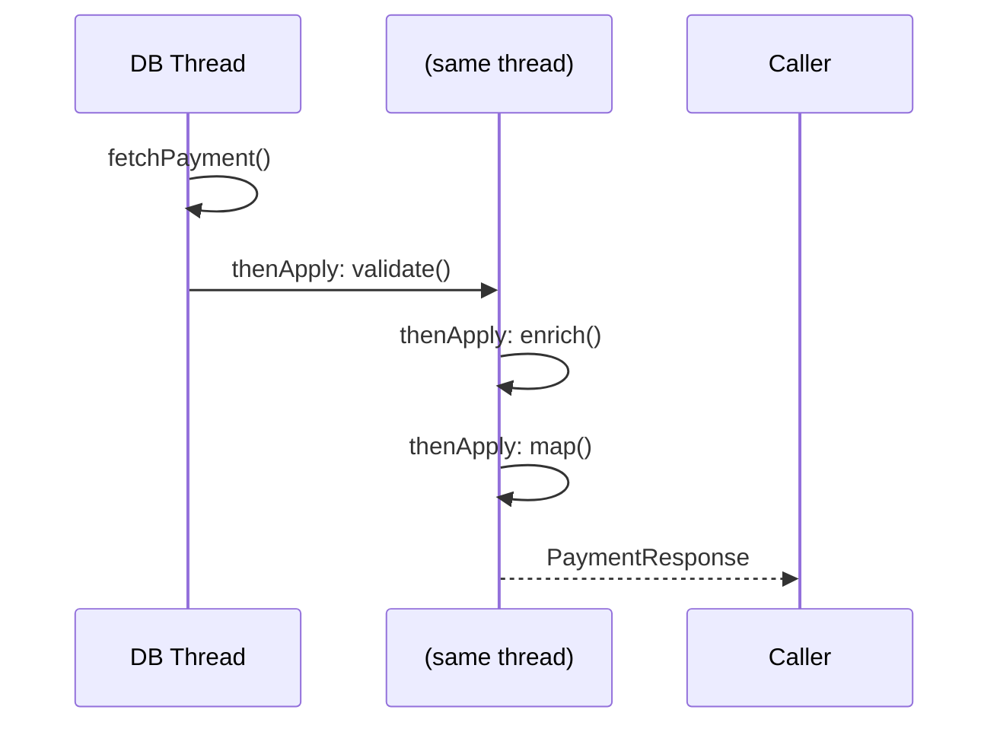
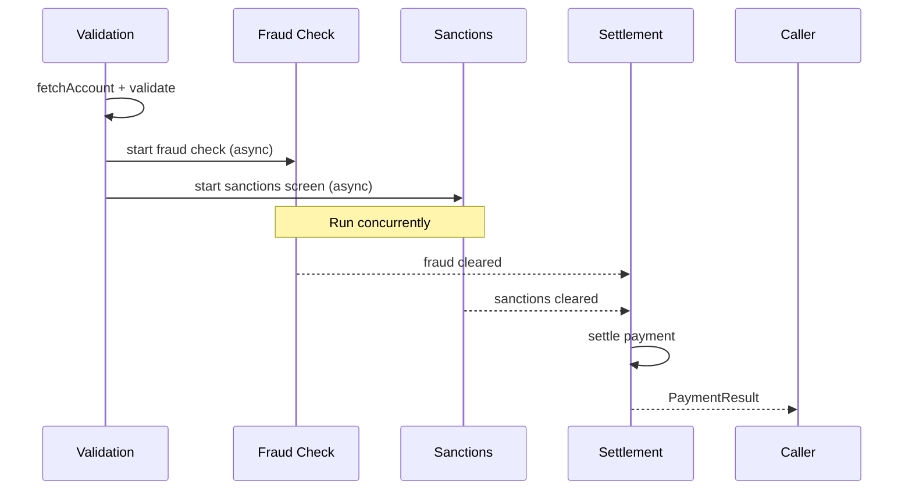

# CompletableFuture — السلاسل غير المتزامنة وتركيبها

## نظرة عامة

‏`CompletableFuture<T>` هو نموذج Java للحسابات غير المتزامنة القابلة للتركيب. وهو يمثل قيمة ستتوفر في المستقبل، ويقدم واجهة غنية لسلسلة المراحل غير المتزامنة وجمعها ومعالجة إخفاقاتها — دون حجب الخيوط بين المراحل.

لنأخذ مسار إثراء دفع متزامنًا يستدعي ثلاث خدمات مستقلة بالتتابع. فإذا استغرق كل استدعاء 50ms، يكون الزمن الكلي 150ms:

```
Request → FX Rate Service (50 ms) → Fraud Score (50 ms) → Account Lookup (50 ms) → Response
```

لا يعتمد أي من الاستدعاءات الثلاثة على بيانات غيره. ومع `CompletableFuture` تعمل بالتوازي ويكتمل المسار في نحو 50ms (أبطأ استدعاء منفرد):

```
                   ┌→ FX Rate Service (50 ms) ─┐
Request ──────────→├→ Fraud Score     (50 ms) ─┤──→ Combine → Response (~50 ms)
                   └→ Account Lookup  (50 ms) ─┘
```

وفي مسار معالجة المدفوعات، يتيح `CompletableFuture` تشغيل فحص الاحتيال، والتحقق من الرصيد، والتوجيه كمراحل متزامنة، مع إطلاق خطوة التسوية النهائية فقط عندما تنجح كل المتطلبات. والنتيجة: مسار يعمل في زمن أطول مرحلة لا في مجموع أزمنة المراحل، فتتحسن الإنتاجية وزمن الاستجابة كثيرًا.

يغطي هذا الدرس واجهة `CompletableFuture` كاملة في سياق مسارات معالجة مدفوعات حقيقية.

## أهداف التعلم

في نهاية هذا الدرس ستستطيع:

- إنشاء نسخ `CompletableFuture` وإكمالها
- سلسلة التحويلات بـ `thenApply` و`thenAccept` و`thenRun`
- تركيب العمليات غير المتزامنة بـ `thenCompose`
- معالجة الاستثناءات بـ `exceptionally` و`handle` و`whenComplete`
- جمع عدة مستقبليات بـ `allOf` و`anyOf` و`thenCombine`
- تطبيق المهل بـ `orTimeout` و`completeOnTimeout`
- تمرير `Executor` مخصص دائمًا لتجنب مخاطر مجمّع الخيوط المشترك
- فهم كيف تتفاعل الخيوط الافتراضية مع `CompletableFuture`

## أساسيات CompletableFuture

```java17
import java.util.concurrent.CompletableFuture;

// 1. Create a future manually
CompletableFuture<PaymentResult> future = new CompletableFuture<>();
// Complete it later (from another thread)
future.complete(PaymentResult.success("TXN-001"));
// Or complete exceptionally
future.completeExceptionally(new PaymentGatewayException("Timeout"));

// 2. Completed future (immediate value)
CompletableFuture<Money> amount = CompletableFuture.completedFuture(Money.of(100, "GBP"));

// 3. Run async computation
CompletableFuture<FraudScore> fraudCheck = CompletableFuture.supplyAsync(
    () -> fraudService.check(payment),    // Without the 2nd argument: commonPool — AVOID
    fraudExecutor                          // Always supply a named, bounded executor
);
```

> [!WARNING]
> **مرّر دائمًا `Executor` صريحًا إلى `supplyAsync` و`runAsync` وكل طرق `...Async`.** فالافتراضي هو `ForkJoinPool.commonPool()` — مجمّع مشترك على مستوى JVM تستخدمه أيضًا التدفقات المتوازية. وفحص دفع بطيء قد يشبع المجمّع المشترك فيعطّل كل العمل المتوازي الآخر في JVM. استخدم دائمًا منفّذًا معزولًا ومسمّى.

## التحويل: thenApply

يحوّل `thenApply` نتيجة مرحلة بشكل متزامن، عادة في **الخيط نفسه** الذي أكمل المرحلة السابقة — أو في الخيط المستدعي إذا كانت المرحلة السابقة قد اكتملت عند استدعاء `thenApply`. استخدمه للتحويلات السريعة غير الحاجبة.

```java17
CompletableFuture<PaymentResponse> pipeline = CompletableFuture
    .supplyAsync(() -> paymentRepository.findById(paymentId), dbExecutor)
    // thenApply: transform Payment → ValidatedPayment (fast, no I/O)
    .thenApply(payment -> paymentValidator.validate(payment))
    // thenApply: transform ValidatedPayment → EnrichedPayment (fast, in-memory)
    .thenApply(validated -> enrichmentService.enrich(validated))
    // thenApply: transform EnrichedPayment → PaymentResponse (fast, mapping)
    .thenApply(enriched -> responseMapper.toResponse(enriched));
```



## التحويل غير المتزامن: thenApplyAsync

يشغّل `thenApplyAsync` التحويل على خيط آخر (من المنفّذ الممرر). استخدمه عندما يكون التحويل بطيئًا أو يجب ألا يحتجز خيط المرحلة السابقة.

```java17
CompletableFuture<SanctionsResult> check = CompletableFuture
    .supplyAsync(() -> paymentRepository.findById(paymentId), dbExecutor)
    // Run on a separate executor — frees the DB thread for more DB work
    .thenApplyAsync(payment -> sanctionsService.check(payment), sanctionsExecutor);
```

## التركيب غير المتزامن: thenCompose

‏`thenCompose` هو **flatMap** في `CompletableFuture`. استخدمه عندما تعيد المرحلة التالية نفسها `CompletableFuture` — فـ `thenApply` كان سينتج مستقبلًا متداخلًا `CompletableFuture<CompletableFuture<T>>`.

```java17
// WRONG: thenApply with an async function — produces nested future
CompletableFuture<CompletableFuture<FraudScore>> nested = CompletableFuture
    .supplyAsync(() -> fetchPayment(id), dbExecutor)
    .thenApply(payment -> fraudService.checkAsync(payment)); // Returns CF<FraudScore>

// CORRECT: thenCompose flattens the nested future
CompletableFuture<FraudScore> flat = CompletableFuture
    .supplyAsync(() -> fetchPayment(id), dbExecutor)
    .thenCompose(payment -> fraudService.checkAsync(payment)); // CF<FraudScore> — flat
```

### مسار معالجة دفع كامل

```java17
// A realistic payment pipeline with concurrent fraud + sanctions checks
public CompletableFuture<PaymentResult> processPayment(PaymentRequest request) {

    // Stage 1: Fetch account and validate (sequential — validation needs account data)
    CompletableFuture<ValidatedPayment> validationStage = CompletableFuture
        .supplyAsync(() -> accountService.fetchForPayment(request.getAccountId()), dbExecutor)
        .thenApply(account -> paymentValidator.validate(request, account));

    // Stage 2a: Fraud check (runs in parallel with 2b)
    CompletableFuture<FraudDecision> fraudStage = validationStage
        .thenComposeAsync(
            validated -> fraudService.checkAsync(validated),
            fraudExecutor
        );

    // Stage 2b: Sanctions screening (runs in parallel with 2a)
    CompletableFuture<SanctionsResult> sanctionsStage = validationStage
        .thenComposeAsync(
            validated -> sanctionsService.screenAsync(validated),
            sanctionsExecutor
        );

    // Stage 3: Wait for BOTH fraud and sanctions (must both pass)
    return fraudStage.thenCombine(sanctionsStage, (fraud, sanctions) -> {
        if (fraud.isBlocked()) throw new FraudBlockException(fraud.getReason());
        if (sanctions.isHit())  throw new SanctionsHitException(sanctions.getMatch());
        return true; // Both cleared
    })
    // Stage 4: Execute settlement (only if stages 2a and 2b both cleared)
    .thenComposeAsync(
        cleared -> settlementService.settleAsync(request),
        settlementExecutor
    )
    // Stage 5: Map to response
    .thenApply(settlement -> PaymentResult.success(settlement.getTransactionId()));
}
```

يُجلب الحساب ويُتحقق منه أولًا، ثم يعمل فحص الاحتيال وفحص العقوبات بالتوازي، ولا تتم التسوية إلا إذا اجتاز الاثنان.



## معالجة الاستثناءات

### exceptionally — التعافي من الفشل

```java17
CompletableFuture<FraudScore> withFallback = CompletableFuture
    .supplyAsync(() -> fraudService.check(payment), fraudExecutor)
    // If fraud service throws, return a fallback score.
    // Fail-open vs fail-closed is a RISK decision, not a coding one: many
    // banks fail closed, or allow only small amounts and send the rest to
    // manual review. Record every fallback decision.
    .exceptionally(ex -> {
        log.warn("Fraud service unavailable: {}", ex.getMessage());
        metricsService.increment("fraud.service.error");
        return FraudScore.fallbackScore();
    });
```

الفشل المفتوح مقابل الفشل المغلق قرار **مخاطر** لا قرار برمجي: فكثير من البنوك تفشل مغلقة، أو تسمح بالمبالغ الصغيرة فقط وترسل الباقي للمراجعة اليدوية. وسجّل كل قرار بديل.

### handle — تحويل النجاح والفشل معًا

```java17
CompletableFuture<PaymentResponse> withHandling = CompletableFuture
    .supplyAsync(() -> processPayment(request), paymentExecutor)
    // handle receives (result, exception) — exactly one will be non-null
    .handle((result, ex) -> {
        if (ex != null) {
            log.error("Payment failed: {}", ex.getMessage());
            return PaymentResponse.failure(ex.getMessage());
        }
        return PaymentResponse.success(result);
    });
```

### whenComplete — آثار جانبية عند الاكتمال

```java17
CompletableFuture<PaymentResult> withAudit = paymentFuture
    // whenComplete: runs on both success and failure — does not transform the result
    .whenComplete((result, ex) -> {
        if (ex != null) {
            auditService.recordFailure(request, ex);
        } else {
            auditService.recordSuccess(request, result);
        }
        // The result/exception is forwarded unchanged to the next stage
    });
```

### انتشار الاستثناءات

```java17
// Exceptions propagate through thenApply / thenCompose stages
// They skip transformations and are only caught by exceptionally / handle
CompletableFuture<PaymentResult> pipeline = CompletableFuture
    .supplyAsync(() -> fetchPayment(id), dbExecutor)      // throws → propagates
    .thenApply(p -> validate(p))                           // SKIPPED if prev threw
    .thenCompose(v -> fraudCheck(v))                       // SKIPPED if prev threw
    .exceptionally(ex -> PaymentResult.failed(ex))         // Catches all upstream failures
                                                           // (ex is usually a CompletionException:
                                                           //  use ex.getCause() for the real error)
    .thenApply(r -> enrichResponse(r));                    // Runs on both success and recovered failure
```

تتخطى الاستثناءات مراحل `thenApply` و`thenCompose` حتى تصل إلى `exceptionally` أو `handle`. والاستثناء الواصل عادة `CompletionException`، فاستخدم `ex.getCause()` للخطأ الحقيقي.

## جمع عدة مستقبليات

### allOf — انتظر الكل

```java17
// Run multiple async checks in parallel; wait for ALL to complete
CompletableFuture<Void> allChecks = CompletableFuture.allOf(
    fraudFuture,
    sanctionsFuture,
    duplicateFuture,
    limitFuture
);

// allOf returns Void — to get results, chain with thenApply
CompletableFuture<PaymentDecision> decision = allChecks.thenApply(ignored -> {
    // All futures are complete at this point — join() will not block
    FraudDecision  fraud     = fraudFuture.join();
    SanctionsResult sanctions = sanctionsFuture.join();
    DuplicateCheck dup        = duplicateFuture.join();
    LimitCheck     limit      = limitFuture.join();
    return decisionEngine.decide(fraud, sanctions, dup, limit);
});
```

### anyOf — الأول في الاكتمال

```java17
// Contact multiple sanctions providers; use the first response
// Useful for latency hedging — if one provider is slow, another may respond first
CompletableFuture<SanctionsResult> fastest = (CompletableFuture<SanctionsResult>)
    CompletableFuture.anyOf(
        providerA.checkAsync(payment),
        providerB.checkAsync(payment),
        providerC.checkAsync(payment)
    );
// WARNING 1: anyOf completes with the FIRST result — including a first
// FAILURE. A provider that fails fast beats one that answers correctly.
// To get the first SUCCESS, complete a shared future only on success.
// WARNING 2: anyOf cancels nothing — the other providers keep running, and
// calling cancel() on a CompletableFuture does NOT stop the work behind it.
// To save resources, cancel the underlying requests (e.g. the HTTP calls).
```

تحذيران: يكتمل `anyOf` بالنتيجة **الأولى** — حتى لو كانت **فشلًا**. فالمزوّد الذي يفشل بسرعة يتغلب على من يجيب بشكل صحيح. وللحصول على أول **نجاح**، أكمل مستقبلًا مشتركًا عند النجاح فقط. كما أن `anyOf` لا يلغي شيئًا — فيستمر المزوّدون الآخرون في العمل، واستدعاء `cancel()` على `CompletableFuture` **لا** يوقف العمل الذي خلفه. ولتوفير الموارد، ألغِ الطلبات الأساسية نفسها (مثل استدعاءات HTTP).

### thenCombine — دمج نتيجتين

```java17
// Combine results of two independent async operations
CompletableFuture<PaymentDecision> combined = fraudFuture
    .thenCombine(sanctionsFuture, (fraud, sanctions) -> {
        // Both futures are complete — combine results
        return new PaymentDecision(
            fraud.isBlocked() || sanctions.isHit(),
            fraud.getRiskScore(),
            sanctions.getMatchedList()
        );
    });
```

## المهل الزمنية

المهل حاسمة في أنظمة الدفع — فالخدمة اللاحقة التي لا تستجيب يجب ألا تحجب إلى الأبد.

```java17
// Java 9+: orTimeout — completes exceptionally with TimeoutException after duration
CompletableFuture<FraudScore> fraudWithTimeout = CompletableFuture
    .supplyAsync(() -> fraudService.check(payment), fraudExecutor)
    .orTimeout(500, TimeUnit.MILLISECONDS); // TimeoutException if not done in 500ms

// Java 9+: completeOnTimeout — completes with a default value after duration
CompletableFuture<FraudScore> fraudWithDefault = CompletableFuture
    .supplyAsync(() -> fraudService.check(payment), fraudExecutor)
    .completeOnTimeout(FraudScore.defaultScore(), 500, TimeUnit.MILLISECONDS);
```

```java17
// Full pipeline with per-stage timeouts and fallbacks
// NOTE: a timeout's clock starts when orTimeout/completeOnTimeout is CALLED.
// Chained at the end of the pipeline, it starts at build time and also counts
// earlier stages. To time one stage, put the timeout on that stage's own
// future — inside thenCompose, as below. (A timeout stops the WAITING, not
// the remote call itself.)
public CompletableFuture<PaymentResult> processWithTimeouts(PaymentRequest request) {
    return CompletableFuture
        .supplyAsync(() -> fetchAccount(request.getAccountId()), dbExecutor)
        .orTimeout(200, TimeUnit.MILLISECONDS)
        .thenComposeAsync(account ->
            fraudService.checkAsync(account, request)
                // fraud stage only: 300ms from when the fraud call starts
                .completeOnTimeout(FraudScore.fallbackScore(), 300, TimeUnit.MILLISECONDS),
            fraudExecutor)
        .thenComposeAsync(fraud -> {
            if (fraud.isBlocked()) return CompletableFuture.failedFuture(
                new FraudBlockException(fraud.getReason()));
            return settlementService.settleAsync(request);
        }, settlementExecutor)
        .orTimeout(1_000, TimeUnit.MILLISECONDS)
        .exceptionally(ex -> PaymentResult.failed(classifyError(ex)));
}
```

ملاحظة: تبدأ ساعة المهلة عند **استدعاء** `orTimeout` أو `completeOnTimeout`. فإذا سُلسلت في نهاية المسار، تبدأ عند بناء المسار وتحسب المراحل السابقة أيضًا. ولتوقيت مرحلة واحدة، ضع المهلة على مستقبل تلك المرحلة نفسها — داخل `thenCompose` كما أعلاه. والمهلة توقف **الانتظار** لا الاستدعاء البعيد نفسه.

## Java 21: ‏CompletableFuture مع الخيوط الافتراضية

```java21
// Java 21 — virtual thread executor with CompletableFuture
// Virtual threads park on blocking I/O, not pin carrier threads
// This makes CompletableFuture pipelines more efficient for I/O-heavy stages

public class PaymentPipelineService {

    // Virtual thread executor for all I/O-bound stages
    private final ExecutorService vtExecutor =
        Executors.newVirtualThreadPerTaskExecutor();

    public CompletableFuture<PaymentResult> process(PaymentRequest request) {
        return CompletableFuture
            .supplyAsync(() -> accountService.fetchForPayment(request.getAccountId()), vtExecutor)
            .thenApply(account -> paymentValidator.validate(request, account))
            .thenComposeAsync(validated ->
                // Virtual thread parks on fraud service HTTP call — no carrier blocking
                CompletableFuture.supplyAsync(() -> fraudService.check(validated), vtExecutor),
                vtExecutor
            )
            .thenComposeAsync(fraud ->
                CompletableFuture.supplyAsync(() -> settlementService.settle(request), vtExecutor),
                vtExecutor
            )
            .thenApply(settlement -> PaymentResult.success(settlement.getTransactionId()))
            .orTimeout(2_000, TimeUnit.MILLISECONDS);
    }
}
```

> [!NOTE]
> مع الخيوط الافتراضية في Java 21، كثيرًا ما تستطيع تبسيط مسار `CompletableFuture` إلى شيفرة حاجبة متتابعة — فتحقق JVM التزامن نفسه دون تعقيد التركيب غير المتزامن. فكّر هل يبرر تعقيد `thenCompose` / `allOf` نفسه، أم أن شيفرة الخيوط الافتراضية المتتابعة أوضح وبالأداء نفسه لحالتك.

## أخطاء شائعة

```java17
// MISTAKE 1: Using ForkJoinPool.commonPool() (the default)
CompletableFuture.supplyAsync(() -> slowDbCall()); // Uses commonPool — AVOID
// FIX: always pass an executor
CompletableFuture.supplyAsync(() -> slowDbCall(), dbExecutor); // ✓

// MISTAKE 2: Blocking inside a stage that runs on a shared or CPU pool
CompletableFuture.supplyAsync(() -> {
    blockingHttpCall();   // Blocks a pool thread for the whole call
    return result;
}, cpuExecutor);
// FIX: run blocking calls on a dedicated, bounded I/O executor or on
// virtual threads — never on commonPool or a CPU-sized pool

// MISTAKE 3: get() without timeout — can block forever
PaymentResult result = future.get(); // DANGEROUS — no timeout
// FIX: always timeout
PaymentResult result = future.get(1, TimeUnit.SECONDS); // ✓

// MISTAKE 4: join() in a staged pipeline — blocks the thread
CompletableFuture<X> result = future
    .thenApply(v -> anotherFuture(v).join()); // join() inside thenApply blocks thread
// FIX: use thenCompose instead of thenApply + join
CompletableFuture<X> result = future.thenCompose(v -> anotherFuture(v)); // ✓

// MISTAKE 5: Swallowing exceptions silently
future.exceptionally(ex -> null); // Returns null — exception is gone
// FIX: log and return meaningful fallback
future.exceptionally(ex -> { log.error("...", ex); return fallback; }); // ✓
```

1. استخدام `ForkJoinPool.commonPool()` الافتراضي — مرّر منفّذًا دائمًا.
2. الحجب داخل مرحلة تعمل على مجمّع مشترك أو مجمّع معالجة — شغّل الاستدعاءات الحاجبة على منفّذ إدخال/إخراج مخصص ومحدود أو على خيوط افتراضية.
3. ‏`get()` بلا مهلة — قد يحجب إلى الأبد.
4. ‏`join()` داخل `thenApply` — استخدم `thenCompose` بدلًا منه.
5. ابتلاع الاستثناءات بصمت — سجّلها وأعد بديلًا ذا معنى.


<!-- KNOWLEDGE-CHECK [
  {
    "id": "kc-cf-01",
    "question": "يستدعي مسار `CompletableFuture` الطريقة `thenApply(payment -> fraudService.checkAsync(payment))` حيث تعيد `checkAsync` كائن `CompletableFuture<FraudScore>`. ما نوع المستقبل الناتج؟",
    "options": [
      "CompletableFuture<FraudScore>",
      "CompletableFuture<CompletableFuture<FraudScore>>",
      "FraudScore",
      "CompletableFuture<Void>"
    ],
    "correct": 1,
    "explanation": "يغلّف thenApply أي شيء تعيده الدالة. ولأن checkAsync() تعيد CompletableFuture<FraudScore>، ينتج thenApply مستقبلًا متداخلًا CompletableFuture<CompletableFuture<FraudScore>>. ولتسطيحه استخدم thenCompose بدل thenApply. فـ thenCompose يكافئ flatMap — يشترك في المستقبل الداخلي ويعيد نتيجته مباشرة."
  },
  {
    "id": "kc-cf-02",
    "question": "لمسار مراحل: supplyAsync ← thenApply ← thenCompose ← exceptionally. ترمي مرحلة `thenApply` استثناء. أي المراحل تُنفّذ؟",
    "options": [
      "كل المراحل — تُلتقط الاستثناءات وتُعالج في كل مرحلة",
      "supplyAsync وthenApply فقط — يتوقف المسار عند الاستثناء",
      "supplyAsync، ثم thenApply (ترمي)، وتُتخطى thenCompose، وتلتقط exceptionally الاستثناء",
      "supplyAsync، ثم thenApply (ترمي)، وتلتقطه thenCompose داخليًا"
    ],
    "correct": 2,
    "explanation": "في مسار CompletableFuture، يعلّم الاستثناء في أي مرحلة المستقبل كمكتمل استثنائيًا. وكل مراحل thenApply وthenCompose اللاحقة **تُتخطى** — تتلقى الاستثناء لكنها لا تشغّل دوالها. وينتشر الاستثناء حتى يصل إلى مرحلة exceptionally() أو handle(). فلا تعمل في هذه الحالة إلا exceptionally()، فتلتقط الاستثناء القادم من thenApply."
  },
  {
    "id": "kc-cf-03",
    "question": "تُجمع ثلاثة مستقبليات لمزوّدي احتيال بـ `CompletableFuture.anyOf()`. يرد المزوّد A خلال 50ms. ماذا يحدث لمستقبلي المزوّدين B وC؟",
    "options": [
      "يُلغيان تلقائيًا عند اكتمال المزوّد A",
      "يستمران في العمل — لا يلغي anyOf() المستقبليات الخاسرة",
      "يرميان CancellationException بعد اكتمال anyOf()",
      "يكتملان بقيم null"
    ],
    "correct": 1,
    "explanation": "يكتمل CompletableFuture.anyOf() بمجرد اكتمال أي مستقبل مدخل — لكنه لا يلغي المستقبليات الأخرى. فيستمر المزوّدان B وC في العمل واستهلاك الموارد (الخيوط، واتصالات الشبكة). واستدعاء cancel(true) على CompletableFuture يعلّم ذلك المستقبل كملغى فقط — ولا يقاطع العمل خلفه. ولتوفير الموارد، ألغِ الطلبات الأساسية نفسها (مثلًا عبر عميل HTTP). ولاحظ أيضًا أن anyOf يكتمل بالنتيجة الأولى حتى لو كانت فشلًا."
  },
  {
    "id": "kc-cf-04",
    "question": "لماذا يجب أن تمرر دائمًا Executor صريحًا إلى `supplyAsync()` بدل استخدام الافتراضي؟",
    "options": [
      "المنفّذ الافتراضي أحادي الخيط ولا يستطيع تشغيل مهام متزامنة",
      "الافتراضي هو ForkJoinPool.commonPool() — مشترك على مستوى JVM مع التدفقات المتوازية؛ والمهام البطيئة قد تجوّع عملًا آخر",
      "المنفّذ الافتراضي لا يدعم معالجة الاستثناءات",
      "للمنفّذ الافتراضي مهلة 100ms على كل المهام"
    ],
    "correct": 1,
    "explanation": "المنفّذ الافتراضي لطرق CompletableFuture غير المتزامنة هو ForkJoinPool.commonPool() — المجمّع نفسه الذي تستخدمه التدفقات المتوازية، والمهام المتكررة، وأي CompletableFuture آخر في JVM. وقد يملأ فحص دفع بطيء أو استدعاء قاعدة بيانات المجمّع المشترك، فيحجب كل عمليات التدفقات المتوازية والعمل غير المتزامن الآخر. استخدم دائمًا منفّذًا معزولًا ومسمّى حتى لا تؤثر المهام البطيئة لخدمة في خدمات أخرى."
  }
] -->


<!-- PRACTICAL-CHALLENGE {
  "id": "pc-completable-future",
  "title": "مسار معالجة مدفوعات غير متزامن",
  "description": "ابنِ مسار دفع غير متزامن بمستوى إنتاجي باستخدام تركيب CompletableFuture.",
  "tasks": [
    {
      "id": "pc-cf-01",
      "description": "نفّذ `PaymentPipeline.process(PaymentRequest)` التي تعيد `CompletableFuture<PaymentResult>` بهذه المراحل: (1) fetchAccount (قاعدة بيانات، 50ms)، (2) validate (في الذاكرة، سريع)، (3) فحص الاحتيال وفحص العقوبات **بالتوازي** (كل منهما نحو 200ms)، (4) التسوية فقط إذا اجتاز الاثنان، (5) سجل التدقيق أيًا كانت النتيجة. واستخدم منفّذات مسمّاة ومعزولة لكل مرحلة إدخال/إخراج."
    },
    {
      "id": "pc-cf-02",
      "description": "أضف مهلًا لكل مرحلة: fetchAccount خلال 100ms، وفحص الاحتيال خلال 300ms، والعقوبات خلال 300ms، والتسوية خلال 1000ms — كل منها مقيسة من بداية مرحلتها (ضع المهلة على مستقبل تلك المرحلة). ويجب أن تُنتج كل مهلة سبب فشل محددًا في PaymentResult النهائية — لا TimeoutException عامة."
    },
    {
      "id": "pc-cf-03",
      "description": "نفّذ فحص احتيال متحوطًا: اتصل بمزوّدي احتيال في الوقت نفسه واستخدم أول رد **ناجح** (فـ anyOf وحده يقبل أيضًا أول فشل). وألغِ طلب HTTP الأساسي للمزوّد الأبطأ لتجنب العمل المهدر. وأضف مهلة كلية 500ms — فإذا لم يرد أي مزوّد، افشل الدفعة بـ FraudServiceUnavailableException."
    },
    {
      "id": "pc-cf-04",
      "description": "قارن زمن المسار بين: (أ) Java 17 حاجب متتابع، (ب) Java 17 بمراحل CompletableFuture متوازية، (ج) Java 21 بخيوط افتراضية حاجبة متتابعة. ومع احتيال=200ms وعقوبات=200ms، احسب الزمن الفعلي المتوقع لكل أسلوب، واشرح أيها المفضل لمهندس رئيسي يصون قاعدة الشيفرة هذه على المدى الطويل."
    }
  ]
} -->
