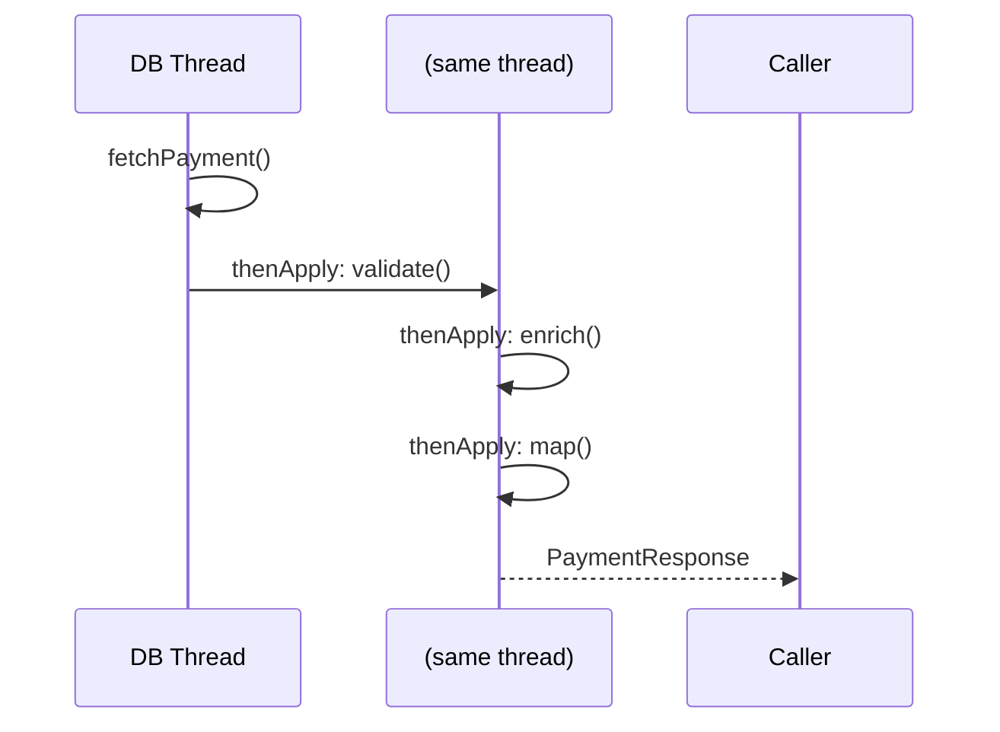
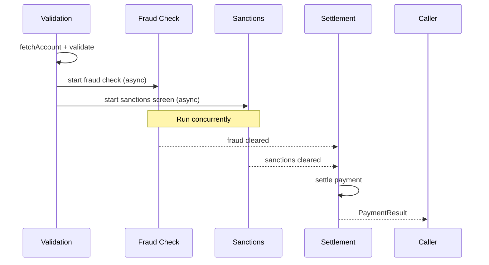

## Overview

`CompletableFuture<T>` is Java's composable asynchronous computation model. It represents a value that will be available in the future and provides a rich API to chain, combine, and handle failures across asynchronous stages — without blocking threads between stages.

In a payment processing pipeline, `CompletableFuture` enables fraud check, balance validation, and routing to run as concurrent stages, with the final settlement step triggered only when all prerequisites succeed. The result: a pipeline that runs in max(stage_times) rather than sum(stage_times), dramatically improving throughput and latency.

This lesson covers the full `CompletableFuture` API in the context of real payment processing pipelines.

## Learning Objectives

By the end of this lesson you will be able to:

- Create and complete `CompletableFuture` instances
- Chain transformations with `thenApply`, `thenAccept`, and `thenRun`
- Compose async operations with `thenCompose`
- Handle exceptions with `exceptionally`, `handle`, and `whenComplete`
- Combine multiple futures with `allOf`, `anyOf`, and `thenCombine`
- Apply timeouts with `orTimeout` and `completeOnTimeout`
- Always supply a custom `Executor` to avoid common thread pool pitfalls
- Understand how virtual threads interact with `CompletableFuture`

## CompletableFuture Basics

```java17
import java.util.concurrent.CompletableFuture;

// 1. Create a future manually
CompletableFuture<PaymentResult> future = new CompletableFuture<>();
// Complete it later (from another thread)
future.complete(PaymentResult.success("TXN-001"));
// Or complete exceptionally
future.completeExceptionally(new PaymentGatewayException("Timeout"));

// 2. Completed future (immediate value)
CompletableFuture<Money> amount = CompletableFuture.completedFuture(Money.of(100, "GBP"));

// 3. Run async computation
CompletableFuture<FraudScore> fraudCheck = CompletableFuture.supplyAsync(
    () -> fraudService.check(payment),    // Runs on ForkJoinPool.commonPool() — AVOID
    fraudExecutor                          // Always supply a named, bounded executor
);
```

> [!WARNING]
> **Always supply an explicit `Executor` to `supplyAsync`, `runAsync`, and all `...Async` methods.** The default is `ForkJoinPool.commonPool()` — a shared JVM-wide pool also used by parallel streams. A slow payment check can saturate the common pool, stalling all other parallel work in the JVM. Always use an isolated, named executor.

## Transformation: thenApply

`thenApply` transforms the result of a stage synchronously in the **same thread** that completed the previous stage. Use it for fast, non-blocking transformations.

```java17
CompletableFuture<PaymentResponse> pipeline = CompletableFuture
    .supplyAsync(() -> paymentRepository.findById(paymentId), dbExecutor)
    // thenApply: transform Payment → ValidatedPayment (fast, no I/O)
    .thenApply(payment -> paymentValidator.validate(payment))
    // thenApply: transform ValidatedPayment → EnrichedPayment (fast, in-memory)
    .thenApply(validated -> enrichmentService.enrich(validated))
    // thenApply: transform EnrichedPayment → PaymentResponse (fast, mapping)
    .thenApply(enriched -> responseMapper.toResponse(enriched));
```



## Async Transformation: thenApplyAsync

`thenApplyAsync` runs the transformation on a different thread (from the supplied executor). Use it when the transformation is slow or should not hold the previous stage's thread.

```java17
CompletableFuture<SanctionsResult> check = CompletableFuture
    .supplyAsync(() -> paymentRepository.findById(paymentId), dbExecutor)
    // Run on a separate executor — frees the DB thread for more DB work
    .thenApplyAsync(payment -> sanctionsService.check(payment), sanctionsExecutor);
```

## Async Composition: thenCompose

`thenCompose` is the **flatMap** of `CompletableFuture`. Use it when the next stage itself returns a `CompletableFuture` — `thenApply` would produce a nested `CompletableFuture<CompletableFuture<T>>`.

```java17
// WRONG: thenApply with an async function — produces nested future
CompletableFuture<CompletableFuture<FraudScore>> nested = CompletableFuture
    .supplyAsync(() -> fetchPayment(id), dbExecutor)
    .thenApply(payment -> fraudService.checkAsync(payment)); // Returns CF<FraudScore>

// CORRECT: thenCompose flattens the nested future
CompletableFuture<FraudScore> flat = CompletableFuture
    .supplyAsync(() -> fetchPayment(id), dbExecutor)
    .thenCompose(payment -> fraudService.checkAsync(payment)); // CF<FraudScore> — flat
```

### Full Payment Processing Pipeline

```java17
// A realistic payment pipeline with concurrent fraud + sanctions checks
public CompletableFuture<PaymentResult> processPayment(PaymentRequest request) {

    // Stage 1: Fetch account and validate (sequential — validation needs account data)
    CompletableFuture<ValidatedPayment> validationStage = CompletableFuture
        .supplyAsync(() -> accountService.fetchForPayment(request.getAccountId()), dbExecutor)
        .thenApply(account -> paymentValidator.validate(request, account));

    // Stage 2a: Fraud check (runs in parallel with 2b)
    CompletableFuture<FraudDecision> fraudStage = validationStage
        .thenComposeAsync(
            validated -> fraudService.checkAsync(validated),
            fraudExecutor
        );

    // Stage 2b: Sanctions screening (runs in parallel with 2a)
    CompletableFuture<SanctionsResult> sanctionsStage = validationStage
        .thenComposeAsync(
            validated -> sanctionsService.screenAsync(validated),
            sanctionsExecutor
        );

    // Stage 3: Wait for BOTH fraud and sanctions (must both pass)
    return fraudStage.thenCombine(sanctionsStage, (fraud, sanctions) -> {
        if (fraud.isBlocked()) throw new FraudBlockException(fraud.getReason());
        if (sanctions.isHit())  throw new SanctionsHitException(sanctions.getMatch());
        return true; // Both cleared
    })
    // Stage 4: Execute settlement (only if stages 2a and 2b both cleared)
    .thenComposeAsync(
        cleared -> settlementService.settleAsync(request),
        settlementExecutor
    )
    // Stage 5: Map to response
    .thenApply(settlement -> PaymentResult.success(settlement.getTransactionId()));
}
```



## Exception Handling

### exceptionally — Recover from Failure

```java17
CompletableFuture<FraudScore> withFallback = CompletableFuture
    .supplyAsync(() -> fraudService.check(payment), fraudExecutor)
    // If fraud service throws, return a default score (fail-open or fail-closed)
    .exceptionally(ex -> {
        log.warn("Fraud service unavailable: {}", ex.getMessage());
        metricsService.increment("fraud.service.error");
        return FraudScore.defaultScore(); // Fail-open: allow payment with default score
    });
```

### handle — Transform Both Success and Failure

```java17
CompletableFuture<PaymentResponse> withHandling = CompletableFuture
    .supplyAsync(() -> processPayment(request), paymentExecutor)
    // handle receives (result, exception) — exactly one will be non-null
    .handle((result, ex) -> {
        if (ex != null) {
            log.error("Payment failed: {}", ex.getMessage());
            return PaymentResponse.failure(ex.getMessage());
        }
        return PaymentResponse.success(result);
    });
```

### whenComplete — Side Effects on Completion

```java17
CompletableFuture<PaymentResult> withAudit = paymentFuture
    // whenComplete: runs on both success and failure — does not transform the result
    .whenComplete((result, ex) -> {
        if (ex != null) {
            auditService.recordFailure(request, ex);
        } else {
            auditService.recordSuccess(request, result);
        }
        // The result/exception is forwarded unchanged to the next stage
    });
```

### Exception Propagation

```java17
// Exceptions propagate through thenApply / thenCompose stages
// They skip transformations and are only caught by exceptionally / handle
CompletableFuture<PaymentResult> pipeline = CompletableFuture
    .supplyAsync(() -> fetchPayment(id), dbExecutor)      // throws → propagates
    .thenApply(p -> validate(p))                           // SKIPPED if prev threw
    .thenCompose(v -> fraudCheck(v))                       // SKIPPED if prev threw
    .exceptionally(ex -> PaymentResult.failed(ex))         // Catches all upstream failures
    .thenApply(r -> enrichResponse(r));                    // Runs on both success and recovered failure
```

## Combining Multiple Futures

### allOf — Wait for All

```java17
// Run multiple async checks in parallel; wait for ALL to complete
CompletableFuture<Void> allChecks = CompletableFuture.allOf(
    fraudFuture,
    sanctionsFuture,
    duplicateFuture,
    limitFuture
);

// allOf returns Void — to get results, chain with thenApply
CompletableFuture<PaymentDecision> decision = allChecks.thenApply(ignored -> {
    // All futures are complete at this point — join() will not block
    FraudDecision  fraud     = fraudFuture.join();
    SanctionsResult sanctions = sanctionsFuture.join();
    DuplicateCheck dup        = duplicateFuture.join();
    LimitCheck     limit      = limitFuture.join();
    return decisionEngine.decide(fraud, sanctions, dup, limit);
});
```

### anyOf — First to Complete

```java17
// Contact multiple sanctions providers; use the first response
// Useful for latency hedging — if one provider is slow, another may respond first
CompletableFuture<SanctionsResult> fastest = (CompletableFuture<SanctionsResult>)
    CompletableFuture.anyOf(
        providerA.checkAsync(payment),
        providerB.checkAsync(payment),
        providerC.checkAsync(payment)
    );
// WARNING: anyOf cancels nothing — the other providers keep running
// Consider cancelling the slower futures to avoid wasted work
```

### thenCombine — Merge Two Results

```java17
// Combine results of two independent async operations
CompletableFuture<PaymentDecision> combined = fraudFuture
    .thenCombine(sanctionsFuture, (fraud, sanctions) -> {
        // Both futures are complete — combine results
        return new PaymentDecision(
            fraud.isBlocked() || sanctions.isHit(),
            fraud.getRiskScore(),
            sanctions.getMatchedList()
        );
    });
```

## Timeouts

Timeouts are critical in payment systems — an unresponsive downstream must not block indefinitely.

```java17
// Java 9+: orTimeout — completes exceptionally with TimeoutException after duration
CompletableFuture<FraudScore> fraudWithTimeout = CompletableFuture
    .supplyAsync(() -> fraudService.check(payment), fraudExecutor)
    .orTimeout(500, TimeUnit.MILLISECONDS); // TimeoutException if not done in 500ms

// Java 9+: completeOnTimeout — completes with a default value after duration
CompletableFuture<FraudScore> fraudWithDefault = CompletableFuture
    .supplyAsync(() -> fraudService.check(payment), fraudExecutor)
    .completeOnTimeout(FraudScore.defaultScore(), 500, TimeUnit.MILLISECONDS);
```

```java17
// Full pipeline with per-stage timeouts and fallbacks
public CompletableFuture<PaymentResult> processWithTimeouts(PaymentRequest request) {
    return CompletableFuture
        .supplyAsync(() -> fetchAccount(request.getAccountId()), dbExecutor)
        .orTimeout(200, TimeUnit.MILLISECONDS)
        .thenComposeAsync(account ->
            fraudService.checkAsync(account, request), fraudExecutor)
        .completeOnTimeout(FraudScore.defaultScore(), 300, TimeUnit.MILLISECONDS)
        .thenComposeAsync(fraud -> {
            if (fraud.isBlocked()) return CompletableFuture.failedFuture(
                new FraudBlockException(fraud.getReason()));
            return settlementService.settleAsync(request);
        }, settlementExecutor)
        .orTimeout(1_000, TimeUnit.MILLISECONDS)
        .exceptionally(ex -> PaymentResult.failed(classifyError(ex)));
}
```

## Java 21: CompletableFuture with Virtual Threads

```java21
// Java 21 — virtual thread executor with CompletableFuture
// Virtual threads park on blocking I/O, not pin carrier threads
// This makes CompletableFuture pipelines more efficient for I/O-heavy stages

public class PaymentPipelineService {

    // Virtual thread executor for all I/O-bound stages
    private final ExecutorService vtExecutor =
        Executors.newVirtualThreadPerTaskExecutor();

    public CompletableFuture<PaymentResult> process(PaymentRequest request) {
        return CompletableFuture
            .supplyAsync(() -> accountService.fetchForPayment(request.getAccountId()), vtExecutor)
            .thenApply(account -> paymentValidator.validate(request, account))
            .thenComposeAsync(validated ->
                // Virtual thread parks on fraud service HTTP call — no carrier blocking
                CompletableFuture.supplyAsync(() -> fraudService.check(validated), vtExecutor),
                vtExecutor
            )
            .thenComposeAsync(fraud ->
                CompletableFuture.supplyAsync(() -> settlementService.settle(request), vtExecutor),
                vtExecutor
            )
            .thenApply(settlement -> PaymentResult.success(settlement.getTransactionId()))
            .orTimeout(2_000, TimeUnit.MILLISECONDS);
    }
}
```

> [!NOTE]
> With Java 21 virtual threads, you can often simplify a `CompletableFuture` pipeline to sequential blocking code — the JVM achieves the same concurrency without the complexity of async composition. Consider whether the pipeline complexity of `thenCompose` / `allOf` is justified, or whether sequential virtual thread code is clearer and equally performant for your use case.

## Common Mistakes

```java17
// MISTAKE 1: Using ForkJoinPool.commonPool() (the default)
CompletableFuture.supplyAsync(() -> slowDbCall()); // Uses commonPool — AVOID
// FIX: always pass an executor
CompletableFuture.supplyAsync(() -> slowDbCall(), dbExecutor); // ✓

// MISTAKE 2: Blocking inside a CompletableFuture stage
CompletableFuture.supplyAsync(() -> {
    Thread.sleep(5000); // Blocks the thread — kills throughput
    return result;
}, executor);
// FIX: orTimeout / async stages / virtual threads

// MISTAKE 3: get() without timeout — can block forever
PaymentResult result = future.get(); // DANGEROUS — no timeout
// FIX: always timeout
PaymentResult result = future.get(1, TimeUnit.SECONDS); // ✓

// MISTAKE 4: join() in a staged pipeline — blocks the thread
CompletableFuture<X> result = future
    .thenApply(v -> anotherFuture(v).join()); // join() inside thenApply blocks thread
// FIX: use thenCompose instead of thenApply + join
CompletableFuture<X> result = future.thenCompose(v -> anotherFuture(v)); // ✓

// MISTAKE 5: Swallowing exceptions silently
future.exceptionally(ex -> null); // Returns null — exception is gone
// FIX: log and return meaningful fallback
future.exceptionally(ex -> { log.error("...", ex); return fallback; }); // ✓
```

---

<!-- KNOWLEDGE-CHECK [
  {
    "id": "kc-cf-01",
    "question": "A `CompletableFuture` pipeline calls `thenApply(payment -> fraudService.checkAsync(payment))` where `checkAsync` returns `CompletableFuture<FraudScore>`. What is the type of the resulting future?",
    "options": [
      "CompletableFuture<FraudScore>",
      "CompletableFuture<CompletableFuture<FraudScore>>",
      "FraudScore",
      "CompletableFuture<Void>"
    ],
    "correct": 1,
    "explanation": "thenApply wraps whatever the function returns. Since checkAsync() returns CompletableFuture<FraudScore>, thenApply produces CompletableFuture<CompletableFuture<FraudScore>> — a nested future. To flatten this, use thenCompose instead of thenApply. thenCompose is the equivalent of flatMap — it subscribes to the inner future and returns its result directly."
  },
  {
    "id": "kc-cf-02",
    "question": "A pipeline has stages: supplyAsync → thenApply → thenCompose → exceptionally. The `thenApply` stage throws an exception. Which stages execute?",
    "options": [
      "All stages — exceptions are caught and handled per stage",
      "Only supplyAsync and thenApply — the pipeline stops on exception",
      "supplyAsync, thenApply (throws), thenCompose is skipped, exceptionally catches the exception",
      "supplyAsync, thenApply (throws), thenCompose catches it internally"
    ],
    "correct": 2,
    "explanation": "In a CompletableFuture pipeline, an exception in any stage marks the future as exceptionally completed. All subsequent thenApply and thenCompose stages are SKIPPED — they receive the exception but do not run their functions. The exception propagates until it reaches an exceptionally() or handle() stage. Only exceptionally() runs in this case, catching the exception from thenApply."
  },
  {
    "id": "kc-cf-03",
    "question": "Three fraud provider futures are combined with `CompletableFuture.anyOf()`. Provider A responds in 50ms. What happens to Provider B and C futures?",
    "options": [
      "They are automatically cancelled when Provider A completes",
      "They continue running — anyOf() does not cancel losing futures",
      "They throw CancellationException after anyOf() completes",
      "They complete with null values"
    ],
    "correct": 1,
    "explanation": "CompletableFuture.anyOf() completes as soon as any input future completes — but it does NOT cancel the other futures. Providers B and C continue running and consuming resources (threads, network connections). To avoid wasted work, you should explicitly cancel the other futures by calling future.cancel(true) on each one after anyOf() completes."
  },
  {
    "id": "kc-cf-04",
    "question": "Why should you always pass an explicit Executor to `supplyAsync()` rather than using the default?",
    "options": [
      "The default executor is single-threaded and cannot run concurrent tasks",
      "The default is ForkJoinPool.commonPool() — shared JVM-wide with parallel streams; slow tasks can starve other work",
      "The default executor does not support exception handling",
      "The default executor has a 100ms timeout on all tasks"
    ],
    "correct": 1,
    "explanation": "The default executor for CompletableFuture async methods is ForkJoinPool.commonPool() — the same pool used by parallel streams, recursive tasks, and any other CompletableFuture in the JVM. A slow payment check or database call can fill the common pool, blocking all parallel stream operations and other async work. Always use an isolated, named executor so each service's slow tasks cannot impact other services."
  }
] -->

---

<!-- PRACTICAL-CHALLENGE {
  "id": "pc-completable-future",
  "title": "Async Payment Processing Pipeline",
  "description": "Build a production-grade async payment pipeline using CompletableFuture composition.",
  "tasks": [
    {
      "id": "pc-cf-01",
      "description": "Implement `PaymentPipeline.process(PaymentRequest)` returning `CompletableFuture<PaymentResult>` with these stages: (1) fetchAccount (DB, 50ms), (2) validate (in-memory, fast), (3) fraud check and sanctions screen in PARALLEL (each ~200ms), (4) settle only if both pass, (5) audit log regardless of outcome. Use named isolated executors for each I/O stage."
    },
    {
      "id": "pc-cf-02",
      "description": "Add per-stage timeouts: fetchAccount must complete within 100ms, fraud check within 300ms, sanctions within 300ms, settlement within 1000ms. Each timeout should produce a specific failure reason in the final PaymentResult — not a generic TimeoutException."
    },
    {
      "id": "pc-cf-03",
      "description": "Implement a hedged fraud check using `anyOf()`: contact two fraud providers simultaneously, use the first response, and explicitly cancel the slower future to avoid resource waste. Add a 500ms overall timeout — if neither provider responds, fail the payment with FraudServiceUnavailableException."
    },
    {
      "id": "pc-cf-04",
      "description": "Compare pipeline latency between: (a) Java 17 sequential blocking, (b) Java 17 CompletableFuture parallel stages, (c) Java 21 virtual threads sequential blocking. With fraud=200ms + sanctions=200ms, calculate the expected wall-clock time for each approach and explain which is preferred for a Principal Engineer maintaining this codebase long-term."
    }
  ]
} -->
