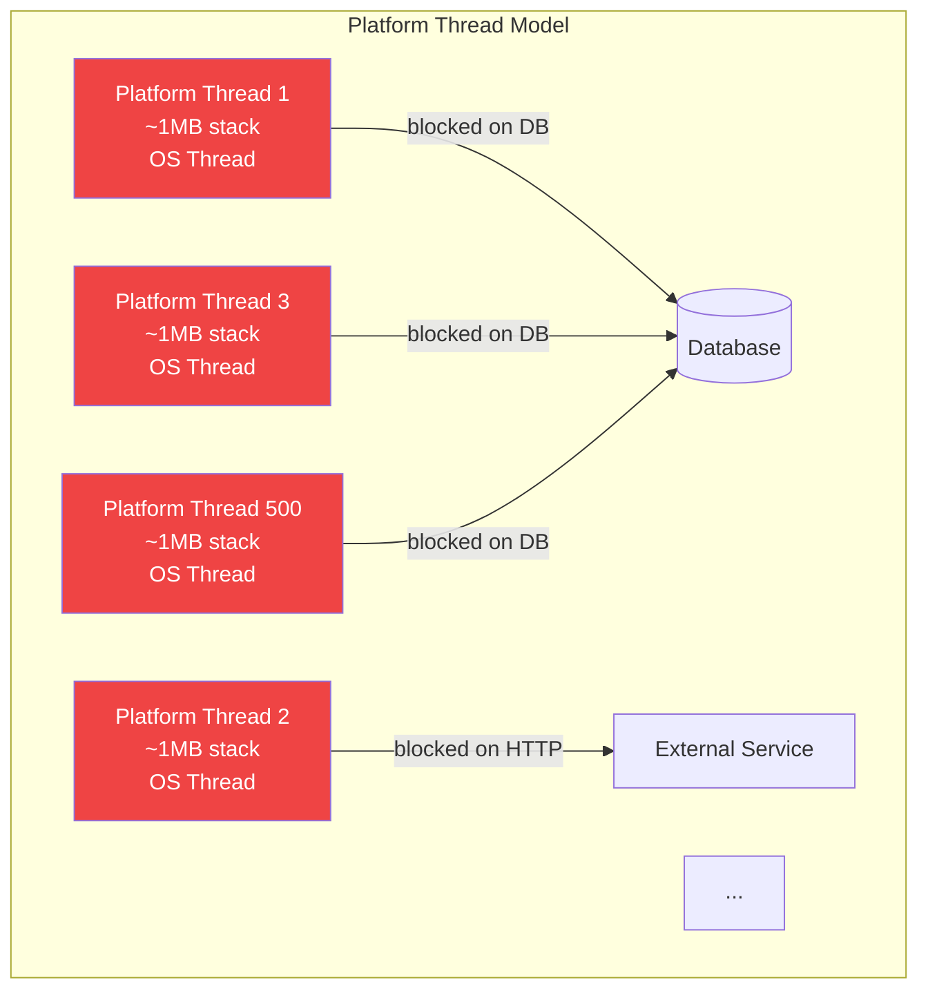
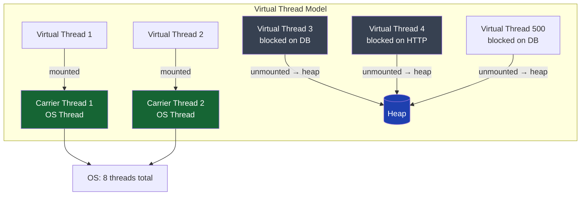
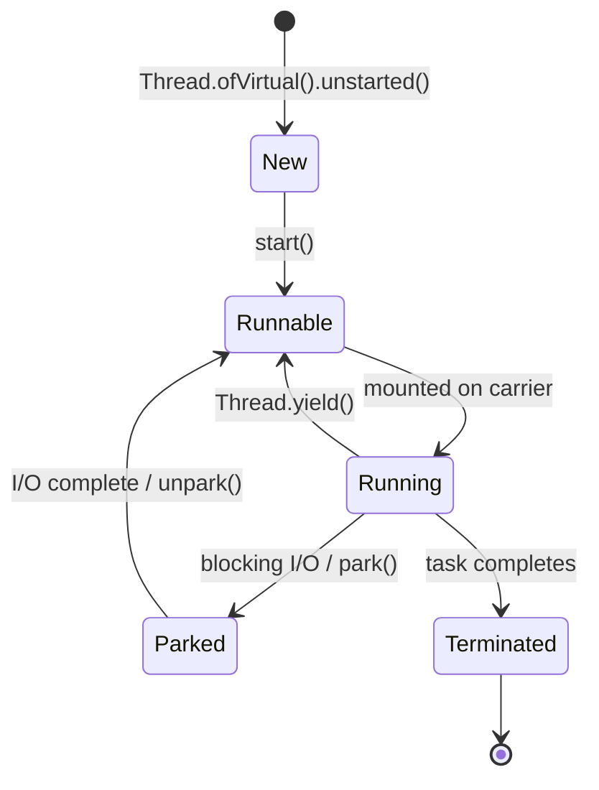

# الخيوط الافتراضية (Virtual Threads) — مشروع Loom في Java 21

## نظرة عامة

الخيوط الافتراضية أهم إضافة إلى نموذج التزامن في Java منذ `java.util.concurrent` في Java 5. وقد صدرت كميزة نهائية في Java 21 ‏(JEP 444)، وهي تغيّر جذريًا طريقة تعامل خوادم Java مع أحمال الإدخال/الإخراج المتزامنة.

الفكرة الجوهرية: **نموذج خيوط المنصة مُهدر لأحمال الإدخال/الإخراج**. فالخيط المنتظر لرد قاعدة البيانات يحجب خيط نظام تشغيل — مورد ثمين ومكلف. والخيوط الافتراضية تفصل خيوط Java عن خيوط نظام التشغيل، فتسمح بملايين العمليات المتزامنة على مجمّع صغير ثابت من خيوط نظام التشغيل.

ولخدمة معالجة مدفوعات تجري 500 استدعاء متزامن لقاعدة البيانات، تحتاج خيوط المنصة إلى 500 خيط نظام تشغيل (نحو 500 MB من مساحة عناوين المكدس المحجوزة، إضافة إلى عمل جدولة النواة). أما الخيوط الافتراضية فتحتاج إلى 500 خيط افتراضي مجدول على نحو 8 خيوط نظام تشغيل، مع تخزين مكدساتها ككائنات صغيرة في الكومة (heap). والتحسن في الإنتاجية ليس هامشيًا — بل بنيوي.

## أهداف التعلم

في نهاية هذا الدرس ستستطيع:

- شرح الفرق بين خيوط المنصة، والخيوط الافتراضية، وخيوط الحمل (carrier threads)
- وصف كيف تُركّب الخيوط الافتراضية على خيوط الحمل وتُفك منها
- إنشاء الخيوط الافتراضية باستخدام `Thread.ofVirtual()` و`Executors.newVirtualThreadPerTaskExecutor()`
- تفعيل الخيوط الافتراضية في Spring Boot 3.2+
- تحديد الأحمال التي تقدم فيها الخيوط الافتراضية فائدة كبيرة
- تحديد الأحمال التي لا تقدم فيها الخيوط الافتراضية أي فائدة
- شرح نموذج الذاكرة والجدولة للخيوط الافتراضية

## مشكلة خيوط المنصة



يستهلك كل خيط منصة محجوب:
- نحو 1 MB من مساحة المكدس المحجوزة (القيمة الافتراضية `-Xss`؛ تُحجز مسبقًا ويلتزم بها نظام التشغيل مع الاستخدام)
- واصف خيط في نظام التشغيل
- سياق في مجدول النواة

فخدمة دفع بـ 500 طلب متزامن قيد التنفيذ = 500 خيط نظام تشغيل = نحو 500 MB من مساحة المكدس المحجوزة، وكلفة تبديل سياق مستمرة، وسقف صارم للتزامن تفرضه حدود خيوط نظام التشغيل.

## الخيوط الافتراضية: الحل

الخيوط الافتراضية **خيوط خفيفة في مساحة المستخدم** تديرها JVM بالكامل لا نظام التشغيل. وهي **تُركّب** على **خيوط الحمل** (خيوط نظام التشغيل) فقط حين يكون لديها عمل على المعالج، و**تُفك** (تُوقف في الكومة) عندما تُحجب على إدخال/إخراج.



**خصائص أساسية:**
- حجم مجمّع خيوط الحمل ≈ عدد أنوية المعالج (افتراضيًا: `Runtime.getRuntime().availableProcessors()`)
- الخيوط الافتراضية كائنات في الكومة — بضع مئات من البايتات لكل منها، إضافة إلى إطارات مكدسها التي تُنسخ إلى الكومة عند توقفها
- تفك JVM الخيط الافتراضي تلقائيًا عند الإدخال/الإخراج الحاجب، وتوقفه في الكومة، فينفّذ خيط الحمل عملًا آخر
- عند اكتمال الإدخال/الإخراج، يُعاد جدولة الخيط الافتراضي على أي خيط حمل متاح

## إنشاء الخيوط الافتراضية

```java21
// Method 1: Thread.ofVirtual() — explicit creation
Thread vt = Thread.ofVirtual()
    .name("payment-vt-", 0)  // Named for thread dumps
    .start(() -> processPayment(request));

// Method 2: Thread.startVirtualThread() — convenience factory
Thread vt = Thread.startVirtualThread(() -> processPayment(request));

// Method 3: ExecutorService — preferred for managed lifecycle
try (ExecutorService executor = Executors.newVirtualThreadPerTaskExecutor()) {
    Future<PaymentResult> future = executor.submit(() -> processPayment(request));
    PaymentResult result = future.get(1, TimeUnit.SECONDS);
} // executor.close() waits for all submitted tasks to complete

// Method 4: Thread.Builder for structured creation
Thread.Builder builder = Thread.ofVirtual().name("payment-handler-", 0);
Thread vt1 = builder.start(() -> processPayment(request1));
Thread vt2 = builder.start(() -> processPayment(request2));
```

الطريقة المفضلة هي `ExecutorService` لإدارة دورة الحياة: فـ `close()` ينتظر اكتمال كل المهام المرسلة.

## دورة حياة الخيط الافتراضي



الانتقال الحاسم هو **قيد التشغيل ← متوقف**: هنا تقدم الخيوط الافتراضية فائدتها. فخيط المنصة يحجب خيط نظام التشغيل في هذا الانتقال، أما الخيط الافتراضي فيحرر خيط الحمل لتشغيل خيوط افتراضية أخرى.

والخيوط الافتراضية **لا تُقسَّم زمنيًا**: فالمجدول لا يقاطع خيطًا افتراضيًا قيد التشغيل. والخيط الافتراضي الذي يحسب طويلًا دون أن يُحجب يُبقي خيط الحمل مشغولًا حتى ينتهي أو يُحجب.

> [!WARNING]
> **لا يُحرَّر خيط الحمل في حالتين (التثبيت — pinning):** الحجب داخل كتلة أو طريقة `synchronized` (Java 21–23؛ أُصلح في JDK 24 عبر JEP 491)، والحجب داخل طريقة أصلية (native) أو دالة أجنبية. اكتشف التثبيت بحدث JFR ‏`jdk.VirtualThreadPinned` (أو `-Djdk.tracePinnedThreads=full` في Java 21–23).

## خيط لكل طلب في خدمات الدفع

يصبح نموذج خيط لكل طلب — خيط واحد لدورة حياة الطلب كاملة — عمليًا من جديد مع الخيوط الافتراضية. فيعود أسلوب الشيفرة الحاجبة البسيطة المتتابعة دون تعقيد الاستدعاءات المتداخلة في البرمجة التفاعلية (reactive).

```java21
// BEFORE virtual threads: reactive programming to avoid blocking platform threads
// Complex, hard to debug, exception handling spread across lambdas
public Mono<PaymentResult> processPayment(PaymentRequest request) {
    return accountRepository.findByIdReactive(request.getAccountId())  // Mono<Account>
        .flatMap(account -> fraudService.checkReactive(account, request)) // Mono<FraudDecision>
        .flatMap(fraud -> {
            if (fraud.isBlocked()) return Mono.error(new FraudBlockException());
            return settlementService.settleReactive(request);              // Mono<Settlement>
        })
        .map(settlement -> PaymentResult.success(settlement.getTransactionId()))
        .onErrorResume(ex -> Mono.just(PaymentResult.failed(ex.getMessage())));
}

// AFTER virtual threads: simple blocking code, same concurrency
// Sequential, easy to read, easy to debug, familiar exception handling
public PaymentResult processPayment(PaymentRequest request) {
    Account account = accountRepository.findById(request.getAccountId()); // Blocking — OK
    FraudDecision fraud = fraudService.check(account, request);           // Blocking — OK
    if (fraud.isBlocked()) throw new FraudBlockException();
    Settlement settlement = settlementService.settle(request);            // Blocking — OK
    return PaymentResult.success(settlement.getTransactionId());
}
// Run this on a virtual thread: JVM parks on each blocking call, carrier stays free
```

قبل الخيوط الافتراضية: برمجة تفاعلية معقدة وصعبة التصحيح، ومعالجة الاستثناءات موزعة على الدوال. وبعدها: شيفرة حاجبة بسيطة بالتزامن نفسه — متتابعة، وسهلة القراءة والتصحيح، ومعالجة استثناءات مألوفة. فشغّلها على خيط افتراضي: توقفه JVM عند كل استدعاء حاجب ويبقى خيط الحمل حرًا.

## Spring Boot 3.2: تفعيل الخيوط الافتراضية

يجعل Spring Boot 3.2 (الصادر في نوفمبر 2023) تفعيل الخيوط الافتراضية لـ Tomcat وSpring MVC خاصية إعداد واحدة:

```java21
// application.properties
// spring.threads.virtual.enabled=true

// Or via application.yml:
// spring:
//   threads:
//     virtual:
//       enabled: true

// What this does:
// 1. Tomcat uses a virtual thread per HTTP request (replaces the platform thread pool)
// 2. @Async methods run on virtual threads
// 3. The auto-configured applicationTaskExecutor and task scheduler use virtual threads
// Also set spring.main.keep-alive=true if the app has no other non-daemon
// thread: virtual threads are daemon threads and do not keep the JVM alive

// Manual configuration (if not using the property):
@Configuration
public class VirtualThreadConfig {

    @Bean
    public TomcatProtocolHandlerCustomizer<?> virtualThreadCustomizer() {
        return protocolHandler ->
            protocolHandler.setExecutor(Executors.newVirtualThreadPerTaskExecutor());
    }

    @Bean(TaskExecutionAutoConfiguration.APPLICATION_TASK_EXECUTOR_BEAN_NAME)
    public AsyncTaskExecutor applicationTaskExecutor() {
        return new TaskExecutorAdapter(Executors.newVirtualThreadPerTaskExecutor());
    }
}
```

ما يفعله ذلك: يستخدم Tomcat خيطًا افتراضيًا لكل طلب HTTP، وتعمل طرق `@Async` على خيوط افتراضية، ويستخدم `applicationTaskExecutor` ومجدول المهام المُعدّان تلقائيًا خيوطًا افتراضية. واضبط أيضًا `spring.main.keep-alive=true` إذا لم يكن في التطبيق خيط آخر غير خفي: فالخيوط الافتراضية خيوط خفية (daemon) ولا تُبقي JVM حية.

```java21
// Spring Boot 3.2 — @Async with virtual threads
@Service
public class AuditService {

    // With virtual threads enabled, @Async runs on a virtual thread
    @Async
    public CompletableFuture<Void> recordAsync(AuditEvent event) {
        auditRepository.save(event); // Blocking DB call — virtual thread parks
        return CompletableFuture.completedFuture(null);
    }
}
```

## متى تفيد الخيوط الافتراضية

تقدم الخيوط الافتراضية فائدة كبيرة في:

| الحمل | الفائدة | السبب |
|---|---|---|
| واجهة REST مع استدعاءات قاعدة بيانات | ✓✓ عالية | معظم الوقت حجب على JDBC/JPA |
| خدمة مصغّرة تستدعي خدمات أخرى | ✓✓ عالية | معظم الوقت حجب على HTTP |
| معالجة مستهلك Kafka | ✓ متوسطة | حجب على poll وكتابات قاعدة البيانات |
| معالجة ملفات مع إدخال/إخراج | ✓✓ عالية | حجب على قراءة/كتابة الملفات |
| ‏ETL دفعي مع عمليات قاعدة بيانات | ✓ متوسطة | التوازي محدود بسعة قاعدة البيانات |

## متى لا تفيد الخيوط الافتراضية

| الحمل | الفائدة | السبب |
|---|---|---|
| الحساب كثيف المعالجة | ✗ لا شيء | لا يُحجب أبدًا — لا يتحرر خيط الحمل أبدًا |
| معالجة البيانات في الذاكرة | ✗ لا شيء | لا حجب إدخال/إخراج للتوقف عنده |
| حلقات حساب ضيقة (JMH) | ✗ لا شيء | مثل خيوط المنصة |
| المسارات التفاعلية (WebFlux) | ✓ طفيفة | غير حاجبة أصلًا — مكسب قليل |

> [!IMPORTANT]
> **الخيوط الافتراضية ليست "أسرع" من خيوط المنصة في الشيفرة كثيفة المعالجة.** فالخيط الافتراضي الذي يجري حسابًا خالصًا يعمل على خيط حمل تمامًا مثل خيط المنصة. والفائدة حصرية لأحمال الإدخال/الإخراج حيث كان الحجب يهدر موارد خيوط نظام التشغيل.

## نموذج الذاكرة

```java21
// Virtual thread stack is stored in the heap, not in OS thread stack space
// Stack frames are captured as heap objects when the virtual thread parks

// Platform thread: up to 1 MB stack in native memory (reserved, committed as used)
// Virtual thread: stack frames in heap, reclaimed by GC when thread terminates

// Practical implication (illustrative):
// Platform threads: 10,000 threads × 1 MB = 10 GB of reserved stack address space
//                   (and 10,000 OS threads for the kernel to schedule)
// Virtual threads: 10,000 parked threads × ~2 KB average stack = ~20 MB heap

// The heap memory for virtual thread stacks is managed by GC
// Deep call stacks on parked virtual threads can cause GC pressure
// Avoid unnecessarily deep call stacks on virtual threads
```

يُخزن مكدس الخيط الافتراضي في الكومة، فيُستعاد بجمع النفايات عند انتهاء الخيط. أما خيط المنصة فيحجز حتى 1 MB من الذاكرة الأصلية. ومثال توضيحي: 10,000 خيط منصة = 10 GB من مساحة العناوين المحجوزة (و10,000 خيط نظام تشغيل تجدولها النواة)، مقابل نحو 20 MB من الكومة لـ 10,000 خيط افتراضي متوقف. والمكدسات العميقة على الخيوط الافتراضية المتوقفة قد تضغط على جامع النفايات، فتجنب المكدسات العميقة بلا داعٍ.

## قابلية الملاحظة: تفريغ الخيوط مع الخيوط الافتراضية

تظهر الخيوط الافتراضية في تفريغات الخيوط بشكل مختلف عن خيوط المنصة:

```java21
// Generate a thread dump that includes virtual threads:
// jcmd <pid> Thread.dump_to_file -format=json threads.json
// (jstack / jcmd Thread.print show platform threads only — NOT virtual threads)

// Simplified plain-text output for a parked virtual thread:
/*
#45 "" virtual
      java.base/jdk.internal.misc.Unsafe.park(Native Method)
      java.base/java.util.concurrent.locks.LockSupport.park(LockSupport.java:371)
      ...
      com.bank.payment.PaymentService.processPayment(PaymentService.java:42)
*/
// A parked virtual thread has no carrier. In the JSON format, a virtual thread
// that is currently MOUNTED shows its "carrier" — a mounted thread that stays
// on its carrier while blocked is a sign of pinning
```

يُظهر `jstack` و`jcmd Thread.print` خيوط المنصة فقط — **لا** الخيوط الافتراضية. فاستخدم `jcmd <pid> Thread.dump_to_file`. والخيط الافتراضي المتوقف ليس له خيط حمل. وفي صيغة JSON يُظهر الخيط الافتراضي **المُركّب** حاليًا خيط حمله — والخيط المُركّب الذي يبقى على خيط حمله وهو محجوب علامة على التثبيت.


<!-- KNOWLEDGE-CHECK [
  {
    "id": "kc-vt-01",
    "question": "لدى خدمة دفع 500 طلب متزامن قيد التنفيذ، كل منها محجوب على استدعاء قاعدة بيانات. مع خيوط المنصة، كم خيط نظام تشغيل محجوب؟ ومع الخيوط الافتراضية؟",
    "options": [
      "المنصة: 500 خيط نظام تشغيل. الافتراضية: 500 خيط نظام تشغيل (الخيوط الافتراضية ما زالت تحتاج خيوط نظام تشغيل)",
      "المنصة: 500 خيط نظام تشغيل محجوب. الافتراضية: نحو 8 خيوط حمل تعمل، و500 خيط افتراضي متوقف في الكومة",
      "المنصة: 8 خيوط نظام تشغيل (مجمّع خيوط). الافتراضية: 500 خيط نظام تشغيل",
      "كلاهما: 8 خيوط نظام تشغيل — مجمّعات خيوط المنصة تحد أيضًا من استخدام خيوط نظام التشغيل"
    ],
    "correct": 1,
    "explanation": "تقابل خيوط المنصة خيوط نظام التشغيل واحدًا لواحد. فـ 500 طلب محجوب = 500 خيط نظام تشغيل محجوب. أما الخيوط الافتراضية فتُفك عند الحجب: توقف JVM الخيط الافتراضي في الكومة ويتحرر خيط الحمل لتشغيل خيوط افتراضية أخرى. فـ 500 خيط افتراضي محجوب على قاعدة البيانات = 500 كائن في الكومة، ونحو 8 خيوط حمل تعالج أي خيوط افتراضية لديها عمل على المعالج. فينخفض استخدام خيوط نظام التشغيل من 500 إلى نحو 8."
  },
  {
    "id": "kc-vt-02",
    "question": "تنتقل خدمة من مجمّع 200 خيط منصة إلى `Executors.newVirtualThreadPerTaskExecutor()`. والخدمة محرك تسعير صرف عملات كثيف المعالجة. ما تغير الأداء المتوقع؟",
    "options": [
      "تحسن كبير — الخيوط الافتراضية أسرع دائمًا",
      "لا تحسن ذو معنى — الخيوط الافتراضية تفيد أحمال الإدخال/الإخراج، لا أحمال المعالجة",
      "تدهور — للخيوط الافتراضية كلفة أعلى من خيوط المنصة في عمل المعالجة",
      "تحسن فقط على الأجهزة التي لها أكثر من 16 نواة"
    ],
    "correct": 1,
    "explanation": "تقدم الخيوط الافتراضية فائدتها بالتوقف عند الحجب على الإدخال/الإخراج، فتحرر خيوط الحمل لعمل آخر. ومحرك تسعير كثيف المعالجة لا يُحجب أبدًا — يستخدم المعالج باستمرار. فيبقى كل خيط افتراضي مُركّبًا على خيط حمل طوال الوقت، ويتصرف تمامًا مثل خيط المنصة. وقد يتدهور الأداء قليلًا فعلًا بسبب كلفة الجدولة الإضافية. استخدم مجمّع خيوط منصة ثابتًا بحجم عدد الأنوية لعمل المعالجة."
  },
  {
    "id": "kc-vt-03",
    "question": "ما الخاصية الواحدة التي تفعّل الخيوط الافتراضية لكل معالجة طلبات Tomcat وطرق @Async في Spring Boot 3.2؟",
    "options": [
      "server.tomcat.threads.virtual=true",
      "spring.threads.virtual.enabled=true",
      "spring.async.virtual-threads=true",
      "java.util.concurrent.virtual=enabled"
    ],
    "correct": 1,
    "explanation": "تفعّل spring.threads.virtual.enabled=true في application.properties (أو spring.threads.virtual.enabled في YAML) الخيوط الافتراضية لـ Tomcat (بدل مجمّع خيوط المنصة) ولـ AsyncTaskExecutor في Spring. وهذا انتقال بسطر واحد لمعظم تطبيقات Spring Boot 3.2+."
  },
  {
    "id": "kc-vt-04",
    "question": "لماذا يجب ألا تجمّع الخيوط الافتراضية في مجمّع (مثل `new ThreadPoolExecutor(10, 100, ..., virtualThreadFactory)`)؟",
    "options": [
      "مصانع الخيوط الافتراضية غير متوافقة مع ThreadPoolExecutor",
      "الخيوط الافتراضية رخيصة الإنشاء؛ والتجميع لا يضيف فائدة، ويُبقي الخيوط الخاملة (وقيم ThreadLocal لديها) حية، ويعيد فرض سقف المجمّع الثابت الذي جاءت الخيوط الافتراضية لإزالته",
      "مجمّعات الخيوط الافتراضية تسبب جمودًا مع خيوط الحمل",
      "لا يستطيع ThreadPoolExecutor إنشاء أكثر من 8 خيوط افتراضية"
    ],
    "correct": 1,
    "explanation": "يكلف الخيط الافتراضي بضع مئات من البايتات، وقد صُمم ليُنشأ لكل مهمة ثم يُتخلص منه. وتجميعها لا يوفر شيئًا (فالإنشاء رخيص أصلًا)، ويُبقي الخيوط الخاملة وقيم ThreadLocal لديها حية بين المهام، ويعيد السقف الثابت للمجمّع الذي صُممت الخيوط الافتراضية لإزالته. وإذا احتجت إلى تقييد التزامن (مثلًا لحماية قاعدة بيانات)، فاستخدم Semaphore — لا مجمّعًا. واستخدم Executors.newVirtualThreadPerTaskExecutor(): فهو ينشئ خيطًا افتراضيًا جديدًا لكل مهمة مرسلة."
  }
] -->


<!-- PRACTICAL-CHALLENGE {
  "id": "pc-virtual-threads",
  "title": "الانتقال إلى الخيوط الافتراضية: خدمة دفع",
  "description": "انقل خدمة دفع مبنية على خيوط المنصة إلى الخيوط الافتراضية وقِس الأثر.",
  "tasks": [
    {
      "id": "pc-vt-01",
      "description": "فعّل الخيوط الافتراضية في خدمة دفع Spring Boot 3.2 باستخدام خاصية الإعداد الواحدة. وتحقق من التغيير بإضافة معالج طلبات يسجّل `Thread.currentThread().isVirtual()` — يجب أن تعيد true لكل طلب HTTP."
    },
    {
      "id": "pc-vt-02",
      "description": "قِس أداء خدمة تجري استدعاء قاعدة بيانات حاجبًا مدته 50ms: (أ) 200 خيط منصة، (ب) خيوط افتراضية. شغّل 1,000 طلب متزامن. وقِس: زمن الإكمال الكلي، وذروة عدد خيوط نظام التشغيل (عبر JConsole أو /actuator/metrics)، وذروة الكومة المستخدمة لمكدسات الخيوط. ووثّق فرق الموارد."
    },
    {
      "id": "pc-vt-03",
      "description": "أعد هيكلة نقطة دفع تفاعلية بـ WebFlux (تستخدم سلاسل Mono/Flux) لتستخدم شيفرة حاجبة على خيوط افتراضية. تستدعي النقطة: بحث الحساب في قاعدة البيانات (20ms)، وخدمة الاحتيال عبر HTTP ‏(150ms)، وكتابة التسوية في قاعدة البيانات (30ms). وقارن تعقيد الشيفرة وزمن الاستجابة بين النسختين التفاعلية والافتراضية."
    },
    {
      "id": "pc-vt-04",
      "description": "نفّذ `VirtualThreadPaymentWorker` يعالج المدفوعات من BlockingQueue باستخدام خيوط افتراضية. ابدأ 10,000 خيط افتراضي، يأخذ كل منها دفعة واحدة من الطابور. وقِس استخدام الذاكرة مقارنة بـ 10,000 خيط منصة، وأكّد مقايضة الكومة مقابل المكدس."
    }
  ]
} -->
