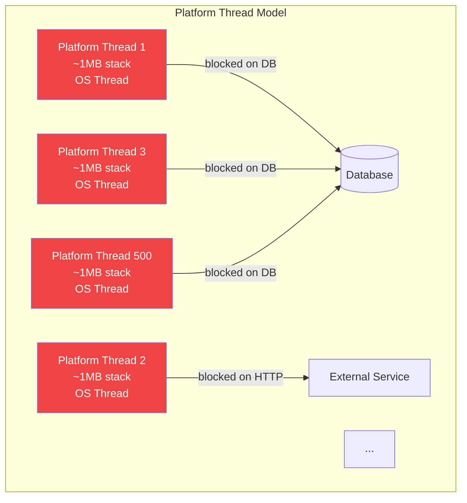
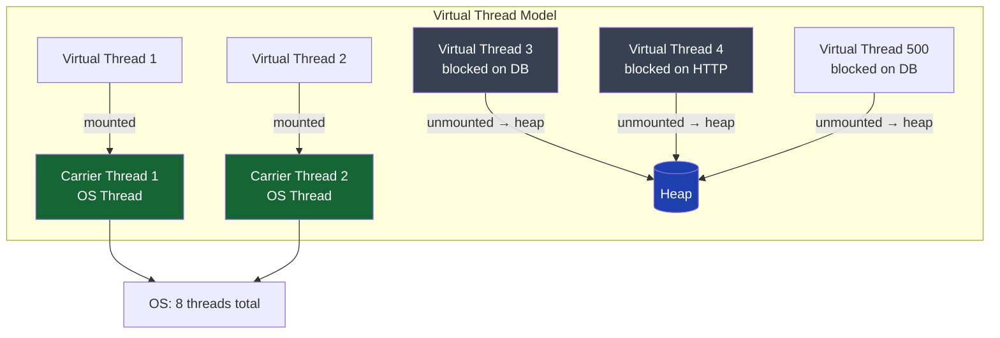
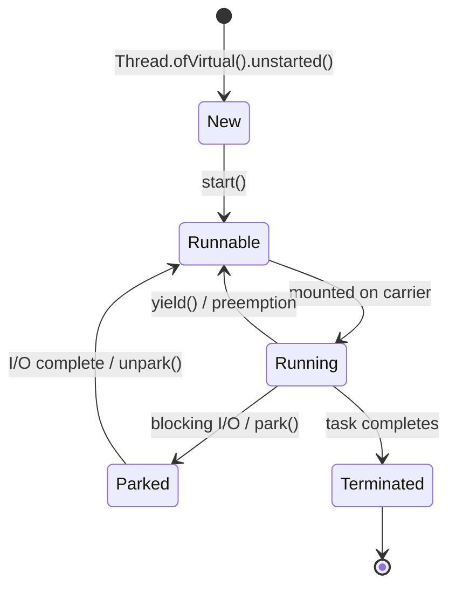

## Overview

Virtual threads are the most significant addition to the Java concurrency model since `java.util.concurrent` in Java 5. Delivered as a GA feature in Java 21 (JEP 444), they fundamentally change how Java servers handle concurrent I/O-bound workloads.

The core insight: **the platform thread model is wasteful for I/O-bound workloads**. A thread waiting for a database response blocks an OS thread — a precious, expensive resource. Virtual threads decouple Java threads from OS threads, allowing millions of concurrent operations on a small fixed pool of OS threads.

For a payment processing service making 500 concurrent database calls, platform threads require 500 OS threads (~500 MB of stack memory). Virtual threads require 500 virtual threads scheduled on ~8 OS threads (~a few MB total). The throughput improvement is not marginal — it is structural.

## Learning Objectives

By the end of this lesson you will be able to:

- Explain the difference between platform threads, virtual threads, and carrier threads
- Describe how virtual threads are mounted and unmounted from carrier threads
- Create virtual threads using `Thread.ofVirtual()` and `Executors.newVirtualThreadPerTaskExecutor()`
- Enable virtual threads in Spring Boot 3.2+
- Identify workloads where virtual threads provide significant benefit
- Identify workloads where virtual threads provide no benefit
- Explain the memory and scheduling model of virtual threads

## The Problem with Platform Threads



Each blocked platform thread consumes:
- ~1 MB of stack memory (default, configurable)
- An OS thread descriptor
- Kernel scheduler context

A payment service with 500 concurrent in-flight requests = 500 OS threads = ~500 MB stack memory, constant context-switching overhead, and a hard ceiling on concurrency imposed by OS thread limits.

## Virtual Threads: The Solution

Virtual threads are **lightweight user-space threads** managed entirely by the JVM, not the OS. They are **mounted** onto **carrier threads** (OS threads) only when they have CPU work to do, and **unmounted** (parked in the heap) when they block on I/O.



**Key properties:**
- Carrier thread pool size ≈ CPU core count (default: `Runtime.getRuntime().availableProcessors()`)
- Virtual threads are heap objects — cost ~few hundred bytes each when parked
- JVM automatically unmounts virtual thread on blocking I/O, parks it in heap, carrier runs other work
- When I/O completes, the virtual thread is rescheduled on any available carrier

## Creating Virtual Threads

```java21
// Method 1: Thread.ofVirtual() — explicit creation
Thread vt = Thread.ofVirtual()
    .name("payment-vt-", 0)  // Named for thread dumps
    .start(() -> processPayment(request));

// Method 2: Thread.startVirtualThread() — convenience factory
Thread vt = Thread.startVirtualThread(() -> processPayment(request));

// Method 3: ExecutorService — preferred for managed lifecycle
try (ExecutorService executor = Executors.newVirtualThreadPerTaskExecutor()) {
    Future<PaymentResult> future = executor.submit(() -> processPayment(request));
    PaymentResult result = future.get(1, TimeUnit.SECONDS);
} // executor.close() waits for all submitted tasks to complete

// Method 4: Thread.Builder for structured creation
Thread.Builder builder = Thread.ofVirtual().name("payment-handler-", 0);
Thread vt1 = builder.start(() -> processPayment(request1));
Thread vt2 = builder.start(() -> processPayment(request2));
```

## Virtual Thread Lifecycle



The critical state transition is **Running → Parked**: this is where virtual threads deliver their benefit. A platform thread blocks its OS thread in this transition. A virtual thread releases its carrier thread to run other virtual threads.

## Thread-Per-Request in Payment Services

The thread-per-request model — one thread for the entire lifecycle of a request — becomes practical again with virtual threads. The simple, sequential blocking code style is restored without the callback hell of reactive programming.

```java21
// BEFORE virtual threads: reactive programming to avoid blocking platform threads
// Complex, hard to debug, exception handling spread across lambdas
public Mono<PaymentResult> processPayment(PaymentRequest request) {
    return accountRepository.findByIdReactive(request.getAccountId())  // Mono<Account>
        .flatMap(account -> fraudService.checkReactive(account, request)) // Mono<FraudDecision>
        .flatMap(fraud -> {
            if (fraud.isBlocked()) return Mono.error(new FraudBlockException());
            return settlementService.settleReactive(request);              // Mono<Settlement>
        })
        .map(settlement -> PaymentResult.success(settlement.getTransactionId()))
        .onErrorResume(ex -> Mono.just(PaymentResult.failed(ex.getMessage())));
}

// AFTER virtual threads: simple blocking code, same concurrency
// Sequential, easy to read, easy to debug, familiar exception handling
public PaymentResult processPayment(PaymentRequest request) {
    Account account = accountRepository.findById(request.getAccountId()); // Blocking — OK
    FraudDecision fraud = fraudService.check(account, request);           // Blocking — OK
    if (fraud.isBlocked()) throw new FraudBlockException();
    Settlement settlement = settlementService.settle(request);            // Blocking — OK
    return PaymentResult.success(settlement.getTransactionId());
}
// Run this on a virtual thread: JVM parks on each blocking call, carrier stays free
```

## Spring Boot 3.2: Enabling Virtual Threads

Spring Boot 3.2 (released November 2023) makes enabling virtual threads for Tomcat and Spring MVC a single configuration property:

```java21
// application.properties
// spring.threads.virtual.enabled=true

// Or via application.yml:
// spring:
//   threads:
//     virtual:
//       enabled: true

// What this does:
// 1. Tomcat uses a virtual thread per HTTP request (replaces the platform thread pool)
// 2. @Async methods run on virtual threads
// 3. TaskExecutor beans default to virtual threads

// Manual configuration (if not using the property):
@Configuration
public class VirtualThreadConfig {

    @Bean
    public TomcatProtocolHandlerCustomizer<?> virtualThreadCustomizer() {
        return protocolHandler ->
            protocolHandler.setExecutor(Executors.newVirtualThreadPerTaskExecutor());
    }

    @Bean(TaskExecutionAutoConfiguration.APPLICATION_TASK_EXECUTOR_BEAN_NAME)
    public AsyncTaskExecutor applicationTaskExecutor() {
        return new TaskExecutorAdapter(Executors.newVirtualThreadPerTaskExecutor());
    }
}
```

```java21
// Spring Boot 3.2 — @Async with virtual threads
@Service
public class AuditService {

    // With virtual threads enabled, @Async runs on a virtual thread
    @Async
    public CompletableFuture<Void> recordAsync(AuditEvent event) {
        auditRepository.save(event); // Blocking DB call — virtual thread parks
        return CompletableFuture.completedFuture(null);
    }
}
```

## When Virtual Threads Help

Virtual threads deliver significant benefit for:

| Workload | Benefit | Why |
|---|---|---|
| REST API with DB calls | ✓✓ High | Most time blocking on JDBC/JPA |
| Microservice calling other services | ✓✓ High | Most time blocking on HTTP |
| Kafka consumer processing | ✓ Medium | Blocking on poll + DB writes |
| File processing with I/O | ✓✓ High | Blocking on file read/write |
| Batch ETL with DB operations | ✓ Medium | Parallelism limited by DB capacity |

## When Virtual Threads Do NOT Help

| Workload | Benefit | Why |
|---|---|---|
| CPU-bound computation | ✗ None | Never blocks — carrier is never freed |
| In-memory data processing | ✗ None | No I/O blocking to park on |
| Tight compute loops (JMH) | ✗ None | Same as platform threads |
| Reactive pipelines (Webflux) | ✓ Minor | Already non-blocking — little to gain |

> [!IMPORTANT]
> **Virtual threads are not "faster" than platform threads for CPU-bound code.** A virtual thread doing pure computation runs on a carrier thread just like a platform thread. The benefit is exclusively in I/O-bound workloads where blocking previously wasted OS thread resources.

## Memory Model

```java21
// Virtual thread stack is stored in the heap, not in OS thread stack space
// Stack frames are captured as heap objects when the virtual thread parks

// Platform thread: 1 MB stack in OS thread stack segment (non-heap)
// Virtual thread: stack frames in heap, reclaimed by GC when thread terminates

// Practical implication:
// Platform threads: 10,000 threads × 1 MB = 10 GB stack memory (pre-allocated)
// Virtual threads: 10,000 parked threads × ~2 KB average stack = ~20 MB heap

// The heap memory for virtual thread stacks is managed by GC
// Deep call stacks on parked virtual threads can cause GC pressure
// Avoid unnecessarily deep call stacks on virtual threads
```

## Observability: Thread Dumps with Virtual Threads

Virtual threads appear in thread dumps differently from platform threads:

```java21
// Generate thread dump with virtual threads:
// jcmd <pid> Thread.dump_to_file -format=json threads.json
// (Standard jstack shows virtual threads in Java 21)

// Thread dump output for a parked virtual thread:
/*
#45 "" virtual
      java.lang.Thread.State: WAITING (parking)
        at jdk.internal.misc.Unsafe.park(Native Method)
        at java.util.concurrent.locks.LockSupport.park(LockSupport.java:371)
        at com.bank.payment.PaymentService.processPayment(PaymentService.java:42)
        - blocked waiting for JDBC connection

   Mounted on carrier: #12 "ForkJoinPool-1-worker-1"
*/

// Key observation: the carrier thread ID is shown — useful for diagnosing pinning
```

---

<!-- KNOWLEDGE-CHECK [
  {
    "id": "kc-vt-01",
    "question": "A payment service has 500 concurrent in-flight requests, each blocked on a database call. With platform threads, how many OS threads are blocked? With virtual threads?",
    "options": [
      "Platform: 500 OS threads. Virtual: 500 OS threads (virtual threads still need OS threads)",
      "Platform: 500 OS threads blocked. Virtual: ~8 carrier OS threads running, 500 virtual threads parked in heap",
      "Platform: 8 OS threads (thread pool). Virtual: 500 OS threads",
      "Both: 8 OS threads — platform thread pools also limit OS thread usage"
    ],
    "correct": 1,
    "explanation": "Platform threads map 1:1 to OS threads. 500 blocked requests = 500 blocked OS threads. Virtual threads are unmounted when blocking: the JVM parks the virtual thread in the heap and the carrier OS thread is freed to run other virtual threads. 500 virtual threads blocking on DB = 500 heap objects, ~8 carrier OS threads processing whichever virtual threads have CPU work. The OS thread utilisation drops from 500 to ~8."
  },
  {
    "id": "kc-vt-02",
    "question": "A service migrates from a 200-thread platform thread pool to `Executors.newVirtualThreadPerTaskExecutor()`. The service is a CPU-bound FX pricing engine. What performance change is expected?",
    "options": [
      "Significant improvement — virtual threads are always faster",
      "No meaningful improvement — virtual threads benefit I/O-bound workloads, not CPU-bound ones",
      "Degradation — virtual threads have higher overhead than platform threads for CPU work",
      "Improvement only on machines with more than 16 cores"
    ],
    "correct": 1,
    "explanation": "Virtual threads deliver their benefit by parking when blocked on I/O, freeing carrier threads for other work. A CPU-bound FX pricing engine never blocks — it continuously uses the CPU. Each virtual thread stays mounted on a carrier thread the entire time, behaving identically to a platform thread. With virtual threads, you may actually slightly degrade performance due to added scheduling overhead. Use a fixed platform thread pool sized to CPU core count for CPU-bound work."
  },
  {
    "id": "kc-vt-03",
    "question": "What single property enables virtual threads for all Tomcat request handling and @Async methods in Spring Boot 3.2?",
    "options": [
      "server.tomcat.threads.virtual=true",
      "spring.threads.virtual.enabled=true",
      "spring.async.virtual-threads=true",
      "java.util.concurrent.virtual=enabled"
    ],
    "correct": 1,
    "explanation": "spring.threads.virtual.enabled=true in application.properties (or spring.threads.virtual.enabled in YAML) enables virtual threads for Tomcat (replacing the platform thread pool) and for Spring's AsyncTaskExecutor. This is a single-line migration for most Spring Boot 3.2+ applications."
  },
  {
    "id": "kc-vt-04",
    "question": "Why should you NOT pool virtual threads (e.g., `new ThreadPoolExecutor(10, 100, ..., virtualThreadFactory)`)?",
    "options": [
      "Virtual thread factories are not compatible with ThreadPoolExecutor",
      "Virtual threads are heap-allocated and cheap to create; pooling prevents the JVM from reclaiming their stack memory and negates the per-request scaling model",
      "Virtual thread pools cause deadlocks with carrier threads",
      "ThreadPoolExecutor cannot create more than 8 virtual threads"
    ],
    "correct": 1,
    "explanation": "Virtual threads cost ~few hundred bytes each and are designed to be created per-task and discarded. Pooling virtual threads (keeping them alive between tasks) wastes the heap memory holding their stacks and prevents GC from reclaiming it. It also reintroduces the fixed-pool ceiling that virtual threads were designed to eliminate. Use Executors.newVirtualThreadPerTaskExecutor() — it creates a new virtual thread per submitted task and discards it on completion."
  }
] -->

---

<!-- PRACTICAL-CHALLENGE {
  "id": "pc-virtual-threads",
  "title": "Virtual Thread Migration: Payment Service",
  "description": "Migrate a platform-thread-based payment service to virtual threads and measure the impact.",
  "tasks": [
    {
      "id": "pc-vt-01",
      "description": "Enable virtual threads in a Spring Boot 3.2 payment service using the single configuration property. Verify the change by adding a request handler that logs `Thread.currentThread().isVirtual()` — it should return true for every HTTP request."
    },
    {
      "id": "pc-vt-02",
      "description": "Benchmark a service that makes a 50ms blocking DB call: (a) 200 platform threads, (b) virtual threads. Run 1,000 concurrent requests. Measure: total completion time, peak OS thread count (via JConsole or /actuator/metrics), and peak heap used for thread stacks. Document the resource difference."
    },
    {
      "id": "pc-vt-03",
      "description": "Refactor a reactive WebFlux payment endpoint (using Mono/Flux chains) to use blocking code on virtual threads. The endpoint calls: account DB lookup (20ms), fraud service HTTP (150ms), settlement DB write (30ms). Compare code complexity and latency between the reactive and virtual thread versions."
    },
    {
      "id": "pc-vt-04",
      "description": "Implement a `VirtualThreadPaymentWorker` that processes payments from a BlockingQueue using virtual threads. Start 10,000 virtual threads, each taking one payment from the queue. Measure memory usage compared to 10,000 platform threads and confirm the heap-vs-stack trade-off."
    }
  ]
} -->
