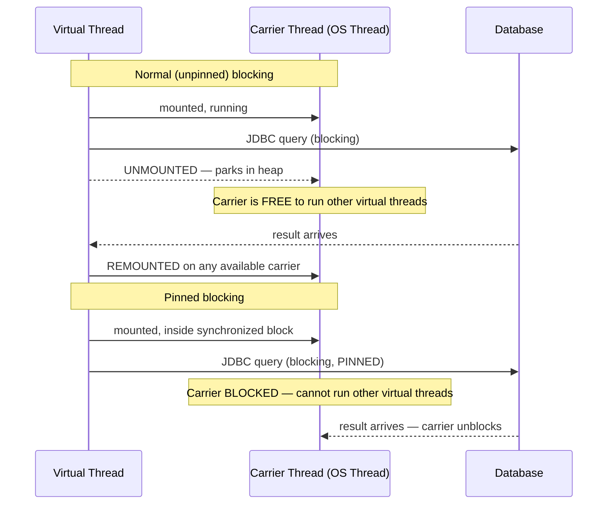
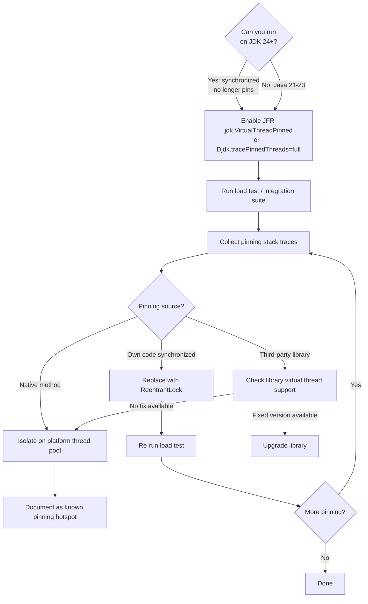

# تثبيت الخيوط الافتراضية (Pinning) — اكتشافه وإصلاحه

## نظرة عامة

تتوقف الخيوط الافتراضية عند الإدخال/الإخراج الحاجب، فتحرر خيط الحمل لعمل آخر. لكن هناك استثناء حاسم: **التثبيت** (pinning). فعندما يُثبَّت خيط افتراضي، لا يمكن فكه عن خيط الحمل حتى عند الحجب. فيُحجب خيط الحمل معه — تمامًا مثل خيط المنصة.

والتثبيت أهم مشكلة توافق للخيوط الافتراضية في التطبيقات المالية الحقيقية. فقواعد الشيفرة القديمة المبنية على خيوط المنصة تحتوي عادة على مئات كتل `synchronized` — وكل منها نقطة تثبيت محتملة تُضعف أداء الخيوط الافتراضية بصمت.

يغطي هذا الدرس أسباب التثبيت، وكيف تكتشفه، والأسلوب المنهجي لإعادة الهيكلة من أجل إزالته.

> [!NOTE]
> **إصدار Java مهم.** في Java 21–23، يثبّت الحجب داخل `synchronized` خيط الحمل. وقد **أزال JDK 24 ‏(JEP 491) هذا السبب**: فصارت الخيوط الافتراضية تستطيع الانفكاك وهي تحمل مراقبًا (monitor). أما الطرق الأصلية واستدعاءات الدوال الأجنبية فما زالت تثبّت في كل الإصدارات. وإذا استطعت التشغيل على JDK 24+، تصبح معظم إعادة هيكلة `synchronized` في هذا الدرس غير لازمة — لكن بنوكًا كثيرة ما زالت على Java 21 LTS، فتبقى هذه التقنيات مهمة.

## أهداف التعلم

في نهاية هذا الدرس ستستطيع:

- شرح ما التثبيت بدقة ولماذا يحدث
- تحديد سببي التثبيت الجذريين: كتل `synchronized` والطرق الأصلية (native)
- تفعيل تشخيص التثبيت بـ `-Djdk.tracePinnedThreads` ‏(Java 21–23) وحدث JFR ‏`jdk.VirtualThreadPinned`
- تدقيق قاعدة شيفرة منهجيًا بحثًا عن نقاط التثبيت الساخنة
- إعادة هيكلة كتل `synchronized` إلى `ReentrantLock` لإزالة التثبيت
- تحديد مكتبات الطرف الثالث ذات مشاكل التثبيت
- تطبيق استراتيجية الانتقال الصحيحة لكل حالة تثبيت

## ما التثبيت؟

يكون الخيط الافتراضي **مثبَّتًا** عندما لا يمكن فكه عن خيط الحمل. وأثناء التثبيت تحجب أي عملية حاجبة خيط نظام التشغيل الحامل — فيتصرف الخيط الافتراضي تمامًا مثل خيط المنصة.



## أسباب التثبيت

### السبب 1: كتل وطرق synchronized

في Java 21–23، **لا يمكن فك** خيط افتراضي داخل كتلة `synchronized` (أو طريقة `synchronized`). فقد كان تنفيذ المراقب في HotSpot يسجل مالك القفل على أنه خيط الحمل، فلا يستطيع الخيط الافتراضي مغادرة خيط الحمل وهو يحمل مراقبًا. واستدعاء `Object.wait()` داخل `synchronized` يثبّت أيضًا. وقد غيّر JDK 24 ‏(JEP 491) تنفيذ المراقب وأزال هذا القيد.

```java21
// PINNING: virtual thread blocks inside synchronized — carrier is pinned
public class PinningExample {
    private final Object lock = new Object();
    private long balance;

    public long getBalance() {
        synchronized (lock) {           // Virtual thread enters monitor
            return database.fetch(id);  // Blocking I/O inside synchronized — PINNED
            // Carrier thread is blocked for the duration of the DB call
        }
    }
}

// NON-PINNING: ReentrantLock — virtual thread parks, carrier is freed
public class NonPinningExample {
    private final ReentrantLock lock = new ReentrantLock();
    private long balance;

    public long getBalance() {
        lock.lock();
        try {
            return database.fetch(id);  // Blocking I/O — virtual thread PARKS (not pinned)
            // Carrier thread is FREE to run other virtual threads
        } finally {
            lock.unlock();
        }
    }
}
```

> [!IMPORTANT]
> **ليست كل كتل `synchronized` تسبب تثبيتًا ضارًا.** فالكتلة التي لا تحتوي إلا عمليات سريعة غير حاجبة (حساب، وقراءة/كتابة في الذاكرة) تحتجز خيط الحمل لحظة ثم تحرره. والأثر في الأداء ضئيل. ويكون التثبيت ضارًا فقط عندما تحدث عملية حاجبة **أثناء تثبيت الخيط الافتراضي** — فيُحجب خيط الحمل طوال مدة انتظار الإدخال/الإخراج.

### السبب 2: الطرق الأصلية والدوال الأجنبية

تُثبَّت الخيوط الافتراضية أيضًا عند تنفيذ طرق أصلية (الكلمة `native`) أو داخل استدعاء لواجهة Foreign Function & Memory يستدعي شيفرة أصلية. وهذا قيد على مستوى JVM — فمكدس الاستدعاء الأصلي لا يمكن تمثيله ككائن في الكومة.

```java21
// Native methods pin virtual threads — cannot be avoided without changing the native code
// Common sources: JDBC drivers with native implementations, cryptographic libraries,
// file system APIs on some platforms, JNI calls

// Detection: JFR event jdk.VirtualThreadPinned with stacktrace shows the native frame
```

## اكتشاف التثبيت

### خيار JVM: ‏-Djdk.tracePinnedThreads

```java21
// JVM startup flag — prints a stack trace whenever a virtual thread is pinned
// Two severity levels:
//   full  — prints complete stack trace (verbose, good for initial audit)
//   short — prints only the pinning frame (less noise, good for ongoing monitoring)

// application startup (Java 21–23 only — the property was removed in JDK 24,
// where JFR is the way to find the remaining native-frame pinning):
// java -Djdk.tracePinnedThreads=full -jar payment-service.jar

// Simplified output when pinning occurs:
/*
Thread[#45,ForkJoinPool-1-worker-1,5,CarrierThreads]
    ...
    com.bank.payment.AccountService.getBalance(AccountService.java:42) <== monitors:1
    com.bank.payment.PaymentProcessor.process(PaymentProcessor.java:87)
*/
// "<== monitors:1" marks the frame that holds 1 monitor (the synchronized block)
```

يطبع هذا الخيار تتبع مكدس كلما ثُبّت خيط افتراضي: `full` للتتبع الكامل (مناسب للتدقيق الأولي)، و`short` للإطار المثبّت فقط. وهو متاح في Java 21–23 فقط — فقد أُزيلت الخاصية في JDK 24، حيث يصبح JFR الطريقة لإيجاد التثبيت المتبقي في الإطارات الأصلية. وتعلّم العبارة `<== monitors:1` الإطار الذي يحمل مراقبًا واحدًا (كتلة synchronized).

### مسجّل رحلة Java ‏(JFR)

```java21
// JFR event: jdk.VirtualThreadPinned
// Records: thread name, duration of pin, stack trace

// Enable during application run:
// jcmd <pid> JFR.start name=pinning-audit settings=default duration=60s filename=pinning.jfr
// jcmd <pid> JFR.stop name=pinning-audit

// Open in JDK Mission Control — filter for jdk.VirtualThreadPinned events
// Sort by duration to find the most impactful pinning hotspots

// Programmatic JFR (useful in integration tests) — jdk.jfr API:
// (the event's default threshold is 20ms; lower it to catch short pins)
try (Recording recording = new Recording()) {
    recording.enable("jdk.VirtualThreadPinned").withThreshold(Duration.ofMillis(10));
    recording.start();
    // ... run payment processing under load ...
    recording.stop();
    Path file = Files.createTempFile("pinning", ".jfr");
    recording.dump(file);
    List<RecordedEvent> events = RecordingFile.readAllEvents(file).stream()
        .filter(e -> e.getEventType().getName().equals("jdk.VirtualThreadPinned"))
        .toList();
}
```

يسجل الحدث `jdk.VirtualThreadPinned` اسم الخيط، ومدة التثبيت، وتتبع المكدس. وعتبته الافتراضية 20ms، فاخفضها لالتقاط حالات التثبيت القصيرة. وافتح التسجيل في JDK Mission Control ورتّب حسب المدة لإيجاد أكثر النقاط تأثيرًا.

### الاكتشاف البرمجي (على مستوى الاختبارات)

```java21
// In integration tests: assert that specific code paths do not pin
// Uses a JFR RecordingStream (JDK 14+; stop() is JDK 20+)
public class PinningTest {

    @Test
    public void paymentProcessing_shouldNotPinCarrierThread() throws Exception {
        AtomicLong pinnedCount = new AtomicLong(0);

        try (RecordingStream rs = new RecordingStream()) {
            rs.enable("jdk.VirtualThreadPinned").withThreshold(Duration.ZERO);
            rs.onEvent("jdk.VirtualThreadPinned", e -> pinnedCount.incrementAndGet());
            rs.startAsync();

            // Run the code under test on a virtual thread
            Thread vt = Thread.ofVirtual().start(() ->
                paymentService.processPayment(testRequest));
            vt.join();

            rs.stop();   // flushes remaining events before returning
        }

        // Assert no pinning occurred (or an agreed threshold)
        assertThat(pinnedCount.get()).isZero();
    }
}
```

يستخدم الاختبار `RecordingStream` من JFR لعدّ أحداث التثبيت أثناء تشغيل الشيفرة على خيط افتراضي، ثم يؤكد أن العدد صفر.

## إصلاح التثبيت: من synchronized إلى ReentrantLock

الإصلاح المعياري للتثبيت الناتج عن `synchronized` هو استبدال القفل الضمني بـ `ReentrantLock`. وإعادة الهيكلة آلية:

```java21
// BEFORE: synchronized — causes pinning when blocking I/O occurs inside
public class AccountRepository {
    private final Object writeLock = new Object();

    public void updateBalance(String accountId, long newBalance) {
        synchronized (writeLock) {
            jdbcTemplate.update(                           // Blocking I/O — PINNED
                "UPDATE accounts SET balance=? WHERE id=?",
                newBalance, accountId
            );
            auditLog.write(accountId, newBalance);        // Blocking I/O — PINNED
        }
    }

    public synchronized AccountBalance findById(String accountId) {  // Method-level synchronized
        return jdbcTemplate.queryForObject(               // Blocking I/O — PINNED
            "SELECT * FROM accounts WHERE id=?",
            AccountBalance.ROW_MAPPER, accountId
        );
    }
}

// AFTER: ReentrantLock — virtual thread parks, carrier is freed
// (Design note: a JVM lock only protects ONE instance of the service. With
//  several instances, protect balances in the database — a row lock
//  (SELECT ... FOR UPDATE) or an atomic UPDATE — and drop the JVM lock.)
public class AccountRepository {
    private final ReentrantLock writeLock = new ReentrantLock();

    public void updateBalance(String accountId, long newBalance) {
        writeLock.lock();
        try {
            jdbcTemplate.update(                          // Blocking I/O — virtual thread PARKS
                "UPDATE accounts SET balance=? WHERE id=?",
                newBalance, accountId
            );
            auditLog.write(accountId, newBalance);        // Blocking I/O — virtual thread PARKS
        } finally {
            writeLock.unlock();                           // ALWAYS in finally
        }
    }

    // findById: does it even need a lock?
    // JDBC connections come from a pool — each call gets its own connection
    // No shared mutable state → no lock needed at all
    public AccountBalance findById(String accountId) {
        return jdbcTemplate.queryForObject(              // Lock removed entirely — correct
            "SELECT * FROM accounts WHERE id=?",
            AccountBalance.ROW_MAPPER, accountId
        );
    }
}
```

لاحظ أن `findById` لا تحتاج إلى قفل أصلًا: فكل استدعاء يأخذ اتصاله الخاص من المجمّع، ولا توجد حالة مشتركة قابلة للتغيير. ومن ناحية التصميم: قفل JVM يحمي نسخة **واحدة** فقط من الخدمة. فمع عدة نسخ، احمِ الأرصدة في قاعدة البيانات — بقفل صف (`SELECT ... FOR UPDATE`) أو بتحديث ذري — واستغنِ عن قفل JVM.

## استراتيجية الانتقال: تدقيق قاعدة الشيفرة

في قاعدة شيفرة مالية كبيرة، يكون الانتقال تدقيقًا على مراحل:



## التثبيت في مكتبات الطرف الثالث

تُثبّت المكتبات للأسباب نفسها التي تثبّت شيفرتك: `synchronized` حول إدخال/إخراج المقابس (Java 21–23) أو الاستدعاءات الأصلية. وقد غيّرت مكتبات كثيرة ذلك في إصدارات صدرت بعد Java 21. والوضع يتغير من إصدار لآخر، لذا **قِس بـ JFR على إصداراتك الفعلية** بدل الثقة في جدول:

| نوع المكتبة | خطر التثبيت المعتاد (Java 21–23) | ما الذي تتحقق منه |
|---|---|---|
| **مشغلات JDBC** | المشغلات القديمة استخدمت `synchronized` حول قراءات المقابس | استخدم إصدارات استبدلته بأقفال (مثل PostgreSQL pgjdbc 42.6.0+، وMySQL Connector/J 9.0+) |
| **مجمّعات الاتصالات (HikariCP وغيرها)** | مسارات الحصول على اتصال | ملاحظات إصدار نسختك؛ وJFR تحت الحمل |
| **ORM ‏(Hibernate)** | أقسام `synchronized` داخلية | ملاحظات الإصدار؛ وJFR تحت الحمل |
| **Lettuce ‏(Redis)** | منخفض — مبني على Netty، والإدخال/الإخراج خارج خيط المستدعي | — |
| **العملاء الحاجبون (Jedis، وعملاء HTTP القديمة)** | ‏`synchronized` حول إدخال/إخراج المقابس في بعض الإصدارات | ‏JFR تحت الحمل؛ رقِّ أو اعزل |
| **H2 (قاعدة اختبار)** | استخدام كثيف لـ `synchronized` | مقبول عادة في الاختبارات فقط |
| **شيفرتك أنت** | المصدر الأكثر شيوعًا | ‏`-Djdk.tracePinnedThreads` / JFR |

```java21
// Workaround for third-party library pinning: isolate on a platform thread pool
// The library code runs on a platform thread — pinning is irrelevant for platform threads
@Service
public class LegacyLibraryService {

    // Platform thread pool for code that cannot be fixed
    private final ExecutorService platformPool = Executors.newFixedThreadPool(
        20,
        Thread.ofPlatform().name("legacy-", 0).factory()
    );

    public CompletableFuture<Result> callLegacyLibrary(Request request) {
        // Offload to platform thread pool — virtual threads not involved
        return CompletableFuture.supplyAsync(
            () -> legacyLibrary.process(request), // Pinning on platform thread is harmless
            platformPool
        );
    }
}
```

الحل المؤقت لتثبيت مكتبات الطرف الثالث: اعزلها على مجمّع خيوط منصة. فتعمل شيفرة المكتبة على خيط منصة — والتثبيت لا معنى له في خيوط المنصة.

## كتل synchronized التي لا تحتاج إلى إصلاح

ليست كل كتلة `synchronized` بحاجة إلى إعادة هيكلة. طبّق الإصلاح فقط عندما تتحقق الشروط كلها:

1. قد تُنفَّذ كتلة `synchronized` على خيط افتراضي
2. تحدث عملية حاجبة (إدخال/إخراج، أو `sleep`، أو `Object.wait()`، أو الحصول على قفل آخر) داخل الكتلة
3. تعمل على Java 21–23 (في JDK 24+ لم تعد `synchronized` تثبّت)

```java21
// SAFE: synchronized with no blocking I/O — brief, non-pinning in practice
// (Technically still pins, but duration is so short it doesn't matter)
public class InMemoryCache {
    private final Map<String, Rate> cache = new HashMap<>();

    public synchronized Rate get(String key) {
        return cache.get(key);     // Pure memory access — microseconds
    }

    public synchronized void put(String key, Rate rate) {
        cache.put(key, rate);      // Pure memory access — microseconds
    }
    // Fine to leave as synchronized — no blocking I/O, pin duration is negligible
    // But ConcurrentHashMap would be better here anyway
}

// MUST FIX: synchronized with blocking I/O
public class DatabaseRepository {
    public synchronized Account findById(String id) {
        return jdbcTemplate.queryForObject(...); // Blocking — MUST fix to ReentrantLock
    }
}
```

الكتلة التي لا تحتوي إلا وصولًا إلى الذاكرة تثبّت تقنيًا، لكن المدة قصيرة جدًا فلا تهم (ومع ذلك يكون `ConcurrentHashMap` أفضل هنا). أما `synchronized` مع إدخال/إخراج حاجب فيجب إصلاحها.


<!-- KNOWLEDGE-CHECK [
  {
    "id": "kc-pin-01",
    "question": "في Java 21، خيط افتراضي داخل كتلة `synchronized` يستدعي `Thread.sleep(1000)`. ماذا يحدث لخيط الحمل؟",
    "options": [
      "يتحرر خيط الحمل لخيوط افتراضية أخرى أثناء النوم",
      "يُحجب خيط الحمل 1000ms — فقد ثبّتته كتلة synchronized",
      "تُرمى UnsupportedOperationException — النوم غير مسموح في كتل synchronized",
      "يُرقّى الخيط الافتراضي تلقائيًا إلى خيط منصة"
    ],
    "correct": 1,
    "explanation": "في Java 21–23، تثبّت كتل synchronized الخيط الافتراضي في خيط الحمل. وأي عملية حاجبة داخلها — بما في ذلك Thread.sleep() والإدخال/الإخراج وObject.wait() — تحجب خيط نظام التشغيل الحامل طوال المدة. فلا يستطيع خيط الحمل تشغيل خيوط افتراضية أخرى، فتضيع فائدة الخيوط الافتراضية. والإصلاح: استبدل synchronized بـ ReentrantLock (تتوقف الخيوط الافتراضية على ReentrantLock.lock() دون تثبيت)، أو رقِّ إلى JDK 24+ حيث أزال JEP 491 هذا السبب."
  },
  {
    "id": "kc-pin-02",
    "question": "ما خيار JVM الصحيح لطباعة تتبع مكدس في كل مرة يُثبَّت فيها خيط افتراضي؟",
    "options": [
      "-XX:+PrintVirtualThreadPinning",
      "-Djdk.tracePinnedThreads=full",
      "-Djava.util.concurrent.pinning=true",
      "-XX:VirtualThreadPinningThreshold=0"
    ],
    "correct": 1,
    "explanation": "يطبع -Djdk.tracePinnedThreads=full تتبع مكدس (بما فيه إطار synchronized أو الإطار الأصلي) كلما حُجب خيط افتراضي وهو مثبّت. استخدمه أثناء اختبار الحمل لتدقيق قاعدة الشيفرة. والخيار 'short' يطبع تتبعًا مختصرًا. والخاصية موجودة في Java 21–23 وأُزيلت في JDK 24؛ أما حدث JFR ‏jdk.VirtualThreadPinned فيعمل في كل الإصدارات وهو أفضل لمراقبة الإنتاج."
  },
  {
    "id": "kc-pin-03",
    "question": "لدى `AccountRepository` الطريقة `public synchronized AccountBalance findById(String id)` وبداخلها استدعاء JDBC. عند الانتقال إلى الخيوط الافتراضية، ما الأثر وما الإصلاح؟",
    "options": [
      "لا أثر — synchronized على طريقة مستودع لا تسبب تثبيتًا",
      "يُثبَّت خيط الحمل طوال مدة كل استدعاء لقاعدة البيانات؛ والإصلاح باستبدال synchronized بـ ReentrantLock أو حذفها إذا لم تكن للطريقة حالة مشتركة قابلة للتغيير فعلًا",
      "ترمي الطريقة استثناء على الخيوط الافتراضية",
      "تستخدم الطريقة خيوط المنصة تلقائيًا عند اكتشاف synchronized"
    ],
    "correct": 1,
    "explanation": "‏synchronized على طريقة تكافئ synchronized(this). وبداخلها يحجب استدعاء JDBC — فيُثبَّت خيط الحمل طوال مدة الاستعلام. وللإصلاح خطوتان: (1) حدد هل القفل لازم فعلًا — فمعظم طرق المستودع تعمل على اتصال من المجمّع لا على حالة مشتركة قابلة للتغيير، فقد يمكن حذف synchronized كليًا. (2) إذا كان القفل لازمًا فعلًا، فاستبدله بـ ReentrantLock."
  },
  {
    "id": "kc-pin-04",
    "question": "إصدار قديم من مكتبة ORM لديك يثبّت خيوط الحمل على Java 21. والترقية معطلة بسبب اعتماديات أخرى. ما الاستراتيجية المؤقتة الصحيحة؟",
    "options": [
      "عطّل الخيوط الافتراضية كليًا حتى تتم الترقية",
      "شغّل عمليات ORM على مجمّع خيوط منصة مخصص — التثبيت على خيوط المنصة غير ضار",
      "استبدل كل استدعاءات ORM بـ JDBC لتجنب التثبيت",
      "زد حجم مجمّع خيوط الحمل إلى 500 لامتصاص التثبيت"
    ],
    "correct": 1,
    "explanation": "لا تتأثر خيوط المنصة بالتثبيت — فالتثبيت مفهوم خاص بالخيوط الافتراضية. وبنقل استدعاءات ORM إلى مجمّع خيوط منصة مخصص (CompletableFuture.supplyAsync(ormCall, platformPool))، يحدث التثبيت على خيوط المنصة حيث لا يهم. ويستطيع باقي التطبيق استخدام الخيوط الافتراضية طبيعيًا. وهذا يكسب وقتًا للترقية دون تعطيل الانتقال إلى الخيوط الافتراضية."
  }
] -->


<!-- PRACTICAL-CHALLENGE {
  "id": "pc-virtual-thread-pinning",
  "title": "تدقيق التثبيت ومعالجته",
  "description": "حدد تثبيت الخيوط الافتراضية وأزله في قاعدة شيفرة خدمة دفع.",
  "tasks": [
    {
      "id": "pc-pin-01",
      "description": "فعّل -Djdk.tracePinnedThreads=full على خدمة دفع Spring Boot وشغّل مجموعة اختبارات التكامل. والتقط كل تتبعات مكدس التثبيت. وصنّف كلًا منها: synchronized في شيفرتك، أو مكتبة طرف ثالث، أو طريقة أصلية. واحسب العدد الكلي لأحداث التثبيت في كل فئة."
    },
    {
      "id": "pc-pin-02",
      "description": "أعد هيكلة أعلى 3 نقاط تثبيت ساخنة في شيفرتك (synchronized بداخلها استدعاءات JDBC). استبدل synchronized بـ ReentrantLock. وأعد تشغيل مجموعة التكامل وتأكد أن أحداث التثبيت تنخفض إلى صفر لتلك الطرق. وتحقق من الصحة — يجب تحرير ReentrantLock في finally."
    },
    {
      "id": "pc-pin-03",
      "description": "على Java 21، اكتب اختبار أداء JMH يقارن إنتاجية طريقة خدمة دفع (استدعاء JDBC مدته 100ms) تعمل على (أ) مجمّع منصة من 50 خيطًا، (ب) خيوط افتراضية مع تثبيت (synchronized تغلّف استدعاء JDBC)، (ج) خيوط افتراضية دون تثبيت (ReentrantLock). وقِس العمليات في الثانية عند 200 طلب متزامن. والمتوقع لعمل الإدخال/الإخراج: (ج) أكبر بكثير من (أ) و(أ) أكبر من (ب)، لأن الخيوط الافتراضية المثبّتة محدودة بعدد خيوط الحمل. ثم كرر (ب) على JDK 24+ واشرح الفرق."
    },
    {
      "id": "pc-pin-04",
      "description": "نفّذ مؤشر صحة Spring Boot يستخدم RecordingStream من JFR لعدّ أحداث jdk.VirtualThreadPinned في الدقيقة. واضبط الصحة على WARN إذا سُجّل أكثر من 10 أحداث تثبيت في الدقيقة في الإنتاج. ووثّق مبرر العتبة."
    }
  ]
} -->
