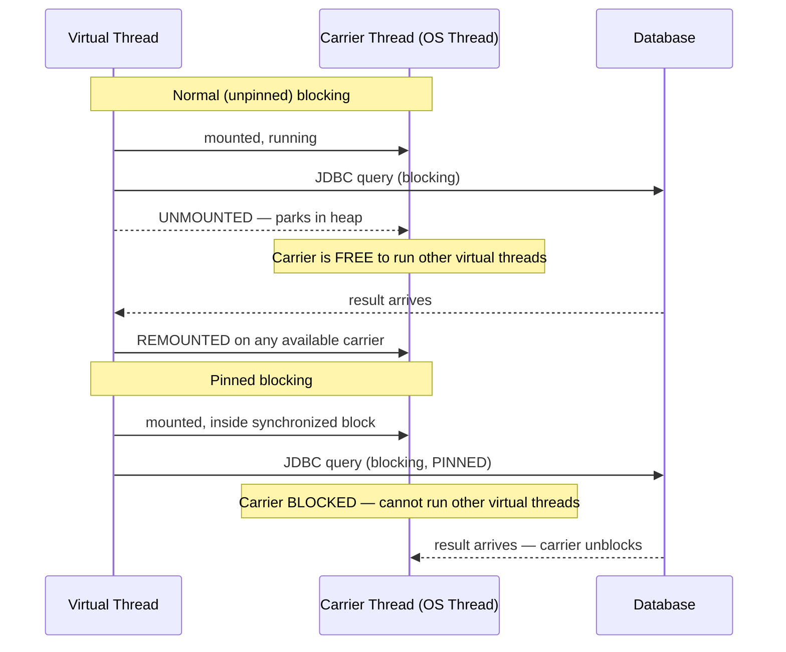
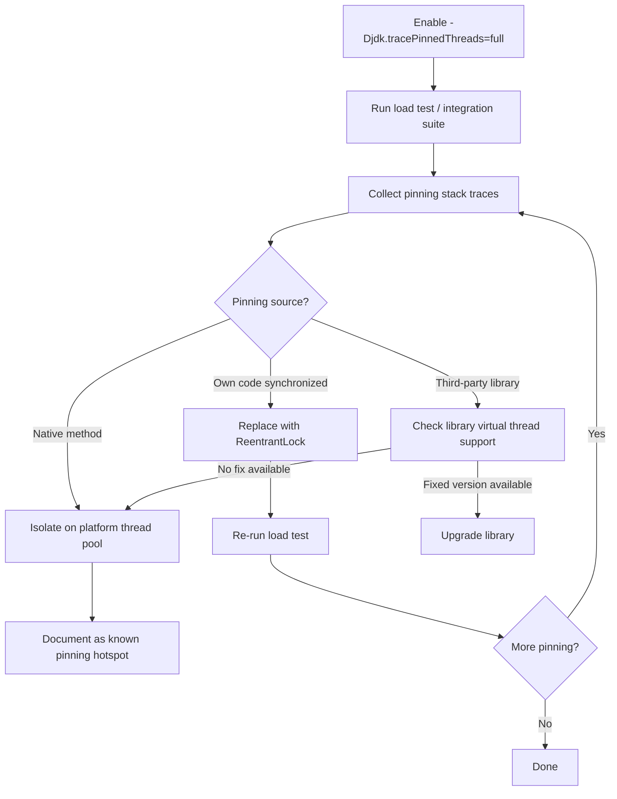

## Overview

Virtual threads park on blocking I/O, freeing their carrier thread for other work. But there is a critical exception: **pinning**. When a virtual thread is pinned, it cannot be unmounted from its carrier thread even when blocking. The carrier thread blocks with it — exactly like a platform thread.

Pinning is the most important virtual thread compatibility concern for real-world financial applications. Legacy codebases built on platform threads typically contain hundreds of `synchronized` blocks — every one of them is a potential pinning point that silently degrades virtual thread performance.

This lesson covers what causes pinning, how to detect it, and the systematic refactoring approach for eliminating it.

## Learning Objectives

By the end of this lesson you will be able to:

- Explain precisely what pinning is and why it occurs
- Identify the two root causes of pinning: `synchronized` blocks and native methods
- Enable JVM pinning diagnostics with `-XX:+PrintVirtualThreads` and JFR
- Systematically audit a codebase for pinning hotspots
- Refactor `synchronized` blocks to `ReentrantLock` to eliminate pinning
- Identify third-party libraries with known pinning issues
- Apply the correct migration strategy for each pinning scenario

## What is Pinning?

A virtual thread is **pinned** when it cannot be unmounted from its carrier thread. While pinned, any blocking operation blocks the carrier OS thread — the virtual thread behaves identically to a platform thread.



## Causes of Pinning

### Cause 1: synchronized Blocks and Methods

A virtual thread inside a `synchronized` block (or `synchronized` method) **cannot be unmounted**. The JVM uses the object monitor (intrinsic lock) as a carrier-level primitive — releasing the carrier while holding a monitor is not currently supported.

```java21
// PINNING: virtual thread blocks inside synchronized — carrier is pinned
public class PinningExample {
    private final Object lock = new Object();
    private long balance;

    public long getBalance() {
        synchronized (lock) {           // Virtual thread enters monitor
            return database.fetch(id);  // Blocking I/O inside synchronized — PINNED
            // Carrier thread is blocked for the duration of the DB call
        }
    }
}

// NON-PINNING: ReentrantLock — virtual thread parks, carrier is freed
public class NonPinningExample {
    private final ReentrantLock lock = new ReentrantLock();
    private long balance;

    public long getBalance() {
        lock.lock();
        try {
            return database.fetch(id);  // Blocking I/O — virtual thread PARKS (not pinned)
            // Carrier thread is FREE to run other virtual threads
        } finally {
            lock.unlock();
        }
    }
}
```

> [!IMPORTANT]
> **Not all `synchronized` blocks cause harmful pinning.** A `synchronized` block that contains only fast, non-blocking operations (arithmetic, in-memory reads/writes) holds the carrier briefly and releases it. The performance impact is negligible. Pinning is only harmful when a blocking operation occurs **while the virtual thread is pinned** — the carrier blocks for the duration of the I/O wait.

### Cause 2: Native Methods and Foreign Functions

Virtual threads also pin when executing native methods (`native` keyword) or when inside a Foreign Function & Memory API call that calls native code. This is a JVM-level constraint — the native call stack cannot be represented as a heap object.

```java21
// Native methods pin virtual threads — cannot be avoided without changing the native code
// Common sources: JDBC drivers with native implementations, cryptographic libraries,
// file system APIs on some platforms, JNI calls

// Detection: JFR event jdk.VirtualThreadPinned with stacktrace shows the native frame
```

## Detecting Pinning

### JVM Flag: -Djdk.tracePinnedThreads

```java21
// JVM startup flag — prints a stack trace whenever a virtual thread is pinned
// Two severity levels:
//   full  — prints complete stack trace (verbose, good for initial audit)
//   short — prints only the pinning frame (less noise, good for ongoing monitoring)

// application startup:
// java -Djdk.tracePinnedThreads=full -jar payment-service.jar

// Output when pinning occurs:
/*
Thread[#45,ForkJoinPool-1-worker-1,5,main]
    com.bank.payment.AccountService.getBalance(AccountService.java:42) <== monitors:1
    com.bank.payment.PaymentProcessor.process(PaymentProcessor.java:87)
    ...
    <== monitors:1  indicates 1 held monitor (synchronized block)
*/
```

### Java Flight Recorder (JFR)

```java21
// JFR event: jdk.VirtualThreadPinned
// Records: thread name, duration of pin, stack trace

// Enable during application run:
// jcmd <pid> JFR.start name=pinning-audit settings=default duration=60s filename=pinning.jfr
// jcmd <pid> JFR.stop name=pinning-audit

// Open in JDK Mission Control — filter for jdk.VirtualThreadPinned events
// Sort by duration to find the most impactful pinning hotspots

// Programmatic JFR (useful in integration tests):
RecordingConfiguration config = new RecordingConfiguration();
config.enable("jdk.VirtualThreadPinned").withThreshold(Duration.ofMillis(10));
try (Recording recording = new Recording(config)) {
    recording.start();
    // Run payment processing under load
    recording.stop();
    List<RecordedEvent> events = EventStream.openFile(recording.getDestination())
        .filter(e -> e.getEventType().getName().equals("jdk.VirtualThreadPinned"))
        .collect(Collectors.toList());
}
```

### Programmatic Detection (Test-Level)

```java21
// In integration tests: assert that specific code paths do not pin
public class PinningTest {

    @Test
    public void paymentProcessing_shouldNotPinCarrierThread() throws Exception {
        AtomicLong pinnedCount = new AtomicLong(0);

        // Register JFR event hook
        FlightRecorder.addPeriodicEvent(PinningCheckEvent.class, () -> {
            // Count pinned events
        });

        // Run test on a virtual thread
        Thread vt = Thread.ofVirtual().start(() -> {
            paymentService.processPayment(testRequest);
        });
        vt.join();

        // Assert no pinning occurred (or acceptable threshold)
        assertThat(pinnedCount.get()).isZero();
    }
}
```

## Fixing Pinning: synchronized → ReentrantLock

The standard fix for `synchronized`-caused pinning is replacing the intrinsic lock with `ReentrantLock`. The refactoring is mechanical:

```java21
// BEFORE: synchronized — causes pinning when blocking I/O occurs inside
public class AccountRepository {
    private final Object writeLock = new Object();

    public void updateBalance(String accountId, long newBalance) {
        synchronized (writeLock) {
            jdbcTemplate.update(                           // Blocking I/O — PINNED
                "UPDATE accounts SET balance=? WHERE id=?",
                newBalance, accountId
            );
            auditLog.write(accountId, newBalance);        // Blocking I/O — PINNED
        }
    }

    public synchronized AccountBalance findById(String accountId) {  // Method-level synchronized
        return jdbcTemplate.queryForObject(               // Blocking I/O — PINNED
            "SELECT * FROM accounts WHERE id=?",
            AccountBalance.ROW_MAPPER, accountId
        );
    }
}

// AFTER: ReentrantLock — virtual thread parks, carrier is freed
public class AccountRepository {
    private final ReentrantLock writeLock = new ReentrantLock();

    public void updateBalance(String accountId, long newBalance) {
        writeLock.lock();
        try {
            jdbcTemplate.update(                          // Blocking I/O — virtual thread PARKS
                "UPDATE accounts SET balance=? WHERE id=?",
                newBalance, accountId
            );
            auditLog.write(accountId, newBalance);        // Blocking I/O — virtual thread PARKS
        } finally {
            writeLock.unlock();                           // ALWAYS in finally
        }
    }

    // findById: does it even need a lock?
    // JDBC connections come from a pool — each call gets its own connection
    // No shared mutable state → no lock needed at all
    public AccountBalance findById(String accountId) {
        return jdbcTemplate.queryForObject(              // Lock removed entirely — correct
            "SELECT * FROM accounts WHERE id=?",
            AccountBalance.ROW_MAPPER, accountId
        );
    }
}
```

## Migration Strategy: Auditing a Codebase

For a large financial codebase, the migration is a phased audit:



## Third-Party Library Pinning

Many common libraries used in financial services have known pinning issues:

| Library | Pinning Status | Notes |
|---|---|---|
| **Hibernate ORM** | ✓ Fixed in 6.2+ | Earlier versions pin on session-level synchronized |
| **Spring Data JPA** | ✓ Fixed in Spring 6.1 | Via Hibernate upgrade |
| **HikariCP** | ✓ Fixed in 5.1.0 | Connection pool acquisition no longer pins |
| **Spring Security** | ⚠ Partial | Some synchronized in filter chain — audit required |
| **Lettuce (Redis)** | ✓ Non-blocking | Async driver — no pinning |
| **Jedis (Redis)** | ⚠ Pins | Blocking driver with synchronized — use connection pool |
| **H2 (test DB)** | ⚠ Pins | In-memory mode uses synchronized extensively |
| **Testcontainers** | ✓ Generally OK | Minimal synchronization in test lifecycle |

```java21
// Workaround for third-party library pinning: isolate on a platform thread pool
// The library code runs on a platform thread — pinning is irrelevant for platform threads
@Service
public class LegacyLibraryService {

    // Platform thread pool for code that cannot be fixed
    private final ExecutorService platformPool = Executors.newFixedThreadPool(
        20,
        Thread.ofPlatform().name("legacy-", 0).factory()
    );

    public CompletableFuture<Result> callLegacyLibrary(Request request) {
        // Offload to platform thread pool — virtual threads not involved
        return CompletableFuture.supplyAsync(
            () -> legacyLibrary.process(request), // Pinning on platform thread is harmless
            platformPool
        );
    }
}
```

## synchronized Blocks That Do NOT Need Fixing

Not every `synchronized` block needs refactoring. Apply the fix only when both conditions are true:

1. The `synchronized` block may execute on a virtual thread
2. A blocking operation (I/O, `sleep`, another lock acquisition) occurs inside the block

```java21
// SAFE: synchronized with no blocking I/O — brief, non-pinning in practice
// (Technically still pins, but duration is so short it doesn't matter)
public class InMemoryCache {
    private final Map<String, Rate> cache = new HashMap<>();

    public synchronized Rate get(String key) {
        return cache.get(key);     // Pure memory access — microseconds
    }

    public synchronized void put(String key, Rate rate) {
        cache.put(key, rate);      // Pure memory access — microseconds
    }
    // Fine to leave as synchronized — no blocking I/O, pin duration is negligible
    // But ConcurrentHashMap would be better here anyway
}

// MUST FIX: synchronized with blocking I/O
public class DatabaseRepository {
    public synchronized Account findById(String id) {
        return jdbcTemplate.queryForObject(...); // Blocking — MUST fix to ReentrantLock
    }
}
```

---

<!-- KNOWLEDGE-CHECK [
  {
    "id": "kc-pin-01",
    "question": "A virtual thread is inside a `synchronized` block and calls `Thread.sleep(1000)`. What happens to the carrier thread?",
    "options": [
      "The carrier thread is freed for other virtual threads during the sleep",
      "The carrier thread blocks for 1000ms — it is pinned by the synchronized block",
      "An UnsupportedOperationException is thrown — sleep is not allowed in synchronized blocks",
      "The virtual thread is automatically upgraded to a platform thread"
    ],
    "correct": 1,
    "explanation": "synchronized blocks pin the virtual thread to its carrier thread. Any blocking operation inside a synchronized block — including Thread.sleep(), I/O, or lock acquisition — blocks the carrier OS thread for the duration. The carrier cannot run other virtual threads. This negates the benefit of virtual threads. The fix: replace synchronized with ReentrantLock — virtual threads park on ReentrantLock.lock() without pinning."
  },
  {
    "id": "kc-pin-02",
    "question": "What is the correct JVM flag to print a stack trace every time a virtual thread is pinned?",
    "options": [
      "-XX:+PrintVirtualThreadPinning",
      "-Djdk.tracePinnedThreads=full",
      "-Djava.util.concurrent.pinning=true",
      "-XX:VirtualThreadPinningThreshold=0"
    ],
    "correct": 1,
    "explanation": "-Djdk.tracePinnedThreads=full prints a stack trace (including the specific synchronized block or native frame) whenever a virtual thread is pinned. Use this during load testing to audit your codebase for pinning hotspots. The 'short' option prints a condensed trace, useful for ongoing monitoring. This is the standard first step when migrating a codebase to virtual threads."
  },
  {
    "id": "kc-pin-03",
    "question": "An `AccountRepository` has `public synchronized AccountBalance findById(String id)` with a JDBC call inside. When migrated to virtual threads, what is the impact and what is the fix?",
    "options": [
      "No impact — synchronized on a repository method does not cause pinning",
      "Carrier thread pins for each DB call duration; fix by replacing synchronized with ReentrantLock or removing it if the method has no actual shared mutable state",
      "The method throws an exception on virtual threads",
      "The method automatically uses platform threads when synchronized is detected"
    ],
    "correct": 1,
    "explanation": "synchronized on a method is equivalent to synchronized(this). Inside, the JDBC call blocks — causing carrier thread pinning for the DB query duration. The fix has two steps: (1) determine if the lock is actually needed — most repository methods operate on a connection-pool connection, not shared mutable state, so the synchronized may be removable entirely. (2) If locking is genuinely needed, replace with ReentrantLock."
  },
  {
    "id": "kc-pin-04",
    "question": "An older Hibernate ORM version (5.x) pins carrier threads. The upgrade to Hibernate 6.2 is blocked by other dependencies. What is the correct interim strategy?",
    "options": [
      "Disable virtual threads entirely until Hibernate is upgraded",
      "Run Hibernate operations on a dedicated platform thread pool — pinning on platform threads is harmless",
      "Replace all Hibernate calls with JDBC to avoid pinning",
      "Increase the carrier thread pool size to 500 to absorb the pinning"
    ],
    "correct": 1,
    "explanation": "Platform threads are not affected by pinning — pinning is only a virtual thread concept. By offloading Hibernate calls to a dedicated platform thread pool (CompletableFuture.supplyAsync(hibernateCall, platformPool)), the pinning happens on platform threads where it is irrelevant. The rest of the application can use virtual threads normally. This buys time for the Hibernate upgrade without blocking the virtual thread migration."
  }
] -->

---

<!-- PRACTICAL-CHALLENGE {
  "id": "pc-virtual-thread-pinning",
  "title": "Pinning Audit and Remediation",
  "description": "Identify and eliminate virtual thread pinning in a payment service codebase.",
  "tasks": [
    {
      "id": "pc-pin-01",
      "description": "Enable -Djdk.tracePinnedThreads=full on a Spring Boot payment service and run your integration test suite. Capture all pinning stack traces. Categorise each by: own code synchronized, third-party library, native method. Count total pinning events per category."
    },
    {
      "id": "pc-pin-02",
      "description": "Refactor the top 3 pinning hotspots in your own code (synchronized with JDBC calls inside). Replace synchronized with ReentrantLock. Re-run the integration suite and confirm pinning events drop to zero for those methods. Verify correctness — the ReentrantLock must be released in finally."
    },
    {
      "id": "pc-pin-03",
      "description": "Write a JMH benchmark: compare throughput of a payment service method (100ms JDBC call) run on (a) a 50-thread platform pool, (b) virtual threads with pinning (synchronized wrapping the JDBC call), (c) virtual threads without pinning (ReentrantLock). Measure ops/second at 200 concurrent requests. Expected: (c) >> (a) > (b) for I/O-bound."
    },
    {
      "id": "pc-pin-04",
      "description": "Implement a Spring Boot health indicator that uses `ThreadMXBean` and JFR to monitor pinning events per minute. Alert (set health to WARN) if more than 10 pinning events per minute are recorded in production. Document the threshold rationale."
    }
  ]
} -->
