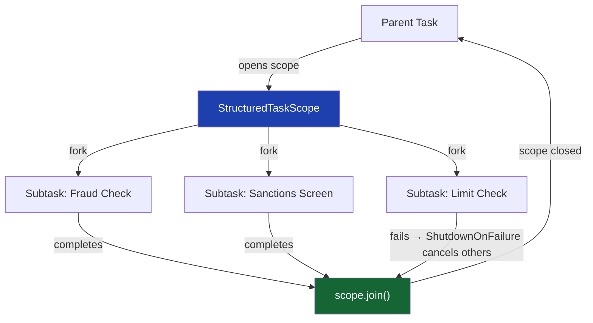
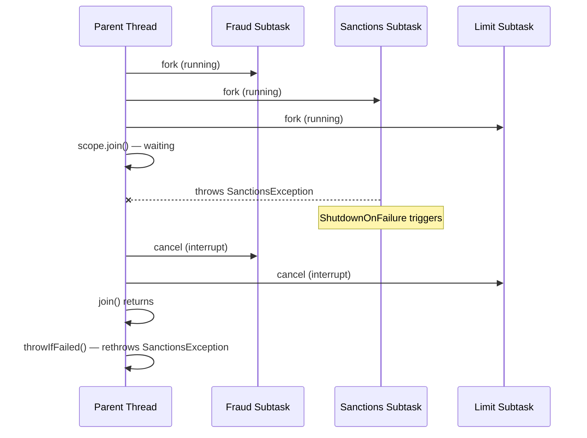

# التزامن المهيكل (Structured Concurrency) — StructuredTaskScope

## نظرة عامة

يتيح `CompletableFuture` و`ExecutorService` الخام التنفيذ المتزامن، لكنهما يخلقان مشكلة جوهرية: **العلاقة بين المهمة الأم والمهام الفرعية التي تولّدها غير مرئية لـ JVM**. فإذا فشلت مهمة فرعية قد لا تعلم الأم. وإذا أُلغيت الأم تستمر المهام الفرعية في العمل. وإذا رمت الأم استثناء تستمر المهام الفرعية المرسلة في استهلاك الموارد.

ويحل **التزامن المهيكل** (JEP 453، معاينة في Java 21) هذه المشكلة بنموذج برمجي تكون فيه للمهام الفرعية المتزامنة مدة حياة واضحة: تُنشأ داخل نطاق (scope)، ويجب أن تكتمل قبل خروج النطاق، ودورة حياتها مربوطة بالمهمة الأم. فينتشر الإلغاء، وتظهر الإخفاقات فورًا، وتُستعاد الموارد بموثوقية.

وفي مسار معالجة مدفوعات يتفرع إلى فحص الاحتيال، وفحص العقوبات، والتحقق من الرصيد — يجعل التزامن المهيكل تدفق التحكم صريحًا، ومتوقعًا، وسهل التصحيح.

> [!NOTE]
> ‏`StructuredTaskScope` واجهة **معاينة** (Preview) ‏(JEP 453 في Java 21، وأعيدت معاينتها في Java 22–24) وتتطلب `--enable-preview` عند الترجمة والتشغيل. وقد **تغيرت الواجهة فعلًا**: فقد استبدل Java 25 ‏(JEP 505) الصنفين الفرعيين `ShutdownOnFailure` و`ShutdownOnSuccess` بـ `StructuredTaskScope.open(...)` وسياسات `Joiner`. يستخدم هذا الدرس واجهة Java 21 ويعرض صيغة Java 25 في نهاية قسم ShutdownOnFailure. وللإنتاج، قيّم هل خطر المعاينة مقبول، أو استخدم `CompletableFuture.allOf()` بديلًا مستقرًا.

## أهداف التعلم

في نهاية هذا الدرس ستستطيع:

- شرح مشاكل التزامن غير المهيكل في مسارات `CompletableFuture`
- استخدام `StructuredTaskScope` لحصر المهام الفرعية المتزامنة في نطاق مهمة أم
- تطبيق `ShutdownOnFailure` لإلغاء كل المهام الفرعية عند فشل أي منها
- تطبيق `ShutdownOnSuccess` لإلغاء المهام الفرعية المتبقية عند نجاح أولها
- استرجاع نتائج المهام الفرعية بشكل صحيح بعد `scope.join()`
- شرح كيف يحسّن التزامن المهيكل قابلية الملاحظة في تفريغات الخيوط

## المشكلة: التزامن غير المهيكل

```java21
// Unstructured: CompletableFuture.allOf — problems:
// 1. If fraud check fails, sanctions check keeps running (wasted work)
// 2. If the calling thread is interrupted, subtasks are not cancelled
// 3. Thread dump shows subtasks with no visible link to parent
// 4. Exception handling is split across exceptionally() / handle() callbacks

public PaymentDecision validatePayment(Payment payment) throws Exception {
    CompletableFuture<FraudDecision>   fraudFuture    = CompletableFuture.supplyAsync(
        () -> fraudService.check(payment), fraudExecutor);
    CompletableFuture<SanctionsResult> sanctionsFuture = CompletableFuture.supplyAsync(
        () -> sanctionsService.screen(payment), sanctionsExecutor);
    CompletableFuture<LimitCheck>      limitFuture    = CompletableFuture.supplyAsync(
        () -> limitService.check(payment), limitExecutor);

    // If fraudFuture fails: sanctionsFuture and limitFuture keep running
    // No automatic cancellation — resource leak
    CompletableFuture.allOf(fraudFuture, sanctionsFuture, limitFuture).get();

    return new PaymentDecision(
        fraudFuture.get(), sanctionsFuture.get(), limitFuture.get()
    );
}
```

إذا فشل فحص الاحتيال يستمر فحص العقوبات في العمل (عمل مهدر)، وإذا قوطع الخيط المستدعي لا تُلغى المهام الفرعية، ولا يُظهر تفريغ الخيوط أي صلة بين المهام الفرعية وأمها، وتتوزع معالجة الاستثناءات على دوال `exceptionally()` / `handle()`.

## StructuredTaskScope — الحل

ينشئ `StructuredTaskScope` **نطاقًا** تعمل داخله المهام الفرعية. وكل `fork()` يبدأ المهمة الفرعية في خيط جديد — **خيط افتراضي** افتراضيًا. وتنتظر طريقة `join()` المهام الفرعية، ويفرض إغلاق النطاق الثابت: **لا تعيش مهمة فرعية بعد نطاقها**.



## ShutdownOnFailure — يجب أن ينجح الجميع

ينفّذ `StructuredTaskScope.ShutdownOnFailure` نمط **التفرع مع وجوب نجاح الجميع**:
- تعمل كل المهام الفرعية بالتزامن
- إذا فشلت **أي** مهمة فرعية، يُغلق النطاق وتُلغى المهام الفرعية المتبقية
- يعيد `scope.throwIfFailed()` رمي أول فشل في خيط الأم

```java21
import java.util.concurrent.StructuredTaskScope;

public PaymentDecision validatePayment(Payment payment)
        throws InterruptedException, ExecutionException {

    try (var scope = new StructuredTaskScope.ShutdownOnFailure()) {

        // Fork all three checks concurrently
        StructuredTaskScope.Subtask<FraudDecision>   fraudTask    =
            scope.fork(() -> fraudService.check(payment));
        StructuredTaskScope.Subtask<SanctionsResult> sanctionsTask =
            scope.fork(() -> sanctionsService.screen(payment));
        StructuredTaskScope.Subtask<LimitCheck>      limitTask    =
            scope.fork(() -> limitService.check(payment));

        // Wait for all subtasks — ShutdownOnFailure cancels all if any fails
        scope.join()           // Blocks until all complete or one fails
             .throwIfFailed(); // Re-throws first exception in this (parent) thread

        // All succeeded — retrieve results (guaranteed non-throwing after join)
        return new PaymentDecision(
            fraudTask.get(),
            sanctionsTask.get(),
            limitTask.get()
        );

    } // try-with-resources: scope closes — all subtasks are guaranteed complete here
}
```

بعد `join()` و`throwIfFailed()` يُضمن نجاح كل المهام، فيمكن استدعاء `get()` بأمان. وعند إغلاق النطاق (try-with-resources) تكون كل المهام الفرعية مكتملة.

والتحقق نفسه بالواجهة المعاد تصميمها في **Java 25+** (ما زالت معاينة):

```java
// Java 25+ (JEP 505) — StructuredTaskScope.open() with a Joiner policy
try (var scope = StructuredTaskScope.open()) {   // default policy: all must succeed
    var fraudTask     = scope.fork(() -> fraudService.check(payment));
    var sanctionsTask = scope.fork(() -> sanctionsService.screen(payment));
    var limitTask     = scope.fork(() -> limitService.check(payment));

    scope.join();   // if any subtask fails: cancels the others and throws FailedException

    return new PaymentDecision(fraudTask.get(), sanctionsTask.get(), limitTask.get());
}
// First success (the old ShutdownOnSuccess):
//   StructuredTaskScope.open(Joiner.<FraudDecision>anySuccessfulResultOrThrow())
// Timeout (the old joinUntil):
//   StructuredTaskScope.open(joiner, cf -> cf.withTimeout(Duration.ofMillis(500)))
```

**ما يحدث عندما يرمي فحص العقوبات استثناء:**



## ShutdownOnSuccess — الأول في النجاح يفوز

ينفّذ `StructuredTaskScope.ShutdownOnSuccess` نمط **الطلب المتحوط** (hedged request):
- تعمل عدة مهام فرعية بالتزامن (مزوّدون متكررون)
- عندما تنجح **أي** مهمة فرعية، يُغلق النطاق وتُلغى المهام الفرعية المتبقية
- يعيد `scope.result()` أول نتيجة ناجحة

```java21
// Hedged fraud check: contact two providers, use the first successful response
// If Provider A is slow, Provider B may respond first — lower tail latency
public FraudDecision checkFraudHedged(Payment payment)
        throws InterruptedException, ExecutionException {

    try (var scope = new StructuredTaskScope.ShutdownOnSuccess<FraudDecision>()) {

        scope.fork(() -> fraudProviderA.check(payment)); // Fork provider A
        scope.fork(() -> fraudProviderB.check(payment)); // Fork provider B

        scope.join(); // Wait for first success (or all to fail)

        return scope.result(); // Returns the first successful FraudDecision
        // The slower provider's subtask was cancelled automatically

    }
}
```

## إضافة مهلة زمنية

تتكامل المهل طبيعيًا مع `scope.joinUntil()`:

```java21
public PaymentDecision validateWithTimeout(Payment payment)
        throws InterruptedException, ExecutionException, TimeoutException {

    try (var scope = new StructuredTaskScope.ShutdownOnFailure()) {

        var fraudTask    = scope.fork(() -> fraudService.check(payment));
        var sanctionsTask = scope.fork(() -> sanctionsService.screen(payment));

        // Deadline: all subtasks must complete within 500ms.
        // On timeout, joinUntil throws TimeoutException; leaving the
        // try block closes the scope, which cancels the unfinished subtasks
        scope.joinUntil(Instant.now().plusMillis(500));

        // Reached only if no timeout: rethrow a subtask failure, if any
        scope.throwIfFailed(e -> new PaymentValidationException(
            "Validation check failed", e));

        return new PaymentDecision(fraudTask.get(), sanctionsTask.get());
    }
}
```

عند انتهاء المهلة يرمي `joinUntil` استثناء `TimeoutException`، والخروج من كتلة try يغلق النطاق فيلغي المهام الفرعية غير المكتملة. ولا يُبلغ `throwIfFailed` إلا إذا لم تنتهِ المهلة، فيعيد رمي فشل مهمة فرعية إن وُجد.

## التزامن المهيكل مقابل CompletableFuture

| الجانب | `CompletableFuture.allOf()` | `StructuredTaskScope` |
|---|---|---|
| انتشار الفشل | يدوي (`exceptionally`) | تلقائي (ShutdownOnFailure) |
| الإلغاء عند الفشل | يدوي (إلغاء كل مستقبل) | تلقائي |
| الصلة بين الأم والمهام الفرعية | لا توجد — غير مرئية في تفريغ الخيوط | مرئية — يجمع تفريغ JSON المهام الفرعية تحت نطاقها |
| أسلوب معالجة الاستثناءات | مبني على الاستدعاءات الراجعة | متتابع (try/catch) |
| المهلة | ‏`orTimeout()` لكل مرحلة | ‏`joinUntil()` على النطاق |
| التوفر | نهائي (Java 8+) | معاينة (Java 21+، ‏`--enable-preview`؛ أعيد تصميم الواجهة في Java 25) |
| أسلوب الشيفرة | وظيفي / تفاعلي | متتابع / أمري |

## قابلية الملاحظة: تفريغات الخيوط

من أثمن خصائص التزامن المهيكل وضوح تفريغ الخيوط. فتفريغ JSON ‏(`jcmd <pid> Thread.dump_to_file -format=json`) يُظهر كل نطاق **كحاوية خيوط** مع صلة بأمها، ويسرد خيوط المهام الفرعية داخلها. توضيح مبسّط:

```
// Unstructured (CompletableFuture) thread dump:
Thread "fraud-executor-1": runnable
    FraudService.check(FraudService.java:42)
    // No indication which parent request spawned this

Thread "payment-processor-7": waiting
    CompletableFuture.get(CompletableFuture.java:1908)
    // No indication which subtasks it's waiting for

// Structured concurrency (simplified view of the JSON dump):
Container: StructuredTaskScope$ShutdownOnFailure@1a2b  (owner: "payment-processor-7")
    parent: <root>
    virtual thread #91: FraudService.check
    virtual thread #92: SanctionsService.screen
    // Parent-subtask relationship is explicit
```

وهذا تحوّلي في تشخيص حوادث الإنتاج: ترى بالضبط أي المهام الفرعية ينتظرها معالج الدفع دون تتبع سلاسل `CompletableFuture` عبر تفريغات الخيوط.

## مسار تحقق كامل من الدفع

```java21
@Service
public class PaymentValidationService {

    private final FraudService    fraudService;
    private final SanctionsService sanctionsService;
    private final LimitService    limitService;
    private final AccountService  accountService;

    // Phase 1: sequential (each step needs the previous result)
    // Phase 2: parallel fan-out (independent checks)
    public ValidationResult validate(PaymentRequest request)
            throws InterruptedException, ExecutionException {

        // Phase 1: Fetch and validate sequentially
        Account account = accountService.fetchForPayment(request.getAccountId());
        ValidatedPayment validated = paymentValidator.validate(request, account);

        // Phase 2: Run all checks in parallel — all must pass
        try (var scope = new StructuredTaskScope.ShutdownOnFailure()) {

            var fraudTask    = scope.fork(() -> fraudService.check(validated));
            var sanctionsTask = scope.fork(() -> sanctionsService.screen(validated));
            var limitTask    = scope.fork(() -> limitService.check(validated));
            var duplicateTask = scope.fork(() -> duplicateDetector.check(validated));

            scope.joinUntil(Instant.now().plusMillis(800))
                 .throwIfFailed(e -> new ValidationException("Check failed: " + e.getMessage(), e));

            // All passed — assemble result
            return ValidationResult.passed(
                fraudTask.get(),
                sanctionsTask.get(),
                limitTask.get(),
                duplicateTask.get()
            );
        }
    }
}
```

المرحلة 1 متتابعة (كل خطوة تحتاج نتيجة السابقة)، والمرحلة 2 تفرع متوازٍ لفحوص مستقلة يجب أن تنجح كلها خلال 800ms.


<!-- KNOWLEDGE-CHECK [
  {
    "id": "kc-sc-01",
    "question": "لنطاق `StructuredTaskScope.ShutdownOnFailure` ثلاث مهام فرعية متفرعة. ترمي المهمة الفرعية 2 استثناء. ماذا يحدث للمهمتين 1 و3؟",
    "options": [
      "تكتملان طبيعيًا — لا يؤثر ShutdownOnFailure في النطاق إلا بعد انتهاء كل المهام",
      "تُلغيان (تُقاطعان) — يغلق ShutdownOnFailure النطاق عند أي فشل، فيلغي المهام الفرعية المتبقية",
      "ترميان الاستثناء نفسه الذي رمته المهمة 2",
      "تُلغى المهمة 3 فقط — فالمهمة 1 بدأت قبل الفشل"
    ],
    "correct": 1,
    "explanation": "يستدعي ShutdownOnFailure الطريقة scope.shutdown() عند فشل أي مهمة فرعية. ويقاطع الإغلاق كل المهام الفرعية الجارية بتعيين علم المقاطعة لديها. فيعود join() في خيط الأم، ويعيد throwIfFailed() رمي أول استثناء. وتُلغى المهام الفرعية غير المكتملة — فلا حساب مهدر ولا تسرب موارد من خيوط يتيمة."
  },
  {
    "id": "kc-sc-02",
    "question": "متى يمكن استدعاء `subtask.get()` بأمان في `StructuredTaskScope` دون خطر رمي `IllegalStateException`؟",
    "options": [
      "في أي وقت بعد عودة scope.fork()",
      "فقط بعد عودة scope.join() وتأكيد throwIfFailed() (أو ما يكافئه) نجاح كل المهام",
      "فقط للمهمة الفرعية التي اكتملت أولًا",
      "يعيد subtask.get() دائمًا null حتى تُعيَّن القيمة صراحة"
    ],
    "correct": 1,
    "explanation": "يرمي subtask.get() استثناء IllegalStateException إذا لم تكتمل المهمة الفرعية أو اكتملت باستثناء. فلا يكون آمنًا إلا بعد عودة scope.join() **و**تأكيد نجاح المهمة الفرعية (مثلًا عبر throwIfFailed() مع ShutdownOnFailure، الذي يضمن نجاح كل المهام إن لم يرمِ). واستدعاء subtask.get() قبل join() أو دون فحص الفشل ينتج نتائج غير متوقعة."
  },
  {
    "id": "kc-sc-03",
    "question": "لماذا كان `StructuredTaskScope` متاحًا كواجهة معاينة فقط في Java 21 وليس نهائيًا؟",
    "options": [
      "فيه أخطاء معروفة تمنع استخدامه في الإنتاج",
      "تصميم الواجهة ما زال يُحسَّن — يريد فريق JDK ملاحظات أوسع من المجتمع قبل الالتزام بواجهة مستقرة",
      "يتطلب اعتمادية Maven منفصلة غير مضمّنة في JDK",
      "يعمل على Linux فقط، لا على Windows أو macOS"
    ],
    "correct": 1,
    "explanation": "واجهات المعاينة في Java تنفيذات كاملة وعاملة، لكن تصميم الواجهة ليس نهائيًا بعد. ويجمع فريق JDK الملاحظات من الاستخدام الحقيقي قبل تثبيتها. وقد تغير StructuredTaskScope فعلًا: فقد استبدل Java 25 ‏(JEP 505) الصنفين ShutdownOnFailure / ShutdownOnSuccess بـ StructuredTaskScope.open() وسياسات Joiner. وللإنتاج، قيّم هل يستطيع فريقك تحمّل مثل هذه الانتقالات في الواجهة، أو استخدم CompletableFuture.allOf() بديلًا مستقرًا في الأثناء."
  },
  {
    "id": "kc-sc-04",
    "question": "يتصل نطاق `ShutdownOnSuccess` بثلاثة مزوّدي احتيال. يرد المزوّد C بنجاح أولًا. ماذا يحدث للمزوّدين A وB؟",
    "options": [
      "يكتملان طبيعيًا — ShutdownOnSuccess يشير فقط عند الانتهاء",
      "يُلغيان (يُقاطعان) — يغلق ShutdownOnSuccess النطاق عند أول نجاح",
      "تُخزّن نتائجهما ويُحسب متوسطها مع نتيجة المزوّد C",
      "يرميان CancellationException فورًا"
    ],
    "correct": 1,
    "explanation": "يستدعي ShutdownOnSuccess الطريقة scope.shutdown() عند نجاح أي مهمة فرعية. فيقاطع كل المهام الفرعية المتبقية الجارية (المزوّدين A وB). ويعيد scope.result() نتيجة المزوّد C. وهذا ينفّذ نمط التحوط بشكل صحيح — لا حساب مهدر بعد الحصول على نتيجة ناجحة."
  }
] -->


<!-- PRACTICAL-CHALLENGE {
  "id": "pc-structured-concurrency",
  "title": "التحقق من الدفع باستخدام StructuredTaskScope",
  "description": "نفّذ مسار تحقق من الدفع باستخدام التزامن المهيكل.",
  "tasks": [
    {
      "id": "pc-scc-01",
      "description": "نفّذ `PaymentGateway.authorise(PaymentRequest)` باستخدام `ShutdownOnFailure` لتشغيل فحص الاحتيال، وفحص العقوبات، وفحص حد السرعة بالتوازي. يجب أن تنجح الثلاثة كلها. فإذا فشل أي منها (رمى استثناء أو أعاد نتيجة محظورة)، ألغِ البقية وارمِ `PaymentDeclinedException` مع السبب من الفحص الفاشل."
    },
    {
      "id": "pc-scc-02",
      "description": "أضف مهلة كلية 300ms عبر `joinUntil()`. فإذا انتهت المهلة (TimeoutException)، ارمِ `ValidationTimeoutException` يحدد أي الفحوص كانت ما زالت تعمل (استخدم `Subtask.state()`). واختبر بفحص احتيال محاكى مدته 400ms للتأكد من أن المهلة تعمل وأن كل المهام الفرعية تُلغى عند إغلاق النطاق."
    },
    {
      "id": "pc-scc-03",
      "description": "نفّذ `FraudDecisionService.check(Payment)` باستخدام `ShutdownOnSuccess` للاتصال بمزوّدي احتيال بالتوازي واستخدام أول رد ناجح. وإذا فشل المزوّدان، لا تسمح بالدفعة بصمت: أعد `FraudDecision.referToManualReview()` (أو ارفض، حسب سياسة مخاطر البنك) وسجّل تحذيرًا. وقِس تحسن زمن الاستجابة عند المئين 99 مقارنة باستدعاء المزوّدين بالتتابع."
    },
    {
      "id": "pc-scc-04",
      "description": "قارن وضوح تفريغ الخيوط: شغّل مسار التحقق نفسه باستخدام (أ) CompletableFuture.allOf()، (ب) StructuredTaskScope. وولّد تفريغ خيوط أثناء حمل الذروة لكل منهما. ووثّق: كم سطرًا تحتاج لتحديد الفحوص التي ينتظرها خيط دفع محجوب في كل أسلوب."
    }
  ]
} -->
