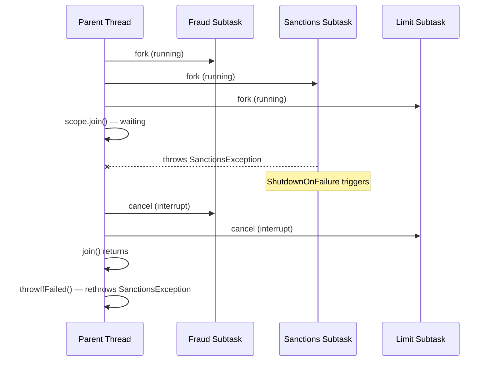

## Overview

`CompletableFuture` and raw `ExecutorService` enable concurrent execution but create a fundamental problem: **the relationship between a parent task and the subtasks it spawns is invisible to the JVM**. If a subtask fails, the parent may not know. If the parent is cancelled, subtasks keep running. If the parent throws an exception, submitted subtasks continue consuming resources.

**Structured concurrency** (JEP 453, Java 21 Preview) solves this with a programming model where concurrent subtasks have a clear lifetime: they are created within a scope, they must complete before the scope exits, and their lifecycle is bound to the parent task. Cancellation propagates. Failures surface immediately. Resources are reclaimed reliably.

For a payment processing pipeline that fans out to fraud check, sanctions screening, and balance validation — structured concurrency makes the control flow explicit, predictable, and debuggable.

> [!NOTE]
> `StructuredTaskScope` was **Preview** in Java 21 and requires `--enable-preview` at compile and runtime. It is expected to be finalised in a future Java release. The API may change before GA. For production use, evaluate whether the preview risk is acceptable or use `CompletableFuture.allOf()` as a stable alternative.

## Learning Objectives

By the end of this lesson you will be able to:

- Explain the problems with unstructured concurrency in `CompletableFuture` pipelines
- Use `StructuredTaskScope` to scope concurrent subtasks to a parent task
- Apply `ShutdownOnFailure` to cancel all subtasks when any one fails
- Apply `ShutdownOnSuccess` to cancel remaining subtasks when the first succeeds
- Retrieve subtask results correctly after `scope.join()`
- Explain how structured concurrency improves observability in thread dumps

## The Problem: Unstructured Concurrency

```java21
// Unstructured: CompletableFuture.allOf — problems:
// 1. If fraud check fails, sanctions check keeps running (wasted work)
// 2. If the calling thread is interrupted, subtasks are not cancelled
// 3. Thread dump shows subtasks with no visible link to parent
// 4. Exception handling is split across exceptionally() / handle() callbacks

public PaymentDecision validatePayment(Payment payment) throws Exception {
    CompletableFuture<FraudDecision>   fraudFuture    = CompletableFuture.supplyAsync(
        () -> fraudService.check(payment), fraudExecutor);
    CompletableFuture<SanctionsResult> sanctionsFuture = CompletableFuture.supplyAsync(
        () -> sanctionsService.screen(payment), sanctionsExecutor);
    CompletableFuture<LimitCheck>      limitFuture    = CompletableFuture.supplyAsync(
        () -> limitService.check(payment), limitExecutor);

    // If fraudFuture fails: sanctionsFuture and limitFuture keep running
    // No automatic cancellation — resource leak
    CompletableFuture.allOf(fraudFuture, sanctionsFuture, limitFuture).get();

    return new PaymentDecision(
        fraudFuture.get(), sanctionsFuture.get(), limitFuture.get()
    );
}
```

## StructuredTaskScope — The Solution

`StructuredTaskScope` creates a **scope** within which subtasks run. The scope `join()` method waits for all subtasks and enforces the invariant: **no subtask outlives the scope**.

```mermaid
graph TD
    Parent[Parent Task] --> |opens scope| Scope[StructuredTaskScope]
    Scope --> |fork| ST1[Subtask: Fraud Check]
    Scope --> |fork| ST2[Subtask: Sanctions Screen]
    Scope --> |fork| ST3[Subtask: Limit Check]
    ST1 --> |completes| Join[scope.join()]
    ST2 --> |completes| Join
    ST3 --> |fails → ShutdownOnFailure cancels others| Join
    Join --> |scope closed| Parent

    style Scope fill:#1e40af,color:#fff
    style Join fill:#166534,color:#fff
```

## ShutdownOnFailure — All Must Succeed

`StructuredTaskScope.ShutdownOnFailure` implements the **fan-out, all-must-succeed** pattern:
- All subtasks run concurrently
- If **any** subtask fails, the scope shuts down and remaining subtasks are cancelled
- `scope.throwIfFailed()` re-throws the first failure in the parent thread

```java21
import java.util.concurrent.StructuredTaskScope;

public PaymentDecision validatePayment(Payment payment)
        throws InterruptedException, ExecutionException {

    try (var scope = new StructuredTaskScope.ShutdownOnFailure()) {

        // Fork all three checks concurrently
        StructuredTaskScope.Subtask<FraudDecision>   fraudTask    =
            scope.fork(() -> fraudService.check(payment));
        StructuredTaskScope.Subtask<SanctionsResult> sanctionsTask =
            scope.fork(() -> sanctionsService.screen(payment));
        StructuredTaskScope.Subtask<LimitCheck>      limitTask    =
            scope.fork(() -> limitService.check(payment));

        // Wait for all subtasks — ShutdownOnFailure cancels all if any fails
        scope.join()           // Blocks until all complete or one fails
             .throwIfFailed(); // Re-throws first exception in this (parent) thread

        // All succeeded — retrieve results (guaranteed non-throwing after join)
        return new PaymentDecision(
            fraudTask.get(),
            sanctionsTask.get(),
            limitTask.get()
        );

    } // try-with-resources: scope closes — all subtasks are guaranteed complete here
}
```

**What happens when sanctions screening throws:**



## ShutdownOnSuccess — First to Succeed Wins

`StructuredTaskScope.ShutdownOnSuccess` implements the **hedged request** pattern:
- Multiple subtasks run concurrently (redundant providers)
- When **any** subtask succeeds, the scope shuts down and remaining subtasks are cancelled
- `scope.result()` returns the first successful result

```java21
// Hedged fraud check: contact two providers, use the first successful response
// If Provider A is slow, Provider B may respond first — lower tail latency
public FraudDecision checkFraudHedged(Payment payment)
        throws InterruptedException, ExecutionException {

    try (var scope = new StructuredTaskScope.ShutdownOnSuccess<FraudDecision>()) {

        scope.fork(() -> fraudProviderA.check(payment)); // Fork provider A
        scope.fork(() -> fraudProviderB.check(payment)); // Fork provider B

        scope.join(); // Wait for first success (or all to fail)

        return scope.result(); // Returns the first successful FraudDecision
        // The slower provider's subtask was cancelled automatically

    }
}
```

## Adding a Timeout

Timeouts integrate naturally with `scope.joinUntil()`:

```java21
public PaymentDecision validateWithTimeout(Payment payment)
        throws InterruptedException, ExecutionException, TimeoutException {

    try (var scope = new StructuredTaskScope.ShutdownOnFailure()) {

        var fraudTask    = scope.fork(() -> fraudService.check(payment));
        var sanctionsTask = scope.fork(() -> sanctionsService.screen(payment));

        // Deadline: all subtasks must complete within 500ms
        scope.joinUntil(Instant.now().plusMillis(500));

        scope.throwIfFailed(e -> new PaymentValidationException(
            "Validation timed out or failed", e));

        return new PaymentDecision(fraudTask.get(), sanctionsTask.get());
    }
}
```

## Structured Concurrency vs CompletableFuture

| Aspect | `CompletableFuture.allOf()` | `StructuredTaskScope` |
|---|---|---|
| Failure propagation | Manual (`exceptionally`) | Automatic (ShutdownOnFailure) |
| Cancellation on failure | Manual (cancel each future) | Automatic |
| Parent-subtask link | None — invisible in thread dump | Visible — subtasks shown under parent |
| Exception handling style | Callback-based | Sequential (try/catch) |
| Timeout | `orTimeout()` per stage | `joinUntil()` on the scope |
| Availability | GA (all Java versions) | Preview (Java 21, enable-preview) |
| Code style | Functional / reactive | Sequential / imperative |

## Observability: Thread Dumps

One of the most valuable properties of structured concurrency is thread dump readability:

```
// Unstructured (CompletableFuture) thread dump:
Thread "fraud-executor-1": runnable
    FraudService.check(FraudService.java:42)
    // No indication which parent request spawned this

Thread "payment-processor-7": waiting
    CompletableFuture.get(CompletableFuture.java:1908)
    // No indication which subtasks it's waiting for

// Structured concurrency thread dump:
Thread "payment-processor-7": waiting on StructuredTaskScope
    Subtask "fraud-executor-1": running FraudService.check
    Subtask "sanctions-executor-3": running SanctionsService.screen
    // Parent-subtask relationship is explicit
```

This is transformative for diagnosing production incidents: you can see exactly which subtasks a payment processor is waiting for without tracing `CompletableFuture` chains across thread dumps.

## Full Payment Validation Pipeline

```java21
@Service
public class PaymentValidationService {

    private final FraudService    fraudService;
    private final SanctionsService sanctionsService;
    private final LimitService    limitService;
    private final AccountService  accountService;

    // Phase 1: sequential (each step needs the previous result)
    // Phase 2: parallel fan-out (independent checks)
    public ValidationResult validate(PaymentRequest request)
            throws InterruptedException, ExecutionException {

        // Phase 1: Fetch and validate sequentially
        Account account = accountService.fetchForPayment(request.getAccountId());
        ValidatedPayment validated = paymentValidator.validate(request, account);

        // Phase 2: Run all checks in parallel — all must pass
        try (var scope = new StructuredTaskScope.ShutdownOnFailure()) {

            var fraudTask    = scope.fork(() -> fraudService.check(validated));
            var sanctionsTask = scope.fork(() -> sanctionsService.screen(validated));
            var limitTask    = scope.fork(() -> limitService.check(validated));
            var duplicateTask = scope.fork(() -> duplicateDetector.check(validated));

            scope.joinUntil(Instant.now().plusMillis(800))
                 .throwIfFailed(e -> new ValidationException("Check failed: " + e.getMessage(), e));

            // All passed — assemble result
            return ValidationResult.passed(
                fraudTask.get(),
                sanctionsTask.get(),
                limitTask.get(),
                duplicateTask.get()
            );
        }
    }
}
```

---

<!-- KNOWLEDGE-CHECK [
  {
    "id": "kc-sc-01",
    "question": "A `StructuredTaskScope.ShutdownOnFailure` scope has three forked subtasks. Subtask 2 throws an exception. What happens to Subtask 1 and Subtask 3?",
    "options": [
      "They complete normally — ShutdownOnFailure only affects the scope after all tasks finish",
      "They are cancelled (interrupted) — ShutdownOnFailure shuts down the scope on any failure, cancelling remaining subtasks",
      "They throw the same exception as Subtask 2",
      "Only Subtask 3 is cancelled — Subtask 1 already started before the failure"
    ],
    "correct": 1,
    "explanation": "ShutdownOnFailure calls scope.shutdown() when any subtask fails. Shutdown interrupts all running subtasks by setting their interrupt flag. The parent thread's join() returns, and throwIfFailed() re-throws the first exception. Subtasks that have not completed are cancelled — no wasted computation and no resource leaks from orphaned threads."
  },
  {
    "id": "kc-sc-02",
    "question": "When can `subtask.get()` safely be called in a `StructuredTaskScope` without risk of throwing `IllegalStateException`?",
    "options": [
      "Any time after scope.fork() returns",
      "Only after scope.join() returns and throwIfFailed() (or equivalent) confirms all tasks succeeded",
      "Only for the subtask that completed first",
      "subtask.get() always returns null until explicitly set"
    ],
    "correct": 1,
    "explanation": "subtask.get() throws IllegalStateException if the subtask has not completed or if it completed with an exception. It is only safe to call after scope.join() returns AND you have confirmed the subtask succeeded (e.g., via throwIfFailed() with ShutdownOnFailure, which guarantees all subtasks succeeded if it doesn't throw). Calling subtask.get() before join() or without checking for failure produces unpredictable results."
  },
  {
    "id": "kc-sc-03",
    "question": "Why is `StructuredTaskScope` only available as a Preview API in Java 21 and not GA?",
    "options": [
      "It has known bugs that prevent production use",
      "The API design is still being refined — the JDK team wants broader community feedback before committing to a stable API",
      "It requires a separate Maven dependency not included in the JDK",
      "It only works on Linux, not on Windows or macOS"
    ],
    "correct": 1,
    "explanation": "Preview APIs in Java are complete, working implementations but the API design is not yet finalised. The JDK team gathers feedback from real-world usage before stabilising the API. StructuredTaskScope may change between Java 21 preview and its eventual GA release. For production use, assess whether your team can absorb a potential API migration when it GAs, or use CompletableFuture.allOf() as the stable alternative in the meantime."
  },
  {
    "id": "kc-sc-04",
    "question": "A `ShutdownOnSuccess` scope contacts three fraud providers. Provider C responds successfully first. What happens to Providers A and B?",
    "options": [
      "They complete naturally — ShutdownOnSuccess only signals when done",
      "They are cancelled (interrupted) — ShutdownOnSuccess shuts down the scope on first success",
      "Their results are stored and averaged with Provider C's result",
      "They throw CancellationException immediately"
    ],
    "correct": 1,
    "explanation": "ShutdownOnSuccess calls scope.shutdown() when any subtask succeeds. This interrupts all remaining running subtasks (Providers A and B). scope.result() returns Provider C's result. This implements the hedging pattern correctly — no wasted computation after a successful result is obtained."
  }
] -->

---

<!-- PRACTICAL-CHALLENGE {
  "id": "pc-structured-concurrency",
  "title": "Payment Validation with StructuredTaskScope",
  "description": "Implement a payment validation pipeline using structured concurrency.",
  "tasks": [
    {
      "id": "pc-scc-01",
      "description": "Implement `PaymentGateway.authorise(PaymentRequest)` using `ShutdownOnFailure` to run fraud check, sanctions screening, and velocity limit check in parallel. All three must pass. If any fails (throws or returns a blocked result), cancel the others and throw `PaymentDeclinedException` with the reason from the failing check."
    },
    {
      "id": "pc-scc-02",
      "description": "Add a 300ms overall deadline via `joinUntil()`. If the deadline expires, throw `ValidationTimeoutException` identifying which checks were still running. Test with simulated 400ms fraud check to confirm the timeout fires correctly and all subtasks are cancelled."
    },
    {
      "id": "pc-scc-03",
      "description": "Implement `FraudDecisionService.check(Payment)` using `ShutdownOnSuccess` to contact two fraud providers in parallel and use the first response. Add a fallback: if both providers fail, return `FraudDecision.defaultAllow()` with a warning log rather than throwing. Measure the 99th-percentile latency improvement over calling providers sequentially."
    },
    {
      "id": "pc-scc-04",
      "description": "Compare thread dump readability: run the same payment validation pipeline using (a) CompletableFuture.allOf(), (b) StructuredTaskScope. Generate a thread dump during peak load for each. Document: how many lines to identify which checks a blocked payment thread is waiting for in each approach."
    }
  ]
} -->
