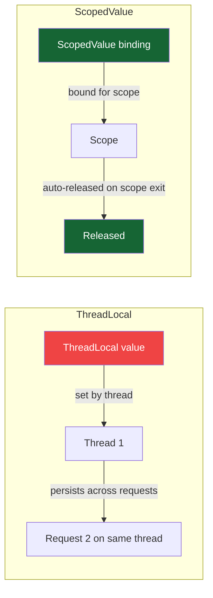

# القيم المحصورة في نطاق (Scoped Values) — بديل ThreadLocal

## نظرة عامة

‏`ThreadLocal` هو آلية Java للسياق المرتبط بالخيط منذ Java 1.2. وهو يعمل بربط قيمة بخيط المنصة الحالي — فلكل خيط نسخته المستقلة. ومع وصول الخيوط الافتراضية في Java 21 تظهر نقاط ضعف `ThreadLocal`: فالخيوط الافتراضية رخيصة وكثيرة، فتتضاعف النسخ لكل خيط؛ وتعيش القيمة ما عاش خيطها ما لم يستدعِ أحد `remove()`؛ ويستطيع أي جزء من الشيفرة تغييرها بـ `set()`؛ وفي الخيوط المجمّعة تتسرب القيمة المنسية إلى الطلب التالي.

وتقدم **القيم المحصورة في نطاق** (JEP 446، معاينة في Java 21؛ ونهائية في Java 25 عبر JEP 506) نموذجًا أفضل: سياق غير قابل للتغيير وقابل للتوريث، يُربط طوال مدة نطاق ويُحرَّر تلقائيًا عند خروج النطاق. فلا تنظيف مطلوب، ولا تغيير، ولا توريث لقيم قديمة.

وفي معالجة المدفوعات، القيم المحصورة هي الآلية الصحيحة لنشر سياق الطلب — معرّفات الترابط (correlation IDs)، وهوية المستخدم، ومعرّف المستأجر — عبر مكدس استدعاءات الخيوط الافتراضية دون مخاطر `ThreadLocal`.

> [!NOTE]
> كانت `ScopedValue` **معاينة** في Java 21–24 (تتطلب `--enable-preview`) وأصبحت **نهائية في Java 25** ‏(JEP 506). والصيغة الأساسية `ScopedValue.where(key, value).run(...)` المعروضة هنا تعمل في الاثنين. وعلى Java 21 LTS دون ميزات المعاينة يبقى `ThreadLocal` البديل المستقر. ولاحظ أن `StructuredTaskScope` المستخدم أدناه للنشر ما زال واجهة معاينة.

## أهداف التعلم

في نهاية هذا الدرس ستستطيع:

- شرح لماذا يُعد `ThreadLocal` إشكاليًا مع الخيوط الافتراضية
- إنشاء نسخ `ScopedValue` وربطها داخل نطاق
- قراءة القيم المحصورة من أي مكان في مكدس الاستدعاءات داخل النطاق
- إعادة ربط القيم المحصورة لنطاقات فرعية دون التأثير في النطاق الأب
- نشر القيم المحصورة إلى الخيوط الفرعية في `StructuredTaskScope`
- تنفيذ سياق الطلب (معرّف الترابط، ومعرّف المستخدم، ومعرّف المستأجر) باستخدام `ScopedValue`
- استبدال سياق MDC المبني على `ThreadLocal<String>` بـ `ScopedValue`

## قيود ThreadLocal مع الخيوط الافتراضية

```java21
// PROBLEM 1: Footprint and leak risk
// Virtual threads are created per task (millions per hour in a busy service).
// Each thread gets its OWN copy of every ThreadLocal value — an expensive
// object cached in a ThreadLocal is now created millions of times.
// Values live until the thread ends (or remove() is called); if threads are
// pooled, stale values persist across requests

// PROBLEM 2: Inheritance surprises
ThreadLocal<String> correlationId = new ThreadLocal<>();
correlationId.set("TXN-001");

// Child thread inherits nothing (ThreadLocal) or the parent's value at fork time (InheritableThreadLocal)
// InheritableThreadLocal is inherited once at thread creation — later parent changes are not seen
Thread child = new Thread(() -> {
    // correlationId.get() == null (ThreadLocal) or "TXN-001" at fork time (Inheritable)
    // If parent updated correlationId after forking, child doesn't see it
});

// PROBLEM 3: Thread pool contamination
// Platform thread pool reuses threads — a ThreadLocal set during request A
// is visible during request B on the same thread if remove() was not called

// PROBLEM 4: Virtual thread proliferation
// 10,000 virtual threads × 10 ThreadLocal values = 100,000 ThreadLocal entries
// Each holds a reference preventing GC until the thread is collected
// ThreadLocal cleanup (remove()) requires explicit code that is often forgotten
```

المشاكل الأربع: (1) البصمة وخطر التسرب — كل خيط يحمل نسخته من كل قيمة، فالكائن المكلف المخزن في `ThreadLocal` يُنشأ ملايين المرات؛ (2) مفاجآت التوريث — `InheritableThreadLocal` يُورَّث مرة واحدة عند إنشاء الخيط؛ (3) تلوث مجمّع الخيوط — قيمة الطلب A تظهر في الطلب B إن لم يُستدعَ `remove()`؛ (4) تكاثر الخيوط الافتراضية — كل قيمة تحمل مرجعًا يمنع جمع النفايات حتى يُجمع الخيط.

## أساسيات ScopedValue

‏`ScopedValue<T>` ربط غير قابل للتغيير مرئي داخل **نطاق** — منطقة محددة من الشيفرة — ويُحرَّر تلقائيًا عند خروج النطاق. ويُنشر إلى الخيوط الفرعية المنشأة داخل النطاق (عبر `StructuredTaskScope`).

```java21
import java.lang.ScopedValue;

// Declare as static final — ScopedValue is a key, not a value
public class PaymentContext {
    public static final ScopedValue<String>  CORRELATION_ID = ScopedValue.newInstance();
    public static final ScopedValue<String>  USER_ID        = ScopedValue.newInstance();
    public static final ScopedValue<String>  TENANT_ID      = ScopedValue.newInstance();
}
```

صرّح بها كـ `static final` — فـ `ScopedValue` مفتاح لا قيمة.

```java21
// Bind and run within a scope
ScopedValue.where(PaymentContext.CORRELATION_ID, "TXN-001")
           .where(PaymentContext.USER_ID, "user-42")
           .run(() -> {
               // Inside this scope: CORRELATION_ID and USER_ID are bound
               processPayment(request);
               // Any method in the call stack can read these values
           });
// Outside the scope: CORRELATION_ID.isBound() == false,
// and CORRELATION_ID.get() throws NoSuchElementException.
// Use isBound() or orElse(default) where a binding may be missing
```

خارج النطاق تكون `CORRELATION_ID.isBound()` خاطئة، ويرمي `CORRELATION_ID.get()` استثناء `NoSuchElementException`. فاستخدم `isBound()` أو `orElse(default)` حيث قد يغيب الربط.

```java21
// Reading a scoped value — available anywhere within the scope
public class FraudService {

    public FraudDecision check(Payment payment) {
        // Read the correlation ID set by the caller's scope — no parameter passing needed
        String correlationId = PaymentContext.CORRELATION_ID.get(); // "TXN-001"
        String tenantId      = PaymentContext.TENANT_ID.get();

        log.info("[{}] Fraud check for tenant {}", correlationId, tenantId);
        return fraudEngine.evaluate(payment);
    }
}
```

## ScopedValue مقابل ThreadLocal



| الخاصية | `ThreadLocal` | `ScopedValue` |
|---|---|---|
| التغيير | قابل للتغيير (set/get/remove) | غير قابل للتغيير داخل النطاق |
| مدة الحياة | يلزم remove() صريح | يُحرَّر تلقائيًا عند خروج النطاق |
| التوريث للخيوط الفرعية | عبر InheritableThreadLocal فقط | تلقائي في StructuredTaskScope |
| البصمة مع الخيوط الافتراضية | نسخة لكل خيط؛ تعيش حتى ينتهي الخيط أو remove() | يعيش الربط فقط أثناء تشغيل النطاق |
| إعادة الربط | ‏set() في أي مكان | ‏where().run() تنشئ نطاقًا جديدًا |
| كلفة القراءة | بحث سريع في جدول تجزئة | مصمم ليكون سريعًا (ذاكرة مؤقتة صغيرة لكل خيط)؛ مقارب لـ ThreadLocal |
| مرئي لـ | الخيط فقط (ينسخ للأبناء مع InheritableThreadLocal) | خيط الربط ومهام StructuredTaskScope الفرعية — **لا** المنفّذات العادية أو CompletableFuture.runAsync |

## نشر سياق الطلب

حالة الاستخدام النموذجية: نشر سياق الطلب (معرّف الترابط، ومعرّف المستخدم، ومعرّف المستأجر) عبر مكدس استدعاءات معالجة الدفع دون تمرير معاملات.

```java21
// HTTP request filter: establish the request scope
@Component
public class RequestContextFilter implements Filter {

    @Override
    public void doFilter(ServletRequest request, ServletResponse response,
                          FilterChain chain) throws IOException, ServletException {

        HttpServletRequest httpRequest = (HttpServletRequest) request;
        String correlationId = Optional.ofNullable(httpRequest.getHeader("X-Correlation-Id"))
                                       .orElseGet(() -> UUID.randomUUID().toString());
        String userId        = extractUserId(httpRequest);
        String tenantId      = extractTenantId(httpRequest);

        // Establish scoped values for the duration of this request.
        // run(Runnable) cannot throw checked exceptions, so wrap them and
        // unwrap afterwards to keep IOException / ServletException intact
        try {
            ScopedValue.where(PaymentContext.CORRELATION_ID, correlationId)
                       .where(PaymentContext.USER_ID,        userId)
                       .where(PaymentContext.TENANT_ID,      tenantId)
                       .run(() -> {
                           try {
                               chain.doFilter(request, response);
                           } catch (IOException | ServletException e) {
                               throw new WrappedFilterException(e);
                           }
                       });
        } catch (WrappedFilterException w) {
            if (w.getCause() instanceof IOException io) throw io;
            throw (ServletException) w.getCause();
        }
        // Scope has exited — all bindings are released automatically
        // NOTE: the bindings are visible only on this request thread. Work
        // handed to a plain executor, @Async or CompletableFuture.runAsync
        // does NOT see them — only StructuredTaskScope subtasks do.
    }
}

// Deep in the call stack — no parameters needed
@Service
public class AuditService {

    public void recordPaymentAttempt(Payment payment) {
        // Reads from the scope established in the HTTP filter — no plumbing required
        String correlationId = PaymentContext.CORRELATION_ID.get();
        String userId        = PaymentContext.USER_ID.get();
        String tenantId      = PaymentContext.TENANT_ID.get();

        auditRepository.save(new AuditRecord(correlationId, userId, tenantId, payment));
    }
}
```

لا تستطيع `run(Runnable)` رمي استثناءات مفحوصة (checked)، لذا تُغلَّف ثم تُفك بعد ذلك للحفاظ على `IOException` و`ServletException` كما هي. وإذا غاب ترويسة معرّف الترابط يُولَّد معرّف جديد. ولاحظ أن الربط مرئي فقط على خيط هذا الطلب: فالعمل المسلَّم إلى منفّذ عادي، أو `@Async`، أو `CompletableFuture.runAsync` **لا** يراه — مهام `StructuredTaskScope` الفرعية فقط تراه.

## إعادة الربط: النطاقات الفرعية

داخل نطاق، تستطيع **إعادة ربط** قيمة محصورة لنطاق متداخل. ويُستعاد الربط الأصلي عند خروج النطاق الداخلي.

```java21
// Outer scope: TENANT_ID = "tenant-A"
ScopedValue.where(PaymentContext.TENANT_ID, "tenant-A").run(() -> {

    // All code here sees TENANT_ID = "tenant-A"
    processPaymentsForTenantA();

    // Inner scope: rebind TENANT_ID for a sub-operation
    ScopedValue.where(PaymentContext.TENANT_ID, "tenant-B").run(() -> {
        // Inside here: TENANT_ID = "tenant-B"
        processPaymentsForTenantB(); // Uses tenant-B context
    });

    // Outer scope restored: TENANT_ID = "tenant-A" again
    finaliseForTenantA();
});
```

## النشر إلى الخيوط الفرعية عبر StructuredTaskScope

تُنشر القيم المحصورة تلقائيًا إلى الخيوط الفرعية المنشأة داخل `StructuredTaskScope`:

```java21
// Scoped values propagate to all forked subtasks automatically.
// The scope must be opened INSIDE the binding (otherwise fork() throws
// StructureViolationException). call() is used instead of run() because
// join() / throwIfFailed() throw checked exceptions.
ScopedValue.where(PaymentContext.CORRELATION_ID, "TXN-001")
           .where(PaymentContext.USER_ID, "user-42")
           .call(() -> {
               try (var scope = new StructuredTaskScope.ShutdownOnFailure()) {

                   scope.fork(() -> {
                       // Child thread automatically sees CORRELATION_ID = "TXN-001"
                       String id = PaymentContext.CORRELATION_ID.get(); // "TXN-001"
                       return fraudService.check(payment);
                   });

                   scope.fork(() -> {
                       // Also sees the same binding
                       String id = PaymentContext.CORRELATION_ID.get(); // "TXN-001"
                       return sanctionsService.screen(payment);
                   });

                   scope.join().throwIfFailed();
               }
               return null;
           });
```

يجب فتح النطاق **داخل** الربط (وإلا يرمي `fork()` استثناء `StructureViolationException`). وتُستخدم `call()` بدل `run()` لأن `join()` و`throwIfFailed()` ترميان استثناءات مفحوصة.

## استبدال MDC بـ ScopedValue

يستخدم سياق التشخيص المعيّن (MDC) في SLF4J/Logback ‏`ThreadLocal` لإرفاق السياق بعبارات السجل، ويجب نسخ MDC صراحة إلى كل خيط جديد. و`ScopedValue` طريقة أنظف لحمل السياق — لكن أطر التسجيل ما زالت تقرأ MDC، فالجسر الشائع هو نسخ القيمة المحصورة إلى MDC في بداية كل مهمة:

```java21
// Traditional MDC with ThreadLocal — requires explicit MDC.put/MDC.clear
// and breaks across virtual thread boundaries
MDC.put("correlationId", "TXN-001");
try {
    log.info("Processing payment"); // Includes correlationId in log
    CompletableFuture.runAsync(() -> {
        // MDC not propagated to this thread!
        log.info("Async step"); // No correlationId in log
    });
} finally {
    MDC.clear(); // Easy to forget
}

// ScopedValue approach — automatic propagation and cleanup
ScopedValue.where(PaymentContext.CORRELATION_ID, "TXN-001").call(() -> {
    log.info("Processing payment [{}]", PaymentContext.CORRELATION_ID.get());

    try (var scope = new StructuredTaskScope.ShutdownOnFailure()) {
        scope.fork(() -> {
            // Automatically sees CORRELATION_ID = "TXN-001".
            // Bridge to the MDC so the log pattern %X{correlationId} works:
            try (var ignored = MDC.putCloseable("correlationId",
                                    PaymentContext.CORRELATION_ID.get())) {
                log.info("Async step");
            }
            return null;
        });
        scope.join().throwIfFailed();
    }
    return null;   // No context cleanup needed — the binding ends with the scope
});
```


<!-- KNOWLEDGE-CHECK [
  {
    "id": "kc-sv-01",
    "question": "يعالج مجمّع خيوط افتراضية 10,000 طلب في الثانية. ويعيّن كل طلب معرّف ترابط `ThreadLocal<String>` لكنه ينسى استدعاء `remove()`. ما الأثر التشغيلي؟",
    "options": [
      "لا أثر — تُجمع الخيوط الافتراضية بسرعة ومعها قيم ThreadLocal",
      "تسرب ذاكرة: تتراكم قيم ThreadLocal إذا جُمّعت الخيوط الافتراضية؛ وتتسرب القيم القديمة إلى الطلبات اللاحقة على الخيوط المعاد استخدامها",
      "تجويع الخيوط: كثرة قيم ThreadLocal تبطئ الجدولة",
      "لا أثر — ThreadLocal خاص بكل خيط ولا يتسرب بين الطلبات"
    ],
    "correct": 1,
    "explanation": "إذا جُمّعت الخيوط الافتراضية (مثل ThreadPoolExecutor بمصنع خيوط افتراضية — نمط مضاد)، تبقى قيم ThreadLocal على الخيط المعاد استخدامه، فيظهر معرّف ترابط الطلب A للطلب B. وحتى مع خيوط افتراضية غير مجمّعة، يحمل كل خيط نسخته حتى ينتهي، ومع ملايين الخيوط في الساعة تضيف النسخ ذاكرة وعملًا لجامع النفايات. ويتجنب ScopedValue المشكلتين: ينتهي الربط عند خروج النطاق، ولا يمكن تغييره بـ set()."
  },
  {
    "id": "kc-sv-02",
    "question": "رُبطت `ScopedValue<String>` بالقيمة `\"TXN-001\"` في نطاق خارجي. وداخل نطاق متداخل أُعيد ربطها بـ `\"TXN-002\"`. ما القيمة التي تراها الشيفرة بعد النطاق المتداخل؟",
    "options": [
      "\"TXN-002\" — الربط الأخير يفوز",
      "\"TXN-001\" — يُستعاد الربط الخارجي عند خروج النطاق الداخلي",
      "null — إعادة الربط تبطل الربطين",
      "‏IllegalStateException — لا يمكن إعادة ربط ScopedValue"
    ],
    "correct": 1,
    "explanation": "تنشئ إعادة ربط ScopedValue نطاقًا جديدًا بالقيمة الجديدة؛ ولا يُعدَّل النطاق الخارجي. وعند خروج النطاق الداخلي تستعيد بيئة التشغيل ربط النطاق الخارجي. فترى الشيفرة بعد النطاق الداخلي \"TXN-001\" مجددًا. وهذا يشبه الربط الديناميكي في Lisp/Clojure — الربط ديناميكي لكل إطار في مكدس الاستدعاءات، لا تغيير لمتغير مشترك."
  },
  {
    "id": "kc-sv-03",
    "question": "رُبطت `ScopedValue<String>` ‏CORRELATION_ID في مرشح HTTP. ويفرّع `StructuredTaskScope` مهمتين فرعيتين. هل تستطيع المهمتان قراءة CORRELATION_ID؟",
    "options": [
      "لا — قيم ScopedValue مرئية فقط في الخيط الذي ربطها",
      "نعم — ينشر StructuredTaskScope تلقائيًا روابط ScopedValue للأب إلى كل المهام الفرعية المتفرعة",
      "فقط إذا صُرّح بـ CORRELATION_ID على أنها InheritableScopedValue",
      "فقط إذا استدعت المهام الفرعية ScopedValue.inherit() صراحة"
    ],
    "correct": 1,
    "explanation": "يلتقط StructuredTaskScope تلقائيًا روابط ScopedValue للخيط المستدعي ويجعلها متاحة لكل الخيوط الفرعية المتفرعة. وهذه من المزايا الأساسية لـ StructuredTaskScope على ExecutorService الخام — فنشر السياق تلقائي وموثوق. وتُورَّث روابط الأب عند التفرع وتكون غير قابلة للتغيير في الابن (يرى الابن القيمة نفسها ولا يستطيع تغييرها للأب)."
  },
  {
    "id": "kc-sv-04",
    "question": "تستدعي طريقة مساعدة `PaymentContext.CORRELATION_ID.get()`. وتُستدعى من مهمة دفعية مجدولة لا تربط CORRELATION_ID أبدًا. ماذا يحدث، وما الإصلاح؟",
    "options": [
      "تعيد get() القيمة null، فيُظهر سطر السجل \"null\"",
      "ترمي get() استثناء NoSuchElementException — استخدم isBound() أو orElse(\"batch\") حيث قد يغيب الربط",
      "تعيد get() القيمة من آخر طلب HTTP عالجه أي خيط",
      "تربط JVM معرّف UUID عشوائيًا تلقائيًا"
    ],
    "correct": 1,
    "explanation": "يرمي ScopedValue.get() استثناء NoSuchElementException عندما لا تكون القيمة مربوطة في الخيط الحالي. وعلى خلاف ThreadLocal، لا توجد قيمة متبقية مخفية من طلب سابق — وهذا أكثر أمانًا، لكن الشيفرة التي قد تعمل خارج طلب (المهام الدفعية، والمجدولات، وشيفرة البدء) يجب أن تفحص isBound() أو تستخدم orElse(default). والأفضل أن تنشئ المهمة الدفعية ربطها الخاص (مثل معرّف ترابط مولَّد للدفعة) عبر ScopedValue.where(...).run(...)."
  }
] -->


<!-- PRACTICAL-CHALLENGE {
  "id": "pc-scoped-values",
  "title": "نشر سياق الطلب باستخدام ScopedValue",
  "description": "استبدل سياق الطلب المبني على ThreadLocal بـ ScopedValue في خدمة دفع.",
  "tasks": [
    {
      "id": "pc-sv-01",
      "description": "عرّف صنف `PaymentRequestContext` بثلاثة حقول ScopedValue من نوع static final: ‏CORRELATION_ID ‏(String)، وUSER_ID ‏(String)، وTENANT_ID ‏(String). ونفّذ طريقة مساعدة `PaymentRequestContext.run(correlationId, userId, tenantId, Runnable action)` تعيّن القيم الثلاث وتشغّل الإجراء."
    },
    {
      "id": "pc-sv-02",
      "description": "نفّذ مرشح Spring ‏`OncePerRequestFilter` يقرأ ترويسات HTTP ‏X-Correlation-Id وX-User-Id وX-Tenant-Id وينشئ نطاق ScopedValue للطلب. وتحقق من أن `PaymentService` و`FraudService` و`AuditService` تستطيع كلها قراءة هذه القيم دون استقبالها كمعاملات."
    },
    {
      "id": "pc-sv-03",
      "description": "أظهر نشر ScopedValue إلى مهام `StructuredTaskScope` الفرعية: في معالج تحقق من الدفع، فرّع 3 مهام فرعية (احتيال، وعقوبات، وحدود)، واجعل كلًا منها تسجّل CORRELATION_ID وTENANT_ID. وتأكد أن مدخلات السجل الثلاثة تُظهر القيم الصحيحة التي عيّنها مرشح HTTP."
    },
    {
      "id": "pc-sv-04",
      "description": "انقل معرّف ترابط MDC قائمًا مبنيًا على `ThreadLocal<String>` إلى ScopedValue. وأظهر: (أ) الشيفرة القديمة مع ThreadLocal، وset/remove الصريحين، وفشل النشر في الاستدعاءات غير المتزامنة، (ب) الشيفرة الجديدة مع ScopedValue وStructuredTaskScope تُظهر النشر التلقائي، مع نسخ القيمة إلى MDC داخل كل مهمة فرعية للتسجيل. واكتب اختبارًا يتحقق من عدم تسرب معرّف الترابط بين الطلبات."
    }
  ]
} -->
