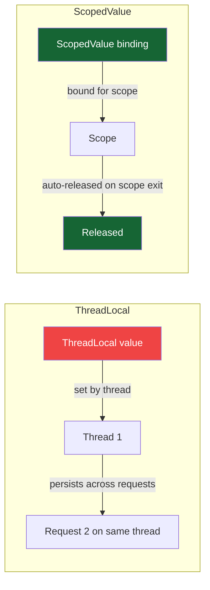

## Overview

`ThreadLocal` has been Java's mechanism for thread-scoped context since Java 1.2. It works by associating a value with the current platform thread — each thread has its own independent copy. With the arrival of virtual threads in Java 21, `ThreadLocal` shows its weaknesses: virtual threads are cheap and numerous, so per-thread copies of values multiply; a value lives as long as its thread unless someone calls `remove()`; any code can change it with `set()`; and on pooled threads a forgotten value leaks into the next request.

**Scoped Values** (JEP 446, Preview in Java 21; final in Java 25 via JEP 506) provide a better model: immutable, inheritable context that is bound for the duration of a scope and automatically released when the scope exits. No cleanup required. No mutation. No inheritance of stale values.

For payment processing, scoped values are the correct mechanism to propagate request context — correlation IDs, user identity, tenant ID — through a call stack of virtual threads without the pitfalls of `ThreadLocal`.

> [!NOTE]
> `ScopedValue` was **Preview** in Java 21–24 (requires `--enable-preview`) and became **final in Java 25** (JEP 506). The basic `ScopedValue.where(key, value).run(...)` form shown here works in both. On Java 21 LTS without preview features, `ThreadLocal` remains the stable alternative. Note that `StructuredTaskScope`, used below for propagation, is still a preview API.

## Learning Objectives

By the end of this lesson you will be able to:

- Explain why `ThreadLocal` is problematic with virtual threads
- Create and bind `ScopedValue` instances within a scope
- Read scoped values from anywhere in the call stack within the scope
- Rebind scoped values for child scopes without affecting the parent
- Propagate scoped values to child threads in `StructuredTaskScope`
- Implement request context (correlation ID, user ID, tenant ID) using `ScopedValue`
- Replace `ThreadLocal<String>` MDC-style context with `ScopedValue`

## ThreadLocal Limitations with Virtual Threads

```java21
// PROBLEM 1: Footprint and leak risk
// Virtual threads are created per task (millions per hour in a busy service).
// Each thread gets its OWN copy of every ThreadLocal value — an expensive
// object cached in a ThreadLocal is now created millions of times.
// Values live until the thread ends (or remove() is called); if threads are
// pooled, stale values persist across requests

// PROBLEM 2: Inheritance surprises
ThreadLocal<String> correlationId = new ThreadLocal<>();
correlationId.set("TXN-001");

// Child thread inherits nothing (ThreadLocal) or the parent's value at fork time (InheritableThreadLocal)
// InheritableThreadLocal is inherited once at thread creation — later parent changes are not seen
Thread child = new Thread(() -> {
    // correlationId.get() == null (ThreadLocal) or "TXN-001" at fork time (Inheritable)
    // If parent updated correlationId after forking, child doesn't see it
});

// PROBLEM 3: Thread pool contamination
// Platform thread pool reuses threads — a ThreadLocal set during request A
// is visible during request B on the same thread if remove() was not called

// PROBLEM 4: Virtual thread proliferation
// 10,000 virtual threads × 10 ThreadLocal values = 100,000 ThreadLocal entries
// Each holds a reference preventing GC until the thread is collected
// ThreadLocal cleanup (remove()) requires explicit code that is often forgotten
```

## ScopedValue Fundamentals

A `ScopedValue<T>` is an immutable binding that is visible within a **scope** — a bounded region of code — and automatically released when the scope exits. It is propagated to any child threads created within the scope.

```java21
import java.lang.ScopedValue;

// Declare as static final — ScopedValue is a key, not a value
public class PaymentContext {
    public static final ScopedValue<String>  CORRELATION_ID = ScopedValue.newInstance();
    public static final ScopedValue<String>  USER_ID        = ScopedValue.newInstance();
    public static final ScopedValue<String>  TENANT_ID      = ScopedValue.newInstance();
}
```

```java21
// Bind and run within a scope
ScopedValue.where(PaymentContext.CORRELATION_ID, "TXN-001")
           .where(PaymentContext.USER_ID, "user-42")
           .run(() -> {
               // Inside this scope: CORRELATION_ID and USER_ID are bound
               processPayment(request);
               // Any method in the call stack can read these values
           });
// Outside the scope: CORRELATION_ID.isBound() == false,
// and CORRELATION_ID.get() throws NoSuchElementException.
// Use isBound() or orElse(default) where a binding may be missing
```

```java21
// Reading a scoped value — available anywhere within the scope
public class FraudService {

    public FraudDecision check(Payment payment) {
        // Read the correlation ID set by the caller's scope — no parameter passing needed
        String correlationId = PaymentContext.CORRELATION_ID.get(); // "TXN-001"
        String tenantId      = PaymentContext.TENANT_ID.get();

        log.info("[{}] Fraud check for tenant {}", correlationId, tenantId);
        return fraudEngine.evaluate(payment);
    }
}
```

## ScopedValue vs ThreadLocal



| Property | `ThreadLocal` | `ScopedValue` |
|---|---|---|
| Mutation | Mutable (set/get/remove) | Immutable within scope |
| Lifetime | Explicit remove() required | Auto-released on scope exit |
| Child thread inheritance | InheritableThreadLocal only | Automatic in StructuredTaskScope |
| Footprint with virtual threads | One copy per thread; lives until thread ends or remove() | Binding lives only while the scope runs |
| Rebinding | set() anywhere | where().run() creates new scope |
| Read cost | Fast hash lookup | Designed to be fast (small per-thread cache); comparable to ThreadLocal |
| Visible to | Only the thread (copies to children with InheritableThreadLocal) | The binding thread + StructuredTaskScope subtasks — NOT plain executors or CompletableFuture.runAsync |

## Request Context Propagation

The canonical use case: propagating request context (correlation ID, user ID, tenant ID) through a payment processing call stack without passing parameters.

```java21
// HTTP request filter: establish the request scope
@Component
public class RequestContextFilter implements Filter {

    @Override
    public void doFilter(ServletRequest request, ServletResponse response,
                          FilterChain chain) throws IOException, ServletException {

        HttpServletRequest httpRequest = (HttpServletRequest) request;
        String correlationId = Optional.ofNullable(httpRequest.getHeader("X-Correlation-Id"))
                                       .orElseGet(() -> UUID.randomUUID().toString());
        String userId        = extractUserId(httpRequest);
        String tenantId      = extractTenantId(httpRequest);

        // Establish scoped values for the duration of this request.
        // run(Runnable) cannot throw checked exceptions, so wrap them and
        // unwrap afterwards to keep IOException / ServletException intact
        try {
            ScopedValue.where(PaymentContext.CORRELATION_ID, correlationId)
                       .where(PaymentContext.USER_ID,        userId)
                       .where(PaymentContext.TENANT_ID,      tenantId)
                       .run(() -> {
                           try {
                               chain.doFilter(request, response);
                           } catch (IOException | ServletException e) {
                               throw new WrappedFilterException(e);
                           }
                       });
        } catch (WrappedFilterException w) {
            if (w.getCause() instanceof IOException io) throw io;
            throw (ServletException) w.getCause();
        }
        // Scope has exited — all bindings are released automatically
        // NOTE: the bindings are visible only on this request thread. Work
        // handed to a plain executor, @Async or CompletableFuture.runAsync
        // does NOT see them — only StructuredTaskScope subtasks do.
    }
}

// Deep in the call stack — no parameters needed
@Service
public class AuditService {

    public void recordPaymentAttempt(Payment payment) {
        // Reads from the scope established in the HTTP filter — no plumbing required
        String correlationId = PaymentContext.CORRELATION_ID.get();
        String userId        = PaymentContext.USER_ID.get();
        String tenantId      = PaymentContext.TENANT_ID.get();

        auditRepository.save(new AuditRecord(correlationId, userId, tenantId, payment));
    }
}
```

## Rebinding: Child Scopes

Within a scope, you can **rebind** a scoped value for a nested scope. The original binding is restored when the inner scope exits.

```java21
// Outer scope: TENANT_ID = "tenant-A"
ScopedValue.where(PaymentContext.TENANT_ID, "tenant-A").run(() -> {

    // All code here sees TENANT_ID = "tenant-A"
    processPaymentsForTenantA();

    // Inner scope: rebind TENANT_ID for a sub-operation
    ScopedValue.where(PaymentContext.TENANT_ID, "tenant-B").run(() -> {
        // Inside here: TENANT_ID = "tenant-B"
        processPaymentsForTenantB(); // Uses tenant-B context
    });

    // Outer scope restored: TENANT_ID = "tenant-A" again
    finaliseForTenantA();
});
```

## Propagation to Child Threads with StructuredTaskScope

Scoped values propagate automatically to child threads created within a `StructuredTaskScope`:

```java21
// Scoped values propagate to all forked subtasks automatically.
// The scope must be opened INSIDE the binding (otherwise fork() throws
// StructureViolationException). call() is used instead of run() because
// join() / throwIfFailed() throw checked exceptions.
ScopedValue.where(PaymentContext.CORRELATION_ID, "TXN-001")
           .where(PaymentContext.USER_ID, "user-42")
           .call(() -> {
               try (var scope = new StructuredTaskScope.ShutdownOnFailure()) {

                   scope.fork(() -> {
                       // Child thread automatically sees CORRELATION_ID = "TXN-001"
                       String id = PaymentContext.CORRELATION_ID.get(); // "TXN-001"
                       return fraudService.check(payment);
                   });

                   scope.fork(() -> {
                       // Also sees the same binding
                       String id = PaymentContext.CORRELATION_ID.get(); // "TXN-001"
                       return sanctionsService.screen(payment);
                   });

                   scope.join().throwIfFailed();
               }
               return null;
           });
```

## Replacing MDC with ScopedValue

Mapped Diagnostic Context (MDC) in SLF4J/Logback uses `ThreadLocal` to attach context to log statements, and MDC must be copied explicitly to every new thread. `ScopedValue` is a cleaner way to carry the context — but logging frameworks still read the MDC, so a common bridge is to copy the scoped value into the MDC at the start of each task:

```java21
// Traditional MDC with ThreadLocal — requires explicit MDC.put/MDC.clear
// and breaks across virtual thread boundaries
MDC.put("correlationId", "TXN-001");
try {
    log.info("Processing payment"); // Includes correlationId in log
    CompletableFuture.runAsync(() -> {
        // MDC not propagated to this thread!
        log.info("Async step"); // No correlationId in log
    });
} finally {
    MDC.clear(); // Easy to forget
}

// ScopedValue approach — automatic propagation and cleanup
ScopedValue.where(PaymentContext.CORRELATION_ID, "TXN-001").call(() -> {
    log.info("Processing payment [{}]", PaymentContext.CORRELATION_ID.get());

    try (var scope = new StructuredTaskScope.ShutdownOnFailure()) {
        scope.fork(() -> {
            // Automatically sees CORRELATION_ID = "TXN-001".
            // Bridge to the MDC so the log pattern %X{correlationId} works:
            try (var ignored = MDC.putCloseable("correlationId",
                                    PaymentContext.CORRELATION_ID.get())) {
                log.info("Async step");
            }
            return null;
        });
        scope.join().throwIfFailed();
    }
    return null;   // No context cleanup needed — the binding ends with the scope
});
```

---

<!-- KNOWLEDGE-CHECK [
  {
    "id": "kc-sv-01",
    "question": "A virtual thread pool processes 10,000 requests per second. Each request sets a `ThreadLocal<String>` correlation ID but forgets to call `remove()`. What is the operational impact?",
    "options": [
      "No impact — virtual threads are GC'd quickly, taking ThreadLocal values with them",
      "Memory leak: ThreadLocal values accumulate if virtual threads are pooled; stale values bleed into subsequent requests on reused threads",
      "Thread starvation: too many ThreadLocal values slow down scheduling",
      "No impact — ThreadLocal is per-thread and does not leak between requests"
    ],
    "correct": 1,
    "explanation": "If virtual threads are pooled (e.g. a ThreadPoolExecutor with a virtual thread factory — an anti-pattern), ThreadLocal values persist on the reused thread, so Request A's correlation ID is visible to Request B. Even with non-pooled virtual threads, each thread holds its own copy until it ends, and with millions of threads per hour the per-thread copies add memory and GC work. ScopedValue avoids both problems: the binding ends when the scope exits, and it cannot be changed with set()."
  },
  {
    "id": "kc-sv-02",
    "question": "A `ScopedValue<String>` is bound to `\"TXN-001\"` in an outer scope. Inside a nested scope, it is rebound to `\"TXN-002\"`. What value does code after the nested scope see?",
    "options": [
      "\"TXN-002\" — the last binding wins",
      "\"TXN-001\" — the outer binding is restored when the inner scope exits",
      "null — rebinding invalidates both bindings",
      "An IllegalStateException — ScopedValues cannot be rebound"
    ],
    "correct": 1,
    "explanation": "ScopedValue rebinding creates a new scope with the new value; the outer scope is not modified. When the inner scope exits, the runtime restores the outer scope's binding. Code after the inner scope sees \"TXN-001\" again. This is analogous to dynamic binding in Lisp/Clojure — the binding is dynamic per call stack frame, not a mutation of a shared variable."
  },
  {
    "id": "kc-sv-03",
    "question": "A `ScopedValue<String>` CORRELATION_ID is bound in an HTTP filter. A `StructuredTaskScope` forks two subtasks. Can the subtasks read CORRELATION_ID?",
    "options": [
      "No — ScopedValues are only visible in the thread that bound them",
      "Yes — StructuredTaskScope automatically propagates the parent's ScopedValue bindings to all forked subtasks",
      "Only if CORRELATION_ID is declared as InheritableScopedValue",
      "Only if the subtasks explicitly call ScopedValue.inherit()"
    ],
    "correct": 1,
    "explanation": "StructuredTaskScope automatically captures the calling thread's ScopedValue bindings and makes them available to all forked child threads. This is one of the key advantages of StructuredTaskScope over raw ExecutorService — context propagation is automatic and reliable. The parent's bindings are inherited at fork time and are immutable in the child (the child sees the same value, cannot change it for the parent)."
  },
  {
    "id": "kc-sv-04",
    "question": "A helper method calls `PaymentContext.CORRELATION_ID.get()`. It is called from a scheduled batch job that never binds CORRELATION_ID. What happens, and what is the fix?",
    "options": [
      "get() returns null, so the log line shows \"null\"",
      "get() throws NoSuchElementException — use isBound() or orElse(\"batch\") where a binding may be missing",
      "get() returns the value from the last HTTP request handled by any thread",
      "The JVM binds a random UUID automatically"
    ],
    "correct": 1,
    "explanation": "ScopedValue.get() throws NoSuchElementException when the value is not bound in the current thread. Unlike ThreadLocal, there is no hidden leftover value from an earlier request — which is safer, but code that can run outside a request (batch jobs, schedulers, startup code) must check isBound() or use orElse(default). Better still, have the batch job establish its own binding (e.g. a generated batch correlation ID) with ScopedValue.where(...).run(...)."
  }
] -->

---

<!-- PRACTICAL-CHALLENGE {
  "id": "pc-scoped-values",
  "title": "Request Context Propagation with ScopedValue",
  "description": "Replace ThreadLocal-based request context with ScopedValue in a payment service.",
  "tasks": [
    {
      "id": "pc-sv-01",
      "description": "Define a `PaymentRequestContext` class with three static final ScopedValue fields: CORRELATION_ID (String), USER_ID (String), and TENANT_ID (String). Implement a `PaymentRequestContext.run(correlationId, userId, tenantId, Runnable action)` convenience method that sets all three values and runs the action."
    },
    {
      "id": "pc-sv-02",
      "description": "Implement a Spring `OncePerRequestFilter` that reads X-Correlation-Id, X-User-Id, and X-Tenant-Id HTTP headers and establishes a ScopedValue scope for the request. Verify that `PaymentService`, `FraudService`, and `AuditService` can all read these values without accepting them as parameters."
    },
    {
      "id": "pc-sv-03",
      "description": "Demonstrate ScopedValue propagation to `StructuredTaskScope` subtasks: in a payment validation handler, fork 3 subtasks (fraud, sanctions, limits), have each log the CORRELATION_ID and TENANT_ID. Confirm all three log entries show the correct values set by the HTTP filter."
    },
    {
      "id": "pc-sv-04",
      "description": "Migrate an existing `ThreadLocal<String>` MDC correlation ID to ScopedValue. Show: (a) the old code with ThreadLocal, explicit set/remove, and the propagation failure in async calls, (b) the new code with ScopedValue and StructuredTaskScope showing automatic propagation, with the value copied into the MDC inside each subtask for logging. Write a test that verifies no correlation ID leaks between requests."
    }
  ]
} -->
