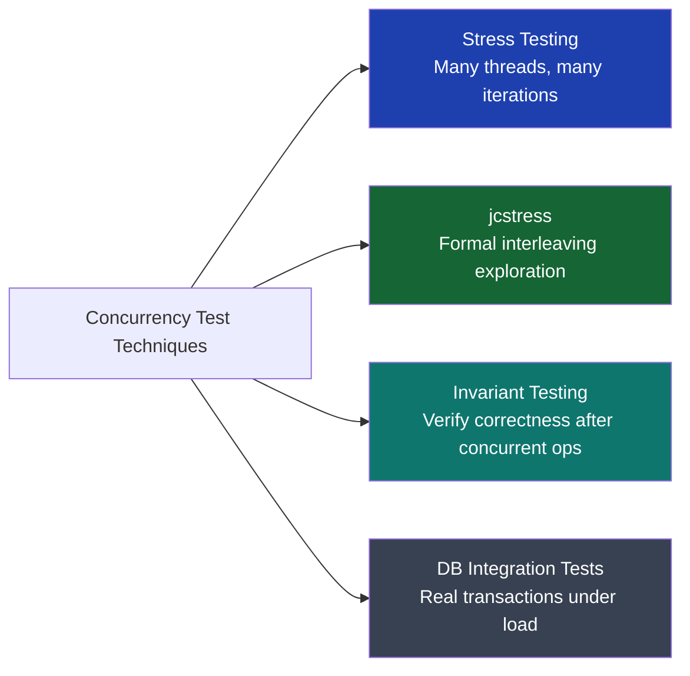

# اختبار الشيفرة المتزامنة — اختبارات الإجهاد وjcstress والثوابت

## نظرة عامة

أخطاء التزامن أصعب فئة عيوب في الاختبار. فحالة تسابق تظهر مرة في كل مليون تنفيذ تحت حمل الإنتاج قد لا تظهر أبدًا في اختبار وحدة يعمل بالتتابع على جهاز المطوّر. فاختبارات JUnit المعيارية تعمل في خيط واحد وبترتيب حتمي — وهي بالضبط الظروف التي تمنع ظهور حالات التسابق.

يغطي هذا الدرس كل تقنية تجعل أخطاء التزامن قابلة للاختبار: أنماط اختبار الإجهاد بـ `CountDownLatch`، وإطار `jcstress` للتحقق الرسمي من حالات التسابق، والاختبار المبني على الثوابت (invariants)، والتحقق من التزامن على مستوى قاعدة البيانات بـ Testcontainers.

## أهداف التعلم

في نهاية هذا الدرس ستستطيع:

- شرح لماذا لا تكتشف اختبارات الوحدة المعيارية حالات التسابق بموثوقية
- بناء اختبارات إجهاد متعددة الخيوط باستخدام `CountDownLatch` و`CyclicBarrier`
- كتابة اختبارات `jcstress` للعمليات الذرية وحلقات CAS
- تصميم اختبارات مبنية على الثوابت تتحقق من الصحة المالية تحت التزامن
- اختبار القفل المتفائل والمتشائم على مستوى قاعدة البيانات بـ Testcontainers
- اكتشاف تثبيت الخيوط الافتراضية في اختبارات التكامل عبر JFR

## لماذا تفوت اختبارات الوحدة أخطاء التزامن

```java17
// This unit test ALWAYS passes — it is single-threaded
@Test
public void debit_shouldNotAllowOverdraft() {
    BankAccount account = new BankAccount("ACC-001", Money.of(1000, "GBP"));
    account.debit(Money.of(900, "GBP"));
    assertThat(account.getBalance()).isEqualTo(Money.of(100, "GBP"));
}
// The race condition (Lesson 7) only manifests when two threads call debit() simultaneously
// A unit test running sequentially never triggers it
```

المشكلة الجوهرية: حالات التسابق **ناشئة** — تنتج عن تداخلات خيوط محددة غير حتمية. والاختبارات المتتابعة لا تستطيع استكشاف فضاء التداخلات.

تقنيات لزيادة تغطية فضاء التداخلات:



## النمط 1: اختبار إجهاد بـ CountDownLatch

اختبار الإجهاد المتزامن الأساسي: أنشئ N خيطًا، واجعلها كلها تبدأ في اللحظة نفسها، وشغّل تكرارات كثيرة، ثم تحقق من الثوابت في النهاية.

```java17
@Test
public void debit_concurrentWithdrawals_shouldNeverOverdraft()
        throws InterruptedException {

    final int THREADS    = 100;
    final int ITERATIONS = 100; // Each thread runs 100 withdrawals
    final long INITIAL_BALANCE = 1_000_000L; // £10,000.00 in pence

    BankAccount account = new BankAccount("ACC-001", INITIAL_BALANCE);
    AtomicLong  successfulDebits = new AtomicLong(0);
    AtomicLong  totalDebited     = new AtomicLong(0);

    CountDownLatch ready  = new CountDownLatch(THREADS); // All threads signal ready
    CountDownLatch start  = new CountDownLatch(1);        // Single start signal
    CountDownLatch done   = new CountDownLatch(THREADS); // All threads signal done

    for (int t = 0; t < THREADS; t++) {
        Thread.ofVirtual().start(() -> {
            ready.countDown();      // Signal: I'm ready
            try {
                start.await();      // Wait for simultaneous start
                for (int i = 0; i < ITERATIONS; i++) {
                    if (account.debit(100L)) { // Try to debit £1.00
                        successfulDebits.incrementAndGet();
                        totalDebited.addAndGet(100L);
                    }
                }
            } catch (InterruptedException e) {
                Thread.currentThread().interrupt();
            } finally {
                done.countDown();   // Signal: I'm done
            }
        });
    }

    ready.await();      // Wait for all threads to be ready
    start.countDown();  // Fire the starting gun — all threads proceed simultaneously
    done.await();       // Wait for all threads to finish

    // Invariant 1: Balance must never be negative
    assertThat(account.getBalance()).isGreaterThanOrEqualTo(0L);

    // Invariant 2: Balance + total debited = initial balance
    assertThat(account.getBalance() + totalDebited.get()).isEqualTo(INITIAL_BALANCE);

    // Invariant 3: Exactly (initial / 100) successful debits maximum
    assertThat(successfulDebits.get()).isLessThanOrEqualTo(INITIAL_BALANCE / 100);
}
```

ثلاثة مزاليج (latches): واحد يشير إلى جاهزية كل الخيوط، وواحد هو "طلقة البداية" التي تطلق الجميع معًا، وواحد ينتظر انتهاء الجميع. ثم تُفحص الثوابت: الرصيد لا يصبح سالبًا أبدًا، والرصيد + مجموع الخصم = الرصيد الابتدائي.

```java21
// Java 21 — virtual threads make stress tests cheaper to run
// 1000 virtual threads vs 100 platform threads — same test, more interleaving coverage
@Test
public void debit_1000ConcurrentVirtualThreads_shouldNeverOverdraft()
        throws InterruptedException {

    final int THREADS    = 1_000; // 1000 virtual threads — feasible, platform threads would need pool management
    final long INITIAL   = 10_000_000L;

    BankAccount account = new BankAccount("ACC-001", INITIAL);
    AtomicLong totalDebited = new AtomicLong(0);

    CountDownLatch start = new CountDownLatch(1);
    CountDownLatch done  = new CountDownLatch(THREADS);

    for (int t = 0; t < THREADS; t++) {
        Thread.ofVirtual().start(() -> {
            try {
                start.await();
                for (int i = 0; i < 50; i++) {
                    if (account.debit(1000L)) totalDebited.addAndGet(1000L);
                }
            } catch (InterruptedException e) {
                Thread.currentThread().interrupt();
            } finally {
                done.countDown();
            }
        });
    }

    start.countDown();
    // Always check the await result: a timeout (deadlock, hung thread) must fail the test
    assertThat(done.await(30, TimeUnit.SECONDS)).as("all threads finished").isTrue();

    // Financial invariant: balance + debited = initial
    assertThat(account.getBalance() + totalDebited.get()).isEqualTo(INITIAL);
    assertThat(account.getBalance()).isGreaterThanOrEqualTo(0L);
}
```

تجعل الخيوط الافتراضية اختبارات الإجهاد أرخص تشغيلًا: 1000 خيط افتراضي بدل 100 خيط منصة يعني تغطية أكبر للتداخلات. وافحص دائمًا نتيجة `await` بمهلة: فانتهاء المهلة (جمود، أو خيط معلق) يجب أن يُفشل الاختبار.

## النمط 2: ‏CyclicBarrier للتزامن على مراحل

يزامن `CyclicBarrier` الخيوط عند نقاط متعددة — وهو مفيد لاختبار عمليات يجب أن تتداخل عند نقطة محددة (مثل ما بين الفحص والتنفيذ).

```java17
@Test
public void idempotencyKey_concurrentSubmissions_shouldProcessExactlyOnce()
        throws InterruptedException, BrokenBarrierException {

    final int THREADS = 20;
    IdempotentPaymentService service = new IdempotentPaymentService();
    String idempotencyKey = "PAY-" + UUID.randomUUID();
    Payment payment = Payment.of(Money.of(5000, "GBP"));

    AtomicInteger processedCount = new AtomicInteger(0);
    CyclicBarrier barrier = new CyclicBarrier(THREADS); // All threads meet here before submitting

    ExecutorService pool = Executors.newFixedThreadPool(THREADS);
    List<Future<PaymentResult>> futures = new ArrayList<>();

    for (int t = 0; t < THREADS; t++) {
        futures.add(pool.submit(() -> {
            barrier.await(); // All 20 threads pause here until all are ready
            // All 20 threads submit the same idempotency key simultaneously
            PaymentResult result = service.process(idempotencyKey, payment);
            if (result.isProcessed()) processedCount.incrementAndGet();
            return result;
        }));
    }

    pool.shutdown();
    pool.awaitTermination(10, TimeUnit.SECONDS);

    // Exactly one payment must have been processed regardless of concurrency
    assertThat(processedCount.get()).isEqualTo(1);

    // All 20 submissions should return a result (success or duplicate)
    futures.forEach(f -> assertThatCode(() -> f.get()).doesNotThrowAnyException());
}
```

تلتقي الخيوط العشرون عند الحاجز ثم ترسل مفتاح عدم التكرار (idempotency key) نفسه في اللحظة نفسها. ويجب أن تُعالَج دفعة واحدة فقط بالضبط أيًا كان التزامن، وأن تعيد كل الإرسالات نتيجة (نجاح أو تكرار) دون استثناء.

## النمط 3: الاختبار المبني على الثوابت

في العمليات المالية المعقدة، تحقق من أن **ثوابت** النظام صحيحة بعد اكتمال كل العمليات المتزامنة — لا من أن كل عملية منفردة أعادت القيمة الصحيحة فقط.

```java17
// Financial invariants for a double-entry ledger:
// 1. Sum of all account balances = constant (money is conserved)
// 2. No account balance goes negative
// 3. Every debit has a corresponding credit

@Test
public void transfers_concurrentBidirectional_shouldConserveBalance()
        throws InterruptedException {

    // Create 10 accounts, each with £1,000
    Map<String, BankAccount> accounts = new HashMap<>();
    for (int i = 0; i < 10; i++) {
        accounts.put("ACC-" + i, new BankAccount("ACC-" + i, 100_000L));
    }

    long initialTotalBalance = accounts.values().stream()
        .mapToLong(BankAccount::getBalance).sum(); // £10,000 total

    // The map is only read by the worker threads (filled before they start),
    // so a plain HashMap is safe here
    CountDownLatch start = new CountDownLatch(1);
    CountDownLatch done  = new CountDownLatch(100);

    TransferService transferService = new TransferService();

    // 100 threads each doing 100 random transfers
    for (int t = 0; t < 100; t++) {
        Thread.ofVirtual().start(() -> {
            try {
                start.await();
                ThreadLocalRandom random = ThreadLocalRandom.current(); // no shared Random
                for (int i = 0; i < 100; i++) {
                    String fromId = "ACC-" + random.nextInt(10);
                    String toId   = "ACC-" + random.nextInt(10);
                    if (!fromId.equals(toId)) {
                        transferService.transfer(
                            accounts.get(fromId),
                            accounts.get(toId),
                            100L // £1.00
                        );
                    }
                }
            } catch (InterruptedException e) {
                Thread.currentThread().interrupt();
            } finally {
                done.countDown();
            }
        });
    }

    start.countDown();
    // A timeout here usually means a DEADLOCK (inconsistent lock ordering)
    assertThat(done.await(60, TimeUnit.SECONDS)).as("no deadlock").isTrue();

    // INVARIANT: total balance must equal initial total balance
    long finalTotalBalance = accounts.values().stream()
        .mapToLong(BankAccount::getBalance).sum();
    assertThat(finalTotalBalance).isEqualTo(initialTotalBalance);

    // INVARIANT: no account balance is negative
    accounts.values().forEach(acc ->
        assertThat(acc.getBalance())
            .as("Account %s must not have negative balance", acc.getId())
            .isGreaterThanOrEqualTo(0L)
    );
}
```

ثوابت دفتر القيد المزدوج: مجموع أرصدة كل الحسابات ثابت (المال محفوظ)، ولا يصبح أي رصيد سالبًا، ولكل خصم إضافة مقابلة. وتُقرأ الخريطة فقط من خيوط العمل (مُلئت قبل بدئها)، فـ `HashMap` العادية آمنة هنا، ويستخدم كل خيط `ThreadLocalRandom` بدل `Random` مشترك. وانتهاء المهلة هنا يعني عادة **جمودًا** (ترتيب أقفال غير متسق).

## jcstress — اختبار رسمي لحالات التسابق

‏`jcstress` (Java Concurrency Stress) إطار OpenJDK لاختبار بنى البيانات المتزامنة تحت تداخلات مضبوطة على مستوى العتاد. وهو يستكشف منهجيًا تداخلات الخيوط التي لا تستطيع اختبارات الإجهاد العادية إطلاقها بشكل حتمي.

**اعتمادية Maven:**
```xml
<dependency>
    <groupId>org.openjdk.jcstress</groupId>
    <artifactId>jcstress-core</artifactId>
    <version>0.16</version>
</dependency>
```

```java17
import org.openjdk.jcstress.annotations.*;
import org.openjdk.jcstress.infra.results.ZZ_Result;

// jcstress test: verify AtomicLong is race-condition free for balance debit
// Two actors run concurrently; arbiter checks the final state
@JCStressTest
@Outcome(id = "true, true",   expect = Expect.FORBIDDEN,   desc = "Both debits succeeded on £100 balance — race condition!")
@Outcome(id = "true, false",  expect = Expect.ACCEPTABLE,  desc = "Thread 1 won")
@Outcome(id = "false, true",  expect = Expect.ACCEPTABLE,  desc = "Thread 2 won")
@Outcome(id = "false, false", expect = Expect.FORBIDDEN,   desc = "Both failed — impossible for a correct debit: £1.00 covers one £0.80 debit")
@State
public class AtomicBalanceDebitTest {

    private final AtomicBalance balance = new AtomicBalance(100L); // £1.00 initial

    @Actor
    public void thread1(ZZ_Result r) {
        r.r1 = balance.debit(80L); // Thread 1 tries to debit £0.80
    }

    @Actor
    public void thread2(ZZ_Result r) {
        r.r2 = balance.debit(80L); // Thread 2 tries to debit £0.80 simultaneously
    }
}
// jcstress explores millions of interleavings; if "true, true" ever appears,
// it reports a FORBIDDEN outcome — a proven race condition
// Run: java -jar jcstress.jar -t AtomicBalanceDebitTest
```

يعمل فاعلان (actors) بالتزامن على رصيد 100 بنس، ويحاول كل منهما خصم 80. والنتيجة `true, true` (نجح الخصمان) **محظورة** — حالة تسابق. ونتيجة `false, false` محظورة أيضًا: فالرصيد يكفي لخصم واحد، والخصم الصحيح لا يفشل في الحالتين.

```java17
// jcstress test: verify ConcurrentHashMap.merge is atomic (no lost updates)
@JCStressTest
@Outcome(id = "2",  expect = Expect.ACCEPTABLE, desc = "Both increments recorded")
@Outcome(id = "1",  expect = Expect.FORBIDDEN,  desc = "Lost update — race condition!")
@State
public class ConcurrentHashMapMergeTest {

    private final ConcurrentHashMap<String, Integer> map = new ConcurrentHashMap<>();

    @Actor
    public void thread1() {
        map.merge("counter", 1, Integer::sum);
    }

    @Actor
    public void thread2() {
        map.merge("counter", 1, Integer::sum);
    }

    @Arbiter
    public void check(I_Result r) {
        r.r1 = map.getOrDefault("counter", 0);
    }
}
```

```java17
// jcstress test: expose the check-then-act race (the broken version)
@JCStressTest
@Outcome(id = "-700", expect = Expect.FORBIDDEN, desc = "OVERDRAFT — balance went negative!")
@Outcome(id = "100",  expect = Expect.ACCEPTABLE, desc = "Thread 1 debited £9")
@Outcome(id = "200",  expect = Expect.ACCEPTABLE, desc = "Thread 2 debited £8")
@Outcome(id = "1000", expect = Expect.FORBIDDEN,  desc = "Neither debited — impossible: at least one check passes")
@State
public class CheckThenActRaceTest {

    final AtomicLong balance = new AtomicLong(1000L);

    @Actor
    public void thread1() {
        // BROKEN check-then-act — not atomic
        if (balance.get() >= 900) {
            balance.addAndGet(-900); // May go negative if thread2 ran first
        }
    }

    @Actor
    public void thread2() {
        if (balance.get() >= 800) {
            balance.addAndGet(-800);
        }
    }

    @Arbiter
    public void check(I_Result r) {
        r.r1 = (int) balance.get();
    }
}
// jcstress will very likely observe the -700 outcome, confirming the race.
// (The fix: a single atomic step — a CAS loop or updateAndGet with the check inside)
```

نسخة الفحص-ثم-التنفيذ المعطوبة: سيلاحظ jcstress على الأرجح النتيجة -700، فيؤكد حالة التسابق. والإصلاح: خطوة ذرية واحدة — حلقة CAS أو `updateAndGet` والفحص بداخلها.

## اختبار تزامن قاعدة البيانات بـ Testcontainers

لا تستطيع المحاكيات في الذاكرة اختبار حالات التسابق على مستوى قاعدة البيانات. استخدم Testcontainers لتشغيل PostgreSQL حقيقية.

```java17
@SpringBootTest
@Testcontainers
class AccountRepositoryConcurrencyTest {

    @Container
    static PostgreSQLContainer<?> postgres = new PostgreSQLContainer<>("postgres:16")
        .withDatabaseName("banking_test")
        .withUsername("test")
        .withPassword("test");

    @DynamicPropertySource
    static void configureProperties(DynamicPropertyRegistry registry) {
        registry.add("spring.datasource.url",      postgres::getJdbcUrl);
        registry.add("spring.datasource.username", postgres::getUsername);
        registry.add("spring.datasource.password", postgres::getPassword);
    }

    @Autowired AccountService accountService;

    @Test
    void concurrentDebits_withSelectForUpdate_shouldNeverOverdraft()
            throws InterruptedException {

        // Setup: create account with £1,000
        accountService.create("ACC-001", 100_000L);

        int THREADS = 50;
        CountDownLatch start = new CountDownLatch(1);
        CountDownLatch done  = new CountDownLatch(THREADS);
        AtomicInteger successCount = new AtomicInteger(0);

        for (int t = 0; t < THREADS; t++) {
            Thread.ofVirtual().start(() -> {
                try {
                    start.await();
                    // Each thread tries to debit £30 — exactly 33 can succeed (33 × £30 = £990)
                    if (accountService.debit("ACC-001", 3_000L)) {
                        successCount.incrementAndGet();
                    }
                } catch (InterruptedException e) {
                    Thread.currentThread().interrupt();
                } finally {
                    done.countDown();
                }
            });
        }

        start.countDown();
        assertThat(done.await(30, TimeUnit.SECONDS)).isTrue();

        // Verify via DB — not in-memory
        long finalBalance = accountService.getBalance("ACC-001");

        // Invariant: balance must not be negative
        assertThat(finalBalance).isGreaterThanOrEqualTo(0L);

        // Invariant: balance = initial - (successful debits × amount)
        assertThat(finalBalance)
            .isEqualTo(100_000L - successCount.get() * 3_000L);

        // With correct locking, no debit is wrongly refused
        assertThat(successCount.get()).isEqualTo(33);
    }
}
```

يحاول كل خيط خصم 30 جنيهًا من 1,000 جنيه — فيمكن أن ينجح 33 بالضبط (33 × 30 = 990). ويُتحقق من الرصيد عبر قاعدة البيانات لا من الذاكرة، ومن أنه لم يُرفض أي خصم صحيح خطأً.

```java21
// Java 21 — virtual threads with Testcontainers
// 500 virtual threads can run concurrently without platform thread pool sizing concerns
// (the DB connection pool still limits how many run SQL at the same time)
@Test
void optimisticLocking_highConcurrency_shouldHandleConflictsGracefully()
        throws InterruptedException {

    accountService.create("ACC-OPT", 100_000L);   // £1,000

    int THREADS = 500; // 500 virtual threads — feasible with Java 21
    CountDownLatch start = new CountDownLatch(1);
    CountDownLatch done  = new CountDownLatch(THREADS);
    AtomicInteger conflictCount  = new AtomicInteger(0);
    AtomicInteger successCount   = new AtomicInteger(0);

    for (int t = 0; t < THREADS; t++) {
        Thread.ofVirtual().start(() -> {
            try {
                start.await();
                try {
                    accountService.debitWithOptimisticLock("ACC-OPT", 100L); // £1.00
                    successCount.incrementAndGet();
                } catch (OptimisticLockingFailureException e) {
                    // Spring wraps JPA's OptimisticLockException in this type
                    conflictCount.incrementAndGet();
                }
            } catch (InterruptedException e) {
                Thread.currentThread().interrupt();
            } finally {
                done.countDown();
            }
        });
    }

    start.countDown();
    assertThat(done.await(60, TimeUnit.SECONDS)).isTrue();

    // Every attempt either succeeded or reported a conflict — none vanished
    assertThat(successCount.get() + conflictCount.get()).isEqualTo(THREADS);
    // No lost update: the balance reflects exactly the successful debits
    assertThat(accountService.getBalance("ACC-OPT"))
        .isEqualTo(100_000L - successCount.get() * 100L);
}
```

مع القفل المتفائل: إما أن تنجح كل محاولة أو تبلّغ عن تعارض — لا تختفي أي منها، ويعكس الرصيد الخصوم الناجحة بالضبط (لا تحديث ضائع). ويغلّف Spring الاستثناء `OptimisticLockException` من JPA في `OptimisticLockingFailureException`. ولاحظ أن مجمّع اتصالات قاعدة البيانات ما زال يحد عدد الخيوط التي تنفّذ SQL في الوقت نفسه.

## اكتشاف التثبيت في اختبارات التكامل

```java21
// Assert that a service method does not pin virtual threads during execution.
// A RecordingStream starts its own JFR recording in this JVM
@Test
void paymentProcessing_onVirtualThread_shouldNotPinCarrierThread()
        throws Exception {

    AtomicInteger pinningEvents = new AtomicInteger(0);

    try (var rs = new RecordingStream()) {
        rs.enable("jdk.VirtualThreadPinned").withThreshold(Duration.ZERO); // default is 20ms
        rs.onEvent("jdk.VirtualThreadPinned", event -> pinningEvents.incrementAndGet());
        rs.startAsync();

        // Run service on a virtual thread
        Thread vt = Thread.ofVirtual().start(() -> {
            paymentService.processPayment(testRequest);
        });
        assertThat(vt.join(Duration.ofSeconds(5))).as("finished in time").isTrue();

        rs.stop();   // JDK 20+: flushes all pending events before returning
    }

    assertThat(pinningEvents.get())
        .as("Payment processing must not pin virtual threads")
        .isZero();
}
```

يبدأ `RecordingStream` تسجيل JFR خاصًا به في هذه JVM. وعتبة الحدث الافتراضية 20ms، فتُخفض إلى الصفر. ويفرغ `stop()` (JDK 20+) كل الأحداث المعلقة قبل العودة، فلا حاجة إلى `sleep`.


<!-- KNOWLEDGE-CHECK [
  {
    "id": "kc-ct-01",
    "question": "في طريقة `debit` (غير متزامنة) حالة تسابق: فحص الرصيد والخصم ليسا ذريين. واختبار وحدة يستدعي `account.debit(900)` من خيط واحد ينجح دائمًا. لماذا لا يظهر التسابق أبدًا في اختبار الوحدة؟",
    "options": [
      "اختبارات الوحدة أسرع من الإنتاج — يحتاج التسابق إلى وقت أطول ليظهر",
      "اختبارات الوحدة أحادية الخيط ومتتابعة؛ والتسابق يتطلب خيطين ينفّذان في الوقت نفسه بتداخل محدد",
      "يزامن JUnit طرق الاختبار تلقائيًا لمنع التسابق",
      "تكتشف JVM حالات التسابق أثناء ترجمة اختبارات الوحدة"
    ],
    "correct": 1,
    "explanation": "تنشأ حالات التسابق من تداخلات محددة لتنفيذ الخيوط المتزامنة. واختبار الوحدة أحادي الخيط فيه خيط واحد فقط — لا خيط ثانٍ يتداخل معه. ولا يظهر تسابق الفحص-ثم-التنفيذ إلا عندما يجتاز الخيط 1 الفحص ويجتاز الخيط 2 الفحص نفسه قبل أن ينفّذ أيهما الخصم. وهذا يتطلب تزامنًا حقيقيًا. وتنشئ اختبارات الإجهاد بـ CountDownLatch هذا الظرف ببدء خيوط كثيرة في اللحظة نفسها."
  },
  {
    "id": "kc-ct-02",
    "question": "في اختبار jcstress تظهر في النتائج نتيجة معلّمة `Expect.FORBIDDEN`. ماذا يعني ذلك؟",
    "options": [
      "إعداد الاختبار خاطئ — النتائج المحظورة لا تُبلغ أبدًا",
      "وجد jcstress تداخلًا على مستوى العتاد أنتج النتيجة المحظورة، فثبت وجود انتهاك للصحة",
      "نفدت ذاكرة الاختبار — زد حجم الكومة",
      "النتيجة ممكنة نظريًا لكنها لم تُلاحظ في هذا التشغيل"
    ],
    "correct": 1,
    "explanation": "تعلّم Expect.FORBIDDEN نتيجة يجب ألا تحدث أبدًا في الشيفرة الصحيحة. فإذا أبلغ jcstress عن نتيجة FORBIDDEN، فهذا يعني أنه لاحظها فعلًا خلال أحد ملايين التداخلات المستكشفة — وهذا انتهاك مثبت للصحة، لا احتمال نظري. ويستخدم jcstress تقنيات مزامنة دقيقة (مثل الدوران المشغول) لإنشاء تداخلات يستحيل إطلاقها بالاختبارات العادية."
  },
  {
    "id": "kc-ct-03",
    "question": "اختبار مبني على الثوابت لـ 100 تحويل متزامن يتحقق من أن الرصيد الكلي عبر كل الحسابات يساوي الإجمالي الابتدائي. وبعد التشغيل يفشل التأكيد. ماذا يثبت ذلك قطعًا؟",
    "options": [
      "في الاختبار خطأ — حسابات الرصيد غير صحيحة",
      "حالة تسابق في منطق التحويل تسبب إنشاء مال أو إتلافه (إضافة مزدوجة أو خصم ضائع)",
      "قاعدة البيانات أبطأ من أن تعالج 100 تحويل متزامن",
      "الثابت صارم جدًا — أخطاء الفاصلة العائمة الصغيرة متوقعة"
    ],
    "correct": 1,
    "explanation": "في نظام تحويل صحيح بالقيد المزدوج، لكل خصم إضافة مقابلة. والرصيد الكلي عبر كل الحسابات محفوظ — يجب أن يساوي الإجمالي الابتدائي مهما كان عدد التحويلات. فإذا فشل الثابت، فقد أُنشئ مال (إضافة مزدوجة) أو أُتلف (خصم ضائع) — حالة تسابق في منطق التحويل. وقوة الأسلوب المبني على الثوابت أنه يختبر الصحة على مستوى النظام، لا على مستوى العمليات المنفردة."
  },
  {
    "id": "kc-ct-04",
    "question": "لماذا لا يكفي اختبار تزامن قاعدة البيانات بقاعدة H2 في الذاكرة لنظام إنتاج يعمل على PostgreSQL؟",
    "options": [
      "H2 أبطأ من أن تُستخدم لاختبار التزامن",
      "لـ H2 دلالات قفل، وسلوك عزل، وتنفيذ MVCC مختلفة عن PostgreSQL — فنجاح الاختبار على H2 لا يضمن الصحة على PostgreSQL",
      "لا تدعم H2 تعليقات @Transactional",
      "لا تستطيع H2 تشغيل خيوط متزامنة"
    ],
    "correct": 1,
    "explanation": "تنفّذ H2 وPostgreSQL التحكم في التزامن بشكل مختلف: استراتيجيات قفل مختلفة، وتنفيذات MVCC مختلفة، ودلالات مستويات عزل مختلفة، ويستخدم وضع H2 داخل العملية قفلًا مختلفًا عن وضع الخادم. فقد يتصرف SELECT FOR UPDATE الذي يمنع السحب على المكشوف بشكل صحيح في PostgreSQL بشكل مختلف في H2. ويجب أن تعمل اختبارات تزامن قاعدة البيانات على محرك قاعدة البيانات الفعلي المستخدم في الإنتاج — وتجعل Testcontainers ذلك عمليًا بتشغيل حاوية PostgreSQL حقيقية لكل مجموعة اختبارات."
  }
] -->


<!-- PRACTICAL-CHALLENGE {
  "id": "pc-testing-concurrency",
  "title": "مجموعة اختبارات تزامن لخدمة دفع",
  "description": "ابنِ مجموعة اختبارات تزامن شاملة تغطي كل حالات التسابق الرئيسية في خدمة دفع.",
  "tasks": [
    {
      "id": "pc-tc-01",
      "description": "اكتب اختبار إجهاد بـ CountDownLatch للطريقة `BankAccount.debit()` بـ 200 خيط افتراضي، يحاول كل منها 50 خصمًا بقيمة جنيه واحد من رصيد ابتدائي 100 جنيه. وأكّد: (1) الرصيد النهائي ≥ 0، (2) الرصيد النهائي + إجمالي الخصوم الناجحة × جنيه = 100 جنيه، (3) لا يرمي أي خيط استثناء غير متوقع. وشغّله مع التنفيذ المعطوب (فحص-ثم-تنفيذ) والمصلح (حلقة CAS)."
    },
    {
      "id": "pc-tc-02",
      "description": "اكتب اختبار jcstress للطريقة `IdempotentPaymentService.process()` يثبت أن إرسالًا واحدًا فقط من إرسالين متزامنين بمفتاح عدم التكرار نفسه يُعالج. النتائج: 'processed=1,duplicate=1' ‏(ACCEPTABLE)، و'processed=2' ‏(FORBIDDEN). وأظهر أن النسخة المعطوبة تفشل والمصلحة تنجح."
    },
    {
      "id": "pc-tc-03",
      "description": "اكتب اختبار تكامل بـ Testcontainers للطريقة `AccountService.debit()` مدعومًا بـ PostgreSQL حقيقية. شغّل 100 خصم متزامن بقيمة 10 جنيهات من حساب فيه 500 جنيه. وأكّد أن الثابت المالي صحيح في قاعدة البيانات. واختبر الحالتين: (أ) دون SELECT FOR UPDATE (يجب أن يفشل أحيانًا)، (ب) مع SELECT FOR UPDATE (يجب أن ينجح دائمًا)."
    },
    {
      "id": "pc-tc-04",
      "description": "اكتب اختبارًا مبنيًا على الثوابت للطريقة `TransferService.transfer()`: ‏10 حسابات × 1,000 جنيه لكل منها، و100 خيط افتراضي يجري كل منها 50 تحويلًا عشوائيًا. وأكّد بعد الاكتمال: (1) مجموع كل الأرصدة = الإجمالي الابتدائي، (2) لا أرصدة سالبة، (3) لا يستغرق أي تشغيل للاختبار أكثر من 30 ثانية. ويجب أن يكتشف هذا الاختبار أي تنفيذ بترتيب أقفال غير متسق."
    }
  ]
} -->
