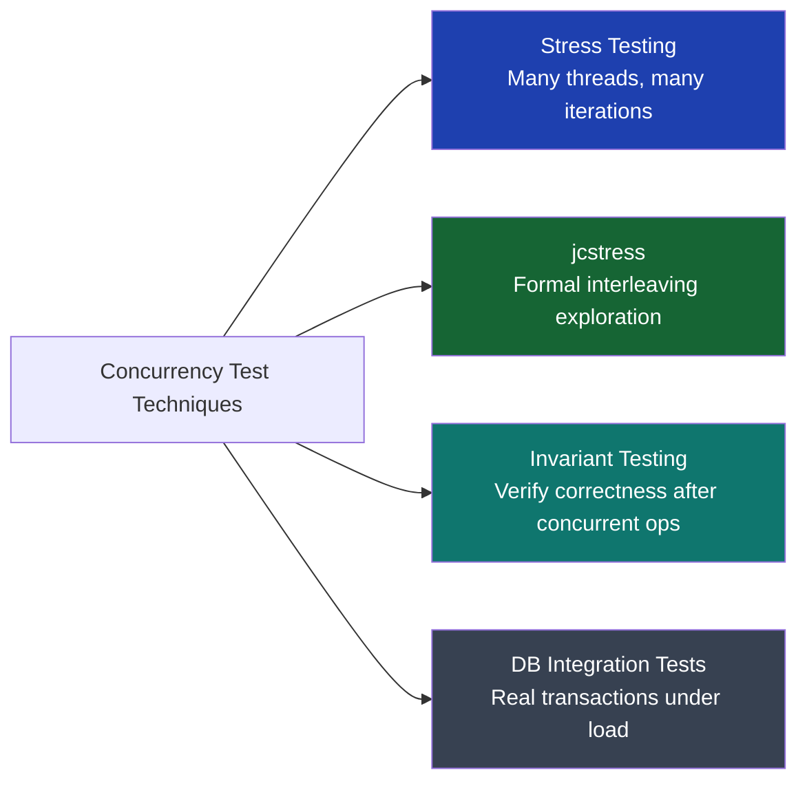

## Overview

Concurrency bugs are the hardest class of defects to test. A race condition that manifests once in every million executions under production load may never appear in a unit test run sequentially on a developer machine. Standard JUnit tests run in a single thread, in deterministic order — the exact conditions that prevent races from triggering.

This lesson covers every technique for making concurrency bugs testable: stress testing patterns with `CountDownLatch`, the `jcstress` framework for formal race condition verification, invariant-based testing, and database-level concurrency verification with Testcontainers.

## Learning Objectives

By the end of this lesson you will be able to:

- Explain why standard unit tests cannot reliably detect race conditions
- Build multi-threaded stress tests using `CountDownLatch` and `CyclicBarrier`
- Write `jcstress` tests for atomic operations and CAS loops
- Design invariant-based tests that verify financial correctness under concurrency
- Test database-level optimistic and pessimistic locking with Testcontainers
- Detect virtual thread pinning in integration tests via JFR

## Why Unit Tests Miss Concurrency Bugs

```java17
// This unit test ALWAYS passes — it is single-threaded
@Test
public void debit_shouldNotAllowOverdraft() {
    BankAccount account = new BankAccount("ACC-001", Money.of(1000, "GBP"));
    account.debit(Money.of(900, "GBP"));
    assertThat(account.getBalance()).isEqualTo(Money.of(100, "GBP"));
}
// The race condition (Lesson 7) only manifests when two threads call debit() simultaneously
// A unit test running sequentially never triggers it
```

The fundamental problem: race conditions are **emergent** — they arise from specific thread interleavings that are non-deterministic. Sequential tests cannot explore the interleaving space.

Techniques to increase coverage of the interleaving space:



## Pattern 1: CountDownLatch Stress Test

The fundamental concurrent stress test: create N threads, make them all start simultaneously, run many iterations, verify invariants at the end.

```java17
@Test
public void debit_concurrentWithdrawals_shouldNeverOverdraft()
        throws InterruptedException {

    final int THREADS    = 100;
    final int ITERATIONS = 100; // Each thread runs 100 withdrawals
    final long INITIAL_BALANCE = 1_000_000L; // £10,000.00 in pence

    BankAccount account = new BankAccount("ACC-001", INITIAL_BALANCE);
    AtomicLong  successfulDebits = new AtomicLong(0);
    AtomicLong  totalDebited     = new AtomicLong(0);

    CountDownLatch ready  = new CountDownLatch(THREADS); // All threads signal ready
    CountDownLatch start  = new CountDownLatch(1);        // Single start signal
    CountDownLatch done   = new CountDownLatch(THREADS); // All threads signal done

    for (int t = 0; t < THREADS; t++) {
        Thread.ofVirtual().start(() -> {
            ready.countDown();      // Signal: I'm ready
            try {
                start.await();      // Wait for simultaneous start
                for (int i = 0; i < ITERATIONS; i++) {
                    if (account.debit(100L)) { // Try to debit £1.00
                        successfulDebits.incrementAndGet();
                        totalDebited.addAndGet(100L);
                    }
                }
            } catch (InterruptedException e) {
                Thread.currentThread().interrupt();
            } finally {
                done.countDown();   // Signal: I'm done
            }
        });
    }

    ready.await();      // Wait for all threads to be ready
    start.countDown();  // Fire the starting gun — all threads proceed simultaneously
    done.await();       // Wait for all threads to finish

    // Invariant 1: Balance must never be negative
    assertThat(account.getBalance()).isGreaterThanOrEqualTo(0L);

    // Invariant 2: Balance + total debited = initial balance
    assertThat(account.getBalance() + totalDebited.get()).isEqualTo(INITIAL_BALANCE);

    // Invariant 3: Exactly (initial / 100) successful debits maximum
    assertThat(successfulDebits.get()).isLessThanOrEqualTo(INITIAL_BALANCE / 100);
}
```

```java21
// Java 21 — virtual threads make stress tests cheaper to run
// 1000 virtual threads vs 100 platform threads — same test, more interleaving coverage
@Test
public void debit_1000ConcurrentVirtualThreads_shouldNeverOverdraft()
        throws InterruptedException {

    final int THREADS    = 1_000; // 1000 virtual threads — feasible, platform threads would need pool management
    final long INITIAL   = 10_000_000L;

    BankAccount account = new BankAccount("ACC-001", INITIAL);
    AtomicLong totalDebited = new AtomicLong(0);

    CountDownLatch start = new CountDownLatch(1);
    CountDownLatch done  = new CountDownLatch(THREADS);

    for (int t = 0; t < THREADS; t++) {
        Thread.ofVirtual().start(() -> {
            try {
                start.await();
                for (int i = 0; i < 50; i++) {
                    if (account.debit(1000L)) totalDebited.addAndGet(1000L);
                }
            } catch (InterruptedException e) {
                Thread.currentThread().interrupt();
            } finally {
                done.countDown();
            }
        });
    }

    start.countDown();
    done.await(30, TimeUnit.SECONDS);

    // Financial invariant: balance + debited = initial
    assertThat(account.getBalance() + totalDebited.get()).isEqualTo(INITIAL);
    assertThat(account.getBalance()).isGreaterThanOrEqualTo(0L);
}
```

## Pattern 2: CyclicBarrier for Phased Concurrency

`CyclicBarrier` synchronises threads at multiple points — useful for testing operations that must interleave at a specific point (e.g., between a check and an act).

```java17
@Test
public void idempotencyKey_concurrentSubmissions_shouldProcessExactlyOnce()
        throws InterruptedException, BrokenBarrierException {

    final int THREADS = 20;
    IdempotentPaymentService service = new IdempotentPaymentService();
    String idempotencyKey = "PAY-" + UUID.randomUUID();
    Payment payment = Payment.of(Money.of(5000, "GBP"));

    AtomicInteger processedCount = new AtomicInteger(0);
    CyclicBarrier barrier = new CyclicBarrier(THREADS); // All threads meet here before submitting

    ExecutorService pool = Executors.newFixedThreadPool(THREADS);
    List<Future<PaymentResult>> futures = new ArrayList<>();

    for (int t = 0; t < THREADS; t++) {
        futures.add(pool.submit(() -> {
            barrier.await(); // All 20 threads pause here until all are ready
            // All 20 threads submit the same idempotency key simultaneously
            PaymentResult result = service.process(idempotencyKey, payment);
            if (result.isProcessed()) processedCount.incrementAndGet();
            return result;
        }));
    }

    pool.shutdown();
    pool.awaitTermination(10, TimeUnit.SECONDS);

    // Exactly one payment must have been processed regardless of concurrency
    assertThat(processedCount.get()).isEqualTo(1);

    // All 20 submissions should return a result (success or duplicate)
    futures.forEach(f -> assertThatCode(() -> f.get()).doesNotThrowAnyException());
}
```

## Pattern 3: Invariant-Based Testing

For complex financial operations, verify that the **invariants** of the system hold after all concurrent operations complete — not just that individual operations returned the right value.

```java17
// Financial invariants for a double-entry ledger:
// 1. Sum of all account balances = constant (money is conserved)
// 2. No account balance goes negative
// 3. Every debit has a corresponding credit

@Test
public void transfers_concurrentBidirectional_shouldConserveBalance()
        throws InterruptedException {

    // Create 10 accounts, each with £1,000
    Map<String, BankAccount> accounts = new HashMap<>();
    for (int i = 0; i < 10; i++) {
        accounts.put("ACC-" + i, new BankAccount("ACC-" + i, 100_000L));
    }

    long initialTotalBalance = accounts.values().stream()
        .mapToLong(BankAccount::getBalance).sum(); // £10,000 total

    Random random = new Random();
    CountDownLatch start = new CountDownLatch(1);
    CountDownLatch done  = new CountDownLatch(100);

    TransferService transferService = new TransferService();

    // 100 threads each doing 100 random transfers
    for (int t = 0; t < 100; t++) {
        Thread.ofVirtual().start(() -> {
            try {
                start.await();
                for (int i = 0; i < 100; i++) {
                    String fromId = "ACC-" + random.nextInt(10);
                    String toId   = "ACC-" + random.nextInt(10);
                    if (!fromId.equals(toId)) {
                        transferService.transfer(
                            accounts.get(fromId),
                            accounts.get(toId),
                            100L // £1.00
                        );
                    }
                }
            } catch (InterruptedException e) {
                Thread.currentThread().interrupt();
            } finally {
                done.countDown();
            }
        });
    }

    start.countDown();
    done.await(60, TimeUnit.SECONDS);

    // INVARIANT: total balance must equal initial total balance
    long finalTotalBalance = accounts.values().stream()
        .mapToLong(BankAccount::getBalance).sum();
    assertThat(finalTotalBalance).isEqualTo(initialTotalBalance);

    // INVARIANT: no account balance is negative
    accounts.values().forEach(acc ->
        assertThat(acc.getBalance())
            .as("Account %s must not have negative balance", acc.getId())
            .isGreaterThanOrEqualTo(0L)
    );
}
```

## jcstress — Formal Race Condition Testing

`jcstress` (Java Concurrency Stress) is OpenJDK's framework for testing concurrent data structures under controlled hardware-level interleavings. It systematically explores thread interleavings that normal stress tests cannot trigger deterministically.

**Maven dependency:**
```xml
<dependency>
    <groupId>org.openjdk.jcstress</groupId>
    <artifactId>jcstress-core</artifactId>
    <version>0.16</version>
</dependency>
```

```java17
import org.openjdk.jcstress.annotations.*;
import org.openjdk.jcstress.infra.results.LL_Result;

// jcstress test: verify AtomicLong is race-condition free for balance debit
// Two actors run concurrently; arbiter checks the final state
@JCStressTest
@Outcome(id = "true, true",   expect = Expect.FORBIDDEN,   desc = "Both debits succeeded on £100 balance — race condition!")
@Outcome(id = "true, false",  expect = Expect.ACCEPTABLE,  desc = "Thread 1 won")
@Outcome(id = "false, true",  expect = Expect.ACCEPTABLE,  desc = "Thread 2 won")
@Outcome(id = "false, false", expect = Expect.ACCEPTABLE,  desc = "Both failed — balance insufficient for each when checked")
@State
public class AtomicBalanceDebitTest {

    private final AtomicBalance balance = new AtomicBalance(100L); // £1.00 initial

    @Actor
    public void thread1(ZZ_Result r) {
        r.r1 = balance.debit(80L); // Thread 1 tries to debit £0.80
    }

    @Actor
    public void thread2(ZZ_Result r) {
        r.r2 = balance.debit(80L); // Thread 2 tries to debit £0.80 simultaneously
    }
}
// jcstress explores millions of interleavings; if "true, true" ever appears,
// it reports a FORBIDDEN outcome — a proven race condition
// Run: java -jar jcstress.jar -t AtomicBalanceDebitTest
```

```java17
// jcstress test: verify ConcurrentHashMap.merge is atomic (no lost updates)
@JCStressTest
@Outcome(id = "2",  expect = Expect.ACCEPTABLE, desc = "Both increments recorded")
@Outcome(id = "1",  expect = Expect.FORBIDDEN,  desc = "Lost update — race condition!")
@State
public class ConcurrentHashMapMergeTest {

    private final ConcurrentHashMap<String, Integer> map = new ConcurrentHashMap<>();

    @Actor
    public void thread1() {
        map.merge("counter", 1, Integer::sum);
    }

    @Actor
    public void thread2() {
        map.merge("counter", 1, Integer::sum);
    }

    @Arbiter
    public void check(I_Result r) {
        r.r1 = map.getOrDefault("counter", 0);
    }
}
```

```java17
// jcstress test: expose the check-then-act race (the broken version)
@JCStressTest
@Outcome(id = "-700", expect = Expect.FORBIDDEN, desc = "OVERDRAFT — balance went negative!")
@Outcome(id = "100",  expect = Expect.ACCEPTABLE, desc = "Thread 1 debited £9")
@Outcome(id = "200",  expect = Expect.ACCEPTABLE, desc = "Thread 2 debited £8")
@Outcome(id = "1000", expect = Expect.ACCEPTABLE, desc = "Neither debited")
@State
public class CheckThenActRaceTest {

    final AtomicLong balance = new AtomicLong(1000L);

    @Actor
    public void thread1() {
        // BROKEN check-then-act — not atomic
        if (balance.get() >= 900) {
            balance.addAndGet(-900); // May go negative if thread2 ran first
        }
    }

    @Actor
    public void thread2() {
        if (balance.get() >= 800) {
            balance.addAndGet(-800);
        }
    }

    @Arbiter
    public void check(I_Result r) {
        r.r1 = (int) balance.get();
    }
}
// jcstress will find the -700 outcome, confirming the race condition
```

## Testing Database Concurrency with Testcontainers

In-memory mocks cannot test database-level races. Use Testcontainers to run real PostgreSQL.

```java17
@SpringBootTest
@Testcontainers
class AccountRepositoryConcurrencyTest {

    @Container
    static PostgreSQLContainer<?> postgres = new PostgreSQLContainer<>("postgres:16")
        .withDatabaseName("banking_test")
        .withUsername("test")
        .withPassword("test");

    @DynamicPropertySource
    static void configureProperties(DynamicPropertyRegistry registry) {
        registry.add("spring.datasource.url",      postgres::getJdbcUrl);
        registry.add("spring.datasource.username", postgres::getUsername);
        registry.add("spring.datasource.password", postgres::getPassword);
    }

    @Autowired AccountService accountService;

    @Test
    void concurrentDebits_withSelectForUpdate_shouldNeverOverdraft()
            throws InterruptedException {

        // Setup: create account with £1,000
        accountService.create("ACC-001", 100_000L);

        int THREADS = 50;
        CountDownLatch start = new CountDownLatch(1);
        CountDownLatch done  = new CountDownLatch(THREADS);
        AtomicInteger successCount = new AtomicInteger(0);

        for (int t = 0; t < THREADS; t++) {
            Thread.ofVirtual().start(() -> {
                try {
                    start.await();
                    // Each thread tries to debit £30 — only ~33 should succeed
                    if (accountService.debit("ACC-001", 3_000L)) {
                        successCount.incrementAndGet();
                    }
                } catch (InterruptedException e) {
                    Thread.currentThread().interrupt();
                } finally {
                    done.countDown();
                }
            });
        }

        start.countDown();
        done.await(30, TimeUnit.SECONDS);

        // Verify via DB — not in-memory
        long finalBalance = accountService.getBalance("ACC-001");

        // Invariant: balance must not be negative
        assertThat(finalBalance).isGreaterThanOrEqualTo(0L);

        // Invariant: balance = initial - (successful debits × amount)
        assertThat(finalBalance)
            .isEqualTo(100_000L - successCount.get() * 3_000L);
    }
}
```

```java21
// Java 21 — virtual threads with Testcontainers
// 500 virtual threads can run concurrently without platform thread pool sizing concerns
@Test
void optimisticLocking_highConcurrency_shouldHandleConflictsGracefully()
        throws InterruptedException {

    int THREADS = 500; // 500 virtual threads — feasible with Java 21
    CountDownLatch start = new CountDownLatch(1);
    CountDownLatch done  = new CountDownLatch(THREADS);
    AtomicInteger retryCount     = new AtomicInteger(0);
    AtomicInteger successCount   = new AtomicInteger(0);

    for (int t = 0; t < THREADS; t++) {
        Thread.ofVirtual().start(() -> {
            try {
                start.await();
                try {
                    accountService.updateWithOptimisticLock("ACC-001", 100L);
                    successCount.incrementAndGet();
                } catch (OptimisticLockException e) {
                    retryCount.incrementAndGet(); // Count OptimisticLock conflicts
                }
            } catch (InterruptedException e) {
                Thread.currentThread().interrupt();
            } finally {
                done.countDown();
            }
        });
    }

    start.countDown();
    done.await(60, TimeUnit.SECONDS);

    // Some conflicts expected under high concurrency — verify retry count is reasonable
    assertThat(successCount.get() + retryCount.get()).isEqualTo(THREADS);
    // Final balance must be consistent
    assertThat(accountService.getBalance("ACC-001")).isGreaterThanOrEqualTo(0L);
}
```

## Detecting Pinning in Integration Tests

```java21
// Assert that a service method does not pin virtual threads during execution
@Test
void paymentProcessing_onVirtualThread_shouldNotPinCarrierThread()
        throws Exception {

    AtomicInteger pinningEvents = new AtomicInteger(0);

    // Register JFR event hook to count pinning events
    try (var es = EventStream.openRepository()) {
        es.onEvent("jdk.VirtualThreadPinned", event -> pinningEvents.incrementAndGet());
        es.startAsync();

        // Run service on a virtual thread
        Thread vt = Thread.ofVirtual().start(() -> {
            paymentService.processPayment(testRequest);
        });
        vt.join(5, TimeUnit.SECONDS);

        Thread.sleep(100); // Allow JFR events to flush

        assertThat(pinningEvents.get())
            .as("Payment processing must not pin virtual threads")
            .isZero();
    }
}
```

---

<!-- KNOWLEDGE-CHECK [
  {
    "id": "kc-ct-01",
    "question": "A `synchronized` debit method has a race condition: the balance check and the debit are not atomic. A unit test calling `account.debit(900)` from a single thread always passes. Why does the race never trigger in the unit test?",
    "options": [
      "Unit tests run faster than production — the race needs more time to manifest",
      "Unit tests are single-threaded and sequential; the race requires two threads executing simultaneously in a specific interleaving",
      "JUnit automatically synchronizes test methods to prevent races",
      "The JVM detects race conditions during unit test compilation"
    ],
    "correct": 1,
    "explanation": "Race conditions arise from specific interleavings of concurrent thread execution. A single-threaded unit test has only one thread — there is no second thread to interleave with. The check-then-act race only manifests when Thread 1 passes the check and Thread 2 also passes the same check before either has executed the debit. This requires genuine concurrency. Stress tests with CountDownLatch create this condition by starting many threads simultaneously."
  },
  {
    "id": "kc-ct-02",
    "question": "In a jcstress test, an outcome marked `Expect.FORBIDDEN` appears in the results. What does this mean?",
    "options": [
      "The test configuration is wrong — forbidden outcomes are never reached",
      "jcstress found a hardware interleaving that produced the forbidden outcome, proving a correctness violation exists",
      "The test ran out of memory — increase heap size",
      "The outcome is theoretically possible but was not observed in this run"
    ],
    "correct": 1,
    "explanation": "Expect.FORBIDDEN marks an outcome that must never occur for correct code. If jcstress reports a FORBIDDEN outcome, it means it actually observed that outcome during one of the millions of explored interleavings — this is a proven correctness violation, not a theoretical possibility. jcstress uses memory barrier manipulation and busy-spin synchronization to create precise hardware interleavings impossible to trigger with ordinary tests."
  },
  {
    "id": "kc-ct-03",
    "question": "An invariant-based test for 100 concurrent transfers checks that the total balance across all accounts equals the initial total. After running, the assertion fails. What does this conclusively prove?",
    "options": [
      "The test has a bug — balance calculations are incorrect",
      "A race condition in the transfer logic is causing money to be created or destroyed (double-credit or lost debit)",
      "The database is too slow to process 100 concurrent transfers",
      "The invariant is too strict — small floating point errors are expected"
    ],
    "correct": 1,
    "explanation": "In a correct double-entry transfer system, every debit has a matching credit. Total balance across all accounts is conserved — it must equal the initial total regardless of how many transfers occurred. If the invariant fails, money was either created (double-credit) or destroyed (lost debit) — a race condition in the transfer logic. The invariant-based approach is powerful because it tests for correctness at the system level, not at the level of individual operations."
  },
  {
    "id": "kc-ct-04",
    "question": "Why is testing database concurrency with an in-memory H2 database insufficient for a PostgreSQL production system?",
    "options": [
      "H2 is too slow for concurrency testing",
      "H2 has different locking semantics, isolation behaviour, and MVCC implementation than PostgreSQL — a test passing on H2 gives no guarantee of correctness on PostgreSQL",
      "H2 does not support @Transactional annotations",
      "H2 cannot run concurrent threads"
    ],
    "correct": 1,
    "explanation": "H2 and PostgreSQL implement concurrency control differently: different locking strategies, different MVCC implementations, different isolation level semantics, and H2's in-process mode uses different locking than its server mode. A SELECT FOR UPDATE that correctly prevents overdraft on PostgreSQL may behave differently on H2. Database concurrency tests must run against the actual database engine used in production — Testcontainers makes this practical by spinning up a real PostgreSQL container per test suite."
  }
] -->

---

<!-- PRACTICAL-CHALLENGE {
  "id": "pc-testing-concurrency",
  "title": "Concurrency Test Suite for Payment Service",
  "description": "Build a comprehensive concurrency test suite covering all major race conditions in a payment service.",
  "tasks": [
    {
      "id": "pc-tc-01",
      "description": "Write a CountDownLatch stress test for `BankAccount.debit()` with 200 virtual threads, each attempting 50 debits of £1 from a £100 starting balance. Assert: (1) final balance ≥ 0, (2) final balance + total successful debits × £1 = £100, (3) no thread throws an unexpected exception. Run with both the broken (check-then-act) and fixed (CAS loop) implementations."
    },
    {
      "id": "pc-tc-02",
      "description": "Write a jcstress test for `IdempotentPaymentService.process()` that proves only one of two concurrent submissions with the same idempotency key gets processed. Outcomes: 'processed=1,duplicate=1' (ACCEPTABLE), 'processed=2' (FORBIDDEN). Demonstrate the broken version fails and the fixed version passes."
    },
    {
      "id": "pc-tc-03",
      "description": "Write a Testcontainers integration test for `AccountService.debit()` backed by real PostgreSQL. Run 100 concurrent debits of £10 from a £500 account. Assert the financial invariant holds in the database. Test both: (a) without SELECT FOR UPDATE (should occasionally fail), (b) with SELECT FOR UPDATE (should always pass)."
    },
    {
      "id": "pc-tc-04",
      "description": "Write an invariant-based test for `TransferService.transfer()`: 10 accounts × £1,000 each, 100 virtual threads each doing 50 random transfers. Assert after completion: (1) sum of all balances = initial total, (2) no negative balances, (3) no test run takes more than 30 seconds. This test should catch any implementation with inconsistent lock ordering."
    }
  ]
} -->
