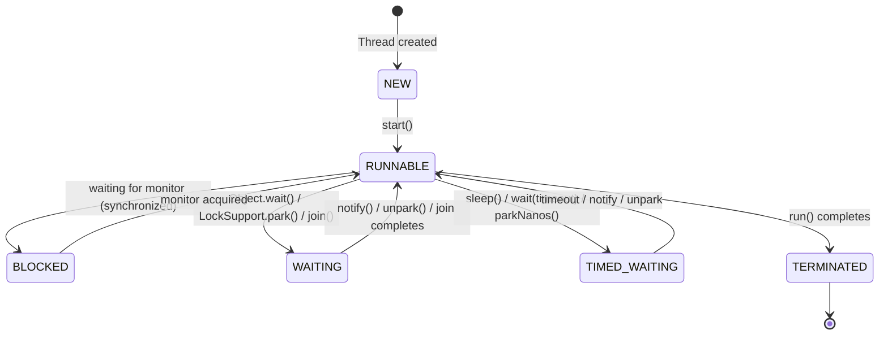

# تحليل تفريغات الخيوط (Thread Dumps) — التشخيص في الإنتاج

## نظرة عامة

تفريغات الخيوط أداة التشخيص الأساسية لفهم ما يفعله كل خيط في JVM عاملة في لحظة محددة. فعندما تتوقف خدمة دفع عن المعالجة، أو تنخفض الإنتاجية 90% دون أخطاء، أو يعلق نشر — يخبرك تفريغ الخيوط بالسبب في ثوانٍ من التحليل.

يغطي هذا الدرس سير عمل تفريغ الخيوط كاملًا: التوليد، والتشريح، وقراءة حالات الخيوط، وتحديد حالات الجمود ونفاد المجمّعات، وصيغة تفريغ الخيوط الافتراضية الجديدة في Java 21.

## أهداف التعلم

في نهاية هذا الدرس ستستطيع:

- تحديد كل حالات خيوط Java وما تعنيه كل منها تشغيليًا
- توليد تفريغات الخيوط باستخدام jstack، وإشارات kill، وJConsole، وSpring Actuator
- قراءة تفريغ خيوط وتحديد: حالات الجمود، ونقاط تنافس الأقفال الساخنة، ونفاد مجمّعات الخيوط، والخيوط المحجوبة
- استخدام `ThreadMXBean` لاكتشاف الجمود برمجيًا في الإنتاج
- تفسير تفريغات الخيوط الافتراضية في Java 21
- ربط تفريغات الخيوط بأعراض التطبيق

## حالات خيوط Java



| الحالة | المعنى | الاهتمام التشغيلي |
|---|---|---|
| `RUNNABLE` | على المعالج أو جاهز للتشغيل — **وأيضًا** خيط محجوب في قراءة مقبس أصلية | افحص الإطار الأعلى: حلقة دوران تستهلك المعالج، أو `socketRead`/`SocketDispatcher.read` = انتظار على الشبكة |
| `BLOCKED` | ينتظر دخول مراقب `synchronized` | تنافس على قفل — العدد الكبير = اختناق |
| `WAITING` | متوقف بلا مهلة (park، wait، join) — يشمل الخيوط المنتظرة لـ `ReentrantLock` | متوقع للعمال الخاملين؛ وخيوط كثيرة متوقفة على القفل نفسه = تنافس أو جمود |
| `TIMED_WAITING` | متوقف بمهلة | متوقع (النوم، والمهام المجدولة) |
| `NEW` | أُنشئ ولم يبدأ | يجب ألا يستمر — هل نُسي استدعاء start()؟ |
| `TERMINATED` | انتهى | لا يظهر في تفريغات الخيوط — الخيط لم يعد موجودًا |

## توليد تفريغات الخيوط

```java17
// Method 1: jstack — most common for production
// jstack <pid> > dump.txt
// Find PID: jps -l (shows all Java processes)
// NOTE: jstack, Thread.print, kill -3 and ThreadMXBean show PLATFORM threads
// only. For virtual threads use jcmd Thread.dump_to_file (Method 3)

// Method 2: Kill signal (Unix/Linux/macOS)
// kill -3 <pid>   → thread dump printed to stdout/stderr of the JVM process

// Method 3: jcmd — more flexible than jstack
// jcmd <pid> Thread.print > dump.txt
// jcmd <pid> Thread.dump_to_file -format=json threads.json  (Java 21+)

// Method 4: Spring Boot Actuator
// curl http://localhost:8080/actuator/threaddump
// Returns JSON thread dump — useful for automated analysis

// Method 5: JConsole / VisualVM (GUI)
// Connect via JMX: jconsole <pid>
// Threads tab → Thread Dump button

// Method 6: Programmatic (useful for health checks)
```

تنبيه: يُظهر jstack و`Thread.print` و`kill -3` و`ThreadMXBean` خيوط المنصة **فقط**. وللخيوط الافتراضية استخدم `jcmd <pid> Thread.dump_to_file`.

```java17
// Programmatic thread dump via ThreadMXBean
import java.lang.management.ManagementFactory;
import java.lang.management.ThreadInfo;
import java.lang.management.ThreadMXBean;

public class ThreadDumpUtil {

    public static String captureThreadDump() {
        ThreadMXBean tmx = ManagementFactory.getThreadMXBean();
        ThreadInfo[] threads = tmx.dumpAllThreads(
            true,  // include locked monitors
            true   // include locked synchronizers (ReentrantLock etc.)
        );

        StringBuilder sb = new StringBuilder();
        for (ThreadInfo info : threads) {
            sb.append(info.toString());
            sb.append("\n");
        }
        return sb.toString();
    }

    // Deadlock detection — returns thread IDs of deadlocked threads (null if none)
    public static long[] detectDeadlock() {
        ThreadMXBean tmx = ManagementFactory.getThreadMXBean();
        long[] deadlocked = tmx.findDeadlockedThreads();
        return deadlocked; // null if no deadlock, array of thread IDs if found
    }

    // Spring Boot health indicator using ThreadMXBean
    @Component
    public static class DeadlockHealthIndicator implements HealthIndicator {
        @Override
        public Health health() {
            long[] deadlocked = ManagementFactory.getThreadMXBean().findDeadlockedThreads();
            if (deadlocked != null && deadlocked.length > 0) {
                return Health.down()
                    .withDetail("deadlockedThreads", deadlocked.length)
                    .withDetail("message", "Deadlocked threads detected — restart required")
                    .build();
            }
            return Health.up().build();
        }
    }
}
```

يلتقط `dumpAllThreads(true, true)` المراقبات والمزامِنات المقفلة (مثل ReentrantLock)، ويعيد `findDeadlockedThreads()` معرّفات الخيوط في جمود (أو null إن لم يوجد). ويحوّل مؤشر الصحة حالة الخدمة إلى DOWN عند اكتشاف جمود.

## تشريح مدخل في تفريغ الخيوط

```
"payment-processor-42" #42 prio=5 os_prio=0 cpu=234.56ms elapsed=1234.56s tid=0x00007f... nid=0x1a2b waiting for monitor entry [0x00007f...]
   java.lang.Thread.State: BLOCKED (on object monitor)
        at com.bank.payment.AccountService.debit(AccountService.java:87)
        - waiting to lock <0x000000076b3e1f68> (a com.bank.account.BankAccount) ← which lock
        at com.bank.payment.PaymentProcessor.process(PaymentProcessor.java:134)
        at com.bank.payment.PaymentHandler.handle(PaymentHandler.java:56)
        at java.util.concurrent.ThreadPoolExecutor.runWorker(ThreadPoolExecutor.java:1136)
        at java.util.concurrent.ThreadPoolExecutor$Worker.run(ThreadPoolExecutor.java:635)
        at java.lang.Thread.run(Thread.java:833)

   Locked ownable synchronizers:
        - <0x000000076b3e1a40> (a java.util.concurrent.locks.ReentrantLock$NonfairSync)
```

**ما يخبرك به كل سطر:**

| العنصر | المعنى |
|---|---|
| `"payment-processor-42"` | اسم الخيط — الخيوط حسنة التسمية أساسية للتشخيص |
| `#42` | معرّف الخيط |
| `cpu=234.56ms` | إجمالي وقت المعالج الذي استهلكه هذا الخيط |
| `elapsed=1234.56s` | الخيط حي منذ 1234 ثانية |
| `BLOCKED (on object monitor)` | ينتظر قفل `synchronized` |
| `waiting to lock <0x...>` | كائن القفل المحدد الذي يحتاجه |
| `Locked ownable synchronizers` | الأقفال التي يحملها هذا الخيط حاليًا (ReentrantLock وغيرها) |

## تحديد حالات الجمود

تعلّم تفريغات الخيوط حالات الجمود صراحة:

```
Found one Java-level deadlock:
=============================
"payment-processor-1":
  waiting to lock monitor 0x000000076b3e1f68 (object 0x..., a com.bank.account.BankAccount)
  which is held by "payment-processor-2"

"payment-processor-2":
  waiting to lock monitor 0x000000076b3e1a40 (object 0x..., a com.bank.account.BankAccount)
  which is held by "payment-processor-1"

Java stack information for the threads listed above:
===================================================
"payment-processor-1":
        at com.bank.payment.TransferService.transfer(TransferService.java:28)
        - waiting to lock <0x000000076b3e1f68> (a com.bank.account.BankAccount)
        at com.bank.payment.TransferService.transfer(TransferService.java:25)
        - locked <0x000000076b3e1a40> (a com.bank.account.BankAccount)

"payment-processor-2":
        at com.bank.payment.TransferService.transfer(TransferService.java:28)
        - waiting to lock <0x000000076b3e1a40> (a com.bank.account.BankAccount)
        at com.bank.payment.TransferService.transfer(TransferService.java:25)
        - locked <0x000000076b3e1f68> (a com.bank.account.BankAccount)

Found 1 deadlock.
```

وتُبلَّغ حالات الجمود على `ReentrantLock` أيضًا: تظهر الخيوط في حالة `WAITING (parking)` بدل `BLOCKED`، ويسمّي التقرير كائنات `ReentrantLock$NonfairSync` بدل المراقبات.

**قراءة هذا الجمود:**
1. ‏`payment-processor-1` يحمل قفل الحساب A ويريد قفل الحساب B (السطر 28)
2. ‏`payment-processor-2` يحمل قفل الحساب B ويريد قفل الحساب A (السطر 28)
3. الإصلاح: في `TransferService.java:25` — أضف ترتيبًا للأقفال مبنيًا على معرّف الحساب

## تحديد نفاد مجمّع الخيوط

```
// Thread dump showing pool exhaustion:
// All 50 "payment-processor-N" threads are BLOCKED on the same downstream service

"payment-processor-1" BLOCKED (on object monitor)
    at com.bank.fraud.FraudServiceClient.check(FraudServiceClient.java:42)
    - waiting to lock <0x000000076b3e1f00> (FraudServiceClient connection pool)

"payment-processor-2" BLOCKED (on object monitor)
    at com.bank.fraud.FraudServiceClient.check(FraudServiceClient.java:42)
    - waiting to lock <0x000000076b3e1f00> (same lock!)

... (payment-processor-3 through payment-processor-50: same pattern)

// (Simplified. A thread waiting on a network read itself usually shows
//  RUNNABLE in socketRead; a thread waiting for a pooled connection usually
//  shows WAITING (parking) inside the pool's getConnection())

// Diagnosis:
// - All 50 payment threads are waiting for FraudServiceClient
// - FraudServiceClient has a connection pool bottleneck (or the fraud service is down)
// - Payment processing is 100% blocked on fraud checking
// - Fix: add circuit breaker to fraud service client; increase connection pool; add timeout
```

مثال مبسّط: الخيط المنتظر قراءة من الشبكة يظهر عادة `RUNNABLE` في `socketRead`، والخيط المنتظر اتصالًا من مجمّع يظهر عادة `WAITING (parking)` داخل `getConnection()`. والتشخيص: كل خيوط الدفع الخمسين تنتظر `FraudServiceClient` — فالمعالجة محجوبة 100% على فحص الاحتيال. والإصلاح: قاطع دائرة (circuit breaker)، ومهلة، ومراجعة حجم مجمّع الاتصالات.

```java17
// Automated pool exhaustion detection from thread dump
public class PoolExhaustionDetector {

    public static Map<String, Long> countWaitersByLock(ThreadInfo[] threads) {
        // Count how many threads wait on each lock: BLOCKED = synchronized
        // monitors; WAITING/TIMED_WAITING with lock info = ReentrantLock,
        // semaphores and other java.util.concurrent synchronizers
        return Arrays.stream(threads)
            .filter(t -> t.getThreadState() == Thread.State.BLOCKED
                      || t.getThreadState() == Thread.State.WAITING
                      || t.getThreadState() == Thread.State.TIMED_WAITING)
            .filter(t -> t.getLockInfo() != null)
            .collect(Collectors.groupingBy(
                t -> t.getLockInfo().getClassName() + "@" + t.getLockInfo().getIdentityHashCode(),
                Collectors.counting()
            ));
    }
    // If any single lock has N threads waiting where N ≈ pool size → pool exhaustion on that lock
    // (Idle pool workers also wait — on the pool's own queue; exclude that lock)
}
```

تعد هذه الأداة الخيوط المنتظرة على كل قفل: `BLOCKED` لمراقبات `synchronized`، و`WAITING`/`TIMED_WAITING` مع معلومات قفل لـ `ReentrantLock` والإشارات (semaphores) ومزامِنات `java.util.concurrent` الأخرى. فإذا انتظر عدد يقارب حجم المجمّع على قفل واحد، فهذا نفاد للمجمّع على ذلك القفل. (والعمال الخاملون ينتظرون أيضًا — على طابور المجمّع نفسه؛ فاستبعد ذلك القفل.)

## تفريغات الخيوط الافتراضية (Java 21)

يضيف Java 21 تفريغ خيوط يشمل الخيوط الافتراضية، مجمّعة حسب **حاوية الخيوط** (منفّذ أو `StructuredTaskScope`). وتعتمد حقول JSON الدقيقة على إصدار JDK — فالإصدارات الأحدث تضيف تفاصيل أكثر عن الحالة والأقفال. مثال مبسّط:

```java21
// Java 21 thread dump includes virtual threads
// Use: jcmd <pid> Thread.dump_to_file -format=json threads.json

// A parked virtual thread (simplified):
{
  "tid": "45",
  "name": "",
  "virtual": true,
  "stack": [
    "java.base/java.lang.VirtualThread.park(VirtualThread.java:...)",
    "java.base/java.util.concurrent.locks.LockSupport.park(LockSupport.java:...)",
    "com.bank.payment.AccountRepository.findById(AccountRepository.java:42)"
  ]
}

// Key points:
// "virtual": true → this is a virtual thread
// no "carrier"    → it is parked (unmounted) — the CORRECT behaviour for I/O waits
// "carrier": {...} appears only for a virtual thread MOUNTED at dump time

// A mounted virtual thread that stays on its carrier while blocked
// (for example inside synchronized on Java 21–23) is pinned — see Lesson 13
```

الخيط الافتراضي المتوقف لا يظهر معه `carrier` — وهذا السلوك الصحيح لانتظار الإدخال/الإخراج. ولا يظهر الحقل `carrier` إلا لخيط افتراضي **مُركّب** وقت التفريغ. والخيط الافتراضي المُركّب الذي يبقى على خيط حمله وهو محجوب (مثل داخل `synchronized` في Java 21–23) مثبَّت — راجع الدرس 13.

```java21
// Detecting pinned virtual threads at runtime
// ThreadMXBean and Thread.getAllStackTraces() do NOT include virtual threads,
// so they cannot find pinning. Use the JFR event instead (see Lesson 13):
public class PinningDetector implements AutoCloseable {

    private final RecordingStream rs = new RecordingStream();
    private final Map<String, LongAdder> pinsByFrame = new ConcurrentHashMap<>();

    public PinningDetector() {
        rs.enable("jdk.VirtualThreadPinned").withThreshold(Duration.ofMillis(5));
        rs.onEvent("jdk.VirtualThreadPinned", e -> {
            String top = e.getStackTrace() == null || e.getStackTrace().getFrames().isEmpty()
                ? "unknown"
                : e.getStackTrace().getFrames().get(0).getMethod().getName();
            pinsByFrame.computeIfAbsent(top, k -> new LongAdder()).increment();
        });
        rs.startAsync();
    }

    public Map<String, Long> snapshot() {
        Map<String, Long> copy = new HashMap<>();
        pinsByFrame.forEach((k, v) -> copy.put(k, v.sum()));
        return copy;
    }

    @Override public void close() { rs.close(); }
}
```

لا يشمل `ThreadMXBean` ولا `Thread.getAllStackTraces()` الخيوط الافتراضية، فلا يستطيعان إيجاد التثبيت. فاستخدم حدث JFR بدلًا من ذلك: تعدّ هذه الأداة أحداث `jdk.VirtualThreadPinned` حسب الإطار الأعلى في المكدس.

## سير عمل تحليل تفريغ الخيوط في الإنتاج

```mermaid
flowchart TD
    A[Symptom: service slow / hung] --> B[Generate 3 thread dumps\n30 seconds apart]
    B --> C{Same threads blocked\nin all 3 dumps?}
    C -->|Yes| D{Blocking pattern?}
    C -->|No| E[Transient — monitor for recurrence]
    D -->|All blocking on same lock| F[Pool exhaustion or\nlock contention bottleneck]
    D -->|Circular wait| G[Deadlock — fix lock ordering]
    D -->|Waiting for external service\n(often RUNNABLE in socketRead)| H[Circuit breaker / timeout issue]
    D -->|All RUNNABLE, high CPU| I[CPU spinning — check for tight loops]
    F --> J[Add circuit breaker\nand timeout]
    G --> K[Fix lock ordering\nor use tryLock]
    H --> J
    I --> L[Profile with async-profiler\nfor hot loop location]
```


<!-- KNOWLEDGE-CHECK [
  {
    "id": "kc-td-01",
    "question": "يُظهر تفريغ خيوط 50 خيط معالجة دفع كلها في حالة `BLOCKED` تنتظر القفل نفسه `<0x000000076b3e1f00>`. علامَ يدل ذلك؟",
    "options": [
      "جمود — الخيوط الخمسون كلها ينتظر بعضها بعضًا",
      "نفاد مجمّع الخيوط على مورد واحد — كل الخيوط محجوبة على الاختناق نفسه (مجمّع اتصالات، أو طريقة synchronized، أو خدمة خارجية)",
      "حالة تسابق — ستحل الخيوط نفسها بعد ثوانٍ قليلة",
      "سلوك طبيعي — الخيوط BLOCKED عمال خاملون ينتظرون العمل"
    ],
    "correct": 1,
    "explanation": "‏50 خيطًا محجوبة على هوية القفل نفسها تدل على اختناق واحد. وهذا نفاد للمجمّع: مجمّع الخيوط كله ينتظر موردًا واحدًا. والقفل على الأرجح مجمّع اتصالات، أو طريقة خدمة synchronized، أو خدمة خارجية بطيئة أو متوقفة. وستصطف كل طلبات الدفع الواردة الجديدة حتى تتحرر الخيوط. والإصلاح: أضف قاطع دائرة (يفتح إذا كانت الخدمة اللاحقة بطيئة)، أو زد مجمّع اتصالات الخدمة اللاحقة، أو أضف مهلة، أو انتقل إلى عميل غير متزامن."
  },
  {
    "id": "kc-td-02",
    "question": "ثلاثة تفريغات خيوط متتالية بفارق 30 ثانية تُظهر الخيطين نفسيهما وكل منهما محجوب على قفل يحمله الآخر. ما التشخيص الصحيح والإجراء الفوري؟",
    "options": [
      "تنافس عابر — انتظر حتى يزول",
      "جمود — لن يتقدم الخيطان أبدًا؛ يجب إعادة تشغيل الخدمة ومنع الجمود في الشيفرة",
      "تنافس على قفل — قلل عدد الخيوط التي تصل إلى القفل نفسه",
      "حالة تسابق — أضف مزيدًا من المزامنة"
    ],
    "correct": 1,
    "explanation": "رؤية الخيطين نفسيهما محجوبين على قفلي بعضهما عبر ثلاثة تفريغات تؤكد الجمود — لا حدثًا عابرًا. فالخيوط في جمود لا تتقدم أبدًا دون تدخل خارجي. والإجراء الفوري: أعد تشغيل الخدمة لاستعادة التوفر، ثم أصلح ترتيب الأقفال في الشيفرة. ويُظهر تفريغ الخيوط الملف ورقم السطر بالضبط — فأصلح ترتيب الحصول على الأقفال حتى يأخذها الخيطان دائمًا بالترتيب نفسه (مثلًا حسب معرّف الحساب)."
  },
  {
    "id": "kc-td-03",
    "question": "يُظهر خيط افتراضي في تفريغ خيوط Java 21 الحالة `WAITING` مع إطار مكدس في `com.bank.AccountRepository.findById`. هل هذه مشكلة؟",
    "options": [
      "نعم — يجب أن تكون الخيوط الافتراضية RUNNABLE دائمًا",
      "لا — تعني WAITING أن الخيط الافتراضي متوقف بشكل صحيح على إدخال/إخراج حاجب، وأن خيط حمله تحرر لتشغيل خيوط افتراضية أخرى",
      "نعم — المستودع محجوب؛ يجب إضافة قاطع دائرة",
      "لا — لكن فقط إذا كان خيط الحمل أيضًا WAITING"
    ],
    "correct": 1,
    "explanation": "‏WAITING هي الحالة الصحيحة لخيط افتراضي محجوب على إدخال/إخراج. فعندما يُحجب خيط افتراضي (استدعاء JDBC، أو طلب HTTP، أو نوم)، توقفه JVM في الكومة وتحرر خيط الحمل. فـ WAITING في التفريغ تعني أن الخيط الافتراضي يفعل بالضبط ما يجب — ينتظر رد قاعدة البيانات دون احتجاز خيط نظام تشغيل. والحالة المقلقة خيط افتراضي يبقى مُركّبًا على خيط حمله وهو محجوب — مثل BLOCKED على مراقب أو الحجب داخل synchronized في Java 21–23 — وهذا هو التثبيت."
  },
  {
    "id": "kc-td-04",
    "question": "لماذا من المفيد أخذ 3 تفريغات خيوط بفارق 30 ثانية بدل تفريغ واحد عند تشخيص مشكلة أداء؟",
    "options": [
      "تقلل التفريغات الثلاثة خطأ القياس بحساب متوسط النتائج",
      "التفريغ الواحد لقطة؛ والخيوط المحجوبة في التفريغات الثلاثة عالقة فعلًا، بخلاف الخيوط المحجوبة عابرًا التي تظهر في تفريغ واحد فقط",
      "تسمح التفريغات الثلاثة بحساب إنتاجية الخيوط بين القياسات",
      "تتطلب قيود JVM ثلاثة تفريغات قبل تفعيل اكتشاف الجمود"
    ],
    "correct": 1,
    "explanation": "تفريغ الخيوط الواحد لقطة — فالخيط في حالة BLOCKED ربما انتظر قفلًا لحظة ثم مضى. وتسمح ثلاثة تفريغات بفارق 30 ثانية بالتمييز بين: (1) خيوط عالقة فعلًا (تظهر BLOCKED على القفل نفسه في التفريغات الثلاثة — جمود أو نفاد مجمّع)، (2) خيوط مشغولة عابرًا (تظهر في حالات أو مواضع مختلفة — تشغيل طبيعي)، (3) طوابير تنمو تدريجيًا (خيوط محجوبة في التفريغ 3 أكثر من التفريغ 1 — تنافس متزايد)."
  }
] -->


<!-- PRACTICAL-CHALLENGE {
  "id": "pc-thread-dump-analysis",
  "title": "مختبر تشخيص تفريغات الخيوط",
  "description": "شخّص سيناريوهات تفريغ خيوط إنتاجية من خدمة دفع وعالجها.",
  "tasks": [
    {
      "id": "pc-tda-01",
      "description": "أعد إنتاج جمود في `TransferService` (نسخة ترتيب الأقفال المعطوبة من الدرس 8). خذ 3 تفريغات خيوط متتالية باستخدام jstack. وحلّل التفريغات واكتب تقريرًا يحدد: أسماء الخيوط، ومعرّفات الأقفال المحمولة والمنتظرة، وأسطر المصدر التي تسبب الجمود بالضبط."
    },
    {
      "id": "pc-tda-02",
      "description": "نفّذ `DeadlockHealthIndicator` كمؤشر صحة Spring Boot ‏`HealthIndicator` يستخدم `ThreadMXBean.findDeadlockedThreads()`. وعند اكتشاف جمود: أعد `Health.DOWN`، وسجّل تتبعات المكدس الكاملة للخيوط في الجمود، وزد عدّاد Micrometer باسم `deadlock.detected`."
    },
    {
      "id": "pc-tda-03",
      "description": "حاكِ نفاد مجمّع: ‏`FraudServiceClient` بطريقة `synchronized` تنام 5 ثوانٍ (محاكاة لرد بطيء). وابدأ معالج دفع بـ 20 خيطًا كلها تستدعي عميل الاحتيال. وخذ تفريغ خيوط وفسّره: حدد كم خيطًا محجوب، وعلى أي قفل، وفي أي سطر. ثم أضف قاطع دائرة لمنع نفاد المجمّع."
    },
    {
      "id": "pc-tda-04",
      "description": "باستخدام Java 21، ولّد تفريغ خيوط بصيغة JSON ‏(`jcmd <pid> Thread.dump_to_file -format=json`) لخدمة تشغّل 1000 خيط افتراضي. واكتب سكربتًا (أو برنامج Java) يقوم بـ: (1) عدّ الخيوط الافتراضية مقابل خيوط المنصة، (2) سرد الخيوط الافتراضية التي كانت مُركّبة على خيط حمل وقت التفريغ مع إطاراتها العليا (مرشحة للتثبيت — أكّد بحدث JFR ‏jdk.VirtualThreadPinned)، (3) تجميع الخيوط الافتراضية حسب إطار المكدس الأعلى لتحديد ما ينتظره معظمها."
    }
  ]
} -->
