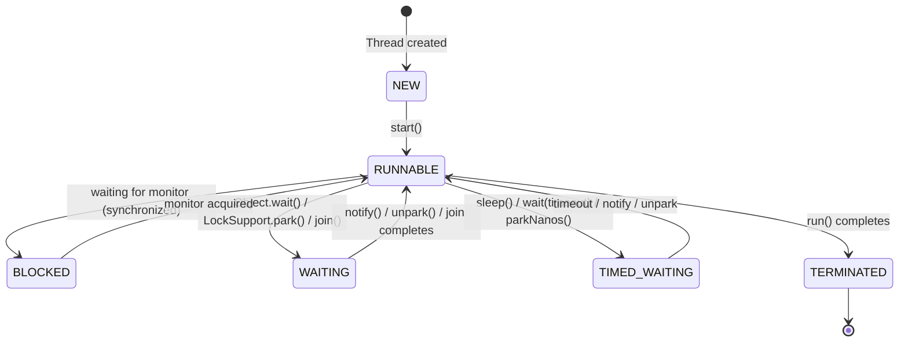
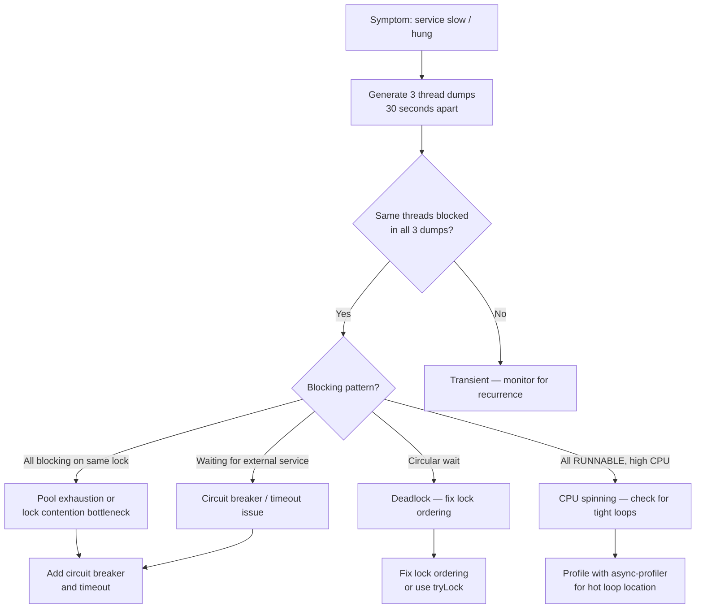

## Overview

Thread dumps are the primary diagnostic tool for understanding what every thread in a running JVM is doing at a specific instant. When a payment service stops processing, when throughput drops 90% with no errors, when a deployment hangs — the thread dump tells you why within seconds of analysis.

This lesson covers the full thread dump workflow: generation, anatomy, reading thread states, identifying deadlocks and pool exhaustion, and the new virtual thread dump format in Java 21.

## Learning Objectives

By the end of this lesson you will be able to:

- Identify all Java thread states and what each means operationally
- Generate thread dumps using jstack, kill signals, JConsole, and Spring Actuator
- Read a thread dump and identify: deadlocks, lock contention hotspots, thread pool exhaustion, blocked threads
- Use `ThreadMXBean` to detect deadlocks programmatically in production
- Interpret virtual thread dumps in Java 21
- Correlate thread dumps with application symptoms

## Java Thread States



| State | Meaning | Operational concern |
|---|---|---|
| `RUNNABLE` | On CPU or ready to run | Normal — but check for CPU-spinning loops |
| `BLOCKED` | Waiting for a `synchronized` monitor | Lock contention — high count = bottleneck |
| `WAITING` | Parked indefinitely (park, wait, join) | Expected for idle workers; unexpected = potential deadlock |
| `TIMED_WAITING` | Parked with timeout | Expected (sleeps, scheduled tasks) |
| `NEW` | Created but not started | Should not persist — start() not called? |
| `TERMINATED` | Finished | Should not appear in running pool — leak? |

## Generating Thread Dumps

```java17
// Method 1: jstack — most common for production
// jstack <pid> > dump.txt
// Find PID: jps -l (shows all Java processes)

// Method 2: Kill signal (Unix/Linux/macOS)
// kill -3 <pid>   → thread dump printed to stdout/stderr of the JVM process

// Method 3: jcmd — more flexible than jstack
// jcmd <pid> Thread.print > dump.txt
// jcmd <pid> Thread.dump_to_file -format=json threads.json  (Java 21+)

// Method 4: Spring Boot Actuator
// curl http://localhost:8080/actuator/threaddump
// Returns JSON thread dump — useful for automated analysis

// Method 5: JConsole / VisualVM (GUI)
// Connect via JMX: jconsole <pid>
// Threads tab → Thread Dump button

// Method 6: Programmatic (useful for health checks)
```

```java17
// Programmatic thread dump via ThreadMXBean
import java.lang.management.ManagementFactory;
import java.lang.management.ThreadInfo;
import java.lang.management.ThreadMXBean;

public class ThreadDumpUtil {

    public static String captureThreadDump() {
        ThreadMXBean tmx = ManagementFactory.getThreadMXBean();
        ThreadInfo[] threads = tmx.dumpAllThreads(
            true,  // include locked monitors
            true   // include locked synchronizers (ReentrantLock etc.)
        );

        StringBuilder sb = new StringBuilder();
        for (ThreadInfo info : threads) {
            sb.append(info.toString());
            sb.append("\n");
        }
        return sb.toString();
    }

    // Deadlock detection — returns thread IDs of deadlocked threads (null if none)
    public static long[] detectDeadlock() {
        ThreadMXBean tmx = ManagementFactory.getThreadMXBean();
        long[] deadlocked = tmx.findDeadlockedThreads();
        return deadlocked; // null if no deadlock, array of thread IDs if found
    }

    // Spring Boot health indicator using ThreadMXBean
    @Component
    public static class DeadlockHealthIndicator implements HealthIndicator {
        @Override
        public Health health() {
            long[] deadlocked = ManagementFactory.getThreadMXBean().findDeadlockedThreads();
            if (deadlocked != null && deadlocked.length > 0) {
                return Health.down()
                    .withDetail("deadlockedThreads", deadlocked.length)
                    .withDetail("message", "Deadlocked threads detected — restart required")
                    .build();
            }
            return Health.up().build();
        }
    }
}
```

## Anatomy of a Thread Dump Entry

```
"payment-processor-42" #42 prio=5 os_prio=0 cpu=234.56ms elapsed=1234.56s tid=0x00007f... nid=0x1a2b waiting for monitor entry [0x00007f...]
   java.lang.Thread.State: BLOCKED (on object monitor)
        at com.bank.payment.AccountService.debit(AccountService.java:87)
        - waiting to lock <0x000000076b3e1f68> (a com.bank.account.BankAccount) ← which lock
        at com.bank.payment.PaymentProcessor.process(PaymentProcessor.java:134)
        at com.bank.payment.PaymentHandler.handle(PaymentHandler.java:56)
        at java.util.concurrent.ThreadPoolExecutor.runWorker(ThreadPoolExecutor.java:1136)
        at java.util.concurrent.ThreadPoolExecutor$Worker.run(ThreadPoolExecutor.java:635)
        at java.lang.Thread.run(Thread.java:833)

   Locked ownable synchronizers:
        - <0x000000076b3e1a40> (a java.util.concurrent.locks.ReentrantLock$NonfairSync)
```

**What each line tells you:**

| Element | Meaning |
|---|---|
| `"payment-processor-42"` | Thread name — well-named threads are essential for diagnosis |
| `#42` | Thread ID |
| `cpu=234.56ms` | Total CPU time consumed by this thread |
| `elapsed=1234.56s` | Thread has been alive for 1234 seconds |
| `BLOCKED (on object monitor)` | Waiting for a `synchronized` lock |
| `waiting to lock <0x...>` | The specific lock object it needs |
| `Locked ownable synchronizers` | Locks this thread currently holds (ReentrantLock etc.) |

## Identifying Deadlocks

Thread dumps explicitly flag deadlocks:

```
Found one Java-level deadlock:
=============================
"payment-processor-1":
  waiting to lock monitor 0x000000076b3e1f68 (object 0x..., a com.bank.account.BankAccount)
  which is held by "payment-processor-2"

"payment-processor-2":
  waiting to lock monitor 0x000000076b3e1a40 (object 0x..., a com.bank.account.BankAccount)
  which is held by "payment-processor-1"

Java stack information for the threads listed above:
===================================================
"payment-processor-1":
        at com.bank.payment.TransferService.transfer(TransferService.java:28)
        - waiting to lock <0x000000076b3e1f68> (a com.bank.account.BankAccount)
        at com.bank.payment.TransferService.transfer(TransferService.java:25)
        - locked <0x000000076b3e1a40> (a com.bank.account.BankAccount)

"payment-processor-2":
        at com.bank.payment.TransferService.transfer(TransferService.java:28)
        - waiting to lock <0x000000076b3e1a40> (a com.bank.account.BankAccount)
        at com.bank.payment.TransferService.transfer(TransferService.java:25)
        - locked <0x000000076b3e1f68> (a com.bank.account.BankAccount)

Found 1 deadlock.
```

**Reading this deadlock:**
1. `payment-processor-1` holds `AccountA` lock, wants `AccountB` lock (line 28)
2. `payment-processor-2` holds `AccountB` lock, wants `AccountA` lock (line 28)
3. Fix: `TransferService.java:25` — add lock ordering based on account ID

## Identifying Thread Pool Exhaustion

```
// Thread dump showing pool exhaustion:
// All 50 "payment-processor-N" threads are BLOCKED on the same downstream service

"payment-processor-1" BLOCKED (on object monitor)
    at com.bank.fraud.FraudServiceClient.check(FraudServiceClient.java:42)
    - waiting to lock <0x000000076b3e1f00> (FraudServiceClient connection pool)

"payment-processor-2" BLOCKED (on object monitor)
    at com.bank.fraud.FraudServiceClient.check(FraudServiceClient.java:42)
    - waiting to lock <0x000000076b3e1f00> (same lock!)

... (payment-processor-3 through payment-processor-50: same pattern)

// Diagnosis:
// - All 50 payment threads are waiting for FraudServiceClient
// - FraudServiceClient has a connection pool bottleneck (or the fraud service is down)
// - Payment processing is 100% blocked on fraud checking
// - Fix: add circuit breaker to fraud service client; increase connection pool; add timeout
```

```java17
// Automated pool exhaustion detection from thread dump
public class PoolExhaustionDetector {

    public static Map<String, Long> countBlockedByLock(ThreadInfo[] threads) {
        // Count how many threads are blocked on each lock
        return Arrays.stream(threads)
            .filter(t -> t.getThreadState() == Thread.State.BLOCKED)
            .filter(t -> t.getLockInfo() != null)
            .collect(Collectors.groupingBy(
                t -> t.getLockInfo().getClassName() + "@" + t.getLockInfo().getIdentityHashCode(),
                Collectors.counting()
            ));
    }
    // If any single lock has N threads blocked where N ≈ pool size → pool exhaustion on that lock
}
```

## Virtual Thread Dumps (Java 21)

Java 21 introduces a richer thread dump format specifically for virtual threads:

```java21
// Java 21 thread dump includes virtual threads with their carrier thread
// Use: jcmd <pid> Thread.dump_to_file -format=json threads.json

// Virtual thread in JSON format:
{
  "name": "",
  "tid": 45,
  "state": "WAITING",
  "virtual": true,
  "carrier": {
    "name": "ForkJoinPool-1-worker-1",
    "tid": 12
  },
  "stack": [
    "java.lang.VirtualThread.park(VirtualThread.java:...)",
    "java.util.concurrent.locks.LockSupport.park(LockSupport.java:...)",
    "com.bank.payment.AccountRepository.findById(AccountRepository.java:42)"
  ]
}

// Key fields:
// "virtual": true  → this is a virtual thread
// "carrier"        → which platform thread it is currently mounted on (if any)
// "state": WAITING → parked on I/O — this is the CORRECT behaviour

// If you see a virtual thread BLOCKED (on object monitor):
// → It is inside a synchronized block — potential pinning issue (see Lesson 13)
```

```java21
// Detecting pinned virtual threads in a thread dump
public class PinningDetector {

    public static List<String> findPinnedVirtualThreads() {
        ThreadMXBean tmx = ManagementFactory.getThreadMXBean();
        ThreadInfo[] threads = tmx.dumpAllThreads(true, true);

        return Arrays.stream(threads)
            .filter(t -> {
                // Virtual thread pinned = BLOCKED state on object monitor
                // (ReentrantLock WAITING is NOT pinning — virtual thread parks correctly)
                return t.getThreadState() == Thread.State.BLOCKED
                    && t.getLockInfo() != null
                    && isVirtualThread(t);
            })
            .map(t -> t.getThreadName() + " pinned at " + 
                      (t.getStackTrace().length > 0 ? t.getStackTrace()[0] : "unknown"))
            .collect(Collectors.toList());
    }

    private static boolean isVirtualThread(ThreadInfo info) {
        // In Java 21, ThreadInfo doesn't expose isVirtual() directly
        // Use Thread.isVirtual() after finding the thread by ID
        return Thread.getAllStackTraces().keySet().stream()
            .filter(t -> t.threadId() == info.getThreadId())
            .findFirst()
            .map(Thread::isVirtual)
            .orElse(false);
    }
}
```

## Production Thread Dump Analysis Workflow



---

<!-- KNOWLEDGE-CHECK [
  {
    "id": "kc-td-01",
    "question": "A thread dump shows 50 payment processor threads all in state `BLOCKED` waiting for the same lock `<0x000000076b3e1f00>`. What does this indicate?",
    "options": [
      "A deadlock — all 50 threads are waiting for each other",
      "Thread pool exhaustion on a single resource — all threads are blocked on the same bottleneck (a connection pool, synchronized method, or external service)",
      "A race condition — the threads will resolve themselves after a few seconds",
      "Normal behaviour — BLOCKED threads are idle workers waiting for work"
    ],
    "correct": 1,
    "explanation": "50 threads blocked on the same lock identity indicates a single bottleneck. This is pool exhaustion: the entire thread pool is waiting for one resource. The lock is likely a connection pool, a synchronized service method, or an external service that is slow or down. All new incoming payment requests will queue until threads become unblocked. The fix: add a circuit breaker (open if downstream is slow), increase the downstream connection pool, add a timeout, or switch to an async client."
  },
  {
    "id": "kc-td-02",
    "question": "Three consecutive thread dumps taken 30 seconds apart show the same 2 threads each blocking on a lock held by the other. What is the correct diagnosis and immediate action?",
    "options": [
      "Transient contention — wait for it to resolve",
      "Deadlock — the threads will never progress; the service must be restarted and the deadlock prevented in code",
      "Lock contention — reduce the number of threads accessing the same lock",
      "Race condition — add more synchronization"
    ],
    "correct": 1,
    "explanation": "Seeing the same two threads blocking on each other's locks across three dumps confirms a deadlock — not a transient event. Deadlocked threads never make progress without external intervention. The immediate action: restart the service to restore availability, then fix the lock ordering in code. The thread dump shows the exact file and line number — fix the acquisition order so both threads always acquire locks in the same order (e.g., by account ID)."
  },
  {
    "id": "kc-td-03",
    "question": "A virtual thread in a Java 21 thread dump shows state `WAITING` with a stack frame at `com.bank.AccountRepository.findById`. Is this a problem?",
    "options": [
      "Yes — virtual threads should always be RUNNABLE",
      "No — WAITING means the virtual thread is correctly parked on blocking I/O, with its carrier thread freed to run other virtual threads",
      "Yes — the repository is blocked; a circuit breaker must be added",
      "No — but only if the carrier thread is also WAITING"
    ],
    "correct": 1,
    "explanation": "WAITING is the correct state for a virtual thread blocked on I/O. When a virtual thread blocks (JDBC call, HTTP request, sleep), the JVM parks it in the heap and the carrier thread is freed. WAITING in the dump means the virtual thread is doing exactly what it should — waiting for the DB response without consuming an OS thread. This is normal and expected behaviour. BLOCKED (on object monitor) is the concerning state — that indicates synchronized-caused pinning."
  },
  {
    "id": "kc-td-04",
    "question": "Why is it valuable to take 3 thread dumps 30 seconds apart rather than a single dump when diagnosing a performance issue?",
    "options": [
      "Three dumps reduce measurement error by averaging results",
      "A single dump shows a snapshot; threads that are blocked in all three dumps are genuinely stuck vs transiently blocked threads that appear in only one",
      "Three dumps allow you to calculate thread throughput between measurements",
      "JVM constraints require three dumps before deadlock detection activates"
    ],
    "correct": 1,
    "explanation": "A single thread dump is a snapshot — a thread in BLOCKED state may have just briefly waited for a lock and already moved on. Three dumps 30 seconds apart let you distinguish: (1) genuinely stuck threads (appear BLOCKED on the same lock in all three dumps — deadlock or pool exhaustion), (2) transiently busy threads (appear in different states or different locations — normal operation), (3) progressively growing queues (more threads blocked in dump 3 than dump 1 — growing contention)."
  }
] -->

---

<!-- PRACTICAL-CHALLENGE {
  "id": "pc-thread-dump-analysis",
  "title": "Thread Dump Diagnosis Lab",
  "description": "Diagnose and resolve production thread dump scenarios from a payment service.",
  "tasks": [
    {
      "id": "pc-tda-01",
      "description": "Reproduce a deadlock in `TransferService` (the broken lock-ordering version from Lesson 8). Take 3 consecutive thread dumps using jstack. Parse the dumps and write a report identifying: thread names, lock IDs held and waited-for, and the exact source lines causing the deadlock."
    },
    {
      "id": "pc-tda-02",
      "description": "Implement `DeadlockHealthIndicator` as a Spring Boot `HealthIndicator` that uses `ThreadMXBean.findDeadlockedThreads()`. When a deadlock is detected: return `Health.DOWN`, log the full stack traces of deadlocked threads, and increment a `deadlock.detected` Micrometer counter."
    },
    {
      "id": "pc-tda-03",
      "description": "Simulate pool exhaustion: a `FraudServiceClient` with a `synchronized` method that sleeps for 5 seconds (simulating a slow response). Start a payment processor with 20 threads all calling the fraud client. Take a thread dump and interpret it: identify how many threads are blocked, on what lock, and at which line. Then add a circuit breaker to prevent pool exhaustion."
    },
    {
      "id": "pc-tda-04",
      "description": "Using Java 21, generate a thread dump in JSON format (`jcmd Thread.dump_to_file -format=json`) of a service running 1000 virtual threads. Write a script (or Java program) that: (1) counts virtual vs platform threads, (2) identifies any virtual threads in BLOCKED state (potential pinning), (3) groups virtual threads by their current stack frame top to identify what most are waiting for."
    }
  ]
} -->
