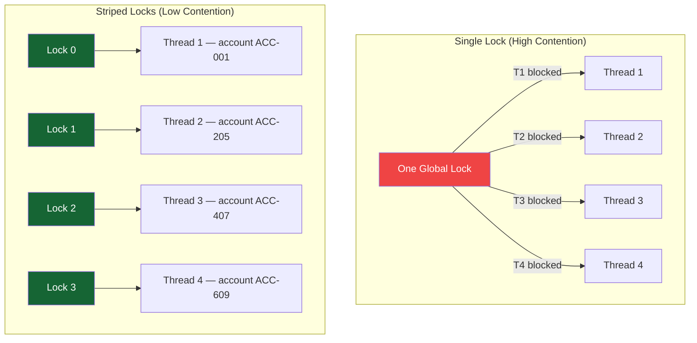

# التنافس على الأقفال — القياس والتقليل

## نظرة عامة

التنافس على الأقفال أشيع سقف للأداء في الأنظمة المالية المتزامنة. فقفل واحد شديد التنافس يسلسل كل الخيوط المنتظرة له — فيلغي تمامًا فائدة وجود خيوط متعددة. وفهم مكان التنافس، وتحديد أثره بقانون أمدال (Amdahl)، وتطبيق تقنيات تقليل موجّهة، مهارة أساسية للمهندس الرئيسي.

يغطي هذا الدرس قياس التنافس بـ async-profiler وJFR، وقانون أمدال كأداة تحليلية لفهم حدود التوسع، والأنماط الرئيسية لتقليل التنافس: تقسيم الأقفال (lock striping)، والاستبدال بهياكل خالية من الأقفال، وتجميع العمليات.

## أهداف التعلم

في نهاية هذا الدرس ستستطيع:

- تطبيق قانون أمدال لتحديد السقف النظري للإنتاجية الذي يفرضه التنافس على الأقفال
- قياس التنافس على الأقفال في JVM عاملة بـ async-profiler وJFR
- تحديد الأقفال الأعلى تنافسًا من ملف تنافس
- تطبيق تقسيم الأقفال لتقليل التنافس على خريطة أو عدّاد مشترك
- استبدال قفل متنافس عليه بهيكل خالٍ من الأقفال عند الملاءمة
- تحديد أنماط التنافس على أقفال قاعدة البيانات وتقليلها

## قانون أمدال

يحدد قانون أمدال أقصى تسريع ممكن عندما لا يمكن توزيع إلا جزء من المهمة على التوازي:

$$S(n) = \frac{1}{(1-p) + \frac{p}{n}}$$

حيث:
- ‏$S(n)$ = التسريع النظري مع $n$ معالجًا
- ‏$p$ = جزء التنفيذ القابل للتوازي
- ‏$(1-p)$ = الجزء الذي يجب أن يعمل بالتتابع (مثلًا تحت قفل)

### مثال معالجة المدفوعات

معالج دفع بقفل عام واحد يحمي تحديثات الأرصدة. 20% من وقت التنفيذ تحت هذا القفل (تتابعي)، و80% قابل للتوازي (التحقق، والإثراء، والتوجيه).

| الخيوط | التسريع النظري | الإنتاجية (الأساس = 100 معاملة/ث) |
|---|---|---|
| 1 | 1.0× | 100 |
| 2 | 1.67× | 167 |
| 4 | 2.50× | 250 |
| 8 | 3.33× | 333 |
| 16 | 4.00× | 400 |
| ∞ | **5.00×** | **سقف 500** |

الجزء التتابعي $(1-p) = 0.20$ يخلق سقفًا قدره $1/0.20 = 5×$ مهما كان عدد الخيوط. وإضافة خيوط بعد 8 تعطي عوائد متناقصة. فالحل ليس مزيدًا من الخيوط — بل **تقليل الجزء التتابعي**.

وقانون أمدال هو الحالة المتفائلة: فهو يتجاهل كلفة التنافس نفسه (نقل خطوط الذاكرة المؤقتة، وتبديل السياق، وتسليم الأقفال). وفي الأنظمة الحقيقية كثيرًا ما **تنخفض** الإنتاجية خلف قفل ساخن عند إضافة خيوط — ويصوغ قانون التوسع العام (Universal Scalability Law) هذه الكلفة الإضافية.

> [!IMPORTANT]
> يشرح قانون أمدال لماذا يكون قفل واحد شديد التنافس كارثيًا للإنتاجية. فالقفل المحتجز 10% من وقت التنفيذ ($p = 0.90$) يحد التسريع الأقصى بـ 10×، والمحتجز 50% يحده بـ 2×. وتقليل الجزء التتابعي — لا إضافة الخيوط — هو طريق تحسين الإنتاجية.

## قياس التنافس على الأقفال

### async-profiler

‏async-profiler محلل أداء بالعينات منخفض الكلفة يستطيع تحليل التنافس على الأقفال بأثر ضئيل جدًا في التشغيل.

```bash
# Profile lock contention for 30 seconds
# Output: flame graph of code paths that WAITED to acquire contended locks
./asprof -e lock -d 30 -f contention.html <pid>

# Record only lock waits longer than 1ms (reduces noise)
./asprof -e lock --lock 1ms -d 30 -f locks.html <pid>

# The widest frames in the flame graph are the contention hotspots
```

يسجل الخيار `--lock 1ms` فقط حالات انتظار الأقفال التي تزيد على 1ms لتقليل الضجيج. وأعرض الإطارات في مخطط اللهب هي نقاط التنافس الساخنة.

### أحداث تنافس الأقفال في JFR

```java17
// Enable JFR lock contention recording via JFR API
import jdk.jfr.Recording;
import jdk.jfr.consumer.RecordingFile;

public class LockContentionProfiler {

    public static void profileFor(Duration duration, Path outputFile) throws Exception {
        try (Recording recording = new Recording()) {
            // jdk.JavaMonitorEnter: waits to ENTER synchronized — real contention
            // jdk.ThreadPark: parking — includes ReentrantLock waits, but also
            //                 idle pool workers, so filter by stack trace
            // (jdk.JavaMonitorWait = Object.wait(): waiting for a signal, not contention)
            recording.enable("jdk.JavaMonitorEnter").withThreshold(Duration.ofMillis(10));
            recording.enable("jdk.ThreadPark").withThreshold(Duration.ofMillis(10));
            recording.setDestination(outputFile);
            recording.start();
            Thread.sleep(duration.toMillis());
            recording.stop();
        }
        // Open outputFile in JDK Mission Control to see lock contention flamegraph
    }
}

// Command line alternative:
// java -XX:StartFlightRecording=filename=contention.jfr,duration=60s,
//      settings=profile -jar payment-service.jar
```

‏`jdk.JavaMonitorEnter`: انتظار **دخول** `synchronized` — تنافس حقيقي. و`jdk.ThreadPark`: التوقف — يشمل انتظار `ReentrantLock` لكن أيضًا عمال المجمّع الخاملين، فرشّح حسب تتبع المكدس. أما `jdk.JavaMonitorWait` فهو `Object.wait()`: انتظار إشارة لا تنافس.

```java17
// Parse JFR lock events programmatically
public List<LockContentionEvent> parseTopContendedLocks(Path jfrFile) throws IOException {
    List<LockContentionEvent> events = new ArrayList<>();

    try (RecordingFile rf = new RecordingFile(jfrFile)) {
        while (rf.hasMoreEvents()) {
            RecordedEvent event = rf.readEvent();
            if (event.getEventType().getName().equals("jdk.JavaMonitorEnter")) {
                long durationMs = event.getDuration().toMillis();
                String className = event.getValue("monitorClass.name");
                events.add(new LockContentionEvent(className, durationMs,
                    event.getStackTrace()));
            }
        }
    }
    // Longest individual waits first. (To find the most contended LOCK,
    // also group by monitor class + top frame and sum the durations)
    return events.stream()
        .sorted(Comparator.comparingLong(LockContentionEvent::durationMs).reversed())
        .limit(20)
        .collect(Collectors.toList());
}
```

تُرتّب النتائج بأطول حالات الانتظار المنفردة أولًا. ولإيجاد **القفل** الأكثر تنافسًا، جمّع أيضًا حسب صنف المراقب والإطار الأعلى واجمع المدد.

## تقسيم الأقفال — تقليل التنافس بالتجزئة

يقسم **تقسيم الأقفال** موردًا مشتركًا إلى أجزاء مستقلة، لكل منها قفله. فتتقدم الخيوط العاملة على أجزاء مختلفة بالتوازي.



```java17
// BEFORE: Single lock — all threads serialised
public class SingleLockBalanceStore {
    private final Object lock = new Object();
    private final Map<String, Long> balances = new HashMap<>();

    public void updateBalance(String accountId, long delta) {
        synchronized (lock) {           // Global lock — bottleneck
            balances.merge(accountId, delta, Long::sum);
        }
    }
}

// AFTER: 16-stripe lock — threads on different accounts proceed in parallel
public class StripedBalanceStore {
    private static final int STRIPES = 16;
    private final Object[] locks    = new Object[STRIPES];
    private final Map<String, Long>[] maps;

    @SuppressWarnings("unchecked")
    public StripedBalanceStore() {
        for (int i = 0; i < STRIPES; i++) {
            locks[i] = new Object();
        }
        maps = new HashMap[STRIPES];
        for (int i = 0; i < STRIPES; i++) {
            maps[i] = new HashMap<>();
        }
    }

    private int stripe(String accountId) {
        // Hash to stripe — floorMod keeps the result in 0..STRIPES-1
        // even for negative hash codes
        return Math.floorMod(accountId.hashCode(), STRIPES);
    }

    public void updateBalance(String accountId, long delta) {
        int s = stripe(accountId);
        synchronized (locks[s]) {        // Only locks 1/16th of accounts
            maps[s].merge(accountId, delta, Long::sum);
        }
    }

    public long getBalance(String accountId) {
        int s = stripe(accountId);
        synchronized (locks[s]) {
            return maps[s].getOrDefault(accountId, 0L);
        }
    }
}
// Contention reduced by up to a factor of STRIPES=16 for evenly spread account IDs.
// A single hot account is still serialised — striping cannot split one key
```

يقلل التقسيم إلى 16 جزءًا التنافس بما يصل إلى 16 مرة عندما تتوزع معرّفات الحسابات بالتساوي. ويُبقي `Math.floorMod` النتيجة بين 0 و15 حتى لقيم التجزئة السالبة. لكن حسابًا ساخنًا واحدًا يبقى متسلسلًا — فالتقسيم لا يستطيع تجزئة مفتاح واحد.

```java17
// SIMPLER: ConcurrentHashMap — built-in striping at the bucket level
// Equivalent to striping at the per-bucket granularity (N buckets, N×1 locks)
public class ConcurrentHashMapBalanceStore {
    private final ConcurrentHashMap<String, Long> balances = new ConcurrentHashMap<>();

    public void updateBalance(String accountId, long delta) {
        balances.merge(accountId, delta, Long::sum); // Atomic, per-bucket lock
    }

    public long getBalance(String accountId) {
        return balances.getOrDefault(accountId, 0L);
    }
}
// In most cases, prefer ConcurrentHashMap over manual striping
// Manual striping is valuable when you need: sorted access, compound operations, or
// non-map structures (arrays, custom data structures)
```

في معظم الحالات فضّل `ConcurrentHashMap` على التقسيم اليدوي. والتقسيم اليدوي مفيد عندما تحتاج: وصولًا مرتبًا، أو عمليات مركبة، أو هياكل غير الخرائط (مصفوفات، أو بنى بيانات مخصصة).

## أنماط تقليل التنافس

### 1. تضييق نطاق القفل

```java17
// BEFORE: lock held too long — includes non-critical work
public void processPayment(Payment payment) {
    synchronized (lock) {
        validatePayment(payment);           // Could be outside lock
        checkFraud(payment);                // Could be outside lock — slow!
        updateBalance(payment.getAccount(), payment.getAmount()); // Must be inside lock
        auditLog(payment);                  // Could be outside lock
    }
}

// AFTER: lock only protects the critical section
public void processPayment(Payment payment) {
    validatePayment(payment);               // Outside lock — fast, no shared state
    FraudResult fraud = checkFraud(payment); // Outside lock — slow I/O, no shared state
    if (fraud.isBlocked()) throw new FraudBlockedException();

    synchronized (lock) {                   // Lock only for the actual balance update
        updateBalance(payment.getAccount(), payment.getAmount());
    }
    auditLog(payment);                      // Outside lock — write-only, no read-then-write
}
```

لا يحمي القفل إلا القسم الحرج الفعلي (تحديث الرصيد). أما التحقق، وفحص الاحتيال البطيء، وسجل التدقيق فتجري خارج القفل.

### 2. الاستبدال الخالي من الأقفال

استبدل قفلًا متنافسًا عليه بهيكل بيانات خالٍ من الأقفال حيث تسمح العمليات بذلك:

```java17
// BEFORE: synchronized counter — serialises all increments
private long transactionCount = 0;
public synchronized void recordTransaction() { transactionCount++; }

// AFTER: LongAdder — lock-free under high contention
private final LongAdder transactionCount = new LongAdder();
public void recordTransaction() { transactionCount.increment(); } // No lock

// BEFORE: synchronized map for append-only metrics
private final Map<String, List<Long>> latencies = new HashMap<>();
public synchronized void recordLatency(String endpoint, long ms) {
    latencies.computeIfAbsent(endpoint, k -> new ArrayList<>()).add(ms);
}

// AFTER: ConcurrentHashMap — per-bucket locking, no global serialisation
private final ConcurrentHashMap<String, LongAdder> latencySums = new ConcurrentHashMap<>();
private final ConcurrentHashMap<String, LongAdder> latencyCounts = new ConcurrentHashMap<>();
public void recordLatency(String endpoint, long ms) {
    latencySums.computeIfAbsent(endpoint, k -> new LongAdder()).add(ms);
    latencyCounts.computeIfAbsent(endpoint, k -> new LongAdder()).increment();
}
// (A reader may see the sum and count from slightly different moments —
//  fine for metrics, not for money)
```

قد يرى القارئ المجموع والعدد من لحظتين مختلفتين قليلًا — وهذا مقبول للمقاييس، لا للمال.

### 3. تجميع العمليات

```java17
// BEFORE: one lock acquisition per event — high contention under event bursts
public void recordEvent(PaymentEvent event) {
    synchronized (lock) {
        eventStore.add(event); // Lock per event — terrible under burst
    }
}

// AFTER: buffer events, flush with a single lock acquisition
// WARNING: events in the in-memory buffer are LOST if the process crashes.
// Use this only for data you can afford to lose (metrics, telemetry) — or
// do not acknowledge an event until its batch is durably stored.
// Payment and ledger events must never sit only in memory.
public class BatchingEventRecorder {
    private final Queue<PaymentEvent> buffer = new ConcurrentLinkedQueue<>();
    private final Object flushLock = new Object();

    public void recordEvent(PaymentEvent event) {
        buffer.offer(event); // Lock-free queue — no contention on record
    }

    // Flush periodically (e.g., every 100ms) or when buffer reaches threshold
    @Scheduled(fixedDelay = 100)
    public void flush() {
        List<PaymentEvent> batch = new ArrayList<>();
        PaymentEvent event;
        while ((event = buffer.poll()) != null) {
            batch.add(event); // Drain the lock-free buffer
        }
        if (!batch.isEmpty()) {
            synchronized (flushLock) {
                eventStore.addAll(batch); // Single lock acquisition for N events
            }
        }
    }
}
```

> [!WARNING]
> الأحداث في المخزن المؤقت في الذاكرة **تضيع** إذا تعطلت العملية. فاستخدم هذا النمط فقط للبيانات التي تتحمل فقدانها (المقاييس، والقياس عن بعد) — أو لا تؤكد استلام حدث حتى تُخزَّن دفعته بشكل دائم. وأحداث المدفوعات ودفتر الأستاذ يجب ألا تبقى في الذاكرة فقط أبدًا.

## التنافس على أقفال قاعدة البيانات

التنافس على الأقفال لا يقتصر على أقفال Java. فأقفال الصفوف والجداول في قاعدة البيانات مهمة بالقدر نفسه في أنظمة الدفع.

```java17
// High contention: one busy account → hot row in DB
// All payments to the same account contend for the same row lock
@Transactional
public void debit(String accountId, long amount) {
    Account account = repository.findByIdForUpdate(accountId); // Row lock
    account.debit(amount);
    repository.save(account); // Lock released on commit
}
// If 100 payments arrive for account "ACC-001" simultaneously:
// 1 transaction runs, 99 wait for the row lock → serialised throughput

// MITIGATION 1: Shorter transactions — reduce time lock is held
// Move non-essential work outside the transaction boundary
@Transactional
public void debit(String accountId, long amount) {
    // Only the minimum required work inside the transaction
    Account account = repository.findByIdForUpdate(accountId);
    account.debit(amount);
    // Don't call fraud service, audit service, notification service inside the transaction
    repository.save(account);
    // Record the audit/notification event in an OUTBOX table here (a fast
    // INSERT in the same transaction); a relay publishes it after commit
    outboxRepository.save(OutboxEvent.debited(accountId, amount));
}

// MITIGATION 2: One atomic UPDATE — the row lock lasts only for this statement
// UPDATE accounts SET balance = balance - :amount
//  WHERE id = :id AND balance >= :amount        -- 0 rows updated = insufficient funds

// MITIGATION 3: Partitioning hot accounts
// If one account receives 10,000 payments/hour (e.g., a corporate settlement account),
// consider partitioned balance shards with periodic reconciliation
```

إذا وصلت 100 دفعة للحساب نفسه في اللحظة نفسها: تعمل معاملة واحدة وتنتظر 99 قفل الصف ← إنتاجية متسلسلة. وطرق التخفيف: (1) معاملات أقصر — أخرج العمل غير الأساسي من حدود المعاملة، وسجّل حدث التدقيق في جدول outbox ضمن المعاملة نفسها (إدراج سريع) لينشره ناقل بعد الالتزام؛ (2) تحديث ذري واحد — يدوم قفل الصف مدة هذه العبارة فقط؛ (3) تجزئة الحسابات الساخنة إلى أرصدة فرعية مع تسوية دورية.


<!-- KNOWLEDGE-CHECK [
  {
    "id": "kc-lc-01",
    "question": "خدمة دفع 20% من تنفيذها تحت قفل عام. وفقًا لقانون أمدال، ما أقصى تحسين في الإنتاجية يمكن تحقيقه بإضافة أي عدد من الخيوط؟",
    "options": [
      "‏20× — مساوٍ لعدد الخيوط المضافة",
      "‏5× — الجزء التتابعي 0.20 يحد التسريع الأقصى بـ 1/0.20 = 5",
      "غير محدود — المزيد من الخيوط يحسّن الإنتاجية دائمًا",
      "‏2× — قانون أمدال ينطبق فقط على أحمال المعالجة"
    ],
    "correct": 1,
    "explanation": "قانون أمدال: أقصى تسريع = 1 / الجزء التتابعي = 1 / 0.20 = 5×. فمهما أُضيف من خيوط، يحد الجزء التتابعي (المقفل) البالغ 20% التحسين النظري الأقصى بـ 5×. وبعد 8–10 خيوط تعطي إضافة الخيوط تحسنًا شبه معدوم. والاستجابة الهندسية الصحيحة: قلل الجزء التتابعي (قلل الوقت تحت القفل) بدل إضافة الخيوط."
  },
  {
    "id": "kc-lc-02",
    "question": "يُظهر تقرير تنافس أقفال من async-profiler أن 60% من وقت التنافس في `AccountService.updateBalance()` التي تستخدم كتلة `synchronized` واحدة على `HashMap` مشتركة. ما الإصلاح الأول الأنسب؟",
    "options": [
      "استبدل HashMap بـ ConcurrentHashMap واستخدم merge() — فتختفي كتلة synchronized كليًا",
      "أضف خيوطًا للمجمّع لتقليل زمن انتظار كل خيط",
      "استبدل synchronized بحقول volatile",
      "قسّم الطريقة إلى طريقتين synchronized"
    ],
    "correct": 0,
    "explanation": "ينفّذ ConcurrentHashMap.merge() قراءة-تعديل-كتابة ذرية على حاوية (bin) واحدة — CAS عندما تكون الحاوية فارغة، وإلا قفلًا قصيرًا على تلك الحاوية فقط. فلا حاجة إلى مزامنة خارجية، فتختفي كتلة synchronized العامة وتتقدم تحديثات الحسابات المختلفة بالتوازي. وتتوسع الإنتاجية مع عدد المفاتيح المختلفة المحدّثة؛ أما الحساب الساخن الواحد فيبقى متسلسلًا. وهذا الإصلاح المعياري لأنماط HashMap مع قفل."
  },
  {
    "id": "kc-lc-03",
    "question": "يستخدم `StripedBalanceStore` ‏16 جزءًا. و90% من كل المعاملات تحدّث حسابات معرّفاتها بين ACC-000 وACC-015. ما المشكلة التي يسببها ذلك؟",
    "options": [
      "لا مشكلة — 16 جزءًا توزّع الحمل بالتساوي دائمًا",
      "مشكلة الجزء الساخن: إذا وقعت ACC-000 حتى ACC-015 كلها في الجزء نفسه، يتسلسل ذلك الجزء بينما تبقى البقية خاملة",
      "جمود: 16 جزءًا تخلق اعتماديات دائرية",
      "فيض: لا يمكن تخزين أكثر من 16 حسابًا"
    ],
    "correct": 1,
    "explanation": "يفترض تقسيم الأقفال توزع المفاتيح بالتساوي على الأجزاء. فإذا وقع 90% من الحركة في الجزء 0 (أو بضعة أجزاء)، تصبح تلك الأجزاء متنافسًا عليها كقفل عام واحد بينما تبقى الأجزاء الـ 15 الأخرى خاملة — مشكلة الجزء الساخن. والتخفيف: أجزاء أكثر أو دالة تجزئة توزّع أفضل، أو ConcurrentHashMap الذي يعطي قفله لكل حاوية الحسابات الساخنة المختلفة حاويات منفصلة عمليًا. ولاحظ أنه لا يفيد أي تقسيم إذا كان حساب **واحد** ساخنًا — فذلك يحتاج تغييرًا في التصميم (مثل أرصدة فرعية مجزأة)."
  },
  {
    "id": "kc-lc-04",
    "question": "يُظهر JFR أحداث `jdk.JavaMonitorEnter` بمتوسط 45ms على `PaymentService.processPayment()`. وتتحقق الطريقة، وتفحص الاحتيال، وتحدّث الرصيد، وتكتب سجل تدقيق — كلها تحت القفل نفسه. ما التغيير الأكثر أثرًا؟",
    "options": [
      "استبدل synchronized بـ ReentrantLock",
      "أخرج التحقق وفحص الاحتيال وسجل التدقيق من القفل — تحديث الرصيد وحده يحتاج إلى استبعاد متبادل",
      "زد حجم مجمّع الخيوط لتقليل زمن انتظار كل خيط",
      "أضف @Transactional إلى الطريقة ليُعالج القفل على مستوى قاعدة البيانات"
    ],
    "correct": 1,
    "explanation": "إذا احتُجز القفل 45ms بينما لا يحتاج إلى الاستبعاد المتبادل إلا تحديث الرصيد (بضع ميكروثوانٍ)، فنطاق القفل أكبر من اللازم بـ 100–1000 مرة. وإخراج فحص الاحتيال (الذي قد يتضمن استدعاءات HTTP) وسجل التدقيق من القفل يخفض زمن الاحتجاز من نحو 45ms إلى ميكروثوانٍ، فيقل التنافس ألف مرة. وهذا تضييق نطاق القفل — أعلى إصلاح للتنافس عائدًا."
  }
] -->


<!-- PRACTICAL-CHALLENGE {
  "id": "pc-lock-contention",
  "title": "تحليل التنافس على الأقفال وتقليله",
  "description": "حلّل التنافس على الأقفال في خدمة مقاييس مدفوعات، وحدّد حجمه، وأزله.",
  "tasks": [
    {
      "id": "pc-lc-01",
      "description": "حلّل `PaymentMetricsService` (تستخدم HashMap مع synchronized لعدّادات كل حساب) باستخدام async-profiler مع `-e lock`. وشغّل اختبار حمل بـ 50 خيطًا. وحدد أعلى 3 نقاط تنافس حسب إجمالي زمن الحجب. واحسب الجزء التتابعي من مخرجات المحلل واستخدم قانون أمدال لتحديد سقف الإنتاجية."
    },
    {
      "id": "pc-lc-02",
      "description": "أعد هيكلة `PaymentMetricsService` لإزالة HashMap المتزامنة: (1) استبدلها بـ ConcurrentHashMap مع merge()، (2) استبدل العدّادات بـ LongAdder. وأعد تشغيل اختبار الحمل مع async-profiler. ووثّق انخفاض أحداث التنافس وتحسن الإنتاجية. وتحقق من اقتراب الجزء التتابعي من الصفر."
    },
    {
      "id": "pc-lc-03",
      "description": "نفّذ مخزن أرصدة مقسّمًا إلى 32 جزءًا لذاكرة مؤقتة لأرصدة حسابات عالية الإنتاجية. وتحقق من التوزيع المتساوي بتسجيل عدد مرات الوصول لكل جزء تحت الحمل. واختبر الحالة المرضية: وجّه 90% من الحركة إلى حسابات تقع كلها في الجزء 0. ووثّق مشكلة الجزء الساخن واقترح حلًا باستخدام التجزئة المتسقة أو إعادة التوزيع."
    },
    {
      "id": "pc-lc-04",
      "description": "حلّل التنافس على أقفال قاعدة البيانات باستخدام عرضي PostgreSQL ‏`pg_stat_activity` و`pg_locks` أثناء تشغيل 100 خصم متزامن على الحساب نفسه. وقِس: متوسط زمن انتظار القفل، وعدد حالات الجمود (إن وُجدت)، والإنتاجية (معاملة/ث). ثم أضف نومًا مدته 100ms بين الحصول على القفل وUPDATE لمحاكاة معاملات طويلة. ووثّق العلاقة بين مدة المعاملة والتنافس على الأقفال."
    }
  ]
} -->
