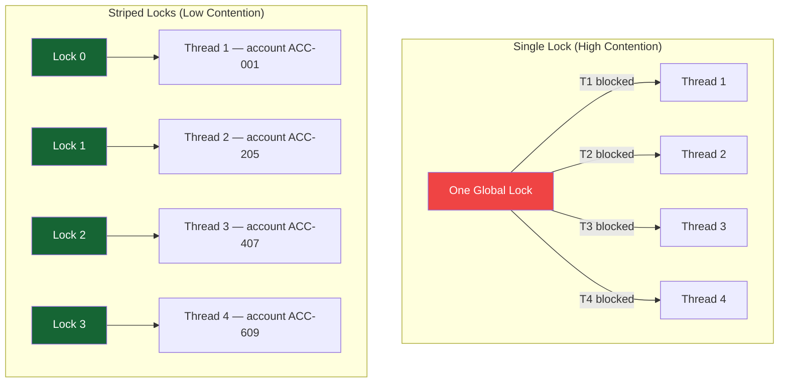

## Overview

Lock contention is the most common performance ceiling in concurrent financial systems. A single heavily contended lock serialises all threads waiting for it — exactly cancelling the benefit of having multiple threads. Understanding where contention occurs, quantifying its impact with Amdahl's Law, and applying targeted reduction techniques is a core Principal Engineer skill.

This lesson covers contention measurement with async-profiler and JFR, Amdahl's Law as the analytical tool for understanding scaling limits, and the principal patterns for reducing contention: lock striping, lock-free replacement, and operation batching.

## Learning Objectives

By the end of this lesson you will be able to:

- Apply Amdahl's Law to quantify the theoretical throughput ceiling imposed by lock contention
- Measure lock contention in a running JVM with async-profiler and JFR
- Identify the highest-contention locks from a contention profile
- Apply lock striping to reduce contention on a shared map or counter
- Replace a contended lock with a lock-free structure where appropriate
- Identify and reduce database lock contention patterns

## Amdahl's Law

Amdahl's Law quantifies the maximum speedup achievable when only a fraction of a task can be parallelised:

$$S(n) = \frac{1}{(1-p) + \frac{p}{n}}$$

Where:
- $S(n)$ = theoretical speedup with $n$ processors
- $p$ = fraction of execution that can be parallelised
- $(1-p)$ = fraction that must run serially (e.g., under a lock)

### Payment Processing Example

A payment processor with one global lock protecting balance updates. 20% of execution time is under this lock (serial). 80% is parallelisable (validation, enrichment, routing).

| Threads | Theoretical speedup | Throughput (baseline = 100 TPS) |
|---|---|---|
| 1 | 1.0× | 100 TPS |
| 2 | 1.67× | 167 TPS |
| 4 | 2.50× | 250 TPS |
| 8 | 3.33× | 333 TPS |
| 16 | 4.00× | 400 TPS |
| ∞ | **5.00×** | **500 TPS ceiling** |

The serial fraction $(1-p) = 0.20$ creates a ceiling of $1/0.20 = 5×$, regardless of thread count. Adding threads beyond 8 provides diminishing returns. The fix is not more threads — it is **reducing the serial fraction**.

> [!IMPORTANT]
> Amdahl's Law explains why a single highly contended lock is catastrophic for throughput. A lock held for 10% of execution time ($p = 0.90$) caps maximum speedup at 10×. A lock held for 50% caps it at 2×. Reducing the serial fraction — not adding threads — is the path to throughput improvement.

## Measuring Lock Contention

### async-profiler

async-profiler is a low-overhead sampling profiler that can profile lock contention with near-zero runtime impact.

```bash
# Profile lock contention for 30 seconds
# Output: flamegraph showing which code paths are waiting for locks
./asprof -e lock -d 30 -f contention.html <pid>

# Or using jattach (async-profiler CLI)
asprof -e lock --lock-threshold 1ms -f locks.svg <pid>
# --lock-threshold 1ms: only record locks held > 1ms (reduces noise)

# Output: flamegraph with hot lock paths highlighted
# The widest frames at the top of "waiting for lock" stacks are the contention hotspots
```

### JFR Lock Contention Events

```java17
// Enable JFR lock contention recording via JFR API
import jdk.jfr.Recording;
import jdk.jfr.consumer.RecordingFile;

public class LockContentionProfiler {

    public static void profileFor(Duration duration, Path outputFile) throws Exception {
        try (Recording recording = new Recording()) {
            // Enable lock contention events with 10ms threshold
            recording.enable("jdk.JavaMonitorWait").withThreshold(Duration.ofMillis(10));
            recording.enable("jdk.JavaMonitorEnter").withThreshold(Duration.ofMillis(10));
            recording.enable("jdk.ThreadPark").withThreshold(Duration.ofMillis(10));
            recording.setDestination(outputFile);
            recording.start();
            Thread.sleep(duration.toMillis());
            recording.stop();
        }
        // Open outputFile in JDK Mission Control to see lock contention flamegraph
    }
}

// Command line alternative:
// java -XX:StartFlightRecording=filename=contention.jfr,duration=60s,
//      settings=profile -jar payment-service.jar
```

```java17
// Parse JFR lock events programmatically
public List<LockContentionEvent> parseTopContendedLocks(Path jfrFile) throws IOException {
    List<LockContentionEvent> events = new ArrayList<>();

    try (RecordingFile rf = new RecordingFile(jfrFile)) {
        while (rf.hasMoreEvents()) {
            RecordedEvent event = rf.readEvent();
            if (event.getEventType().getName().equals("jdk.JavaMonitorEnter")) {
                long durationMs = event.getDuration().toMillis();
                String className = event.getValue("monitorClass.name");
                events.add(new LockContentionEvent(className, durationMs,
                    event.getStackTrace()));
            }
        }
    }
    // Sort by total time blocked — longest contention first
    return events.stream()
        .sorted(Comparator.comparingLong(LockContentionEvent::durationMs).reversed())
        .limit(20)
        .collect(Collectors.toList());
}
```

## Lock Striping — Reducing Contention by Partitioning

**Lock striping** divides a shared resource into independent segments, each with its own lock. Threads operating on different segments proceed in parallel.



```java17
// BEFORE: Single lock — all threads serialised
public class SingleLockBalanceStore {
    private final Object lock = new Object();
    private final Map<String, Long> balances = new HashMap<>();

    public void updateBalance(String accountId, long delta) {
        synchronized (lock) {           // Global lock — bottleneck
            balances.merge(accountId, delta, Long::sum);
        }
    }
}

// AFTER: 16-stripe lock — threads on different accounts proceed in parallel
public class StripedBalanceStore {
    private static final int STRIPES = 16;
    private final Object[] locks    = new Object[STRIPES];
    private final Map<String, Long>[] maps;

    @SuppressWarnings("unchecked")
    public StripedBalanceStore() {
        for (int i = 0; i < STRIPES; i++) {
            locks[i] = new Object();
        }
        maps = new HashMap[STRIPES];
        for (int i = 0; i < STRIPES; i++) {
            maps[i] = new HashMap<>();
        }
    }

    private int stripe(String accountId) {
        // Hash to stripe — accounts with different hashes go to different stripes
        return Math.abs(accountId.hashCode() % STRIPES);
    }

    public void updateBalance(String accountId, long delta) {
        int s = stripe(accountId);
        synchronized (locks[s]) {        // Only locks 1/16th of accounts
            maps[s].merge(accountId, delta, Long::sum);
        }
    }

    public long getBalance(String accountId) {
        int s = stripe(accountId);
        synchronized (locks[s]) {
            return maps[s].getOrDefault(accountId, 0L);
        }
    }
}
// Contention reduced by factor of STRIPES=16 for uniformly distributed account IDs
```

```java17
// SIMPLER: ConcurrentHashMap — built-in striping at the bucket level
// Equivalent to striping at the per-bucket granularity (N buckets, N×1 locks)
public class ConcurrentHashMapBalanceStore {
    private final ConcurrentHashMap<String, Long> balances = new ConcurrentHashMap<>();

    public void updateBalance(String accountId, long delta) {
        balances.merge(accountId, delta, Long::sum); // Atomic, per-bucket lock
    }

    public long getBalance(String accountId) {
        return balances.getOrDefault(accountId, 0L);
    }
}
// In most cases, prefer ConcurrentHashMap over manual striping
// Manual striping is valuable when you need: sorted access, compound operations, or
// non-map structures (arrays, custom data structures)
```

## Contention Reduction Patterns

### 1. Reduce Lock Scope

```java17
// BEFORE: lock held too long — includes non-critical work
public void processPayment(Payment payment) {
    synchronized (lock) {
        validatePayment(payment);           // Could be outside lock
        checkFraud(payment);                // Could be outside lock — slow!
        updateBalance(payment.getAccount(), payment.getAmount()); // Must be inside lock
        auditLog(payment);                  // Could be outside lock
    }
}

// AFTER: lock only protects the critical section
public void processPayment(Payment payment) {
    validatePayment(payment);               // Outside lock — fast, no shared state
    FraudResult fraud = checkFraud(payment); // Outside lock — slow I/O, no shared state
    if (fraud.isBlocked()) throw new FraudBlockedException();

    synchronized (lock) {                   // Lock only for the actual balance update
        updateBalance(payment.getAccount(), payment.getAmount());
    }
    auditLog(payment);                      // Outside lock — write-only, no read-then-write
}
```

### 2. Lock-Free Replacement

Replace a contended lock with a lock-free data structure where the operations support it:

```java17
// BEFORE: synchronized counter — serialises all increments
private long transactionCount = 0;
public synchronized void recordTransaction() { transactionCount++; }

// AFTER: LongAdder — lock-free under high contention
private final LongAdder transactionCount = new LongAdder();
public void recordTransaction() { transactionCount.increment(); } // No lock

// BEFORE: synchronized map for append-only metrics
private final Map<String, List<Long>> latencies = new HashMap<>();
public synchronized void recordLatency(String endpoint, long ms) {
    latencies.computeIfAbsent(endpoint, k -> new ArrayList<>()).add(ms);
}

// AFTER: ConcurrentHashMap — per-bucket locking, no global serialisation
private final ConcurrentHashMap<String, LongAdder> latencySums = new ConcurrentHashMap<>();
private final ConcurrentHashMap<String, LongAdder> latencyCounts = new ConcurrentHashMap<>();
public void recordLatency(String endpoint, long ms) {
    latencySums.computeIfAbsent(endpoint, k -> new LongAdder()).add(ms);
    latencyCounts.computeIfAbsent(endpoint, k -> new LongAdder()).increment();
}
```

### 3. Operation Batching

```java17
// BEFORE: one lock acquisition per event — high contention under event bursts
public void recordEvent(PaymentEvent event) {
    synchronized (lock) {
        eventStore.add(event); // Lock per event — terrible under burst
    }
}

// AFTER: buffer events, flush with a single lock acquisition
public class BatchingEventRecorder {
    private final Queue<PaymentEvent> buffer = new ConcurrentLinkedQueue<>();
    private final Object flushLock = new Object();

    public void recordEvent(PaymentEvent event) {
        buffer.offer(event); // Lock-free queue — no contention on record
    }

    // Flush periodically (e.g., every 100ms) or when buffer reaches threshold
    @Scheduled(fixedDelay = 100)
    public void flush() {
        List<PaymentEvent> batch = new ArrayList<>();
        PaymentEvent event;
        while ((event = buffer.poll()) != null) {
            batch.add(event); // Drain the lock-free buffer
        }
        if (!batch.isEmpty()) {
            synchronized (flushLock) {
                eventStore.addAll(batch); // Single lock acquisition for N events
            }
        }
    }
}
```

## Database Lock Contention

Lock contention is not limited to Java-level locks. Database row-level and table-level locks are equally significant in payment systems.

```java17
// High contention: sequential account ID → hot row in DB
// All payments to the same account contend for the same row lock
@Transactional
public void debit(String accountId, long amount) {
    Account account = repository.findByIdForUpdate(accountId); // Row lock
    account.debit(amount);
    repository.save(account); // Lock released on commit
}
// If 100 payments arrive for account "ACC-001" simultaneously:
// 1 transaction runs, 99 wait for the row lock → serialised throughput

// MITIGATION 1: Shorter transactions — reduce time lock is held
// Move non-essential work outside the transaction boundary
@Transactional
public void debit(String accountId, long amount) {
    // Only the minimum required work inside the transaction
    Account account = repository.findByIdForUpdate(accountId);
    account.debit(amount);
    // Don't call fraud service, audit service, notification service inside the transaction
    repository.save(account);
    // Publish audit event AFTER transaction commits
}

// MITIGATION 2: Partitioning hot accounts
// If one account receives 10,000 payments/hour (e.g., a corporate settlement account),
// consider partitioned balance shards with periodic reconciliation
```

---

<!-- KNOWLEDGE-CHECK [
  {
    "id": "kc-lc-01",
    "question": "A payment service has 20% of execution under a global lock. According to Amdahl's Law, what is the maximum throughput improvement achievable by adding any number of threads?",
    "options": [
      "20× — equal to the number of threads added",
      "5× — the serial fraction 0.20 caps the maximum speedup at 1/0.20 = 5",
      "Unlimited — more threads always improve throughput",
      "2× — Amdahl's Law applies only to CPU-bound workloads"
    ],
    "correct": 1,
    "explanation": "Amdahl's Law: maximum speedup = 1 / serial_fraction = 1 / 0.20 = 5×. Regardless of how many threads are added, the 20% serial (locked) portion limits the maximum theoretical improvement to 5×. Beyond 8-10 threads, adding more threads yields near-zero improvement. The correct engineering response: reduce the serial fraction (reduce time under lock) rather than adding threads."
  },
  {
    "id": "kc-lc-02",
    "question": "An async-profiler lock contention report shows that 60% of contention time is in `AccountService.updateBalance()` which uses a single `synchronized` block on a shared `HashMap`. What is the most appropriate first fix?",
    "options": [
      "Replace the HashMap with ConcurrentHashMap and use merge() — eliminates the synchronized block entirely",
      "Add more threads to the pool to reduce per-thread wait time",
      "Replace synchronized with volatile fields",
      "Split the method into two synchronized methods"
    ],
    "correct": 0,
    "explanation": "ConcurrentHashMap.merge() performs an atomic read-modify-write at the bucket level — no external synchronization needed. This eliminates the global synchronized block entirely, replacing serialized single-lock access with per-bucket CAS operations. Throughput scales with the number of buckets (default 16+). This is the standard fix for HashMap-with-lock patterns."
  },
  {
    "id": "kc-lc-03",
    "question": "A `StripedBalanceStore` uses 16 stripes. 90% of all transactions update accounts with IDs in the range ACC-000 to ACC-015. What problem does this cause?",
    "options": [
      "No problem — 16 stripes always distribute load evenly",
      "Hot stripe problem: if ACC-000 to ACC-015 all hash to the same stripe, that stripe is serialised while others are idle",
      "Deadlock: 16 stripes create circular dependencies",
      "Overflow: more than 16 accounts cannot be stored"
    ],
    "correct": 1,
    "explanation": "Lock striping assumes uniform distribution of keys across stripes. If 90% of traffic hashes to stripe 0 (or a few stripes), those stripes are as contended as a single global lock — the other 15 stripes are idle. This is the hot stripe problem. Mitigation: use a better hash function that distributes hot accounts more evenly, or use ConcurrentHashMap which has much finer granularity (per-bucket locks at power-of-2 scale)."
  },
  {
    "id": "kc-lc-04",
    "question": "JFR shows `jdk.JavaMonitorEnter` events averaging 45ms on `PaymentService.processPayment()`. The method validates, fraud-checks, updates balance, and writes an audit log — all under the same lock. What is the most impactful change?",
    "options": [
      "Replace synchronized with ReentrantLock",
      "Move validation, fraud check, and audit log outside the lock — only the balance update requires mutual exclusion",
      "Increase the thread pool size to reduce per-thread wait time",
      "Add @Transactional to the method to handle locking at the database level"
    ],
    "correct": 1,
    "explanation": "If the lock is held for 45ms but only the balance update (a few microseconds) requires mutual exclusion, the lock scope is 100-1000x larger than necessary. Moving fraud check (which may involve HTTP calls) and audit log outside the lock reduces hold time from ~45ms to microseconds, reducing contention 1000-fold. This is lock scope reduction — the highest-ROI contention fix available."
  }
] -->

---

<!-- PRACTICAL-CHALLENGE {
  "id": "pc-lock-contention",
  "title": "Lock Contention Profiling and Reduction",
  "description": "Profile, quantify, and eliminate lock contention in a payment metrics service.",
  "tasks": [
    {
      "id": "pc-lc-01",
      "description": "Profile `PaymentMetricsService` (uses synchronized HashMap for per-account counters) using async-profiler with `-e lock`. Run a load test with 50 threads. Identify the top 3 contention hotspots by total blocked time. Calculate the serial fraction from the profiler output and use Amdahl's Law to determine the throughput ceiling."
    },
    {
      "id": "pc-lc-02",
      "description": "Refactor `PaymentMetricsService` to eliminate the synchronized HashMap: (1) replace with ConcurrentHashMap + merge(), (2) replace counters with LongAdder. Re-run the load test with async-profiler. Document the reduction in contention events and improvement in throughput. Verify the serial fraction approaches zero."
    },
    {
      "id": "pc-lc-03",
      "description": "Implement a striped balance store with 32 stripes for a high-throughput account balance cache. Verify even distribution by logging stripe access counts under load. Test the pathological case: generate 90% of traffic to accounts that all hash to stripe 0. Document the hot stripe problem and propose a fix using consistent hashing or redistribution."
    },
    {
      "id": "pc-lc-04",
      "description": "Profile database lock contention using PostgreSQL's `pg_stat_activity` and `pg_locks` views while running 100 concurrent debits on the same account. Measure: average lock wait time, number of deadlocks (if any), and throughput (TPS). Then implement a 100ms sleep between lock acquisition and UPDATE to simulate long transactions. Document the relationship between transaction duration and lock contention."
    }
  ]
} -->
