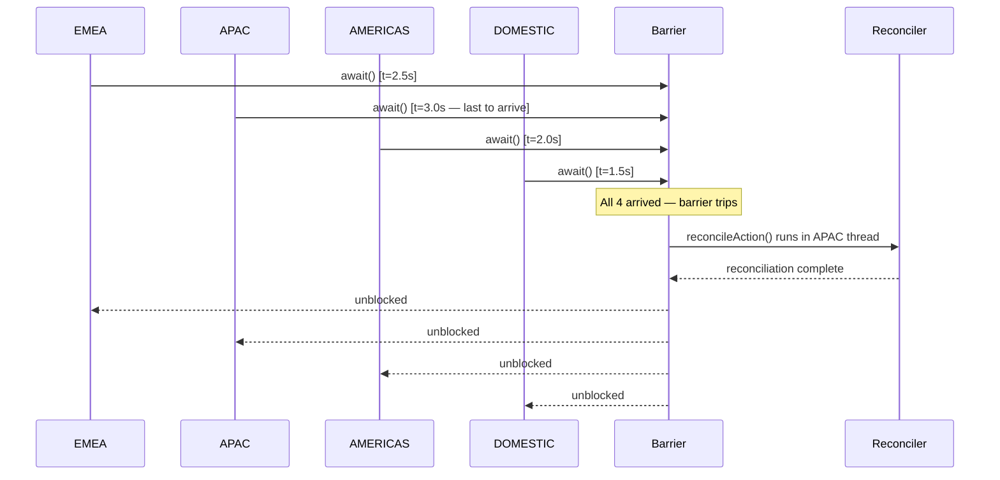
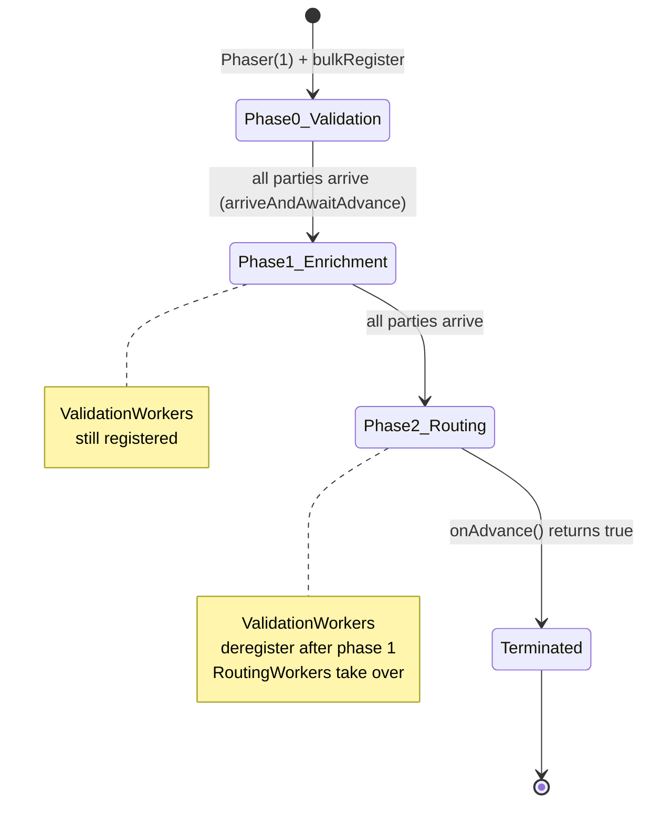
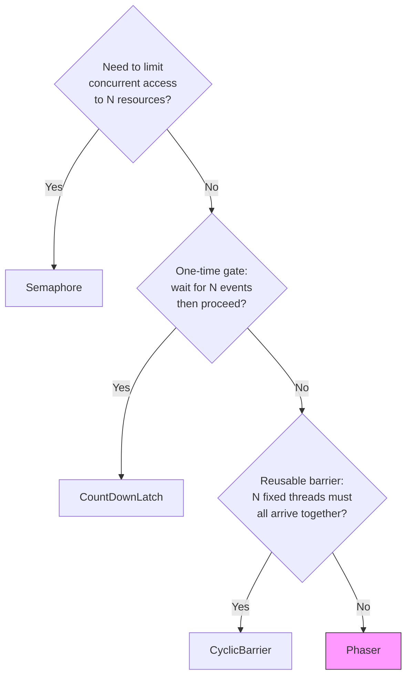

# أدوات المزامنة — Semaphore وCountDownLatch وCyclicBarrier وPhaser

## نظرة عامة

تمنح مجموعة أدوات المزامنة في `java.util.concurrent` المهندسين الرئيسيين أدوات تنسيق دقيقة وقابلة للتركيب تتجاوز الكلمة `synchronized` الخشنة. فكل صنف يرمّز *بروتوكول* تنسيق مختلفًا: من ينتظر من، وكم مرة، وهل يستطيع المشاركون الانضمام أو المغادرة ديناميكيًا. واختيار الأداة الخاطئة يؤدي إما إلى أخطاء صحة (استخدام مزلاج لمرة واحدة حيث يلزم حاجز قابل لإعادة الاستخدام) أو تعقيد غير ضروري (استخدام Phaser حيث يكفي Semaphore بسيط). وفي أنظمة الدفع والبنوك، تقع هذه الأدوات في صميم مسارات المعالجة الدفعية، وعملاء الواجهات المقيّدين بالمعدّل، ومنطق تسلسل البدء.

## أهداف التعلم

في نهاية هذا الدرس ستستطيع:

- تنفيذ Semaphore عادل لتقييد الاستدعاءات المتزامنة لواجهة كشف احتيال لدى طرف ثالث
- استخدام `CountDownLatch` كبوابة بدء لمرة واحدة تحجب معالجة المعاملات حتى تُنشأ كل اتصالات التغذية
- تنسيق معالجات التسوية الإقليمية في نهاية اليوم بـ `CyclicBarrier` وإجراء حاجز
- تصميم مسار دفع متعدد المراحل باستخدام `Phaser` مع تسجيل العمال وإلغاء تسجيلهم ديناميكيًا
- تحديد نمط الفشل المحدد الناتج عن استخدام `CountDownLatch` حيث يلزم `CyclicBarrier`
- اختيار أداة المزامنة المناسبة من مقارنة الأصناف الأربعة

## سياق العمل

يشغّل معالج مدفوعات أوروبي كبير ثلاثة مسارات عمل متمايزة تقابل مباشرة ثلاث أدوات مزامنة مختلفة. فخدمة تقييم الاحتيال لا يُسمح لها إلا بـ 10 استدعاءات تقييم متزامنة لمزوّد تعلم آلي خارجي بموجب عقد مستوى خدمة صارم — ويفرض ذلك Semaphore. وعند البدء، يجب أن ينتظر المحرك الدفعي تأكيد الاتصالات بثلاث شبكات مقاصة إقليمية قبل قبول تعليمات الدفع — ويحرس ذلك CountDownLatch. وينتهي كل يوم عمل بأربعة معالجات إقليمية يجب أن يُكمل كل منها تسويته الصافية المحلية قبل أن تعمل مطابقة دفتر الأستاذ الرئيسي — ويزامن ذلك CyclicBarrier. ولمسار تنسيق دفع جديد متعدد الخطوات أعداد عمال ديناميكية تتغير في كل مرحلة — وينسّق ذلك Phaser. وفي نهاية الدرس ستتعرف على كل نمط من النظرة الأولى.

## 1. ‏Semaphore — التحكم في الوصول إلى موارد محدودة

يحتفظ `Semaphore` بعدد ثابت من *التصاريح*. ويجب على أي خيط الحصول على تصريح قبل المتابعة وإعادته عند الانتهاء. وهذا يجعله مثاليًا لتقييد السعة: مجمّعات الاتصالات، وحدود استدعاءات الواجهات المتزامنة، والخدمات اللاحقة المقيدة بالمعدّل.

### الواجهة الأساسية

```java
Semaphore semaphore = new Semaphore(permits);         // create with N permits
semaphore.acquire();                                   // block until permit available
semaphore.acquire(n);                                  // acquire n permits atomically
semaphore.release();                                   // return permit
semaphore.release(n);                                  // return n permits
boolean acquired = semaphore.tryAcquire();             // non-blocking attempt
boolean acquired = semaphore.tryAcquire(500, TimeUnit.MILLISECONDS);  // try with timeout
int available    = semaphore.availablePermits();
```

### Semaphore العادل مقابل غير العادل

يقبل المُنشئ ذو المعاملين قيمة منطقية `fair`:

```java
// Non-fair (default) — higher throughput, potential thread starvation
Semaphore nonFair = new Semaphore(10, false);

// Fair — FIFO ordering, prevents starvation, slightly lower throughput
Semaphore fair    = new Semaphore(10, true);
```

> [!NOTE]
> في معالجة المدفوعات تهم العدالة. فإذا حرس Semaphore اتصالًا مشتركًا بمحرك تسعير واستخدمت Semaphore غير عادل، فقد تجوّع خيوط الدفعات التي تعيد الحصول على التصاريح باستمرار خيوط التفويض الآنية. ويمنع Semaphore العادل التجويع (ترتيب FIFO) — لكنه **لا** يعطي الخيوط الآنية أولوية: فهي ما زالت تصطف خلف خيوط الدفعات. وعندما يكون لفئتين من الحركة احتياجات زمن استجابة مختلفة، أعط كلًا منهما حصة تصاريح خاصة (مثل Semaphore منفصل للدفعات). ولاحظ أيضًا أن `tryAcquire()` دون مهلة يتجاهل العدالة ويتخطى الطابور؛ بينما يحترمها `tryAcquire(timeout, unit)`.

### مثال مالي — مقيّد معدّل لواجهة الاحتيال

ينص عقد مستوى خدمة تقييم الاحتيال مع مزوّد التعلم الآلي الخارجي على: لا أكثر من 10 طلبات متزامنة قيد التنفيذ في أي لحظة. وتجاوز ذلك يطلق ردود HTTP 429 وغرامات.

```java
import java.util.concurrent.Semaphore;
import java.util.concurrent.TimeUnit;
import java.util.concurrent.TimeoutException;

/**
 * Thread-safe client for the external fraud scoring API.
 * Enforces a hard limit of MAX_CONCURRENT_CALLS simultaneous in-flight requests.
 */
public class FraudScoringClient {

    private static final int MAX_CONCURRENT_CALLS = 10;
    private static final long ACQUIRE_TIMEOUT_MS  = 2_000;

    // Fair semaphore: authorisation threads must not starve behind batch threads
    private final Semaphore concurrencyGuard = new Semaphore(MAX_CONCURRENT_CALLS, true);

    private final FraudApiHttpClient httpClient;
    private final MeterRegistry      meterRegistry;

    public FraudScoringClient(FraudApiHttpClient httpClient, MeterRegistry meterRegistry) {
        this.httpClient    = httpClient;
        this.meterRegistry = meterRegistry;
        // Register the gauge ONCE — it samples availablePermits() on each scrape
        meterRegistry.gauge("fraud.semaphore.available", concurrencyGuard,
                            Semaphore::availablePermits);
    }

    /**
     * Score a payment for fraud risk.
     * Blocks if MAX_CONCURRENT_CALLS are already in-flight.
     * Throws TimeoutException if a permit cannot be obtained within 2 seconds.
     */
    public FraudScore score(PaymentRequest payment) throws TimeoutException, InterruptedException {
        boolean acquired = concurrencyGuard.tryAcquire(ACQUIRE_TIMEOUT_MS, TimeUnit.MILLISECONDS);
        if (!acquired) {
            meterRegistry.counter("fraud.semaphore.timeout").increment();
            throw new TimeoutException(
                "Fraud API semaphore timeout after " + ACQUIRE_TIMEOUT_MS + "ms — "
                + concurrencyGuard.getQueueLength() + " threads waiting");
        }

        try {
            return httpClient.postScoreRequest(payment);
        } finally {
            // ALWAYS release in finally — a permit leak will gradually starve all callers
            concurrencyGuard.release();
        }
    }

    /** Number of threads currently blocked waiting for a permit. */
    public int waitingThreadCount() {
        return concurrencyGuard.getQueueLength();
    }
}
```

يُسجّل مقياس `gauge` مرة واحدة في المُنشئ — فهو يقرأ `availablePermits()` عند كل جمع للمقاييس.

> [!WARNING]
> تسرب التصاريح قاتل صامت. فإذا لم يُستدعَ `release()` في كتلة `finally`، فكل مسار استثناء يخرج دون إعادة سيستنزف تصريحًا للأبد. ومع `MAX_CONCURRENT_CALLS = 10` و10 استثناءات غير معالجة، يتجمد النظام — فكل الاستدعاءات المستقبلية تُحجب إلى الأبد منتظرة تصاريح لا تعود أبدًا. اربط دائمًا `acquire` بـ `release` في `try/finally`.

### Semaphore كمجمّع اتصالات خفيف

```java
/**
 * A fixed-size pool of database connections guarded by a counting Semaphore.
 * (Teaching example — in production use HikariCP, which also validates
 *  and replaces broken connections.)
 */
public class LedgerConnectionPool {

    private final Semaphore        permits;
    // Thread-safe queue: several permit holders poll/offer at the same time.
    // (A plain ArrayDeque here would be a data race.)
    private final Queue<Connection> pool;

    public LedgerConnectionPool(int poolSize, DataSource dataSource) throws SQLException {
        this.permits = new Semaphore(poolSize, true);
        this.pool    = new ConcurrentLinkedQueue<>();
        for (int i = 0; i < poolSize; i++) {
            pool.add(dataSource.getConnection());
        }
    }

    public Connection acquire(long timeoutMs) throws InterruptedException, TimeoutException {
        if (!permits.tryAcquire(timeoutMs, TimeUnit.MILLISECONDS)) {
            throw new TimeoutException("Connection pool exhausted after " + timeoutMs + "ms");
        }
        // poll() is safe here: permit count equals pool size, so a connection is always present
        return pool.poll();
    }

    public void release(Connection conn) {
        pool.offer(conn);
        permits.release();
    }
}
```

هذا مثال تعليمي — وفي الإنتاج استخدم HikariCP الذي يتحقق أيضًا من الاتصالات المعطلة ويستبدلها. ولاحظ أن الطابور آمن للخيوط (`ConcurrentLinkedQueue`): فعدة حاملي تصاريح يسحبون ويعيدون في الوقت نفسه، و`ArrayDeque` العادي هنا سيكون سباق بيانات.

## 2. ‏CountDownLatch — بوابة بدء لمرة واحدة

يُهيأ `CountDownLatch` بعدد. وتُحجب الخيوط التي تستدعي `await()` حتى يصل العدد إلى الصفر عبر استدعاءات `countDown()` متكررة. وهو **لمرة واحدة**: فبمجرد وصوله إلى الصفر لا يمكن إعادة ضبطه.

### الواجهة الأساسية

```java
CountDownLatch latch = new CountDownLatch(3);  // gate requires 3 events

// Waiter thread:
latch.await();                                 // blocks until count == 0
latch.await(10, TimeUnit.SECONDS);             // blocks with timeout

// Worker threads:
latch.countDown();                             // decrement count by 1
long remaining = latch.getCount();             // current count (for diagnostics only)
```

> [!IMPORTANT]
> لا يمكن إعادة ضبط `CountDownLatch`. فإذا استدعيت `countDown()` ثلاث مرات على `new CountDownLatch(3)` ثم احتجت إلى بوابة من جديد، فيجب إنشاء نسخة جديدة. وهذا مقصود — فهو يفصل بوابات التهيئة لمرة واحدة عن نقاط التفتيش المتكررة. ومحاولة إعادة استخدام مزلاج بتتبع `getCount() == 0` ثم إنشاء واحد جديد حالة تسابق.

### مثال مالي — بوابة بدء المحرك الدفعي

يتصل المحرك الدفعي بثلاث شبكات مقاصة إقليمية (SEPA، وSWIFT، وACH) عند البدء. ويجب ألا تُقبل أي تعليمات دفع حتى تتأكد الاتصالات الثلاثة. و`CountDownLatch(3)` الأداة المعيارية لذلك.

```java
import java.util.Queue;
import java.util.concurrent.ConcurrentLinkedQueue;
import java.util.concurrent.CountDownLatch;
import java.util.concurrent.ExecutorService;
import java.util.concurrent.Executors;
import java.util.concurrent.TimeUnit;

public class BatchEngineStartup {

    private static final int    FEED_COUNT          = 3;
    private static final long   STARTUP_TIMEOUT_SEC = 30;

    private final CountDownLatch feedsReady = new CountDownLatch(FEED_COUNT);
    private final Queue<String>  failedFeeds = new ConcurrentLinkedQueue<>();

    public void start() throws InterruptedException {
        ExecutorService startupPool = Executors.newFixedThreadPool(FEED_COUNT);

        startupPool.submit(new FeedConnector("SEPA",  feedsReady, failedFeeds));
        startupPool.submit(new FeedConnector("SWIFT", feedsReady, failedFeeds));
        startupPool.submit(new FeedConnector("ACH",   feedsReady, failedFeeds));

        startupPool.shutdown();

        boolean allReported = feedsReady.await(STARTUP_TIMEOUT_SEC, TimeUnit.SECONDS);
        if (!allReported) {
            throw new IllegalStateException(
                "Batch engine startup timeout: " + feedsReady.getCount()
                + " feed(s) did not report within " + STARTUP_TIMEOUT_SEC + "s");
        }
        // Every feed reported — but a report can be a FAILURE. Check explicitly:
        // counting a failed connection as "ready" would open the gate wrongly
        if (!failedFeeds.isEmpty()) {
            throw new IllegalStateException("Feeds failed to connect: " + failedFeeds);
        }
        System.out.println("All feeds connected — batch engine accepting instructions");
    }

    // ---------------------------------------------------------------------------

    static class FeedConnector implements Runnable {

        private final String           networkName;
        private final CountDownLatch   latch;
        private final Queue<String>    failures;

        FeedConnector(String networkName, CountDownLatch latch, Queue<String> failures) {
            this.networkName = networkName;
            this.latch       = latch;
            this.failures    = failures;
        }

        @Override
        public void run() {
            try {
                connectToNetwork(networkName);     // blocks until TCP handshake completes
                System.out.println(networkName + " feed connected");
            } catch (Exception e) {
                // Record the failure so the caller fails fast instead of waiting
                // for the full timeout
                failures.add(networkName);
                System.err.println(networkName + " feed failed: " + e.getMessage());
            } finally {
                latch.countDown();   // "this feed has reported" — success OR failure
            }
        }

        private void connectToNetwork(String name) throws Exception {
            // Simulate network handshake latency
            Thread.sleep((long) (Math.random() * 2000) + 500);
            System.out.println("TCP handshake complete for " + name);
        }
    }
}
```

يعني `countDown()` هنا "هذه التغذية أبلغت" — نجاحًا **أو** فشلًا. لذلك يتحقق المستدعي صراحة من قائمة الإخفاقات بعد `await()`: فاحتساب اتصال فاشل على أنه "جاهز" سيفتح البوابة خطأً. وتسجيل الفشل يجعل المستدعي يفشل فورًا بدل انتظار المهلة كاملة.

### CountDownLatch كمسدس انطلاق (النمط المعكوس)

يمكن أيضًا استخدام المزلاج بالعكس: خيط تحكم واحد يعدّ تنازليًا، فيطلق خيوط عمل كثيرة في اللحظة نفسها. وهذا مفيد لاختبارات الحمل أو اختبارات الأداء المنسقة متعددة الخيوط:

```java
/**
 * Stress-test harness: 50 threads hammer the payment authorisation endpoint
 * simultaneously, all released at exactly the same moment.
 */
public class AuthorisationLoadTest {

    public void run() throws InterruptedException {
        int threadCount = 50;
        CountDownLatch ready      = new CountDownLatch(threadCount); // all at the gate
        CountDownLatch startGun   = new CountDownLatch(1);   // 1 controller releases all
        CountDownLatch allDone    = new CountDownLatch(threadCount);

        for (int i = 0; i < threadCount; i++) {
            final int txId = i;
            new Thread(() -> {
                try {
                    ready.countDown();
                    startGun.await();                        // all block here
                    submitAuthorisation("TXN-" + txId);
                } catch (InterruptedException e) {
                    Thread.currentThread().interrupt();
                } finally {
                    allDone.countDown();
                }
            }).start();
        }

        ready.await();             // every thread is at the gate (no guessing with sleep)
        startGun.countDown();      // release all 50 threads simultaneously
        allDone.await();           // wait for all results
        System.out.println("Load test complete");
    }

    private void submitAuthorisation(String txnId) {
        // ... call authorisation service
    }
}
```

يضمن مزلاج `ready` وصول كل الخيوط إلى البوابة — دون تخمين بـ `sleep`.

## 3. ‏CyclicBarrier — نقطة لقاء قابلة لإعادة الاستخدام لـ N طرفًا

يتطلب `CyclicBarrier` أن يستدعي N طرفًا (خيطًا) بالضبط `await()` قبل إطلاق أي منهم. وعلى خلاف `CountDownLatch` **يُعاد ضبطه تلقائيًا** بعد كل عبور، فيناسب المعالجة التكرارية المبنية على المراحل.

### الواجهة الأساسية

```java
// Basic barrier: 4 threads must all arrive before any proceed
CyclicBarrier barrier = new CyclicBarrier(4);

// Barrier with action: runs in the last-arriving thread before all are released
CyclicBarrier barrier = new CyclicBarrier(4, () -> runReconciliation());

// Called by each party to announce arrival and wait for the rest:
barrier.await();
barrier.await(5, TimeUnit.SECONDS);   // with timeout

// Diagnostic:
int waiting   = barrier.getNumberWaiting();
int parties   = barrier.getParties();
boolean broke = barrier.isBroken();

// Manual reset (use with extreme care):
barrier.reset();
```

> [!WARNING]
> استدعاء `barrier.reset()` بينما خيوط تنتظر يرمي `BrokenBarrierException` في كل الخيوط المنتظرة. لا تستدعِ `reset()` أبدًا كآلية "تعافٍ" من حاجز حي — فهو يسمم كل الخيوط المنتظرة. وتعامل مع الحاجز المكسور كحالة قاتلة تتطلب إعادة تشغيل المسار كاملًا.

### مثال مالي — التسوية الإقليمية في نهاية اليوم

أربعة معالجات تسوية إقليمية (EMEA، وAPAC، وAMERICAS، وDOMESTIC) يحسب كل منها مراكزه الصافية مستقلًا. ولا يمكن أن تبدأ مهمة المطابقة الرئيسية حتى يُكمل الأربعة دفعاتهم. وعند الحاجز: يشغّل إجراء الحاجز المطابقة في آخر خيط يصل.

```java
import java.util.concurrent.BrokenBarrierException;
import java.util.concurrent.CyclicBarrier;
import java.util.concurrent.ExecutorService;
import java.util.concurrent.Executors;

public class EndOfDaySettlement {

    private final LedgerReconciliationService reconciler;

    public EndOfDaySettlement(LedgerReconciliationService reconciler) {
        this.reconciler = reconciler;
    }

    public void runSettlement() {
        // Barrier action: runs once all 4 regions complete, in the last-arriving thread
        Runnable reconcileAction = () -> {
            System.out.println("[" + Thread.currentThread().getName()
                               + "] All regions settled — running master reconciliation");
            reconciler.reconcileMasterLedger();
        };

        CyclicBarrier settlementBarrier = new CyclicBarrier(4, reconcileAction);

        ExecutorService pool = Executors.newFixedThreadPool(4);
        for (String region : new String[]{"EMEA", "APAC", "AMERICAS", "DOMESTIC"}) {
            pool.submit(new RegionalSettlementProcessor(region, settlementBarrier));
        }
        pool.shutdown();
    }

    // ---------------------------------------------------------------------------

    static class RegionalSettlementProcessor implements Runnable {

        private final String         region;
        private final CyclicBarrier  barrier;

        RegionalSettlementProcessor(String region, CyclicBarrier barrier) {
            this.region  = region;
            this.barrier = barrier;
        }

        @Override
        public void run() {
            Thread.currentThread().setName("settler-" + region);
            try {
                System.out.println(region + ": computing net positions...");
                computeNetPositions(region);

                System.out.println(region + ": net positions ready — waiting at barrier");
                barrier.await();   // block until all 4 regions are ready

                // All threads unblocked here (after reconcileAction completes)
                System.out.println(region + ": continuing post-reconciliation work");
                postReconciliationTasks(region);

            } catch (InterruptedException e) {
                Thread.currentThread().interrupt();
                System.err.println(region + ": interrupted during settlement");
            } catch (BrokenBarrierException e) {
                // Another party threw an exception or barrier.reset() was called
                System.err.println(region + ": barrier broken — aborting settlement");
                // Trigger operational alert, escalate to ops team
            }
        }

        private void computeNetPositions(String region) throws InterruptedException {
            long processingMs = switch (region) {
                case "APAC"     -> 3_000;  // most positions
                case "EMEA"     -> 2_500;
                case "AMERICAS" -> 2_000;
                default         -> 1_500;
            };
            Thread.sleep(processingMs);
        }

        private void postReconciliationTasks(String region) {
            System.out.println(region + ": generating settlement reports");
        }
    }
}
```



### معنى "Cyclic" في CyclicBarrier

يُعاد ضبط الحاجز تلقائيًا بعد كل عبور. وهذا يتيح إعادة الاستخدام يومًا بعد يوم — فكائن الحاجز نفسه يستطيع تنسيق تسوية الاثنين، ثم الثلاثاء، وهكذا:

```java
// The same barrier object is reused across multiple settlement days
CyclicBarrier dailyBarrier = new CyclicBarrier(4, reconcileAction);

for (int day = 1; day <= 5; day++) {  // Monday through Friday
    System.out.println("=== Day " + day + " ===");
    for (String region : regions) {
        pool.submit(new RegionalSettlementProcessor(region, dailyBarrier));
    }
    // After all 4 arrive and reconcileAction runs, barrier resets for next day.
    // Wait for the day to finish before submitting the next one: the barrier
    // only counts arrivals, so with a larger pool it could group Monday's
    // EMEA with Tuesday's APAC
    waitForDayToComplete(day);
}
```

انتظر انتهاء اليوم قبل إرسال اليوم التالي: فالحاجز يعدّ الوصولات فقط، ومع مجمّع أكبر قد يجمع EMEA من يوم الاثنين مع APAC من يوم الثلاثاء.

> [!NOTE]
> يُضمن تشغيل إجراء الحاجز مرة واحدة بالضبط في كل عبور، في الخيط الذي كان آخر من استدعى `await()`. وليس بالضرورة الخيط نفسه في كل عبور. فلا تخزن في المتغيرات المحلية للخيط المستدعي حالة يحتاج إجراء الحاجز إلى قراءتها — مرر البيانات عبر حالة مشتركة متزامنة بشكل صحيح.

### معالجة BrokenBarrierException بشكل دفاعي

```java
private void processWithBarrier(CyclicBarrier barrier) {
    try {
        doWork();
        barrier.await(10, TimeUnit.SECONDS);
    } catch (TimeoutException e) {
        // This thread timed out — that ALREADY breaks the barrier: every other
        // waiter gets BrokenBarrierException. Do not call reset() here; reset
        // only after all parties have left, as part of a controlled restart
        throw new SettlementException("Regional processor timed out at barrier", e);
    } catch (BrokenBarrierException e) {
        // Another participant failed; this processor should also abort
        throw new SettlementException("Barrier broken by another region — aborting", e);
    } catch (InterruptedException e) {
        Thread.currentThread().interrupt();
        throw new SettlementException("Interrupted at barrier", e);
    }
}
```

انتهاء مهلة هذا الخيط **يكسر** الحاجز بالفعل: فيتلقى كل منتظر آخر `BrokenBarrierException`. فلا تستدعِ `reset()` هنا؛ وأعد الضبط فقط بعد مغادرة كل الأطراف، كجزء من إعادة تشغيل مضبوطة.

## 4. ‏Phaser — تنسيق مرن متعدد المراحل

‏`Phaser` أقوى أداة مزامنة في `java.util.concurrent`. فهو يعمم `CountDownLatch` (لمرة واحدة) و`CyclicBarrier` (دوري بأطراف ثابتة) بالسماح بـ:

- تسجيل الأطراف وإلغاء تسجيلها ديناميكيًا أثناء التشغيل
- مراحل متعددة مرقّمة
- شرط إنهاء اختياري عبر التوريث
- حالات الاستخدام لمرة واحدة والدورية معًا

### الواجهة الأساسية

```java
Phaser phaser = new Phaser(initialParties);

// Registration (dynamic)
phaser.register();                    // register one more party
phaser.bulkRegister(n);               // register n more parties

// Arrival
phaser.arrive();                      // arrive but do NOT wait
phaser.arriveAndAwaitAdvance();       // arrive and wait for all others (most common)
phaser.arriveAndDeregister();         // arrive and permanently deregister (reduce party count)

// Phase inspection
int phase     = phaser.getPhase();         // current phase number (0-based)
int parties   = phaser.getRegisteredParties();
int arrived   = phaser.getArrivedParties();
int unarrived = phaser.getUnarrivedParties();

// Waiting without arrival
phaser.awaitAdvance(phaseNumber);          // wait for a specific phase to complete
phaser.awaitAdvanceInterruptibly(phase, timeout, unit);

// Termination
boolean terminated = phaser.isTerminated();
// Terminate by returning true from onAdvance() (phase numbers then become negative):
// protected boolean onAdvance(int phase, int registeredParties) {
//     return phase >= MAX_PHASE || registeredParties == 0;
// }
```

### مثال مالي — مسار معالجة دفع متعدد الخطوات

لمسار تنسيق الدفع ثلاث مراحل: التحقق، والإثراء، والتوجيه. وتعالج خيوط العمل دفعات من تعليمات الدفع. ويشارك عمال التحقق-والإثراء في المرحلتين 0 و1 ثم يلغون تسجيلهم. أما عمال التوجيه فمسجّلون من البداية لكنهم لا يعملون إلا في المرحلة 2 — فيصلون دون انتظار في المراحل السابقة.

```java
import java.util.concurrent.Phaser;
import java.util.List;
import java.util.concurrent.ExecutorService;
import java.util.concurrent.Executors;

public class PaymentPipeline {

    private static final int PHASE_VALIDATION  = 0;
    private static final int PHASE_ENRICHMENT  = 1;
    private static final int PHASE_ROUTING     = 2;
    private static final int TOTAL_PHASES      = 3;

    public void process(List<PaymentInstruction> instructions) throws InterruptedException {

        // Create phaser with 1 registered party (the orchestrator thread itself)
        Phaser phaser = new Phaser(1) {
            @Override
            protected boolean onAdvance(int phase, int registeredParties) {
                System.out.printf("--- Phase %d complete, %d parties remain ---%n",
                                  phase, registeredParties);
                // Terminate after phase 2 (ROUTING), or if all workers deregistered
                return phase >= TOTAL_PHASES - 1 || registeredParties == 0;
            }
        };

        ExecutorService pool = Executors.newCachedThreadPool();

        // Register and submit validation workers (phases 0 and 1)
        int validationWorkerCount = 3;
        phaser.bulkRegister(validationWorkerCount);
        for (int i = 0; i < validationWorkerCount; i++) {
            final int workerId = i;
            pool.submit(new ValidationAndEnrichmentWorker(workerId, instructions, phaser));
        }

        // Register and submit routing-only workers (phase 2 only)
        int routingWorkerCount = 2;
        phaser.bulkRegister(routingWorkerCount);
        for (int i = 0; i < routingWorkerCount; i++) {
            final int workerId = i;
            pool.submit(new RoutingOnlyWorker(workerId, instructions, phaser));
        }

        // Orchestrator participates in phase synchronisation
        phaser.arriveAndAwaitAdvance();   // phase 0 → 1
        phaser.arriveAndAwaitAdvance();   // phase 1 → 2
        int last = phaser.arriveAndDeregister();   // leave in phase 2

        // Wait for phase 2 to finish (the phaser then terminates). awaitAdvance
        // works without being registered — no busy-wait loop needed
        phaser.awaitAdvance(last);
        pool.shutdown();
        System.out.println("Pipeline complete, final phase: " + phaser.getPhase());
    }
}
```

يشارك المنسّق في المرحلتين 0 و1، ثم يغادر في المرحلة 2 وينتظر انتهاءها بـ `awaitAdvance` — التي تعمل دون أن يكون مسجّلًا، فلا حاجة إلى حلقة انتظار مشغول.

```java
/**
 * Worker that participates in validation (phase 0) and enrichment (phase 1),
 * then deregisters before routing (phase 2).
 */
class ValidationAndEnrichmentWorker implements Runnable {

    private final int                        workerId;
    private final List<PaymentInstruction>   instructions;
    private final Phaser                     phaser;

    ValidationAndEnrichmentWorker(int id, List<PaymentInstruction> instructions, Phaser phaser) {
        this.workerId     = id;
        this.instructions = instructions;
        this.phaser       = phaser;
    }

    @Override
    public void run() {
        try {
            // Phase 0: Validation
            System.out.println("Worker-" + workerId + " validating payments");
            validatePayments(instructions);
            phaser.arriveAndAwaitAdvance();   // wait for all validation workers

            // Phase 1: Enrichment
            System.out.println("Worker-" + workerId + " enriching payments");
            enrichPayments(instructions);
            phaser.arriveAndAwaitAdvance();   // wait for all enrichment workers

            // Phase 2: This worker does not participate in routing
            System.out.println("Worker-" + workerId + " deregistering (no routing work)");
            phaser.arriveAndDeregister();     // reduces party count — routing phase unblocks sooner

        } catch (Exception e) {
            System.err.println("Worker-" + workerId + " failed: " + e.getMessage());
            phaser.arriveAndDeregister();     // must deregister on failure to avoid deadlock
        }
    }

    private void validatePayments(List<PaymentInstruction> instructions) throws InterruptedException {
        Thread.sleep(100);  // simulate validation work
    }

    private void enrichPayments(List<PaymentInstruction> instructions) throws InterruptedException {
        Thread.sleep(150);  // simulate BIC/IBAN enrichment
    }
}
```

```java
/**
 * Worker that skips phases 0 and 1 by advancing past them, then does routing.
 */
class RoutingOnlyWorker implements Runnable {

    private final int                        workerId;
    private final List<PaymentInstruction>   instructions;
    private final Phaser                     phaser;

    RoutingOnlyWorker(int id, List<PaymentInstruction> instructions, Phaser phaser) {
        this.workerId     = id;
        this.instructions = instructions;
        this.phaser       = phaser;
    }

    @Override
    public void run() {
        try {
            // Skip phase 0 and phase 1: arrive, then wait for THAT phase to end.
            // Use the phase number returned by arrive(): calling getPhase()
            // afterwards is a race — if we were the last to arrive, the phase
            // has already advanced and we would wait for the WRONG phase
            phaser.awaitAdvance(phaser.arrive());   // phase 0 → 1
            phaser.awaitAdvance(phaser.arrive());   // phase 1 → 2

            // Phase 2: Routing
            System.out.println("RoutingWorker-" + workerId + " routing payments");
            routePayments(instructions);
            phaser.arriveAndDeregister();

        } catch (Exception e) {
            System.err.println("RoutingWorker-" + workerId + " failed: " + e.getMessage());
            phaser.arriveAndDeregister();
        }
    }

    private void routePayments(List<PaymentInstruction> instructions) throws InterruptedException {
        Thread.sleep(200);  // simulate routing decisions
    }
}
```

يتخطى عامل التوجيه المرحلتين 0 و1: يصل ثم ينتظر انتهاء **تلك** المرحلة. ويستخدم رقم المرحلة الذي يعيده `arrive()`: فاستدعاء `getPhase()` بعده حالة تسابق — إذا كان آخر من يصل تكون المرحلة قد تقدمت بالفعل فينتظر المرحلة **الخطأ**.



### إنهاء Phaser عبر onAdvance

```java
/**
 * A Phaser that runs exactly N rounds of end-of-day settlement,
 * then terminates cleanly.
 */
Phaser weeklyPhaser = new Phaser(WORKER_COUNT) {
    @Override
    protected boolean onAdvance(int phase, int registeredParties) {
        // Terminate after 5 trading days, or if all workers have deregistered
        boolean fiveDaysComplete    = phase >= 4;    // phases 0–4 = Mon–Fri
        boolean allWorkersGone      = registeredParties == 0;
        boolean shouldTerminate     = fiveDaysComplete || allWorkersGone;

        if (shouldTerminate) {
            System.out.println("Weekly settlement cycle complete after phase " + phase);
        }
        return shouldTerminate;
    }
};
```

> [!IMPORTANT]
> ينتهي `Phaser` تلقائيًا عندما يصبح `registeredParties == 0` ما لم تُعِد كتابة `onAdvance()` لتعيد `false`. فعندما يستدعي عامل `arriveAndDeregister()` فيخفض عدد الأطراف إلى صفر، ينتهي الـ Phaser فورًا. وهذا مقصود — فـ Phaser بلا أطراف مسجلة لا عمل ذا معنى لديه لينسقه. فاحسب لذلك دائمًا حسابًا في المسارات متعددة المراحل التي قد يغادر فيها كل العمال مبكرًا.

## 5. خطأ شائع: CountDownLatch حيث يلزم CyclicBarrier

هذا من أشيع أخطاء التزامن في أنظمة الدفع الدفعية. والأعراض خفية: تعمل التسوية بشكل صحيح في اليوم الأول؛ وفي اليوم الثاني يكون المزلاج عند الصفر بالفعل، فيعود `await()` فورًا و**تعمل المطابقة قبل انتهاء المناطق** — بلا خطأ، بل بأرقام خاطئة.

```java
// BUG: CountDownLatch used for a recurring nightly settlement
public class BrokenSettlementCoordinator {

    // This latch can only count down to zero ONCE
    private final CountDownLatch latch = new CountDownLatch(4);

    public void runNightlySettlement(int dayNumber) throws InterruptedException {
        for (String region : regions) {
            pool.submit(() -> {
                processRegion(region);
                latch.countDown();   // Day 1: works correctly, counts 4→3→2→1→0
                                     // Day 2: latch is already at 0, countDown() is a no-op
                                     //        await() returns immediately on day 2 without
                                     //        waiting for all regions — CORRECTNESS BUG
            });
        }
        latch.await();   // Day 1: waits correctly
                         // Day 2: returns immediately because count is already 0
        reconcileMasterLedger();   // Day 2: runs BEFORE all regions complete — DATA CORRUPTION
    }
}
```

```java
// CORRECT: CyclicBarrier resets automatically after each trip
public class CorrectSettlementCoordinator {

    // Barrier automatically resets — safe for nightly reuse
    private final CyclicBarrier barrier = new CyclicBarrier(4, this::reconcileMasterLedger);

    public void runNightlySettlement(int dayNumber) {
        for (String region : regions) {
            pool.submit(() -> {
                try {
                    processRegion(region);
                    barrier.await();   // correct on day 1, day 2, day 3, ...
                } catch (BrokenBarrierException | InterruptedException e) {
                    handleSettlementFailure(region, e);
                }
            });
        }
        // Reconciliation runs as the barrier action — no separate await needed here.
        // If any region fails, the barrier stays BROKEN for every later night
        // until reset() — make recovery an explicit, monitored step
    }
}
```

إذا فشلت أي منطقة يبقى الحاجز **مكسورًا** لكل الليالي اللاحقة حتى `reset()` — فاجعل التعافي خطوة صريحة ومراقبة.

## 6. جدول مقارنة أدوات المزامنة

| الخاصية | Semaphore | CountDownLatch | CyclicBarrier | Phaser |
|---|---|---|---|---|
| **الغرض** | تقييد السعة | بوابة لمرة واحدة | نقطة لقاء لـ N طرفًا | تنسيق متعدد المراحل |
| **قابل لإعادة الاستخدام** | نعم | لا | نعم (إعادة ضبط تلقائية) | نعم (متعدد المراحل) |
| **أطراف ثابتة** | لا (N تصريحًا) | نعم (العدد) | نعم | لا (ديناميكي) |
| **إجراء الحاجز** | لا | لا | نعم (آخر خيط) | عبر `onAdvance()` |
| **الانضمام/المغادرة ديناميكيًا** | ضمني (acquire/release) | لا | لا | نعم (register/deregister) |
| **نموذج الانتظار** | توفر التصاريح | وصول العدد إلى الصفر | وصول كل الأطراف | تقدم المرحلة |
| **معالجة المقاطعة** | ‏`InterruptedException` | ‏`InterruptedException` | الخيط المقاطَع: `InterruptedException`؛ والمنتظرون الآخرون: `BrokenBarrierException` | ‏`arriveAndAwaitAdvance()` غير قابلة للمقاطعة؛ استخدم `awaitAdvanceInterruptibly()` |
| **الإنهاء** | لا ينطبق | ضمني (العدد=0) | يبقى مكسورًا بعد الفشل حتى `reset()` | ‏`onAdvance()` تعيد true (فتصبح أرقام المراحل سالبة) |
| **خيار العدالة** | نعم (`new Semaphore(n, true)`) | لا ينطبق | لا ينطبق | لا ينطبق |
| **أفضل حالة استخدام مالية** | تقييد معدّل الواجهات، ومجمّعات الاتصالات | بوابات البدء، وأدوات الاختبار | مراحل تسوية نهاية اليوم | مسارات الدفع متعددة الخطوات |



## اختبار المعرفة

**س1: ترسل خدمة كشف احتيال طلبات تقييم إلى واجهة تعلم آلي خارجية. وينص العقد على 20 طلبًا متزامنًا قيد التنفيذ كحد أقصى. وأحيانًا تصل 50 خيط تفويض دفع في اللحظة نفسها. ماذا يحدث إذا استخدمت `new Semaphore(20, false)` مقابل `new Semaphore(20, true)`، وأيهما أنسب هنا؟**

ج: مع Semaphore غير عادل (`false`)، قد يذهب التصريح المُحرّر إلى أي خيط — بما فيه خيط وصل للتو و"تخطى" الطابور. فإذا ظلت خيوط الدفعات تصل وتعيد الحصول على التصاريح، قد تتجوع خيوط التفويض الآنية. ومع Semaphore عادل (`true`) تُمنح التصاريح بترتيب FIFO، فلا ينتظر أي خيط إلى ما لا نهاية. وفي تفويض الدفع يكون Semaphore العادل الخيار الأكثر أمانًا، لكنه يكلف إنتاجية تحت التنافس الشديد (تسليمات خيوط أكثر) — فقِسها. والعدالة تمنع التجويع فقط؛ ولا تضع الاستدعاءات الآنية أولًا. فإذا تشاركت الحركة الآنية والدفعية الواجهة، أعط كلًا منهما حصة تصاريح خاصة.

**س2: يستخدم نظام تسوية نهاية اليوم `CyclicBarrier(4)` لتنسيق أربعة معالجات إقليمية. وأثناء تشغيل يوم الخميس يرمي معالج APAC استثناء `RuntimeException` غير ملتقط *قبل* أن يصل إلى `barrier.await()`. والثلاثة الآخرون ينتظرون عند الحاجز بالفعل. ماذا يحدث لهم؟**

ج: ينتظرون **إلى الأبد** (إذا استخدموا `await()` دون مهلة). فالحاجز لا يعلم أن APAC توقف — والخيط الذي لا يستدعي `await()` أبدًا لا يكسره. ولا ينكسر الحاجز إلا عندما يُقاطَع خيط منتظر أو تنتهي مهلته، أو عندما يرمي إجراء الحاجز استثناء، أو عند استدعاء `reset()`. لذا استخدم دائمًا `await(timeout, unit)`: فأول منتظر تنتهي مهلته يتلقى `TimeoutException` ويكسر الحاجز، ويتلقى المنتظرون الآخرون `BrokenBarrierException`. ويجب أن يلغوا عمل التسوية المحلي ويطلقوا تنبيهًا تشغيليًا. ويبقى الحاجز مكسورًا حتى `reset()` — فاستدعه فقط كجزء من إعادة تشغيل مضبوطة، بعد مغادرة كل الأطراف.

## التحدي العملي

### التحدي: معالج دفعات دفع واعٍ بالمخاطر

صمّم ونفّذ `RiskAwareBatchProcessor` ينسّق مهمة دفعية للمدفوعات بثلاث مراحل لمعالجة نهاية اليوم:

**المرحلة 0 — الاستيعاب والتحقق**: مجمّع من 4 عمال تحقق يقرأ سجلات الدفع من طابور، ويتحقق من الصيغة والحدود، ويكتب السجلات الصالحة في قائمة مشتركة. استخدم `Semaphore(2)` لتقييد الوصول المتزامن إلى واجهة الاحتيال اللاحقة أثناء التحقق — فلا يستدعي واجهة الاحتيال إلا تحققان في الوقت نفسه.

**المرحلة 1 — الإثراء**: ‏3 عمال إثراء يضيفون رموز BIC، وتفاصيل البنوك المراسلة، وأسعار الصرف لكل دفعة متحقق منها. وينضم هؤلاء العمال في المرحلة 1 ويلغون تسجيلهم بعد إكمال الإثراء.

**المرحلة 2 — توجيه التسوية**: عاملا توجيه يعيّنان كل دفعة لشبكة المقاصة الخاصة بها (SEPA، أو SWIFT، أو ACH). ولا يشارك هذان العاملان إلا في المرحلة 2.

**متطلبات التنسيق**:
- استخدم `Phaser` لتنسيق انتقالات المراحل
- استخدم `CountDownLatch(3)` لمنع الدفعة كلها من البدء حتى تتأكد ثلاث تغذيات أسعار خارجية (USD/EUR، وUSD/GBP، وUSD/CHF) من أنها حية (حاكِها بتأخير ثانية لكل تغذية)
- استخدم `CyclicBarrier(2)` داخل مرحلة التوجيه ليتزامن عاملا التوجيه قبل كتابة ملف التسوية النهائي — ويجب أن يسجّل إجراء الحاجز رسالة "routing complete"
- أعد كتابة `Phaser.onAdvance()` لتسجيل انتقالات المراحل والإنهاء بعد المرحلة 2

**المُخرَج**: صنف مستقل بطريقة `main()` يعرض المسار كاملًا. استخدم `System.out.println` مع أسماء الخيوط للمراقبة. ويجب أن تستخدم كل خطوة معالجة محاكاة `Thread.sleep()` بمدد نسبية واقعية (الإثراء أطول من التحقق). ويجب أن تطبع طريقة `main()` ملخصًا لعدد المدفوعات المعالجة في كل مرحلة.

<!-- KNOWLEDGE-CHECK
{
  "questions": [
    {
      "text": "يستخدم نظام تسوية نهاية اليوم CountDownLatch(4) لتنسيق أربعة معالجات إقليمية. وبعد عمله بشكل صحيح يوم الاثنين، تبدأ المطابقة الرئيسية يوم الثلاثاء قبل انتهاء المناطق. ما السبب الأرجح؟",
      "options": [
        "جُمع CountDownLatch كنفاية بين التشغيلين",
        "‏CountDownLatch أداة لمرة واحدة ولا يمكن إعادة استخدامها — فالعدد صفر بالفعل منذ تشغيل الاثنين، فيعود await() فورًا دون انتظار",
        "زاد تشغيل الثلاثاء عدد CountDownLatch فحدث فيض",
        "لا يدعم CountDownLatch استدعاء عدة خيوط لـ countDown() في الوقت نفسه"
      ],
      "correct": 1,
      "explanation": "‏CountDownLatch بوابة لمرة واحدة — فبمجرد وصول عدده إلى الصفر لا يُعاد ضبطه أبدًا. يوم الاثنين تخفضه أربعة استدعاءات countDown() إلى الصفر. ويوم الثلاثاء يكون العدد ما زال صفرًا من التشغيل السابق، فيعود await() فورًا دون انتظار اكتمال أي معالج. والأداة الصحيحة للتنسيق الدفعي المتكرر هي CyclicBarrier، الذي يُعاد ضبطه تلقائيًا بعد كل عبور."
    },
    {
      "text": "تستخدم خدمة كشف احتيال Semaphore(20, false) لتقييد الاستدعاءات المتزامنة لواجهة تعلم آلي خارجية. وتحت الحمل تتجوع خيوط تفويض الدفع الآنية بينما تحصل خيوط الدفعات على التصاريح باستمرار. ما التغيير الذي يعالج ذلك؟",
      "options": [
        "زد الـ Semaphore إلى Semaphore(50, false) لتقليل التنافس",
        "انتقل إلى Semaphore(20, true) لاستخدام ترتيب FIFO العادل، فيُمنع تجويع الخيوط المنتظرة",
        "استخدم CyclicBarrier(20) بدلًا منه لتنسيق تنفيذ الدفعات",
        "استبدله بقفل عادل ReentrantLock(true) لكل استدعاء واجهة"
      ],
      "correct": 1,
      "explanation": "قد يعطي Semaphore غير العادل (false) التصريح المُحرّر لأي خيط، بما فيه خيط وصل للتو. وتحت الحمل المستمر قد تتجوع الخيوط الآنية إذا ظلت خيوط الدفعات تحصل على التصاريح أولًا. ويمنح Semaphore العادل (true) التصاريح بترتيب FIFO، فلا ينتظر أي خيط إلى ما لا نهاية. وهو يكلف بعض الإنتاجية تحت التنافس الشديد، ولا يعطي الاستدعاءات الآنية أولوية — ولذلك أعط كل فئة حركة حصة تصاريح خاصة."
    },
    {
      "text": "يُستخدم Phaser لدفعة دفع بثلاث مراحل. وأثناء المرحلة 1 يرمي أحد العمال الخمسة استثناء غير ملتقط قبل استدعاء arriveAndAwaitAdvance(). ماذا يحدث للعمال الأربعة الآخرين المنتظرين في المرحلة 1؟",
      "options": [
        "يكتشف الـ Phaser الوصول المفقود ويتقدم تلقائيًا بعد مهلة",
        "ينتظر العمال الأربعة الآخرون إلى الأبد لأن الـ Phaser لا يتلقى الوصول الخامس أبدًا",
        "يرمي الـ Phaser استثناء BrokenBarrierException لكل العمال المنتظرين",
        "يخفض الـ Phaser عدد أطرافه تلقائيًا ويتقدم بأربعة أطراف"
      ],
      "correct": 1,
      "explanation": "على خلاف CyclicBarrier الذي له حالة 'مكسور'، لا يكتشف Phaser الوصول المفقود تلقائيًا. فإذا توقف طرف مسجّل دون استدعاء arriveAndAwaitAdvance() أو arriveAndDeregister()، لا يتقدم الـ Phaser أبدًا، وينتظر العمال الآخرون إلى الأبد. والإصلاح استخدام try/finally في كل عامل لضمان استدعاء arriveAndDeregister() دائمًا حتى عند الاستثناء، فيستطيع الـ Phaser التقدم بعدد أطراف أقل."
    }
  ]
}
-->

<!-- PRACTICAL-CHALLENGE
{
  "title": "معالج دفعات دفع واعٍ بالمخاطر",
  "difficulty": "advanced",
  "estimatedMinutes": 80,
  "tasks": [
    {
      "id": "1",
      "description": "نفّذ RiskAwareBatchProcessor ببوابة بدء CountDownLatch(3) تحجب الدفعة كلها حتى تؤكد ثلاث تغذيات أسعار خارجية (USD/EUR، وUSD/GBP، وUSD/CHF) أنها حية. وحاكِ تأكيد كل تغذية بتأخير ثانية على خيوط منفصلة. ويجب أن يُحجب الخيط الرئيسي عند المزلاج حتى تجهز التغذيات الثلاث قبل السماح لأي عامل بالبدء."
    },
    {
      "id": "2",
      "description": "نفّذ المسار الدفعي ثلاثي المراحل باستخدام Phaser. المرحلة 0: ‏4 عمال تحقق مع Semaphore(2) يقيّد استدعاءات واجهة الاحتيال المتزامنة باثنين في الوقت نفسه. المرحلة 1: ‏3 عمال إثراء يلغون تسجيلهم من الـ Phaser بعد اكتمال الإثراء. المرحلة 2: عاملا توجيه يشاركان في المرحلة 2 فقط. وأعد كتابة Phaser.onAdvance() لتسجيل كل انتقال مرحلة والإنهاء بعد المرحلة 2."
    },
    {
      "id": "3",
      "description": "نفّذ تنسيق مرحلة التوجيه باستخدام CyclicBarrier(2) ليتزامن عاملا التوجيه قبل كتابة ملف التسوية النهائي. ويجب أن يسجّل إجراء الحاجز 'routing complete' مع طابع زمني وعدد المدفوعات. وأضف مهلة 10 ثوانٍ لـ CyclicBarrier مع معالجة مناسبة لـ BrokenBarrierException تلغي التوجيه وتطلق تنبيهًا تشغيليًا."
    },
    {
      "id": "4",
      "description": "أضف تحمّل الأعطال: غلّف تفاعل كل عامل مع الـ Phaser في try/finally لضمان استدعاء arriveAndDeregister() دائمًا حتى عند الاستثناء، فيُمنع جمود العمال المنتظرين. واكتب اختبار تكامل يحاكي عامل مرحلة 1 يرمي RuntimeException أثناء المعالجة ويتحقق من أن: (أ) العمال الباقين يكملون بنجاح، (ب) ينتهي الـ Phaser بشكل نظيف، (ج) يُزاد عدّاد الأخطاء مرة واحدة بالضبط."
    }
  ]
}
-->
