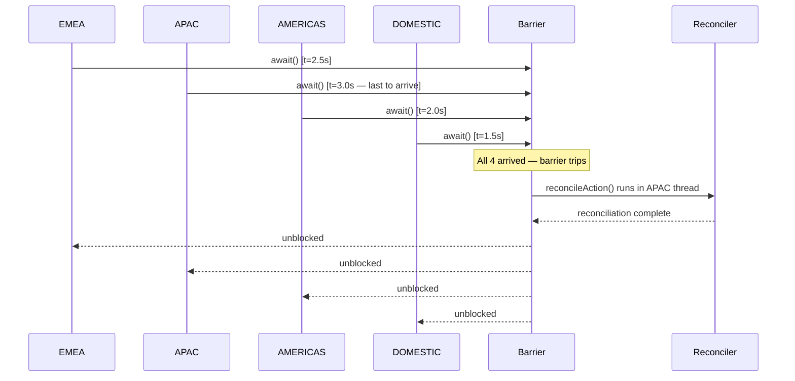
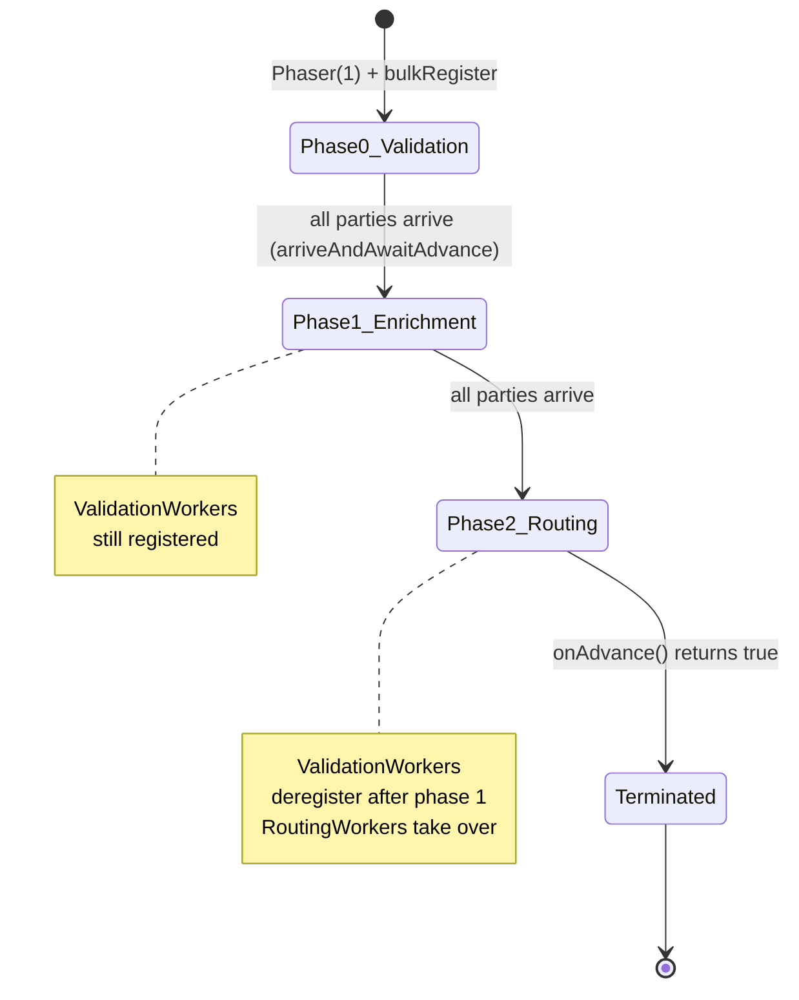
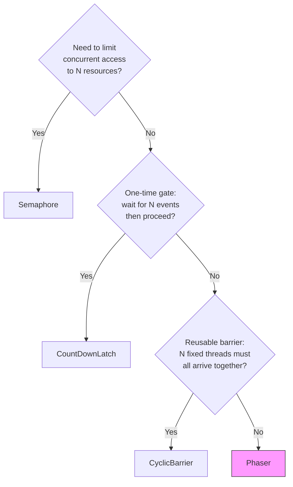

The `java.util.concurrent` synchronizer toolkit gives Principal Engineers precise, composable coordination primitives beyond the coarse-grained `synchronized` keyword. Each class encodes a different coordination *protocol*: who waits for whom, how many times, and whether participants can dynamically join or leave. Choosing the wrong primitive leads to either correctness failures (using a one-shot latch where a reusable barrier is needed) or unnecessary complexity (using a Phaser where a simple Semaphore suffices). In payments and banking systems, these primitives sit at the core of batch processing pipelines, API rate-limiting clients, and startup sequencing logic.

## Learning Objectives

By the end of this lesson you will be able to:

- Implement a fair Semaphore to rate-limit concurrent calls to a third-party fraud-detection API
- Use `CountDownLatch` as a one-shot startup gate that blocks transaction processing until all feed connections are established
- Coordinate end-of-day regional settlement processors with `CyclicBarrier` and a barrier action
- Design a multi-phase payment pipeline using `Phaser` with dynamic worker registration and deregistration
- Identify the specific failure mode that results from substituting a `CountDownLatch` where a `CyclicBarrier` is required
- Select the appropriate synchronizer from a comparison of all four classes

## Business Context

A large European payment processor runs three distinct workflows that map directly to three different synchronizers. The fraud-scoring service may only issue 10 concurrent scoring calls to its third-party ML provider under a strict SLA contract — a Semaphore enforces this. At startup, the batch engine must wait until connections to three regional clearing networks are confirmed before accepting payment instructions — a CountDownLatch gates this. Each business day closes with four regional processors that must each complete their local net settlement before the master ledger reconciliation can run — a CyclicBarrier synchronises this. A new multi-step payment orchestration pipeline has dynamic worker counts that change per phase — a Phaser coordinates this. By the end of this lesson you will recognise each pattern on sight.

## 1. Semaphore — Controlling Access to Limited Resources

A `Semaphore` maintains a fixed number of *permits*. Any thread must acquire a permit before proceeding and must release it when done. This makes it ideal for capacity throttling: connection pools, concurrent API call limits, and rate-limited downstream services.

### Core API

```java
Semaphore semaphore = new Semaphore(permits);         // create with N permits
semaphore.acquire();                                   // block until permit available
semaphore.acquire(n);                                  // acquire n permits atomically
semaphore.release();                                   // return permit
semaphore.release(n);                                  // return n permits
boolean acquired = semaphore.tryAcquire();             // non-blocking attempt
boolean acquired = semaphore.tryAcquire(500, MILLIS);  // try with timeout
int available    = semaphore.availablePermits();
```

### Fair vs Non-Fair Semaphore

The two-argument constructor accepts a `fair` boolean:

```java
// Non-fair (default) — higher throughput, potential thread starvation
Semaphore nonFair = new Semaphore(10, false);

// Fair — FIFO ordering, prevents starvation, slightly lower throughput
Semaphore fair    = new Semaphore(10, true);
```

> [!NOTE]
> In payment processing, fairness matters. If a Semaphore guards a shared pricing-engine connection and you use a non-fair semaphore, long-running batch threads can repeatedly re-acquire the permit while real-time authorisation threads starve. Use fair semaphores whenever latency guarantees span across thread populations with different priorities.

### Fintech Example — Fraud API Rate Limiter

The fraud-scoring SLA contract with the third-party ML provider states: no more than 10 concurrent in-flight requests at any point. Exceeding this triggers HTTP 429 responses and penalty fees.

```java
import java.util.concurrent.Semaphore;
import java.util.concurrent.TimeUnit;
import java.util.concurrent.TimeoutException;

/**
 * Thread-safe client for the external fraud scoring API.
 * Enforces a hard limit of MAX_CONCURRENT_CALLS simultaneous in-flight requests.
 */
public class FraudScoringClient {

    private static final int MAX_CONCURRENT_CALLS = 10;
    private static final long ACQUIRE_TIMEOUT_MS  = 2_000;

    // Fair semaphore: authorisation threads must not starve behind batch threads
    private final Semaphore concurrencyGuard = new Semaphore(MAX_CONCURRENT_CALLS, true);

    private final FraudApiHttpClient httpClient;
    private final MeterRegistry      meterRegistry;

    public FraudScoringClient(FraudApiHttpClient httpClient, MeterRegistry meterRegistry) {
        this.httpClient    = httpClient;
        this.meterRegistry = meterRegistry;
    }

    /**
     * Score a payment for fraud risk.
     * Blocks if MAX_CONCURRENT_CALLS are already in-flight.
     * Throws TimeoutException if a permit cannot be obtained within 2 seconds.
     */
    public FraudScore score(PaymentRequest payment) throws TimeoutException, InterruptedException {
        boolean acquired = concurrencyGuard.tryAcquire(ACQUIRE_TIMEOUT_MS, TimeUnit.MILLISECONDS);
        if (!acquired) {
            meterRegistry.counter("fraud.semaphore.timeout").increment();
            throw new TimeoutException(
                "Fraud API semaphore timeout after " + ACQUIRE_TIMEOUT_MS + "ms — "
                + concurrencyGuard.getQueueLength() + " threads waiting");
        }

        meterRegistry.gauge("fraud.semaphore.available", concurrencyGuard,
                            Semaphore::availablePermits);
        try {
            return httpClient.postScoreRequest(payment);
        } finally {
            // ALWAYS release in finally — a permit leak will gradually starve all callers
            concurrencyGuard.release();
        }
    }

    /** Number of threads currently blocked waiting for a permit. */
    public int waitingThreadCount() {
        return concurrencyGuard.getQueueLength();
    }
}
```

> [!WARNING]
> Permit leaks are a silent killer. If `release()` is not called in a `finally` block, every exception path that exits without releasing will drain one permit permanently. With `MAX_CONCURRENT_CALLS = 10` and 10 unhandled exceptions, the system deadlocks — all future calls block forever waiting for permits that are never returned. Always pair `acquire` with `release` in a `try/finally`.

### Semaphore as a Lightweight Connection Pool

```java
/**
 * A fixed-size pool of database connections guarded by a Semaphore.
 * Demonstrates binary (1-permit) and counting semaphore patterns.
 */
public class LedgerConnectionPool {

    private final Semaphore        permits;
    private final Queue<Connection> pool;

    public LedgerConnectionPool(int poolSize, DataSource dataSource) throws SQLException {
        this.permits = new Semaphore(poolSize, true);
        this.pool    = new ArrayDeque<>(poolSize);
        for (int i = 0; i < poolSize; i++) {
            pool.add(dataSource.getConnection());
        }
    }

    public Connection acquire(long timeoutMs) throws InterruptedException, TimeoutException {
        if (!permits.tryAcquire(timeoutMs, TimeUnit.MILLISECONDS)) {
            throw new TimeoutException("Connection pool exhausted after " + timeoutMs + "ms");
        }
        // poll() is safe here: permit count equals pool size, so a connection is always present
        return pool.poll();
    }

    public void release(Connection conn) {
        pool.offer(conn);
        permits.release();
    }
}
```

---

## 2. CountDownLatch — One-Shot Startup Gate

A `CountDownLatch` is initialised with a count. Threads calling `await()` block until the count reaches zero via repeated `countDown()` calls. It is **one-shot**: once it reaches zero it cannot be reset.

### Core API

```java
CountDownLatch latch = new CountDownLatch(3);  // gate requires 3 events

// Waiter thread:
latch.await();                                 // blocks until count == 0
latch.await(10, TimeUnit.SECONDS);             // blocks with timeout

// Worker threads:
latch.countDown();                             // decrement count by 1
long remaining = latch.getCount();             // current count (for diagnostics only)
```

> [!IMPORTANT]
> `CountDownLatch` cannot be reset. If you call `countDown()` three times on a `new CountDownLatch(3)` and then need to gate again, you must create a new instance. This is by design — it separates one-time initialisation gates from recurring checkpoints. Attempting to reuse a latch by tracking whether `getCount() == 0` and creating a new one is a race condition.

### Fintech Example — Batch Engine Startup Gate

The payment batch engine connects to three regional clearing networks (SEPA, SWIFT, ACH) at startup. No payment instructions should be accepted until all three connections are confirmed. A `CountDownLatch(3)` is the canonical tool.

```java
import java.util.concurrent.CountDownLatch;
import java.util.concurrent.ExecutorService;
import java.util.concurrent.Executors;
import java.util.concurrent.TimeUnit;

public class BatchEngineStartup {

    private static final int    FEED_COUNT          = 3;
    private static final long   STARTUP_TIMEOUT_SEC = 30;

    private final CountDownLatch feedsReady = new CountDownLatch(FEED_COUNT);

    public void start() throws InterruptedException {
        ExecutorService startupPool = Executors.newFixedThreadPool(FEED_COUNT);

        startupPool.submit(new FeedConnector("SEPA",  feedsReady));
        startupPool.submit(new FeedConnector("SWIFT", feedsReady));
        startupPool.submit(new FeedConnector("ACH",   feedsReady));

        startupPool.shutdown();

        boolean allUp = feedsReady.await(STARTUP_TIMEOUT_SEC, TimeUnit.SECONDS);
        if (!allUp) {
            throw new IllegalStateException(
                "Batch engine startup timeout: " + feedsReady.getCount()
                + " feed(s) did not connect within " + STARTUP_TIMEOUT_SEC + "s");
        }
        System.out.println("All feeds connected — batch engine accepting instructions");
    }

    // ---------------------------------------------------------------------------

    static class FeedConnector implements Runnable {

        private final String           networkName;
        private final CountDownLatch   latch;

        FeedConnector(String networkName, CountDownLatch latch) {
            this.networkName = networkName;
            this.latch       = latch;
        }

        @Override
        public void run() {
            try {
                connectToNetwork(networkName);     // blocks until TCP handshake completes
                System.out.println(networkName + " feed connected");
            } catch (Exception e) {
                // Log, alert, potentially trigger circuit breaker
                System.err.println(networkName + " feed failed: " + e.getMessage());
                // Note: we do NOT call countDown() here — the latch timeout will fire
            } finally {
                latch.countDown();   // signal regardless — let caller inspect getCount()
                                     // if failure should still unblock, call countDown() in catch
            }
        }

        private void connectToNetwork(String name) throws Exception {
            // Simulate network handshake latency
            Thread.sleep((long) (Math.random() * 2000) + 500);
            System.out.println("TCP handshake complete for " + name);
        }
    }
}
```

### CountDownLatch as a Starting Pistol (Reversed Pattern)

The latch can also be used in reverse: one controller thread counts down, releasing many worker threads simultaneously. This is useful for load tests or coordinated multi-thread benchmarks:

```java
/**
 * Stress-test harness: 50 threads hammer the payment authorisation endpoint
 * simultaneously, all released at exactly the same moment.
 */
public class AuthorisationLoadTest {

    public void run() throws InterruptedException {
        int threadCount = 50;
        CountDownLatch startGun   = new CountDownLatch(1);   // 1 controller releases all
        CountDownLatch allDone    = new CountDownLatch(threadCount);

        for (int i = 0; i < threadCount; i++) {
            final int txId = i;
            new Thread(() -> {
                try {
                    startGun.await();                        // all block here
                    submitAuthorisation("TXN-" + txId);
                } catch (InterruptedException e) {
                    Thread.currentThread().interrupt();
                } finally {
                    allDone.countDown();
                }
            }).start();
        }

        Thread.sleep(100);         // let all threads reach the gate
        startGun.countDown();      // release all 50 threads simultaneously
        allDone.await();           // wait for all results
        System.out.println("Load test complete");
    }

    private void submitAuthorisation(String txnId) {
        // ... call authorisation service
    }
}
```

---

## 3. CyclicBarrier — Reusable N-Party Rendezvous

A `CyclicBarrier` requires exactly N parties (threads) to call `await()` before any of them are released. Unlike `CountDownLatch`, it **resets automatically** after each barrier trip, making it suitable for iterative, phase-based processing.

### Core API

```java
// Basic barrier: 4 threads must all arrive before any proceed
CyclicBarrier barrier = new CyclicBarrier(4);

// Barrier with action: runs in the last-arriving thread before all are released
CyclicBarrier barrier = new CyclicBarrier(4, () -> runReconciliation());

// Called by each party to announce arrival and wait for the rest:
barrier.await();
barrier.await(5, TimeUnit.SECONDS);   // with timeout

// Diagnostic:
int waiting   = barrier.getNumberWaiting();
int parties   = barrier.getParties();
boolean broke = barrier.isBroken();

// Manual reset (use with extreme care):
barrier.reset();
```

> [!WARNING]
> `barrier.reset()` while threads are waiting throws `BrokenBarrierException` in all waiting threads. Never call `reset()` as a "recovery" mechanism from a live barrier — it poisons all waiting threads. Treat a broken barrier as a fatal state requiring full pipeline restart.

### Fintech Example — End-of-Day Regional Settlement

Four regional settlement processors (EMEA, APAC, AMERICAS, DOMESTIC) each compute their net positions independently. The master reconciliation job cannot begin until all four have completed their batch. At the barrier: the barrier action runs the reconciliation in the last thread to arrive.

```java
import java.util.concurrent.BrokenBarrierException;
import java.util.concurrent.CyclicBarrier;
import java.util.concurrent.ExecutorService;
import java.util.concurrent.Executors;

public class EndOfDaySettlement {

    private final LedgerReconciliationService reconciler;

    public EndOfDaySettlement(LedgerReconciliationService reconciler) {
        this.reconciler = reconciler;
    }

    public void runSettlement() {
        // Barrier action: runs once all 4 regions complete, in the last-arriving thread
        Runnable reconcileAction = () -> {
            System.out.println("[" + Thread.currentThread().getName()
                               + "] All regions settled — running master reconciliation");
            reconciler.reconcileMasterLedger();
        };

        CyclicBarrier settlementBarrier = new CyclicBarrier(4, reconcileAction);

        ExecutorService pool = Executors.newFixedThreadPool(4);
        for (String region : new String[]{"EMEA", "APAC", "AMERICAS", "DOMESTIC"}) {
            pool.submit(new RegionalSettlementProcessor(region, settlementBarrier));
        }
        pool.shutdown();
    }

    // ---------------------------------------------------------------------------

    static class RegionalSettlementProcessor implements Runnable {

        private final String         region;
        private final CyclicBarrier  barrier;

        RegionalSettlementProcessor(String region, CyclicBarrier barrier) {
            this.region  = region;
            this.barrier = barrier;
        }

        @Override
        public void run() {
            Thread.currentThread().setName("settler-" + region);
            try {
                System.out.println(region + ": computing net positions...");
                computeNetPositions(region);

                System.out.println(region + ": net positions ready — waiting at barrier");
                barrier.await();   // block until all 4 regions are ready

                // All threads unblocked here (after reconcileAction completes)
                System.out.println(region + ": continuing post-reconciliation work");
                postReconciliationTasks(region);

            } catch (InterruptedException e) {
                Thread.currentThread().interrupt();
                System.err.println(region + ": interrupted during settlement");
            } catch (BrokenBarrierException e) {
                // Another party threw an exception or barrier.reset() was called
                System.err.println(region + ": barrier broken — aborting settlement");
                // Trigger operational alert, escalate to ops team
            }
        }

        private void computeNetPositions(String region) throws InterruptedException {
            long processingMs = switch (region) {
                case "APAC"     -> 3_000;  // most positions
                case "EMEA"     -> 2_500;
                case "AMERICAS" -> 2_000;
                default         -> 1_500;
            };
            Thread.sleep(processingMs);
        }

        private void postReconciliationTasks(String region) {
            System.out.println(region + ": generating settlement reports");
        }
    }
}
```



### The "Cyclic" in CyclicBarrier

The barrier automatically resets after each trip. This enables day-over-day reuse — the same barrier object can coordinate Monday's settlement, Tuesday's settlement, and so on:

```java
// The same barrier object is reused across multiple settlement days
CyclicBarrier dailyBarrier = new CyclicBarrier(4, reconcileAction);

for (int day = 1; day <= 5; day++) {  // Monday through Friday
    System.out.println("=== Day " + day + " ===");
    for (String region : regions) {
        pool.submit(new RegionalSettlementProcessor(region, dailyBarrier));
    }
    // After all 4 arrive and reconcileAction runs, barrier resets for next day
}
```

> [!NOTE]
> The barrier action is guaranteed to run exactly once per barrier trip, in the thread that was last to call `await()`. This is not necessarily the same thread each trip. Do not store state in the calling thread's local variables that the barrier action needs to read — pass data through shared, properly synchronised state.

### Handling BrokenBarrierException Defensively

```java
private void processWithBarrier(CyclicBarrier barrier) {
    try {
        doWork();
        barrier.await(10, TimeUnit.SECONDS);
    } catch (TimeoutException e) {
        // This thread timed out — this also breaks the barrier for all other waiters
        barrier.reset();   // only safe if you can guarantee no other thread is mid-await
        throw new SettlementException("Regional processor timed out at barrier", e);
    } catch (BrokenBarrierException e) {
        // Another participant failed; this processor should also abort
        throw new SettlementException("Barrier broken by another region — aborting", e);
    } catch (InterruptedException e) {
        Thread.currentThread().interrupt();
        throw new SettlementException("Interrupted at barrier", e);
    }
}
```

---

## 4. Phaser — Flexible Multi-Phase Coordination

`Phaser` is the most powerful synchronizer in `java.util.concurrent`. It generalises both `CountDownLatch` (one-shot) and `CyclicBarrier` (fixed-party cyclic) by allowing:

- Dynamic party registration and deregistration at runtime
- Multiple numbered phases
- Optional termination condition via subclassing
- Both one-shot and cyclic use cases

### Core API

```java
Phaser phaser = new Phaser(initialParties);

// Registration (dynamic)
phaser.register();                    // register one more party
phaser.bulkRegister(n);               // register n more parties

// Arrival
phaser.arrive();                      // arrive but do NOT wait
phaser.arriveAndAwaitAdvance();       // arrive and wait for all others (most common)
phaser.arriveAndDeregister();         // arrive and permanently deregister (reduce party count)

// Phase inspection
int phase     = phaser.getPhase();         // current phase number (0-based)
int parties   = phaser.getRegisteredParties();
int arrived   = phaser.getArrivedParties();
int unarrived = phaser.getUnarrivedParties();

// Waiting without arrival
phaser.awaitAdvance(phaseNumber);          // wait for a specific phase to complete
phaser.awaitAdvanceInterruptibly(phase, timeout, unit);

// Termination
boolean terminated = phaser.isTerminated();
// Terminate by returning negative phase from onAdvance():
// protected boolean onAdvance(int phase, int registeredParties) {
//     return phase >= MAX_PHASE || registeredParties == 0;
// }
```

### Fintech Example — Multi-Step Payment Processing Pipeline

A payment orchestration pipeline has three phases: validation, enrichment, and routing. Worker threads process batches of payment instructions. Some workers handle only validation (they deregister after phase 0). A dynamic set of enrichment workers joins at phase 1.

```java
import java.util.concurrent.Phaser;
import java.util.List;
import java.util.concurrent.ExecutorService;
import java.util.concurrent.Executors;

public class PaymentPipeline {

    private static final int PHASE_VALIDATION  = 0;
    private static final int PHASE_ENRICHMENT  = 1;
    private static final int PHASE_ROUTING     = 2;
    private static final int TOTAL_PHASES      = 3;

    public void process(List<PaymentInstruction> instructions) throws InterruptedException {

        // Create phaser with 1 registered party (the orchestrator thread itself)
        Phaser phaser = new Phaser(1) {
            @Override
            protected boolean onAdvance(int phase, int registeredParties) {
                System.out.printf("--- Phase %d complete, %d parties remain ---%n",
                                  phase, registeredParties);
                // Terminate after phase 2 (ROUTING), or if all workers deregistered
                return phase >= TOTAL_PHASES - 1 || registeredParties == 0;
            }
        };

        ExecutorService pool = Executors.newCachedThreadPool();

        // Register and submit validation workers (phases 0 and 1)
        int validationWorkerCount = 3;
        phaser.bulkRegister(validationWorkerCount);
        for (int i = 0; i < validationWorkerCount; i++) {
            final int workerId = i;
            pool.submit(new ValidationAndEnrichmentWorker(workerId, instructions, phaser));
        }

        // Register and submit routing-only workers (phase 2 only)
        int routingWorkerCount = 2;
        phaser.bulkRegister(routingWorkerCount);
        for (int i = 0; i < routingWorkerCount; i++) {
            final int workerId = i;
            pool.submit(new RoutingOnlyWorker(workerId, instructions, phaser));
        }

        // Orchestrator participates in phase synchronisation
        phaser.arriveAndAwaitAdvance();   // phase 0 → 1
        phaser.arriveAndAwaitAdvance();   // phase 1 → 2
        phaser.arriveAndDeregister();     // orchestrator exits after phase 2 setup

        // Wait for pipeline termination
        while (!phaser.isTerminated()) {
            Thread.sleep(50);
        }
        pool.shutdown();
        System.out.println("Pipeline complete, final phase: " + phaser.getPhase());
    }
}
```

```java
/**
 * Worker that participates in validation (phase 0) and enrichment (phase 1),
 * then deregisters before routing (phase 2).
 */
class ValidationAndEnrichmentWorker implements Runnable {

    private final int                        workerId;
    private final List<PaymentInstruction>   instructions;
    private final Phaser                     phaser;

    ValidationAndEnrichmentWorker(int id, List<PaymentInstruction> instructions, Phaser phaser) {
        this.workerId     = id;
        this.instructions = instructions;
        this.phaser       = phaser;
    }

    @Override
    public void run() {
        try {
            // Phase 0: Validation
            System.out.println("Worker-" + workerId + " validating payments");
            validatePayments(instructions);
            phaser.arriveAndAwaitAdvance();   // wait for all validation workers

            // Phase 1: Enrichment
            System.out.println("Worker-" + workerId + " enriching payments");
            enrichPayments(instructions);
            phaser.arriveAndAwaitAdvance();   // wait for all enrichment workers

            // Phase 2: This worker does not participate in routing
            System.out.println("Worker-" + workerId + " deregistering (no routing work)");
            phaser.arriveAndDeregister();     // reduces party count — routing phase unblocks sooner

        } catch (Exception e) {
            System.err.println("Worker-" + workerId + " failed: " + e.getMessage());
            phaser.arriveAndDeregister();     // must deregister on failure to avoid deadlock
        }
    }

    private void validatePayments(List<PaymentInstruction> instructions) throws InterruptedException {
        Thread.sleep(100);  // simulate validation work
    }

    private void enrichPayments(List<PaymentInstruction> instructions) throws InterruptedException {
        Thread.sleep(150);  // simulate BIC/IBAN enrichment
    }
}
```

```java
/**
 * Worker that skips phases 0 and 1 by advancing past them, then does routing.
 */
class RoutingOnlyWorker implements Runnable {

    private final int                        workerId;
    private final List<PaymentInstruction>   instructions;
    private final Phaser                     phaser;

    RoutingOnlyWorker(int id, List<PaymentInstruction> instructions, Phaser phaser) {
        this.workerId     = id;
        this.instructions = instructions;
        this.phaser       = phaser;
    }

    @Override
    public void run() {
        try {
            // Skip phase 0 and phase 1 by arriving without blocking
            phaser.arrive();   // phase 0: arrive but don't await
            phaser.awaitAdvance(phaser.getPhase());   // wait passively for phase 1 to start
            phaser.arrive();   // phase 1: arrive but don't await
            phaser.awaitAdvance(phaser.getPhase());   // wait passively for phase 2 to start

            // Phase 2: Routing
            System.out.println("RoutingWorker-" + workerId + " routing payments");
            routePayments(instructions);
            phaser.arriveAndDeregister();

        } catch (Exception e) {
            System.err.println("RoutingWorker-" + workerId + " failed: " + e.getMessage());
            phaser.arriveAndDeregister();
        }
    }

    private void routePayments(List<PaymentInstruction> instructions) throws InterruptedException {
        Thread.sleep(200);  // simulate routing decisions
    }
}
```



### Phaser Termination via onAdvance

```java
/**
 * A Phaser that runs exactly N rounds of end-of-day settlement,
 * then terminates cleanly.
 */
Phaser weeklyPhaser = new Phaser(WORKER_COUNT) {
    @Override
    protected boolean onAdvance(int phase, int registeredParties) {
        // Terminate after 5 trading days, or if all workers have deregistered
        boolean fiveDaysComplete    = phase >= 4;    // phases 0–4 = Mon–Fri
        boolean allWorkersGone      = registeredParties == 0;
        boolean shouldTerminate     = fiveDaysComplete || allWorkersGone;

        if (shouldTerminate) {
            System.out.println("Weekly settlement cycle complete after phase " + phase);
        }
        return shouldTerminate;
    }
};
```

> [!IMPORTANT]
> A `Phaser` with `registeredParties == 0` auto-terminates unless `onAdvance()` is overridden to return `false`. When a worker calls `arriveAndDeregister()` and reduces the party count to zero, the phaser terminates immediately. This is intentional — a phaser with no registered parties has no meaningful work to coordinate. Always account for this in multi-phase pipelines where all workers might exit early.

---

## 5. Common Mistake: CountDownLatch Where CyclicBarrier Is Needed

This is one of the most common concurrency bugs in batch payment systems. The symptoms are subtle: settlement runs correctly on the first day, then hangs forever on the second day.

```java
// BUG: CountDownLatch used for a recurring nightly settlement
public class BrokenSettlementCoordinator {

    // This latch can only count down to zero ONCE
    private final CountDownLatch latch = new CountDownLatch(4);

    public void runNightlySettlement(int dayNumber) throws InterruptedException {
        for (String region : regions) {
            pool.submit(() -> {
                processRegion(region);
                latch.countDown();   // Day 1: works correctly, counts 4→3→2→1→0
                                     // Day 2: latch is already at 0, countDown() is a no-op
                                     //        await() returns immediately on day 2 without
                                     //        waiting for all regions — CORRECTNESS BUG
            });
        }
        latch.await();   // Day 1: waits correctly
                         // Day 2: returns immediately because count is already 0
        reconcileMasterLedger();   // Day 2: runs BEFORE all regions complete — DATA CORRUPTION
    }
}
```

```java
// CORRECT: CyclicBarrier resets automatically after each trip
public class CorrectSettlementCoordinator {

    // Barrier automatically resets — safe for nightly reuse
    private final CyclicBarrier barrier = new CyclicBarrier(4, this::reconcileMasterLedger);

    public void runNightlySettlement(int dayNumber) {
        for (String region : regions) {
            pool.submit(() -> {
                try {
                    processRegion(region);
                    barrier.await();   // correct on day 1, day 2, day 3, ...
                } catch (BrokenBarrierException | InterruptedException e) {
                    handleSettlementFailure(region, e);
                }
            });
        }
        // Reconciliation runs as the barrier action — no separate await needed here
    }
}
```

---

## 6. Synchronizer Comparison Table

| Feature | Semaphore | CountDownLatch | CyclicBarrier | Phaser |
|---|---|---|---|---|
| **Purpose** | Capacity throttle | One-shot gate | N-party rendezvous | Multi-phase coordination |
| **Reusable** | Yes | No | Yes (auto-reset) | Yes (multi-phase) |
| **Fixed parties** | No (N permits) | Yes (count) | Yes | No (dynamic) |
| **Barrier action** | No | No | Yes (last thread) | Via `onAdvance()` |
| **Dynamic join/leave** | Implicit (acquire/release) | No | No | Yes (register/deregister) |
| **Waiting model** | Permit availability | Count reaches zero | All parties arrive | Phase advance |
| **Interrupt handling** | `InterruptedException` | `InterruptedException` | `BrokenBarrierException` | Returns negative phase |
| **Termination** | Manual (drain permits) | Implicit (count=0) | Manual or broken | `onAdvance()` returns true |
| **Fairness option** | Yes (`new Semaphore(n, true)`) | N/A | N/A | N/A |
| **Best fintech use case** | API rate limiting, connection pools | Startup gates, test harnesses | End-of-day settlement phases | Multi-step payment pipelines |



---

## Knowledge Check

**Q1: A fraud detection service issues scoring requests to an external ML API. The contract states a maximum of 20 concurrent in-flight requests. Occasionally, 50 payment authorisation threads all arrive simultaneously. What happens if you use `new Semaphore(20, false)` versus `new Semaphore(20, true)`, and which is more appropriate here?**

A: With a non-fair semaphore (`false`), when a permit is released the JVM can grant it to any waiting thread — including one that just arrived. This can cause high-priority real-time authorisation threads to starve if a wave of batch threads is constantly arriving and re-acquiring permits. With a fair semaphore (`true`), permits are granted in FIFO order, guaranteeing that no thread waits indefinitely. For payment authorisation, where customer-facing latency SLAs apply, the fair semaphore is more appropriate despite its slightly lower throughput. The throughput difference is typically less than 5% under moderate contention, while starvation prevention is a hard correctness requirement for real-time payments.

**Q2: An end-of-day settlement system uses a `CyclicBarrier(4)` to coordinate four regional processors. During a Thursday run, the APAC processor throws an uncaught `RuntimeException` after calling `barrier.await()` but before all four have arrived. What happens to the other three processors waiting at the barrier?**

A: When a thread's `await()` call is interrupted, times out, or the barrier is broken, `BrokenBarrierException` is thrown to all currently waiting threads and to any thread that subsequently calls `await()` while the barrier is in the broken state. In this case, the APAC thread's exception causes the barrier to be marked broken. The three waiting threads (EMEA, AMERICAS, DOMESTIC) each receive a `BrokenBarrierException`. They must catch this exception, abort their local settlement work, and trigger an operational alert. The barrier remains broken until `barrier.reset()` is called — which should only happen after all participant threads have been confirmed to have exited the barrier, otherwise `reset()` itself throws `BrokenBarrierException` in remaining waiters.

---

## Practical Challenge

### Challenge: Risk-Aware Payment Batch Processor

Design and implement a `RiskAwareBatchProcessor` that orchestrates a three-phase payment batch job for end-of-day processing:

**Phase 0 — Ingestion and Validation**: A pool of 4 validation workers reads payment records from a queue, validates format and limits, and writes valid records to a shared list. Use a `Semaphore(2)` to limit concurrent access to the downstream fraud API during validation — only 2 validations may call the fraud API simultaneously.

**Phase 1 — Enrichment**: 3 enrichment workers add BIC codes, correspondent bank details, and FX rates to each validated payment. These workers join at phase 1 and deregister after completing enrichment.

**Phase 2 — Settlement Routing**: 2 routing workers assign each payment to its clearing network (SEPA, SWIFT, or ACH). These workers participate only in phase 2.

**Coordination requirements**:
- Use a `Phaser` to coordinate phase transitions
- Use a `CountDownLatch(3)` to gate the entire batch from starting until three external price feeds (USD/EUR, USD/GBP, USD/CHF) have been confirmed as live (simulate with a 1-second delay per feed)
- Use a `CyclicBarrier(2)` within the routing phase for the two routing workers to synchronise before writing the final settlement file — the barrier action should log a "routing complete" message
- Override `Phaser.onAdvance()` to log phase transitions and terminate after phase 2

**Deliverable**: A self-contained class with a `main()` method that demonstrates the full pipeline. Use `System.out.println` with thread names for observability. Each simulated processing step should use `Thread.sleep()` with realistic relative durations (enrichment should take longer than validation). The `main()` method should print a summary of how many payments were processed per phase.

<!-- KNOWLEDGE-CHECK
{
  "questions": [
    {
      "text": "An end-of-day settlement system uses CountDownLatch(4) to coordinate four regional processors. After running correctly on Monday, the system hangs on Tuesday. What is the most likely cause?",
      "options": [
        "The CountDownLatch was garbage collected between runs",
        "CountDownLatch is a one-shot primitive and cannot be reused — the latch count is already zero from Monday's run, so await() returns immediately without waiting",
        "The CountDownLatch's count was incremented by the Tuesday run, causing an overflow",
        "CountDownLatch does not support multiple threads calling countDown() concurrently"
      ],
      "correct": 1,
      "explanation": "CountDownLatch is a one-shot gate — once its count reaches zero, it never resets. On Monday, four countDown() calls bring it to zero. On Tuesday, the count is still zero from the previous run, so await() returns immediately without waiting for any processors to complete. The correct primitive for recurring batch coordination is CyclicBarrier, which automatically resets after each trip."
    },
    {
      "text": "A fraud detection service uses Semaphore(20, false) to limit concurrent calls to an external ML API. Under load, real-time payment authorisation threads starve while batch threads continuously acquire permits. What change addresses this?",
      "options": [
        "Increase the semaphore to Semaphore(50, false) to reduce contention",
        "Change to Semaphore(20, true) to use fair FIFO ordering, preventing starvation of waiting threads",
        "Use a CyclicBarrier(20) instead to coordinate batch execution",
        "Replace with a ReentrantLock(true) fair lock for each API call"
      ],
      "correct": 1,
      "explanation": "A non-fair semaphore (false) can grant permits to any waiting thread, including newly arrived ones. Under sustained load, real-time threads can starve if batch threads continuously acquire and release permits before real-time threads get a turn. A fair semaphore (true) grants permits in FIFO arrival order, guaranteeing that no thread waits indefinitely. The throughput difference is typically less than 5% under moderate contention."
    },
    {
      "text": "A Phaser is used for a 3-phase payment batch. During phase 1, one of 5 workers throws an uncaught exception before calling arriveAndAwaitAdvance(). What happens to the other 4 workers waiting at phase 1?",
      "options": [
        "The phaser detects the missing arrival and automatically advances after a timeout",
        "The other 4 workers wait indefinitely because the phaser never receives the 5th arrival",
        "The phaser throws BrokenBarrierException to all waiting workers",
        "The phaser reduces its party count automatically and advances with 4 parties"
      ],
      "correct": 1,
      "explanation": "Unlike CyclicBarrier which has a 'broken' state, Phaser does not automatically detect a missing arrival. If a registered party dies without calling arriveAndAwaitAdvance() or arriveAndDeregister(), the phaser simply never advances. The other workers wait indefinitely. The fix is to use try/finally in every worker to ensure arriveAndDeregister() is always called even on exception, so the phaser can advance with a reduced party count."
    }
  ]
}
-->

<!-- PRACTICAL-CHALLENGE
{
  "title": "Risk-Aware Payment Batch Processor",
  "difficulty": "advanced",
  "estimatedMinutes": 80,
  "tasks": [
    {"id": "1", "description": "Implement a RiskAwareBatchProcessor with a CountDownLatch(3) startup gate that blocks the entire batch until three external price feeds (USD/EUR, USD/GBP, USD/CHF) confirm they are live. Simulate each feed confirmation with a 1-second delay on separate threads. The main thread must block at the latch until all three feeds are ready before allowing any workers to start."},
    {"id": "2", "description": "Implement the three-phase batch pipeline using a Phaser. Phase 0: 4 validation workers with a Semaphore(2) limiting concurrent fraud API calls to 2 at a time. Phase 1: 3 enrichment workers that deregister from the phaser after enrichment completes. Phase 2: 2 routing workers that participate only in phase 2. Override Phaser.onAdvance() to log each phase transition and terminate after phase 2."},
    {"id": "3", "description": "Implement the routing phase coordination using a CyclicBarrier(2) so the two routing workers synchronise before writing the final settlement file. The barrier action must log 'routing complete' with a timestamp and payment count. Add a CyclicBarrier timeout of 10 seconds with appropriate BrokenBarrierException handling that aborts routing and triggers an operational alert."},
    {"id": "4", "description": "Add fault tolerance: wrap every worker's phaser interaction in try/finally to guarantee arriveAndDeregister() is always called even on exception, preventing deadlock of waiting workers. Write an integration test that simulates a phase 1 worker throwing a RuntimeException mid-processing and verifies that: (a) the remaining workers complete successfully, (b) the phaser terminates cleanly, and (c) an error counter is incremented exactly once."}
  ]
}
-->
