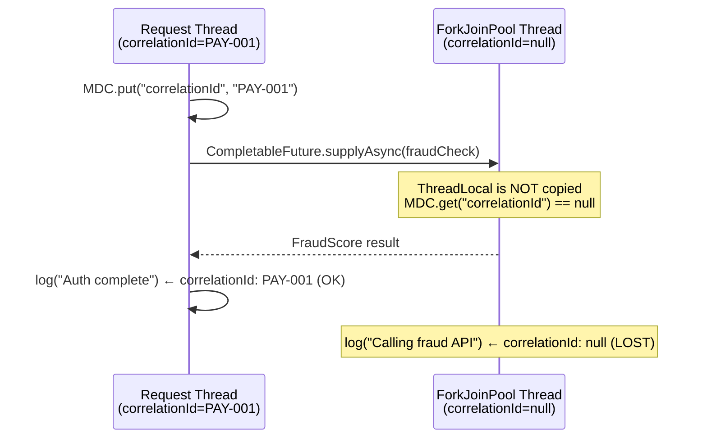
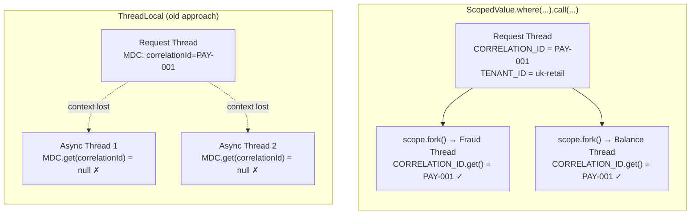
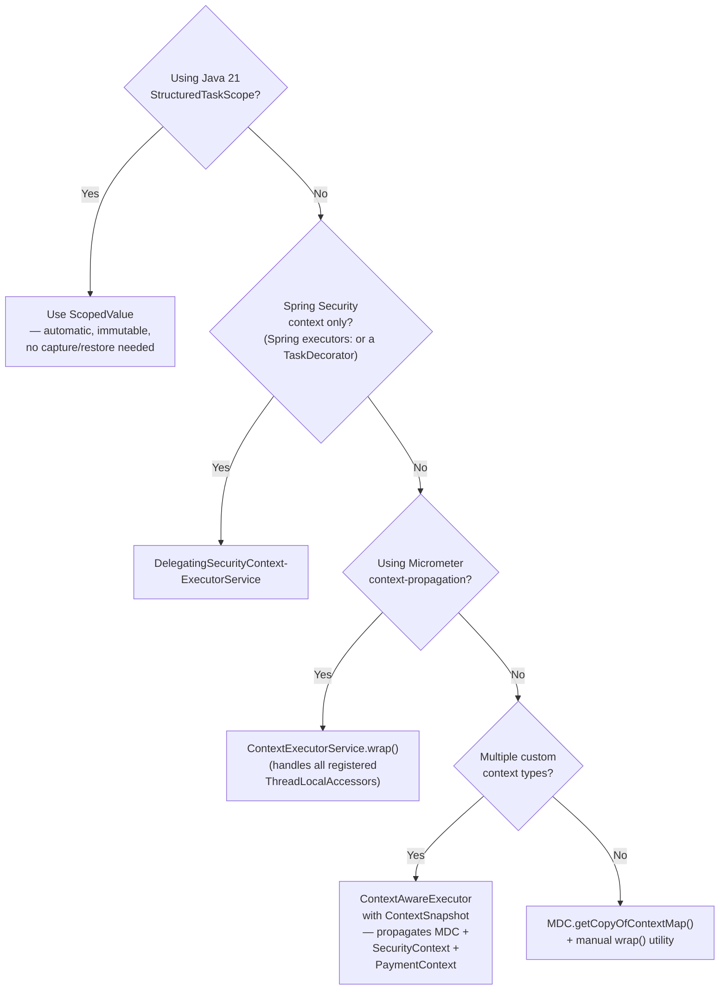

# نشر السياق عبر الخيوط — MDC وSecurityContext والتتبع

## نظرة عامة

نادرًا ما تنفّذ أنظمة الدفع الحديثة بلغة Java معاملة على خيط واحد من البداية إلى النهاية. فيستقبل متحكم REST طلب تفويض دفع، ويفرّع فحوص الإثراء والاحتيال عبر `CompletableFuture`، ويدمج النتائج على خيط من مجمّع مشترك، ويسجّل كل خطوة. ومعرّف الترابط، وهوية المستخدم الموثّق، وسياق التتبع الموزع التي وصلت في ترويسات HTTP يجب أن ترافق كل سطر سجل وكل استدعاء لاحق — لكن الحاويات المبنية على `ThreadLocal` مثل MDC، و`SecurityContextHolder` في Spring Security، وسياق التتبع في Micrometer ترتبط بالخيط *الأصلي* وتختفي لحظة انتقال التنفيذ إلى خيط من المجمّع. ويتناول هذا الدرس فهم سبب ضياع السياق وكيفية استعادته منهجيًا، من أنماط الالتقاط والاستعادة اليدوية حتى `ScopedValue` ونموذج التزامن المهيكل.

## أهداف التعلم

في نهاية هذا الدرس ستستطيع:

- شرح لماذا يضيع سياق `ThreadLocal` عبر قفزات `CompletableFuture` والخيوط الافتراضية
- تجهيز أسطر سجل خدمة الدفع بمعرّفات ترابط MDC تصمد عبر الاستمرارات غير المتزامنة
- تغليف خدمات المنفّذات بـ `DelegatingSecurityContextExecutorService` من Spring Security
- تنفيذ نمط `ContextSnapshot` للالتقاط والاستعادة لأنواع سياق عشوائية
- بناء `ContextAwareExecutor` ينشر MDC و`SecurityContext` و`PaymentContext` مخصصًا كوحدة واحدة
- وصف كيف ينتشر `ObservationRegistry` في Micrometer عبر مغلفات المنفّذات
- شرح لماذا يلغي `ScopedValue` مع `StructuredTaskScope` الحاجة إلى نشر السياق يدويًا

## سياق العمل

*مثال مركّب (مبني على أنماط شائعة في الصناعة، لا على شركة بعينها):* تعالج خدمة تفويض مدفوعات في بنك رقمي 15,000 تفويض في الثانية في الذروة. ويحمل كل تفويض `correlationId` لربط السجلات من البداية للنهاية، و`tenantId` للتوجيه متعدد المستأجرين، و`Principal` موثّقًا لسجل التدقيق. وتستخدم الخدمة `CompletableFuture` لتوزيع تقييم الاحتيال وفحوص الرصيد وجلب أسعار الصرف على التوازي. وكشف حادث إنتاج أن نحو ربع أسطر السجل الصادرة من الاستمرارات غير المتزامنة بلا `correlationId` — فصار التحقيق بعد الحادث صعبًا جدًا. وأظهر حادث ثانٍ أن خدمة التدقيق تتلقى طلبات غير موثّقة لأن `SecurityContextHolder` كان فارغًا على خيوط المجمّع. وهذا الدرس يصلح المشكلتين.

## 1. المشكلة: سياق ThreadLocal لا يعبر حدود الخيوط

يربط `ThreadLocal` في Java قيمة بـ *الخيط الحالي*. فعندما تستدعي `CompletableFuture.supplyAsync(supplier, executor)`، يعمل `supplier` على خيط من `executor` — خيط مختلف عن الذي أرسل العمل. ولا تُنقل حالة `ThreadLocal` من الخيط المرسل.

### ما الذي يضيع

```java
// MDC uses ThreadLocal under the hood (Logback/Log4j2 implementations)
MDC.put("correlationId", "PAY-20240315-001");
MDC.put("tenantId", "tenant-uk-retail");

CompletableFuture<FraudScore> fraudFuture = CompletableFuture.supplyAsync(() -> {
    // This runs on ForkJoinPool.commonPool() — a DIFFERENT thread
    // MDC.get("correlationId") returns null here
    // Log line: "Calling fraud API" — correlationId: null  ← LOST
    return fraudApiClient.score(payment);
});
```

تؤثر المشكلة نفسها في:

| نوع السياق | آلية التخزين | يضيع عند |
|---|---|---|
| معرّف ترابط MDC | `ThreadLocal<Map>` | أي قفزة منفّذ غير متزامنة |
| ‏`SecurityContextHolder` في Spring | `ThreadLocal<SecurityContext>` | أي قفزة منفّذ غير متزامنة |
| ‏`Observation` في Micrometer | ‏`ThreadLocal` في `ObservationRegistry` | أي قفزة منفّذ غير متزامنة |
| سياق معاملة مخصص | `ThreadLocal<T>` | أي قفزة منفّذ غير متزامنة |
| جلسة Hibernate | ‏`ThreadLocal` | أي قفزة منفّذ غير متزامنة |



> [!WARNING]
> التوريث عبر `InheritableThreadLocal` ينشر السياق فقط عندما **يُنشأ خيط جديد** كابن للخيط الحالي. ولا ينشره إلى خيوط مجمّع موجود مسبقًا. و`CompletableFuture.supplyAsync()` يرسل إلى خيط *موجود* في المجمّع — فلا يفيد `InheritableThreadLocal` هنا. وهذا مفهوم خاطئ شائع يمنح ثقة زائفة.

## 2. ‏MDC — سياق التشخيص المعيّن لربط السجلات

‏MDC آلية Logback/Log4j2 لإرفاق أزواج مفتاح-قيمة بكل عبارة سجل على الخيط الحالي. وهو لا غنى عنه لربط أسطر السجل عبر سلسلة استدعاءات معالجة الدفع الموزعة.

### أساسيات MDC

```java
import org.slf4j.MDC;

// Attach context at the entry point (e.g., servlet filter, gRPC interceptor)
MDC.put("correlationId", payment.getCorrelationId());
MDC.put("tenantId",      payment.getTenantId());
MDC.put("paymentType",   payment.getType().name());

try {
    processPayment(payment);
} finally {
    // ALWAYS clear in finally — MDC uses ThreadLocal; not clearing contaminates
    // the next request on the same pooled thread
    MDC.clear();
}
```

امسح MDC دائمًا في `finally` — فهو يستخدم `ThreadLocal`، وعدم المسح يلوّث الطلب التالي على الخيط المجمّع نفسه.

اضبط نمط السجل ليتضمن قيم MDC:

```xml
<!-- logback.xml -->
<pattern>%d{ISO8601} [%thread] %-5level %logger{36} [%X{correlationId}] [%X{tenantId}] - %msg%n</pattern>
```

### مشكلة ضياع MDC في CompletableFuture

```java
// Broken: MDC context is lost in async continuations
public CompletableFuture<AuthorisationResult> authorise(PaymentRequest payment) {
    MDC.put("correlationId", payment.getCorrelationId());

    return CompletableFuture
        .supplyAsync(() -> fraudClient.score(payment))       // MDC lost here
        .thenCombine(
            CompletableFuture.supplyAsync(() -> balanceService.check(payment)),  // MDC lost here
            (fraud, balance) -> buildResult(fraud, balance)
        );
    // MDC.clear() is also never called — leak on the request thread
}
```

### إصلاح ضياع MDC — الالتقاط والاستعادة يدويًا

```java
/**
 * Utility to capture the current MDC context map and produce a Runnable/Supplier
 * wrapper that restores it on the executing thread.
 */
public final class MdcPropagator {

    private MdcPropagator() {}

    /**
     * Wraps a Supplier, capturing the current MDC context map.
     * When the supplier executes on another thread, the MDC map is restored
     * for the duration of the call, then cleared.
     */
    public static <T> Supplier<T> wrap(Supplier<T> supplier) {
        // Capture on the calling thread (snapshot of current MDC state)
        Map<String, String> capturedMdc = MDC.getCopyOfContextMap();

        return () -> {
            Map<String, String> previousMdc = MDC.getCopyOfContextMap();
            try {
                if (capturedMdc != null) {
                    MDC.setContextMap(capturedMdc);   // restore on executing thread
                } else {
                    MDC.clear();
                }
                return supplier.get();
            } finally {
                // Restore the executing thread's original MDC state
                if (previousMdc != null) {
                    MDC.setContextMap(previousMdc);
                } else {
                    MDC.clear();
                }
            }
        };
    }

    public static Runnable wrap(Runnable runnable) {
        Map<String, String> capturedMdc = MDC.getCopyOfContextMap();
        return () -> {
            Map<String, String> previousMdc = MDC.getCopyOfContextMap();
            try {
                if (capturedMdc != null) {
                    MDC.setContextMap(capturedMdc);
                } else {
                    MDC.clear();
                }
                runnable.run();
            } finally {
                if (previousMdc != null) {
                    MDC.setContextMap(previousMdc);
                } else {
                    MDC.clear();
                }
            }
        };
    }
}
```

يلتقط المغلف خريطة MDC على الخيط المستدعي، ويستعيدها على الخيط المنفّذ طوال الاستدعاء، ثم يعيد الحالة الأصلية لذلك الخيط.

```java
// Fixed: MDC context is explicitly propagated to each async stage
public CompletableFuture<AuthorisationResult> authorise(PaymentRequest payment) {
    MDC.put("correlationId", payment.getCorrelationId());
    MDC.put("tenantId",      payment.getTenantId());

    try {
        return CompletableFuture
            .supplyAsync(MdcPropagator.wrap(() -> fraudClient.score(payment)), executor)
            .thenCombine(
                CompletableFuture.supplyAsync(
                    MdcPropagator.wrap(() -> balanceService.check(payment)), executor),
                (fraud, balance) -> buildResult(fraud, balance)
            );
    } finally {
        // Clear the request thread's MDC after task submission. (If an outer
        // filter also put MDC values, remove only your own keys instead.)
        MDC.clear();
    }
}
```

> [!NOTE]
> يعيد `MDC.getCopyOfContextMap()` القيمة `null` إذا لم يُعيّن أي سياق MDC على الخيط الحالي. فافحص null دائمًا قبل استدعاء `MDC.setContextMap()`. فتعيين خريطة null في بعض تنفيذات MDC يرمي `NullPointerException`.

## 3. نشر SecurityContext في Spring Security

يخزن Spring Security الـ `Principal` الموثّق في `SecurityContextHolder`، الذي يعمل افتراضيًا بنمط `ThreadLocal`. ولا ترث الخيوط غير المتزامنة سياق الأمان، فترى سجلات التدقيق وفحوص الصلاحيات في الشيفرة غير المتزامنة مستخدمًا مجهولًا.

### النمط المعطوب

```java
@Service
public class PaymentAuditService {

    @Async   // runs on Spring's async executor — SecurityContext NOT propagated by default
    public void logPaymentAuthorisation(Payment payment) {
        Authentication auth = SecurityContextHolder.getContext().getAuthentication();
        // auth is NULL here — the pool thread has an empty SecurityContext
        auditLog.write(auth.getName(), payment);   // NullPointerException
    }
}
```

### DelegatingSecurityContextExecutorService

يوفر Spring Security الصنف `DelegatingSecurityContextExecutorService`، الذي يلتقط `SecurityContext` للخيط المستدعي ويستعيده على الخيط المنفّذ لكل مهمة مرسلة:

```java
import org.springframework.security.concurrent.DelegatingSecurityContextExecutorService;
import org.springframework.security.core.context.SecurityContext;
import org.springframework.security.core.context.SecurityContextHolder;

@Configuration
public class AsyncSecurityConfig {

    @Bean("securityAwareExecutor")
    public ExecutorService securityAwareExecutorService() {
        ExecutorService base = Executors.newFixedThreadPool(
            Runtime.getRuntime().availableProcessors(),
            new ThreadFactory() {
                private final AtomicInteger counter = new AtomicInteger();
                @Override
                public Thread newThread(Runnable r) {
                    Thread t = new Thread(r, "payment-async-" + counter.incrementAndGet());
                    t.setDaemon(true);
                    return t;
                }
            }
        );
        // Wrap: each submitted task runs with the submitter's SecurityContext
        return new DelegatingSecurityContextExecutorService(base);
    }
}
```

```java
@Service
public class PaymentAuthorisationService {

    @Autowired
    @Qualifier("securityAwareExecutor")
    private ExecutorService executor;

    public CompletableFuture<AuthResult> authorise(PaymentRequest request) {
        // SecurityContext is captured at submission time and restored on the pool thread
        return CompletableFuture.supplyAsync(
            () -> {
                Authentication auth = SecurityContextHolder.getContext().getAuthentication();
                // auth.getName() now returns the authenticated user — correctly propagated
                log.info("Authorising payment for user {}", auth.getName());
                return performAuthorisation(request);
            },
            executor
        );
    }
}
```

### نشر SecurityContext يدويًا

لتحكم أدق، التقط واستعد يدويًا:

```java
/**
 * Wraps a Supplier with the current thread's SecurityContext.
 * Useful when you cannot use DelegatingSecurityContextExecutorService
 * (e.g., one-off tasks on a shared executor you don't own).
 */
public static <T> Supplier<T> withSecurityContext(Supplier<T> supplier) {
    // Capture on the submitting thread
    SecurityContext capturedContext = SecurityContextHolder.getContext();

    return () -> {
        SecurityContext previousContext = SecurityContextHolder.getContext();
        try {
            SecurityContextHolder.setContext(capturedContext);
            return supplier.get();
        } finally {
            SecurityContextHolder.setContext(previousContext);
        }
    };
}
```

```java
// Creating an empty context for a background thread that has no user principal:
SecurityContext emptyContext = SecurityContextHolder.createEmptyContext();
emptyContext.setAuthentication(systemAuthentication());   // system-level auth
SecurityContextHolder.setContext(emptyContext);
```

> [!TIP]
> في Spring، الخطاف المعتاد هو **`TaskDecorator`** على `ThreadPoolTaskExecutor` ‏(`executor.setTaskDecorator(...)`): فهو يغلّف كل مهمة مرسلة، فتستطيع التقاط السياق على الخيط المرسل واستعادته على العامل. ويأتي Spring Framework 6.1+ بـ `ContextPropagatingTaskDecorator`، الذي ينشر كل ما سُجّل في مكتبة نشر السياق في Micrometer (القسم 5).

> [!IMPORTANT]
> لـ `SecurityContextHolder` ثلاثة أنماط: `MODE_THREADLOCAL` (الافتراضي)، و`MODE_INHERITABLETHREADLOCAL`، و`MODE_GLOBAL`. ينشر `MODE_INHERITABLETHREADLOCAL` السياق إلى الخيوط الأبناء المنشأة من الخيط الحالي، لكن لا إلى خيوط المجمّع (التحفظ نفسه كما في `InheritableThreadLocal`). ويستخدم `MODE_GLOBAL` سياقًا مشتركًا واحدًا — لا تستخدمه أبدًا في تطبيق متعدد المستخدمين. وللعمل غير المتزامن على المجمّعات، يكون `DelegatingSecurityContextExecutorService` الأسلوب الصحيح.

## 4. نمط ContextSnapshot — نشر يدوي قابل للتركيب

عندما تحتاج إلى نشر عدة أنواع سياق (MDC، وSecurityContext، وسياق دفع مخصص) معًا، يقدم نمط `ContextSnapshot` تجريدًا نظيفًا. التقط كل السياق على الخيط المرسل، ثم استعده كوحدة على الخيط المنفّذ.

### PaymentContext — سياق نطاق مخصص

```java
/**
 * Domain-specific context for a payment authorisation request.
 * Carried through the entire async processing pipeline.
 */
public record PaymentContext(
    String  correlationId,
    String  tenantId,
    String  paymentType,
    String  originatingIp,
    Instant receivedAt
) {
    private static final ThreadLocal<PaymentContext> HOLDER = new ThreadLocal<>();

    public static void set(PaymentContext ctx)  { HOLDER.set(ctx); }
    public static PaymentContext get()          { return HOLDER.get(); }
    public static void clear()                 { HOLDER.remove(); }
}
```

### ContextSnapshot — التقاط كل أنواع السياق

```java
/**
 * Immutable snapshot of all thread-local context relevant to a payment request.
 * Captured on the submitting thread, restored on the executing thread.
 */
public final class ContextSnapshot {

    private final Map<String, String>  mdcContext;
    private final SecurityContext      securityContext;
    private final PaymentContext       paymentContext;

    private ContextSnapshot(
            Map<String, String> mdcContext,
            SecurityContext securityContext,
            PaymentContext paymentContext) {
        this.mdcContext      = mdcContext != null ? Map.copyOf(mdcContext) : Map.of();
        this.securityContext = securityContext;
        this.paymentContext  = paymentContext;
    }

    /** Captures all context from the calling thread. */
    public static ContextSnapshot capture() {
        return new ContextSnapshot(
            MDC.getCopyOfContextMap(),
            SecurityContextHolder.getContext(),
            PaymentContext.get()
        );
    }

    /**
     * Restores this snapshot on the calling thread for the duration of the action,
     * then restores the previous state.
     */
    public <T> T runWith(Supplier<T> action) {
        // Save current state of the executing thread
        Map<String, String> prevMdc      = MDC.getCopyOfContextMap();
        SecurityContext      prevSec      = SecurityContextHolder.getContext();
        PaymentContext       prevPayment  = PaymentContext.get();

        try {
            // Restore captured context
            MDC.setContextMap(mdcContext);
            SecurityContextHolder.setContext(securityContext);
            if (paymentContext != null) {
                PaymentContext.set(paymentContext);
            } else {
                // MUST clear: otherwise a value left on this pooled thread by an
                // earlier task (another tenant!) would be visible to this task
                PaymentContext.clear();
            }
            return action.get();
        } finally {
            // Restore the executing thread's original state
            if (prevMdc != null) {
                MDC.setContextMap(prevMdc);
            } else {
                MDC.clear();
            }
            SecurityContextHolder.setContext(prevSec);
            if (prevPayment != null) {
                PaymentContext.set(prevPayment);
            } else {
                PaymentContext.clear();
            }
        }
    }

    public void runWith(Runnable action) {
        runWith(() -> { action.run(); return null; });
    }

    public <T> Supplier<T> wrap(Supplier<T> supplier) {
        return () -> runWith(supplier);
    }

    public Runnable wrap(Runnable runnable) {
        return () -> runWith(runnable);
    }
}
```

إذا لم يكن في اللقطة `PaymentContext`، **يجب** مسح قيمة الخيط: وإلا ظهرت للمهمة قيمة تركتها مهمة سابقة على هذا الخيط المجمّع (لمستأجر آخر!).

### استخدام ContextSnapshot في مسار دفع

```java
@Service
public class PaymentAuthorisationPipeline {

    private final ExecutorService     processingPool;
    private final FraudScoringClient  fraudClient;
    private final BalanceService      balanceService;
    private final FxRateService       fxService;

    public CompletableFuture<AuthorisationResult> authorise(PaymentRequest request) {
        // Set up context on the request thread
        MDC.put("correlationId", request.getCorrelationId());
        MDC.put("tenantId",      request.getTenantId());
        PaymentContext.set(new PaymentContext(
            request.getCorrelationId(),
            request.getTenantId(),
            request.getType().name(),
            request.getOriginatingIp(),
            Instant.now()
        ));

        // Capture ALL context as a single immutable snapshot
        ContextSnapshot snapshot = ContextSnapshot.capture();

        try {
            CompletableFuture<FraudScore> fraudFuture = CompletableFuture.supplyAsync(
                snapshot.wrap(() -> {
                    log.info("Calling fraud API");   // correlationId: PAY-001 ← correct
                    return fraudClient.score(request);
                }),
                processingPool
            );

            CompletableFuture<BalanceCheckResult> balanceFuture = CompletableFuture.supplyAsync(
                snapshot.wrap(() -> {
                    log.info("Checking balance");    // correlationId: PAY-001 ← correct
                    return balanceService.check(request);
                }),
                processingPool
            );

            CompletableFuture<FxRate> fxFuture = CompletableFuture.supplyAsync(
                snapshot.wrap(() -> {
                    log.info("Fetching FX rate");    // correlationId: PAY-001 ← correct
                    return fxService.getRate(request.getCurrency(), "GBP");
                }),
                processingPool
            );

            return fraudFuture
                .thenCombineAsync(balanceFuture, (fraud, balance) ->
                    new PartialResult(fraud, balance), processingPool)
                .thenCombineAsync(fxFuture,
                    // wrap() takes a Supplier/Runnable, so restore the context
                    // inside the BiFunction with runWith()
                    (partial, fx) -> snapshot.runWith(
                        () -> buildFinalResult(partial, fx, request)),
                    processingPool);
        } finally {
            MDC.clear();
            PaymentContext.clear();
        }
    }
}
```

تأخذ `wrap()` قيمة Supplier أو Runnable، لذا تُستعاد السياق داخل دالة الدمج (BiFunction) بـ `runWith()`.

## 5. نشر سياق التتبع في Micrometer

يستخدم Micrometer (وبالتبعية OpenTelemetry) ‏`Observation` و`ObservationRegistry` للتتبع الموزع. ويجب أن ينتشر سياق المقطع (معرّف التتبع، ومعرّف المقطع) عبر الحدود غير المتزامنة تمامًا مثل MDC.

### التجهيز المبني على Observation

```java
import io.micrometer.observation.Observation;
import io.micrometer.observation.ObservationRegistry;

@Service
public class FraudScoringService {

    private final ObservationRegistry observationRegistry;
    private final FraudApiClient      fraudApiClient;

    public FraudScore score(PaymentRequest payment) {
        return Observation.createNotStarted("fraud.scoring", observationRegistry)
            .lowCardinalityKeyValue("payment.type", payment.getType().name())
            .highCardinalityKeyValue("correlation.id", payment.getCorrelationId())
            .observe(() -> {
                // Span context is active here — Micrometer manages the ThreadLocal
                return fraudApiClient.callScoringEndpoint(payment);
            });
    }
}
```

### نشر سياق Observation عبر الخيوط

تعرّف مكتبة `context-propagation` في Micrometer أدوات `ThreadLocalAccessor` — مثل `ObservationThreadLocalAccessor` للمراقبة الحالية — و`ContextExecutorService` لنشرها كلها عبر مجمّع خيوط:

```java
import io.micrometer.context.ContextExecutorService;
import io.micrometer.context.ContextSnapshotFactory;

@Configuration
public class MicrometerAsyncConfig {

    @Bean("tracingAwareExecutor")
    public ExecutorService tracingAwareExecutorService() {
        ExecutorService base = Executors.newFixedThreadPool(10);
        ContextSnapshotFactory snapshots = ContextSnapshotFactory.builder().build();

        // On each submit: capture every registered ThreadLocalAccessor
        // (including ObservationThreadLocalAccessor, which Spring Boot registers)
        // and restore them on the worker thread
        return ContextExecutorService.wrap(base, snapshots::captureAll);
    }
}
```

```java
// OpenTelemetry context propagation (brief illustration)
import io.opentelemetry.context.Context;
import io.opentelemetry.context.Scope;

public CompletableFuture<FraudScore> scoreAsync(PaymentRequest payment) {
    // Capture the current OTel context (span, baggage)
    Context otelContext = Context.current();

    return CompletableFuture.supplyAsync(() -> {
        // Make the captured OTel context current on this thread
        try (Scope scope = otelContext.makeCurrent()) {
            // Span is now active — trace.id and span.id are set
            return fraudApiClient.score(payment);
        }
    }, executor);
}
```

> [!NOTE]
> ‏`ContextSnapshot` في Micrometer (من `micrometer-context-propagation`) تنفيذ إنتاجي للنمط الموصوف في القسم 4. فهو يكتشف كل تنفيذات `ThreadLocalAccessor` المسجلة عبر `ContextRegistry` ويتولى الالتقاط والاستعادة تلقائيًا. وإذا كان مشروعك يتضمن Micrometer بالفعل ففضّله على بناء نسختك: يعيد `ContextSnapshotFactory.builder().build().captureAll()` لقطة، ويستعيدها `snapshot.wrap(task)` حول المهمة. وسجّل `ThreadLocalAccessor` خاصًا بك للسياق المخصص مثل `PaymentContext`.

## 6. ‏ScopedValue — سياق دون ThreadLocal

يوفر `ScopedValue` (معاينة منذ Java 21 — JEP 446 — ونهائي في Java 25 عبر JEP 506) روابط غير قابلة للتغيير ومحصورة تلقائيًا تنتشر عبر شجرة الاستدعاءات دون التقاط واستعادة يدويين. ومع `StructuredTaskScope` (ما زال واجهة معاينة) يزيلان مشكلة نشر السياق داخل النطاق. لكنها **لا** تصل إلى المنفّذات العادية أو `CompletableFuture.supplyAsync` — بل إلى المهام الفرعية المتفرعة فقط.

> [!NOTE]
> يلخص هذا الدرس سلوك النشر الأساسي الذي قُدّم في الدرس 15 (القيم المحصورة في نطاق). والتركيز هنا تحديدًا على كيف يزيل `ScopedValue` الحاجة إلى نمط `ContextSnapshot` عند استخدام التزامن المهيكل.

### ScopedValue مقابل ThreadLocal

```java
// ThreadLocal: mutable, manual lifecycle, does NOT cross thread boundaries
static final ThreadLocal<String> CORRELATION_ID = new ThreadLocal<>();
CORRELATION_ID.set("PAY-001");
CompletableFuture.supplyAsync(() -> CORRELATION_ID.get());   // returns null

// ScopedValue: immutable, automatic lifecycle, propagates through StructuredTaskScope
static final ScopedValue<String> CORRELATION_ID = ScopedValue.newInstance();

// call() instead of run(): join()/throwIfFailed() throw checked exceptions
ScopedValue.where(CORRELATION_ID, "PAY-001")
    .call(() -> {
        try (var scope = new StructuredTaskScope.ShutdownOnFailure()) {
            var fraudTask   = scope.fork(() -> CORRELATION_ID.get());   // returns "PAY-001"
            var balanceTask = scope.fork(() -> CORRELATION_ID.get());   // returns "PAY-001"
            scope.join().throwIfFailed();
        }
        return null;
    });
```

تُستخدم `call()` بدل `run()` لأن `join()`/`throwIfFailed()` ترميان استثناءات مفحوصة.

### سياق دفع كامل بـ ScopedValue

```java
public final class PaymentScopes {
    public static final ScopedValue<String>         CORRELATION_ID = ScopedValue.newInstance();
    public static final ScopedValue<String>         TENANT_ID      = ScopedValue.newInstance();
    public static final ScopedValue<Authentication> PRINCIPAL      = ScopedValue.newInstance();

    private PaymentScopes() {}
}
```

```java
@Service
public class StructuredPaymentAuthoriser {

    public AuthorisationResult authorise(PaymentRequest request) throws Exception {

        return ScopedValue
            .where(PaymentScopes.CORRELATION_ID, request.getCorrelationId())
            .where(PaymentScopes.TENANT_ID,      request.getTenantId())
            .where(PaymentScopes.PRINCIPAL,      SecurityContextHolder.getContext().getAuthentication())
            .call(() -> {
                try (var scope = new StructuredTaskScope.ShutdownOnFailure()) {

                    var fraudTask   = scope.fork(() -> {
                        // No capture/restore needed — the ScopedValue is automatically
                        // available. (The log PATTERN still reads the MDC: copy the value
                        // into the MDC inside the task if you rely on %X{correlationId})
                        log.info("Scoring fraud for correlationId={}",
                                 PaymentScopes.CORRELATION_ID.get());
                        return fraudClient.score(request);
                    });

                    var balanceTask = scope.fork(() -> {
                        log.info("Checking balance for tenant={}",
                                 PaymentScopes.TENANT_ID.get());
                        return balanceService.check(request);
                    });

                    scope.join().throwIfFailed();

                    return buildResult(fraudTask.get(), balanceTask.get());
                }
            });
    }
}
```

لا حاجة إلى التقاط واستعادة — فالقيمة المحصورة متاحة تلقائيًا. (لكن نمط السجل ما زال يقرأ MDC: انسخ القيمة إلى MDC داخل المهمة إذا كنت تعتمد على `%X{correlationId}`.)



> [!IMPORTANT]
> روابط `ScopedValue` **غير قابلة للتغيير** داخل نطاقها. فلا تستطيع استدعاء دالة تعيين لتغيير معرّف الترابط في منتصف النطاق (كما تفعل بـ `MDC.put()`). وإذا احتجت إلى إعادة ربط قيمة لنطاق ابن (مثل معاملة فرعية بمعرّف ترابط جديد)، فاستخدم كتلة `ScopedValue.where(...).call(...)` متداخلة — فإعادة الربط محصورة في الكتلة المتداخلة ويُستعاد الربط الخارجي تلقائيًا.

## 7. ‏ContextAwareExecutor — مغلف بمستوى إنتاجي

للفرق التي لم تنتقل بعد إلى التزامن المهيكل، يقدم مزخرف `ContextAwareExecutor` حلًا واحدًا قابلًا للتركيب. فهو يغلّف أي `Executor` ويضمن أن كل مهمة مرسلة تعمل مع MDC و`SecurityContext` و`PaymentContext` للخيط المرسل.

```java
import org.slf4j.MDC;
import org.springframework.security.core.context.SecurityContext;
import org.springframework.security.core.context.SecurityContextHolder;

import java.util.Map;
import java.util.concurrent.Executor;

/**
 * An Executor decorator that propagates MDC, Spring SecurityContext,
 * and custom PaymentContext from the submitting thread to the executing thread.
 *
 * Usage:
 *   ExecutorService base = Executors.newFixedThreadPool(10);
 *   Executor contextAware = new ContextAwareExecutor(base);
 *   CompletableFuture.supplyAsync(supplier, contextAware);
 */
public final class ContextAwareExecutor implements Executor {

    private final Executor delegate;

    public ContextAwareExecutor(Executor delegate) {
        this.delegate = delegate;
    }

    @Override
    public void execute(Runnable command) {
        // Capture on the calling thread — before submit
        Map<String, String>  capturedMdc      = MDC.getCopyOfContextMap();
        SecurityContext      capturedSecurity  = SecurityContextHolder.getContext();
        PaymentContext       capturedPayment   = PaymentContext.get();

        delegate.execute(() -> {
            // Save the executing thread's current state
            Map<String, String>  prevMdc      = MDC.getCopyOfContextMap();
            SecurityContext      prevSecurity  = SecurityContextHolder.getContext();
            PaymentContext       prevPayment   = PaymentContext.get();

            try {
                // Restore captured context onto executing thread
                if (capturedMdc != null) {
                    MDC.setContextMap(capturedMdc);
                } else {
                    MDC.clear();
                }
                SecurityContextHolder.setContext(capturedSecurity);
                if (capturedPayment != null) {
                    PaymentContext.set(capturedPayment);
                } else {
                    PaymentContext.clear();   // never inherit a previous task's tenant
                }

                command.run();

            } finally {
                // Restore executing thread's original state (important for thread-pool reuse)
                if (prevMdc != null) {
                    MDC.setContextMap(prevMdc);
                } else {
                    MDC.clear();
                }
                SecurityContextHolder.setContext(prevSecurity);
                if (prevPayment != null) {
                    PaymentContext.set(prevPayment);
                } else {
                    PaymentContext.clear();
                }
            }
        });
    }
}
```

### تسجيل ContextAwareExecutor كحبة Spring

```java
@Configuration
public class PaymentExecutorConfig {

    @Bean("paymentProcessingExecutor")
    public Executor paymentProcessingExecutor() {
        ThreadPoolTaskExecutor base = new ThreadPoolTaskExecutor();
        base.setCorePoolSize(10);
        base.setMaxPoolSize(50);
        base.setQueueCapacity(500);
        base.setThreadNamePrefix("payment-proc-");
        base.initialize();

        // Wrap with context propagation.
        // Note: `base` is not a Spring bean here, so Spring will not shut it down
        // gracefully. Alternatively keep `base` as the bean and plug the same
        // capture/restore logic in with base.setTaskDecorator(...)
        return new ContextAwareExecutor(base.getThreadPoolExecutor());
    }
}
```

لاحظ أن `base` ليس حبة Spring هنا، فلن يوقفه Spring بشكل منظم. والبديل: احتفظ بـ `base` كحبة وأضف منطق الالتقاط والاستعادة نفسه عبر `base.setTaskDecorator(...)`.

### اختبار تكامل: التحقق من نشر السياق

```java
@SpringBootTest
class ContextAwareExecutorTest {

    @Autowired
    @Qualifier("paymentProcessingExecutor")
    private Executor executor;

    @Test
    @WithMockUser(username = "operator-01", roles = "PAYMENTS")
    void correlationIdShouldPropagateToAsyncTask() throws Exception {
        MDC.put("correlationId", "TEST-CORR-001");
        PaymentContext.set(new PaymentContext("TEST-CORR-001", "tenant-test",
                                             "SEPA_CREDIT", "127.0.0.1", Instant.now()));

        CompletableFuture<Map<String, String>> contextCapture =
            CompletableFuture.supplyAsync(() -> {
                Map<String, String> captured = new HashMap<>();
                captured.put("correlationId",  MDC.get("correlationId"));
                captured.put("tenantId",       PaymentContext.get() != null
                                               ? PaymentContext.get().tenantId() : "null");
                captured.put("principal",      SecurityContextHolder.getContext()
                                               .getAuthentication().getName());
                return captured;
            }, executor);

        Map<String, String> result = contextCapture.get(5, TimeUnit.SECONDS);

        assertThat(result.get("correlationId")).isEqualTo("TEST-CORR-001");
        assertThat(result.get("tenantId")).isEqualTo("tenant-test");
        assertThat(result.get("principal")).isEqualTo("operator-01");
    }
}
```

## 8. دليل اختيار استراتيجية نشر السياق



## اختبار المعرفة

**س1: تستخدم خدمة معالجة دفع `CompletableFuture.supplyAsync()` لاستدعاء واجهة احتيال على مجمّع خيوط مشترك. ويعيّن خيط الطلب `MDC.put("correlationId", id)` قبل الإرسال. ويقترح مهندس مبتدئ تحويل المجمّع إلى `InheritableThreadLocal` لحل ضياع MDC. لماذا لا ينجح ذلك، وما الحل الصحيح؟**

ج: ينسخ `InheritableThreadLocal` القيم من الخيط الأب إلى الابن **لحظة إنشاء خيط جديد** فقط — تحديدًا عند استدعاء `new Thread(runnable)`. وتُنشأ خيوط المجمّع مرة واحدة عند بدئه، لا عند كل إرسال مهمة. فعندما يرسل `supplyAsync()` مهمة، تذهب إلى خيط موجود بالفعل — ولا يعيد `InheritableThreadLocal` نسخ السياق وقت الإرسال. والحل الصحيح يعتمد على البيئة: استخدم `ContextAwareExecutor` (أو `TaskDecorator` في Spring) لالتقاط `MDC.getCopyOfContextMap()` صراحة وقت الإرسال واستعادته على الخيط المنفّذ؛ أو استخدم `ContextExecutorService.wrap()` من Micrometer إذا كان المشروع يتضمن `micrometer-context-propagation`؛ أو انتقل إلى `ScopedValue` مع `StructuredTaskScope`.

**س2: يحفظ `ContextAwareExecutor` لديك سياق MDC السابق للخيط المنفّذ ويستعيده في كتلة `finally`. ويجادل زميل بأن ذلك غير ضروري — فخيوط المجمّع تبدأ دون سياق MDC، فلا شيء يُستعاد. متى يكون زميلك مخطئًا؟**

ج: قد تحمل خيوط المجمّع سياقًا متبقيًا من مهمة سابقة في حالتين. أولًا، إذا رمت مهمة على ذلك الخيط استثناء قبل الوصول إلى تنظيف `finally` الخاص بها، فقد لا يكون MDC للخيط فارغًا عند وصول المهمة التالية. ثانيًا، إذا تشارك مساران مختلفان للطلبات `ExecutorService` نفسه (وهو شائع في Spring حيث يعالج منفّذ `@Async` واحد كل الطرق المعلّمة)، فقد يحمل خيط أنهى مهمة الطلب A حالة A عندما يلتقط مهمة الطلب B. ولهذا السبب نفسه، عندما تكون القيمة الملتقطة null يجب على المغلف **مسح** قيمة الخيط لا تركها. ونمط الحفظ والاستعادة في `finally` يضمن العزل بين المهام أيًا كان تاريخ الخيط، وهذا أساسي في أنظمة الدفع متعددة المستأجرين حيث يُعد تسرب `tenantId` بين الطلبات انتهاكًا لعزل البيانات.

## التحدي العملي

### التحدي: ContextAwareCompletableFutureFactory

ابنِ صنفًا مساعدًا `ContextAwareCompletableFutureFactory` يوفر بدائل مباشرة لطرق مصنع `CompletableFuture` المعيارية، تنشر تلقائيًا أنواع السياق الثلاثة (MDC، وSecurityContext، وPaymentContext).

**الطرق المطلوبة**:

```java
public class ContextAwareCompletableFutureFactory {

    // Replace: CompletableFuture.supplyAsync(supplier, executor)
    public static <T> CompletableFuture<T> supplyAsync(
        Supplier<T> supplier, Executor executor) { ... }

    // Replace: CompletableFuture.runAsync(runnable, executor)
    public static CompletableFuture<Void> runAsync(
        Runnable runnable, Executor executor) { ... }

    // Wrap a thenApplyAsync continuation with context propagation
    public static <T, U> CompletableFuture<U> thenApplyAsync(
        CompletableFuture<T> future,
        Function<T, U> fn,
        Executor executor) { ... }
}
```

**متطلبات التنفيذ**:
1. استخدم داخليًا الصنف `ContextSnapshot` من القسم 4 لالتقاط السياق واستعادته
2. عالج الحالة التي يعيد فيها `MDC.getCopyOfContextMap()` القيمة `null`
3. استعد دائمًا السياق السابق للخيط المنفّذ في كتلة `finally`
4. اكتب اختبار تكامل JUnit 5 باستخدام `@SpringBootTest` و`@WithMockUser` يتحقق من نشر أنواع السياق الثلاثة (MDC، وSecurityContext، وPaymentContext) بشكل صحيح عبر سلسلة `supplyAsync ← thenApplyAsync ← thenApplyAsync`
5. أضف نسخة `thenCombineAsync` تنشر السياق إلى دالة الدمج `BiFunction`

**إضافي**: نفّذ صنفًا فرعيًا `ContextAwareCompletableFuture<T>` يعيد كتابة `thenApplyAsync` و`thenComposeAsync` و`thenAcceptAsync` و`thenRunAsync` و`handleAsync` لنشر السياق الملتقط وقت إنشاء `CompletableFuture` الأصلي تلقائيًا — فلا يحتاج المستدعون أبدًا إلى التفكير في نشر السياق في سلاسل الاستمرار.

<!-- KNOWLEDGE-CHECK
{
  "questions": [
    {
      "text": "تستخدم خدمة دفع CompletableFuture.supplyAsync() لاستدعاء واجهة احتيال. ويعيّن خيط الطلب MDC.put('correlationId', id) قبل الإرسال. ويقترح مهندس مبتدئ التحول إلى InheritableThreadLocal لحل ضياع MDC. لماذا لا ينجح ذلك؟",
      "options": [
        "‏InheritableThreadLocal غير مدعوم في Java 17+",
        "‏InheritableThreadLocal ينسخ القيم فقط عند إنشاء خيوط جديدة، لا عند إرسال المهام إلى خيوط موجودة في المجمّع",
        "‏InheritableThreadLocal ينسخ القيم بشكل صحيح لكن MDC يستخدم آلية مختلفة",
        "مجمّعات الخيوط غير متوافقة مع InheritableThreadLocal بسبب خطأ في JVM"
      ],
      "correct": 1,
      "explanation": "ينسخ InheritableThreadLocal القيم من الأب إلى الابن فقط لحظة إنشاء كائن Thread جديد. وتُنشأ خيوط المجمّع مرة واحدة عند بدئه، لا عند كل إرسال مهمة. فعندما يرسل supplyAsync() مهمة إلى خيط موجود في المجمّع، لا يحدث أي توريث. والحل الصحيح التقاط MDC.getCopyOfContextMap() صراحة وقت الإرسال واستعادته على الخيط المنفّذ."
    },
    {
      "text": "يحفظ ContextAwareExecutor لديك سياق MDC السابق للخيط المنفّذ ويستعيده في كتلة finally. ويجادل زميل بأن ذلك غير ضروري لأن خيوط المجمّع تبدأ دون سياق. متى يكون الزميل مخطئًا؟",
      "options": [
        "الزميل محق دائمًا — خيوط المجمّع لا تحمل سياقًا متبقيًا أبدًا",
        "الزميل مخطئ عندما ترمي مهمة سابقة على ذلك الخيط استثناء قبل تنظيفها فيبقى سياق متبقٍ، أو عندما يتشارك المنفّذ أنواع طلبات مختلفة",
        "الزميل مخطئ فقط عند استخدام منفّذ أحادي الخيط",
        "الزميل مخطئ فقط عند استخدام ThreadLocal بدل MDC"
      ],
      "correct": 1,
      "explanation": "قد تحمل خيوط المجمّع سياقًا متبقيًا من مهمة سابقة إذا رمت تلك المهمة قبل تنظيف MDC أو قيم ThreadLocal. وإذا تشارك المنفّذ مسارات طلبات مختلفة، فقد يحمل خيط شغّل الطلب A قيمه عندما يلتقط الطلب B. ولهذا السبب نفسه، عندما تكون القيمة الملتقطة null يجب على المغلف مسح قيمة الخيط لا تركها. وفي أنظمة الدفع متعددة المستأجرين، يُعد تسرب معرّف المستأجر بين الطلبات انتهاكًا لعزل البيانات. والحفظ والاستعادة في finally يضمنان العزل أيًا كان تاريخ الخيط."
    },
    {
      "text": "ما الميزة الأساسية لـ ScopedValue على ThreadLocal لنشر السياق في مسارات معالجة الدفع التي تستخدم StructuredTaskScope؟",
      "options": [
        "‏ScopedValue أسرع من ThreadLocal في القراءات",
        "‏ScopedValue غير قابل للتغيير وينتشر تلقائيًا إلى كل المهام المتفرعة داخل StructuredTaskScope، فيلغي الحاجة إلى الالتقاط والاستعادة يدويًا",
        "يدعم ScopedValue التوريث عبر مجمّعات الخيوط دون أي إعداد",
        "يسمح ScopedValue بتحديثات سياق قابلة للتغيير من المهام الأبناء إلى الأب"
      ],
      "correct": 1,
      "explanation": "‏ScopedValue غير قابل للتغيير، وربطه متاح تلقائيًا لكل المهام المتفرعة داخل نطاق ScopedValue.where(...).call() المحيط، بما فيها المهام المنشأة عبر StructuredTaskScope.fork(). فلا حاجة إلى التقاط يدوي وقت الإرسال ولا استعادة في كتلة finally. وهذا يلغي نمط ContextSnapshot كليًا عند استخدام التزامن المهيكل."
    }
  ]
}
-->

<!-- PRACTICAL-CHALLENGE
{
  "title": "ContextAwareCompletableFutureFactory",
  "difficulty": "advanced",
  "estimatedMinutes": 75,
  "tasks": [
    {
      "id": "1",
      "description": "نفّذ ContextAwareExecutor يغلّف Executor مفوّضًا ويلتقط ثلاثة أنواع سياق وقت الإرسال: خريطة MDC (عبر MDC.getCopyOfContextMap())، وSecurityContext في Spring (عبر SecurityContextHolder.getContext())، وPaymentContext مخصصًا (عبر PaymentContext.get()). واستعد السياق الملتقط على الخيط المنفّذ، واستعد السياق السابق للخيط في كتلة finally لضمان العزل بين المهام."
    },
    {
      "id": "2",
      "description": "نفّذ صنفًا مساعدًا ContextAwareCompletableFutureFactory بطرق ساكنة: supplyAsync(Supplier, Executor)، وrunAsync(Runnable, Executor)، وthenApplyAsync(CompletableFuture, Function, Executor). ويجب أن تلتقط كل طريقة أنواع السياق الثلاثة وقت الاستدعاء وتغلّف الدالة لاستعادتها على الخيط المنفّذ، باستخدام نمط ContextSnapshot."
    },
    {
      "id": "3",
      "description": "سجّل ContextAwareExecutor كحبة Spring ‏@Bean تغلّف ThreadPoolTaskExecutor. واضبطه كمنفّذ @Async الافتراضي في التطبيق. واكتب اختبار تكامل @SpringBootTest مع @WithMockUser يرسل سلسلة CompletableFuture من ثلاث مراحل (supplyAsync ← thenApplyAsync ← thenApplyAsync) ويتحقق من تطابق correlationId وtenantId وهوية المستخدم في Spring في المراحل الثلاث."
    },
    {
      "id": "4",
      "description": "نفّذ بديلًا باستخدام ScopedValue يحل محل نمط ContextSnapshot لمسار الدفع نفسه. استخدم ScopedValue.where(CORRELATION_ID, id).where(TENANT_ID, tid).call(() -> ...) وStructuredTaskScope لتفريع مهام الاحتيال والرصيد. واكتب اختبار مقارنة يُظهر أن ScopedValue يلغي الحاجة إلى الالتقاط والاستعادة يدويًا، وأن كل المهام المتفرعة ترى قيم السياق الصحيحة دون أي شيفرة نشر صريحة."
    }
  ]
}
-->
