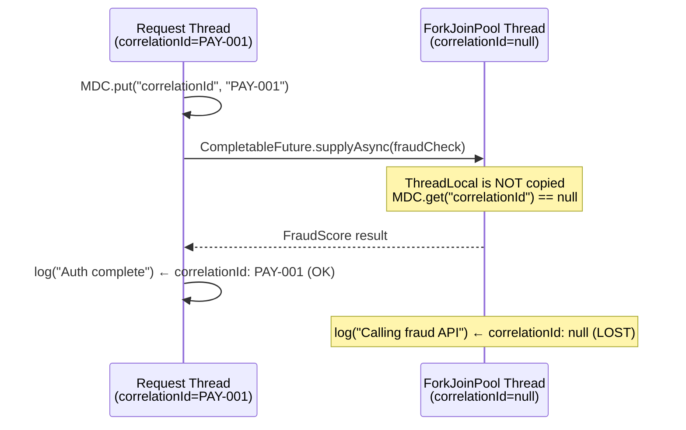
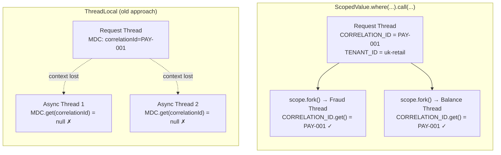
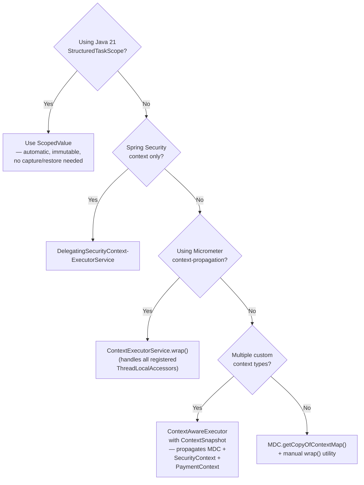

Modern Java payment systems rarely execute a transaction on a single thread from entry to completion. A REST controller receives a payment authorisation request, forks enrichment and fraud checks via `CompletableFuture`, merges results on a common pool thread, and logs every step. The correlation ID, authenticated user principal, and distributed trace context that arrived in the HTTP headers must accompany each log line and downstream call — but `ThreadLocal`-based containers like MDC, Spring Security's `SecurityContextHolder`, and Micrometer's tracing context bind to the *originating* thread and vanish the moment execution hops to a pool thread. This lesson is about understanding why context is lost and how to restore it systematically, from manual capture-and-restore patterns through to `ScopedValue` and Java 21's structured concurrency model.

## Learning Objectives

By the end of this lesson you will be able to:

- Explain why `ThreadLocal` context is lost across `CompletableFuture` and virtual thread hops
- Instrument payment service log lines with MDC correlation IDs that survive async continuations
- Wrap executor services with Spring Security's `DelegatingSecurityContextExecutorService`
- Implement a `ContextSnapshot` capture-and-restore pattern for arbitrary context types
- Build a `ContextAwareExecutor` that propagates MDC, `SecurityContext`, and a custom `PaymentContext` as a single unit
- Describe how Micrometer's `ObservationRegistry` propagates through executor wrappers
- Explain why `ScopedValue` with `StructuredTaskScope` eliminates the need for manual context propagation

## Business Context

A payment authorisation service at a UK neobank processes 15,000 authorisations per second during peak. Each authorisation carries a `correlationId` for end-to-end log correlation, a `tenantId` for multi-tenant routing, and an authenticated `Principal` for audit trail. The service uses `CompletableFuture` to parallelise fraud scoring, balance checks, and FX rate lookups. A production incident revealed that 23% of log lines emitted from async continuations had no `correlationId` — making post-incident investigation extremely difficult. A second incident showed that the audit service was receiving unauthenticated requests because `SecurityContextHolder` was empty on pool threads. This lesson fixes both.

## 1. The Problem: ThreadLocal Context Does Not Cross Thread Boundaries

Java's `ThreadLocal` associates a value with the *current thread*. When you call `CompletableFuture.supplyAsync(supplier, executor)`, the `supplier` runs on a thread from `executor` — a different thread from the one that submitted the work. `ThreadLocal` state from the submitting thread is not transferred.

### What Gets Lost

```java
// MDC uses ThreadLocal under the hood (Logback/Log4j2 implementations)
MDC.put("correlationId", "PAY-20240315-001");
MDC.put("tenantId", "tenant-uk-retail");

CompletableFuture<FraudScore> fraudFuture = CompletableFuture.supplyAsync(() -> {
    // This runs on ForkJoinPool.commonPool() — a DIFFERENT thread
    // MDC.get("correlationId") returns null here
    // Log line: "Calling fraud API" — correlationId: null  ← LOST
    return fraudApiClient.score(payment);
});
```

The same problem affects:

| Context type | Storage mechanism | Lost when |
|---|---|---|
| MDC correlation ID | `ThreadLocal<Map>` | Any async executor hop |
| Spring `SecurityContextHolder` | `ThreadLocal<SecurityContext>` | Any async executor hop |
| Micrometer `Observation` | `ThreadLocal` in `ObservationRegistry` | Any async executor hop |
| Custom transaction context | `ThreadLocal<T>` | Any async executor hop |
| Hibernate session | `ThreadLocal` | Any async executor hop |



> [!WARNING]
> `ThreadLocal` inheritance via `InheritableThreadLocal` only propagates context when a **new thread is created** as a child of the current thread. It does not propagate to threads from a pre-existing thread pool. `CompletableFuture.supplyAsync()` submits to an *existing* pool thread — `InheritableThreadLocal` does not help here. This is a common misconception that leads to false confidence.

---

## 2. MDC — Mapped Diagnostic Context for Log Correlation

MDC is Logback/Log4j2's mechanism for attaching key-value pairs to every log statement on the current thread. It is indispensable for correlating log lines across a distributed payment processing call chain.

### MDC Basics

```java
import org.slf4j.MDC;

// Attach context at the entry point (e.g., servlet filter, gRPC interceptor)
MDC.put("correlationId", payment.getCorrelationId());
MDC.put("tenantId",      payment.getTenantId());
MDC.put("paymentType",   payment.getType().name());

try {
    processPayment(payment);
} finally {
    // ALWAYS clear in finally — MDC uses ThreadLocal; not clearing contaminates
    // the next request on the same pooled thread
    MDC.clear();
}
```

Configure your log pattern to include MDC values:

```xml
<!-- logback.xml -->
<pattern>%d{ISO8601} [%thread] %-5level %logger{36} [%X{correlationId}] [%X{tenantId}] - %msg%n</pattern>
```

### The Lost MDC Problem in CompletableFuture

```java
// Broken: MDC context is lost in async continuations
public CompletableFuture<AuthorisationResult> authorise(PaymentRequest payment) {
    MDC.put("correlationId", payment.getCorrelationId());

    return CompletableFuture
        .supplyAsync(() -> fraudClient.score(payment))       // MDC lost here
        .thenCombine(
            CompletableFuture.supplyAsync(() -> balanceService.check(payment)),  // MDC lost here
            (fraud, balance) -> buildResult(fraud, balance)
        );
    // MDC.clear() is also never called — leak on the request thread
}
```

### Fixing MDC Loss — Manual Capture and Restore

```java
/**
 * Utility to capture the current MDC context map and produce a Runnable/Supplier
 * wrapper that restores it on the executing thread.
 */
public final class MdcPropagator {

    private MdcPropagator() {}

    /**
     * Wraps a Supplier, capturing the current MDC context map.
     * When the supplier executes on another thread, the MDC map is restored
     * for the duration of the call, then cleared.
     */
    public static <T> Supplier<T> wrap(Supplier<T> supplier) {
        // Capture on the calling thread (snapshot of current MDC state)
        Map<String, String> capturedMdc = MDC.getCopyOfContextMap();

        return () -> {
            Map<String, String> previousMdc = MDC.getCopyOfContextMap();
            try {
                if (capturedMdc != null) {
                    MDC.setContextMap(capturedMdc);   // restore on executing thread
                } else {
                    MDC.clear();
                }
                return supplier.get();
            } finally {
                // Restore the executing thread's original MDC state
                if (previousMdc != null) {
                    MDC.setContextMap(previousMdc);
                } else {
                    MDC.clear();
                }
            }
        };
    }

    public static Runnable wrap(Runnable runnable) {
        Map<String, String> capturedMdc = MDC.getCopyOfContextMap();
        return () -> {
            Map<String, String> previousMdc = MDC.getCopyOfContextMap();
            try {
                if (capturedMdc != null) {
                    MDC.setContextMap(capturedMdc);
                } else {
                    MDC.clear();
                }
                runnable.run();
            } finally {
                if (previousMdc != null) {
                    MDC.setContextMap(previousMdc);
                } else {
                    MDC.clear();
                }
            }
        };
    }
}
```

```java
// Fixed: MDC context is explicitly propagated to each async stage
public CompletableFuture<AuthorisationResult> authorise(PaymentRequest payment) {
    MDC.put("correlationId", payment.getCorrelationId());
    MDC.put("tenantId",      payment.getTenantId());

    try {
        return CompletableFuture
            .supplyAsync(MdcPropagator.wrap(() -> fraudClient.score(payment)), executor)
            .thenCombine(
                CompletableFuture.supplyAsync(
                    MdcPropagator.wrap(() -> balanceService.check(payment)), executor),
                (fraud, balance) -> buildResult(fraud, balance)
            );
    } finally {
        MDC.clear();   // clear the request thread's MDC after task submission
    }
}
```

> [!NOTE]
> `MDC.getCopyOfContextMap()` returns `null` if no MDC context has been set on the current thread. Always null-check before calling `MDC.setContextMap()`. Setting a null map on some MDC implementations will throw a `NullPointerException`.

---

## 3. Spring Security SecurityContext Propagation

Spring Security stores the authenticated `Principal` in `SecurityContextHolder`, which defaults to `ThreadLocal` mode. Async threads do not inherit the security context, so audit logs and permission checks in async code see an anonymous principal.

### The Broken Pattern

```java
@Service
public class PaymentAuditService {

    @Async   // runs on Spring's async executor — SecurityContext NOT propagated by default
    public void logPaymentAuthorisation(Payment payment) {
        Authentication auth = SecurityContextHolder.getContext().getAuthentication();
        // auth is NULL here — the pool thread has an empty SecurityContext
        auditLog.write(auth.getName(), payment);   // NullPointerException
    }
}
```

### DelegatingSecurityContextExecutorService

Spring Security provides `DelegatingSecurityContextExecutorService`, which captures the calling thread's `SecurityContext` and restores it on the executing thread for every submitted task:

```java
import org.springframework.security.concurrent.DelegatingSecurityContextExecutorService;
import org.springframework.security.core.context.SecurityContext;
import org.springframework.security.core.context.SecurityContextHolder;

@Configuration
public class AsyncSecurityConfig {

    @Bean("securityAwareExecutor")
    public ExecutorService securityAwareExecutorService() {
        ExecutorService base = Executors.newFixedThreadPool(
            Runtime.getRuntime().availableProcessors(),
            new ThreadFactory() {
                private final AtomicInteger counter = new AtomicInteger();
                @Override
                public Thread newThread(Runnable r) {
                    Thread t = new Thread(r, "payment-async-" + counter.incrementAndGet());
                    t.setDaemon(true);
                    return t;
                }
            }
        );
        // Wrap: each submitted task runs with the submitter's SecurityContext
        return new DelegatingSecurityContextExecutorService(base);
    }
}
```

```java
@Service
public class PaymentAuthorisationService {

    @Autowired
    @Qualifier("securityAwareExecutor")
    private ExecutorService executor;

    public CompletableFuture<AuthResult> authorise(PaymentRequest request) {
        // SecurityContext is captured at submission time and restored on the pool thread
        return CompletableFuture.supplyAsync(
            () -> {
                Authentication auth = SecurityContextHolder.getContext().getAuthentication();
                // auth.getName() now returns the authenticated user — correctly propagated
                log.info("Authorising payment for user {}", auth.getName());
                return performAuthorisation(request);
            },
            executor
        );
    }
}
```

### Manual SecurityContext Propagation

For fine-grained control, capture and restore manually:

```java
/**
 * Wraps a Supplier with the current thread's SecurityContext.
 * Useful when you cannot use DelegatingSecurityContextExecutorService
 * (e.g., one-off tasks on a shared executor you don't own).
 */
public static <T> Supplier<T> withSecurityContext(Supplier<T> supplier) {
    // Capture on the submitting thread
    SecurityContext capturedContext = SecurityContextHolder.getContext();

    return () -> {
        SecurityContext previousContext = SecurityContextHolder.getContext();
        try {
            SecurityContextHolder.setContext(capturedContext);
            return supplier.get();
        } finally {
            SecurityContextHolder.setContext(previousContext);
        }
    };
}
```

```java
// Creating an empty context for a background thread that has no user principal:
SecurityContext emptyContext = SecurityContextHolder.createEmptyContext();
emptyContext.setAuthentication(systemAuthentication());   // system-level auth
SecurityContextHolder.setContext(emptyContext);
```

> [!IMPORTANT]
> `SecurityContextHolder` has three modes: `MODE_THREADLOCAL` (default), `MODE_INHERITABLETHREADLOCAL`, and `MODE_GLOBAL`. `MODE_INHERITABLETHREADLOCAL` propagates the context to child threads created from the current thread, but not to pool threads (same caveat as `InheritableThreadLocal`). `MODE_GLOBAL` uses a single shared context — never use this in a multi-user application. For pool-based async, `DelegatingSecurityContextExecutorService` is the correct approach.

---

## 4. The ContextSnapshot Pattern — Composable Manual Propagation

When you need to propagate multiple context types (MDC, SecurityContext, custom payment context) atomically, the `ContextSnapshot` pattern provides a clean abstraction. Capture all context on the submitting thread, then restore it as a unit on the executing thread.

### PaymentContext — Custom Domain Context

```java
/**
 * Domain-specific context for a payment authorisation request.
 * Carried through the entire async processing pipeline.
 */
public record PaymentContext(
    String  correlationId,
    String  tenantId,
    String  paymentType,
    String  originatingIp,
    Instant receivedAt
) {
    private static final ThreadLocal<PaymentContext> HOLDER = new ThreadLocal<>();

    public static void set(PaymentContext ctx)  { HOLDER.set(ctx); }
    public static PaymentContext get()          { return HOLDER.get(); }
    public static void clear()                 { HOLDER.remove(); }
}
```

### ContextSnapshot — Capturing All Context Types

```java
/**
 * Immutable snapshot of all thread-local context relevant to a payment request.
 * Captured on the submitting thread, restored on the executing thread.
 */
public final class ContextSnapshot {

    private final Map<String, String>  mdcContext;
    private final SecurityContext      securityContext;
    private final PaymentContext       paymentContext;

    private ContextSnapshot(
            Map<String, String> mdcContext,
            SecurityContext securityContext,
            PaymentContext paymentContext) {
        this.mdcContext      = mdcContext != null ? Map.copyOf(mdcContext) : Map.of();
        this.securityContext = securityContext;
        this.paymentContext  = paymentContext;
    }

    /** Captures all context from the calling thread. */
    public static ContextSnapshot capture() {
        return new ContextSnapshot(
            MDC.getCopyOfContextMap(),
            SecurityContextHolder.getContext(),
            PaymentContext.get()
        );
    }

    /**
     * Restores this snapshot on the calling thread for the duration of the action,
     * then restores the previous state.
     */
    public <T> T runWith(Supplier<T> action) {
        // Save current state of the executing thread
        Map<String, String> prevMdc      = MDC.getCopyOfContextMap();
        SecurityContext      prevSec      = SecurityContextHolder.getContext();
        PaymentContext       prevPayment  = PaymentContext.get();

        try {
            // Restore captured context
            MDC.setContextMap(mdcContext);
            SecurityContextHolder.setContext(securityContext);
            if (paymentContext != null) {
                PaymentContext.set(paymentContext);
            }
            return action.get();
        } finally {
            // Restore the executing thread's original state
            if (prevMdc != null) {
                MDC.setContextMap(prevMdc);
            } else {
                MDC.clear();
            }
            SecurityContextHolder.setContext(prevSec);
            if (prevPayment != null) {
                PaymentContext.set(prevPayment);
            } else {
                PaymentContext.clear();
            }
        }
    }

    public void runWith(Runnable action) {
        runWith(() -> { action.run(); return null; });
    }

    public <T> Supplier<T> wrap(Supplier<T> supplier) {
        return () -> runWith(supplier);
    }

    public Runnable wrap(Runnable runnable) {
        return () -> runWith(runnable);
    }
}
```

### Using ContextSnapshot in a Payment Pipeline

```java
@Service
public class PaymentAuthorisationPipeline {

    private final ExecutorService     processingPool;
    private final FraudScoringClient  fraudClient;
    private final BalanceService      balanceService;
    private final FxRateService       fxService;

    public CompletableFuture<AuthorisationResult> authorise(PaymentRequest request) {
        // Set up context on the request thread
        MDC.put("correlationId", request.getCorrelationId());
        MDC.put("tenantId",      request.getTenantId());
        PaymentContext.set(new PaymentContext(
            request.getCorrelationId(),
            request.getTenantId(),
            request.getType().name(),
            request.getOriginatingIp(),
            Instant.now()
        ));

        // Capture ALL context as a single immutable snapshot
        ContextSnapshot snapshot = ContextSnapshot.capture();

        try {
            CompletableFuture<FraudScore> fraudFuture = CompletableFuture.supplyAsync(
                snapshot.wrap(() -> {
                    log.info("Calling fraud API");   // correlationId: PAY-001 ← correct
                    return fraudClient.score(request);
                }),
                processingPool
            );

            CompletableFuture<BalanceCheckResult> balanceFuture = CompletableFuture.supplyAsync(
                snapshot.wrap(() -> {
                    log.info("Checking balance");    // correlationId: PAY-001 ← correct
                    return balanceService.check(request);
                }),
                processingPool
            );

            CompletableFuture<FxRate> fxFuture = CompletableFuture.supplyAsync(
                snapshot.wrap(() -> {
                    log.info("Fetching FX rate");    // correlationId: PAY-001 ← correct
                    return fxService.getRate(request.getCurrency(), "GBP");
                }),
                processingPool
            );

            return fraudFuture
                .thenCombineAsync(balanceFuture, (fraud, balance) ->
                    new PartialResult(fraud, balance), processingPool)
                .thenCombineAsync(fxFuture,
                    snapshot.wrap((partial, fx) -> buildFinalResult(partial, fx, request)),
                    processingPool);
        } finally {
            MDC.clear();
            PaymentContext.clear();
        }
    }
}
```

---

## 5. Micrometer Tracing Context Propagation

Micrometer (and by extension OpenTelemetry) uses `Observation` and `ObservationRegistry` for distributed tracing. Span context (trace ID, span ID) needs to propagate across async boundaries just like MDC.

### Observation-Based Instrumentation

```java
import io.micrometer.observation.Observation;
import io.micrometer.observation.ObservationRegistry;

@Service
public class FraudScoringService {

    private final ObservationRegistry observationRegistry;
    private final FraudApiClient      fraudApiClient;

    public FraudScore score(PaymentRequest payment) {
        return Observation.createNotStarted("fraud.scoring", observationRegistry)
            .lowCardinalityKeyValue("payment.type", payment.getType().name())
            .highCardinalityKeyValue("correlation.id", payment.getCorrelationId())
            .observe(() -> {
                // Span context is active here — Micrometer manages the ThreadLocal
                return fraudApiClient.callScoringEndpoint(payment);
            });
    }
}
```

### Propagating Observation Context Across Threads

Micrometer provides `ObservationThreadLocalAccessor` for use with Project Reactor's context model, and `ContextExecutorService` for thread pool propagation:

```java
import io.micrometer.context.ContextExecutorService;
import io.micrometer.context.ContextRegistry;

@Configuration
public class MicrometerAsyncConfig {

    @Bean("tracingAwareExecutor")
    public ExecutorService tracingAwareExecutorService(ObservationRegistry observationRegistry) {
        ExecutorService base = Executors.newFixedThreadPool(10);

        // ContextExecutorService propagates all registered ThreadLocalAccessors,
        // including Micrometer's ObservationThreadLocalAccessor
        return ContextExecutorService.wrap(base, ContextRegistry.getInstance());
    }
}
```

```java
// OpenTelemetry context propagation (brief illustration)
import io.opentelemetry.context.Context;
import io.opentelemetry.context.Scope;

public CompletableFuture<FraudScore> scoreAsync(PaymentRequest payment) {
    // Capture the current OTel context (span, baggage)
    Context otelContext = Context.current();

    return CompletableFuture.supplyAsync(() -> {
        // Make the captured OTel context current on this thread
        try (Scope scope = otelContext.makeCurrent()) {
            // Span is now active — trace.id and span.id are set
            return fraudApiClient.score(payment);
        }
    }, executor);
}
```

> [!NOTE]
> Micrometer's `ContextSnapshot` (from `micrometer-context-propagation`) is a production-grade implementation of the pattern described in Section 4. It discovers all registered `ThreadLocalAccessor` implementations via `ContextRegistry` and handles capture/restore automatically. If your project already includes Micrometer, prefer this over building your own. The key class is `io.micrometer.context.ContextSnapshot` with `ContextSnapshot.captureAll()` and `snapshot.wrap(task)`.

---

## 6. ScopedValue (Java 21) — Context Without ThreadLocal

`ScopedValue` (finalised in Java 21 via JEP 446/481) provides immutable, automatically scoped bindings that propagate through the call tree without manual capture/restore. Combined with `StructuredTaskScope`, they eliminate the context-propagation problem entirely within a scope.

> [!NOTE]
> This lesson recaps the core propagation behaviour introduced in Lesson 15 (Scoped Values). The focus here is specifically on how `ScopedValue` removes the need for the `ContextSnapshot` pattern when using structured concurrency.

### ScopedValue vs ThreadLocal

```java
// ThreadLocal: mutable, manual lifecycle, does NOT cross thread boundaries
static final ThreadLocal<String> CORRELATION_ID = new ThreadLocal<>();
CORRELATION_ID.set("PAY-001");
CompletableFuture.supplyAsync(() -> CORRELATION_ID.get());   // returns null

// ScopedValue: immutable, automatic lifecycle, propagates through StructuredTaskScope
static final ScopedValue<String> CORRELATION_ID = ScopedValue.newInstance();

ScopedValue.where(CORRELATION_ID, "PAY-001")
    .run(() -> {
        try (var scope = new StructuredTaskScope.ShutdownOnFailure()) {
            var fraudTask   = scope.fork(() -> CORRELATION_ID.get());   // returns "PAY-001"
            var balanceTask = scope.fork(() -> CORRELATION_ID.get());   // returns "PAY-001"
            scope.join().throwIfFailed();
        }
    });
```

### Full Payment Context with ScopedValue

```java
public final class PaymentScopes {
    public static final ScopedValue<String>         CORRELATION_ID = ScopedValue.newInstance();
    public static final ScopedValue<String>         TENANT_ID      = ScopedValue.newInstance();
    public static final ScopedValue<Authentication> PRINCIPAL      = ScopedValue.newInstance();

    private PaymentScopes() {}
}
```

```java
@Service
public class StructuredPaymentAuthoriser {

    public AuthorisationResult authorise(PaymentRequest request) throws Exception {

        return ScopedValue
            .where(PaymentScopes.CORRELATION_ID, request.getCorrelationId())
            .where(PaymentScopes.TENANT_ID,      request.getTenantId())
            .where(PaymentScopes.PRINCIPAL,      SecurityContextHolder.getContext().getAuthentication())
            .call(() -> {
                try (var scope = new StructuredTaskScope.ShutdownOnFailure()) {

                    var fraudTask   = scope.fork(() -> {
                        // No manual MDC.put() needed — ScopedValue is automatically available
                        log.info("Scoring fraud for correlationId={}",
                                 PaymentScopes.CORRELATION_ID.get());
                        return fraudClient.score(request);
                    });

                    var balanceTask = scope.fork(() -> {
                        log.info("Checking balance for tenant={}",
                                 PaymentScopes.TENANT_ID.get());
                        return balanceService.check(request);
                    });

                    scope.join().throwIfFailed();

                    return buildResult(fraudTask.get(), balanceTask.get());
                }
            });
    }
}
```



> [!IMPORTANT]
> `ScopedValue` bindings are **immutable** within their scope. You cannot call a setter to change the correlation ID mid-scope (as you can with `MDC.put()`). If you need to rebind a value for a child scope (e.g., a sub-transaction with a new correlation ID), use a nested `ScopedValue.where(...).call(...)` block — the rebinding is scoped to the nested block and the outer binding is restored automatically.

---

## 7. The ContextAwareExecutor — A Production-Grade Wrapper

For teams not yet on Java 21's structured concurrency, the `ContextAwareExecutor` decorator provides a single, composable solution. It wraps any `Executor` and ensures that every submitted task runs with the submitting thread's MDC, `SecurityContext`, and `PaymentContext`.

```java
import org.slf4j.MDC;
import org.springframework.security.core.context.SecurityContext;
import org.springframework.security.core.context.SecurityContextHolder;

import java.util.Map;
import java.util.concurrent.Executor;

/**
 * An Executor decorator that propagates MDC, Spring SecurityContext,
 * and custom PaymentContext from the submitting thread to the executing thread.
 *
 * Usage:
 *   ExecutorService base = Executors.newFixedThreadPool(10);
 *   Executor contextAware = new ContextAwareExecutor(base);
 *   CompletableFuture.supplyAsync(supplier, contextAware);
 */
public final class ContextAwareExecutor implements Executor {

    private final Executor delegate;

    public ContextAwareExecutor(Executor delegate) {
        this.delegate = delegate;
    }

    @Override
    public void execute(Runnable command) {
        // Capture on the calling thread — before submit
        Map<String, String>  capturedMdc      = MDC.getCopyOfContextMap();
        SecurityContext      capturedSecurity  = SecurityContextHolder.getContext();
        PaymentContext       capturedPayment   = PaymentContext.get();

        delegate.execute(() -> {
            // Save the executing thread's current state
            Map<String, String>  prevMdc      = MDC.getCopyOfContextMap();
            SecurityContext      prevSecurity  = SecurityContextHolder.getContext();
            PaymentContext       prevPayment   = PaymentContext.get();

            try {
                // Restore captured context onto executing thread
                if (capturedMdc != null) {
                    MDC.setContextMap(capturedMdc);
                } else {
                    MDC.clear();
                }
                SecurityContextHolder.setContext(capturedSecurity);
                if (capturedPayment != null) {
                    PaymentContext.set(capturedPayment);
                }

                command.run();

            } finally {
                // Restore executing thread's original state (important for thread-pool reuse)
                if (prevMdc != null) {
                    MDC.setContextMap(prevMdc);
                } else {
                    MDC.clear();
                }
                SecurityContextHolder.setContext(prevSecurity);
                if (prevPayment != null) {
                    PaymentContext.set(prevPayment);
                } else {
                    PaymentContext.clear();
                }
            }
        });
    }
}
```

### Registering ContextAwareExecutor as a Spring Bean

```java
@Configuration
public class PaymentExecutorConfig {

    @Bean("paymentProcessingExecutor")
    public Executor paymentProcessingExecutor() {
        ThreadPoolTaskExecutor base = new ThreadPoolTaskExecutor();
        base.setCorePoolSize(10);
        base.setMaxPoolSize(50);
        base.setQueueCapacity(500);
        base.setThreadNamePrefix("payment-proc-");
        base.initialize();

        // Wrap with context propagation
        return new ContextAwareExecutor(base.getThreadPoolExecutor());
    }
}
```

### Integration Test: Verify Context Propagation

```java
@SpringBootTest
class ContextAwareExecutorTest {

    @Autowired
    @Qualifier("paymentProcessingExecutor")
    private Executor executor;

    @Test
    @WithMockUser(username = "operator-01", roles = "PAYMENTS")
    void correlationIdShouldPropagateToAsyncTask() throws Exception {
        MDC.put("correlationId", "TEST-CORR-001");
        PaymentContext.set(new PaymentContext("TEST-CORR-001", "tenant-test",
                                             "SEPA_CREDIT", "127.0.0.1", Instant.now()));

        CompletableFuture<Map<String, String>> contextCapture =
            CompletableFuture.supplyAsync(() -> {
                Map<String, String> captured = new HashMap<>();
                captured.put("correlationId",  MDC.get("correlationId"));
                captured.put("tenantId",       PaymentContext.get() != null
                                               ? PaymentContext.get().tenantId() : "null");
                captured.put("principal",      SecurityContextHolder.getContext()
                                               .getAuthentication().getName());
                return captured;
            }, executor);

        Map<String, String> result = contextCapture.get(5, TimeUnit.SECONDS);

        assertThat(result.get("correlationId")).isEqualTo("TEST-CORR-001");
        assertThat(result.get("tenantId")).isEqualTo("tenant-test");
        assertThat(result.get("principal")).isEqualTo("operator-01");
    }
}
```

---

## 8. Context Propagation Strategy Decision Guide



---

## Knowledge Check

**Q1: A payment processing service uses `CompletableFuture.supplyAsync()` to call a fraud API on a shared thread pool. The request thread sets `MDC.put("correlationId", id)` before submission. A junior engineer suggests switching the thread pool to use `InheritableThreadLocal` to solve the MDC loss problem. Why does this not work, and what is the correct solution?**

A: `InheritableThreadLocal` only copies values from parent thread to child thread **at the moment a new thread is created** — specifically when `new Thread(runnable)` or `new Thread(threadGroup, runnable)` is called. Thread pool threads are created once at pool startup, not per-task submission. When `supplyAsync()` submits a task, it is dispatched to an already-existing thread — `InheritableThreadLocal` does not re-copy context at dispatch time. The correct solution depends on the stack: use `ContextAwareExecutor` to explicitly capture `MDC.getCopyOfContextMap()` at submission time and restore it on the executing thread; or use Micrometer's `ContextExecutorService.wrap()` if the project already includes `micrometer-context-propagation`; or migrate to `ScopedValue` with `StructuredTaskScope` on Java 21.

**Q2: Your `ContextAwareExecutor` saves and restores the executing thread's previous MDC context in the `finally` block. A colleague argues this is unnecessary — thread pool threads start with no MDC context, so there is nothing to restore. When is your colleague wrong?**

A: Thread pool threads can carry residual context from a previous task in two scenarios. First, if a task on that thread threw an uncaught exception before reaching its own `finally` cleanup, the thread's MDC may be non-empty when the next task arrives. Second, if the same `ExecutorService` is shared between two different request paths (which is common in Spring where a single `@Async` executor handles all annotated methods), a thread completing request A's task may still have request A's MDC state when it picks up request B's task — and that state would bleed into request B's execution window between arrival and the point where the captured context is restored. The save-and-restore pattern in `finally` guarantees isolation between tasks regardless of the thread's prior history, which is essential correctness in multi-tenant payment systems where `tenantId` leaking between requests is a data isolation violation.

---

## Practical Challenge

### Challenge: ContextAwareCompletableFutureFactory

Build a `ContextAwareCompletableFutureFactory` utility class that provides drop-in replacements for the standard `CompletableFuture` factory methods, automatically propagating all three context types (MDC, SecurityContext, PaymentContext).

**Required methods**:

```java
public class ContextAwareCompletableFutureFactory {

    // Replace: CompletableFuture.supplyAsync(supplier, executor)
    public static <T> CompletableFuture<T> supplyAsync(
        Supplier<T> supplier, Executor executor) { ... }

    // Replace: CompletableFuture.runAsync(runnable, executor)
    public static CompletableFuture<Void> runAsync(
        Runnable runnable, Executor executor) { ... }

    // Wrap a thenApplyAsync continuation with context propagation
    public static <T, U> CompletableFuture<U> thenApplyAsync(
        CompletableFuture<T> future,
        Function<T, U> fn,
        Executor executor) { ... }
}
```

**Implementation requirements**:
1. Internally use the `ContextSnapshot` class from Section 4 of this lesson to capture and restore context
2. Handle the case where `MDC.getCopyOfContextMap()` returns `null`
3. Always restore the executing thread's prior context in a `finally` block
4. Write a JUnit 5 integration test using `@SpringBootTest` and `@WithMockUser` that verifies all three context types (MDC, SecurityContext, PaymentContext) are correctly propagated through a chain of `supplyAsync → thenApplyAsync → thenApplyAsync`
5. Add a `thenCombineAsync` overload that propagates context into the `BiFunction` combiner

**Bonus**: Implement a `ContextAwareCompletableFuture<T>` subclass that overrides `thenApplyAsync`, `thenComposeAsync`, `thenAcceptAsync`, `thenRunAsync`, and `handleAsync` to automatically propagate the context captured at the time the original `CompletableFuture` was created — so callers never need to think about context propagation in continuation chains.

<!-- KNOWLEDGE-CHECK
{
  "questions": [
    {
      "text": "A payment service uses CompletableFuture.supplyAsync() to call a fraud API. The request thread sets MDC.put('correlationId', id) before submission. A junior engineer proposes switching to InheritableThreadLocal to solve MDC loss. Why does this not work?",
      "options": [
        "InheritableThreadLocal is not supported in Java 17+",
        "InheritableThreadLocal only copies values when new threads are created, not when tasks are dispatched to existing thread pool threads",
        "InheritableThreadLocal copies values correctly but MDC uses a different mechanism",
        "Thread pools are not compatible with InheritableThreadLocal due to a JVM bug"
      ],
      "correct": 1,
      "explanation": "InheritableThreadLocal only copies values from parent to child thread at the moment a new Thread object is created. Thread pool threads are created once at pool startup, not per-task submission. When supplyAsync() dispatches a task to an already-existing pool thread, no inheritance occurs. The correct solution is to explicitly capture MDC.getCopyOfContextMap() at submission time and restore it on the executing thread."
    },
    {
      "text": "Your ContextAwareExecutor saves and restores the executing thread's prior MDC context in a finally block. A colleague argues this is unnecessary since pool threads start with no context. When is the colleague wrong?",
      "options": [
        "The colleague is always right — thread pool threads never have residual context",
        "The colleague is wrong when a previous task on that thread threw an uncaught exception before its own cleanup, leaving residual context, or when the executor is shared between different request types",
        "The colleague is wrong only when using a single-threaded executor",
        "The colleague is wrong only when using ThreadLocal instead of MDC"
      ],
      "correct": 1,
      "explanation": "Thread pool threads can carry residual context from a previous task if that task threw an uncaught exception before cleaning up its MDC. Additionally, if the executor is shared between different request paths, a thread completing request A may still carry A's MDC when it picks up request B. In multi-tenant payment systems, tenant ID leaking between requests is a data isolation violation. Save-and-restore in finally guarantees isolation regardless of prior task history."
    },
    {
      "text": "What is the key advantage of ScopedValue (Java 21) over ThreadLocal for context propagation in payment processing pipelines using StructuredTaskScope?",
      "options": [
        "ScopedValue is faster than ThreadLocal for reads",
        "ScopedValue is immutable and automatically propagates to all tasks forked within a StructuredTaskScope, eliminating the need for manual capture/restore",
        "ScopedValue supports inheritance across thread pools without any configuration",
        "ScopedValue allows mutable context updates from child tasks back to the parent"
      ],
      "correct": 1,
      "explanation": "ScopedValue is immutable and its binding is automatically available to all tasks forked within the enclosing ScopedValue.where(...).call() scope, including tasks created via StructuredTaskScope.fork(). There is no need for manual capture at submission time or restore in a finally block. This eliminates the entire ContextSnapshot pattern when using Java 21 structured concurrency."
    }
  ]
}
-->

<!-- PRACTICAL-CHALLENGE
{
  "title": "ContextAwareCompletableFutureFactory",
  "difficulty": "advanced",
  "estimatedMinutes": 75,
  "tasks": [
    {"id": "1", "description": "Implement a ContextAwareExecutor that wraps a delegate Executor and captures three context types at submission time: MDC map (via MDC.getCopyOfContextMap()), Spring SecurityContext (via SecurityContextHolder.getContext()), and a custom PaymentContext (via PaymentContext.get()). Restore the captured context on the executing thread and restore the thread's prior context in a finally block to guarantee isolation between tasks."},
    {"id": "2", "description": "Implement a ContextAwareCompletableFutureFactory utility class with static methods: supplyAsync(Supplier, Executor), runAsync(Runnable, Executor), and thenApplyAsync(CompletableFuture, Function, Executor). Each method must capture all three context types at call time and wrap the lambda to restore them on the executing thread, using the ContextSnapshot pattern."},
    {"id": "3", "description": "Register the ContextAwareExecutor as a Spring @Bean wrapping a ThreadPoolTaskExecutor. Configure it as the default @Async executor in the application. Write a @SpringBootTest integration test with @WithMockUser that submits a CompletableFuture chain of three stages (supplyAsync -> thenApplyAsync -> thenApplyAsync) and verifies that correlationId, tenantId, and Spring principal are identical in all three stages."},
    {"id": "4", "description": "Implement a Java 21 alternative using ScopedValue that replaces the ContextSnapshot pattern for the same payment pipeline. Use ScopedValue.where(CORRELATION_ID, id).where(TENANT_ID, tid).call(() -> ...) and StructuredTaskScope to fork fraud and balance tasks. Write a comparison test demonstrating that ScopedValue eliminates the need for manual capture/restore and that all forked tasks see the correct context values without any explicit propagation code."}
  ]
}
-->
