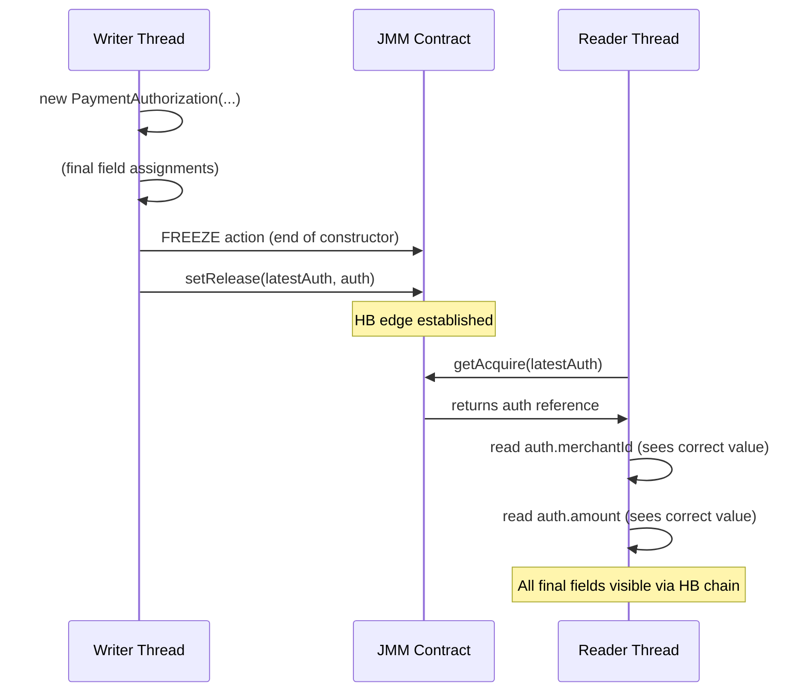

# نموذج ذاكرة Java المتقدم — الحقول النهائية وأسوار VarHandle وUnsafe

## نظرة عامة

مواصفة نموذج ذاكرة Java ليست دليل أداء — بل عقد رسمي بين المبرمج وJVM. ويعرف معظم المهندسين القواعد السطحية: `volatile` تعطي الرؤية، و`synchronized` تعطي الاستبعاد المتبادل. أما المهندسون الرئيسيون فيجب أن يتعمقوا أكثر: فهم الدلالات الرسمية لـ JMM حول الحقول `final`، وتصنيف الأسوار (fences) الدقيق الذي يعرضه `VarHandle`، ودور `sun.misc.Unsafe` في المنظومة، والفرق بين علاقة تحدث-قبل كترتيب جزئي والسببية الزمنية الفعلية. ويزوّدك هذا الدرس بالأدوات لتصميم بنى بيانات خالية من الأقفال آمنة حقًا في أنظمة معالجة الدفع، ولتدقيق داخليات الأطر، وللاستدلال على الصحة من المبادئ الأولى لا من الموروث الشفهي.

## أهداف التعلم

في نهاية هذا الدرس ستستطيع:

- شرح فعل "التجميد" (freeze) في JMM للحقول `final` وضماناته وحدوده الدقيقة
- استخدام طرق الأسوار الخمس في `VarHandle` بشكل صحيح واختيار أدنى سور لازم لسيناريو معين
- شرح سبب وجود `sun.misc.Unsafe` وكيف تحل Java الحديثة محل استخداماته لترتيب الذاكرة
- التمييز بين علاقة تحدث-قبل كترتيب جزئي والسببية الزمنية الفعلية
- شرح معنى "خالٍ من سباقات البيانات" (DRF) وما يضمنه JMM للبرامج DRF
- فهم كيف يصبح `Unsafe.compareAndSwapLong` تعليمة عتادية واحدة عبر دوال JVM الجوهرية (intrinsics)
- بناء سجل دفع غير قابل للتغيير منشور بأمان باستخدام الحقول `final` ودلالات التحرير في `VarHandle`

## سياق العمل

*مثال مركّب (مبني على أنماط شائعة في الصناعة، لا على شركة بعينها):* يعالج مسار كشف احتيال في شبكة بطاقات 85,000 طلب تفويض في الثانية على خادم بـ 48 نواة. ويُثرى كل طلب ببيانات التاجر المخزنة في كائن `MerchantProfile` كل حقوله `final`. وتُنشر هذه الملفات من خيط تحديث خلفي وتقرؤها مئات خيوط التفويض في الوقت نفسه. واكتشف الفريق خطأ خفيًا: رأى بعض القراء سمات تاجر قديمة رغم أن كل الحقول `final`. والسبب الجذري: أحد الحقول `final` يشير إلى خريطة قابلة للتغيير ظل خيط التحديث يغيّرها **بعد** البناء — وضمان الحقول النهائية في JMM لا يغطي التغييرات اللاحقة. واحتاج الإصلاح الصحيح إلى فهم ما يضمنه التجميد بالضبط، وأي الأسوار يحتاجها النشر، وما الذي كانت تفعله فعلًا الشيفرة القديمة المبنية على `Unsafe.putOrderedObject`. ويشرح هذا الدرس كل قطعة من هذا اللغز.

## دلالات الحقول النهائية: فعل التجميد

### ما يضمنه JMM

يقدّم JMM فعلًا خاصًا يُسمى **التجميد** (freeze) للحقول `final`. فعندما يكتب المُنشئ في حقل `final`، يضمن JMM ما يلي:

1. كل الكتابات في الحقول `final` داخل المُنشئ مرتبة قبل فعل التجميد في نهاية المُنشئ.
2. أي خيط يحصل على مرجع إلى الكائن **بعد** انتهاء المُنشئ يرى الحقول `final` بقيمها المبنية — ويرى أيضًا الكائنات التي يمكن الوصول إليها عبرها **كما كانت عند التجميد**.
3. يصح هذا **حتى لو نُشر المرجع عبر سباق بيانات** (حقل عادي غير volatile)، ما دام `this` لم يتسرب أثناء البناء.

وهذه النقطة الثالثة هي ما يجعل `final` مميزًا: فالكائنات غير القابلة للتغيير ذات الحقول `final` فقط آمنة للخيوط حتى عند نشرها بإهمال. (لكن النشر الآمن ما زال لازمًا لأمرين آخرين: التأكد من أن القارئ يرى **المرجع الجديد** أصلًا، وجعل الحقول غير النهائية مرئية.)

```java
// ImmutableMerchantProfile — all fields are final
public final class ImmutableMerchantProfile {
    private final String merchantId;       // freeze applies
    private final String merchantName;     // freeze applies
    private final RiskCategory riskCategory; // freeze applies — but see caveat below
    private final BigDecimal dailyLimit;   // freeze applies

    public ImmutableMerchantProfile(
            String merchantId,
            String merchantName,
            RiskCategory riskCategory,
            BigDecimal dailyLimit) {
        this.merchantId    = merchantId;
        this.merchantName  = merchantName;
        this.riskCategory  = riskCategory;
        this.dailyLimit    = dailyLimit;
        // JMM freeze happens here: all final-field writes
        // are visible to any thread that reads this reference
        // through a correctly synchronised channel
    }

    public String getMerchantId()         { return merchantId; }
    public String getMerchantName()       { return merchantName; }
    public RiskCategory getRiskCategory() { return riskCategory; }
    public BigDecimal getDailyLimit()     { return dailyLimit; }
}
```

### قنوات النشر الآمن

يحمي التجميد الحقول `final` للكائن، لكن القارئ في سباق قد يرى مرجعًا قديمًا (أو `null`) لوقت طويل. ولجعل المرجع الجديد نفسه مرئيًا فورًا — ولتغطية أي حالة غير نهائية — انشره عبر قناة آمنة:

- تخزين المرجع في حقل `volatile`
- تخزين المرجع في `AtomicReference`
- تخزين المرجع عبر `VarHandle` بدلالات تحرير على الأقل
- تخزين المرجع في حقل `final` لكائن آخر (التعدي)
- تخزين المرجع قبل بدء الخيط القارئ

```java
// Safe publication via volatile — correct
public class MerchantProfileCache {
    private volatile ImmutableMerchantProfile current;

    public void refresh(ImmutableMerchantProfile updated) {
        // volatile write: happens-before any subsequent volatile read
        // combined with freeze: all final fields are visible
        this.current = updated;
    }

    public ImmutableMerchantProfile get() {
        return current; // volatile read
    }
}
```

### القيد الحاسم: التجميد لا يحمي الحالة القابلة للتغيير

يغطي ضمان التجميد الحقول `final` **و**الكائنات التي يمكن الوصول إليها عبرها، لكن فقط **كما كانت عند نهاية المُنشئ**. ولا يغطي التغييرات اللاحقة، ولا الكتابات من خيوط أخرى لم تُرتّب قبل انتهاء المُنشئ.

```java
// DANGEROUS: the final reference is frozen, but its contents are not
public final class MerchantProfileUnsafe {
    private final Map<String, String> attributes; // final reference — FROZEN
    // the map's contents are covered only AS THEY WERE at the freeze

    public MerchantProfileUnsafe(Map<String, String> attrs) {
        // We store the CALLER's map. If the caller (or another thread)
        // modifies 'attrs' after construction, those changes are NOT
        // covered — and HashMap is not safe for concurrent modification
        this.attributes = attrs;
    }
}

// Correct approach: defensive copy into an unmodifiable structure
public final class MerchantProfileSafe {
    private final Map<String, String> attributes;

    public MerchantProfileSafe(Map<String, String> attrs) {
        // Deep copy + make unmodifiable during construction
        // The map object is fully constructed inside this constructor,
        // so the freeze covers it correctly
        this.attributes = Map.copyOf(attrs); // immutable, fully constructed here
    }
}
```

> [!WARNING]
> ضمان التجميد في JMM **لا** يحمي الكائنات القابلة للتغيير التي تظل تتغير. فإذا حمل حقل `final` قائمة `List` أو خريطة `Map` قابلة للتغيير يعدّلها أي أحد (خيط آخر، أو المستدعي الذي مررها) بعد البناء، فقد يراها القراء في حالة غير متسقة. أنشئ نسخة غير قابلة للتغيير داخل المُنشئ — `Map.copyOf()` و`List.copyOf()` — فلا يستطيع شيء تغييرها بعد ذلك. (و`Collections.unmodifiableX()` مجرد عرض: فالمجموعة الأصلية ما زالت قابلة للتغيير تحته.)

### تسرب المُنشئ: الخطأ الشائع

يُلغى ضمان التجميد إذا تسرب مرجع الكائن من المُنشئ قبل اكتمال البناء:

```java
// BUG: 'this' escapes the constructor before final fields are set
public final class FraudModel {
    private final double[] weights;
    private static FraudModel INSTANCE; // accessed by other threads

    public FraudModel(double[] weights) {
        INSTANCE = this;              // ESCAPE — 'this' is now visible to other threads
        this.weights = weights.clone(); // final field written AFTER escape
        // The JMM freeze guarantee is VOID because 'this' escaped before freeze
    }
}

// CORRECT: no escape before construction completes
public final class FraudModelSafe {
    private final double[] weights;

    private FraudModelSafe(double[] weights) {
        this.weights = weights.clone(); // final field set
        // freeze happens here — after all final writes
    }

    // Publication happens after construction; freeze is in effect
    public static FraudModelSafe create(double[] weights) {
        return new FraudModelSafe(weights);
    }
}
```

## أسوار VarHandle

### طرق الأسوار الخمس

يعرض `VarHandle` خمس طرق أسوار ساكنة منذ Java 9. يقابل كل منها نوع حاجز محددًا، فتستطيع التعبير عن أدنى مزامنة لازمة:

| الطريقة | نوع الحاجز | الأثر |
|---|---|---|
| `VarHandle.fullFence()` | الأربعة كلها (بما فيها StoreLoad) | كل القراءات/الكتابات السابقة مرتبة قبل أي قراءة/كتابة لاحقة |
| `VarHandle.acquireFence()` | LoadLoad + LoadStore | القراءات السابقة مرتبة قبل أي قراءة/كتابة لاحقة |
| `VarHandle.releaseFence()` | LoadStore + StoreStore | كل القراءات/الكتابات السابقة تكتمل قبل أي كتابة لاحقة |
| `VarHandle.loadLoadFence()` | LoadLoad | كل القراءات السابقة تكتمل قبل أي قراءة لاحقة |
| `VarHandle.storeStoreFence()` | StoreStore | كل الكتابات السابقة تكتمل قبل أي كتابة لاحقة |

### ربط الأسوار بحالات الاستخدام

```
Producer thread pattern (release semantics):
  1. Write all data fields
  2. VarHandle.storeStoreFence()   ← ensure data writes are ordered before flag write
  3. Write the flag/sequence       ← at least setOpaque, not a plain write

Consumer thread pattern (acquire semantics):
  1. Read the flag/sequence        ← at least getOpaque, or the JIT may hoist
                                     a plain read out of a polling loop
  2. VarHandle.loadLoadFence()     ← ensure flag read completes before data reads
  3. Read all data fields
```

يجب أن تكون كتابة العلَم على الأقل `setOpaque` لا كتابة عادية، وقراءته على الأقل `getOpaque` — وإلا قد يرفع JIT قراءة عادية خارج حلقة الاستطلاع.

### طابور SPSC بأسوار صريحة

طابور المنتج الواحد والمستهلك الواحد (SPSC) العمود الفقري لكثير من الأنظمة المالية منخفضة الزمن. والفكرة الأساسية: على x86 يكون ترتيب StoreStore وLoadLoad مجانيًا (نموذج ذاكرة TSO)، لكنه يكلف تعليمات فعلية على ARM — وإن كانت أقل بكثير من سور كامل. فاستخدم أضعف ترتيب صحيح:

```java
import java.lang.invoke.MethodHandles;
import java.lang.invoke.VarHandle;

/**
 * Lock-free SPSC ring buffer for payment events.
 * Uses minimal fences: storeStoreFence before publishing,
 * loadLoadFence after reading the sequence counter.
 *
 * Correctness model:
 *   Producer: write data → storeStoreFence → write sequence
 *   Consumer: read sequence → loadLoadFence → read data
 *
 * This is correct because:
 *   storeStoreFence() on the producer ensures data is visible before sequence
 *   loadLoadFence() on the consumer ensures sequence is committed before data reads
 *   Together they establish: (producer data writes) HB (consumer data reads)
 */
public final class SpscPaymentQueue {

    private static final int CAPACITY = 1024; // must be power of two
    private static final int MASK     = CAPACITY - 1;

    // NOTE on false sharing: these two counters will often share a cache line.
    // A `long[] pad = new long[8]` field would NOT help — an array is a separate
    // heap object; the field is just a 4–8 byte reference. Real implementations
    // pad through class inheritance (as JCTools does) or with @Contended
    private volatile long producerSequence = 0;
    private volatile long consumerSequence = 0;

    // Payload slots — each slot holds one PaymentEvent reference
    private final PaymentEvent[] slots = new PaymentEvent[CAPACITY];

    // VarHandle for sequence fields (used to read with plain semantics where safe)
    private static final VarHandle PRODUCER_SEQ;
    private static final VarHandle CONSUMER_SEQ;

    static {
        try {
            var lookup = MethodHandles.lookup();
            PRODUCER_SEQ = lookup.findVarHandle(SpscPaymentQueue.class, "producerSequence", long.class);
            CONSUMER_SEQ = lookup.findVarHandle(SpscPaymentQueue.class, "consumerSequence", long.class);
        } catch (ReflectiveOperationException e) {
            throw new ExceptionInInitializerError(e);
        }
    }

    /**
     * Called only from the single producer thread.
     * Returns false if the queue is full.
     */
    public boolean offer(PaymentEvent event) {
        // Plain read of producerSequence — safe because only producer writes it
        long pSeq = (long) PRODUCER_SEQ.get(this);
        // Acquire read of consumerSequence — need visibility of consumer progress
        long cSeq = (long) CONSUMER_SEQ.getAcquire(this);

        if (pSeq - cSeq >= CAPACITY) {
            return false; // full
        }

        int slot = (int) (pSeq & MASK);
        slots[slot] = event; // write payload

        // storeStoreFence: payload write ordered before the sequence write.
        // (setRelease below already gives this ordering — the explicit fence
        //  only makes the intent visible to readers of the code)
        VarHandle.storeStoreFence();

        // Release write: makes producerSequence visible to consumer
        PRODUCER_SEQ.setRelease(this, pSeq + 1);
        return true;
    }

    /**
     * Called only from the single consumer thread.
     * Returns null if the queue is empty.
     */
    public PaymentEvent poll() {
        // Plain read of consumerSequence — safe because only consumer writes it
        long cSeq = (long) CONSUMER_SEQ.get(this);
        // Acquire read: ensures we see the latest producerSequence
        long pSeq = (long) PRODUCER_SEQ.getAcquire(this);

        if (cSeq >= pSeq) {
            return null; // empty
        }

        // loadLoadFence: pSeq read ordered before the slot read
        // (getAcquire above already guarantees this — explicit for clarity)
        VarHandle.loadLoadFence();

        int slot = (int) (cSeq & MASK);
        PaymentEvent event = slots[slot];
        slots[slot] = null; // clear reference to aid GC

        // Release write: signals to producer that slot is now free
        CONSUMER_SEQ.setRelease(this, cSeq + 1);
        return event;
    }
}
```

ملاحظة عن المشاركة الزائفة: هذان العدّادان سيتشاركان غالبًا خط ذاكرة مؤقتة. وحقل `long[] pad = new long[8]` **لن** يفيد — فالمصفوفة كائن منفصل في الكومة، والحقل مجرد مرجع بحجم 4–8 بايت. والتنفيذات الحقيقية تحشو عبر وراثة الأصناف (كما يفعل JCTools) أو بـ `@Contended`. والسوران الصريحان زائدان عمليًا — فـ `setRelease` و`getAcquire` يعطيان الترتيب نفسه — لكنهما يوضحان القصد لقارئ الشيفرة.

> [!NOTE]
> على x86 (نموذج TSO) لا يُصدر `storeStoreFence()` و`loadLoadFence()` أي تعليمة — بل يمنعان JIT فقط من إعادة الترتيب. وعلى ARM (ضعيف الترتيب) يُصدران `dmb ishst` (كتابة-كتابة) و`dmb ishld` (قراءة-قراءة) على التوالي، وهما أرخص من `dmb ish` الكامل الذي يحتاجه `fullFence()`. وعند عشرات آلاف العمليات في الثانية يكون التوفير ملحوظًا — فقِس على عتادك المستهدف.

### اقتران الاكتساب-التحرير

تقابل طرق الأسوار الخمس أنصاف حواجز. والاقتران الصحيح لأنماط التسليم:

```java
// Pattern: publish a computed result
// Producer side
computeResult();                       // compute
VarHandle.releaseFence();              // all prior writes drain
resultRef.setOpaque(this, result);     // store (at least opaque, not plain)

// Consumer side
var r = resultRef.getOpaque(this);     // load
VarHandle.acquireFence();              // all subsequent reads see producer's writes
useResult(r);                          // use
```

> [!IMPORTANT]
> ‏`VarHandle.releaseFence()` قبل كتابة عادية **لا** يعطي دلالات الاكتساب-التحرير. فالكتابة نفسها يجب أن تستخدم على الأقل `setOpaque` أو `setRelease`. وقد يُحسّن JIT سور `releaseFence()` متبوعًا بـ `set()` عادية على بعض المنصات فيُبطل السور كليًا. فاقرن السور دائمًا بنمط وصول مرتب بشكل مناسب.

## ‏sun.misc.Unsafe: ما هو ولماذا يوجد

### السياق التاريخي

لم يكن `sun.misc.Unsafe` مقصودًا أبدًا كواجهة عامة. بل كان مخرج طوارئ أُضيف في Java المبكرة ليسمح لـ JDK نفسه بعمليات يمنعها نظام الأنواع: تخصيص الذاكرة دون استدعاء مُنشئ، وعمليات CAS خام على إزاحات كائنات عشوائية، وإصدار أسوار ذاكرة صريحة. والاسم ليس سخرية — فهو غير آمن فعلًا.

```java
// How Unsafe is obtained — only works in privileged code
import sun.misc.Unsafe;
import java.lang.reflect.Field;

public class UnsafeAccessor {
    public static Unsafe getUnsafe() {
        try {
            Field f = Unsafe.class.getDeclaredField("theUnsafe");
            f.setAccessible(true);
            return (Unsafe) f.get(null);
        } catch (ReflectiveOperationException e) {
            throw new RuntimeException("Cannot access Unsafe", e);
        }
    }
}
```

### طرق أسوار الذاكرة الثلاث في Unsafe

```java
Unsafe unsafe = UnsafeAccessor.getUnsafe();

// Full fence: equivalent to VarHandle.fullFence()
// On x86 HotSpot emits a lock-prefixed instruction (lock addl); on ARM dmb ish
unsafe.fullFence();

// Store fence: equivalent to VarHandle.releaseFence() (LoadStore + StoreStore)
// On x86: no instruction — only a compiler barrier
unsafe.storeFence();

// Load fence: equivalent to VarHandle.acquireFence() (LoadLoad + LoadStore)
// On x86: no instruction — only a compiler barrier
unsafe.loadFence();
```

يكافئ `storeFence` ‏`VarHandle.releaseFence()`، ويكافئ `loadFence` ‏`VarHandle.acquireFence()`؛ وعلى x86 لا يُصدر أي منهما تعليمة — بل حاجز مترجم فقط. أما `fullFence` فيُصدر تعليمة بالبادئة lock على x86 و`dmb ish` على ARM.

### كيف استخدم Netty وDisruptor ‏Unsafe

استخدم LMAX Disruptor — الذي يشغّل كثيرًا من أنظمة التداول والدفع منخفضة الزمن — ‏`Unsafe` لإجراء كتابات مرتبة في حقول تسلسل المخزن الحلقي:

```java
// Disruptor-style pattern (pre-VarHandle, using Unsafe)
// This is the HISTORICAL approach — shown for understanding, not for use
public final class Sequence {
    private volatile long value;
    private static final long VALUE_OFFSET;
    private static final Unsafe UNSAFE = UnsafeAccessor.getUnsafe();

    static {
        try {
            VALUE_OFFSET = UNSAFE.objectFieldOffset(
                Sequence.class.getDeclaredField("value"));
        } catch (Exception e) {
            throw new RuntimeException(e);
        }
    }

    // putOrderedLong = StoreStore fence + plain store (no StoreLoad fence)
    // Cheaper than a volatile write on x86 (volatile write = StoreLoad fence)
    public void setOrdered(long update) {
        UNSAFE.putOrderedLong(this, VALUE_OFFSET, update);
    }

    public long get() {
        return value; // volatile read
    }
}
```

البديل الحديث باستخدام `VarHandle`:

```java
// Modern VarHandle replacement — equivalent semantics, no Unsafe
public final class Sequence {
    private volatile long value;
    private static final VarHandle VALUE_VH;

    static {
        try {
            VALUE_VH = MethodHandles.lookup()
                .findVarHandle(Sequence.class, "value", long.class);
        } catch (ReflectiveOperationException e) {
            throw new ExceptionInInitializerError(e);
        }
    }

    // setRelease = StoreStore + LoadStore fence before store
    // Equivalent to Unsafe.putOrderedLong, but type-safe and supported
    public void setOrdered(long update) {
        VALUE_VH.setRelease(this, update);
    }

    public long get() {
        return (long) VALUE_VH.getAcquire(this);
    }
}
```

> [!WARNING]
> ‏`sun.misc.Unsafe` **ليس جزءًا من واجهة Java العامة**. وإزاحات حقوله خاصة بالمنصة. وقد أهمل JEP 471 ‏(Java 23) طرق الوصول إلى الذاكرة فيه تمهيدًا لإزالتها، وجعل JEP 498 ‏(Java 24) الـ JVM تطبع تحذيرًا عند أول استخدام لها. وأي شيفرة تطبيق تستخدم `Unsafe` مباشرة ستنكسر عبر إصدارات JDK الرئيسية. فاستخدم `VarHandle` (متاح منذ Java 9) أو أصناف `java.util.concurrent.atomic` بدلًا منه. ولا ينبغي أن يلمس `Unsafe` إلا مؤلفو الأطر وJDK.

### مسار الانتقال

```
Java 1.5–8:   sun.misc.Unsafe (field offsets, putOrdered*, CAS methods)
Java 9–:      java.lang.invoke.VarHandle (typed, access-mode based, public API)
Java 9–:      java.util.concurrent.atomic.* (high-level wrappers)
Java 23:      Unsafe memory-access methods deprecated for removal (JEP 471)
Java 24:      runtime warning on first use of those methods (JEP 498)
```

## علاقة تحدث-قبل ليست سببية زمنية

### التعريف الرسمي

يعرّف JMM علاقة تحدث-قبل (HB) كـ **ترتيب جزئي** على الأفعال (القراءات، والكتابات، والمزامنة) في تنفيذ البرنامج. وخصائصها الأساسية:

- **التعدي**: إذا كان A HB B وB HB C، فإن A HB C.
- **ترتيب البرنامج**: داخل خيط واحد، كل الأفعال مرتبة بـ HB.
- **ليست كلية**: قد لا يتحقق A HB B ولا B HB A لفعلين A وB. فهما فعلان **متزامنان**.

الفكرة الحاسمة: **علاقة HB تتعلق بالرؤية لا بالوقت الفعلي**. فـ "A HB B" تعني أن B مضمون أن يرى آثار A. وفعلان يحدثان واحدًا بعد الآخر زمنيًا دون سلسلة HB بينهما لا يحملان **أي** ضمان رؤية — ويحق لـ JIT والمعالج إعادة ترتيبهما ما دامت نتيجة كل خيط لنفسه لم تتغير.

```
// Three threads, two HB edges:
Thread 1: write x=1 → volatile write flag=true   (1) HB (2) by program order
Thread 2: volatile read flag → read x            (2) HB (3) — if the read SEES true
Thread 3: (independent) write y=2                 no HB relationship with 1,2,3

// Real-time ordering might be:
// T=0ns  Thread 3 writes y=2
// T=1ns  Thread 1 writes x=1
// T=2ns  Thread 1 writes flag=true
// T=3ns  Thread 2 reads flag=true (sees true)
// T=4ns  Thread 2 reads x (guaranteed to see 1 due to HB chain)

// The HB chain (1) → (2) → (3) gives Thread 2 visibility of x=1
// Thread 3's write to y has NO HB relationship with any of these
// Thread 2 reading y has no guarantee — it may see the old value
```

### البرامج الخالية من سباقات البيانات (DRF)

يقدّم JMM ضمانًا قويًا: إذا كان البرنامج **خاليًا من سباقات البيانات** في كل تنفيذاته، فإنه ينفّذ **باتساق تتابعي** — كأن كل الخيوط نُفّذت بترتيب متداخل كلي ما.

يحدث سباق البيانات عندما:
1. يصل خيطان إلى المتغير نفسه
2. يكون أحد الوصولين على الأقل كتابة
3. لا يكون الوصولان مرتبين بعلاقة HB

```java
// DATA RACE — not DRF — JMM gives no guarantee
int balance = 1000;

// Thread 1 (no synchronisation)
balance = balance - 100; // read + write, no HB with Thread 2

// Thread 2 (no synchronisation)
balance = balance + 50;  // read + write, no HB with Thread 1
// balance may end up as 950, 900 or 1050 — one update can be lost
// The JMM allows the JIT to cache balance in a register permanently

// DRF — all accesses synchronised
AtomicInteger safeBalance = new AtomicInteger(1000);

// Thread 1
safeBalance.addAndGet(-100); // atomic CAS — HB with any subsequent read

// Thread 2
safeBalance.addAndGet(50);   // atomic CAS — HB-ordered with Thread 1's CAS
// Final value is deterministic: 950
```

قد تنتهي القيمة إلى 950 أو 900 أو 1050 — أي قد يضيع تحديث. أما مع `AtomicInteger` فالنتيجة النهائية محددة: 950.

> [!NOTE]
> ‏DRF ليس عن الصحة بالمعنى "الخاطئ بوضوح" فقط. فـ JMM يسمح صراحة لمترجمات JIT بتحسينات عدوانية (رفع الشيفرة خارج الحلقات، وطي ثوابت القراءات غير المحمية، والتخزين في المسجلات) على الشيفرة ذات سباقات البيانات. فالمتغير الذي يكتبه خيط آخر دون أن يُعلن `volatile` أو يُوصل إليه عبر `VarHandle` قد يُخزن في مسجل إلى الأبد — فلا يكون JIT معطوبًا؛ بل في شيفرتك سباق بيانات، وعقد JMM باطل.

### مثال عملي على الترتيب الجزئي

```java
// Payment pipeline: two independent enrichment steps
// happening concurrently, then a final aggregation

public class PaymentEnricher {
    private String merchantName;    // set by Thread A
    private String cardholderName;  // set by Thread B
    private volatile boolean ready; // publication flag

    // Thread A: enriches merchant data
    public void enrichMerchant(String name) {
        this.merchantName = name;    // (A1) plain write
        this.ready = true;           // (A2) volatile write — A1 HB A2
    }

    // Thread B: enriches cardholder data
    public void enrichCardholder(String name) {
        this.cardholderName = name;  // (B1) plain write
        // B1 has NO HB relationship with A1, A2, or C1
        // This is a data race if Thread C reads cardholderName
    }

    // Thread C: aggregates — BROKEN for cardholderName
    public Payment aggregate() {
        if (!this.ready) return null;    // (C1) volatile read — A2 HB C1
        // A1 HB A2 HB C1 → Thread C sees merchantName correctly
        // B1 has NO HB with C1 → Thread C may NOT see cardholderName
        return new Payment(merchantName, cardholderName); // BUG: cardholderName unsafe
    }
}

// CORRECT: both enrichers use volatile or synchronised publication
public class PaymentEnricherSafe {
    private volatile String merchantName;
    private volatile String cardholderName;

    public void enrichMerchant(String name) {
        this.merchantName = name;
    }

    public void enrichCardholder(String name) {
        this.cardholderName = name;
    }

    public Payment aggregate() {
        String m = merchantName;
        String c = cardholderName;
        if (m == null || c == null) return null;
        return new Payment(m, c);
    }
}
```

يرى الخيط C ‏`merchantName` بشكل صحيح عبر السلسلة A1 HB A2 HB C1، لكن لا علاقة HB بين B1 وC1، فقد لا يرى `cardholderName`. والإصلاح: انشر الحقلين عبر `volatile` أو مزامنة.

## دوال JVM الجوهرية: من Java إلى العتاد

### كيف يصبح CAS تعليمة واحدة

يتعرف مترجم JIT على استدعاءات طرق محددة ويستبدلها بشيفرة أصلية محسّنة (intrinsics). و`Unsafe.compareAndSwapLong` (وبالتبعية `AtomicLong.compareAndSet`) من أهمها:

```
// Java source:
AtomicLong counter = new AtomicLong(0);
counter.compareAndSet(0L, 1L);

// x86-64 assembly emitted by JIT (via intrinsic):
lock cmpxchg qword ptr [rdx+0x10], rcx
// LOCK prefix: atomic bus lock (or cache-line lock on modern CPUs)
// CMPXCHG: compare RAX (expected value) with [rdx+0x10]; if equal, write RCX

// Without intrinsic (hypothetical naive implementation):
// 1. Load value from memory
// 2. Compare in registers
// 3. Conditionally store (non-atomic, NOT safe across threads)
```

تعليمة `LOCK CMPXCHG` على x86 مضمونة معماريًا أن تكون ذرية، وتتضمن حاجز ذاكرة كاملًا ضمنيًا. ولهذا تكون عمليات CAS في Java صحيحة **و**فعالة معًا — فهي تقابل مباشرة ما يوفره العتاد.

```java
// Benchmarking intrinsic CAS vs a lock-based alternative
// Using JMH (micro-benchmark harness)

@BenchmarkMode(Mode.AverageTime)
@OutputTimeUnit(TimeUnit.NANOSECONDS)
@State(Scope.Benchmark)
public class CasBenchmark {

    private AtomicLong atomicCounter = new AtomicLong(0);
    private long lockedCounter = 0;
    private final Object lock = new Object();

    // Intrinsic path: single LOCK CMPXCHG instruction
    @Benchmark
    public boolean intrinsicCas() {
        long current = atomicCounter.get();
        return atomicCounter.compareAndSet(current, current + 1);
    }

    // Lock-based path: monitor enter/exit + plain store
    @Benchmark
    public void lockedIncrement() {
        synchronized (lock) {
            lockedCounter++;
        }
    }

    // Illustrative results on x86-64 (vary by CPU), single thread:
    // intrinsicCas:    ~4 ns   (LOCK CMPXCHG + memory ordering)
    // lockedIncrement: ~12 ns  (monitor enter + exit overhead)
    //
    // Under contention (8 threads):
    // intrinsicCas:    ~25 ns  (CAS retry spin)
    // lockedIncrement: ~80 ns  (thread parking + wakeup)
}
```

### أنماط الوصول في VarHandle ومقابلاتها الجوهرية

```
VarHandle access mode → JIT intrinsic → hardware instruction (x86-64)
─────────────────────────────────────────────────────────────────────
get()                 → plain load     → MOV (no barrier)
getOpaque()          → opaque load    → MOV (no compiler reorder)
getAcquire()         → acquire load   → MOV + implicit barrier (x86 TSO: free)
getVolatile()        → volatile load  → MOV (x86 TSO already orders it)
set()                → plain store    → MOV
setOpaque()          → opaque store   → MOV (no compiler reorder)
setRelease()         → release store  → MOV + implicit barrier (x86 TSO: free)
setVolatile()        → volatile store → MOV + lock addl (or XCHG) — the StoreLoad fence
compareAndSet()      → CAS            → LOCK CMPXCHG
getAndAdd()          → fetch-add      → LOCK XADD
```

> [!NOTE]
> على x86 ‏(TSO) تكون قراءات الاكتساب وكتابات التحرير "مجانية" — فالعتاد يوفر بالفعل ترتيبًا أقوى مما تتطلبه هذه الأنماط. ولهذا تكون `setRelease` بسرعة الكتابة العادية على x86، بينما تُصدر على ARM تعليمة `stlr` (كتابة-تحرير). واختيار `setRelease` بدل `setVolatile` يتجنب سور StoreLoad — التعليمة ذات البادئة lock على x86، والترتيب الإضافي على ARM — وهذا ملحوظ في المسارات الساخنة.

## البناء الآمن: الحقول النهائية + تحرير VarHandle

### النمط الكامل لسجل دفع

هذا النمط هو الأسلوب الإنتاجي لنشر سجلات دفع غير قابلة للتغيير في مسار كشف الاحتيال:

```java
import java.lang.invoke.MethodHandles;
import java.lang.invoke.VarHandle;
import java.math.BigDecimal;
import java.time.Instant;

/**
 * Immutable payment authorization record.
 *
 * Construction safety contract:
 * 1. All fields are final — JMM freeze applies at end of constructor.
 * 2. The reference is published via VarHandle.setRelease(), which provides
 *    a StoreStore + LoadStore fence before the reference store.
 * 3. Consumers read via getAcquire(), providing a LoadLoad + LoadStore
 *    fence after the reference load.
 * 4. The combination: producer freeze + release publish + acquire consume
 *    guarantees all final field values are visible to consumers.
 */
public final class PaymentAuthorization {

    public enum Status { PENDING, APPROVED, DECLINED }

    private final String  authorizationId;
    private final String  cardToken;        // tokenized PAN
    private final String  merchantId;
    private final BigDecimal amount;
    private final String  currency;
    private final Instant requestedAt;
    private final Status  status;

    // Package-private constructor — use factory
    PaymentAuthorization(
            String authorizationId,
            String cardToken,
            String merchantId,
            BigDecimal amount,
            String currency,
            Instant requestedAt,
            Status status) {
        // All assignments happen before the implicit freeze at constructor end
        this.authorizationId = authorizationId;
        this.cardToken        = cardToken;
        this.merchantId       = merchantId;
        this.amount           = amount;
        this.currency         = currency;
        this.requestedAt      = requestedAt;
        this.status           = status;
        // FREEZE: JMM freeze action here — all final writes are ordered before
        //         any action that makes 'this' visible to another thread
    }

    // Accessors omitted for brevity
    public String getAuthorizationId() { return authorizationId; }
    public String getMerchantId()      { return merchantId; }
    public BigDecimal getAmount()      { return amount; }
    public Status getStatus()          { return status; }
}

/**
 * Cache that holds the most recent authorization per card token.
 * Publish via release, consume via acquire — minimum correct synchronisation.
 */
public class RecentAuthorizationCache {

    // Not volatile — we use VarHandle access modes explicitly
    private PaymentAuthorization latestAuth;

    private static final VarHandle LATEST_AUTH_VH;

    static {
        try {
            LATEST_AUTH_VH = MethodHandles.lookup()
                .findVarHandle(RecentAuthorizationCache.class,
                               "latestAuth",
                               PaymentAuthorization.class);
        } catch (ReflectiveOperationException e) {
            throw new ExceptionInInitializerError(e);
        }
    }

    /**
     * Called by writer thread after constructing a new authorization.
     *
     * setRelease semantics:
     *   - All prior writes (the PaymentAuthorization constructor writes)
     *     are ordered before this store.
     *   - Combined with the JMM freeze, all final fields of the new object
     *     are guaranteed visible to any thread that reads via getAcquire().
     */
    public void publish(PaymentAuthorization auth) {
        LATEST_AUTH_VH.setRelease(this, auth);
    }

    /**
     * Called by reader threads (authorization decision logic).
     *
     * getAcquire semantics:
     *   - All subsequent reads are ordered after this load.
     *   - Any HB chain from the writer's setRelease to this getAcquire
     *     means all writer's prior writes (including final field assignments)
     *     are visible.
     */
    public PaymentAuthorization readLatest() {
        return (PaymentAuthorization) LATEST_AUTH_VH.getAcquire(this);
    }
}
```

عقد سلامة البناء: كل الحقول `final` فيحدث التجميد في نهاية المُنشئ؛ ويُنشر المرجع عبر `setRelease()`؛ ويقرؤه المستهلكون عبر `getAcquire()`. ومجموع التجميد عند المنتج والنشر بالتحرير والاستهلاك بالاكتساب يضمن رؤية كل قيم الحقول النهائية.

### الضمان على مستوى التجميع (Assembly)

```
// Writer thread execution (conceptual assembly)
// 1. Constructor writes (all final field stores):
MOV [authorizationId_offset], rax   ; plain store
MOV [merchantId_offset], rbx        ; plain store
MOV [amount_offset], rcx            ; plain store
; ... (all final field stores)

// 2. JMM freeze + VarHandle.setRelease():
; On x86 (TSO): release store = plain MOV (TSO guarantees store order)
MOV [latestAuth_offset], rdx        ; reference store

// On ARM: release store = STLR (store-release instruction)
; STLR x3, [x1]                      ; atomic store with release barrier

// ─────────────────────────────────────────────────────────
// Reader thread execution
// 1. VarHandle.getAcquire():
; On x86: acquire load = plain MOV (TSO guarantees load order after store)
MOV rax, [latestAuth_offset]        ; reference load

; On ARM: acquire load = LDAR (load-acquire instruction)
; LDAR x0, [x1]                      ; atomic load with acquire barrier

// 2. All final field reads (guaranteed visible due to HB chain):
MOV rbx, [authorizationId_offset]   ; plain load — sees correct value
MOV rcx, [merchantId_offset]        ; plain load — sees correct value
```



## اختبار المعرفة

**س: حقل `final` في صنف يحمل مرجعًا إلى `List<String>` مُلئت داخل المُنشئ. وبعد النشر عبر كتابة `volatile`، هل محتوى `List` مضمون الرؤية للخيط القارئ؟**

**ج:** نعم — لكن فقط لأن `List` **بُنيت بالكامل داخل المُنشئ نفسه**. ففعل التجميد في JMM يغطي الحقل `final` والكائنات التي يمكن الوصول إليها عبره كما كانت عند نهاية المُنشئ. ولأن `List` مُلئت أثناء تنفيذ المُنشئ (قبل التجميد)، فحالتها كاملة مرئية. أما إذا مُرر مرجع `List` نفسه من الخارج (مثلًا كمعامل للمُنشئ يواصل خيط آخر تعديله)، فالتعديلات اللاحقة على محتواه غير مغطاة.

**س: لماذا لا يُصدر `VarHandle.setRelease()` سور `StoreLoad`، ومتى يهم غياب ذلك السور؟**

**ج:** يعطي `setRelease()` ترتيب **LoadStore + StoreStore**: فكل القراءات والكتابات السابقة مرتبة قبل الكتابة. ولا يضيف سور `StoreLoad` — أغلى الحواجز، الذي يفرّغ مخزن الكتابة قبل أي قراءة لاحقة. ويهم غيابه عندما يجب ألا تنتقل **قراءات الخيط الكاتب نفسه اللاحقة** إلى ما قبل هذه الكتابة. والحالة الكلاسيكية الاستبعاد المتبادل على نمط Dekker: يعيّن الخيط 1 العلَم `flag1` ثم يقرأ `flag2`؛ ويعيّن الخيط 2 العلَم `flag2` ثم يقرأ `flag1`. فمع التحرير/الاكتساب وحدهما قد يقرأ كل خيط القيمة القديمة `false` لعلَم الآخر فيدخل الاثنان. ومن أنماط الوصول، يوفر `setVolatile()` (أو `fullFence()`) ترتيب StoreLoad. أما نمط التسليم من المنتج إلى المستهلك (اكتب البيانات ثم عيّن العلَم)، فيكفيه `setRelease` لدى المنتج و`getAcquire` لدى المستهلك، ويتجنب السور المكلف.

## التحدي العملي

أنت المهندس الرئيسي المسؤول عن **ذاكرة مؤقتة لدرجات مخاطر التجار** في مسار التفويض الآني لشبكة بطاقات. تحمل الذاكرة كائن `MerchantRiskScore` واحدًا لكل تاجر، يحدّثه خيط خلفي كل 30 ثانية. وتقرأ خيوط التفويض (أكثر من 200 متزامنة) الدرجة نحو 85,000 مرة في الثانية.

**التنفيذ الحالي (المعطوب):**

```java
public class MerchantRiskCache {
    private final Map<String, MerchantRiskScore> scores = new HashMap<>();
    private long lastRefreshEpoch;

    public MerchantRiskScore getScore(String merchantId) {
        return scores.get(merchantId); // no synchronisation
    }

    public void refresh(Map<String, MerchantRiskScore> updated) {
        scores.clear();
        scores.putAll(updated);
        lastRefreshEpoch = System.currentTimeMillis();
    }
}
```

**مهامك:**

1. **حدّد كل انتهاكات JMM** في التنفيذ الحالي. وسمِّ الأفعال المحددة التي تشكل سباقات بيانات واشرح أي قاعدة في JMM تُنتهك.

2. **صمّم تنفيذًا مصححًا** باستخدام `VarHandle` بأدنى دلالات أسوار لازمة. وتجنب `volatile` على مرجع `Map` — واستخدم بدلًا من ذلك `setRelease`/`getAcquire` عبر `VarHandle` لإظهار النمط. واستخدم `Map.copyOf()` لضمان عدم قابلية الخريطة المنشورة للتغيير.

3. **اشرح ضمان التجميد** في تصميمك: أظهر أن كائنات `MerchantRiskScore` المخزنة في الخريطة مرئية بأمان إذا استخدمت حقولًا `final` وبُنيت أثناء دورة التحديث.

4. **اكتب اختبار أداء JMH** يقارن تنفيذك المصحح مع:
   - نسخة `HashMap` المعطوبة (المتوقع: سريعة لكنها خاطئة)
   - نسخة `ConcurrentHashMap` (المتوقع: صحيحة لكن بكلفة أعلى)
   - نسخة الاكتساب/التحرير بـ `VarHandle` (المتوقع: صحيحة وسريعة)

5. **فكّر في حالة يكون فيها لـ `MerchantRiskScore` حقل `double riskScore` غير نهائي** يُحدَّث بعد البناء. واشرح لماذا لا ينطبق ضمان التجميد بعد ذلك، وأظهر كيف تصلح كائن الدرجة نفسه لاستعادة السلامة.

المُخرَج المتوقع: وحدة Java عاملة فيها تنفيذ الذاكرة المؤقتة، ونموذج `MerchantRiskScore`، واختبار أداء JMH. ويجب أن يُظهر الاختبار أن حل `VarHandle` ضمن 5% من زمن قراءة نسخة `HashMap` المعطوبة.

<!-- KNOWLEDGE-CHECK
{
  "questions": [
    {
      "text": "يحمل حقل final قائمة List<String> مُلئت بالكامل داخل المُنشئ. وبعد النشر عبر كتابة volatile، هل محتوى List مضمون الرؤية للخيوط القارئة؟",
      "options": [
        "لا، الحقول final تضمن رؤية المرجع فقط، لا حالة الكائن المشار إليه",
        "نعم، يغطي فعل التجميد في JMM كل الكتابات التي تحدث أثناء المُنشئ، بما فيها ملء List، فيصبح محتواها مرئيًا لأي خيط يحصل على المرجع بعد الكتابة volatile",
        "نعم، لكن فقط إذا كانت List من نوع java.util.ArrayList لا LinkedList",
        "لا، ضمان التجميد ينطبق فقط على الحقول final البدائية لا المرجعية"
      ],
      "correct": 1,
      "explanation": "يحدث التجميد في JMM عند نهاية المُنشئ. وأي خيط يحصل على مرجع الكائن بعد ذلك يرى الحقول final — والكائنات التي يمكن الوصول إليها عبرها — محدّثة على الأقل كما كانت عند التجميد. ولأن List مُلئت بالكامل داخل المُنشئ، فمحتواها مرئي. وهذا ينطبق على كل الحقول final لا البدائية فقط. ولا يغطي التغييرات التي تُجرى على List بعد البناء."
    },
    {
      "text": "ما انتهاكات JMM المحددة في صنف يصل فيه خيطان بالتزامن إلى حقل HashMap عادي (غير volatile وغير متزامن) — أحدهما يستدعي clear()+putAll() والآخر يستدعي get()؟",
      "options": [
        "مجرد احتمال ConcurrentModificationException، وهي مشكلة مكتبة لا مشكلة JMM",
        "سباق بيانات: القراءات والكتابات المتزامنة على الحالة الداخلية لـ HashMap غير مرتبة بأي علاقة تحدث-قبل، فيسمح JMM لـ JIT بتخزين القراءات في المسجلات ويسمح للقارئ برؤية أي حالة محدّثة جزئيًا",
        "مشكلة رؤية فقط — قد يرى القارئ مرجعًا قديمًا إلى HashMap القديمة",
        "لا انتهاك لـ JMM لأن HashMap مرجع في حقل final"
      ],
      "correct": 1,
      "explanation": "دون مزامنة، تكون كل الوصولات المتزامنة إلى الجدول الداخلي لـ HashMap وحقل size وmodCount سباقات بيانات. ويسمح JMM لـ JIT بتخزين هذه القراءات مؤقتًا، وقد يرى القارئ الحجم القديم مع الجدول الجديد، أو أي مزيج من الحالة الداخلية القديمة والجديدة. إضافة إلى ذلك، HashMap ليست آمنة للخيوط: فالتعديل البنيوي المتزامن قد يفسدها (مدخلات ضائعة، وحاويات معطوبة، وفي إصدارات JDK القديمة حتى حلقات لا نهائية)."
    },
    {
      "text": "لا يُصدر VarHandle.setRelease() سور StoreLoad. متى يهم غياب سور StoreLoad للصحة؟",
      "options": [
        "يهم دائمًا — setRelease() غير آمن أبدًا للاستخدام متعدد الخيوط",
        "يهم عندما يجب ألا تنتقل قراءات الخيط الكاتب نفسه اللاحقة إلى ما قبل هذه الكتابة — مثل نمط Dekker 'عيّن علَمي، ثم اقرأ علَمك'؛ ويوفر setVolatile() أو fullFence() ترتيب StoreLoad",
        "يهم على عتاد ARM فقط لا على x86",
        "يهم فقط عندما يخزن الحقل نوعًا بدائيًا لا مرجع كائن"
      ],
      "correct": 1,
      "explanation": "يعطي setRelease() ترتيب تحرير (LoadStore + StoreStore): كل الكتابات السابقة مرتبة قبل هذه الكتابة. ولا يضيف سور StoreLoad، فقد تُنفَّذ قراءة **لاحقة** للخيط نفسه قبل أن تصبح هذه الكتابة مرئية للآخرين. ويهم ذلك في بروتوكولات نمط Dekker — عيّن علَمي ثم اقرأ علَمك — حيث قد يقرأ كل خيط القيمة القديمة للآخر. أما التسليم المعياري من المنتج إلى المستهلك (اكتب البيانات ثم عيّن العلَم)، فيكفيه setRelease لدى الكاتب مع getAcquire لدى القارئ، على x86 وARM معًا."
    }
  ]
}
-->

<!-- PRACTICAL-CHALLENGE
{
  "title": "ذاكرة مؤقتة لدرجات مخاطر التجار مع VarHandle واختبار أداء JMH",
  "difficulty": "advanced",
  "estimatedMinutes": 80,
  "tasks": [
    {
      "id": "1",
      "description": "حدّد كل انتهاكات JMM في MerchantRiskCache يستخدم حقل HashMap عاديًا يُقرأ ويُكتب بالتزامن. وسمِّ كل سباق بيانات محدد: اسرد الأفعال المتزامنة، والحقل الذي تصل إليه، وأي قاعدة في JMM (تحدث-قبل، ترتيب البرنامج، قفل المراقب، volatile) تُنتهك. واشرح لماذا يُسمح لـ JIT بتخزين قراءات HashMap في مسجل إلى الأبد."
    },
    {
      "id": "2",
      "description": "نفّذ MerchantRiskCache مصححًا باستخدام VarHandle مع setRelease() للكاتب وgetAcquire() للقراء. وينشر الكاتب لقطة Map.copyOf() غير قابلة للتغيير. ولا تستخدم volatile على الحقل — استخدم VarHandle صراحة. وأضف تعليقات على كل استدعاء VarHandle تشرح الحاجز المحدد المُصدر. واشرح ضمان التجميد: لماذا تكون كائنات MerchantRiskScore ذات الحقول final مرئية بأمان بعد النشر."
    },
    {
      "id": "3",
      "description": "وسّع التصميم لمعالجة حالة يكون فيها لـ MerchantRiskScore حقل double riskScore غير نهائي يُحدَّث بعد البناء. واشرح لماذا لا ينطبق ضمان التجميد بعد ذلك، وأظهر إصلاحين: (1) اجعل riskScore نهائيًا ومرره إلى المُنشئ، (2) إذا كانت الحالة القابلة للتغيير لا مفر منها، فأعلن riskScore كـ volatile ووثّق كلفة الحاجز الناتجة. وأظهر أن الإصلاح (1) هو المفضل."
    },
    {
      "id": "4",
      "description": "اكتب اختبار أداء JMH بثلاثة تنفيذات: (أ) HashMap معطوبة بلا مزامنة، (ب) ConcurrentHashMap مع استبدال putAll بعمليات compute، (ج) VarHandle مع setRelease/getAcquire على مرجع لقطة Map.copyOf(). وقِس إنتاجية القراءة بخيط واحد وإنتاجية القراءة المتزامنة بـ 200 خيط. ويجب أن تحقق نسخة VarHandle زمن قراءة ضمن 5% من HashMap المعطوبة مع كونها صحيحة بشكل مثبت. وأبلغ النتائج بوحداتها واشرح الفرق بلغة أنماط الوصول إلى خطوط الذاكرة المؤقتة وكلفة الحواجز."
    }
  ]
}
-->
