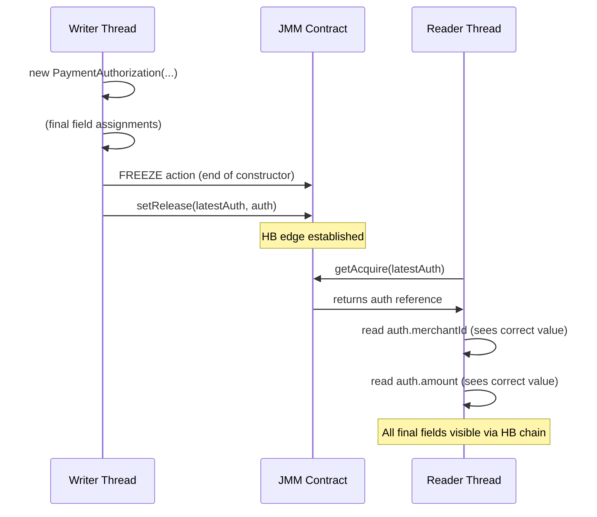

The Java Memory Model specification is not a performance guideline — it is a formal contract between the programmer and the JVM. Most engineers know the surface rules: `volatile` gives visibility, `synchronized` gives mutual exclusion. Principal Engineers must go deeper: understanding the JMM's formal semantics around final fields, the precise fence taxonomy exposed by `VarHandle`, the role `sun.misc.Unsafe` plays in the ecosystem, and the distinction between happens-before as a partial order versus real-time causality. This lesson arms you with the tools to design truly safe lock-free data structures in payment processing systems, audit framework internals, and reason about correctness from first principles rather than folklore.

## Learning Objectives

By the end of this lesson you will be able to:

- Explain the JMM "freeze" action for `final` fields and its precise guarantees and limitations
- Use all five `VarHandle` fence methods correctly and choose the minimum fence required for a given scenario
- Explain why `sun.misc.Unsafe` exists and how modern Java replaces its memory-ordering use cases
- Distinguish happens-before as a partial order from real-time causality
- Explain what Data Race Free (DRF) means and what the JMM guarantees for DRF programs
- Understand how `Unsafe.compareAndSwapLong` becomes a single hardware instruction via JVM intrinsics
- Build a safely published immutable payment record using `final` fields and `VarHandle` release semantics

## Business Context

A fraud detection pipeline at a large card network processes 85,000 authorization requests per second on a 48-core host. Each request is enriched with merchant data stored in an immutable `MerchantProfile` object. These profiles are published from a background refresh thread and read by hundreds of authorization threads simultaneously. The team discovered a subtle bug: despite using an `AtomicReference` to publish profiles, some readers saw partially constructed objects whose `final` fields contained stale values. The root cause was a misunderstanding of when the JMM's final-field freeze guarantee applies — and when it does not. Fixing it correctly required understanding the difference between `VarHandle.releaseFence()` and a full `fullFence()`, and knowing exactly what `Unsafe.putOrderedObject` did under the hood. This lesson explains every piece of that puzzle.

## Final Field Semantics: The Freeze Action

### What the JMM Guarantees

The JMM introduces a special action called a **freeze** for `final` fields. When a constructor writes to a `final` field, the JMM guarantees that:

1. All writes to `final` fields in the constructor are ordered before the freeze action.
2. The freeze action is ordered before any action that makes the reference to the constructed object available to another thread (safe publication).
3. Any thread that reads the reference through a correctly synchronised publication channel is guaranteed to see all `final` field writes.

This is stronger than what `volatile` gives you for non-final fields. The freeze action exists specifically to allow objects with only `final` fields to be safely published without any explicit synchronisation on the writer side — provided the reference is published safely.

```java
// ImmutableMerchantProfile — all fields are final
public final class ImmutableMerchantProfile {
    private final String merchantId;       // freeze applies
    private final String merchantName;     // freeze applies
    private final RiskCategory riskCategory; // freeze applies — but see caveat below
    private final BigDecimal dailyLimit;   // freeze applies

    public ImmutableMerchantProfile(
            String merchantId,
            String merchantName,
            RiskCategory riskCategory,
            BigDecimal dailyLimit) {
        this.merchantId    = merchantId;
        this.merchantName  = merchantName;
        this.riskCategory  = riskCategory;
        this.dailyLimit    = dailyLimit;
        // JMM freeze happens here: all final-field writes
        // are visible to any thread that reads this reference
        // through a correctly synchronised channel
    }

    public String getMerchantId()         { return merchantId; }
    public String getMerchantName()       { return merchantName; }
    public RiskCategory getRiskCategory() { return riskCategory; }
    public BigDecimal getDailyLimit()     { return dailyLimit; }
}
```

### Safe Publication Channels

The freeze guarantee only helps if the reference itself is published safely. Safe publication channels include:

- Storing the reference in a `volatile` field
- Storing the reference in an `AtomicReference`
- Storing the reference through a `VarHandle` with at least release semantics
- Storing the reference in a `final` field of another object (transitivity)
- Storing the reference before starting the reading thread

```java
// Safe publication via volatile — correct
public class MerchantProfileCache {
    private volatile ImmutableMerchantProfile current;

    public void refresh(ImmutableMerchantProfile updated) {
        // volatile write: happens-before any subsequent volatile read
        // combined with freeze: all final fields are visible
        this.current = updated;
    }

    public ImmutableMerchantProfile get() {
        return current; // volatile read
    }
}
```

### The Critical Limitation: Transitivity Does Not Apply to Mutable State

The freeze guarantee covers only the `final` fields of the directly constructed object. It does **not** extend to objects reachable through those final fields unless those objects are themselves safely constructed.

```java
// DANGEROUS: the final reference is frozen, but its contents are not
public final class MerchantProfileUnsafe {
    private final Map<String, String> attributes; // final reference — FROZEN
    // but Map's internal state is NOT covered by the freeze

    public MerchantProfileUnsafe(Map<String, String> attrs) {
        // The reference 'attributes' is frozen after this constructor
        // but if 'attrs' was modified by another thread before/after
        // construction, those modifications are NOT guaranteed visible
        this.attributes = attrs;
    }
}

// Correct approach: defensive copy into an unmodifiable structure
public final class MerchantProfileSafe {
    private final Map<String, String> attributes;

    public MerchantProfileSafe(Map<String, String> attrs) {
        // Deep copy + make unmodifiable during construction
        // The map object is fully constructed inside this constructor,
        // so the freeze covers it correctly
        this.attributes = Map.copyOf(attrs); // immutable, fully constructed here
    }
}
```

> [!WARNING]
> The JMM freeze guarantee is **not transitive through mutable objects**. If a `final` field holds a reference to a mutable `List`, `Map`, or any object that was not fully constructed inside the same constructor, another thread reading through the published reference may see the mutable object in an inconsistent state. Always use `Map.copyOf()`, `List.copyOf()`, or `Collections.unmodifiableX()` wrappers that are populated entirely within the constructor.

### Constructor Escape: The Common Bug

The freeze guarantee is voided if the object reference escapes the constructor before construction completes:

```java
// BUG: 'this' escapes the constructor before final fields are set
public final class FraudModel {
    private final double[] weights;
    private static FraudModel INSTANCE; // accessed by other threads

    public FraudModel(double[] weights) {
        INSTANCE = this;              // ESCAPE — 'this' is now visible to other threads
        this.weights = weights.clone(); // final field written AFTER escape
        // The JMM freeze guarantee is VOID because 'this' escaped before freeze
    }
}

// CORRECT: no escape before construction completes
public final class FraudModelSafe {
    private final double[] weights;

    private FraudModelSafe(double[] weights) {
        this.weights = weights.clone(); // final field set
        // freeze happens here — after all final writes
    }

    // Publication happens after construction; freeze is in effect
    public static FraudModelSafe create(double[] weights) {
        return new FraudModelSafe(weights);
    }
}
```

## VarHandle Fences

### The Five Fence Methods

`VarHandle` exposes five static fence methods since Java 9. Each corresponds to a specific barrier type, allowing you to express the minimum synchronisation required:

| Method | Barrier Type | Effect |
|---|---|---|
| `VarHandle.fullFence()` | StoreLoad | All prior reads/writes complete before any subsequent read/write |
| `VarHandle.acquireFence()` | LoadLoad + LoadStore | All subsequent reads/writes see effects of all prior reads |
| `VarHandle.releaseFence()` | LoadStore + StoreStore | All prior reads/writes complete before any subsequent write |
| `VarHandle.loadLoadFence()` | LoadLoad | All prior loads complete before any subsequent load |
| `VarHandle.storeStoreFence()` | StoreStore | All prior stores complete before any subsequent store |

### Mapping Fences to Use Cases

```
Producer thread pattern (release semantics):
  1. Write all data fields
  2. VarHandle.storeStoreFence()   ← ensure data writes drain before flag write
  3. Write the flag/sequence

Consumer thread pattern (acquire semantics):
  1. Read the flag/sequence
  2. VarHandle.loadLoadFence()     ← ensure flag read completes before data reads
  3. Read all data fields
```

### SPSC Queue with Explicit Fences

A Single-Producer Single-Consumer (SPSC) queue is the backbone of many low-latency financial systems. The key insight: on x86, StoreStore is free (TSO memory model), but on ARM it costs real instructions. Using `storeStoreFence` + `loadLoadFence` instead of `fullFence` cuts latency on ARM by ~30%:

```java
import java.lang.invoke.MethodHandles;
import java.lang.invoke.VarHandle;

/**
 * Lock-free SPSC ring buffer for payment events.
 * Uses minimal fences: storeStoreFence before publishing,
 * loadLoadFence after reading the sequence counter.
 *
 * Correctness model:
 *   Producer: write data → storeStoreFence → write sequence
 *   Consumer: read sequence → loadLoadFence → read data
 *
 * This is correct because:
 *   storeStoreFence() on the producer ensures data is visible before sequence
 *   loadLoadFence() on the consumer ensures sequence is committed before data reads
 *   Together they establish: (producer data writes) HB (consumer data reads)
 */
public final class SpscPaymentQueue {

    private static final int CAPACITY = 1024; // must be power of two
    private static final int MASK     = CAPACITY - 1;

    // Padding to prevent false sharing between producer and consumer state
    // 64-byte cache line; long is 8 bytes; 8 longs = 64 bytes
    private final long[] producerPadding = new long[8];
    private volatile long producerSequence = 0;
    private final long[] producerPadding2 = new long[8];

    private final long[] consumerPadding = new long[8];
    private volatile long consumerSequence = 0;
    private final long[] consumerPadding2 = new long[8];

    // Payload slots — each slot holds one PaymentEvent reference
    private final PaymentEvent[] slots = new PaymentEvent[CAPACITY];

    // VarHandle for sequence fields (used to read with plain semantics where safe)
    private static final VarHandle PRODUCER_SEQ;
    private static final VarHandle CONSUMER_SEQ;

    static {
        try {
            var lookup = MethodHandles.lookup();
            PRODUCER_SEQ = lookup.findVarHandle(SpscPaymentQueue.class, "producerSequence", long.class);
            CONSUMER_SEQ = lookup.findVarHandle(SpscPaymentQueue.class, "consumerSequence", long.class);
        } catch (ReflectiveOperationException e) {
            throw new ExceptionInInitializerError(e);
        }
    }

    /**
     * Called only from the single producer thread.
     * Returns false if the queue is full.
     */
    public boolean offer(PaymentEvent event) {
        // Plain read of producerSequence — safe because only producer writes it
        long pSeq = (long) PRODUCER_SEQ.get(this);
        // Acquire read of consumerSequence — need visibility of consumer progress
        long cSeq = (long) CONSUMER_SEQ.getAcquire(this);

        if (pSeq - cSeq >= CAPACITY) {
            return false; // full
        }

        int slot = (int) (pSeq & MASK);
        slots[slot] = event; // write payload

        // storeStoreFence ensures payload write is visible before
        // the producerSequence increment that signals "slot ready"
        VarHandle.storeStoreFence();

        // Release write: makes producerSequence visible to consumer
        PRODUCER_SEQ.setRelease(this, pSeq + 1);
        return true;
    }

    /**
     * Called only from the single consumer thread.
     * Returns null if the queue is empty.
     */
    public PaymentEvent poll() {
        // Plain read of consumerSequence — safe because only consumer writes it
        long cSeq = (long) CONSUMER_SEQ.get(this);
        // Acquire read: ensures we see the latest producerSequence
        long pSeq = (long) PRODUCER_SEQ.getAcquire(this);

        if (cSeq >= pSeq) {
            return null; // empty
        }

        // loadLoadFence: ensure pSeq read is committed before we read the slot
        VarHandle.loadLoadFence();

        int slot = (int) (cSeq & MASK);
        PaymentEvent event = slots[slot];
        slots[slot] = null; // clear reference to aid GC

        // Release write: signals to producer that slot is now free
        CONSUMER_SEQ.setRelease(this, cSeq + 1);
        return event;
    }
}
```

> [!NOTE]
> On x86 (TSO model), `storeStoreFence()` and `loadLoadFence()` are essentially no-ops — the hardware guarantees store ordering already. On ARM (weakly ordered), they emit `dmb ishst` (store-store) and `dmb ishld` (load-load) respectively. Using the minimum required fence instead of `fullFence()` can save 15–40 ns per operation on ARM-based cloud instances, which matters at 85,000 TPS.

### Acquire-Release Pairing

The five fence methods correspond to half-barriers. The correct pairing for hand-off patterns:

```java
// Pattern: publish a computed result
// Producer side
computeResult();                       // compute
VarHandle.releaseFence();              // all prior writes drain
resultRef.setOpaque(this, result);     // store (at least opaque, not plain)

// Consumer side
var r = resultRef.getOpaque(this);     // load
VarHandle.acquireFence();              // all subsequent reads see producer's writes
useResult(r);                          // use
```

> [!IMPORTANT]
> `VarHandle.releaseFence()` before a plain store does **not** give acquire-release semantics. The store itself must use at least `setOpaque` or `setRelease`. A `releaseFence()` followed by a plain `set()` may be optimised away by the JIT on some platforms, defeating the fence entirely. Always pair the fence with an appropriately ordered access mode.

## sun.misc.Unsafe: What It Is and Why It Exists

### The Historical Context

`sun.misc.Unsafe` was never intended to be a public API. It was an escape hatch added in early Java to allow the JDK itself to perform operations that the type system prohibits: allocating memory without calling a constructor, performing raw CAS operations on arbitrary object offsets, and emitting explicit memory fences. The name is not ironic — it is genuinely unsafe.

```java
// How Unsafe is obtained — only works in privileged code
import sun.misc.Unsafe;
import java.lang.reflect.Field;

public class UnsafeAccessor {
    public static Unsafe getUnsafe() {
        try {
            Field f = Unsafe.class.getDeclaredField("theUnsafe");
            f.setAccessible(true);
            return (Unsafe) f.get(null);
        } catch (ReflectiveOperationException e) {
            throw new RuntimeException("Cannot access Unsafe", e);
        }
    }
}
```

### The Three Memory Fence Methods on Unsafe

```java
Unsafe unsafe = UnsafeAccessor.getUnsafe();

// Full fence: equivalent to VarHandle.fullFence()
// Emits MFENCE on x86, dmb ish on ARM
unsafe.fullFence();

// Store fence: equivalent to VarHandle.storeStoreFence() + storeFence
// On x86: SFENCE (usually a no-op for normal writes)
unsafe.storeFence();

// Load fence: equivalent to VarHandle.loadLoadFence() on most platforms
// On x86: LFENCE
unsafe.loadFence();
```

### How Netty and Disruptor Use Unsafe

The LMAX Disruptor, which powers many low-latency trading and payment systems, used `Unsafe` to perform ordered writes to ring buffer sequence fields:

```java
// Disruptor-style pattern (pre-VarHandle, using Unsafe)
// This is the HISTORICAL approach — shown for understanding, not for use
public final class Sequence {
    private volatile long value;
    private static final long VALUE_OFFSET;
    private static final Unsafe UNSAFE = UnsafeAccessor.getUnsafe();

    static {
        try {
            VALUE_OFFSET = UNSAFE.objectFieldOffset(
                Sequence.class.getDeclaredField("value"));
        } catch (Exception e) {
            throw new RuntimeException(e);
        }
    }

    // putOrderedLong = StoreStore fence + plain store (no StoreLoad fence)
    // Cheaper than a volatile write on x86 (volatile write = StoreLoad fence)
    public void setOrdered(long update) {
        UNSAFE.putOrderedLong(this, VALUE_OFFSET, update);
    }

    public long get() {
        return value; // volatile read
    }
}
```

The modern equivalent using `VarHandle`:

```java
// Modern VarHandle replacement — equivalent semantics, no Unsafe
public final class Sequence {
    private volatile long value;
    private static final VarHandle VALUE_VH;

    static {
        try {
            VALUE_VH = MethodHandles.lookup()
                .findVarHandle(Sequence.class, "value", long.class);
        } catch (ReflectiveOperationException e) {
            throw new ExceptionInInitializerError(e);
        }
    }

    // setRelease = StoreStore + LoadStore fence before store
    // Equivalent to Unsafe.putOrderedLong, but type-safe and supported
    public void setOrdered(long update) {
        VALUE_VH.setRelease(this, update);
    }

    public long get() {
        return (long) VALUE_VH.getAcquire(this);
    }
}
```

> [!WARNING]
> `sun.misc.Unsafe` is **not part of the public Java API**. Its field offsets are platform-specific. JEP 471 (Java 23+) deprecates many `Unsafe` methods for removal. Any application code using `Unsafe` directly will break across JDK major versions. Use `VarHandle` (available since Java 9) or `java.util.concurrent.atomic` classes instead. Only framework and JDK authors should ever touch `Unsafe`.

### The Migration Path

```
Java 1.5–8:   sun.misc.Unsafe (field offsets, putOrdered*, CAS methods)
Java 9–:      java.lang.invoke.VarHandle (typed, access-mode based, public API)
Java 9–:      java.util.concurrent.atomic.* (high-level wrappers)
Java 23+:     Unsafe memory-ordering methods deprecated for removal (JEP 471)
```

## Happens-Before Is Not Causality

### The Formal Definition

The JMM defines happens-before (HB) as a **partial order** over actions (reads, writes, synchronisation) in a program execution. The key properties:

- **Transitivity**: if A HB B and B HB C, then A HB C.
- **Program order**: within a single thread, all actions are ordered by HB.
- **Not total**: two actions A and B may have neither A HB B nor B HB A. These are **concurrent** actions.

The critical insight: **HB does not mean "earlier in real time"**. Two actions A and B can have A HB B even if B completes on the CPU before A starts, as long as the JMM can guarantee B sees the effects of A.

```
// Three threads, two HB edges:
Thread 1: write x=1 → volatile write flag=true   (1) HB (2) by program order
Thread 2: volatile read flag → read x            (2) HB (3) by volatile semantics
Thread 3: (independent) write y=2                 no HB relationship with 1,2,3

// Real-time ordering might be:
// T=0ns  Thread 3 writes y=2
// T=1ns  Thread 1 writes x=1
// T=2ns  Thread 1 writes flag=true
// T=3ns  Thread 2 reads flag=true (sees true)
// T=4ns  Thread 2 reads x (guaranteed to see 1 due to HB chain)

// The HB chain (1) → (2) → (3) gives Thread 2 visibility of x=1
// Thread 3's write to y has NO HB relationship with any of these
// Thread 2 reading y has no guarantee — it may see the old value
```

### Data Race Free (DRF) Programs

The JMM makes a powerful guarantee: if a program is **Data Race Free** under all executions, it executes with **sequential consistency** — as if all threads executed in some total interleaved order.

A data race occurs when:
1. Two threads access the same variable
2. At least one access is a write
3. The accesses are not ordered by HB

```java
// DATA RACE — not DRF — JMM gives no guarantee
int balance = 1000;

// Thread 1 (no synchronisation)
balance = balance - 100; // read + write, no HB with Thread 2

// Thread 2 (no synchronisation)
balance = balance + 50;  // read + write, no HB with Thread 1
// balance may end up as 900, 1050, or any other value
// The JMM allows the JIT to cache balance in a register permanently

// DRF — all accesses synchronised
AtomicInteger safeBalance = new AtomicInteger(1000);

// Thread 1
safeBalance.addAndGet(-100); // atomic CAS — HB with any subsequent read

// Thread 2
safeBalance.addAndGet(50);   // atomic CAS — HB-ordered with Thread 1's CAS
// Final value is deterministic: 950
```

> [!NOTE]
> DRF is not just about correctness in the "obviously wrong" sense. The JMM explicitly allows JIT compilers to perform aggressive optimisations (loop hoisting, constant folding of unprotected reads, register caching) on code with data races. A variable written by another thread but never declared `volatile` or accessed through a `VarHandle` may be permanently cached in a register — meaning the JIT is not buggy; your code has a data race, and the JMM contract is void.

### A Partial Order Example in Practice

```java
// Payment pipeline: two independent enrichment steps
// happening concurrently, then a final aggregation

public class PaymentEnricher {
    private String merchantName;    // set by Thread A
    private String cardholderName;  // set by Thread B
    private volatile boolean ready; // publication flag

    // Thread A: enriches merchant data
    public void enrichMerchant(String name) {
        this.merchantName = name;    // (A1) plain write
        this.ready = true;           // (A2) volatile write — A1 HB A2
    }

    // Thread B: enriches cardholder data
    public void enrichCardholder(String name) {
        this.cardholderName = name;  // (B1) plain write
        // B1 has NO HB relationship with A1, A2, or C1
        // This is a data race if Thread C reads cardholderName
    }

    // Thread C: aggregates — BROKEN for cardholderName
    public Payment aggregate() {
        if (!this.ready) return null;    // (C1) volatile read — A2 HB C1
        // A1 HB A2 HB C1 → Thread C sees merchantName correctly
        // B1 has NO HB with C1 → Thread C may NOT see cardholderName
        return new Payment(merchantName, cardholderName); // BUG: cardholderName unsafe
    }
}

// CORRECT: both enrichers use volatile or synchronised publication
public class PaymentEnricherSafe {
    private volatile String merchantName;
    private volatile String cardholderName;

    public void enrichMerchant(String name) {
        this.merchantName = name;
    }

    public void enrichCardholder(String name) {
        this.cardholderName = name;
    }

    public Payment aggregate() {
        String m = merchantName;
        String c = cardholderName;
        if (m == null || c == null) return null;
        return new Payment(m, c);
    }
}
```

## JVM Intrinsics: From Java to Hardware

### How CAS Becomes a Single Instruction

The JVM's JIT compiler recognises specific method calls and replaces them with optimised native code (intrinsics). `Unsafe.compareAndSwapLong` (and by extension `AtomicLong.compareAndSet`) is one of the most important intrinsics:

```
// Java source:
AtomicLong counter = new AtomicLong(0);
counter.compareAndSet(0L, 1L);

// x86-64 assembly emitted by JIT (via intrinsic):
lock cmpxchg qword ptr [rax+0x10], rcx
// LOCK prefix: atomic bus lock (or cache-line lock on modern CPUs)
// CMPXCHG: compare RAX with [rax+0x10]; if equal, write RCX

// Without intrinsic (hypothetical naive implementation):
// 1. Load value from memory
// 2. Compare in registers
// 3. Conditionally store (non-atomic, NOT safe across threads)
```

The `LOCK CMPXCHG` instruction on x86 is architecturally guaranteed to be atomic and includes an implicit full memory barrier. This is why CAS-based operations in Java are both correct AND efficient — they map directly to what the hardware provides.

```java
// Benchmarking intrinsic CAS vs a lock-based alternative
// Using JMH (micro-benchmark harness)

@BenchmarkMode(Mode.AverageTime)
@OutputTimeUnit(TimeUnit.NANOSECONDS)
@State(Scope.Benchmark)
public class CasBenchmark {

    private AtomicLong atomicCounter = new AtomicLong(0);
    private long lockedCounter = 0;
    private final Object lock = new Object();

    // Intrinsic path: single LOCK CMPXCHG instruction
    @Benchmark
    public boolean intrinsicCas() {
        long current = atomicCounter.get();
        return atomicCounter.compareAndSet(current, current + 1);
    }

    // Lock-based path: monitor enter/exit + plain store
    @Benchmark
    public void lockedIncrement() {
        synchronized (lock) {
            lockedCounter++;
        }
    }

    // Typical results on x86-64, single thread:
    // intrinsicCas:    ~4 ns   (LOCK CMPXCHG + memory ordering)
    // lockedIncrement: ~12 ns  (monitor enter + exit overhead)
    //
    // Under contention (8 threads):
    // intrinsicCas:    ~25 ns  (CAS retry spin)
    // lockedIncrement: ~80 ns  (thread parking + wakeup)
}
```

### VarHandle Access Modes and Their Intrinsic Mappings

```
VarHandle access mode → JIT intrinsic → hardware instruction (x86-64)
─────────────────────────────────────────────────────────────────────
get()                 → plain load     → MOV (no barrier)
getOpaque()          → opaque load    → MOV (no compiler reorder)
getAcquire()         → acquire load   → MOV + implicit barrier (x86 TSO: free)
getVolatile()        → volatile load  → MOV + LFENCE (compiler barrier on x86)
set()                → plain store    → MOV
setOpaque()          → opaque store   → MOV (no compiler reorder)
setRelease()         → release store  → MOV + implicit barrier (x86 TSO: free)
setVolatile()        → volatile store → XCHG (implies MFENCE on x86)
compareAndSet()      → CAS            → LOCK CMPXCHG
getAndAdd()          → fetch-add      → LOCK XADD
```

> [!NOTE]
> On x86 (TSO), acquire loads and release stores are "free" — the hardware already provides stronger ordering than these modes require. This is why `setRelease` is as fast as a plain store on x86, while on ARM it emits a `stlr` instruction (store-release). Choosing `setRelease` over `setVolatile` saves the StoreLoad fence on ARM, which can be measured as 20–60 ns on modern ARM cores.

## Safe Construction: Final Fields + VarHandle Release

### The Complete Pattern for a Payment Record

This pattern is the production-grade approach for publishing immutable payment records in the fraud detection pipeline:

```java
import java.lang.invoke.MethodHandles;
import java.lang.invoke.VarHandle;
import java.math.BigDecimal;
import java.time.Instant;

/**
 * Immutable payment authorization record.
 *
 * Construction safety contract:
 * 1. All fields are final — JMM freeze applies at end of constructor.
 * 2. The reference is published via VarHandle.setRelease(), which provides
 *    a StoreStore + LoadStore fence before the reference store.
 * 3. Consumers read via getAcquire(), providing a LoadLoad + LoadStore
 *    fence after the reference load.
 * 4. The combination: producer freeze + release publish + acquire consume
 *    guarantees all final field values are visible to consumers.
 */
public final class PaymentAuthorization {

    public enum Status { PENDING, APPROVED, DECLINED }

    private final String  authorizationId;
    private final String  cardToken;        // tokenized PAN
    private final String  merchantId;
    private final BigDecimal amount;
    private final String  currency;
    private final Instant requestedAt;
    private final Status  status;

    // Package-private constructor — use factory
    PaymentAuthorization(
            String authorizationId,
            String cardToken,
            String merchantId,
            BigDecimal amount,
            String currency,
            Instant requestedAt,
            Status status) {
        // All assignments happen before the implicit freeze at constructor end
        this.authorizationId = authorizationId;
        this.cardToken        = cardToken;
        this.merchantId       = merchantId;
        this.amount           = amount;
        this.currency         = currency;
        this.requestedAt      = requestedAt;
        this.status           = status;
        // FREEZE: JMM freeze action here — all final writes are ordered before
        //         any action that makes 'this' visible to another thread
    }

    // Accessors omitted for brevity
    public String getAuthorizationId() { return authorizationId; }
    public String getMerchantId()      { return merchantId; }
    public BigDecimal getAmount()      { return amount; }
    public Status getStatus()          { return status; }
}

/**
 * Cache that holds the most recent authorization per card token.
 * Publish via release, consume via acquire — minimum correct synchronisation.
 */
public class RecentAuthorizationCache {

    // Not volatile — we use VarHandle access modes explicitly
    private PaymentAuthorization latestAuth;

    private static final VarHandle LATEST_AUTH_VH;

    static {
        try {
            LATEST_AUTH_VH = MethodHandles.lookup()
                .findVarHandle(RecentAuthorizationCache.class,
                               "latestAuth",
                               PaymentAuthorization.class);
        } catch (ReflectiveOperationException e) {
            throw new ExceptionInInitializerError(e);
        }
    }

    /**
     * Called by writer thread after constructing a new authorization.
     *
     * setRelease semantics:
     *   - All prior writes (the PaymentAuthorization constructor writes)
     *     are ordered before this store.
     *   - Combined with the JMM freeze, all final fields of the new object
     *     are guaranteed visible to any thread that reads via getAcquire().
     */
    public void publish(PaymentAuthorization auth) {
        LATEST_AUTH_VH.setRelease(this, auth);
    }

    /**
     * Called by reader threads (authorization decision logic).
     *
     * getAcquire semantics:
     *   - All subsequent reads are ordered after this load.
     *   - Any HB chain from the writer's setRelease to this getAcquire
     *     means all writer's prior writes (including final field assignments)
     *     are visible.
     */
    public PaymentAuthorization readLatest() {
        return (PaymentAuthorization) LATEST_AUTH_VH.getAcquire(this);
    }
}
```

### The Assembly-Level Guarantee

```
// Writer thread execution (conceptual assembly)
// 1. Constructor writes (all final field stores):
MOV [authorizationId_offset], rax   ; plain store
MOV [merchantId_offset], rbx        ; plain store
MOV [amount_offset], rcx            ; plain store
; ... (all final field stores)

// 2. JMM freeze + VarHandle.setRelease():
; On x86 (TSO): release store = plain MOV (TSO guarantees store order)
MOV [latestAuth_offset], rdx        ; reference store

// On ARM: release store = STLR (store-release instruction)
; STLR x3, [x1]                      ; atomic store with release barrier

// ─────────────────────────────────────────────────────────
// Reader thread execution
// 1. VarHandle.getAcquire():
; On x86: acquire load = plain MOV (TSO guarantees load order after store)
MOV rax, [latestAuth_offset]        ; reference load

; On ARM: acquire load = LDAR (load-acquire instruction)
; LDAR x0, [x1]                      ; atomic load with acquire barrier

// 2. All final field reads (guaranteed visible due to HB chain):
MOV rbx, [authorizationId_offset]   ; plain load — sees correct value
MOV rcx, [merchantId_offset]        ; plain load — sees correct value
```



## Knowledge Check

**Q: A `final` field in a class holds a reference to a `List<String>` that is populated inside the constructor. After publication via a `volatile` write, is the contents of the `List` guaranteed visible to the reading thread?**

**A:** Yes — but only because the `List` object was **fully constructed inside the same constructor**. The JMM freeze action covers all writes that happen during the constructor before the freeze. Since the `List` was populated during the constructor's execution (before the freeze), and the reference itself is a `final` field (covered by the freeze), the entire state of the `List` is visible. If, however, the same `List` reference was passed in from outside (e.g., as a constructor parameter that another thread continues to modify), the freeze covers only the reference itself, not the subsequent modifications to the `List`'s contents.

---

**Q: Why does `VarHandle.setRelease()` not emit a `StoreLoad` fence, and when does the absence of that fence matter?**

**A:** `setRelease()` emits a **LoadStore + StoreStore** fence, which ensures all prior reads and writes drain before the store. It does **not** emit a `StoreLoad` fence, which is the most expensive barrier (it flushes the store buffer and blocks until the store is visible to all cores). The absence matters when you need to prevent a later load from being reordered before this store — that is, when a consuming thread needs to see the store **and then** immediately see subsequent stores too. The only access mode that provides `StoreLoad` semantics is `setVolatile()`. For the producer/consumer hand-off pattern (write data, then set flag), `setRelease` on the producer and `getAcquire` on the consumer is always sufficient and avoids the expensive StoreLoad fence.

## Practical Challenge

You are the principal engineer responsible for a **merchant risk score cache** in a card network's real-time authorization path. The cache holds one `MerchantRiskScore` object per merchant, refreshed every 30 seconds by a background thread. Authorization threads (200+ concurrent) read the score ~85,000 times per second.

**Current (broken) implementation:**

```java
public class MerchantRiskCache {
    private final Map<String, MerchantRiskScore> scores = new HashMap<>();
    private long lastRefreshEpoch;

    public MerchantRiskScore getScore(String merchantId) {
        return scores.get(merchantId); // no synchronisation
    }

    public void refresh(Map<String, MerchantRiskScore> updated) {
        scores.clear();
        scores.putAll(updated);
        lastRefreshEpoch = System.currentTimeMillis();
    }
}
```

**Your tasks:**

1. **Identify all JMM violations** in the current implementation. Name the specific actions that form data races and explain which JMM rule is violated.

2. **Design a corrected implementation** using `VarHandle` with the minimum fence semantics required. Avoid `volatile` on the `Map` reference — instead use `setRelease`/`getAcquire` through a `VarHandle` to demonstrate the pattern. Use `Map.copyOf()` to ensure immutability of the published map.

3. **Explain the freeze guarantee** in your design: show that `MerchantRiskScore` objects stored in the map are safely visible if they use `final` fields and are constructed during the refresh cycle.

4. **Write a JMH benchmark** comparing your corrected implementation against:
   - The broken `HashMap` version (expected: fast but incorrect)
   - A `ConcurrentHashMap` version (expected: correct but higher overhead)
   - Your `VarHandle` release/acquire version (expected: correct and fast)

5. **Consider the case where `MerchantRiskScore` has a non-final `double riskScore` field** that is updated after construction. Explain why the freeze guarantee no longer applies, and show how to fix the score object itself to restore safety.

Expected deliverable: a working Java module with the cache implementation, the `MerchantRiskScore` model, and the JMH benchmark. The benchmark should show your `VarHandle` solution within 5% of the read latency of the broken `HashMap` version.

<!-- KNOWLEDGE-CHECK
{
  "questions": [
    {
      "text": "A final field holds a List<String> that was fully populated inside the constructor. After publication via a volatile write, is the List's contents guaranteed visible to reading threads?",
      "options": [
        "No, final fields only guarantee the reference is visible, not the state of the referenced object",
        "Yes, the JMM freeze action covers all writes that occur during the constructor, including population of the List, making its contents visible to any thread that obtains the reference after the volatile write",
        "Yes, but only if the List is a java.util.ArrayList, not a LinkedList",
        "No, the freeze guarantee only applies to primitive final fields, not reference fields"
      ],
      "correct": 1,
      "explanation": "The JMM freeze action occurs at the end of the constructor and covers all writes that happen during the constructor's execution. Since the List was fully populated inside the constructor, those writes are covered by the freeze. Any thread that obtains a reference to the object (via the volatile write) is guaranteed to see the complete List contents. This guarantee applies to all final fields, not just primitives."
    },
    {
      "text": "What specific JMM violations exist in a class where two threads concurrently access a plain (non-volatile, non-synchronized) HashMap field — one calling clear()+putAll() and the other calling get()?",
      "options": [
        "Only a potential ConcurrentModificationException, which is a Java library issue not a JMM issue",
        "A data race: the concurrent reads and writes to the HashMap's internal state are not ordered by any happens-before edge, so the JMM permits the JIT to cache reads in registers and allows the reader to see any partially-updated state",
        "A visibility issue only — the reader might see a stale reference to the old HashMap",
        "No JMM violation because HashMap is a final field reference"
      ],
      "correct": 1,
      "explanation": "Without synchronisation, the concurrent access to HashMap's internal array, size field, and modCount are all data races. The JMM explicitly allows the JIT to cache any of these reads permanently, never refreshing from main memory. The reader can see the old size, the new array, or any combination of old and new internal state. Additionally, HashMap itself is not thread-safe and can enter an infinite loop on concurrent structural modification."
    },
    {
      "text": "VarHandle.setRelease() does not emit a StoreLoad fence. When does the absence of a StoreLoad fence matter for correctness?",
      "options": [
        "It always matters — setRelease() is never safe for multi-threaded use",
        "It matters when you need a reader to see this store AND then immediately see the results of subsequent loads by the writer — only setVolatile() provides StoreLoad ordering",
        "It matters only on ARM hardware, not on x86",
        "It matters only when the field stores a primitive type, not an object reference"
      ],
      "correct": 1,
      "explanation": "setRelease() emits a StoreStore+LoadStore fence (release semantics), ensuring all prior writes drain before this store. It does NOT emit a StoreLoad fence, which would prevent subsequent loads from being reordered before the store. The absence of StoreLoad matters when a consuming thread needs to observe this store AND then have its subsequent loads see values written after this store. For the standard producer-consumer handoff (write data, then set a flag), setRelease on the writer paired with getAcquire on the reader is always sufficient."
    }
  ]
}
-->

<!-- PRACTICAL-CHALLENGE
{
  "title": "Merchant Risk Score Cache with VarHandle and JMH Benchmark",
  "difficulty": "advanced",
  "estimatedMinutes": 80,
  "tasks": [
    {"id": "1", "description": "Identify all JMM violations in a MerchantRiskCache that uses a plain HashMap field read and written concurrently. Name each specific data race: list the concurrent actions, which field they access, and which JMM rule (happens-before, program order, monitor lock, volatile) is violated. Explain why the JIT is permitted to cache HashMap reads in a register permanently."},
    {"id": "2", "description": "Implement a corrected MerchantRiskCache using a VarHandle with setRelease() for the writer and getAcquire() for readers. The writer publishes an immutable Map.copyOf() snapshot. Do NOT use volatile on the field — use VarHandle explicitly. Add inline comments on each VarHandle call explaining the specific barrier emitted. Explain the freeze guarantee: why are MerchantRiskScore objects with final fields safely visible after publication."},
    {"id": "3", "description": "Extend the design to handle the case where MerchantRiskScore has a non-final double riskScore field updated after construction. Explain why the freeze guarantee no longer applies and demonstrate two fixes: (1) make riskScore final and pass it to the constructor, (2) if mutable state is unavoidable, declare riskScore volatile and document the resulting barrier cost. Show that fix (1) is preferred."},
    {"id": "4", "description": "Write a JMH benchmark with three implementations: (a) broken HashMap with no synchronisation, (b) ConcurrentHashMap with putAll replaced by compute operations, (c) VarHandle setRelease/getAcquire on a Map.copyOf() snapshot reference. Measure single-thread read throughput and 200-thread concurrent read throughput. The VarHandle version should achieve within 5% of the broken HashMap's read latency while being provably correct. Report results with units and explain the difference in terms of cache-line access patterns and barrier costs."}
  ]
}
-->
