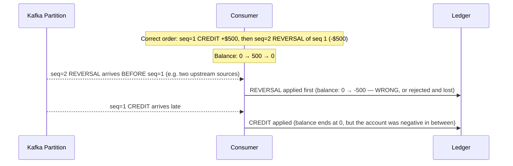
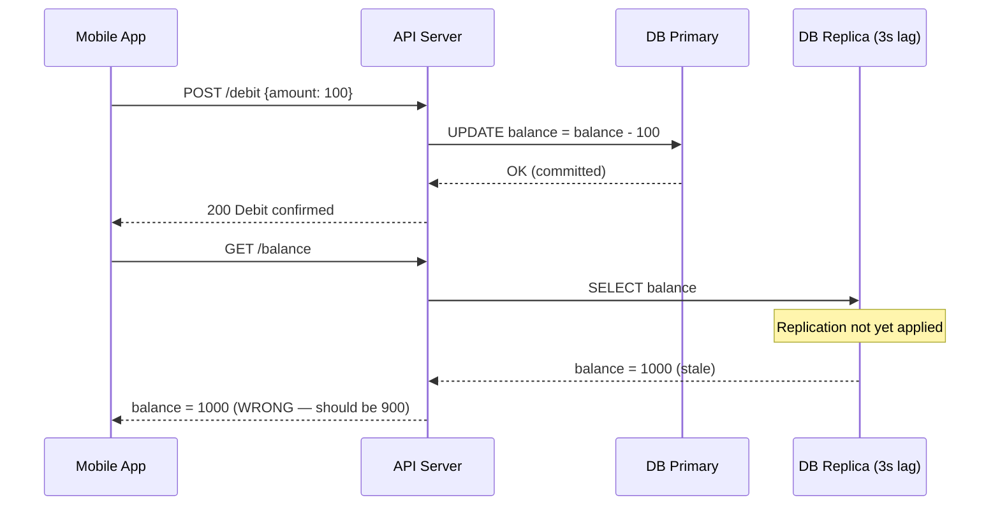
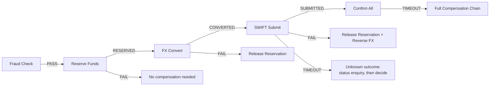

# أنماط التزامن في التقنية المالية

## نظرة عامة

تفشل أنظمة الدفع الموزعة بطرق لا تفشل بها البرامج المتتابعة أبدًا. فانتهاء مهلة الشبكة لا يعني أن المعاملة فشلت — بل يعني أنك لا تعرف. والمستهلك الذي يعالج الأحداث بغير ترتيبها قد يعكس خصمًا قبل تطبيقه. ومجمّع الخيوط الذي يتشارك طابور عمل قد يجوّع التفويضات الحساسة للوقت خلف مهام التسوية الدفعية. وهذه ليست مشكلات نظرية: إنها فئة الحوادث التي تتصدر الأخبار المالية. ويصنّف هذا الدرس أنماط التزامن الستة التي يجب أن يعرفها بعمق كل مهندس رئيسي في الخدمات المالية، مع تنفيذات Java إنتاجية والمنطق التشغيلي وراء كل قرار تصميم.

## أهداف التعلم

في نهاية هذا الدرس ستستطيع:

- تنفيذ مفاتيح عدم التكرار (idempotency keys) في كل طبقة من مكدس الدفع (HTTP، والخدمة، وقاعدة البيانات، والذاكرة)
- اكتشاف فجوات التسلسل في تدفقات أحداث كل حساب ومعالجتها
- تجزئة العمل المتزامن بمفتاح عمل لتحقيق تنفيذ تتابعي لكل كيان دون أقفال عامة
- الاستدلال على مقايضات اتساق "اقرأ ما كتبت" عبر بنى الأنظمة الموزعة
- تنفيذ نمط المستهلكين المتنافسين مع رؤية تسليم صحيحة وجدولة عادلة
- تصميم منسّق Saga لمعاملات الدفع الموزعة باستخدام `CompletableFuture` مع مهل وتعويض

## سياق العمل

*مثال مركّب (مبني على أنماط فشل شائعة في الصناعة، لا على شركة بعينها):* يعالج معالج مدفوعات تحويلات عابرة للحدود لمئات البنوك. ويعالج النظام مدفوعات التجزئة الآنية (الهدف: أقل من 500ms من البداية للنهاية) ودفعات الرواتب الضخمة (ملايين السجلات ليلًا). وعلى مدى ثمانية عشر شهرًا تراكمت لدى الفريق أربعة حوادث إنتاج، يعود كل منها إلى سوء تطبيق نمط تزامن:

1. عاصفة إعادة محاولات أثناء انتهاء مهلة خدمة لاحقة أنشأت آلاف الخصوم المكررة (فشل عدم التكرار).
2. عولج عكس إضافة قبل وصول الإضافة الأصلية، فبقيت حسابات بأرصدة سالبة (فشل الترتيب).
3. حجب فحص احتيال بطيء لتاجر واحد خيوط التفويض لكل التجار (فشل التجزئة).
4. أعادت قراءة رصيد عميل القيمة قبل الخصم بعد ثلاث ثوانٍ من خصم مؤكد، فرُفض دفع في جهاز نقطة بيع (فشل "اقرأ ما كتبت").

ويعالج كل قسم في هذا الدرس أحد أنماط الفشل هذه بإصلاح ملموس.

## النمط 1: عدم التكرار والمعالجة لمرة واحدة بالضبط

### مشكلة عاصفة إعادة المحاولات

عندما تنتهي مهلة استدعاء شبكة، لا يستطيع المستدعي التمييز بين ثلاثة سيناريوهات: استلم الخادم الطلب وعالجه؛ أو استلمه وما زال يعالجه؛ أو لم يستلمه أبدًا. وإعادة المحاولة دون ضمانات عدم التكرار تنشئ معاملات مكررة.

```
// Timeline of a duplicate debit incident
T+0ms   Client sends POST /transfers {amount:100, from:ACC-1, to:ACC-2}
T+200ms Server deducts 100 from ACC-1 (committed to DB)
T+450ms Server sends HTTP 200 response
T+451ms Network drops the response
T+500ms Client timeout fires: retries POST /transfers {amount:100, from:ACC-1, to:ACC-2}
T+600ms Server deducts 100 AGAIN from ACC-1 (second transaction)
T+601ms HTTP 200 delivered to client
// Result: client sees one successful transfer; two debits occurred
```

### نمط مفتاح عدم التكرار: طبقة HTTP

```java
// REST controller layer — idempotency key extracted from header
@RestController
@RequestMapping("/v1/transfers")
public class TransferController {

    private final TransferService transferService;

    @PostMapping
    public ResponseEntity<TransferResponse> initiateTransfer(
            @RequestHeader(value = "Idempotency-Key", required = true) String idempotencyKey,
            @RequestBody TransferRequest request) {

        // Validate key format: UUID v4 expected from clients
        if (!isValidUUID(idempotencyKey)) {
            return ResponseEntity.badRequest()
                .body(TransferResponse.error("INVALID_IDEMPOTENCY_KEY",
                    "Idempotency-Key must be a UUID v4"));
        }

        TransferResponse response = transferService.transfer(idempotencyKey, request);

        // Return the same response whether this is first attempt or a retry.
        // HTTP semantics: 200 means "here is the result of your operation"
        // regardless of whether we computed it now or retrieved it from cache.
        return ResponseEntity.ok(response);
    }

    private boolean isValidUUID(String key) {
        try {
            UUID uuid = UUID.fromString(key);
            return uuid.version() == 4;
        } catch (IllegalArgumentException e) {
            return false;
        }
    }
}
```

### عدم التكرار في طبقة الخدمة: نافذة إزالة تكرار في الذاكرة

في المسارات عالية التكرار، تكون رحلة قاعدة بيانات في كل طلب لفحص عدم التكرار بطيئة جدًا. وتتعامل نافذة إزالة تكرار في الذاكرة مع الحالة الشائعة (إعادات محاولة خلال ثوانٍ) بكلفة رخيصة:

```java
import com.github.benmanes.caffeine.cache.Cache;
import com.github.benmanes.caffeine.cache.Caffeine;

@Service
public class IdempotentTransferService {

    // In-memory window of COMPLETED results: 5 minutes TTL.
    // Only a fast path for retries — the DB unique constraint is the real guard.
    private final Cache<String, TransferResponse> recentResults = Caffeine.newBuilder()
        .expireAfterWrite(5, TimeUnit.MINUTES)
        .maximumSize(100_000)
        .build();

    private final TransferRepository  repository;
    private final AccountLedger       ledger;
    private final TransactionTemplate txTemplate;   // not @Transactional on a private method:
                                                    // the Spring proxy would ignore it

    public TransferResponse transfer(String idempotencyKey, TransferRequest request) {
        // 1. Fast path: a completed result for this key (no DB hit)
        TransferResponse cached = recentResults.getIfPresent(idempotencyKey);
        if (cached != null) {
            return cached;
        }

        // 2. Slow path: claim the key and do the work in ONE DB transaction.
        //    Do NOT run this inside Caffeine's get(key, loader): the loader runs
        //    while a map bin is locked, and long I/O there blocks other keys.
        TransferResponse response = txTemplate.execute(status -> executeTransfer(idempotencyKey, request));

        // 3. Cache only finished results
        if (response.isFinal()) {
            recentResults.put(idempotencyKey, response);
        }
        return response;
    }

    private TransferResponse executeTransfer(String idempotencyKey, TransferRequest request) {
        // INSERT ... ON CONFLICT (idempotency_key) DO NOTHING — returns null on a
        // duplicate. A concurrent duplicate WAITS on the unique index until the
        // first transaction commits, then gets null. (Catching a unique-violation
        // exception instead would abort the PostgreSQL transaction.)
        TransferRecord record = repository.claimIdempotencyKey(idempotencyKey, request);
        if (record == null) {
            return repository.findByIdempotencyKey(idempotencyKey)
                .map(TransferResponse::fromExisting)          // COMPLETED → same result
                .orElseThrow(() -> new IllegalStateException(
                    "Idempotency key exists but record not found: " + idempotencyKey));
        }
        ledger.debit(request.fromAccount(), request.amount());
        ledger.credit(request.toAccount(), request.amount());
        repository.markComplete(record.id());
        return TransferResponse.success(record.id());
    }
}
```

تحفظ الذاكرة المؤقتة النتائج **المكتملة** فقط — فهي مسار سريع لإعادات المحاولة، والقيد الفريد في قاعدة البيانات هو الحارس الحقيقي. ولا تُشغّل العمل داخل `get(key, loader)` في Caffeine: فالمحمّل يعمل وحاوية في الخريطة مقفلة، والإدخال/الإخراج الطويل هناك يحجب مفاتيح أخرى. ويُحجز المفتاح بـ `INSERT ... ON CONFLICT DO NOTHING` في معاملة واحدة مع العمل (عبر `TransactionTemplate`، لأن `@Transactional` على طريقة خاصة يتجاهلها وكيل Spring).

### عدم التكرار الموزع بـ Redis SETNX

عبر نسخ خدمة متعددة لا تكفي الذاكرة المؤقتة المحلية — فقد تستلم عقدة أخرى إعادة المحاولة. ويقدم `SETNX` في Redis (عيّن إن لم يوجد) مع مدة صلاحية **فحصًا مسبقًا موزعًا** سريعًا يوقف معظم التكرارات المتزامنة قبل وصولها إلى قاعدة البيانات. لكنه ليس "مرة واحدة بالضبط" وحده: فـ Redis وقاعدة البيانات لا يلتزمان معًا، فيبقى القيد الفريد في قاعدة البيانات (في المعاملة نفسها مع تغيير دفتر الأستاذ) مصدر الحقيقة. وبينما يكون المفتاح محجوزًا دون نتيجة مخزنة بعد، أجب التكرارات بـ "ما زال قيد المعالجة" (مثل HTTP 409)، لا بـ "نجاح":

```java
@Service
public class DistributedIdempotencyGuard {

    private final StringRedisTemplate redis;
    private static final Duration IDEMPOTENCY_TTL = Duration.ofMinutes(10);

    /**
     * Attempts to claim an idempotency key.
     * Returns true if this caller is the first to claim it (should process).
     * Returns false if another caller already claimed it (return cached result).
     *
     * Uses SET NX EX as a single atomic command — avoids the race condition
     * of a separate SETNX + EXPIRE (crash between the two would leave a
     * key with no TTL, blocking retries permanently).
     */
    public boolean tryClaimKey(String idempotencyKey, String instanceId) {
        Boolean claimed = redis.opsForValue().setIfAbsent(
            "idempotency:" + idempotencyKey,
            instanceId,
            IDEMPOTENCY_TTL);
        return Boolean.TRUE.equals(claimed);
    }

    public void storeResult(String idempotencyKey, TransferResponse response) {
        String resultKey = "idempotency:result:" + idempotencyKey;
        redis.opsForValue().set(resultKey, serialize(response), IDEMPOTENCY_TTL);
    }

    public Optional<TransferResponse> getStoredResult(String idempotencyKey) {
        String resultKey = "idempotency:result:" + idempotencyKey;
        String json = redis.opsForValue().get(resultKey);
        return Optional.ofNullable(json).map(this::deserialize);
    }

    private String serialize(TransferResponse r)     { return "{}"; /* Jackson */ }
    private TransferResponse deserialize(String json){ return null; /* Jackson */ }
}
```

### مشكلة المعاملة الشبح

تحدث المعاملة الشبح عندما يُلتزم سجل عدم التكرار دون المعاملة الفعلية (أو العكس)، عادة بسبب تعطل بين كتابتي قاعدة البيانات:

```java
// BROKEN: two separate commits — crash between them creates a ghost
public TransferResponse transferBroken(String idempotencyKey, TransferRequest request) {
    repository.insertIdempotencyRecord(idempotencyKey);    // COMMIT 1
    // *** CRASH HERE: idempotency record exists, but no ledger transaction ***
    // Retry finds the key → returns "success" for a never-executed transfer
    ledger.applyTransfer(request);                         // COMMIT 2
    return TransferResponse.success(/* ... */);
}

// CORRECT: idempotency record and transaction in a single ACID transaction
@Transactional
public TransferResponse transferCorrect(String idempotencyKey, TransferRequest request) {
    // Both writes in one transaction: either both commit or both roll back.
    // On commit: idempotency record and ledger entry are durable together.
    // On crash: both roll back — retry re-executes both safely.
    TransferRecord record = repository.insertWithIdempotencyKey(idempotencyKey, request);
    ledger.applyTransfer(request); // same transaction boundary
    return TransferResponse.success(record.id());
}
```

> [!WARNING]
> مشكلة المعاملة الشبح خفية: ستُظهر المراقبة صفر معاملات مكررة (حارس عدم التكرار يعمل)، لكن العملاء سيبلّغون عن تحويلات فاشلة يعتقد نظامك أنها نجحت. سجّل دائمًا مفتاح عدم التكرار ومعاملة العمل **في وحدة التزام ACID نفسها**.

## النمط 2: ترتيب الأحداث وفجوات التسلسل

### لماذا يجب ترتيب الأحداث المالية

عكس إضافة مطبق قبل الإضافة الأصلية يترك رصيدًا سالبًا. وخصم مطبق قبل فحص رصيد سمح به يسبب قرارات احتيال خاطئة. فلتدفقات الأحداث المالية متطلبات ترتيب صارمة لكل حساب.



### مُرتِّب أحداث لكل حساب

```java
import java.util.concurrent.ConcurrentHashMap;
import java.util.concurrent.PriorityBlockingQueue;

/**
 * Per-account event sequencer that buffers out-of-order events
 * and delivers them in sequence order.
 *
 * Design invariant: one queue per account, accessed only by the partition
 * thread assigned to that account. No lock contention between accounts.
 */
public class PerAccountSequencer {

    private final ConcurrentHashMap<String, Long> expectedSeq = new ConcurrentHashMap<>();

    private final ConcurrentHashMap<String, PriorityBlockingQueue<AccountEvent>>
        pendingBuffers = new ConcurrentHashMap<>();

    private final AccountEventProcessor processor;
    // Maximum events to buffer waiting for a gap to fill
    private static final int MAX_GAP_BUFFER = 100;

    public void onEvent(AccountEvent event) {
        String accountId   = event.accountId();
        long   receivedSeq = event.sequenceNumber();
        long   expected    = expectedSeq.getOrDefault(accountId, 1L);

        if (receivedSeq == expected) {
            // In order: process immediately, then drain any buffered followers
            processAndDrain(accountId, event);
        } else if (receivedSeq > expected) {
            // Out of order: buffer and wait for gap to fill
            bufferEvent(accountId, event);
            checkForGapTimeout(accountId, expected, receivedSeq);
        } else {
            // Duplicate or redelivery (receivedSeq < expected)
            log.warn("Duplicate event for account {}: received seq={}, expected>={}",
                accountId, receivedSeq, expected);
        }
    }

    // NOTE: expectedSeq lives in memory and is lost on restart. In production,
    // store the last applied sequence per account in the SAME DB transaction as
    // the ledger change — that also makes redelivered events harmless.
    private void processAndDrain(String accountId, AccountEvent event) {
        processor.process(event);
        expectedSeq.put(accountId, event.sequenceNumber() + 1);

        // Drain any buffered events that now have the correct sequence number
        PriorityBlockingQueue<AccountEvent> buffer = pendingBuffers.get(accountId);
        if (buffer == null) return;

        while (true) {
            AccountEvent next = buffer.peek();
            if (next == null) break;
            long nextExpected = expectedSeq.getOrDefault(accountId, 1L);
            if (next.sequenceNumber() == nextExpected) {
                buffer.poll();
                processor.process(next);
                expectedSeq.put(accountId, next.sequenceNumber() + 1);
            } else {
                break; // gap remains; wait for missing events
            }
        }
    }

    private void bufferEvent(String accountId, AccountEvent event) {
        PriorityBlockingQueue<AccountEvent> buffer = pendingBuffers.computeIfAbsent(
            accountId,
            id -> new PriorityBlockingQueue<>(16,
                Comparator.comparingLong(AccountEvent::sequenceNumber)));

        if (buffer.size() >= MAX_GAP_BUFFER) {
            alertOps(accountId, event.sequenceNumber(),
                     expectedSeq.getOrDefault(accountId, 1L));
            requestRedelivery(accountId,
                              expectedSeq.getOrDefault(accountId, 1L),
                              event.sequenceNumber() - 1);
        }
        buffer.offer(event);
    }

    private void checkForGapTimeout(String accountId, long expected, long received) {
        long gap = received - expected;
        if (gap > 10) {
            log.warn("Sequence gap for account {}: expected={}, got={}, gap={}",
                accountId, expected, received, gap);
            requestRedelivery(accountId, expected, received - 1);
        }
    }

    private void requestRedelivery(String accountId, long fromSeq, long toSeq) {
        // Kafka seek, event store replay, or upstream redelivery request
    }

    private void alertOps(String accountId, long received, long expected) { /* ... */ }
}
```

يحتفظ المُرتِّب بالتسلسل المتوقع في الذاكرة، فيضيع عند إعادة التشغيل. وفي الإنتاج خزّن آخر تسلسل مطبق لكل حساب في **معاملة قاعدة البيانات نفسها** مع تغيير دفتر الأستاذ — فيصبح الحدث المعاد تسليمه غير ضار أيضًا.

### استراتيجية Kafka: قسم لكل حساب

أوثق طريقة لضمان الترتيب لكل حساب في Kafka توجيه كل أحداث الحساب إلى القسم (partition) نفسه:

```java
// Producer: partition by accountId
@Service
public class AccountEventProducer {

    private final KafkaTemplate<String, AccountEvent> kafkaTemplate;
    private static final String TOPIC = "account-events";

    /**
     * Kafka's default partitioner consistently hashes the same key to
     * the same partition. All events for the same account go to one partition,
     * and Kafka guarantees ordering within a partition.
     */
    public CompletableFuture<RecordMetadata> publish(AccountEvent event) {
        ProducerRecord<String, AccountEvent> record = new ProducerRecord<>(
            TOPIC,
            event.accountId(),   // KEY drives partition assignment
            event
        );
        return kafkaTemplate.send(record)
            .thenApply(SendResult::getRecordMetadata);
    }
}

// Consumer: each partition is handled by exactly one thread at a time
@Component
public class AccountEventConsumer {

    private final AccountEventProcessor processor;

    // Up to 12 consumer threads; a partition is never processed by two threads
    // at once → serial within a partition, parallel across partitions.
    @KafkaListener(
        topics = "account-events",
        concurrency = "12",
        containerFactory = "accountEventListenerFactory")
    public void onEvent(AccountEvent event, Acknowledgment ack) {
        processor.process(event);   // must be idempotent: delivery is at-least-once
        ack.acknowledge();          // commit offset only after successful processing
    }
}
```

يعالج كل قسم خيط واحد في أي لحظة: تتابعي داخل القسم، ومتوازٍ عبر الأقسام. والتسليم "مرة على الأقل"، فيجب أن يكون المعالج عديم التكرار، ويُلتزم الإزاحة (offset) فقط بعد المعالجة الناجحة.

> [!IMPORTANT]
> تخلق استراتيجية القسم لكل حساب **خطر إعادة التقسيم**: لا يستطيع Kafka إلا *زيادة* عدد أقسام الموضوع، والزيادة تغيّر القسم الذي يُجزّأ إليه معرّف الحساب — فينكسر الترتيب للأحداث الجارية. خطط لعدد الأقسام عند إنشاء الموضوع لأفق نمو 3–5 سنوات، بمضاعف سخي لأقصى عدد مستهلكين متوقع. وإذا اضطررت للزيادة، فأفرغ الموضوع أولًا أو انتقل إلى موضوع جديد.

## النمط 3: التزامن المجزأ

### نمط المنفّذ المجزأ

الأقفال العامة على حالة الحساب سقف لقابلية التوسع. والنموذج الذهني الصحيح لأنظمة الدفع: الحسابات المختلفة مستقلة ويمكن معالجتها بالتوازي؛ والحساب نفسه يجب أن يُعالج بالتتابع. ويرمّز التزامن المجزأ هذا مباشرة في نموذج التنفيذ:

```java
import java.util.concurrent.ExecutorService;
import java.util.concurrent.Executors;

/**
 * Partitioned executor for payment authorization.
 *
 * Key invariant: all tasks for the same account key are always submitted
 * to the same single-threaded partition, giving serial execution per account
 * without any explicit locking.
 *
 * Performance model:
 *   - N partitions × M accounts → no cross-account lock contention
 *   - Per-account serial order maintained implicitly by partition assignment
 *
 * LIMITS:
 *   - Serial only INSIDE this JVM. With several service instances, route all
 *     requests for an account to one instance (e.g. via Kafka partitions) —
 *     and keep a database guard (conditional UPDATE) as the final safety net
 *   - A slow task blocks every account that shares its partition: keep remote
 *     calls (fraud, HTTP) OUT of the partition thread
 *   - newSingleThreadExecutor has an unbounded queue: monitor queue depth
 */
public class PartitionedAuthorizationExecutor {

    private final int              numPartitions;
    private final ExecutorService[] partitions;

    public PartitionedAuthorizationExecutor(int numPartitions) {
        this.numPartitions = numPartitions;
        this.partitions    = new ExecutorService[numPartitions];
        for (int i = 0; i < numPartitions; i++) {
            final int id = i;
            this.partitions[i] = Executors.newSingleThreadExecutor(
                Thread.ofPlatform()
                    .name("auth-partition-" + id)
                    .factory());
        }
    }

    /**
     * Routes a task to the partition determined by accountId.
     * Same accountId → same partition → serial execution guaranteed.
     * Different accountIds → potentially different partitions → parallel.
     */
    public <T> CompletableFuture<T> submit(String accountId, Callable<T> task) {
        int partition = partitionFor(accountId);
        return CompletableFuture.supplyAsync(() -> {
            try {
                return task.call();
            } catch (Exception e) {
                throw new CompletionException(e);
            }
        }, partitions[partition]);
    }

    private int partitionFor(String accountId) {
        // Integer.MIN_VALUE edge case: bitmasking with MAX_VALUE is safe
        return (accountId.hashCode() & Integer.MAX_VALUE) % numPartitions;
    }

    public void shutdown() {
        for (ExecutorService e : partitions) {
            e.shutdown();
        }
    }
}

// Usage: authorization service with no explicit account-level locks
@Service
public class AuthorizationService {

    private final PartitionedAuthorizationExecutor executor =
        new PartitionedAuthorizationExecutor(32);

    private final AccountRepository accountRepository;
    private final FraudEngine fraudEngine;
    private final Executor ioExecutor;

    public CompletableFuture<AuthorizationResult> authorize(AuthorizationRequest request) {
        // 1. Slow remote call OUTSIDE the partition: a slow fraud check must not
        //    block other accounts that share the partition thread
        return CompletableFuture.supplyAsync(() -> fraudEngine.evaluate(request), ioExecutor)
            .thenCompose(fraud -> {
                if (fraud.score() > 0.85) {
                    return CompletableFuture.completedFuture(
                        AuthorizationResult.declined("FRAUD_SUSPECTED"));
                }
                // 2. Short critical section, serial per account, inside the partition
                return executor.submit(request.accountId(), () -> {
                    Account account = accountRepository.load(request.accountId());
                    if (account.balance().compareTo(request.amount()) < 0) {
                        return AuthorizationResult.declined("INSUFFICIENT_FUNDS");
                    }
                    account.reserve(request.amount());
                    // save() should still be a conditional/versioned update:
                    // another instance may hold the same account
                    accountRepository.save(account);
                    return AuthorizationResult.approved(account.reservationId());
                });
            });
    }
}
```

حدود هذا النمط: التتابع **داخل هذه JVM** فقط — فمع عدة نسخ للخدمة وجّه كل طلبات الحساب إلى نسخة واحدة (مثلًا عبر أقسام Kafka) واحتفظ بحارس في قاعدة البيانات (تحديث شرطي) كشبكة أمان أخيرة. والمهمة البطيئة تحجب كل الحسابات التي تتشارك قسمها، لذا أبقِ الاستدعاءات البعيدة (الاحتيال، HTTP) **خارج** خيط القسم: في المثال يُجرى فحص الاحتيال أولًا على منفّذ إدخال/إخراج، ثم يدخل القسم قسم حرج قصير فقط للرصيد والحجز. كما أن طابور `newSingleThreadExecutor` غير محدود، فراقب عمقه.

### اكتشاف الأقسام الساخنة وتخفيفها

المنفّذات المجزأة عرضة للأقسام الساخنة عندما يولّد عدد صغير من معرّفات الحسابات حجمًا غير متناسب:

```java
@Component
public class PartitionHealthMonitor {

    // Updated by many threads: a plain long[] with ++ would lose counts
    private final AtomicLongArray taskCounts;
    private final int             numPartitions;

    public PartitionHealthMonitor(int numPartitions) {
        this.numPartitions = numPartitions;
        this.taskCounts    = new AtomicLongArray(numPartitions);
    }

    public void recordTask(int partition) {
        taskCounts.incrementAndGet(partition);
    }

    /**
     * Reports the skew ratio: max partition load / average partition load.
     * Healthy: below 2.0.
     * Problematic: above 5.0 — a hot partition is likely starving other work.
     */
    public double skewRatio() {
        long total = 0;
        long max   = 0;
        for (int i = 0; i < numPartitions; i++) {
            long count = taskCounts.get(i);
            total += count;
            if (count > max) max = count;
        }
        double avg = (double) total / numPartitions;
        return avg == 0 ? 1.0 : max / avg;
    }

    public List<Map.Entry<Integer, Long>> hotPartitions(int topN) {
        List<Map.Entry<Integer, Long>> entries = new ArrayList<>();
        for (int i = 0; i < numPartitions; i++) {
            entries.add(Map.entry(i, taskCounts.get(i)));
        }
        entries.sort((a, b) -> Long.compare(b.getValue(), a.getValue()));
        return entries.subList(0, Math.min(topN, entries.size()));
    }
}
```

يُحدَّث العدّاد من خيوط كثيرة، لذا يُستخدم `AtomicLongArray`: فمصفوفة `long[]` عادية مع `++` ستفقد عدّات.

## النمط 4: اتساق "اقرأ ما كتبت"

### خطأ عرض الرصيد

بعد خصم مؤكد يقرأ تطبيق العميل الرصيد فيرى القيمة قبل الخصم. وبعد ثلاث ثوانٍ يتحدث. والسبب الجذري: كُتب الخصم في قاعدة البيانات الأساسية، لكن قراءة الرصيد خُدمت من نسخة قراءة متأخرة النسخ 3 ثوانٍ.



### الاستراتيجية 1: التوجيه برمز الجلسة

```java
@Service
public class BalanceService {

    private final DataSource primaryDataSource;
    private final DataSource replicaDataSource;

    // Tracks sessions with recent writes: maps sessionToken → write timestamp.
    // In-memory per instance: needs sticky sessions — or put the "wrote at"
    // marker in the session/cookie or a shared store if requests can move
    // between instances
    private final Cache<String, Instant> recentWriteTokens = Caffeine.newBuilder()
        .expireAfterWrite(30, TimeUnit.SECONDS)
        .build();

    @Transactional
    public DebitResult debit(String accountId, BigDecimal amount, String sessionToken) {
        try (Connection conn = primaryDataSource.getConnection()) {
            // ... execute UPDATE on primary
        }
        // Record that this session wrote recently
        recentWriteTokens.put(sessionToken, Instant.now());
        return new DebitResult(/* ... */);
    }

    public BigDecimal getBalance(String accountId, String sessionToken) {
        // If this session has a recent write, force primary read.
        // Otherwise, serve from replica (scales better).
        DataSource source = recentWriteTokens.getIfPresent(sessionToken) != null
            ? primaryDataSource
            : replicaDataSource;

        try (Connection conn = source.getConnection()) {
            // ... SELECT balance FROM accounts WHERE id = ?
        }
        return BigDecimal.ZERO; // placeholder
    }
}
```

الذاكرة المؤقتة هنا محلية لكل نسخة: فتحتاج جلسات لاصقة (sticky sessions) — أو ضع علامة "كتب في" في الجلسة/ملف تعريف الارتباط أو مخزن مشترك إذا كانت الطلبات تنتقل بين النسخ.

### الاستراتيجية 2: القراءة بعد الكتابة المبنية على الإصدار

تعيد الكتابة رقم إصدار، وينتظر القارئ حتى تلحق نسخة القراءة به:

```java
// Schema: ALTER TABLE accounts ADD COLUMN version BIGINT DEFAULT 0;

@Service
public class VersionedBalanceService {

    private final JdbcTemplate primaryJdbc;
    private final JdbcTemplate replicaJdbc;

    @Transactional
    public DebitResult debit(String accountId, BigDecimal amount) {
        // Conditional debit: no row returned (EmptyResultDataAccessException)
        // = insufficient funds or unknown account
        return primaryJdbc.queryForObject(
            "UPDATE accounts SET balance = balance - ?, version = version + 1 " +
            "WHERE id = ? AND balance >= ? RETURNING balance, version",
            (rs, i) -> new DebitResult(rs.getBigDecimal("balance"), rs.getLong("version")),
            amount, accountId, amount);
    }

    /**
     * Reads from replica, polling until it has advanced to at least minVersion.
     * Falls back to primary if replica lags beyond the deadline.
     */
    public BigDecimal getBalance(String accountId, long minVersion) {
        Instant deadline = Instant.now().plusSeconds(2);

        while (Instant.now().isBefore(deadline)) {
            var vb = replicaJdbc.queryForObject(
                "SELECT balance, version FROM accounts WHERE id = ?",
                (rs, i) -> Map.entry(rs.getBigDecimal("balance"), rs.getLong("version")),
                accountId);

            if (vb.getValue() >= minVersion) {
                return vb.getKey(); // replica caught up
            }

            try { Thread.sleep(5); } catch (InterruptedException e) {
                Thread.currentThread().interrupt();
                break;
            }
        }

        // Replica did not catch up: fall back to primary
        log.warn("Replica lag exceeded deadline for account {} version {}",
            accountId, minVersion);
        return primaryJdbc.queryForObject(
            "SELECT balance FROM accounts WHERE id = ?",
            BigDecimal.class, accountId);
    }
}
```

الخصم شرطي: عدم إعادة صف يعني رصيدًا غير كافٍ أو حسابًا مجهولًا.

> [!NOTE]
> يضيف الأسلوب المبني على الإصدار بضع ميلي ثوانٍ لزمن القراءة عندما تتأخر نسخة القراءة، لكنه يتجنب القراءات القديمة دون توجيه كل القراءات إلى الأساسية. وأسلوب رمز الجلسة أبسط لكنه يوجّه كل قراءة بعد الكتابة إلى الأساسية — وعند إنتاجية عالية تكون هذه زيادة كبيرة في حمل الأساسية. فاختر حسب هامش سعة الأساسية. (وتسمح PostgreSQL أيضًا بمقارنة مواضع WAL مباشرة: `pg_current_wal_lsn()` على الأساسية بعد الكتابة، و`pg_last_wal_replay_lsn()` على نسخة القراءة.)

### مقايضات القراءة من القائد مقابل التابع

| الاستراتيجية | زمن الاستجابة | حمل الأساسية | خطر القِدم | التعقيد |
|---|---|---|---|---|
| الأساسية دائمًا | الأدنى مطلقًا | عالٍ | صفر | منخفض |
| رمز الجلسة (لاصق) | منخفض | متوسط-عالٍ | صفر للجلسات المتأثرة | منخفض |
| استطلاع الإصدار | منخفض + بضع ms عند تأخر النسخة | منخفض | صفر (يرجع إلى الأساسية) | متوسط |
| نهائي (بلا ضمان) | الأدنى | منخفض | عالٍ | منخفض |

## النمط 5: نمط المستهلكين المتنافسين

### رؤية تسليم صحيحة

يوزّع نمط المستهلكين المتنافسين العمل على عدة خيوط عمل. ومتطلب الصحة الحاسم: يجب أن يرى خيط العامل كل الحالة التي كتبها الخيط الذي أنتج عنصر العمل. وتنشئ `put()` و`take()` في `LinkedBlockingQueue` علاقة تحدث-قبل — فكل ما كُتب قبل `put()` مرئي للخيط الذي يستدعي `take()` (أو `poll()`).

```java
import java.util.concurrent.LinkedBlockingQueue;
import java.util.concurrent.atomic.AtomicBoolean;

/**
 * Competing consumers for payment settlement jobs.
 * Workers compete for jobs from a shared bounded queue.
 * The queue provides the hand-off with correct JMM visibility —
 * no additional synchronisation needed on the job object itself.
 */
public class SettlementProcessor {

    // Bounded: backpressure if workers fall behind
    private final LinkedBlockingQueue<SettlementJob> workQueue =
        new LinkedBlockingQueue<>(10_000);

    private final List<Thread> workers = new ArrayList<>();
    private final AtomicBoolean running = new AtomicBoolean(true);

    public void start(int workerCount) {
        for (int i = 0; i < workerCount; i++) {
            final int workerId = i;
            Thread worker = Thread.ofPlatform()
                .name("settlement-worker-" + workerId)
                .start(() -> workerLoop(workerId));
            workers.add(worker);
        }
    }

    private void workerLoop(int workerId) {
        while (running.get() || !workQueue.isEmpty()) {
            try {
                SettlementJob job = workQueue.poll(100, TimeUnit.MILLISECONDS);
                if (job == null) continue;

                // LinkedBlockingQueue: put() HB the poll()/take() that receives it:
                // all state written to 'job' before put() is visible here.
                processJob(workerId, job);

            } catch (InterruptedException e) {
                Thread.currentThread().interrupt();
                break;
            }
        }
    }

    public void submit(SettlementJob job) {
        try {
            workQueue.put(job); // blocks if queue full (backpressure)
        } catch (InterruptedException e) {
            Thread.currentThread().interrupt();
            throw new RuntimeException("Interrupted while submitting settlement job", e);
        }
    }

    private void processJob(int workerId, SettlementJob job) { /* ... */ }

    public void shutdown() {
        running.set(false);
        workers.forEach(t -> {
            try { t.join(5_000); } catch (InterruptedException e) {
                Thread.currentThread().interrupt();
            }
        });
    }
}
```

### طابور مدعوم بقاعدة البيانات مع SKIP LOCKED

للمتانة عبر إعادات التشغيل وتوزيع العمل بين الخدمات، يقدم طابور قاعدة بيانات مع `SKIP LOCKED` مستهلكين متنافسين على طبقة الحفظ:

```java
// PostgreSQL schema:
// CREATE TABLE settlement_jobs (
//   id         BIGSERIAL PRIMARY KEY,
//   status     VARCHAR(20) NOT NULL DEFAULT 'PENDING',
//   created_at TIMESTAMP   NOT NULL DEFAULT NOW(),
//   claimed_at TIMESTAMP,
//   payload    JSONB       NOT NULL,
//   error_msg  TEXT
// );
// CREATE INDEX settlement_jobs_pending ON settlement_jobs(created_at)
//   WHERE status = 'PENDING';

@Service
public class DatabaseSettlementQueue {

    private final JdbcTemplate  jdbc;
    private final ObjectMapper  objectMapper;

    /**
     * Claims the next available job atomically, in ONE statement.
     * SKIP LOCKED: other consumers transparently skip rows already
     * locked by concurrent transactions — no queue-behind-a-lock bottleneck.
     */
    @Transactional
    public Optional<SettlementJob> claimNext() {
        List<SettlementJob> jobs = jdbc.query(
            "UPDATE settlement_jobs SET status = 'PROCESSING', claimed_at = NOW() " +
            "WHERE id = (SELECT id FROM settlement_jobs " +
            "            WHERE status = 'PENDING' ORDER BY created_at " +
            "            LIMIT 1 FOR UPDATE SKIP LOCKED) " +
            "RETURNING id, payload",
            (rs, i) -> parseJob(rs.getLong("id"), rs.getString("payload")));
        return jobs.stream().findFirst();
    }

    /**
     * A worker that crashes leaves its job in PROCESSING forever. A periodic
     * reaper returns jobs claimed too long ago to PENDING (the job handler
     * must therefore be idempotent).
     */
    @Transactional
    public int requeueStuckJobs() {
        return jdbc.update(
            "UPDATE settlement_jobs SET status = 'PENDING', claimed_at = NULL " +
            "WHERE status = 'PROCESSING' AND claimed_at < NOW() - INTERVAL '10 minutes'");
    }

    @Transactional
    public void complete(long jobId) {
        jdbc.update(
            "UPDATE settlement_jobs SET status = 'COMPLETED' WHERE id = ?", jobId);
    }

    @Transactional
    public void fail(long jobId, String error) {
        jdbc.update(
            "UPDATE settlement_jobs SET status = 'FAILED', error_msg = ? WHERE id = ?",
            error, jobId);
    }

    private SettlementJob parseJob(long id, String payload) {
        try {
            return objectMapper.readValue(payload, SettlementJob.class);
        } catch (Exception e) {
            throw new RuntimeException("Failed to parse job " + id, e);
        }
    }
}
```

تحجز `claimNext()` المهمة في عبارة **واحدة** (UPDATE مع استعلام فرعي `FOR UPDATE SKIP LOCKED`). والعامل الذي يتعطل يترك مهمته في حالة PROCESSING إلى الأبد، لذا تعيد مهمة دورية المهام المحجوزة منذ وقت طويل إلى PENDING — ولذلك يجب أن يكون معالج المهمة عديم التكرار.

### الجدولة العادلة: فصل مستويات اتفاقية الخدمة

```java
@Configuration
public class ExecutorConfig {

    // High-priority: real-time authorizations (sub-100ms SLA)
    @Bean("authorizationExecutor")
    public ExecutorService authorizationExecutor() {
        return new ThreadPoolExecutor(
            16, 16,
            0L, TimeUnit.MILLISECONDS,
            new ArrayBlockingQueue<>(1_000),     // bounded: reject on overload
            Thread.ofPlatform().name("auth-", 0).factory(),
            new ThreadPoolExecutor.AbortPolicy()); // 503 to caller — better than SLA breach
    }

    // Low-priority: bulk settlement (best-effort, no SLA)
    @Bean("settlementExecutor")
    public ExecutorService settlementExecutor() {
        return new ThreadPoolExecutor(
            4, 8,
            60L, TimeUnit.SECONDS,
            new LinkedBlockingQueue<>(100_000),  // large queue: batch accumulation OK
            Thread.ofPlatform().name("settlement-", 0).factory(),
            new ThreadPoolExecutor.CallerRunsPolicy()); // slow down producer on overload
    }
}
```

> [!WARNING]
> ‏`CallerRunsPolicy` خطرة على المنفّذات عالية الأولوية: فإذا كان المستدعي خيط طلب HTTP، فإنها تحجبه طوال مدة المهمة. استخدم `AbortPolicy` للمسارات الحساسة للزمن، ونفّذ قواطع دوائر في المستدعي للتعامل مع `RejectedExecutionException` الناتج بلطف (أعد HTTP 503 بدل ترك خيط الطلب معلقًا).

## النمط 6: نمط Saga للمعاملات الموزعة

### بنية Saga الدفع

يمر الدفع العابر للحدود بأربع خدمات: فحص الاحتيال، وحجز الأموال، وتحويل العملة، والإرسال عبر SWIFT. ويمكن أن تفشل كل خطوة مستقلة. والمعاملة الموزعة (2PC) ستتطلب أن تحتجز الخدمات الأربع أقفالًا في الوقت نفسه — وهذا غير عملي عند الإنتاجية العالية. فيقسّم نمط Saga المعاملة إلى خطوات محلية مع إجراءات تعويضية:



### تنسيق Saga بـ CompletableFuture

```java
import java.util.concurrent.CompletableFuture;
import java.util.concurrent.TimeUnit;

/**
 * Saga orchestrator for cross-border payment.
 *
 * Concurrency model:
 *   - Steps execute sequentially (financial ordering requirement)
 *   - Compensation steps execute concurrently where independent
 *   - Each stage runs on a dedicated sagaExecutor
 *   - Each step's timeout is put on THAT step's future (inside thenCompose),
 *     so it measures only that step — a timeout chained on the pipeline
 *     would start when the pipeline is built
 *   - An exceptionally() stage runs for ANY earlier failure, so each one
 *     first re-throws failures it does not own (rethrowIfAborted)
 */
@Service
public class CrossBorderPaymentSaga {

    private final FraudService     fraudService;
    private final FundsService     fundsService;
    private final FxService        fxService;
    private final SwiftService     swiftService;
    private final SagaLogRepository sagaLog;
    private final ExecutorService  sagaExecutor;

    public CompletableFuture<PaymentResult> execute(CrossBorderPaymentRequest request) {
        String sagaId = UUID.randomUUID().toString();
        sagaLog.start(sagaId, request);

        return CompletableFuture
            // Step 1: Fraud check — no compensating action needed on failure
            .supplyAsync(() -> fraudService.check(sagaId, request), sagaExecutor)
            .orTimeout(5, TimeUnit.SECONDS)           // first stage: starts now
            .exceptionally(ex -> {
                sagaLog.failed(sagaId, "FRAUD_CHECK_FAILED");
                throw new SagaAbortException("FRAUD_CHECK_FAILED", ex);
            })

            // Step 2: Reserve funds
            .thenComposeAsync(fraudResult -> {
                if (!fraudResult.passed()) {
                    sagaLog.failed(sagaId, "FRAUD_REJECTED");
                    return CompletableFuture.failedFuture(
                        new SagaAbortException("FRAUD_REJECTED", fraudResult));
                }
                sagaLog.stepCompleted(sagaId, "FRAUD_CHECKED", fraudResult.toString());
                return fundsService.reserve(sagaId, request.fromAccount(), request.amount())
                    .orTimeout(3, TimeUnit.SECONDS);   // this step only
            }, sagaExecutor)
            .exceptionally(ex -> {
                rethrowIfAborted(ex);
                // Reserve failed or timed out: the outcome may be unknown —
                // release is idempotent, so it is safe to call either way
                fundsService.releaseAsync(sagaId, request.fromAccount());
                sagaLog.failed(sagaId, "RESERVE_FAILED");
                throw new SagaAbortException("RESERVE_FAILED", ex);
            })

            // Step 3: FX conversion
            .thenComposeAsync(reservation -> {
                sagaLog.stepCompleted(sagaId, "FUNDS_RESERVED", reservation.id());
                return fxService.convert(sagaId, request.amount(),
                        request.sourceCurrency(), request.targetCurrency())
                    .orTimeout(10, TimeUnit.SECONDS);
            }, sagaExecutor)
            .exceptionally(ex -> {
                rethrowIfAborted(ex);
                // FX failed or timed out: release the reservation
                log.error("[{}] FX conversion failed — compensating reservation", sagaId, ex);
                fundsService.releaseAsync(sagaId, request.fromAccount());
                sagaLog.failed(sagaId, "FX_FAILED");
                throw new SagaAbortException("FX_FAILED", ex);
            })

            // Step 4: SWIFT submission
            .thenComposeAsync(fxResult -> {
                sagaLog.stepCompleted(sagaId, "FX_CONVERTED", fxResult.rate().toString());
                return swiftService.submit(sagaId, request, fxResult)
                    .orTimeout(30, TimeUnit.SECONDS);
            }, sagaExecutor)
            .exceptionally(ex -> {
                rethrowIfAborted(ex);
                if (rootCause(ex) instanceof TimeoutException) {
                    // A TIMEOUT is an UNKNOWN outcome — the message may already be
                    // on the SWIFT network. Do NOT compensate blindly: mark the saga
                    // for status enquiry / reconciliation, then decide
                    sagaLog.failed(sagaId, "SWIFT_OUTCOME_UNKNOWN");
                    throw new SagaAbortException("SWIFT_OUTCOME_UNKNOWN", ex);
                }
                // A definite rejection: compensate FX and reservation in parallel
                log.error("[{}] SWIFT rejected — full compensation chain", sagaId, ex);
                compensateFullAsync(sagaId, request);
                sagaLog.failed(sagaId, "SWIFT_FAILED");
                throw new SagaAbortException("SWIFT_FAILED", ex);
            })

            // Final: confirm saga completed
            .thenApplyAsync(swiftResult -> {
                sagaLog.completed(sagaId);
                return PaymentResult.succeeded(sagaId, swiftResult.swiftReference());
            }, sagaExecutor)

            .exceptionally(ex -> {
                if (!(rootCause(ex) instanceof SagaAbortException)) {
                    sagaLog.failed(sagaId, "UNEXPECTED: " + ex.getMessage());
                }
                return PaymentResult.failed(sagaId, ex.getMessage());
            });
    }

    /** A failure from an EARLIER step passes through unchanged. */
    private static void rethrowIfAborted(Throwable ex) {
        Throwable cause = rootCause(ex);
        if (cause instanceof SagaAbortException abort) throw abort;
    }

    private static Throwable rootCause(Throwable ex) {
        return (ex instanceof CompletionException && ex.getCause() != null) ? ex.getCause() : ex;
    }

    /**
     * Compensation: release reservation and reverse FX concurrently.
     * These are independent compensating actions — parallelise them.
     */
    private void compensateFullAsync(String sagaId, CrossBorderPaymentRequest request) {
        CompletableFuture<Void> releaseFunds = CompletableFuture.runAsync(
            () -> fundsService.release(sagaId, request.fromAccount()), sagaExecutor);

        CompletableFuture<Void> reverseFx = CompletableFuture.runAsync(
            () -> fxService.reverse(sagaId), sagaExecutor);

        CompletableFuture.allOf(releaseFunds, reverseFx)
            .orTimeout(10, TimeUnit.SECONDS)
            .whenComplete((v, ex) -> {
                if (ex != null) {
                    // Compensation failed: manual reconciliation required
                    sagaLog.compensationFailed(sagaId, ex.getMessage());
                    alertOps("SAGA_COMPENSATION_FAILED", sagaId, ex);
                } else {
                    sagaLog.compensated(sagaId);
                }
            });
    }

    private void alertOps(String event, String sagaId, Throwable ex) { /* ... */ }
}
```

أمران مهمان في هذا المنسّق: أولًا، تعمل مرحلة `exceptionally()` عند **أي** فشل سابق، لذا تعيد كل منها أولًا رمي الإخفاقات التي لا تخصها (`rethrowIfAborted`) — وإلا فإن رفض الاحتيال سيطلق أيضًا تحرير الحجز وتعويض الصرف. ثانيًا، توضع مهلة كل خطوة على مستقبل **تلك** الخطوة (داخل `thenCompose`)، فتقيس الخطوة وحدها. وانتهاء مهلة SWIFT نتيجة **مجهولة** — فقد تكون الرسالة على شبكة SWIFT بالفعل. فلا تعوّض بشكل أعمى: علّم الـ Saga للاستعلام عن الحالة أو المطابقة، ثم قرر.

### تعويض عديم التكرار مع سجل Saga

يجب أن تكون الإجراءات التعويضية نفسها عديمة التكرار — فقد يُعاد تنفيذ تعويض إذا تعطل المنسّق في منتصفه. ويجعل سجل الـ Saga التعافي آمنًا:

```java
/**
 * Durable saga log: persists each step transition so the coordinator
 * can resume compensation after a crash without double-compensating.
 *
 * State machine:
 * STARTED → FRAUD_CHECKED → FUNDS_RESERVED → FX_CONVERTED → SWIFT_SUBMITTED
 *         → COMPLETED
 *         → FAILED (at any step)
 *         → COMPENSATING → COMPENSATED
 *         → COMPENSATION_FAILED (requires manual intervention)
 */
@Repository
public class SagaLogRepository {

    private final JdbcTemplate jdbc;

    @Transactional
    public void start(String sagaId, CrossBorderPaymentRequest request) {
        jdbc.update(
            "INSERT INTO saga_log (saga_id, status, request_json, created_at) " +
            "VALUES (?, 'STARTED', ?::jsonb, NOW())",
            sagaId, serialize(request));
    }

    @Transactional
    public void stepCompleted(String sagaId, String stepName, String resultJson) {
        jdbc.update(
            "UPDATE saga_log SET status = ?, last_step_result = ?::jsonb, " +
            "updated_at = NOW() WHERE saga_id = ?",
            stepName + "_COMPLETE", resultJson, sagaId);
    }

    @Transactional
    public void failed(String sagaId, String reason) {
        jdbc.update(
            "UPDATE saga_log SET status = 'FAILED', error_message = ?, " +
            "updated_at = NOW() WHERE saga_id = ?",
            reason, sagaId);
    }

    @Transactional
    public void compensated(String sagaId) {
        jdbc.update(
            "UPDATE saga_log SET status = 'COMPENSATED', updated_at = NOW() " +
            "WHERE saga_id = ?", sagaId);
    }

    @Transactional
    public void compensationFailed(String sagaId, String error) {
        jdbc.update(
            "UPDATE saga_log SET status = 'COMPENSATION_FAILED', error_message = ?, " +
            "updated_at = NOW() WHERE saga_id = ?",
            error, sagaId);
    }

    /**
     * Atomically claims a failed saga for compensation: only ONE instance
     * gets 1 row back. (No separate Redis lock needed — and no risk of
     * deleting another instance's lock after it expired.)
     */
    @Transactional
    public boolean claimForCompensation(String sagaId) {
        return jdbc.update(
            "UPDATE saga_log SET status = 'COMPENSATING', updated_at = NOW() " +
            "WHERE saga_id = ? AND status = 'FAILED'", sagaId) == 1;
    }

    // Sagas that failed before reserving anything (e.g. FRAUD_REJECTED) need
    // no compensation — the last completed step tells the recovery job
    // what has to be undone
    public List<String> findUncompensatedFailedSagas() {
        return jdbc.queryForList(
            "SELECT saga_id FROM saga_log " +
            "WHERE status = 'FAILED' " +
            "AND updated_at < NOW() - INTERVAL '1 minute' " +
            "ORDER BY created_at",
            String.class);
    }

    private String serialize(Object obj) { return "{}"; /* Jackson */ }
}
```

يحجز `claimForCompensation` الـ Saga الفاشلة ذريًا: نسخة واحدة فقط تحصل على صف واحد. والـ Sagas التي فشلت قبل حجز أي شيء (مثل رفض الاحتيال) لا تحتاج تعويضًا — فآخر خطوة مكتملة تخبر مهمة التعافي بما يجب التراجع عنه.

### تعافي Saga: تنسيق التعويض المتزامن

```java
@Service
public class SagaRecoveryJob {

    private final SagaLogRepository sagaLog;
    private final CrossBorderPaymentSaga saga;

    @Scheduled(fixedDelay = 60_000)
    public void recoverFailedSagas() {
        List<String> failedIds = sagaLog.findUncompensatedFailedSagas();

        for (String sagaId : failedIds) {
            // Claim in the database: the conditional UPDATE lets exactly one
            // instance move FAILED → COMPENSATING. Others get false and skip.
            if (sagaLog.claimForCompensation(sagaId)) {
                try {
                    saga.compensate(sagaId);   // each compensating action is idempotent
                } catch (Exception e) {
                    log.error("Recovery failed for saga {}", sagaId, e);
                    sagaLog.compensationFailed(sagaId, e.getMessage());
                }
            }
        }
    }
}
```

يتم الحجز في قاعدة البيانات: يسمح التحديث الشرطي لنسخة واحدة بالضبط بنقل الحالة من FAILED إلى COMPENSATING — دون قفل Redis منفصل، ودون خطر حذف قفل نسخة أخرى بعد انتهاء صلاحيته.

> [!IMPORTANT]
> نمط Saga **لا** يوفر العزل. فبينما تعالج Saga ‏A حجز الأموال للحساب ACC-001، قد تفحص Saga ‏B للحساب نفسه الرصيد المتاح وترى المبلغ كاملًا (غير المحجوز بعد). فنفّذ العزل على مستوى النطاق: يجب أن تستخدم خطوة `reserveFunds` قفل صف في قاعدة البيانات (`SELECT FOR UPDATE`) أو قفلًا متفائلًا (`WHERE version = ?`) لمنع الحجز المزدوج. فنمط Saga يعالج التعافي من الفشل؛ ولا يعالج تلقائيًا الوصول المتزامن إلى الحالة المشتركة داخل خطوة.

## اختبار المعرفة

**س: تعيد خدمة دفع محاولة طلب تحويل وتستخدم مفتاح عدم تكرار مخزنًا في Redis بـ SETNX. تعيّن المحاولة الأولى المفتاح وتنجح. وتجد المحاولة الثانية (إعادة المحاولة) المفتاح معيّنًا فتعيد النتيجة المخزنة. لكن بعد ساعتين يبلّغ عميل أن التحويل لم يحدث أبدًا. ما السبب الأرجح؟**

**ج:** السبب الأرجح **مشكلة المعاملة الشبح**: عيّن SETNX مفتاح عدم التكرار (دلالة "قيد التنفيذ")، لكن التحويل الفعلي — خصم دفتر الأستاذ وإضافته — فشل أو لم يُلتزم في الوحدة الذرية نفسها. فرأى حارس عدم التكرار المفتاح عند إعادة المحاولة وأعاد "نجاح"، لكن معاملة العمل لم تُحفظ أبدًا. والإصلاح تسجيل مفتاح عدم التكرار مع المعاملة في **معاملة ACID واحدة**: فإذا فشلت كتابة دفتر الأستاذ يُتراجع عن سجل عدم التكرار أيضًا، فتحاول إعادة المحاولة التالية التحويل بشكل صحيح. ويجب استخدام SETNX في Redis فقط لإزالة التكرار السريعة أثناء التنفيذ، وتكون قيمة المفتاح "PROCESSING" حتى تلتزم معاملة قاعدة البيانات، ثم تُحدَّث إلى "COMPLETED" مع النتيجة. وسجل قاعدة البيانات هو مصدر الحقيقة؛ وRedis مجرد تحسين أداء.

**س: تستخدم خدمة تفويض الدفع لديك `PartitionedAuthorizationExecutor` بـ 32 قسمًا أحادي الخيط. وتلاحظ أن قسمًا واحدًا يعمل باستمرار بنسبة 100% بينما الأقسام الأخرى عند 10%. والتفويضات موجهة بتجزئة معرّف الحساب. ما السبب المحتمل وكيف تشخّصه وتصلحه؟**

**ج:** هذه مشكلة **قسم ساخن** سببها توزيع مفاتيح منحرف. والأسباب المحتملة: (1) عدد صغير من معرّفات الحسابات له حجم معاملات أعلى بكثير — بطاقة شركة يستخدمها مئات الموظفين، أو حساب خدمة مشترك — وتقع كلها في القسم نفسه؛ (2) تنتج `String.hashCode()` توزيعًا غير متساوٍ لأنماط محارف شائعة في صيغة معرّفات حساباتك. والتشخيص: سجّل ربط `(accountId, partitionIndex)` لأكثر 50 حسابًا انشغالًا وابحث عن تجمع في الأقسام؛ واحسب نسبة الانحراف (أقصى حمل قسم / متوسط حمل الأقسام) — السليم أقل من 2.0، والمشكلة فوق 5.0. وخيارات الإصلاح: (1) استبدل `String.hashCode()` بـ MurmurHash3 أو xxHash لتوزيع أفضل (يفيد عندما تتصادم عدة حسابات مشغولة — ولا تستطيع أي دالة تجزئة تقسيم حساب ساخن **واحد**)؛ (2) للحسابات الساخنة المعروفة، خصص لها أقسام فائضة مستقلة خارج الحلقة الرئيسية؛ (3) إذا كانت الحركة الساخنة حساب خدمة يجري عمليات دفعية، فقيّد معدّله في طبقة الواجهة لمنعه من إشباع قسم والتسبب في ضغط عكسي على كل الحسابات الأخرى التي تتشارك طابور ذلك القسم.

## التحدي العملي

أنت المهندس الرئيسي لـ **نظام معالجة مدفوعات ACH آني** يتعامل مع التحويلات الفردية وملفات دفعات الرواتب. وللنظام المتطلبات التالية:

- التحويلات الفردية: أقل من 200ms من البداية للنهاية، ودلالات "مرة واحدة بالضبط"
- دفعات الرواتب: حتى 500,000 دفعة لكل ملف، تُعالج ليلًا
- يمكن أن تتلقى الحسابات مدفوعات فردية ودفعية في الوقت نفسه
- يجب أن يتعامل النظام مع انتهاء مهل الخدمات السابقة بلطف مع التعويض

**مهامك:**

1. **صمّم استراتيجية عدم التكرار** للمكدس كاملًا: طبقة HTTP (ترويسة مفتاح عدم التكرار)، وطبقة الخدمة (نافذة Caffeine في الذاكرة)، وطبقة قاعدة البيانات (قيد فريد + سجل saga ذري). وحدد مدة الصلاحية في كل طبقة واشرح لماذا يناسب كل اختيار حالة الدفع.

2. **نفّذ معالجًا مجزأ** يتعامل مع التفويضات الفردية ومدخلات الدفعات معًا. ويجب أن تسبق التفويضات الفردية مدخلات الدفعات داخل قسم الحساب نفسه (أولوية داخل القسم). وأظهر كيف تنفّذ ترتيب الأولوية دون أقفال عابرة للأقسام — تلميح: استبدل `LinkedBlockingQueue` في المنفّذ أحادي الخيط بـ `PriorityBlockingQueue` مرتب على `(priority, arrivalTime)`. (استخدم `execute()` مع مهام تطبّق `Comparable`: فـ `submit()` يغلّف المهام في `FutureTask` غير قابل للمقارنة.)

3. **نمذج متطلب ترتيب الأحداث**: تصل دفعات الرواتب كرسالة Kafka واحدة لكل ملف، ثم تتفرع إلى أحداث لكل حساب. وقد يتلقى كل حساب عدة إضافات من الدفعة نفسها (مكونات أجر متعددة). صمّم مخطط التسلسل: كيف تعيّن أرقام تسلسل لمدخلات الدفعة، وتكتشف الفجوات، وتضمن ألا تترك دفعة جزئية الحسابات في حالة غير متسقة؟

4. **نفّذ Saga** لدفعة رواتب تتضمن: التحقق من الرصيد (فحص أن حساب الدافع فيه أموال كافية للدفعة كاملة)، وحجوزات أموال فردية لكل مستفيد، وتطبيق الإضافات النهائية. وأظهر سلسلة التعويض إذا فشلت أي إضافة فردية في منتصف الدفعة. وفكّر: هل يجب تعويض كل الحجوزات السابقة، أم الفشل إلى الأمام فقط بالإبقاء على حجز الدافع وإعادة محاولة المستفيد الفاشل؟

5. **اكتب اختبار حمل** باستخدام JMH أو Gatling يحاكي 1,000 تفويض فردي متزامن إضافة إلى 5 ملفات دفعات رواتب متزامنة من 10,000 مدخل لكل منها. وقِس: زمن P99 للتفويضات الفردية تحت حمل الدفعات، وتوزيع استخدام الأقسام (نسبة الانحراف)، ومعدّل تعويض الـ Saga تحت معدّل فشل خطوات محاكى بنسبة 1%.

المُخرَج المتوقع: وحدة Spring Boot عاملة بالتنفيذ الكامل. ويجب أن يبقى زمن P99 للتفويضات الفردية أقل من 200ms حتى عندما تعمل معالجة الدفعات بكامل إنتاجيتها على بنية المنفّذ المجزأ نفسها.

<!-- KNOWLEDGE-CHECK
{
  "questions": [
    {
      "text": "تخزن خدمة دفع مفتاح عدم تكرار في Redis بـ SETNX قبل معالجة تحويل. ويبلّغ عميل أن تحويلًا لم يحدث أبدًا، بينما تعيد إعادات المحاولة 'معالج بالفعل'. ما السبب الجذري الأرجح؟",
      "options": [
        "انتهت صلاحية مفتاح Redis قبل المحاولة الثانية",
        "عيّن SETNX المفتاح (دلالة 'قيد التنفيذ') لكن معاملة دفتر الأستاذ الفعلية فشلت أو لم تُلتزم في الوحدة الذرية نفسها — فيعيد حارس عدم التكرار نجاحًا خاطئًا لمعاملة لم تُحفظ أبدًا",
        "مدة صلاحية مفتاح عدم التكرار قصيرة جدًا",
        "‏SETNX في Redis غير ذري وقد يسمح بمعالجة مكررة"
      ],
      "correct": 1,
      "explanation": "هذه مشكلة المعاملة الشبح: يعيّن SETNX المفتاح قبل التزام معاملة قاعدة البيانات الفعلية. فإذا فشلت المعاملة أو لم تُلتزم أبدًا، يكون مفتاح عدم التكرار معيّنًا بالفعل، فتُحجب كل إعادات المحاولة وتعيد 'معالج بالفعل' — لكن لم يحدث أي تحويل. والإصلاح تسجيل مفتاح عدم التكرار مع المعاملة في معاملة ACID واحدة في قاعدة البيانات، فيلتزمان أو يُتراجع عنهما معًا. ويجب استخدام SETNX في Redis فقط لإزالة التكرار السريعة أثناء التنفيذ، مع سجل قاعدة البيانات كمصدر الحقيقة."
    },
    {
      "text": "يُظهر PartitionedAuthorizationExecutor بـ 32 قسمًا قسمًا واحدًا عند استخدام 100% بينما الأخرى عند 10%. ما السبب الأرجح وأول خطوة تشخيص؟",
      "options": [
        "خطأ في مجمّع الخيوط يسبب توزيع مهام غير متساوٍ؛ أعد تشغيل الخدمة",
        "قسم ساخن: عدد صغير من معرّفات الحسابات بحجم معاملات أعلى بكثير يقع كله في القسم نفسه؛ احسب نسبة الانحراف وسجّل ربط الأقسام لأكثر 50 حسابًا انشغالًا",
        "عدد الأقسام منخفض جدًا؛ زده إلى 128 قسمًا",
        "قاعدة بيانات محمّلة تبطئ كل الاستعلامات في قسم واحد"
      ],
      "correct": 1,
      "explanation": "تحدث الأقسام الساخنة عندما يولّد عدد صغير من المفاتيح (مثل بطاقة شركة يستخدمها مئات الموظفين، أو حساب خدمة) حجمًا غير متناسب ويقع كله في القسم نفسه. والتشخيص تسجيل ربط (accountId, partitionIndex) لأكثر 50 حسابًا انشغالًا وحساب نسبة الانحراف (أقصى حمل قسم / المتوسط). والنسبة السليمة أقل من 2.0؛ وفوق 5.0 تدل على قسم ساخن. والإصلاحات تشمل دالة تجزئة أفضل مثل MurmurHash3 (تفيد عندما تتصادم عدة حسابات مشغولة)، وأقسامًا فائضة مخصصة للحسابات الساخنة المعروفة، أو تقييد معدّل حسابات الخدمة في طبقة الواجهة. ولا تستطيع أي دالة تجزئة تقسيم حساب ساخن واحد."
    },
    {
      "text": "يُستخدم نمط Saga لدفع عابر للحدود يمر بأربع خدمات. ما مشكلة العزل التي لا يحلها نمط Saga، وكيف يجب معالجتها؟",
      "options": [
        "نمط Saga لا يعالج انتهاء مهل الشبكة؛ استخدم 2PC بدلًا منه",
        "نمط Saga لا يوفر العزل — فقد تقرأ Sagas متزامنة للحساب نفسه الرصيد كاملًا قبل تطبيق أي حجز، فيحدث حجز مزدوج؛ ويجب تنفيذ العزل داخل كل خطوة بأقفال صفوف قاعدة البيانات أو القفل المتفائل",
        "نمط Saga لا يدعم المعاملات التعويضية",
        "نمط Saga لا يعمل مع الخدمات المصغّرة؛ بل يتطلب تطبيقًا موحدًا"
      ],
      "correct": 1,
      "explanation": "يعالج نمط Saga التعافي من الفشل عبر المعاملات التعويضية لكنه لا يوفر العزل. فبينما تحجز Saga ‏A أموالًا للحساب ACC-001، قد تفحص Saga ‏B الرصيد المتاح وترى المبلغ كاملًا (غير المحجوز بعد)، فيحدث حجز مزدوج. ويجب تنفيذ العزل على مستوى الخطوة: يجب أن تستخدم خطوة reserveFunds ‏SELECT FOR UPDATE أو القفل المتفائل لمنع Sagas متزامنة من حجز الأموال نفسها في الوقت نفسه."
    }
  ]
}
-->

<!-- PRACTICAL-CHALLENGE
{
  "title": "نظام معالجة مدفوعات ACH آني",
  "difficulty": "advanced",
  "estimatedMinutes": 90,
  "tasks": [
    {
      "id": "1",
      "description": "صمّم استراتيجية عدم تكرار بثلاث طبقات لمعالجة مدفوعات ACH: ‏(1) طبقة HTTP — اقبل ترويسة Idempotency-Key، وافحص ذاكرة Caffeine مؤقتة بصلاحية 60 ثانية لرفض الطلبات المكررة ضمن نافذة التنفيذ؛ (2) طبقة الخدمة — استخدم ذاكرة Caffeine مؤقتة بصلاحية 5 دقائق كحارس إزالة تكرار سريع قبل الوصول إلى قاعدة البيانات؛ (3) طبقة قاعدة البيانات — احفظ مفتاح عدم التكرار مع سجل المعاملة في معاملة ACID واحدة باستخدام قيد فريد. ووثّق لماذا تناسب كل مدة صلاحية حالة الدفع."
    },
    {
      "id": "2",
      "description": "نفّذ PartitionedAuthorizationExecutor بـ 32 قسمًا أحادي الخيط. واستبدل LinkedBlockingQueue المعياري بـ PriorityBlockingQueue مرتب حسب (priority, arrivalTime) حتى تسبق التفويضات الفردية (priority=HIGH) مدخلات الدفعات (priority=LOW) داخل قسم الحساب نفسه (أرسل مهام Comparable بـ execute()، لأن submit() يغلّفها في FutureTask غير قابل للمقارنة). ونفّذ PartitionHealthMonitor آمنًا للخيوط (AtomicLongArray) يتتبع عدد المهام لكل قسم ويبلّغ نسبة الانحراف (الأقصى/المتوسط) مع تنبيه عندما تتجاوز 5.0."
    },
    {
      "id": "3",
      "description": "نفّذ PayrollBatchSaga ينسّق: (1) التحقق من أن لدى الدافع أموالًا كافية لإجمالي الدفعة كاملة باستخدام SELECT FOR UPDATE، (2) إنشاء حجوزات أموال فردية لكل مستفيد (بالتوازي مع حتى 20 حجزًا متزامنًا)، (3) تطبيق الإضافات النهائية لكل المستفيدين. ونفّذ سلسلة التعويض لحالة فشل إضافة في منتصف الدفعة: حرّر حجز الدافع وسجّل كل المستفيدين الفاشلين في طابور مطابقة. واستخدم SagaLogRepository مدعومًا بـ PostgreSQL لجعل كل انتقالات الحالة دائمة وعديمة التكرار."
    },
    {
      "id": "4",
      "description": "اكتب اختبار حمل باستخدام JMH أو Gatling يحاكي 1,000 تفويض فردي متزامن في الوقت نفسه مع 5 ملفات دفعات رواتب متزامنة من 10,000 مدخل لكل منها. وقِس: (أ) زمن P99 للتفويضات الفردية تحت حمل الدفعات الكامل، (ب) توزيع استخدام الأقسام (نسبة الانحراف في الذروة)، (ج) معدّل تعويض الـ Saga تحت معدّل فشل خطوات محاكى بنسبة 1%. ويجب أن يبقى زمن P99 للتفويضات الفردية أقل من 200ms أيًا كانت إنتاجية الدفعات."
    }
  ]
}
-->
