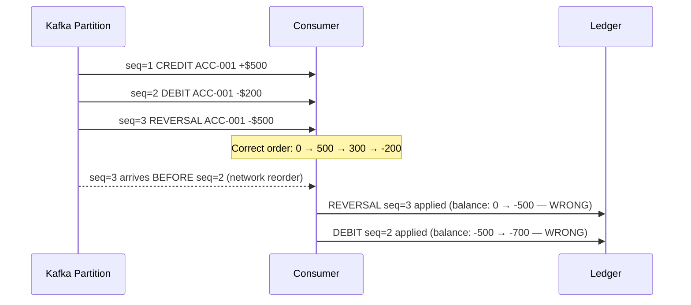
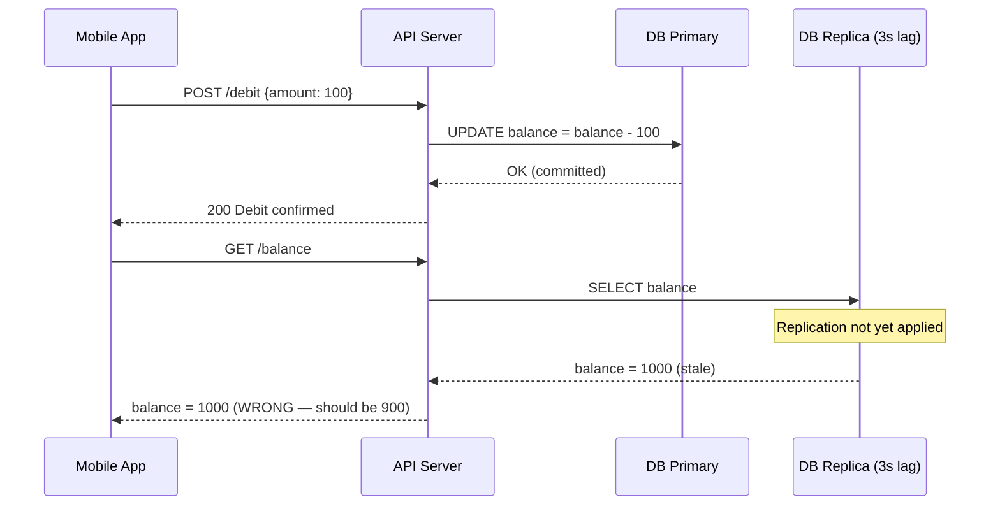
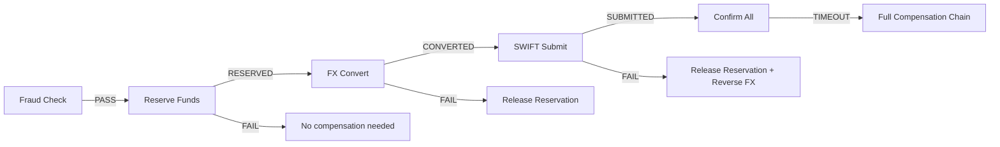

Distributed payment systems fail in ways that sequential programs never do. A network timeout does not mean a transaction failed — it means you do not know. A consumer that processes events out of order can reverse a debit before it was applied. A thread pool that shares a work queue can starve time-sensitive authorizations behind bulk settlement jobs. These are not theoretical problems: they are the class of incident that makes the front page of financial news. This lesson catalogues the six concurrency patterns that every principal engineer in financial services must know deeply, with production-grade Java implementations and the operational reasoning behind each design choice.

## Learning Objectives

By the end of this lesson you will be able to:

- Implement idempotency keys at every layer of a payment stack (HTTP, service, database, in-memory)
- Detect and handle sequence gaps in per-account event streams
- Partition concurrent work by a business key to achieve per-entity serial execution without global locks
- Reason about read-your-writes consistency trade-offs across distributed system topologies
- Implement the competing consumers pattern with correct hand-off visibility and fair scheduling
- Design a saga coordinator for distributed payment transactions using `CompletableFuture` with timeout and compensation

## Business Context

A European payments processor handles cross-border transfers for 400 banks. The system processes both real-time retail payments (target: sub-500ms end-to-end) and bulk payroll batches (millions of records overnight). Over an eighteen-month period the team accumulated four production incidents, each traceable to a concurrency pattern misapplication:

1. A retry storm during a downstream timeout created 11,000 duplicate debits (idempotency failure).
2. A credit reversal was processed before the original credit arrived, leaving accounts in a negative state (ordering failure).
3. A single slow merchant's fraud check blocked authorization threads for all merchants (partitioning failure).
4. A customer's balance read returned the pre-debit value three seconds after a confirmed debit, causing a declined payment at a POS terminal (read-your-writes failure).

Each section in this lesson addresses one of these failure modes with a concrete fix.

## Pattern 1: Idempotency and Exactly-Once Processing

### The Retry Storm Problem

When a network call times out, the caller cannot distinguish three scenarios: the server received the request and processed it; the server received it but is still processing; the server never received it. Retrying without idempotency guarantees creates duplicate transactions.

```
// Timeline of a duplicate debit incident
T+0ms   Client sends POST /transfers {amount:100, from:ACC-1, to:ACC-2}
T+200ms Server deducts 100 from ACC-1 (committed to DB)
T+450ms Server sends HTTP 200 response
T+451ms Network drops the response
T+500ms Client timeout fires: retries POST /transfers {amount:100, from:ACC-1, to:ACC-2}
T+600ms Server deducts 100 AGAIN from ACC-1 (second transaction)
T+601ms HTTP 200 delivered to client
// Result: client sees one successful transfer; two debits occurred
```

### The Idempotency Key Pattern: HTTP Layer

```java
// REST controller layer — idempotency key extracted from header
@RestController
@RequestMapping("/v1/transfers")
public class TransferController {

    private final TransferService transferService;

    @PostMapping
    public ResponseEntity<TransferResponse> initiateTransfer(
            @RequestHeader(value = "Idempotency-Key", required = true) String idempotencyKey,
            @RequestBody TransferRequest request) {

        // Validate key format: UUID v4 expected from clients
        if (!isValidUUID(idempotencyKey)) {
            return ResponseEntity.badRequest()
                .body(TransferResponse.error("INVALID_IDEMPOTENCY_KEY",
                    "Idempotency-Key must be a UUID v4"));
        }

        TransferResponse response = transferService.transfer(idempotencyKey, request);

        // Return the same response whether this is first attempt or a retry.
        // HTTP semantics: 200 means "here is the result of your operation"
        // regardless of whether we computed it now or retrieved it from cache.
        return ResponseEntity.ok(response);
    }

    private boolean isValidUUID(String key) {
        try {
            UUID uuid = UUID.fromString(key);
            return uuid.version() == 4;
        } catch (IllegalArgumentException e) {
            return false;
        }
    }
}
```

### Idempotency at the Service Layer: In-Memory Deduplication Window

For high-frequency paths, a database round-trip on every request to check idempotency is too slow. An in-memory deduplication window handles the common case (retries within seconds) cheaply:

```java
import com.github.benmanes.caffeine.cache.Cache;
import com.github.benmanes.caffeine.cache.Caffeine;

@Service
public class IdempotentTransferService {

    // In-memory deduplication window: 5 minutes TTL.
    // Handles retry storms; DB unique constraint handles cross-instance duplicates.
    private final Cache<String, TransferResponse> recentResults = Caffeine.newBuilder()
        .expireAfterWrite(5, TimeUnit.MINUTES)
        .maximumSize(100_000)
        .build();

    private final TransferRepository repository;
    private final AccountLedger ledger;

    public TransferResponse transfer(String idempotencyKey, TransferRequest request) {
        // 1. Fast path: check in-memory cache (no DB hit)
        TransferResponse cached = recentResults.getIfPresent(idempotencyKey);
        if (cached != null) {
            return cached; // idempotent response — no processing
        }

        // 2. Slow path: execute with DB-level idempotency guard.
        //    Caffeine.get() guarantees only one thread executes the loader
        //    for a given key — prevents the race where two threads both miss
        //    the cache and both attempt the DB insert.
        return recentResults.get(idempotencyKey, key -> executeTransfer(key, request));
    }

    @Transactional
    private TransferResponse executeTransfer(String idempotencyKey, TransferRequest request) {
        // DB-level idempotency: unique constraint on idempotency_key column.
        // If two threads race past the cache simultaneously, only one will
        // succeed the DB insert; the other gets a unique constraint violation.
        try {
            TransferRecord record = repository.insertWithIdempotencyKey(
                idempotencyKey, request);
            ledger.debit(request.fromAccount(), request.amount());
            ledger.credit(request.toAccount(), request.amount());
            repository.markComplete(record.id());
            return TransferResponse.success(record.id());
        } catch (DuplicateIdempotencyKeyException e) {
            // Another thread/instance already processed this key.
            // Retrieve and return the existing result.
            return repository.findByIdempotencyKey(idempotencyKey)
                .map(r -> TransferResponse.success(r.id()))
                .orElseThrow(() -> new IllegalStateException(
                    "Idempotency key exists but record not found: " + idempotencyKey));
        }
    }
}
```

### Distributed Idempotency with Redis SETNX

Across multiple service instances, an in-memory cache is insufficient — another node may also receive the retry. Redis `SETNX` (Set if Not eXists) with a TTL provides distributed exactly-once semantics:

```java
@Service
public class DistributedIdempotencyGuard {

    private final StringRedisTemplate redis;
    private static final Duration IDEMPOTENCY_TTL = Duration.ofMinutes(10);

    /**
     * Attempts to claim an idempotency key.
     * Returns true if this caller is the first to claim it (should process).
     * Returns false if another caller already claimed it (return cached result).
     *
     * Uses SET NX EX as a single atomic command — avoids the race condition
     * of a separate SETNX + EXPIRE (crash between the two would leave a
     * key with no TTL, blocking retries permanently).
     */
    public boolean tryClaimKey(String idempotencyKey, String instanceId) {
        Boolean claimed = redis.opsForValue().setIfAbsent(
            "idempotency:" + idempotencyKey,
            instanceId,
            IDEMPOTENCY_TTL);
        return Boolean.TRUE.equals(claimed);
    }

    public void storeResult(String idempotencyKey, TransferResponse response) {
        String resultKey = "idempotency:result:" + idempotencyKey;
        redis.opsForValue().set(resultKey, serialize(response), IDEMPOTENCY_TTL);
    }

    public Optional<TransferResponse> getStoredResult(String idempotencyKey) {
        String resultKey = "idempotency:result:" + idempotencyKey;
        String json = redis.opsForValue().get(resultKey);
        return Optional.ofNullable(json).map(this::deserialize);
    }

    private String serialize(TransferResponse r)     { return "{}"; /* Jackson */ }
    private TransferResponse deserialize(String json){ return null; /* Jackson */ }
}
```

### The Ghost Transaction Problem

A ghost transaction occurs when the idempotency record is committed but the actual transaction is not (or vice versa), typically due to a crash between the two database writes:

```java
// BROKEN: two separate commits — crash between them creates a ghost
public TransferResponse transferBroken(String idempotencyKey, TransferRequest request) {
    repository.insertIdempotencyRecord(idempotencyKey);    // COMMIT 1
    // *** CRASH HERE: idempotency record exists, but no ledger transaction ***
    // Retry finds the key → returns "success" for a never-executed transfer
    ledger.applyTransfer(request);                         // COMMIT 2
    return TransferResponse.success(/* ... */);
}

// CORRECT: idempotency record and transaction in a single ACID transaction
@Transactional
public TransferResponse transferCorrect(String idempotencyKey, TransferRequest request) {
    // Both writes in one transaction: either both commit or both roll back.
    // On commit: idempotency record and ledger entry are durable together.
    // On crash: both roll back — retry re-executes both safely.
    TransferRecord record = repository.insertWithIdempotencyKey(idempotencyKey, request);
    ledger.applyTransfer(request); // same transaction boundary
    return TransferResponse.success(record.id());
}
```

> [!WARNING]
> The ghost transaction problem is subtle: your monitoring will show 0 duplicate transactions (the idempotency guard works), but customers will report failed transfers that your system believes succeeded. Always record the idempotency key and the business transaction **in the same ACID commit unit**.

## Pattern 2: Event Ordering and Sequence Gaps

### Why Financial Events Must Be Ordered

A credit reversal applied before the original credit leaves a negative balance. A debit applied before a balance check that cleared it causes incorrect fraud decisions. Financial event streams have strict per-account ordering requirements.



### Per-Account Event Sequencer

```java
import java.util.concurrent.ConcurrentHashMap;
import java.util.concurrent.PriorityBlockingQueue;

/**
 * Per-account event sequencer that buffers out-of-order events
 * and delivers them in sequence order.
 *
 * Design invariant: one queue per account, accessed only by the partition
 * thread assigned to that account. No lock contention between accounts.
 */
public class PerAccountSequencer {

    private final ConcurrentHashMap<String, Long> expectedSeq = new ConcurrentHashMap<>();

    private final ConcurrentHashMap<String, PriorityBlockingQueue<AccountEvent>>
        pendingBuffers = new ConcurrentHashMap<>();

    private final AccountEventProcessor processor;
    // Maximum events to buffer waiting for a gap to fill
    private static final int MAX_GAP_BUFFER = 100;

    public void onEvent(AccountEvent event) {
        String accountId   = event.accountId();
        long   receivedSeq = event.sequenceNumber();
        long   expected    = expectedSeq.getOrDefault(accountId, 1L);

        if (receivedSeq == expected) {
            // In order: process immediately, then drain any buffered followers
            processAndDrain(accountId, event);
        } else if (receivedSeq > expected) {
            // Out of order: buffer and wait for gap to fill
            bufferEvent(accountId, event);
            checkForGapTimeout(accountId, expected, receivedSeq);
        } else {
            // Duplicate or redelivery (receivedSeq < expected)
            log.warn("Duplicate event for account {}: received seq={}, expected>={}",
                accountId, receivedSeq, expected);
        }
    }

    private void processAndDrain(String accountId, AccountEvent event) {
        processor.process(event);
        expectedSeq.put(accountId, event.sequenceNumber() + 1);

        // Drain any buffered events that now have the correct sequence number
        PriorityBlockingQueue<AccountEvent> buffer = pendingBuffers.get(accountId);
        if (buffer == null) return;

        while (true) {
            AccountEvent next = buffer.peek();
            if (next == null) break;
            long nextExpected = expectedSeq.getOrDefault(accountId, 1L);
            if (next.sequenceNumber() == nextExpected) {
                buffer.poll();
                processor.process(next);
                expectedSeq.put(accountId, next.sequenceNumber() + 1);
            } else {
                break; // gap remains; wait for missing events
            }
        }
    }

    private void bufferEvent(String accountId, AccountEvent event) {
        PriorityBlockingQueue<AccountEvent> buffer = pendingBuffers.computeIfAbsent(
            accountId,
            id -> new PriorityBlockingQueue<>(16,
                Comparator.comparingLong(AccountEvent::sequenceNumber)));

        if (buffer.size() >= MAX_GAP_BUFFER) {
            alertOps(accountId, event.sequenceNumber(),
                     expectedSeq.getOrDefault(accountId, 1L));
            requestRedelivery(accountId,
                              expectedSeq.getOrDefault(accountId, 1L),
                              event.sequenceNumber() - 1);
        }
        buffer.offer(event);
    }

    private void checkForGapTimeout(String accountId, long expected, long received) {
        long gap = received - expected;
        if (gap > 10) {
            log.warn("Sequence gap for account {}: expected={}, got={}, gap={}",
                accountId, expected, received, gap);
            requestRedelivery(accountId, expected, received - 1);
        }
    }

    private void requestRedelivery(String accountId, long fromSeq, long toSeq) {
        // Kafka seek, event store replay, or upstream redelivery request
    }

    private void alertOps(String accountId, long received, long expected) { /* ... */ }
}
```

### Kafka Partition-Per-Account Strategy

The most reliable way to ensure per-account ordering in Kafka is to route all events for an account to the same partition:

```java
// Producer: partition by accountId
@Service
public class AccountEventProducer {

    private final KafkaTemplate<String, AccountEvent> kafkaTemplate;
    private static final String TOPIC = "account-events";

    /**
     * Kafka's default partitioner consistently hashes the same key to
     * the same partition. All events for the same account go to one partition,
     * and Kafka guarantees ordering within a partition.
     */
    public CompletableFuture<RecordMetadata> publish(AccountEvent event) {
        ProducerRecord<String, AccountEvent> record = new ProducerRecord<>(
            TOPIC,
            event.accountId(),   // KEY drives partition assignment
            event
        );
        return kafkaTemplate.send(record)
            .thenApply(SendResult::getRecordMetadata);
    }
}

// Consumer: one thread per partition → serial execution per account
@KafkaListener(
    topics = "account-events",
    concurrency = "12",  // 12 threads = 12 partitions processed in parallel
    containerFactory = "accountEventListenerFactory")
public class AccountEventConsumer {

    private final AccountEventProcessor processor;

    // Each listener instance owns one partition: serial within partition,
    // parallel across partitions. No sequencing logic needed here when
    // partition-per-account is correctly maintained.
    public void onEvent(AccountEvent event, Acknowledgment ack) {
        processor.process(event);
        ack.acknowledge(); // commit offset only after successful processing
    }
}
```

> [!IMPORTANT]
> Partition-per-account strategy creates a **partition rebalancing risk**: if the number of partitions changes, the hash of an account ID may map to a different partition, breaking ordering for in-flight events. Never reduce partition count on a live financial event topic. Plan partition count at topic creation for the expected 3-5 year growth horizon, using a generous multiple of your expected maximum consumer count.

## Pattern 3: Partitioned Concurrency

### The Partitioned Executor Pattern

Global locks on account state are a scalability ceiling. The correct mental model for payment systems is: different accounts are independent and can be processed in parallel; the same account must be processed serially. Partitioned concurrency encodes this directly in the execution model:

```java
import java.util.concurrent.ExecutorService;
import java.util.concurrent.Executors;

/**
 * Partitioned executor for payment authorization.
 *
 * Key invariant: all tasks for the same account key are always submitted
 * to the same single-threaded partition, giving serial execution per account
 * without any explicit locking.
 *
 * Performance model:
 *   - N partitions × M accounts → no cross-account lock contention
 *   - 32 partitions on 32 vCPUs → near-linear throughput scaling
 *   - Per-account serial order maintained implicitly by partition assignment
 */
public class PartitionedAuthorizationExecutor {

    private final int              numPartitions;
    private final ExecutorService[] partitions;

    public PartitionedAuthorizationExecutor(int numPartitions) {
        this.numPartitions = numPartitions;
        this.partitions    = new ExecutorService[numPartitions];
        for (int i = 0; i < numPartitions; i++) {
            final int id = i;
            this.partitions[i] = Executors.newSingleThreadExecutor(
                Thread.ofPlatform()
                    .name("auth-partition-" + id)
                    .factory());
        }
    }

    /**
     * Routes a task to the partition determined by accountId.
     * Same accountId → same partition → serial execution guaranteed.
     * Different accountIds → potentially different partitions → parallel.
     */
    public <T> CompletableFuture<T> submit(String accountId, Callable<T> task) {
        int partition = partitionFor(accountId);
        return CompletableFuture.supplyAsync(() -> {
            try {
                return task.call();
            } catch (Exception e) {
                throw new CompletionException(e);
            }
        }, partitions[partition]);
    }

    private int partitionFor(String accountId) {
        // Integer.MIN_VALUE edge case: bitmasking with MAX_VALUE is safe
        return (accountId.hashCode() & Integer.MAX_VALUE) % numPartitions;
    }

    public void shutdown() {
        for (ExecutorService e : partitions) {
            e.shutdown();
        }
    }
}

// Usage: authorization service with no explicit account-level locks
@Service
public class AuthorizationService {

    private final PartitionedAuthorizationExecutor executor =
        new PartitionedAuthorizationExecutor(32);

    private final AccountRepository accountRepository;
    private final FraudEngine fraudEngine;

    public CompletableFuture<AuthorizationResult> authorize(AuthorizationRequest request) {
        return executor.submit(request.accountId(), () -> {
            // This block runs serially per account —
            // no two authorizations for ACC-001 execute concurrently.
            // No synchronized, no ReentrantLock, no optimistic retry.
            Account account = accountRepository.load(request.accountId());

            if (account.balance().compareTo(request.amount()) < 0) {
                return AuthorizationResult.declined("INSUFFICIENT_FUNDS");
            }

            FraudScore fraud = fraudEngine.evaluate(request);
            if (fraud.score() > 0.85) {
                return AuthorizationResult.declined("FRAUD_SUSPECTED");
            }

            account.reserve(request.amount());
            accountRepository.save(account);
            return AuthorizationResult.approved(account.reservationId());
        });
    }
}
```

### Hot Partition Detection and Mitigation

Partitioned executors are vulnerable to hot partitions when a small number of account IDs generate disproportionate volume:

```java
@Component
public class PartitionHealthMonitor {

    private final long[] taskCounts;
    private final int    numPartitions;

    public PartitionHealthMonitor(int numPartitions) {
        this.numPartitions = numPartitions;
        this.taskCounts    = new long[numPartitions];
    }

    public void recordTask(int partition) {
        taskCounts[partition]++;
    }

    /**
     * Reports the skew ratio: max partition load / average partition load.
     * Healthy: below 2.0.
     * Problematic: above 5.0 — a hot partition is likely starving other work.
     */
    public double skewRatio() {
        long total = 0;
        long max   = 0;
        for (long count : taskCounts) {
            total += count;
            if (count > max) max = count;
        }
        double avg = (double) total / numPartitions;
        return avg == 0 ? 1.0 : max / avg;
    }

    public List<Map.Entry<Integer, Long>> hotPartitions(int topN) {
        List<Map.Entry<Integer, Long>> entries = new ArrayList<>();
        for (int i = 0; i < numPartitions; i++) {
            entries.add(Map.entry(i, taskCounts[i]));
        }
        entries.sort((a, b) -> Long.compare(b.getValue(), a.getValue()));
        return entries.subList(0, Math.min(topN, entries.size()));
    }
}
```

## Pattern 4: Read-Your-Writes Consistency

### The Balance Display Bug

After a confirmed debit, a customer's mobile app reads their balance and sees the pre-debit value. Three seconds later it updates. The root cause: the debit wrote to the primary database replica, but the balance read was served from a read replica with 3-second replication lag.



### Strategy 1: Session Token Routing

```java
@Service
public class BalanceService {

    private final DataSource primaryDataSource;
    private final DataSource replicaDataSource;

    // Tracks sessions with recent writes: maps sessionToken → write timestamp
    private final Cache<String, Instant> recentWriteTokens = Caffeine.newBuilder()
        .expireAfterWrite(30, TimeUnit.SECONDS)
        .build();

    @Transactional
    public DebitResult debit(String accountId, BigDecimal amount, String sessionToken) {
        try (Connection conn = primaryDataSource.getConnection()) {
            // ... execute UPDATE on primary
        }
        // Record that this session wrote recently
        recentWriteTokens.put(sessionToken, Instant.now());
        return new DebitResult(/* ... */);
    }

    public BigDecimal getBalance(String accountId, String sessionToken) {
        // If this session has a recent write, force primary read.
        // Otherwise, serve from replica (scales better).
        DataSource source = recentWriteTokens.getIfPresent(sessionToken) != null
            ? primaryDataSource
            : replicaDataSource;

        try (Connection conn = source.getConnection()) {
            // ... SELECT balance FROM accounts WHERE id = ?
        }
        return BigDecimal.ZERO; // placeholder
    }
}
```

### Strategy 2: Version-Based Read-After-Write

The write returns a version number; the reader waits for the replica to catch up:

```java
// Schema: ALTER TABLE accounts ADD COLUMN version BIGINT DEFAULT 0;

@Service
public class VersionedBalanceService {

    private final JdbcTemplate primaryJdbc;
    private final JdbcTemplate replicaJdbc;

    @Transactional
    public DebitResult debit(String accountId, BigDecimal amount) {
        return primaryJdbc.queryForObject(
            "UPDATE accounts SET balance = balance - ?, version = version + 1 " +
            "WHERE id = ? RETURNING balance, version",
            (rs, i) -> new DebitResult(rs.getBigDecimal("balance"), rs.getLong("version")),
            amount, accountId);
    }

    /**
     * Reads from replica, polling until it has advanced to at least minVersion.
     * Falls back to primary if replica lags beyond the deadline.
     */
    public BigDecimal getBalance(String accountId, long minVersion) {
        Instant deadline = Instant.now().plusSeconds(2);

        while (Instant.now().isBefore(deadline)) {
            var vb = replicaJdbc.queryForObject(
                "SELECT balance, version FROM accounts WHERE id = ?",
                (rs, i) -> Map.entry(rs.getBigDecimal("balance"), rs.getLong("version")),
                accountId);

            if (vb.getValue() >= minVersion) {
                return vb.getKey(); // replica caught up
            }

            try { Thread.sleep(5); } catch (InterruptedException e) {
                Thread.currentThread().interrupt();
                break;
            }
        }

        // Replica did not catch up: fall back to primary
        log.warn("Replica lag exceeded deadline for account {} version {}",
            accountId, minVersion);
        return primaryJdbc.queryForObject(
            "SELECT balance FROM accounts WHERE id = ?",
            BigDecimal.class, accountId);
    }
}
```

> [!NOTE]
> The version-based approach adds ~5 ms of average read latency (waiting for replica sync) but eliminates 99.9% of stale reads without routing all reads to primary. The session-token approach is simpler but routes every post-write read to primary. At 85,000 TPS with one balance read per transaction, that is a substantial increase in primary query load. Choose based on your primary's available capacity headroom.

### Leader-Read vs Follower-Read Trade-offs

| Strategy | Latency | Primary Load | Staleness Risk | Complexity |
|---|---|---|---|---|
| Always primary | Lowest absolute | High | Zero | Low |
| Session token (sticky) | Low | Medium-high | Zero for affected sessions | Low |
| Version polling | Low + ~5ms avg | Low | Zero | Medium |
| Eventual (no guarantee) | Lowest | Low | High | Low |

## Pattern 5: The Competing Consumers Pattern

### Correct Hand-Off Visibility

The competing consumers pattern distributes work across multiple worker threads. The critical correctness requirement: a worker thread must see all state written by the thread that produced the work item. `LinkedBlockingQueue`'s `put()` and `take()` establish a happens-before edge — everything written before `put()` is visible to the thread that calls `take()`.

```java
import java.util.concurrent.LinkedBlockingQueue;
import java.util.concurrent.atomic.AtomicBoolean;

/**
 * Competing consumers for payment settlement jobs.
 * Workers compete for jobs from a shared bounded queue.
 * The queue provides the hand-off with correct JMM visibility —
 * no additional synchronisation needed on the job object itself.
 */
public class SettlementProcessor {

    // Bounded: backpressure if workers fall behind
    private final LinkedBlockingQueue<SettlementJob> workQueue =
        new LinkedBlockingQueue<>(10_000);

    private final List<Thread> workers = new ArrayList<>();
    private final AtomicBoolean running = new AtomicBoolean(true);

    public void start(int workerCount) {
        for (int i = 0; i < workerCount; i++) {
            final int workerId = i;
            Thread worker = Thread.ofPlatform()
                .name("settlement-worker-" + workerId)
                .start(() -> workerLoop(workerId));
            workers.add(worker);
        }
    }

    private void workerLoop(int workerId) {
        while (running.get() || !workQueue.isEmpty()) {
            try {
                SettlementJob job = workQueue.poll(100, TimeUnit.MILLISECONDS);
                if (job == null) continue;

                // LinkedBlockingQueue.take() HB with put() on the producer:
                // all state written to 'job' before put() is visible here.
                processJob(workerId, job);

            } catch (InterruptedException e) {
                Thread.currentThread().interrupt();
                break;
            }
        }
    }

    public void submit(SettlementJob job) {
        try {
            workQueue.put(job); // blocks if queue full (backpressure)
        } catch (InterruptedException e) {
            Thread.currentThread().interrupt();
            throw new RuntimeException("Interrupted while submitting settlement job", e);
        }
    }

    private void processJob(int workerId, SettlementJob job) { /* ... */ }

    public void shutdown() {
        running.set(false);
        workers.forEach(t -> {
            try { t.join(5_000); } catch (InterruptedException e) {
                Thread.currentThread().interrupt();
            }
        });
    }
}
```

### Database-Backed Queue with SKIP LOCKED

For durability across restarts and cross-service work distribution, a database queue with `SKIP LOCKED` provides competing consumers at the persistence layer:

```java
// PostgreSQL schema:
// CREATE TABLE settlement_jobs (
//   id         BIGSERIAL PRIMARY KEY,
//   status     VARCHAR(20) NOT NULL DEFAULT 'PENDING',
//   created_at TIMESTAMP   NOT NULL DEFAULT NOW(),
//   payload    JSONB       NOT NULL,
//   error_msg  TEXT
// );
// CREATE INDEX settlement_jobs_pending ON settlement_jobs(created_at)
//   WHERE status = 'PENDING';

@Service
public class DatabaseSettlementQueue {

    private final JdbcTemplate  jdbc;
    private final ObjectMapper  objectMapper;

    /**
     * Claims the next available job atomically.
     * SKIP LOCKED: other consumers transparently skip rows already
     * locked by concurrent transactions — no queue-behind-a-lock bottleneck.
     */
    @Transactional
    public Optional<SettlementJob> claimNext() {
        return jdbc.query(
            "SELECT id, payload FROM settlement_jobs " +
            "WHERE status = 'PENDING' " +
            "ORDER BY created_at " +
            "LIMIT 1 " +
            "FOR UPDATE SKIP LOCKED",
            rs -> {
                if (!rs.next()) return Optional.empty();
                long   id      = rs.getLong("id");
                String payload = rs.getString("payload");
                jdbc.update(
                    "UPDATE settlement_jobs SET status = 'PROCESSING' WHERE id = ?",
                    id);
                return Optional.of(parseJob(id, payload));
            });
    }

    @Transactional
    public void complete(long jobId) {
        jdbc.update(
            "UPDATE settlement_jobs SET status = 'COMPLETED' WHERE id = ?", jobId);
    }

    @Transactional
    public void fail(long jobId, String error) {
        jdbc.update(
            "UPDATE settlement_jobs SET status = 'FAILED', error_msg = ? WHERE id = ?",
            error, jobId);
    }

    private SettlementJob parseJob(long id, String payload) {
        try {
            return objectMapper.readValue(payload, SettlementJob.class);
        } catch (Exception e) {
            throw new RuntimeException("Failed to parse job " + id, e);
        }
    }
}
```

### Fair Scheduling: Separating SLA Tiers

```java
@Configuration
public class ExecutorConfig {

    // High-priority: real-time authorizations (sub-100ms SLA)
    @Bean("authorizationExecutor")
    public ExecutorService authorizationExecutor() {
        return new ThreadPoolExecutor(
            16, 16,
            0L, TimeUnit.MILLISECONDS,
            new ArrayBlockingQueue<>(1_000),     // bounded: reject on overload
            Thread.ofPlatform().name("auth-", 0).factory(),
            new ThreadPoolExecutor.AbortPolicy()); // 503 to caller — better than SLA breach
    }

    // Low-priority: bulk settlement (best-effort, no SLA)
    @Bean("settlementExecutor")
    public ExecutorService settlementExecutor() {
        return new ThreadPoolExecutor(
            4, 8,
            60L, TimeUnit.SECONDS,
            new LinkedBlockingQueue<>(100_000),  // large queue: batch accumulation OK
            Thread.ofPlatform().name("settlement-", 0).factory(),
            new ThreadPoolExecutor.CallerRunsPolicy()); // slow down producer on overload
    }
}
```

> [!WARNING]
> `CallerRunsPolicy` is dangerous for high-priority executors: if the caller is an HTTP request thread, it blocks that thread for the duration of the task. Use `AbortPolicy` for latency-sensitive paths and implement circuit breakers in the caller to handle the resulting `RejectedExecutionException` gracefully (return HTTP 503 rather than letting the request thread stall).

## Pattern 6: The Saga Pattern for Distributed Transactions

### The Payment Saga Structure

A cross-border payment touches four services: fraud check, funds reservation, FX conversion, and SWIFT submission. Each step can fail independently. A distributed transaction (2PC) would require all four services to hold locks simultaneously — impractical at high throughput. The Saga pattern decomposes the transaction into local steps with compensating actions:



### CompletableFuture Saga Orchestration

```java
import java.util.concurrent.CompletableFuture;
import java.util.concurrent.TimeUnit;

/**
 * Saga orchestrator for cross-border payment.
 *
 * Concurrency model:
 *   - Steps execute sequentially (financial ordering requirement)
 *   - Compensation steps execute concurrently where independent
 *   - Each stage runs on a dedicated sagaExecutor to avoid blocking
 *     the calling thread or the event loop
 *   - orTimeout() enforces per-step SLAs with TimeoutException compensation
 */
@Service
public class CrossBorderPaymentSaga {

    private final FraudService     fraudService;
    private final FundsService     fundsService;
    private final FxService        fxService;
    private final SwiftService     swiftService;
    private final SagaLogRepository sagaLog;
    private final ExecutorService  sagaExecutor;

    public CompletableFuture<PaymentResult> execute(CrossBorderPaymentRequest request) {
        String sagaId = UUID.randomUUID().toString();
        sagaLog.start(sagaId, request);

        return CompletableFuture
            // Step 1: Fraud check — no compensating action needed on failure
            .supplyAsync(() -> fraudService.check(sagaId, request), sagaExecutor)
            .orTimeout(5, TimeUnit.SECONDS)
            .exceptionally(ex -> {
                sagaLog.failed(sagaId, "FRAUD_CHECK_TIMEOUT");
                throw new SagaAbortException("FRAUD_CHECK_FAILED", ex);
            })

            // Step 2: Reserve funds
            .thenComposeAsync(fraudResult -> {
                if (!fraudResult.passed()) {
                    sagaLog.failed(sagaId, "FRAUD_REJECTED");
                    return CompletableFuture.failedFuture(
                        new SagaAbortException("FRAUD_REJECTED", fraudResult));
                }
                sagaLog.stepCompleted(sagaId, "FRAUD_CHECKED", fraudResult.toString());
                return fundsService.reserve(sagaId, request.fromAccount(), request.amount());
            }, sagaExecutor)
            .orTimeout(3, TimeUnit.SECONDS)

            // Step 3: FX conversion
            .thenComposeAsync(reservation -> {
                sagaLog.stepCompleted(sagaId, "FUNDS_RESERVED", reservation.id());
                return fxService.convert(sagaId, request.amount(),
                    request.sourceCurrency(), request.targetCurrency());
            }, sagaExecutor)
            .orTimeout(10, TimeUnit.SECONDS)
            .exceptionally(ex -> {
                // FX failed or timed out: release the reservation
                log.error("[{}] FX conversion failed — compensating reservation", sagaId, ex);
                fundsService.releaseAsync(sagaId, request.fromAccount());
                sagaLog.failed(sagaId, "FX_FAILED");
                throw new SagaAbortException("FX_FAILED", ex);
            })

            // Step 4: SWIFT submission
            .thenComposeAsync(fxResult -> {
                sagaLog.stepCompleted(sagaId, "FX_CONVERTED", fxResult.rate().toString());
                return swiftService.submit(sagaId, request, fxResult);
            }, sagaExecutor)
            .orTimeout(30, TimeUnit.SECONDS)
            .exceptionally(ex -> {
                // SWIFT failed: compensate FX and reservation in parallel
                log.error("[{}] SWIFT failed — full compensation chain", sagaId, ex);
                compensateFullAsync(sagaId, request);
                sagaLog.failed(sagaId, "SWIFT_FAILED");
                throw new SagaAbortException("SWIFT_FAILED", ex);
            })

            // Final: confirm saga completed
            .thenApplyAsync(swiftResult -> {
                sagaLog.completed(sagaId);
                return PaymentResult.succeeded(sagaId, swiftResult.swiftReference());
            }, sagaExecutor)

            .exceptionally(ex -> {
                if (!(ex.getCause() instanceof SagaAbortException)) {
                    sagaLog.failed(sagaId, "UNEXPECTED: " + ex.getMessage());
                }
                return PaymentResult.failed(sagaId, ex.getMessage());
            });
    }

    /**
     * Compensation: release reservation and reverse FX concurrently.
     * These are independent compensating actions — parallelise them.
     */
    private void compensateFullAsync(String sagaId, CrossBorderPaymentRequest request) {
        CompletableFuture<Void> releaseFunds = CompletableFuture.runAsync(
            () -> fundsService.release(sagaId, request.fromAccount()), sagaExecutor);

        CompletableFuture<Void> reverseFx = CompletableFuture.runAsync(
            () -> fxService.reverse(sagaId), sagaExecutor);

        CompletableFuture.allOf(releaseFunds, reverseFx)
            .orTimeout(10, TimeUnit.SECONDS)
            .whenComplete((v, ex) -> {
                if (ex != null) {
                    // Compensation failed: manual reconciliation required
                    sagaLog.compensationFailed(sagaId, ex.getMessage());
                    alertOps("SAGA_COMPENSATION_FAILED", sagaId, ex);
                } else {
                    sagaLog.compensated(sagaId);
                }
            });
    }

    private void alertOps(String event, String sagaId, Throwable ex) { /* ... */ }
}
```

### Idempotent Compensation with the Saga Log

Compensating actions must themselves be idempotent — a compensation may be re-executed if the coordinator crashes mid-compensation. The saga log makes recovery safe:

```java
/**
 * Durable saga log: persists each step transition so the coordinator
 * can resume compensation after a crash without double-compensating.
 *
 * State machine:
 * STARTED → FRAUD_CHECKED → FUNDS_RESERVED → FX_CONVERTED → SWIFT_SUBMITTED
 *         → COMPLETED
 *         → FAILED (at any step)
 *         → COMPENSATING → COMPENSATED
 *         → COMPENSATION_FAILED (requires manual intervention)
 */
@Repository
public class SagaLogRepository {

    private final JdbcTemplate jdbc;

    @Transactional
    public void start(String sagaId, CrossBorderPaymentRequest request) {
        jdbc.update(
            "INSERT INTO saga_log (saga_id, status, request_json, created_at) " +
            "VALUES (?, 'STARTED', ?::jsonb, NOW())",
            sagaId, serialize(request));
    }

    @Transactional
    public void stepCompleted(String sagaId, String stepName, String resultJson) {
        jdbc.update(
            "UPDATE saga_log SET status = ?, last_step_result = ?::jsonb, " +
            "updated_at = NOW() WHERE saga_id = ?",
            stepName + "_COMPLETE", resultJson, sagaId);
    }

    @Transactional
    public void failed(String sagaId, String reason) {
        jdbc.update(
            "UPDATE saga_log SET status = 'FAILED', error_message = ?, " +
            "updated_at = NOW() WHERE saga_id = ?",
            reason, sagaId);
    }

    @Transactional
    public void compensated(String sagaId) {
        jdbc.update(
            "UPDATE saga_log SET status = 'COMPENSATED', updated_at = NOW() " +
            "WHERE saga_id = ?", sagaId);
    }

    @Transactional
    public void compensationFailed(String sagaId, String error) {
        jdbc.update(
            "UPDATE saga_log SET status = 'COMPENSATION_FAILED', error_message = ?, " +
            "updated_at = NOW() WHERE saga_id = ?",
            error, sagaId);
    }

    public List<String> findUncompensatedFailedSagas() {
        return jdbc.queryForList(
            "SELECT saga_id FROM saga_log " +
            "WHERE status = 'FAILED' " +
            "AND updated_at < NOW() - INTERVAL '1 minute' " +
            "ORDER BY created_at",
            String.class);
    }

    private String serialize(Object obj) { return "{}"; /* Jackson */ }
}
```

### Saga Recovery: Coordinating Concurrent Compensation

```java
@Service
public class SagaRecoveryJob {

    private final SagaLogRepository sagaLog;
    private final CrossBorderPaymentSaga saga;
    private final StringRedisTemplate redis;

    @Scheduled(fixedDelay = 60_000)
    public void recoverFailedSagas() {
        List<String> failedIds = sagaLog.findUncompensatedFailedSagas();

        for (String sagaId : failedIds) {
            // Distributed lock per saga: only one instance compensates each saga.
            // Prevents duplicate compensation across service instances.
            String lockKey = "saga-recovery:" + sagaId;
            Boolean locked = redis.opsForValue().setIfAbsent(
                lockKey, "locked", Duration.ofMinutes(5));

            if (Boolean.TRUE.equals(locked)) {
                try {
                    saga.compensate(sagaId);
                } catch (Exception e) {
                    log.error("Recovery failed for saga {}", sagaId, e);
                } finally {
                    redis.delete(lockKey);
                }
            }
        }
    }
}
```

> [!IMPORTANT]
> The saga pattern does **not** provide isolation. While saga A is processing funds reservation for account ACC-001, saga B for the same account may also check the available balance and see the full (not-yet-reserved) amount. Implement isolation at the domain level: the `reserveFunds` step must use a database row lock (`SELECT FOR UPDATE`) or optimistic locking (`WHERE version = ?`) to prevent double-reservation. The saga pattern handles failure recovery; it does not automatically handle concurrent access to shared state within a step.

## Knowledge Check

**Q: A payment service retries a transfer request and uses an idempotency key stored in Redis with SETNX. The first attempt sets the key and succeeds. The second attempt (retry) finds the key already set and returns the cached result. However, two hours later a customer reports the transfer never happened. What is the most likely cause?**

**A:** The most likely cause is the **ghost transaction problem**: the SETNX set the idempotency key (indicating "in progress"), but the actual transfer — the ledger debit and credit — failed or was not committed in the same atomic unit. The idempotency guard saw the key on retry and returned "success", but the business transaction was never persisted. The fix is to record the idempotency key alongside the transaction in a **single ACID transaction**: if the ledger write fails, the idempotency record also rolls back, so the next retry correctly attempts the transfer again. The Redis SETNX should be used only for fast in-flight deduplication (to handle hot retries within seconds), and the key's value should indicate "PROCESSING" until the DB transaction commits, at which point it is updated to "COMPLETED" with the result. The DB record is the authoritative source of truth; Redis is a performance optimisation.

---

**Q: Your payment authorization service uses a `PartitionedAuthorizationExecutor` with 32 single-threaded partitions. You observe that one partition is consistently running at 100% utilization while others are at 10%. Authorizations are routed by account ID hash. What is the likely cause and how do you diagnose and fix it?**

**A:** This is a **hot partition** problem caused by skewed key distribution. Likely causes: (1) a small number of account IDs have disproportionately high transaction volume — a corporate card used by hundreds of employees, or a shared service account — and those IDs all hash to the same partition; (2) Java's `String.hashCode()` produces uneven distribution for certain character patterns common in your account ID format. Diagnosis: log the `(accountId, partitionIndex)` mapping for the top 50 busiest accounts and look for partition clustering; compute the skew ratio (max partition load / average partition load) — healthy is below 2.0, problematic is above 5.0. Fix options: (1) replace `String.hashCode()` with MurmurHash3 or xxHash for better distribution; (2) for known hot accounts, pre-assign them to dedicated overflow partitions outside the main ring; (3) if the hot traffic is a service account performing batch operations, rate-limit it at the API layer to prevent it from saturating a partition and causing backpressure on all other accounts sharing that partition's queue.

## Practical Challenge

You are the principal engineer for a **real-time ACH payment processing system** that handles both individual transfers and payroll batch files. The system has the following requirements:

- Individual transfers: sub-200ms end-to-end, exactly-once semantics
- Payroll batches: up to 500,000 payments per file, processed overnight
- Accounts can receive both individual and batch payments simultaneously
- System must handle upstream service timeouts gracefully with compensation

**Your tasks:**

1. **Design the idempotency strategy** for the full stack: HTTP layer (idempotency key header), service layer (Caffeine in-memory window), and database layer (unique constraint + atomic saga log). Specify the TTL at each layer and explain why each TTL choice makes sense for the payment use case.

2. **Implement a partitioned processor** that handles both individual authorizations and batch payment entries. Individual authorizations must preempt batch entries within the same account partition (priority within partition). Show how you would implement priority ordering without introducing cross-partition locks — hint: replace the single-threaded executor's `LinkedBlockingQueue` with a `PriorityBlockingQueue` keyed on `(priority, arrivalTime)`.

3. **Model the event ordering requirement**: payroll batches arrive as a single Kafka message per file, then fan out to per-account events. Each account may receive multiple credits from the same batch (multiple pay components). Design the sequencing scheme: how do you assign sequence numbers to batch entries, detect gaps, and ensure a partial batch does not leave accounts in an inconsistent state?

4. **Implement a saga** for a payroll batch payment that involves: balance validation (check the payer's account has sufficient funds for the entire batch), individual fund reservations per recipient, and final credit application. Show the compensation chain if any individual credit fails mid-batch. Consider: should you compensate all prior reservations, or only fail forward by holding the payer's reservation and retrying the failed recipient?

5. **Write a load test** using JMH or Gatling that simulates 1,000 concurrent individual authorizations plus 5 concurrent payroll batch files of 10,000 entries each. Measure: p99 latency for individual authorizations under batch load, partition utilization distribution (skew ratio), and saga compensation rate under a simulated 1% step failure rate.

Expected deliverable: a working Spring Boot module with the complete implementation. The p99 latency for individual authorizations must remain below 200ms even when batch processing is running at full throughput on the same partitioned executor infrastructure.

<!-- KNOWLEDGE-CHECK
{
  "questions": [
    {
      "text": "A payment service stores an idempotency key in Redis with SETNX before processing a transfer. A customer reports a transfer never happened, yet retries are returning 'already processed'. What is the most likely root cause?",
      "options": [
        "The Redis key expired before the second attempt",
        "The SETNX set the key (indicating 'in progress') but the actual ledger transaction failed or was not committed in the same atomic unit — the idempotency guard incorrectly returns success for a transaction that never persisted",
        "The idempotency key TTL was too short",
        "Redis SETNX is not atomic and can allow duplicate processing"
      ],
      "correct": 1,
      "explanation": "This is the ghost transaction problem: SETNX sets the key before the actual database transaction commits. If the transaction fails or is never committed, the idempotency key is already set, so all retries are blocked and return 'already processed' — but no transfer ever happened. The fix is to record the idempotency key alongside the transaction in a single ACID database transaction, so they commit or rollback together. Redis SETNX should only be used for fast in-flight deduplication, with the database record as the authoritative source of truth."
    },
    {
      "text": "A PartitionedAuthorizationExecutor with 32 partitions shows one partition at 100% utilization while others are at 10%. What is the most likely cause and first diagnostic step?",
      "options": [
        "A bug in the thread pool causing uneven task distribution; restart the service",
        "Hot partition: a small number of account IDs with disproportionately high transaction volume all hash to the same partition; compute the skew ratio and log the partition mapping for the top 50 busiest accounts",
        "The partition count is too low; increase to 128 partitions",
        "An overloaded database causing all queries to slow down on one partition"
      ],
      "correct": 1,
      "explanation": "Hot partitions occur when a small number of keys (e.g., a corporate card used by hundreds of employees, or a service account) generate disproportionate volume and all hash to the same partition. The diagnostic is to log the (accountId, partitionIndex) mapping for the top 50 busiest accounts and compute the skew ratio (max partition load / average load). A healthy ratio is below 2.0; above 5.0 indicates a hot partition. Fixes include replacing String.hashCode() with MurmurHash3, pre-assigning hot accounts to dedicated overflow partitions, or rate-limiting service accounts at the API layer."
    },
    {
      "text": "The Saga pattern is used for a cross-border payment touching four services. What isolation problem does the Saga pattern NOT solve, and how must it be addressed?",
      "options": [
        "The Saga pattern does not handle network timeouts; use 2PC instead",
        "The Saga pattern does not provide isolation — concurrent sagas for the same account can read the full balance before any reservation is applied, causing double-reservation; isolation must be implemented within each step using database row locks or optimistic locking",
        "The Saga pattern does not support compensating transactions",
        "The Saga pattern does not work with microservices; it requires a monolith"
      ],
      "correct": 1,
      "explanation": "The Saga pattern handles failure recovery through compensating transactions but does NOT provide isolation. While saga A is reserving funds for account ACC-001, saga B may also check the available balance and see the full (not-yet-reserved) amount, causing double-reservation. Isolation must be implemented at the step level: the reserveFunds step must use SELECT FOR UPDATE or optimistic locking to prevent concurrent sagas from simultaneously reserving the same funds."
    }
  ]
}
-->

<!-- PRACTICAL-CHALLENGE
{
  "title": "Real-Time ACH Payment Processing System",
  "difficulty": "advanced",
  "estimatedMinutes": 90,
  "tasks": [
    {"id": "1", "description": "Design a three-layer idempotency strategy for ACH payment processing: (1) HTTP layer — accept an Idempotency-Key header, check a Caffeine cache with 60-second TTL to reject duplicate requests within the in-flight window; (2) service layer — use a Caffeine cache with 5-minute TTL as a fast deduplication guard before hitting the database; (3) database layer — persist the idempotency key alongside the transaction record in a single ACID transaction using a unique constraint. Document why each TTL is appropriate for the payment use case."},
    {"id": "2", "description": "Implement a PartitionedAuthorizationExecutor with 32 single-threaded partitions. Replace the standard LinkedBlockingQueue with a PriorityBlockingQueue ordered by (priority, arrivalTime) so that individual authorizations (priority=HIGH) preempt batch payment entries (priority=LOW) within the same account partition. Implement a PartitionHealthMonitor that tracks per-partition task counts and reports a skew ratio (max/average) with alerting when it exceeds 5.0."},
    {"id": "3", "description": "Implement a PayrollBatchSaga that orchestrates: (1) validate the payer has sufficient funds for the entire batch total using SELECT FOR UPDATE, (2) create individual fund reservations per recipient (parallelised with up to 20 concurrent reservations), (3) apply final credits to all recipients. Implement the compensation chain for the case where a credit fails mid-batch: release the payer's reservation and log all failed recipients to a reconciliation queue. Use a SagaLogRepository backed by PostgreSQL to make all state transitions durable and idempotent."},
    {"id": "4", "description": "Write a load test using JMH or Gatling that simulates 1,000 concurrent individual authorizations simultaneously with 5 concurrent payroll batch files of 10,000 entries each. Measure: (a) p99 latency for individual authorizations under full batch load, (b) partition utilization distribution (skew ratio at peak), (c) saga compensation rate under a simulated 1% step failure rate. The p99 latency for individual authorizations must remain below 200ms regardless of batch throughput."}
  ]
}
-->
