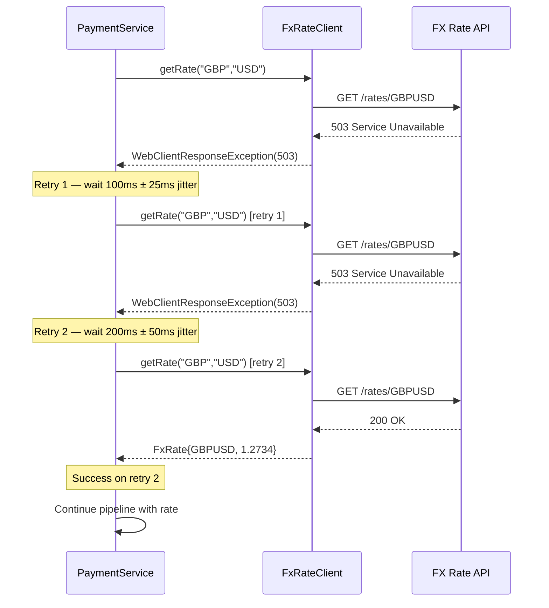

Reactive pipelines are unforgiving with errors. Unlike imperative code where you can wrap a try/catch around a block and expect execution to resume on the next line, in a reactive stream **an unhandled error terminates the entire sequence**. The subscriber receives `onError`, the stream is cancelled, and no further elements are emitted. For a payment processing pipeline that handles thousands of concurrent streams, this behaviour demands a deliberate, layered error strategy — not an afterthought.

This lesson covers every tool Reactor provides for error handling, then assembles them into a production-grade `PaymentWebClient` that combines retries, timeouts, and a Resilience4j circuit breaker.

## Learning Objectives

- Explain how errors propagate through a reactive pipeline and why they terminate the stream
- Distinguish between `onErrorReturn`, `onErrorResume`, and `doOnError` and select the right operator for each scenario
- Implement exponential backoff with jitter using `retryWhen` and `Retry.backoff`
- Apply the `timeout` operator with a fallback `Mono` to bound latency
- Integrate a Resilience4j reactive circuit breaker into a `WebClient` pipeline
- Classify errors as retryable or non-retryable and enforce that classification in code
- Route permanently-failed events to a dead letter channel within a reactive pipeline
- Avoid the correctness pitfalls of `onErrorContinue` in business-critical flows

## Business Context

**The Incident:** In Q3 2023, a European neo-bank experienced a 47-minute outage during which approximately 12,000 payment submissions returned HTTP 500 to customers. The root cause was a downstream FX rate service that began returning intermittent 503 responses due to a misconfigured load balancer. The payment service's reactive pipeline had no retry logic. Each 503 propagated as an error that cancelled the subscriber's `Mono<PaymentResult>`, which the controller mapped to a 500. Because there was no circuit breaker, the payment service continued hammering the degraded FX service with 400 req/s — preventing it from recovering.

The fix was three operators added to one pipeline: `retryWhen`, `timeout`, and a Resilience4j circuit breaker. This lesson teaches you to build that pipeline correctly from the start.

## How Errors Propagate in Reactive Streams

In a reactive pipeline, an error is a terminal signal. Once `onError` is emitted, the subscription ends. No further `onNext` or `onComplete` signals follow.

```java
// This pipeline terminates at the first failed payment
Flux<PaymentResult> results = paymentIds
    .flatMap(id -> paymentService.process(id))  // if any Mono errors, flatMap propagates it
    .map(result -> enrich(result));              // this never runs for errored items

// Without error handling: one failure cancels all in-flight work
// for that subscriber
```

The key insight is that `flatMap` propagates inner errors to the outer sequence. This is correct behaviour — but it means you must handle errors at the right level.

```java
// Handle at the inner level to isolate failures per payment
Flux<PaymentResult> results = paymentIds
    .flatMap(id -> paymentService.process(id)
        .onErrorResume(ex -> Mono.just(PaymentResult.failed(id, ex)))
    );
// Now one failure does not terminate the outer Flux
```

## onErrorReturn, onErrorResume, and doOnError

These three operators are the foundation of reactive error handling. They are not interchangeable.

### doOnError — Side-Effect Only

`doOnError` runs a side-effect when an error occurs but **does not catch or transform it**. The error continues propagating downstream. Use it for logging, metrics, and alerting.

```java
Mono<PaymentResult> payment = paymentService.submit(request)
    .doOnError(PaymentException.class, ex ->
        log.error("Payment submission failed: paymentId={}, reason={}",
            request.getPaymentId(), ex.getMessage()))
    .doOnError(ex ->
        meterRegistry.counter("payment.error",
            "type", ex.getClass().getSimpleName()).increment());
// Error still propagates — subscriber still receives onError
```

### onErrorReturn — Static Fallback Value

`onErrorReturn` catches an error and emits a single fallback value, then completes the stream. Use it when you have a safe default.

```java
Mono<FxRate> fxRate = fxRateService.getRate("GBP", "USD")
    .onErrorReturn(FxRateUnavailableException.class,
        FxRate.cached("GBP", "USD", cachedRate));
// Subscriber receives the cached rate and onComplete — no error
```

> [!WARNING]
> `onErrorReturn` catches **all** errors unless you specify a type or predicate. Using it without a type parameter swallows `OutOfMemoryError` and other fatal signals. Always prefer the typed variant in production code.

### onErrorResume — Dynamic Fallback Publisher

`onErrorResume` catches an error and **switches to an alternative publisher**. This is the most powerful recovery operator — the fallback can itself be a `Mono` or `Flux` that makes a network call, reads from cache, or applies business logic.

```java
Mono<AccountBalance> balance = primaryAccountService.getBalance(accountId)
    .onErrorResume(ServiceUnavailableException.class,
        ex -> cacheService.getCachedBalance(accountId)
            .switchIfEmpty(Mono.error(new BalanceUnavailableException(accountId))))
    .onErrorResume(TimeoutException.class,
        ex -> Mono.just(AccountBalance.unknown(accountId)));
```

Chaining multiple `onErrorResume` calls creates a **fallback chain** — errors not handled by the first handler propagate to the next.

| Operator | Catches Error? | Emits Fallback? | Use Case |
|---|---|---|---|
| `doOnError` | No | No | Logging, metrics |
| `onErrorReturn` | Yes | Static value | Safe defaults, cached values |
| `onErrorResume` | Yes | Dynamic publisher | Cache fallback, alternative service |
| `onErrorMap` | Yes (re-throws) | No | Error translation |

## retryWhen — Exponential Backoff with Jitter

Retrying immediately after a failure often makes things worse — you are hammering a service that is already struggling. `Retry.backoff` from Reactor implements exponential backoff with optional jitter.

```java
// Retry specification: 3 attempts, 100ms base delay, 2s max delay, 25% jitter
Retry retrySpec = Retry.backoff(3, Duration.ofMillis(100))
    .maxBackoff(Duration.ofSeconds(2))
    .jitter(0.25)
    .filter(ex -> isRetryable(ex))           // only retry specific error types
    .onRetryExhaustedThrow((spec, signal) -> // transform exhausted retry into domain error
        new PaymentServiceUnavailableException(
            "FX rate service unavailable after " + spec.maxAttempts + " retries",
            signal.failure()));

Mono<FxRate> fxRate = fxRateClient.getRate("GBP", "USD")
    .retryWhen(retrySpec);
```

The jitter parameter randomises the backoff duration by ±25%. Without jitter, all clients that failed at the same time retry at the same intervals — a **thundering herd** that can prevent recovery. Jitter spreads load across time.

```java
// Error classification — retryable vs non-retryable
private boolean isRetryable(Throwable ex) {
    // Retryable: transient infrastructure failures
    if (ex instanceof io.netty.channel.ConnectTimeoutException) return true;
    if (ex instanceof java.net.SocketException) return true;
    if (ex instanceof WebClientResponseException wex) {
        // 429 Too Many Requests, 503 Service Unavailable, 502 Bad Gateway
        return wex.getStatusCode().is5xxServerError()
            || wex.getStatusCode().value() == 429;
    }
    // Non-retryable: business logic errors
    if (ex instanceof InsufficientFundsException) return false;
    if (ex instanceof PaymentValidationException) return false;
    if (ex instanceof WebClientResponseException wex) {
        // 400, 401, 403, 404 — retrying will not help
        return !wex.getStatusCode().is4xxClientError();
    }
    return false;
}
```

## Retry Sequence Diagram



## Timeout Operator with Fallback

`timeout` cancels the subscription if no item is emitted within the specified duration and emits a `TimeoutException`. It optionally accepts a fallback publisher.

```java
Mono<FxRate> fxRateWithTimeout = fxRateClient.getRate("GBP", "USD")
    .timeout(
        Duration.ofMillis(300),
        // Fallback: use last-known cached rate rather than failing
        cacheService.getLastKnownRate("GBP", "USD")
            .switchIfEmpty(Mono.error(
                new FxRateUnavailableException("No cached rate available")))
    );
```

> [!NOTE]
> `timeout` measures wall-clock time from subscription to first element. For `Flux`, each element must arrive within the timeout — not just the first. Use `timeout(Duration, Publisher)` for element-level and `take(Duration)` as a time-bounded window over the whole flux.

## Resilience4j Reactive Circuit Breaker

Retries and timeouts protect individual calls. A circuit breaker protects the whole system by stopping calls to a service that is reliably failing, giving it time to recover.

```xml
<!-- pom.xml -->
<dependency>
    <groupId>io.github.resilience4j</groupId>
    <artifactId>resilience4j-reactor</artifactId>
    <version>2.2.0</version>
</dependency>
<dependency>
    <groupId>io.github.resilience4j</groupId>
    <artifactId>resilience4j-spring-boot3</artifactId>
    <version>2.2.0</version>
</dependency>
```

```yaml
# application.yml
resilience4j:
  circuitbreaker:
    instances:
      fx-rate-service:
        sliding-window-type: COUNT_BASED
        sliding-window-size: 20
        failure-rate-threshold: 50        # Open if >50% of last 20 calls fail
        wait-duration-in-open-state: 10s  # Stay open for 10 seconds
        permitted-number-of-calls-in-half-open-state: 5
        slow-call-duration-threshold: 500ms
        slow-call-rate-threshold: 80      # Also open if >80% calls are slow
```

```java
@Service
public class PaymentWebClient {

    private final WebClient webClient;
    private final ReactiveCircuitBreaker circuitBreaker;
    private final ReactiveCircuitBreakerFactory<?, ?> cbFactory;

    public PaymentWebClient(WebClient.Builder builder,
                            ReactiveCircuitBreakerFactory<?, ?> cbFactory) {
        this.webClient = builder.baseUrl("https://fx-rates.internal").build();
        this.cbFactory = cbFactory;
        this.circuitBreaker = cbFactory.create("fx-rate-service");
    }

    public Mono<FxRate> getFxRate(String fromCcy, String toCcy) {
        Retry retrySpec = Retry.backoff(3, Duration.ofMillis(100))
            .maxBackoff(Duration.ofSeconds(2))
            .jitter(0.25)
            .filter(this::isRetryable);

        return webClient.get()
            .uri("/rates/{from}/{to}", fromCcy, toCcy)
            .retrieve()
            .bodyToMono(FxRate.class)
            .timeout(Duration.ofMillis(300))
            .retryWhen(retrySpec)
            .transform(mono -> circuitBreaker.run(mono,
                throwable -> fallbackRate(fromCcy, toCcy, throwable)))
            .doOnError(ex -> log.error("FX rate lookup failed: {}/{} — {}",
                fromCcy, toCcy, ex.getMessage()));
    }

    private Mono<FxRate> fallbackRate(String from, String to, Throwable cause) {
        log.warn("Circuit breaker open for FX rate {}/{}: {}",
            from, to, cause.getMessage());
        return cacheService.getLastKnownRate(from, to)
            .switchIfEmpty(Mono.error(new FxRateUnavailableException(from, to)));
    }

    private boolean isRetryable(Throwable ex) {
        if (ex instanceof TimeoutException) return true;
        if (ex instanceof WebClientResponseException wex) {
            return wex.getStatusCode().is5xxServerError()
                || wex.getStatusCode().value() == 429;
        }
        return ex instanceof java.net.ConnectException;
    }
}
```

## Dead Letter Handling in Reactive Pipelines

Not all failures are transient. After retries are exhausted, permanently failed events should be routed to a dead letter channel for manual inspection and replay — not silently dropped.

```java
Flux<PaymentEvent> processedPayments = inboundPayments
    .flatMap(event -> paymentProcessor.process(event)
        .retryWhen(Retry.backoff(3, Duration.ofMillis(100))
            .filter(this::isRetryable))
        .onErrorResume(RetryExhaustedException.class,
            ex -> deadLetterService.publish(event, ex.getCause())
                .thenReturn(PaymentEvent.deadLettered(event.getId())))
        .onErrorResume(NonRetryableException.class,
            ex -> deadLetterService.publish(event, ex)
                .thenReturn(PaymentEvent.deadLettered(event.getId())))
    );
```

The dead letter handler publishes to a Kafka topic or persistent store. This pattern ensures **no payment is silently lost** — a critical requirement for financial audit trails.

## onErrorContinue — When to Avoid It

`onErrorContinue` is a Reactor operator that lets a `Flux` continue processing subsequent elements after an error on one element, dropping the failed element and invoking a consumer. It sounds appealing for batch processing but has significant correctness risks.

```java
// DANGEROUS — do not use for financial data
Flux<PaymentResult> results = payments
    .map(p -> processPayment(p))
    .onErrorContinue((ex, item) -> log.error("Skipping: {}", item));
// This silently drops payments that fail to process
```

> [!WARNING]
> `onErrorContinue` has complex interaction with operators like `flatMap` and `zip`. It can swallow errors from nested publishers that you did not intend to catch. For financial pipelines where every record matters, **always prefer `onErrorResume` at the inner publisher level**. Reserve `onErrorContinue` only for genuine fire-and-forget scenarios like metrics emission.

## Bulkhead with Schedulers.newBoundedElastic

A bulkhead limits the number of concurrent calls to a downstream dependency, preventing one slow service from consuming all thread resources.

```java
// Create a bounded scheduler for FX rate calls
// Max 10 concurrent threads, queue up to 100 waiting tasks
Scheduler fxBulkhead = Schedulers.newBoundedElastic(
    10,                      // max concurrent threads
    100,                     // max queued tasks
    "fx-rate-bulkhead"
);

Mono<FxRate> fxRate = fxRateClient.getRate(fromCcy, toCcy)
    .subscribeOn(fxBulkhead)   // execute on the bounded scheduler
    .timeout(Duration.ofMillis(300))
    .onErrorResume(RejectedExecutionException.class,
        ex -> Mono.error(new FxRateBulkheadFullException("FX bulkhead saturated")));
```

When the queue of 100 waiting tasks is full, `subscribeOn` throws `RejectedExecutionException`. Map this to a domain error that callers understand — and potentially short-circuit with a cached result.

## Knowledge Check

**Q1: Your `PaymentWebClient` calls the fraud scoring service. The service starts returning 400 Bad Request for a subset of payments because the payload format is wrong. Your retry logic retries all errors up to 3 times. What is the problem and how do you fix it?**

A: 400 responses are non-retryable — the request itself is invalid and retrying will produce the same response three more times, adding latency without benefit. Fix by adding a predicate to `Retry.filter()` that excludes `4xx` responses: `filter(ex -> !(ex instanceof WebClientResponseException wex && wex.getStatusCode().is4xxClientError()))`. This ensures retries only occur for transient infrastructure errors, not client-side data errors.

**Q2: Describe the difference between placing `retryWhen` before vs after `timeout` in the operator chain. Which order is correct for a payment service that must stay within a 500ms total budget?**

A: `timeout` placed before `retryWhen` applies a fresh timeout window to each attempt independently. `timeout` placed after `retryWhen` enforces a single deadline across all retry attempts. For a 500ms total budget, place `timeout` **after** `retryWhen` to enforce the end-to-end constraint: `.retryWhen(retrySpec).timeout(Duration.ofMillis(500))`. If you place timeout before retry, each of three attempts gets its own 500ms window — allowing 1.5s total — which violates your SLO.

## Practical Challenge

**Scenario:** A payment gateway service calls three downstream services: FX rate lookup, fraud scoring, and account validation. Each has different reliability characteristics and SLAs.

**Tasks:**

1. **Implement error classification** for each service: FX rate service (retryable: 503, 429, `ConnectTimeoutException`; non-retryable: 404); Fraud service (retryable: 503; non-retryable: 400, 422); Account validation (non-retryable: 404 account not found, 403 account frozen — these are business errors that must propagate to the caller).

2. **Build a `PaymentEnrichmentPipeline`** that calls all three services, applies `retryWhen` with backoff to the FX and fraud services, applies `timeout(200ms)` to each individual call, and routes any event that exhausts retries to a `deadLetterPublisher` while allowing the pipeline to continue processing subsequent payments.

3. **Configure a Resilience4j circuit breaker** for the fraud service with a 60% failure rate threshold, 15-second open state, and a fallback that returns `FraudScore.defaultAllow()` with a flag indicating the score was not computed. Document why a default-allow fallback may be acceptable or unacceptable depending on your risk posture.

4. **Write a test** using `StepVerifier` and a `WireMock` stub that verifies: (a) the pipeline retries exactly 3 times on a 503 before routing to dead letter, (b) a 400 response does not trigger any retry, and (c) the circuit breaker opens after 10 consecutive 503 responses.

<!-- KNOWLEDGE-CHECK
{
  "questions": [
    {
      "id": "q1",
      "text": "Your PaymentWebClient retries all errors 3 times. The fraud service starts returning 400 Bad Request for some payments. What is the problem?",
      "options": [
        "Three retries is not enough — increase to 5",
        "400 responses are non-retryable client errors — retrying wastes latency and must be excluded via Retry.filter()",
        "The retry backoff base delay needs to be increased",
        "Add onErrorContinue to skip the bad payments"
      ],
      "correct": 1,
      "explanation": "HTTP 4xx responses indicate the request itself is invalid. Retrying an invalid request will produce the same 400 response each time, adding latency without any chance of success. Use Retry.filter() to exclude 4xx errors from the retry predicate."
    },
    {
      "id": "q2",
      "text": "What is the effect of placing timeout() before vs after retryWhen() in the operator chain?",
      "options": [
        "The order has no effect — both apply the same total deadline",
        "timeout() before retryWhen() gives each attempt its own deadline; timeout() after gives a single deadline for all attempts",
        "timeout() must always come before retryWhen() or the timeout is ignored",
        "timeout() after retryWhen() disables the retry logic"
      ],
      "correct": 1,
      "explanation": "timeout() before retryWhen() restarts the timeout window on each attempt, so 3 retries with a 500ms timeout allows 1.5s total. timeout() after retryWhen() sets one absolute deadline across all attempts. For strict latency SLOs, place timeout() after retryWhen()."
    }
  ]
}
-->

<!-- PRACTICAL-CHALLENGE
## Practical Challenge

**Scenario:** A payment gateway service calls three downstream services: FX rate lookup, fraud scoring, and account validation. Each has different reliability characteristics.

**Tasks:**

1. Implement error classification for each service: FX rate (retryable: 503, 429, ConnectTimeoutException; non-retryable: 404); Fraud service (retryable: 503; non-retryable: 400, 422); Account validation (non-retryable: 404 account not found, 403 account frozen).

2. Build a PaymentEnrichmentPipeline that calls all three services, applies retryWhen with Retry.backoff to the FX and fraud services, applies timeout(200ms) to each individual call, and routes any event that exhausts retries to a deadLetterPublisher.

3. Configure a Resilience4j circuit breaker for the fraud service with a 60% failure rate threshold, 15-second open state, and a fallback that returns FraudScore.defaultAllow(). Document why a default-allow fallback may be acceptable or unacceptable depending on your risk posture.

4. Write a test using StepVerifier and WireMock that verifies: (a) the pipeline retries exactly 3 times on a 503 before routing to dead letter, (b) a 400 response does not trigger any retry, and (c) the circuit breaker opens after 10 consecutive 503 responses.
-->
