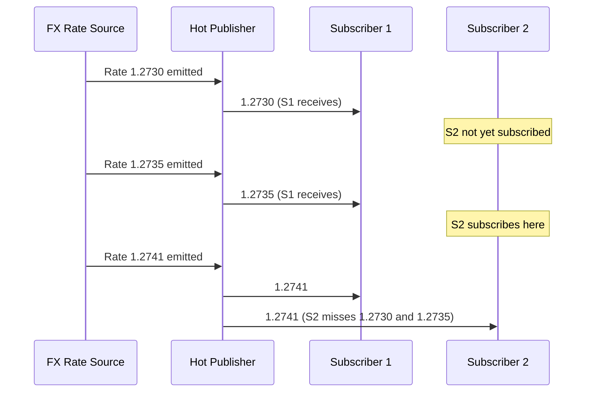

The distinction between cold and hot publishers is one of the most consequential design decisions in a reactive system. Get it wrong and you either hammer downstream services with redundant requests or miss events entirely because your subscriber connected too late. In financial systems — where FX rate feeds, market data streams, and payment event buses carry time-sensitive data — understanding this distinction is not academic.

A cold publisher is a recipe. A hot publisher is a live broadcast. This lesson explores both, the operators that convert between them, and the patterns that make real-time financial data feeds reliable.

## Learning Objectives

- Explain the fundamental difference between cold and hot publishers and when each is appropriate
- Convert a cold `Flux` to a hot `ConnectableFlux` using `publish()` and `connect()`
- Use `share()` for auto-connecting hot publishers with reference counting
- Apply `replay()` to cache recent emissions for late subscribers
- Create programmatic hot sources using `Sinks.many().multicast()`
- Model a real-time FX rate feed as a hot publisher consumed by multiple downstream components
- Use `switchMap` to replace a stale upstream source with the latest price feed
- Identify and prevent memory leaks caused by uncompleted hot publishers

## Business Context

**The Production Problem:** A trading platform's payment conversion service subscribed to an FX rate service on each incoming payment request. The FX service fetched rates from an external provider via HTTP. At 2,000 payments per second during the London market open, this created 2,000 HTTP requests per second to the FX provider — far exceeding the provider's rate limit of 100 req/s.

The engineering team initially solved this with a cache with a 1-second TTL. But a cache introduces staleness. The correct solution was a **hot publisher**: one WebSocket connection to the FX provider broadcasting rates to all concurrent payment-processing pipelines. 2,000 subscribers, one upstream connection.

## Cold Publishers — Re-Execute Per Subscriber

A cold publisher starts a fresh execution for each subscriber. The subscription triggers the work — no subscriber, no work.

```java
// Cold publisher — calls the database on every subscription
Flux<Payment> pendingPayments = Flux.defer(() ->
    paymentRepository.findByStatus(PaymentStatus.PENDING)
);

// Two subscribers = two database queries
pendingPayments.subscribe(p -> processForAudit(p));      // query 1
pendingPayments.subscribe(p -> processForSettlement(p)); // query 2
```

This is correct behaviour for database queries — each subscriber gets an independent, consistent view of the data at the time of subscription. But it is catastrophically wrong for a real-time feed.

```java
// Cold publisher re-executes — wrong for a live FX rate stream
Mono<FxRate> fxRate = Mono.fromCallable(() -> fxProvider.fetchCurrentRate("GBP/USD"));

// Each subscriber triggers a new HTTP call
fxRate.subscribe(r -> logRate(r));       // HTTP call 1
fxRate.subscribe(r -> storeRate(r));     // HTTP call 2
fxRate.subscribe(r -> notifyTraders(r)); // HTTP call 3
```

## Hot Publishers — Shared Single Execution

A hot publisher executes once regardless of subscriber count. Subscribers receive events that occur **after they subscribe** — they miss events that happened before they connected.



This late-subscriber behaviour is correct for a live market data feed — you do not want stale rates replayed to new subscribers. But you must handle the gap consciously.

## publish() and connect() — Controlled Hot Conversion

`publish()` converts a cold `Flux` into a `ConnectableFlux`. Nothing happens until you call `connect()`. This lets you coordinate subscriber registration before data starts flowing.

```java
// FX rate WebSocket stream — cold publisher (Reactor Netty WebSocket)
Flux<FxRate> coldFxStream = webSocketClient.connect(fxFeedUri)
    .flatMap(session -> session.receive()
        .map(msg -> parseRate(msg.getPayloadAsText())));

// Convert to hot — does not start until connect() is called
ConnectableFlux<FxRate> hotFxStream = coldFxStream.publish();

// Register all consumers first
Disposable auditSub   = hotFxStream.subscribe(r -> auditLog.record(r));
Disposable hedgingSub = hotFxStream.subscribe(r -> hedgingEngine.update(r));
Disposable paymentSub = hotFxStream.subscribe(r -> paymentConverter.update(r));

// Now start the upstream connection — all three receive from the same stream
Disposable connection = hotFxStream.connect();
```

> [!NOTE]
> When you call `connect()` on a `ConnectableFlux`, it returns a `Disposable`. Dispose the connection to cancel the upstream source and terminate all downstream subscriptions.

## share() — Auto-Connect with Reference Counting

`share()` is shorthand for `publish().refCount(1)`. The upstream source starts when the first subscriber subscribes and **stops when the last subscriber unsubscribes**. New subscribers re-trigger the upstream if no active subscribers exist.

```java
// Auto-starts when first subscriber connects, auto-stops when last unsubscribes
Flux<FxRate> sharedFxStream = coldFxStream.share();

@Service
public class FxRateFeed {

    private final Flux<FxRate> rates;

    public FxRateFeed(WebSocketClient client) {
        this.rates = client.connect(URI.create("wss://fx.provider/stream"))
            .flatMap(session -> session.receive()
                .map(msg -> parseRate(msg.getPayloadAsText())))
            .share();  // shared across all callers
    }

    public Flux<FxRate> stream() {
        return rates;
    }
}
```

> [!WARNING]
> `share()` has a gap condition: if all subscribers unsubscribe and a new one arrives within the same scheduler turn, the upstream may restart and the new subscriber misses the connection sequence. For critical feeds, prefer `publish().autoConnect(1)` with explicit lifecycle management.

## replay() — Caching for Late Subscribers

`replay()` creates a hot publisher that also caches recent emissions for late-joining subscribers. This bridges the gap between hot and cold behaviour.

```java
// Cache the last 1 rate — new subscribers immediately receive the latest known rate
Flux<FxRate> replayingFxStream = coldFxStream
    .replay(1)          // buffer size: last N elements
    .autoConnect(1);    // start when first subscriber arrives

// Alternative: cache with time bound — keep rates from the last 30 seconds
Flux<FxRate> timedReplayStream = coldFxStream
    .replay(Duration.ofSeconds(30))
    .autoConnect(1);
```

For FX rates, `replay(1)` is the most common choice: new subscribers receive the last known rate immediately, then continue receiving live updates.

## Sinks.many().multicast() — Programmatic Hot Sources

`Sinks` is the preferred Reactor API for programmatically emitting to a hot publisher. It replaces the older `UnicastProcessor` and `DirectProcessor`.

```java
@Service
public class FxRatePublisher {

    private final Sinks.Many<FxRate> sink = Sinks.many()
        .multicast()
        .onBackpressureBuffer(1024);

    public Flux<FxRate> rateStream() {
        return sink.asFlux();
    }

    public void publishRate(FxRate rate) {
        Sinks.EmitResult result = sink.tryEmitNext(rate);
        if (result.isFailure()) {
            if (result == Sinks.EmitResult.FAIL_ZERO_SUBSCRIBER) {
                return; // no subscribers — acceptable for a broadcast feed
            }
            log.error("Failed to emit FX rate: {} — {}", rate, result);
        }
    }

    @PreDestroy
    public void shutdown() {
        sink.tryEmitComplete();
    }
}
```

### Sink Variants

| Sink Type | Subscribers | Replay | Backpressure | Use Case |
|---|---|---|---|---|
| `unicast()` | 1 only | No | Buffer / Drop | Single consumer queue |
| `multicast()` | N | No | Buffer (bounded) | Event bus, fan-out |
| `multicast().onBackpressureBuffer()` | N | No | Unlimited buffer | Burst absorption |
| `replay(n)` | N | Last N | Yes | FX feed, state broadcasts |

## switchMap — Replacing a Stale Price Feed

`switchMap` subscribes to a new inner publisher on each upstream item, **cancelling the previous subscription**. This is the correct operator for "latest wins" scenarios.

```java
// Payment request stream — process each payment with the latest available FX rate
Flux<PaymentResult> results = paymentRequests
    .switchMap(request ->
        fxRateFeed.latestRate(request.getCurrencyPair())
            .flatMap(rate -> paymentProcessor.convert(request, rate))
    );
// If a new FX rate arrives mid-conversion, the old conversion is cancelled
// and restarted with the new rate
```

For comparison, `flatMap` would continue all in-flight conversions — leading to payments being processed with stale rates when the feed updates rapidly.

## Cold vs Hot — Use Case Reference

| Scenario | Publisher Type | Operator |
|---|---|---|
| Database query per request | Cold | `Flux.defer()`, `repository.findAll()` |
| HTTP API call per request | Cold | `WebClient.get()...` |
| FX rate WebSocket feed | Hot | `share()` or `publish().autoConnect()` |
| Kafka topic consumer | Hot | `KafkaReceiver.receive()` |
| Payment event bus | Hot | `Sinks.many().multicast()` |
| Configuration broadcast | Hot | `Sinks.many().replay(1)` |
| File reading | Cold | `Flux.using()` |
| Timer / interval | Hot (effectively) | `Flux.interval()` |

## Memory Leak Risk — Uncompleted Hot Publishers

A hot publisher holds strong references to all its subscribers. If the publisher never completes, subscribers that are no longer needed must be explicitly disposed.

```java
// LEAK: subscribing without tracking the disposable
fxRateFeed.rateStream().subscribe(rate -> cache.put(rate.getPair(), rate));
// The lambda captures `cache` — the cache object cannot be GC'd after the service stops

// CORRECT: track the disposable and cancel on shutdown
Disposable subscription = fxRateFeed.rateStream()
    .subscribe(rate -> cache.put(rate.getPair(), rate));

@PreDestroy
void cleanup() {
    subscription.dispose();
}
```

For Spring-managed components, `Disposable` objects should be tracked in a `CompositeDisposable` and disposed in a `@PreDestroy` method. This is the most common source of memory leaks in reactive applications.

```java
private final CompositeDisposable disposables = new CompositeDisposable();

@PostConstruct
void init() {
    disposables.add(fxRateFeed.rateStream().subscribe(this::handleRate));
    disposables.add(paymentEvents.stream().subscribe(this::handlePayment));
}

@PreDestroy
void destroy() {
    disposables.dispose();
}
```

## Knowledge Check

**Q1: Your trading platform's FX rate service has 500 concurrent payment processing pipelines, each subscribing to `fxRateClient.getRate("GBP/USD")`. The FX client uses a cold publisher backed by an HTTP call. What is happening and how do you fix it?**

A: 500 concurrent subscriptions to a cold `Mono` backed by an HTTP call means 500 HTTP requests are being made — one per subscriber. Fix by converting the client to use a `Flux` backed by a WebSocket connection with `.share()` or `.replay(1).autoConnect(1)`. All 500 pipelines subscribe to the same hot stream, and only one WebSocket connection is maintained upstream.

**Q2: You convert a cold `Flux<FxRate>` to hot with `publish().autoConnect(1)`. A subscriber unsubscribes, leaving zero active subscribers. Five seconds later, a new subscriber arrives. What happens?**

A: With `autoConnect(1)`, the upstream connection is **not cancelled** when subscribers drop to zero. The upstream continues emitting into a void. When the new subscriber arrives it joins the existing connection and receives subsequent emissions. If you used `publish().refCount(1)` (equivalent to `share()`), the upstream would stop when the last subscriber leaves and restart from scratch when the new one arrives — potentially missing data or re-triggering a WebSocket handshake.

## Practical Challenge

**Scenario:** You are building the FX rate broadcast infrastructure for a payment platform. The upstream source is a WebSocket connection to an external FX provider. Multiple internal services consume rates: payment conversion, hedging engine, audit logger, and risk monitoring.

**Tasks:**

1. **Implement `FxRateFeed`** as a Spring `@Service` using `Sinks.many().replay(1).autoConnect(1)`. The sink is populated by a Reactor Netty `WebSocketClient` connection. Include `@PostConstruct` to establish the connection and `@PreDestroy` to close it cleanly.

2. **Model the subscription lifecycle.** When the payment conversion service starts, it subscribes to the feed and maintains a local `Map<String, BigDecimal>` of latest rates. Write the code with correct `Disposable` management in a `CompositeDisposable`.

3. **Implement a stale-rate guard.** If the WebSocket connection drops and no rate update arrives within 5 seconds, emit a `StaleRateException` to all subscribers. Use `timeout(Duration.ofSeconds(5))` with reconnect logic via `.retryWhen(Retry.fixedDelay(Long.MAX_VALUE, Duration.ofSeconds(1)))`.

4. **Write a test** using `Sinks.many()` as a test producer. Verify that: (a) a subscriber that connects after the first emission receives the last known rate immediately (replay behaviour), (b) all three subscribers receive the same emission, and (c) disposing one subscriber does not affect the others.

<!-- KNOWLEDGE-CHECK
{
  "questions": [
    {
      "id": "q1",
      "text": "500 concurrent payment pipelines each subscribe to a cold Mono<FxRate> backed by an HTTP call. What is the consequence?",
      "options": [
        "500 HTTP requests are made in parallel — one per subscriber",
        "Reactor deduplicates the calls automatically",
        "Only the first subscription triggers an HTTP call; the rest receive a cached result",
        "The cold publisher queues the subscriptions and processes them sequentially"
      ],
      "correct": 0,
      "explanation": "Cold publishers re-execute their source for every subscription. 500 subscriptions to a cold HTTP-backed Mono means 500 HTTP requests. The fix is to convert to a hot publisher with share() or replay(1).autoConnect(1)."
    },
    {
      "id": "q2",
      "text": "What is the difference between publish().autoConnect(1) and publish().refCount(1) when the last subscriber unsubscribes?",
      "options": [
        "They behave identically",
        "autoConnect() keeps the upstream running; refCount() cancels the upstream and restarts on the next subscription",
        "refCount() keeps the upstream running; autoConnect() cancels it",
        "autoConnect() cancels the upstream immediately; refCount() waits 30 seconds"
      ],
      "correct": 1,
      "explanation": "autoConnect() connects once and never disconnects regardless of subscriber count. refCount() (share()) tracks subscriber count and cancels the upstream when it reaches zero, reconnecting when a new subscriber arrives. For a persistent WebSocket feed you typically want autoConnect() to avoid reconnection overhead."
    }
  ]
}
-->

<!-- PRACTICAL-CHALLENGE
{
  "title": "Hot vs Cold Publishers \u2014 Sharing and Multicasting \u2014 Production Implementation",
  "difficulty": "advanced",
  "estimatedMinutes": 60,
  "tasks": [
    {
      "id": "1",
      "description": "Implement FxRateFeed as a Spring @Service using Sinks.many().replay(1).autoConnect(1). Populate the sink from a Reactor Netty WebSocketClient. Include"
    },
    {
      "id": "2",
      "description": "Model the subscription lifecycle for the payment conversion service with correct CompositeDisposable management"
    },
    {
      "id": "3",
      "description": "Implement a stale-rate guard: timeout(5s) with retryWhen(Retry.fixedDelay(MAX_VALUE, 1s)) for reconnection"
    },
    {
      "id": "4",
      "description": "Write a test using Sinks.many(): verify (a) late subscriber receives last known rate (replay), (b) all subscribers receive same emission, (c) disposing"
    }
  ]
}
-->
