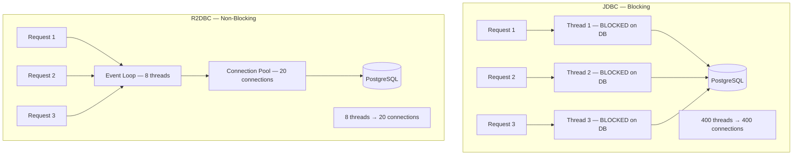
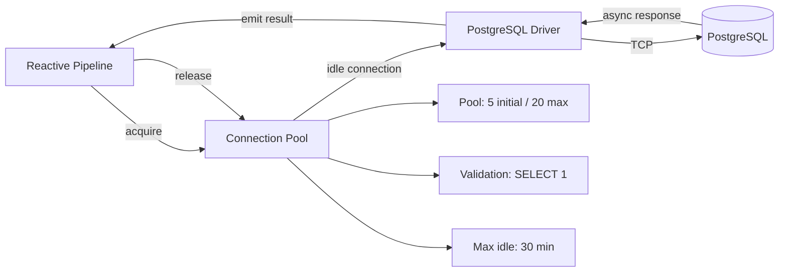

JDBC is blocking by design. Every database call parks the calling thread until the database responds. In a reactive WebFlux application running on a small event-loop thread pool, a single JDBC call inside a reactive pipeline can stall the entire server. R2DBC — Reactive Relational Database Connectivity — provides a fully non-blocking database driver for PostgreSQL, MySQL, and other relational databases, allowing reactive pipelines to integrate with the database without blocking a single thread.

This lesson covers the R2DBC stack from driver setup to streaming large result sets, reactive transactions, and the cases where JDBC with virtual threads is still the right choice.

## Learning Objectives

- Explain why JDBC is incompatible with event-loop thread models and how R2DBC addresses this
- Configure the `r2dbc-postgresql` driver and connection pool for a production payment service
- Perform CRUD operations using `R2dbcEntityTemplate` and `ReactiveCrudRepository`
- Write custom queries using `DatabaseClient` with parameter binding
- Use `@Transactional` correctly with R2DBC's reactive transaction model
- Stream large `Flux<Payment>` result sets without loading all rows into memory
- Solve the N+1 query problem in a reactive context
- Identify workloads where JDBC with virtual threads outperforms R2DBC

## Business Context

**The Migration Story:** A payment platform's settlement service ran overnight batch jobs to reconcile 2 million transactions per day. Originally written with Spring MVC and JDBC, it consumed 400 platform threads during peak processing, blocking on database I/O for 85% of their lifecycle. After migrating the settlement query layer to Spring WebFlux + R2DBC, the same workload ran on 8 event-loop threads with a connection pool of 20 connections — a 95% reduction in thread usage and a 40% improvement in throughput.

The key was treating the settlement query as a `Flux<Transaction>` stream that back-pressures the database — not loading 2 million rows into a `List` in memory.

## R2DBC vs JDBC — The Blocking Problem



The JDBC model requires one thread per concurrent database operation. With R2DBC, the event loop registers a callback with the database driver and immediately moves to the next task — no thread parks.

> [!WARNING]
> Never use JDBC drivers inside a reactive pipeline. `jdbcTemplate.query(...)` inside a `flatMap` will block an event-loop thread and cause starvation. If you must use JDBC in a reactive application, run it on a `Schedulers.boundedElastic()` scheduler.

## Driver and Connection Pool Setup

```xml
<!-- pom.xml -->
<dependency>
    <groupId>org.springframework.boot</groupId>
    <artifactId>spring-boot-starter-data-r2dbc</artifactId>
</dependency>
<dependency>
    <groupId>org.postgresql</groupId>
    <artifactId>r2dbc-postgresql</artifactId>
</dependency>
<dependency>
    <groupId>io.r2dbc</groupId>
    <artifactId>r2dbc-pool</artifactId>
</dependency>
```

```yaml
# application.yml
spring:
  r2dbc:
    url: r2dbc:postgresql://localhost:5432/payments
    username: app_user
    password: ${DB_PASSWORD}
    pool:
      initial-size: 5
      max-size: 20
      max-idle-time: 30m
      validation-query: SELECT 1
```

For production, configure the pool programmatically to gain access to all options:

```java
@Configuration
public class R2dbcConfig extends AbstractR2dbcConfiguration {

    @Bean
    @Override
    public ConnectionFactory connectionFactory() {
        ConnectionFactory postgres = PostgresqlConnectionFactory.from(
            PostgresqlConnectionConfiguration.builder()
                .host("payments-db.internal")
                .port(5432)
                .database("payments")
                .username("app_user")
                .password(dbPassword)
                .connectTimeout(Duration.ofSeconds(5))
                .statementTimeout(Duration.ofSeconds(30))
                .build()
        );

        return ConnectionPool.create(
            ConnectionPoolConfiguration.builder(postgres)
                .initialSize(5)
                .maxSize(20)
                .maxIdleTime(Duration.ofMinutes(30))
                .maxLifeTime(Duration.ofHours(1))
                .validationQuery("SELECT 1")
                .acquireRetry(3)
                .build()
        );
    }
}
```



## ReactiveCrudRepository — Spring Data Integration

Spring Data R2DBC provides repository support using the same `@Repository` interface model as JPA, but all return types are reactive.

```java
// Domain entity — no JPA annotations, R2DBC uses its own mapping
@Table("payments")
public record Payment(
    @Id Long id,
    String paymentId,
    String fromAccount,
    String toAccount,
    BigDecimal amount,
    String currency,
    PaymentStatus status,
    Instant createdAt,
    Instant updatedAt
) {}

// Repository — all methods return reactive types
public interface PaymentRepository extends ReactiveCrudRepository<Payment, Long> {

    Flux<Payment> findByStatus(PaymentStatus status);

    Flux<Payment> findByFromAccountAndStatusOrderByCreatedAtDesc(
        String fromAccount, PaymentStatus status);

    Mono<Payment> findByPaymentId(String paymentId);

    @Query("SELECT * FROM payments WHERE amount > :minAmount AND currency = :currency")
    Flux<Payment> findHighValuePayments(
        @Param("minAmount") BigDecimal minAmount,
        @Param("currency") String currency);

    @Modifying
    @Query("UPDATE payments SET status = :status, updated_at = NOW() WHERE payment_id = :paymentId")
    Mono<Integer> updateStatus(
        @Param("paymentId") String paymentId,
        @Param("status") String status);
}
```

## R2dbcEntityTemplate — Programmatic CRUD

`R2dbcEntityTemplate` provides a fluent API for CRUD operations, useful when query conditions are dynamic.

```java
@Service
public class PaymentQueryService {

    private final R2dbcEntityTemplate template;

    public Mono<Payment> findById(Long id) {
        return template.selectOne(
            Query.query(Criteria.where("id").is(id)),
            Payment.class
        );
    }

    public Flux<Payment> findPendingPaymentsAbove(BigDecimal threshold, String currency) {
        return template.select(
            Query.query(
                Criteria.where("status").is(PaymentStatus.PENDING)
                    .and("amount").greaterThan(threshold)
                    .and("currency").is(currency)
            ).sort(Sort.by(Sort.Direction.DESC, "created_at"))
             .limit(1000),
            Payment.class
        );
    }

    public Mono<Payment> insert(Payment payment) {
        return template.insert(payment);
    }

    public Mono<Payment> update(Payment payment) {
        return template.update(payment);
    }

    public Mono<Long> deleteByPaymentId(String paymentId) {
        return template.delete(
            Query.query(Criteria.where("payment_id").is(paymentId)),
            Payment.class
        );
    }
}
```

## DatabaseClient — Custom Queries and Stored Procedures

`DatabaseClient` provides the lowest-level access to the R2DBC connection — use it for complex queries, stored procedures, or operations that do not map cleanly to entities.

```java
@Service
public class SettlementQueryService {

    private final DatabaseClient databaseClient;

    // Streaming large result set — back-pressures the database connection
    public Flux<SettlementRow> streamPendingSettlements(LocalDate settlementDate) {
        return databaseClient.sql("""
                SELECT p.payment_id, p.amount, p.currency,
                       a.iban AS from_iban, b.iban AS to_iban,
                       p.created_at
                FROM payments p
                JOIN accounts a ON a.account_id = p.from_account
                JOIN accounts b ON b.account_id = p.to_account
                WHERE p.status = 'PENDING'
                  AND DATE(p.created_at) = :settlementDate
                ORDER BY p.created_at
                """)
            .bind("settlementDate", settlementDate)
            .map(row -> new SettlementRow(
                row.get("payment_id", String.class),
                row.get("amount", BigDecimal.class),
                row.get("currency", String.class),
                row.get("from_iban", String.class),
                row.get("to_iban", String.class),
                row.get("created_at", LocalDateTime.class)
            ))
            .all();  // returns Flux — data is streamed row by row
    }
}
```

The `.all()` method returns a `Flux` that emits one element per row. The database driver streams rows as the subscriber requests them — the entire result set is never held in memory simultaneously.

## @Transactional with Reactive Context

R2DBC transactions must be managed in the reactive context. Spring's `@Transactional` annotation works with R2DBC when the method returns a `Mono` or `Flux`.

```java
@Service
@Transactional
public class PaymentTransactionService {

    private final PaymentRepository paymentRepository;
    private final AccountRepository accountRepository;
    private final AuditRepository auditRepository;

    // @Transactional works — the transaction context flows through the reactive chain
    @Transactional
    public Mono<Payment> submitPayment(PaymentRequest request) {
        return accountRepository.findById(request.getFromAccount())
            .flatMap(account -> validateSufficientFunds(account, request.getAmount()))
            .flatMap(account -> debitAccount(account, request.getAmount()))
            .flatMap(debitedAccount -> createPaymentRecord(request))
            .flatMap(payment -> auditRepository.recordSubmission(payment)
                .thenReturn(payment))
            // If any step errors, the transaction rolls back automatically
            .onErrorMap(InsufficientFundsException.class,
                ex -> new PaymentRejectedException(ex.getMessage()));
    }

    private Mono<Account> debitAccount(Account account, BigDecimal amount) {
        return accountRepository.save(
            account.withBalance(account.balance().subtract(amount))
                   .withVersion(account.version() + 1)  // optimistic locking
        );
    }
}
```

> [!WARNING]
> `@Transactional` in R2DBC uses `TransactionalOperator` under the hood, which stores the transaction in the Reactor `Context`. This means you **must not** switch schedulers inside a transactional method with `subscribeOn()` — the transaction context would be lost on the new thread. All operations in the transaction must remain on the R2DBC driver's thread.

## N+1 Problem in Reactive Context

The N+1 problem manifests in reactive code when you use `flatMap` for per-entity lookups instead of a JOIN.

```java
// N+1 — one query per payment to load the account
Flux<PaymentWithAccount> withAccounts = paymentRepository.findAll()     // 1 query
    .flatMap(payment ->
        accountRepository.findById(payment.getFromAccount())            // N queries
            .map(account -> new PaymentWithAccount(payment, account))
    );

// Correct approach — use a JOIN in DatabaseClient
Flux<PaymentWithAccount> withAccountsJoined = databaseClient.sql("""
        SELECT p.*, a.iban, a.holder_name
        FROM payments p
        JOIN accounts a ON a.account_id = p.from_account
        WHERE p.status = :status
        """)
    .bind("status", "PENDING")
    .map(this::mapPaymentWithAccount)
    .all();
```

For small datasets or when you need the per-entity cache, `flatMap` with a bounded concurrency is acceptable. For reporting queries and batch operations, always prefer a JOIN.

## Streaming Large Result Sets

```java
// Stream 2 million settlement rows without OOM
public Flux<SettlementResult> processDailySettlement(LocalDate date) {
    return settlementQueryService.streamPendingSettlements(date)
        .buffer(500)                                    // group into batches of 500
        .flatMap(batch -> settlementEngine.processBatch(batch), 4)  // 4 concurrent batches
        .doOnNext(result -> metrics.increment("settlements.processed"))
        .onBackpressureBuffer(2000);                    // buffer for downstream processing
}
```

The `buffer(500)` operator accumulates 500 rows and emits them as a `List<SettlementRow>`, which the downstream batch processor handles efficiently. Back-pressure from the downstream propagates up through the `Flux` chain, controlling how fast the database cursor advances.

## When R2DBC Is the Wrong Choice

R2DBC is not always better than JDBC. Senior engineers must know when to choose JDBC with virtual threads instead.

| Scenario | R2DBC | JDBC + Virtual Threads |
|---|---|---|
| High-throughput reactive pipeline | Best | Not suited |
| Simple request-response CRUD | Good | Equivalent or simpler |
| Complex JPA entity graphs / lazy loading | Not supported | Best (JPA only works with JDBC) |
| Batch insert of 100k+ rows | Poor (row-by-row) | Best (JDBC batch insert) |
| Stored procedures with complex output | Limited | Best |
| Team unfamiliar with reactive | Steep learning curve | Simpler model |
| Streaming large result sets | Best (back-pressure) | Acceptable with cursor |
| Spring MVC (non-reactive) application | Incompatible | Required |

For Spring Boot 3+ on Java 21, the recommendation is: use R2DBC for new reactive services, use JDBC with `Executors.newVirtualThreadPerTaskExecutor()` for existing services or complex JPA requirements.

## Knowledge Check

**Q1: Your `@Transactional` R2DBC service method subscribes a `flatMap` using `subscribeOn(Schedulers.boundedElastic())` to offload a CPU-bound calculation. After deployment, transactions intermittently fail to roll back on error. What is the cause?**

A: The R2DBC transaction context is stored in the Reactor `Context`, which is propagated through the reactive chain. When you switch schedulers with `subscribeOn()`, the new thread does not automatically carry the transaction context. Any database operations executing on the new scheduler thread cannot participate in the ongoing transaction. Remove the `subscribeOn()`, or if the CPU work is genuinely intensive, complete it before the transaction boundary and pass the result in.

**Q2: You need to load all payments for a customer's history page (typically 50-200 rows). Your colleague suggests using `Flux<Payment>` and streaming to the client. Is this appropriate?**

A: For 50-200 rows, the streaming overhead of R2DBC back-pressure is unnecessary. Use `collectList()` to gather the rows into a `Mono<List<Payment>>` for a simple, predictable response. Streaming with `Flux` is valuable when result sets are large (thousands to millions of rows) and you want to avoid loading all data into memory, or when you are streaming directly to a WebFlux response with `MediaType.APPLICATION_NDJSON_VALUE`. For a customer history page, `collectList()` is simpler and equally performant.

## Practical Challenge

**Scenario:** You are building the settlement processing service for a payment platform. It must process 2 million pending transactions each night, updating their status to `SETTLED` or `FAILED` based on bank confirmation responses.

**Tasks:**

1. **Configure R2DBC** for PostgreSQL with a connection pool of 5 initial / 20 max connections, 30-minute max idle time, and a 30-second statement timeout. Use `ConnectionPoolConfiguration` programmatically, not just `application.yml`.

2. **Implement `SettlementRepository`** extending `ReactiveCrudRepository<Transaction, Long>` with: a custom `@Query` method to fetch pending transactions by settlement date using `Flux<Transaction>`, and a `@Modifying` method to bulk-update status.

3. **Write the streaming settlement processor** using `DatabaseClient` to stream rows in batches of 1,000. For each batch, call `bankAdapter.confirmBatch(batch)` which returns `Mono<Map<String, SettlementStatus>>`. Update each transaction's status in the same batch, measuring throughput with `meterRegistry.counter("settlements.processed")`.

4. **Write a `@DataR2dbcTest`** that uses an embedded H2 R2DBC database to test the repository. Verify that: (a) `findPendingByDate` returns the correct count, (b) `updateStatus` modifies the correct rows, and (c) a `@Transactional` service method rolls back when the second operation fails.

<!-- KNOWLEDGE-CHECK
{
  "questions": [
    {
      "id": "q1",
      "text": "Your @Transactional R2DBC service uses subscribeOn(Schedulers.boundedElastic()) inside the transaction. Transactions intermittently fail to roll back. What is the cause?",
      "options": [
        "boundedElastic() is incompatible with R2DBC drivers",
        "The R2DBC transaction context is in the Reactor Context and is not carried to the new scheduler thread",
        "R2DBC does not support @Transactional at all",
        "The transaction timeout needs to be increased"
      ],
      "correct": 1,
      "explanation": "R2DBC transactions are stored in the Reactor Context. subscribeOn() changes the executing thread, and the new thread does not automatically carry the R2DBC transaction context. Database operations on the new thread cannot participate in the transaction, so rollback does not propagate. Remove subscribeOn() from inside transactional boundaries."
    },
    {
      "id": "q2",
      "text": "When should you prefer JDBC with virtual threads over R2DBC for a Java 21 service?",
      "options": [
        "Never — R2DBC is always faster",
        "For high-concurrency reactive pipelines and streaming large result sets",
        "For complex JPA entity graphs, batch inserts, or when the team is unfamiliar with reactive programming",
        "Only for legacy applications that cannot be migrated"
      ],
      "correct": 2,
      "explanation": "R2DBC does not support JPA or lazy loading. JDBC batch inserts are significantly faster than R2DBC row-by-row inserts. For teams new to reactive, JDBC with virtual threads provides equivalent concurrency with far less complexity. R2DBC excels in high-concurrency streaming scenarios."
    }
  ]
}
-->

<!-- PRACTICAL-CHALLENGE
## Practical Challenge

**Scenario:** Build the settlement processing service for a payment platform processing 2 million transactions nightly.

**Tasks:**

1. Configure R2DBC for PostgreSQL: ConnectionPoolConfiguration with 5 initial / 20 max connections, 30-minute idle timeout, 30-second statement timeout.

2. Implement SettlementRepository extending ReactiveCrudRepository with a @Query method returning Flux<Transaction> for pending settlements by date, and a @Modifying bulk update method.

3. Write a streaming settlement processor using DatabaseClient: stream rows in batches of 1,000, call bankAdapter.confirmBatch(batch) returning Mono<Map<String,SettlementStatus>>, update each transaction status, track throughput with metrics.

4. Write a @DataR2dbcTest: verify findPendingByDate returns correct count, updateStatus modifies correct rows, and @Transactional rolls back when the second operation fails.
-->
