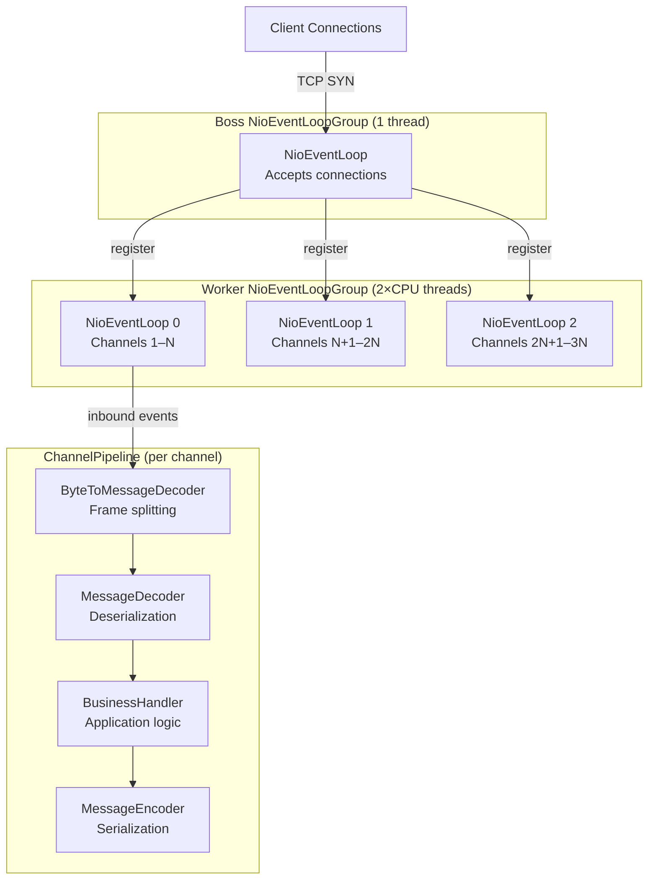

# Non-Blocking I/O — Netty and NIO Under the Hood

> [!NOTE]
> Netty is the I/O foundation for most high-throughput financial infrastructure: Spring WebFlux, Reactor Netty, gRPC-Java, and many proprietary trading systems all sit on top of it. Understanding how NIO selectors, event loops, and channel pipelines work lets you tune performance, diagnose latency anomalies, and make informed decisions about when to use — or avoid — Netty directly.

## Learning Objectives

By the end of this lesson you will be able to:

1. Explain how Java NIO `Selector` and `Channel` abstractions differ from blocking `Socket` I/O and why they enable higher concurrency at lower thread cost.
2. Describe Netty's `NioEventLoopGroup` thread model and explain why blocking inside an event loop thread causes pipeline stalls.
3. Build a Netty server pipeline using `ChannelPipeline` and `ChannelHandler` for a custom binary financial protocol with a length-field frame decoder.
4. Manage `ByteBuf` reference counts correctly, distinguishing direct and heap buffers and choosing appropriately for financial message parsing.
5. Compare Netty, OkHttp, and Java NIO directly across connection pooling, protocol support, and operational complexity.
6. Apply JVM NIO performance tuning flags and OS socket buffer settings for high-throughput financial message flows.
7. Justify when to bypass Netty and use the WebClient/WebFlux abstraction layer instead.
8. Diagnose and prevent common Netty production problems: `OutOfDirectMemoryError`, event loop starvation, and frame corruption.

## Business Context

A tier-1 payment processor handling 100,000 transactions per second cannot afford one platform thread per TCP connection. At that volume a blocking model would require tens of thousands of threads, each consuming approximately 1 MB of stack, totalling tens of gigabytes of memory just to hold idle connections open. ISO 8583 card-switching networks, FIX protocol engines, and high-frequency settlement gateways all use non-blocking I/O at their core for this reason.

Netty is not just a performance choice — it is the standard substrate that the financial industry has converged on. SWIFT's Alliance Connect gateway, Visa's internal message bus, and virtually every Java-based trading system use event-loop I/O. As a principal engineer you need to understand what is happening inside the abstraction layers Spring WebFlux gives you.

---

## Java NIO — Selector and Channel Architecture

Classic `java.io` creates one thread per connection: the thread calls `socket.read()` and blocks until bytes arrive. Java NIO (since Java 1.4) inverts this: a single thread registers interest in multiple channels with a `Selector` and calls `select()`, which returns only the channels that are ready.

```java
// Raw NIO — demonstrates the selector pattern Netty abstracts
// In production use Netty, not raw NIO directly
Selector selector = Selector.open();
ServerSocketChannel serverChannel = ServerSocketChannel.open();
serverChannel.configureBlocking(false);
serverChannel.bind(new InetSocketAddress(8080));
serverChannel.register(selector, SelectionKey.OP_ACCEPT);

while (true) {
    // Blocks until at least one channel is ready — OS-level epoll/kqueue
    int readyCount = selector.select(100); // 100ms timeout
    if (readyCount == 0) continue;

    Set<SelectionKey> selectedKeys = selector.selectedKeys();
    Iterator<SelectionKey> iterator = selectedKeys.iterator();

    while (iterator.hasNext()) {
        SelectionKey key = iterator.next();
        iterator.remove();  // MUST remove — selector does not clear automatically

        if (key.isAcceptable()) {
            SocketChannel client = serverChannel.accept();
            client.configureBlocking(false);
            client.register(selector, SelectionKey.OP_READ,
                ByteBuffer.allocateDirect(4096));
        } else if (key.isReadable()) {
            SocketChannel client = (SocketChannel) key.channel();
            ByteBuffer buffer = (ByteBuffer) key.attachment();
            int bytesRead = client.read(buffer);
            if (bytesRead == -1) {
                client.close();
            } else {
                buffer.flip();
                processMessage(buffer);
                buffer.clear();
            }
        }
    }
}
```

The selector maps to OS-level `epoll` (Linux) or `kqueue` (macOS/BSD). This is where the performance gain lives: a single system call returns all ready file descriptors, eliminating per-connection thread overhead.

---

## Netty Event Loop Thread Model

Netty wraps the selector loop in a structured `NioEventLoop`. Each event loop thread owns its selector and processes all I/O and pipeline handler callbacks on that single thread — no synchronisation needed inside a handler.



```java
// Netty server bootstrap — financial message gateway
public class PaymentGatewayServer {

    private static final int BOSS_THREADS  = 1;
    private static final int WORKER_THREADS = Runtime.getRuntime().availableProcessors() * 2;

    public void start(int port) throws InterruptedException {
        NioEventLoopGroup bossGroup   = new NioEventLoopGroup(BOSS_THREADS);
        NioEventLoopGroup workerGroup = new NioEventLoopGroup(WORKER_THREADS);

        try {
            ServerBootstrap bootstrap = new ServerBootstrap()
                .group(bossGroup, workerGroup)
                .channel(NioServerSocketChannel.class)
                .childOption(ChannelOption.SO_KEEPALIVE, true)
                .childOption(ChannelOption.TCP_NODELAY, true)      // Disable Nagle — critical for latency
                .childOption(ChannelOption.SO_RCVBUF, 1024 * 1024)
                .childOption(ChannelOption.SO_SNDBUF, 1024 * 1024)
                .childHandler(new ChannelInitializer<SocketChannel>() {
                    @Override
                    protected void initChannel(SocketChannel ch) {
                        ChannelPipeline pipeline = ch.pipeline();
                        pipeline.addLast("frameDecoder",
                            new LengthFieldBasedFrameDecoder(
                                65535,  // maxFrameLength
                                0,      // lengthFieldOffset
                                4,      // lengthFieldLength (4-byte big-endian header)
                                0,      // lengthAdjustment
                                4       // initialBytesToStrip (strip the header itself)
                            ));
                        pipeline.addLast("messageDecoder", new Iso8583Decoder());
                        pipeline.addLast("businessHandler", new PaymentHandler(businessExecutor));
                        pipeline.addLast("messageEncoder", new Iso8583Encoder());
                    }
                });

            ChannelFuture future = bootstrap.bind(port).sync();
            future.channel().closeFuture().sync();
        } finally {
            bossGroup.shutdownGracefully();
            workerGroup.shutdownGracefully();
        }
    }
}
```

> [!WARNING]
> **Never block inside an event loop thread.** A `Thread.sleep()`, a JDBC call, or even a `CompletableFuture.get()` inside a `ChannelHandler` stalls every channel on that event loop. Offload to a separate `EventExecutorGroup` using `pipeline.addLast(businessExecutorGroup, "handler", new PaymentHandler())`.

---

## Custom Protocol Frame Decoder

Financial protocols use length-prefixed framing. For bespoke protocols, extend `ByteToMessageDecoder`:

```java
// Custom frame decoder for a proprietary payment protocol:
// Header: 4-byte magic (0x46494E45 = "FINE"), 2-byte message type, 4-byte body length
public class PaymentFrameDecoder extends ByteToMessageDecoder {

    private static final int  HEADER_LENGTH = 10;
    private static final int  MAGIC_NUMBER  = 0x46494E45;
    private static final byte STATE_HEADER  = 0;
    private static final byte STATE_BODY    = 1;

    private byte  state       = STATE_HEADER;
    private int   messageType = 0;
    private int   bodyLength  = 0;

    @Override
    protected void decode(ChannelHandlerContext ctx, ByteBuf in, List<Object> out) {
        if (state == STATE_HEADER) {
            if (in.readableBytes() < HEADER_LENGTH) return; // wait for more bytes

            int magic = in.readInt();
            if (magic != MAGIC_NUMBER) {
                ctx.close();
                throw new CorruptedFrameException(
                    "Invalid magic: 0x" + Integer.toHexString(magic));
            }
            messageType = in.readUnsignedShort();
            bodyLength  = in.readInt();

            if (bodyLength < 0 || bodyLength > 1_048_576) { // 1 MB safety cap
                ctx.close();
                throw new TooLongFrameException("Body too large: " + bodyLength);
            }
            state = STATE_BODY;
        }

        if (state == STATE_BODY) {
            if (in.readableBytes() < bodyLength) return; // wait for body bytes

            // readRetainedSlice increments refCnt — caller must release
            ByteBuf body = in.readRetainedSlice(bodyLength);
            out.add(new PaymentFrame(messageType, body));
            state = STATE_HEADER;
        }
    }
}
```

---

## ByteBuf and Reference Counting

Netty manages off-heap memory via its own pool, tracked with reference counts. Each `ByteBuf` starts with `refCnt = 1`. Every `retain()` increments it; every `release()` decrements it. When the count reaches zero the memory returns to the pool.

```java
// CORRECT: SimpleChannelInboundHandler releases the message after channelRead0 returns
@ChannelHandler.Sharable
public class PaymentHandler extends SimpleChannelInboundHandler<PaymentFrame> {

    private final Executor businessExecutor;

    @Override
    protected void channelRead0(ChannelHandlerContext ctx, PaymentFrame frame) {
        ByteBuf body = frame.getBody();

        // Parse fixed-length fields directly from direct buffer — no heap copy needed
        int panLength     = body.readUnsignedByte();
        CharSequence pan  = body.readCharSequence(panLength, StandardCharsets.US_ASCII);
        BigDecimal amount = BigDecimal.valueOf(body.readLong(), 2); // implicit 2 decimal places

        // Retain the buffer if passing to another thread — business executor will release it
        body.retain();

        PaymentRequest request = PaymentRequest.builder()
            .pan(pan.toString())
            .amount(amount)
            .bodyBuf(body)
            .build();

        // Offload to business thread pool — do not block the event loop
        businessExecutor.execute(() -> {
            try {
                PaymentResult result = paymentService.process(request);
                ctx.writeAndFlush(encodeResult(result));
            } finally {
                body.release(); // release the extra retain taken above
            }
        });
        // SimpleChannelInboundHandler releases the original frame after this method returns
    }

    @Override
    public void exceptionCaught(ChannelHandlerContext ctx, Throwable cause) {
        log.error("Pipeline exception on channel {}", ctx.channel().id(), cause);
        ctx.close();
    }
}
```

| Buffer type | Allocation | GC overhead | Network zero-copy | Use case |
|---|---|---|---|---|
| `Unpooled.buffer()` | Heap | Yes | No | Short-lived parsing |
| `Unpooled.directBuffer()` | Native | No | Yes | High-volume sends |
| `PooledByteBufAllocator.DEFAULT.buffer()` | Pooled heap | Low | No | Pooled parsing |
| `PooledByteBufAllocator.DEFAULT.directBuffer()` | Pooled native | No | Yes | Production recommended |

> [!NOTE]
> `OutOfDirectMemoryError` is the most common Netty production failure. It occurs when `ByteBuf.release()` is not called, leaking direct memory. Enable leak detection in staging: `-Dio.netty.leakDetection.level=PARANOID`. Use `SIMPLE` in production for approximately 1% sampling overhead.

---

## Connection Pooling in Netty

Netty does not pool connections by default. Use `FixedChannelPool` for persistent upstream connections:

```java
// Fixed pool of 20 connections to a downstream settlement gateway
Bootstrap clientBootstrap = new Bootstrap()
    .group(workerGroup)
    .channel(NioSocketChannel.class)
    .option(ChannelOption.CONNECT_TIMEOUT_MILLIS, 3000)
    .handler(new ChannelInitializer<SocketChannel>() {
        @Override
        protected void initChannel(SocketChannel ch) {
            ch.pipeline().addLast(new Iso8583Encoder(), new Iso8583Decoder());
        }
    });

FixedChannelPool pool = new FixedChannelPool(
    clientBootstrap.remoteAddress("settlement-gateway", 9090),
    new AbstractChannelPoolHandler() {
        @Override public void channelCreated(Channel ch) {
            log.info("New settlement channel created: {}", ch.id());
        }
        @Override public void channelAcquired(Channel ch) {
            metrics.increment("settlement.pool.acquired");
        }
        @Override public void channelReleased(Channel ch) {
            metrics.increment("settlement.pool.released");
        }
    },
    20 // maxConnections
);

// Acquire a channel, send, then release back to the pool
pool.acquire().addListener((Future<Channel> future) -> {
    if (future.isSuccess()) {
        Channel ch = future.getNow();
        ch.writeAndFlush(settlementMessage)
            .addListener(writeFuture -> pool.release(ch));
    } else {
        log.error("Failed to acquire channel from pool", future.cause());
    }
});
```

---

## Netty vs Alternatives

| Dimension | Netty (direct) | Reactor Netty / WebClient | OkHttp | Java NIO (raw) |
|---|---|---|---|---|
| Abstraction level | Low | Medium | High | Lowest |
| Learning curve | High | Medium | Low | Very high |
| HTTP/2 support | Yes (manual) | Yes (auto) | Yes | Manual |
| Custom binary protocol | Native fit | Requires codec | No | Native fit |
| Connection pooling | Manual | Automatic | Automatic | Manual |
| Recommended for | ISO 8583, FIX, custom | REST/HTTP APIs | Simple HTTP clients | Rarely |

---

## JVM NIO Performance Tuning

```bash
# NUMA-aware memory allocation — reduces cross-node memory latency on multi-socket servers
-XX:+UseNUMA

# Netty direct memory pool configuration
-Dio.netty.allocator.type=pooled
-Dio.netty.allocator.numDirectArenas=16
-Dio.netty.maxDirectMemory=4294967296   # 4 GB direct memory cap

# OS socket buffer sizes (set via sysctl on Linux host, not JVM flags)
# net.core.rmem_max=16777216
# net.core.wmem_max=16777216
# net.ipv4.tcp_rmem=4096 87380 16777216
# net.ipv4.tcp_wmem=4096 65536 16777216
# net.ipv4.tcp_no_metrics_save=1
# net.ipv4.tcp_fin_timeout=15
```

---

## Knowledge Check

**Q1: An event loop thread in your Netty payment gateway processes 10,000 messages per second. A developer adds a Redis cache lookup using a synchronous Jedis client inside the `ChannelHandler`. After deployment, latency for all connections on that event loop spikes from 1ms to 60ms. What is the root cause and how do you fix it?**

The synchronous Jedis call blocks the event loop thread for each Redis round trip (approximately 5ms). Since all channels on that event loop share one thread, the thread is fully occupied on Redis calls and cannot serve other channels. Fix: replace Jedis with Lettuce (async Redis client) and use its `RedisFuture` or `Mono`, or offload to a separate `EventExecutorGroup` via `pipeline.addLast(businessExecutor, "cacheHandler", new CachingPaymentHandler())`.

**Q2: Your team is building a REST API layer over microservices using Spring WebFlux. A new engineer proposes using Netty directly instead of `WebClient` for inter-service HTTP calls, citing maximum performance. How do you respond?**

`WebClient` is built on Reactor Netty which uses the same Netty event loop, so there is no performance advantage for standard HTTP workloads. Using Netty directly for HTTP would require re-implementing HTTP framing, header parsing, keep-alive management, HTTP/2 multiplexing, and TLS session management. The correct abstraction is `WebClient`. Use Netty directly only when implementing a custom non-HTTP protocol such as ISO 8583 or FIX where existing HTTP clients are not applicable.

---

## Practical Challenge

**Scenario:** You are building a low-latency ISO 8583 card-switching gateway. The gateway accepts connections from POS terminals, decodes ISO 8583 messages, forwards them to an authorisation host, and returns responses.

1. **Implement a complete `ByteToMessageDecoder`** for a simplified ISO 8583 format: 2-byte MTI (message type indicator), followed by an 8-byte primary bitmap, followed by variable-length data elements. The decoder must validate that the MTI is a known value (0100, 0110, 0200, 0210, 0400, 0410) and emit a parsed `Iso8583Message` object.

2. **Implement connection pooling** to the authorisation host using `FixedChannelPool` with 50 connections, a 5-second connection timeout, and a circuit breaker that stops acquiring from the pool when more than 30 consecutive acquires fail.

3. **Benchmark using JMH** the throughput difference between heap `ByteBuf` and pooled direct `ByteBuf` when parsing 1,000 ISO 8583 messages of 256 bytes each. Report your findings and explain the result.

<!-- KNOWLEDGE-CHECK
{
  "questions": [
    {
      "text": "What problem does Java NIO's Selector solve compared to traditional blocking java.io sockets?",
      "options": ["Selectors provide faster serialization of network data", "A single thread can monitor multiple channels simultaneously and only process a channel when it has data ready, eliminating the need for one thread per connection", "Selectors automatically retry failed network operations", "Selectors provide built-in TLS termination without additional libraries"],
      "correct": 1,
      "explanation": "Classic java.io blocks the calling thread on each socket.read() until data arrives. A Selector allows one thread to register interest in many channels and call select() — which returns only channels that are ready to read or write. This multiplexing is how Netty handles tens of thousands of connections with a small thread pool."
    },
    {
      "text": "Why is it critical to never perform blocking operations (Thread.sleep, JDBC queries) on a Netty event-loop thread?",
      "options": ["Netty event loops do not support exception handling for blocking calls", "Blocking an event-loop thread stalls all other channels registered to that event loop, causing latency spikes and potential timeouts for all concurrent connections", "Netty runs on virtual threads that cannot park during blocking operations", "Blocking calls corrupt the ByteBuf reference count causing memory leaks"],
      "correct": 1,
      "explanation": "Each Netty NioEventLoop thread processes I/O events for all channels assigned to it. If a handler blocks that thread, no other channel on that event loop can receive or send data until the blocking call returns. This is why blocking work must be handed off to a separate thread pool via channel.eventLoop().execute() or a business logic thread pool."
    },
    {
      "text": "What is the difference between direct ByteBuf and heap ByteBuf in Netty, and why does it matter for financial message parsing?",
      "options": ["Direct ByteBuf is immutable; heap ByteBuf is mutable", "Direct ByteBuf is allocated in native memory outside the JVM heap, avoiding an extra copy when writing to a socket; heap ByteBuf is on-heap and requires a copy to native memory before each socket write", "Direct ByteBuf supports reference counting; heap ByteBuf is garbage collected normally", "Heap ByteBuf is faster for reads; direct ByteBuf is faster for writes regardless of size"],
      "correct": 1,
      "explanation": "Direct ByteBuf avoids the JVM-to-native memory copy that is required before each socket write with heap buffers. For high-throughput financial message flows parsing thousands of messages per second, eliminating this copy reduces CPU usage and GC pressure significantly."
    }
  ]
}
-->

<!-- PRACTICAL-CHALLENGE
{
  "title": "Netty Server Pipeline for a Custom Binary Financial Protocol",
  "difficulty": "advanced",
  "estimatedMinutes": 45,
  "tasks": [
    {"id": "1", "description": "Build a Netty server that accepts TCP connections and decodes a custom binary protocol: a 4-byte big-endian length field followed by a JSON payment authorization message. Use LengthFieldBasedFrameDecoder to handle frame boundaries and a custom ChannelInboundHandlerAdapter to parse the payload into a PaymentAuthRequest POJO."},
    {"id": "2", "description": "Implement connection pooling to the authorization host using FixedChannelPool with 50 connections, a 5-second connection timeout, and a circuit breaker that stops acquiring from the pool when more than 30 consecutive acquires fail."},
    {"id": "3", "description": "Benchmark using JMH the throughput difference between heap ByteBuf and pooled direct ByteBuf when parsing 1,000 ISO 8583 messages of 256 bytes each. Report your findings and explain the result."},
    {"id": "4", "description": "Diagnose and fix an OutOfDirectMemoryError in a Netty pipeline: introduce a handler that retains a ByteBuf but never releases it. Use -Dio.netty.leakDetectionLevel=PARANOID to identify the leak location, then fix the handler to call ReferenceCountUtil.release(msg) or use SimpleChannelInboundHandler which releases automatically."}
  ]
}
-->

4. **Write a Netty unit test** using `EmbeddedChannel` that verifies: given a stream of bytes representing two concatenated ISO 8583 messages delivered in a single `write()` call (the sticky-packet case), the frame decoder emits exactly two separate `Iso8583Message` objects in order.
