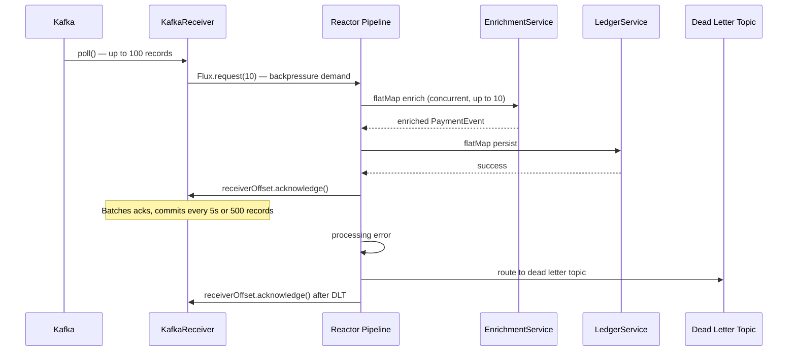

# Reactor Kafka — Reactive Kafka Consumer and Producer

> [!NOTE]
> Reactor Kafka brings reactive backpressure to Kafka consumption. Rather than the thread-per-partition model of `@KafkaListener`, it uses a `Flux` of records that only pulls from Kafka as fast as your downstream processing can handle. For financial pipelines where processing involves non-blocking I/O — database writes, HTTP calls to enrichment services — this model eliminates the need to tune thread pool sizes manually.

## Learning Objectives

By the end of this lesson you will be able to:

1. Explain the architecture difference between `ReactiveKafkaConsumerTemplate` and Spring Kafka's `@KafkaListener`, and state when each is appropriate.
2. Configure `KafkaReceiver` with `ReceiverOptions` including topic assignment, consumer group, and deserialisers.
3. Implement a backpressure-aware consumer using `receive()` that returns a `Flux<ReceiverRecord>` and acknowledges offsets correctly with `ReceiverOffset.acknowledge()`.
4. Publish messages non-blocking with `ReactiveKafkaProducerTemplate` and handle producer errors without blocking.
5. Implement dead-letter topic routing for messages that fail processing after retries.
6. Configure connection recovery and auto-restart for the reactive consumer pipeline.
7. Debug backpressure violations and offset commit failures in a Reactor Kafka pipeline.
8. Compare the trade-offs between `flatMap` (concurrent) and `concatMap` (sequential) for Kafka record processing.

## Business Context

A payment event pipeline processes 500,000 events per second: authorisations, settlements, chargebacks, refunds. Each event must be enriched (account lookup, merchant data), validated against business rules, and written to multiple downstream stores (ledger DB, audit log, analytics stream). With `@KafkaListener` and a fixed thread pool, any one slow operation — a database connection pool at capacity, an external enrichment service spiking in latency — causes consumer lag to grow uncontrollably. Reactor Kafka models this as a reactive pipeline where backpressure propagates from downstream to Kafka, naturally throttling consumption to what the system can actually process.

---

## Reactive Kafka Consumer Setup

```java
// ReceiverOptions — the central configuration object for KafkaReceiver
// All options are immutable; use withXxx() methods to build up options
Map<String, Object> consumerProps = new HashMap<>();
consumerProps.put(ConsumerConfig.BOOTSTRAP_SERVERS_CONFIG, "kafka:9092");
consumerProps.put(ConsumerConfig.GROUP_ID_CONFIG, "payment-event-processor");
consumerProps.put(ConsumerConfig.KEY_DESERIALIZER_CLASS_CONFIG, StringDeserializer.class);
consumerProps.put(ConsumerConfig.VALUE_DESERIALIZER_CLASS_CONFIG, JsonDeserializer.class);
// CRITICAL: disable auto-commit — Reactor Kafka manages commits explicitly
consumerProps.put(ConsumerConfig.ENABLE_AUTO_COMMIT_CONFIG, false);
// Set to earliest if this is a new consumer group — latest for established groups
consumerProps.put(ConsumerConfig.AUTO_OFFSET_RESET_CONFIG, "earliest");
// Fetch up to 1 MB per partition per poll — tune for your message size
consumerProps.put(ConsumerConfig.MAX_PARTITION_FETCH_BYTES_CONFIG, 1_048_576);

ReceiverOptions<String, PaymentEvent> receiverOptions = ReceiverOptions
    .<String, PaymentEvent>create(consumerProps)
    .subscription(Collections.singleton("payment-events"))
    // Commit interval: commit offsets every 5 seconds in batch
    // Lower = less reprocessing on restart; higher = fewer round trips to Kafka broker
    .commitInterval(Duration.ofSeconds(5))
    // Commit batch size: also commit when 500 records are acknowledged (whichever comes first)
    .commitBatchSize(500)
    // Backpressure: request at most 100 records ahead — limits in-flight processing
    .maxDeferredCommits(1000);
```

---

## Backpressure-Aware Consumption

```java
@Service
@RequiredArgsConstructor
public class ReactivePaymentEventConsumer {

    private final ReactiveKafkaConsumerTemplate<String, PaymentEvent> consumerTemplate;
    private final PaymentEnrichmentService enrichmentService;
    private final LedgerService ledgerService;
    private final DeadLetterService deadLetterService;

    // Returns a Flux that the caller subscribes to — typically on application startup
    public Flux<Void> consume() {
        return consumerTemplate.receive()
            // Limit concurrent processing: flatMap with concurrency=10 processes
            // up to 10 records simultaneously without overwhelming downstream
            .flatMap(this::processRecord, 10)
            .doOnError(e -> log.error("Fatal consumer error — pipeline terminated", e))
            // On error, restart after 5 seconds — Reactor Kafka reconnects to broker
            .retryWhen(Retry.fixedDelay(Long.MAX_VALUE, Duration.ofSeconds(5))
                .doBeforeRetry(signal ->
                    log.warn("Consumer pipeline restarting (attempt {})",
                        signal.totalRetries())));
    }

    private Mono<Void> processRecord(ReceiverRecord<String, PaymentEvent> record) {
        return Mono.just(record.value())
            .flatMap(enrichmentService::enrich)
            .flatMap(ledgerService::persist)
            .doOnSuccess(ignored -> {
                // Acknowledge AFTER successful processing — this schedules the commit
                // The commit itself happens in batch per commitInterval/commitBatchSize
                record.receiverOffset().acknowledge();
                metrics.increment("payment.event.processed",
                    "partition", String.valueOf(record.partition()));
            })
            .onErrorResume(e -> routeToDeadLetter(record, e))
            .then();
    }

    private Mono<Void> routeToDeadLetter(
            ReceiverRecord<String, PaymentEvent> record, Throwable error) {
        log.error("Processing failed for record key={} partition={} offset={}",
            record.key(), record.partition(), record.offset(), error);

        // Build dead letter record preserving original metadata as headers
        SenderRecord<String, PaymentEvent, String> dlqRecord = SenderRecord.create(
            new ProducerRecord<>(
                "payment-events.DLT",
                null,
                record.key(),
                record.value(),
                buildDeadLetterHeaders(record, error)
            ),
            record.key()
        );

        return deadLetterService.send(dlqRecord)
            .doOnSuccess(ignored -> {
                // Acknowledge even after DLT routing — we do not want to reprocess
                record.receiverOffset().acknowledge();
                metrics.increment("payment.event.dead_lettered");
            })
            .then();
    }

    private Headers buildDeadLetterHeaders(
            ReceiverRecord<String, PaymentEvent> record, Throwable error) {
        RecordHeaders headers = new RecordHeaders(record.headers());
        headers.add("dlt-original-topic",
            record.topic().getBytes(StandardCharsets.UTF_8));
        headers.add("dlt-original-partition",
            String.valueOf(record.partition()).getBytes(StandardCharsets.UTF_8));
        headers.add("dlt-original-offset",
            String.valueOf(record.offset()).getBytes(StandardCharsets.UTF_8));
        headers.add("dlt-exception-message",
            error.getMessage().getBytes(StandardCharsets.UTF_8));
        return headers;
    }
}
```

---

## Reactive Kafka Consumer Pipeline



---

## Reactive Kafka Producer

```java
@Service
@RequiredArgsConstructor
public class ReactivePaymentEventProducer {

    private final ReactiveKafkaProducerTemplate<String, PaymentEvent> producerTemplate;

    // Non-blocking publish — returns Mono<SenderResult> for each record
    public Mono<Void> publishPaymentEvent(PaymentEvent event) {
        SenderRecord<String, PaymentEvent, String> senderRecord = SenderRecord.create(
            new ProducerRecord<>("payment-events", event.getPaymentId(), event),
            event.getPaymentId()  // correlation metadata returned in SenderResult
        );

        return producerTemplate.send(senderRecord)
            .doOnNext(result -> {
                RecordMetadata metadata = result.recordMetadata();
                log.debug("Published payment event to partition={} offset={}",
                    metadata.partition(), metadata.offset());
                metrics.recordHistogram("kafka.publish.latency",
                    result.correlationMetadata(), metadata.partition());
            })
            .doOnError(e -> {
                log.error("Failed to publish payment event: {}", event.getPaymentId(), e);
                metrics.increment("kafka.publish.error");
            })
            .then();
    }

    // Batch publish — sends a Flux of records and waits for all to complete
    public Mono<Void> publishBatch(List<PaymentEvent> events) {
        Flux<SenderRecord<String, PaymentEvent, String>> records = Flux.fromIterable(events)
            .map(event -> SenderRecord.create(
                new ProducerRecord<>("payment-events", event.getPaymentId(), event),
                event.getPaymentId()
            ));

        return producerTemplate.send(records)
            .then();
    }
}
```

---

## flatMap vs concatMap for Kafka Records

Choosing between `flatMap` and `concatMap` determines the processing order and idempotency requirements:

```java
// flatMap: concurrent processing — higher throughput, out-of-order processing
// Use when: operations are idempotent, order within partition does not matter
consumerTemplate.receive()
    .flatMap(record -> processRecord(record), 10) // 10 concurrent
    .subscribe();

// concatMap: sequential processing — preserves order, lower throughput
// Use when: order within a partition matters (e.g., balance updates for the same account)
consumerTemplate.receive()
    .concatMap(record -> processRecord(record)) // one at a time, strictly ordered
    .subscribe();

// groupBy + concatMap: order per key, concurrent across keys — the best of both
// Use when: order matters per entity (account) but not across entities
consumerTemplate.receive()
    .groupBy(record -> record.key())  // group by account ID
    .flatMap(group -> group.concatMap(record -> processRecord(record)))
    .subscribe();
```

> [!WARNING]
> `groupBy` creates an unbounded number of inner `GroupedFlux` streams — one per unique key. For a Kafka consumer with high key cardinality (millions of account IDs), this will create millions of Flux objects. Apply a bound: use `flatMap` with `concatMap` only for keys that arrive within a time window, or use a custom key-based `Scheduler`.

---

## @KafkaListener vs Reactor Kafka Trade-offs

| Dimension | `@KafkaListener` | Reactor Kafka |
|---|---|---|
| Programming model | Imperative / annotation-driven | Reactive / functional |
| Backpressure | None — thread blocks on slow processing | Native Reactor backpressure |
| Thread model | Thread pool, one thread per partition | Event loop + configurable concurrency |
| Error handling | `ErrorHandler` / retry template | `onErrorResume`, `retryWhen` operators |
| Offset management | Auto or manual (`Acknowledgment`) | `ReceiverOffset.acknowledge()` |
| Observability | Spring metrics auto-configured | Manual `doOnNext`/`doOnError` hooks |
| Learning curve | Low | High |
| Best for | Simple consumers, batch jobs | High-concurrency, non-blocking pipelines |

---

## Connection Recovery and Auto-Restart

```java
// Production-grade consumer with restart and health monitoring
@Component
public class PaymentEventConsumerLifecycle implements SmartLifecycle {

    private final ReactivePaymentEventConsumer consumer;
    private Disposable subscription;
    private volatile boolean running = false;

    @Override
    public void start() {
        log.info("Starting reactive payment event consumer");
        running = true;
        subscription = consumer.consume()
            .subscribe(
                null,
                e -> {
                    log.error("Consumer terminated with error — triggering restart", e);
                    running = false;
                    // SmartLifecycle restart: call stop() then start()
                    stop(() -> start());
                },
                () -> log.info("Consumer completed — this should not happen in production")
            );
    }

    @Override
    public void stop() {
        running = false;
        if (subscription != null && !subscription.isDisposed()) {
            subscription.dispose();
        }
    }

    @Override
    public boolean isRunning() { return running; }

    @Override
    public int getPhase() { return Integer.MAX_VALUE; } // start last, stop first
}
```

---

## Knowledge Check

**Q1: Your Reactor Kafka consumer acknowledges offsets before processing completes to maximise throughput. After a pod restart, you discover that 2,000 events were acknowledged but never persisted to the ledger database. What was the root cause and how do you correct the design?**

Acknowledging before processing means that if the pod restarts between acknowledge and persist, those offsets are committed to Kafka but the events are lost. The correct pattern is to acknowledge only inside `doOnSuccess`, after `ledgerService.persist()` completes. This guarantees at-least-once delivery: on restart, the last acknowledged offset is replayed. The persistence layer must be idempotent (deduplicate on `paymentId`) to handle the duplicate writes this introduces.

**Q2: A financial services team uses `flatMap` with concurrency 50 to process payment events. They notice that for accounts with high event rates, their account balance table is inconsistent — a debit arrives before the preceding credit is written. What is the simplest fix that preserves throughput for most accounts?**

Use `groupBy(record -> record.key())` keyed by account ID, then `concatMap` within each group. This preserves order per account (key) while allowing concurrent processing across different accounts. The result: Account A's events are processed sequentially, Account B's events are processed sequentially, but A and B process concurrently. Throughput scales with the number of distinct accounts, which is typically very high.

---

## Practical Challenge

**Scenario:** You are building a reactive payment event processing pipeline that consumes from a `payment-events` Kafka topic, enriches each event with merchant data from a Redis cache, persists to a PostgreSQL ledger via R2DBC, and publishes a `payment-settled` event to a downstream topic.

1. **Configure `ReceiverOptions`** for a consumer group `settlement-processor` with manual offset commit, a commit interval of 3 seconds, batch size of 200, and a maximum of 500 deferred commits.

2. **Implement the `consume()` method** using `flatMap` with concurrency 20, with `retryWhen` that retries up to 5 times with exponential backoff starting at 1 second, before routing to a dead letter topic.

3. **Implement the dead letter publisher** using `ReactiveKafkaProducerTemplate` that preserves original topic, partition, offset, and exception class as Kafka headers on the DLT record.

<!-- KNOWLEDGE-CHECK
{
  "questions": [
    {
      "text": "What is the fundamental difference between Reactor Kafka's KafkaReceiver and Spring Kafka's @KafkaListener in terms of backpressure?",
      "options": ["KafkaReceiver supports exactly-once semantics; @KafkaListener does not", "@KafkaListener exposes a Flux that the consumer controls with request(n); KafkaReceiver uses a fixed thread pool", "KafkaReceiver returns a Flux<ReceiverRecord> where the consumer controls demand via request(n), naturally propagating backpressure; @KafkaListener uses a fixed thread pool that polls Kafka regardless of downstream processing speed", "They are equivalent in backpressure behavior but KafkaReceiver has lower latency"],
      "correct": 2,
      "explanation": "KafkaReceiver integrates Kafka polling into the Reactive Streams demand model. The consumer only fetches records when request(n) is called — when downstream is slow, Kafka fetches slow. @KafkaListener uses a dedicated thread pool that continuously polls Kafka, requiring manual thread pool tuning to match processing capacity."
    },
    {
      "text": "Why must ENABLE_AUTO_COMMIT be disabled when using Reactor Kafka's KafkaReceiver?",
      "options": ["Auto-commit causes duplicate messages in multi-partition topics", "Reactor Kafka manages offset commits explicitly via ReceiverOffset.acknowledge() after successful processing; auto-commit would commit offsets before processing completes, losing messages on restart if processing fails after the commit", "Auto-commit is not supported by the ReactiveKafkaConsumerTemplate API", "Auto-commit causes thread contention in the Netty event loop"],
      "correct": 1,
      "explanation": "With auto-commit, Kafka commits offsets on a timer regardless of whether processing succeeded. If the application crashes after the commit but before processing completes, those messages are skipped on restart. Reactor Kafka's explicit acknowledge() model only commits after successful processing."
    },
    {
      "text": "When processing Kafka payment events, when should you use concatMap instead of flatMap in the KafkaReceiver pipeline?",
      "options": ["concatMap when messages are large; flatMap when messages are small", "concatMap when ordering must be preserved (e.g., sequential state changes for the same account); flatMap when messages are independent and concurrent processing is acceptable", "concatMap provides backpressure; flatMap does not", "flatMap is always preferred as it has higher throughput than concatMap"],
      "correct": 1,
      "explanation": "flatMap processes inner publishers concurrently — multiple records are processed simultaneously, possibly out of order. concatMap waits for each inner publisher to complete before starting the next — preserving order. For financial state machines where event order matters (account credit before debit), concatMap is required."
    }
  ]
}
-->

<!-- PRACTICAL-CHALLENGE
{
  "title": "Backpressure-Aware Kafka Payment Event Processor with Dead Letter Routing",
  "difficulty": "advanced",
  "estimatedMinutes": 45,
  "tasks": [
    {"id": "1", "description": "Configure a KafkaReceiver to consume from a payment-events topic with a consumer group, JSON deserialization, and manual offset commit (ENABLE_AUTO_COMMIT=false). Implement a receive() pipeline that processes each ReceiverRecord, calls a mock fraud service returning Mono<FraudScore>, and acknowledges the offset after successful processing."},
    {"id": "2", "description": "Implement the consume() method using flatMap with concurrency 20, with retryWhen that retries up to 5 times with exponential backoff starting at 1 second, before routing to a dead letter topic."},
    {"id": "3", "description": "Implement the dead letter publisher using ReactiveKafkaProducerTemplate that preserves original topic, partition, offset, and exception class as Kafka headers on the DLT record."},
    {"id": "4", "description": "Instrument the consumer pipeline with Micrometer: track records.processed counter, records.failed counter, processing.duration histogram, and consumer.lag gauge (using Kafka AdminClient to compare committed offset with end offset). Alert when consumer lag exceeds 10,000 records for more than 5 minutes."}
  ]
}
-->

4. **Write a test using `StepVerifier`** that verifies: given a mock `KafkaReceiver` that emits 5 records where the 3rd record's enrichment always throws `EnrichmentException`, the pipeline routes exactly 1 record to the DLT, acknowledges all 5 offsets, and emits 4 successful downstream publish confirmations.
