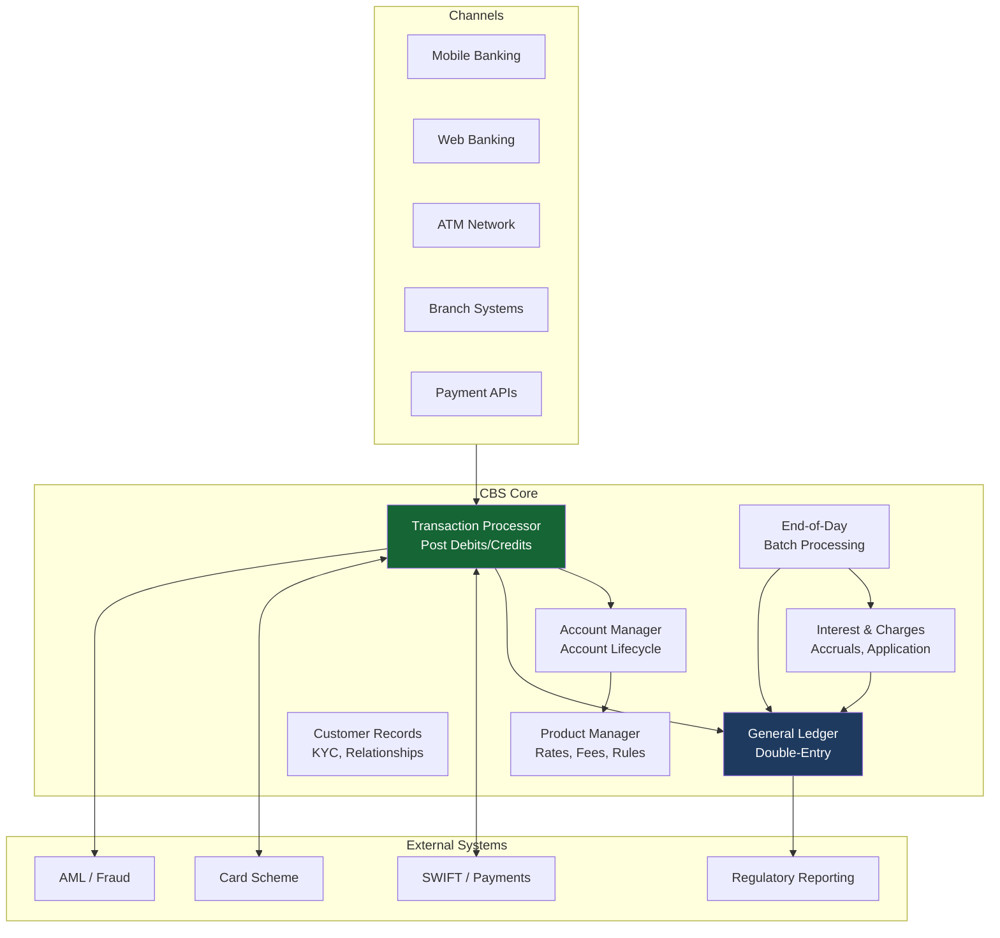
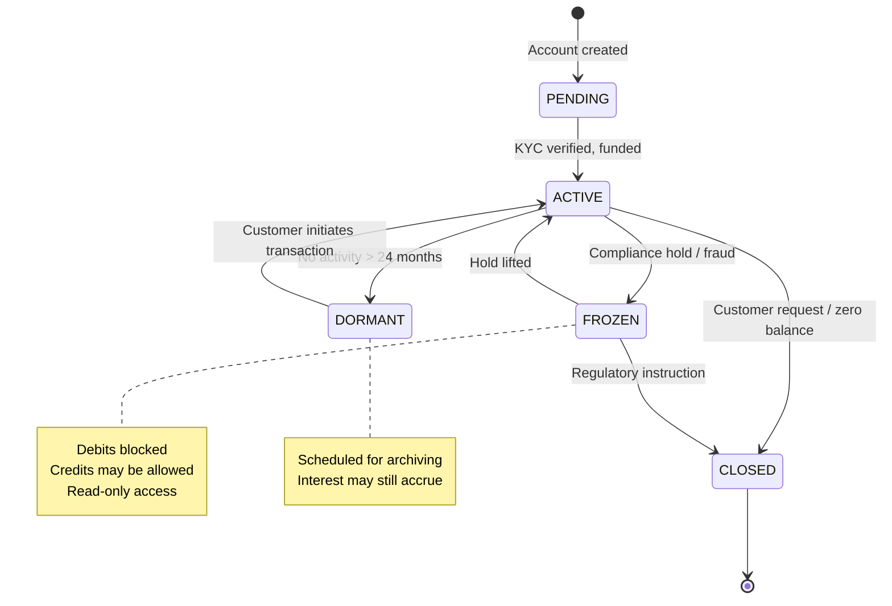
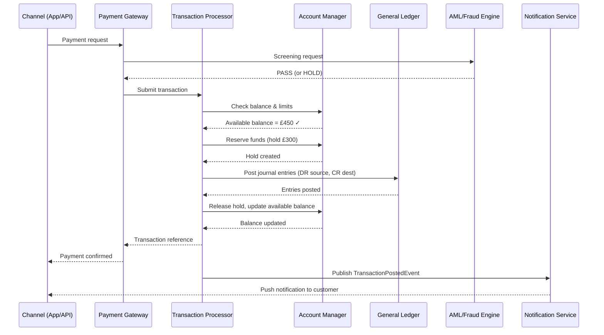
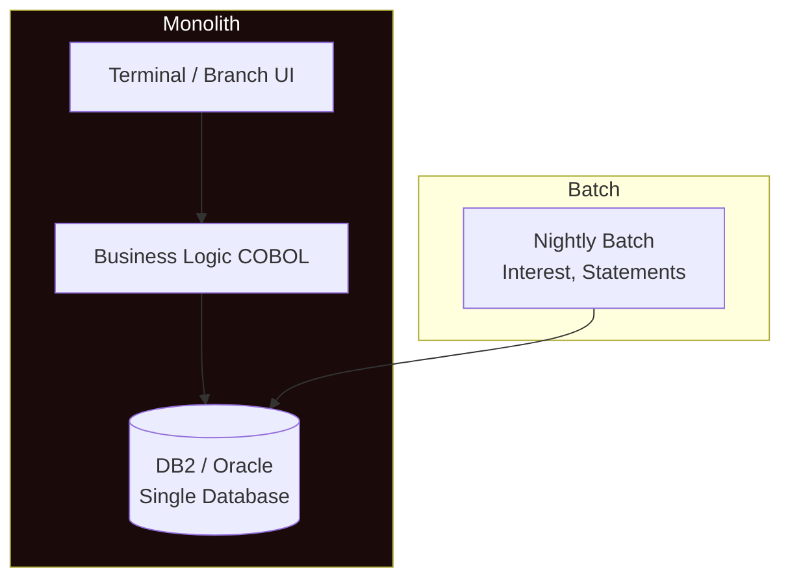
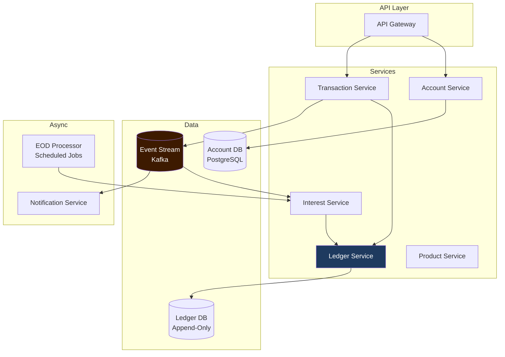

# بنية الأنظمة البنكية الأساسية — تصميم نظام السجل

## نظرة عامة

**النظام البنكي الأساسي (Core Banking System — CBS)** هو العمود الفقري التشغيلي لكل بنك. فهو نظام السجل للحسابات والأرصدة والمعاملات — المصدر الوحيد الموثوق للحقيقة المالية. وكل قناة (تطبيق الجوال، والفرع، والصراف الآلي، وواجهة الدفع) تقرأ في النهاية من النظام البنكي الأساسي وتكتب فيه.

وفهم بنية النظام البنكي الأساسي شرط مسبق لتصميم كل نظام آخر في هذا المسار: فمعالجات الدفع، ومحركات المطابقة، وأنظمة مكافحة غسل الأموال، وواجهات البنوك المفتوحة كلها تقع أمام النظام الأساسي أو بجانبه. وصحة هذا النموذج الذهني تمكّنك من تصميم تكاملات صحيحة، وفهم تدفقات البيانات، والاستدلال على سيناريوهات الفشل عبر المنظومة التقنية البنكية كاملة.

## أهداف التعلم

في نهاية هذا الدرس ستستطيع:

- وصف المكونات الرئيسية للنظام البنكي الأساسي ومسؤولياتها
- شرح مبدأ نظام السجل وآثاره المعمارية
- وصف نموذج الحساب: أنواع الحسابات، وبنيتها، وآلة حالاتها
- تتبع معاملة دفع عبر مسار المعالجة في النظام الأساسي
- شرح دورة التسوية وأثرها في توفر الرصيد
- مقارنة بنية النظام الأساسي القديمة الموحدة بالبدائل السحابية الحديثة
- تحديد أنماط التكامل بين النظام الأساسي والأنظمة المحيطة

## سياق العمل

ينتقل بنك منافس من نظام بنكي أساسي قديم موحد (نظام مبني على COBOL من التسعينيات يعمل في مقر البنك) إلى بنية سحابية أصلية. ويجب على المهندس الرئيسي الذي يقود الانتقال أن يفهم ما يفعله النظام القديم، وأي المكونات يجب إعادة بنائها، وأيها يمكن استبداله ببدائل حديثة.

ويجب أن يحافظ الانتقال على صفر فقدان للبيانات المالية، وتوفر مستمر، وامتثال تنظيمي طوال الوقت. وفهم بنية النظام البنكي الأساسي شرط مسبق لتصميم استراتيجية الانتقال.

## ما النظام البنكي الأساسي؟

النظام البنكي الأساسي هو **الجهاز العصبي المركزي** للبنك. وهو يدير:

| القدرة | الوصف |
|---|---|
| **إدارة الحسابات** | إنشاء كل أنواع الحسابات وصيانتها ودورة حياتها |
| **دفتر الأستاذ العام** | القيد المزدوج لكل الحركات المالية |
| **معالجة المعاملات** | ترحيل الخصوم والإضافات إلى الحسابات |
| **الفوائد والرسوم** | حساب الفوائد والرسوم والتكاليف وتطبيقها |
| **بيانات العملاء** | العلاقة بين العملاء وحساباتهم |
| **معاملات المنتجات** | أسعار الفائدة، وجداول الرسوم، وحدود السحب على المكشوف |
| **إدارة التواريخ** | حساب أيام العمل، ومعالجة نهاية اليوم، ودورات التسوية |
| **التقارير التنظيمية** | بيانات للجهات الرقابية الاحترازية والسلوكية |

النظام البنكي الأساسي ليس بوابة دفع، ولا محرك كشف احتيال، ولا تطبيقًا يواجه العملاء — فتلك الأنظمة تُبنى *حول* النظام الأساسي. وهو الحقيقة الدائمة التي تعتمد عليها كل تلك الأنظمة.

## بنية مكونات النظام البنكي الأساسي



> [!NOTE]
> في الأنظمة القديمة الموحدة تكون كل هذه المكونات غالبًا تطبيقًا واحدًا بقاعدة بيانات واحدة. وفي البنى السحابية الحديثة تُفصل إلى خدمات مصغّرة بتكامل مبني على الأحداث. ونموذج المكونات المنطقي هو نفسه — بينما تتغير طوبولوجيا النشر.

## نموذج الحساب

**الحساب** الوحدة الأساسية في النظام البنكي الأساسي. فكل علاقة مالية تُعبَّر عنها بحساب واحد أو أكثر.

### بنية الحساب

```java17
// Core account entity — simplified from production schema
@Entity
@Table(name = "accounts")
public class Account {

    @Id
    private String accountNumber;        // e.g. "12345678" or "GB29NWBK60161331926819"

    private String customerId;           // Link to customer record
    private String productCode;          // "CURRENT_01", "SAVINGS_02", "LOAN_MORT"
    private String currency;             // ISO 4217 — "GBP", "USD", "EUR"

    @Enumerated(EnumType.STRING)
    private AccountStatus status;        // PENDING, ACTIVE, FROZEN, DORMANT, CLOSED

    // Balances — several types tracked simultaneously
    private long ledgerBalance;          // Book balance — posted transactions
    private long availableBalance;       // Ledger balance - holds/reservations
    private long pendingCredits;         // Incoming funds not yet settled
    private long pendingDebits;          // Outgoing funds not yet settled

    private long overdraftLimit;         // Authorised overdraft in minor units
    private String sortCode;             // UK routing: "60-16-13"
    private String iban;                 // International: "GB29NWBK..."

    private LocalDate openedDate;
    private LocalDate closedDate;
    private Instant lastTransactionAt;
    private Instant lastUpdatedAt;
    private long version;                // Optimistic locking
}
```

تُتتبع عدة أنواع من الأرصدة في الوقت نفسه: الرصيد الدفتري (المعاملات المرحّلة)، والرصيد المتاح (الدفتري ناقص الحجوزات)، والإضافات والخصوم المعلقة التي لم تُسوَّ بعد. وتُخزّن المبالغ بالوحدات الصغرى، ويُستخدم حقل الإصدار للقفل المتفائل.

### أنواع الحسابات

| النوع | الوصف | دلالة الرصيد |
|---|---|---|
| **الحساب الجاري** | حساب المعاملات اليومية | التزام؛ الرصيد ملك العميل |
| **حساب التوفير** | وديعة بفائدة | التزام؛ سحب مقيد |
| **حساب القرض** | ائتمان ممنوح للعميل | أصل؛ الرصيد دين على العميل |
| **بطاقة الائتمان** | ائتمان متجدد | أصل ما دام العميل مدينًا؛ والرصيد الدائن (دفع زائد) التزام |
| **حساب نوسترو (Nostro)** | حساب البنك لدى بنك آخر | أصل؛ يُحتفظ به للبنوك المراسلة |
| **حساب فوسترو (Vostro)** | حساب بنك آخر لدى هذا البنك | التزام (مستحق لذلك البنك) |
| **الحساب المعلّق (Suspense)** | احتجاز مؤقت للبنود غير المطابقة بعد؛ يُحقق فيها وتُصفّى إلى الصفر، عادة يوميًا | داخلي |
| **حساب التسوية** | يُستخدم أثناء مقاصة المدفوعات | داخلي |

### آلة حالات الحساب



## مسار معالجة المعاملات

تمر معاملة الدفع بعدة مراحل قبل اعتبارها نهائية. وفهم هذا المسار أساسي للتكامل مع النظام البنكي الأساسي بشكل صحيح.



### حالات المعاملة

| الحالة | المعنى | الأثر في الرصيد |
|---|---|---|
| **RECEIVED** | قبلتها البوابة؛ والتحقق معلق | لا شيء |
| **AUTHORISED** | الأموال مؤكدة؛ واجتازت فحص غسل الأموال | يُخفض الرصيد المتاح (حجز) |
| **CLEARING** | أُرسلت إلى نظام الدفع؛ بانتظار التسوية | يُنشأ خصم معلق |
| **SETTLED** | انتقلت الأموال فعلًا؛ وتمت التسوية بين البنوك | يُحدّث الرصيد الدفتري |
| **REVERSED** | أُلغيت المعاملة؛ ورُحّل قيد تعويضي | تُعكس كل الآثار |
| **DECLINED** | رُفضت (رصيد غير كافٍ، أو غسل أموال، أو حد) | لا تغيير |

> [!IMPORTANT]
> **الرصيد المتاح** و**الرصيد الدفتري** مختلفان. فالرصيد الدفتري يعكس كل المعاملات المرحّلة. أما الرصيد المتاح فيطرح الحجوزات والخصوم المعلقة التي لم تُسوَّ بعد. فالعميل الذي رصيده الدفتري 500 جنيه ولديه 200 جنيه في تفويضات بطاقات معلقة رصيده المتاح 300 جنيه. وافحص دائمًا الرصيد المتاح قبل السماح بسحب.

## دورة التسوية

**التسوية** هي العملية التي تُنقل بها المدفوعات بين البنوك نقلًا نهائيًا لا رجعة فيه. وتسوّي معظم أنظمة الدفع على دورات لا فورًا.

### BACS (المقاصة الآلية في المملكة المتحدة) — دورة ثلاثة أيام

```mermaid
gantt
    title BACS three-day cycle (simplified)
    dateFormat  D
    axisFormat  Day %d

    section Originating bank
    Day 1 input, payment file submitted to Bacs        :done, 1, 1d
    Day 2 processing, Bacs validates and sorts         :done, 2, 1d
    Day 3 entry day, payer debited and banks settle  :done, 3, 1d

    section Receiving bank
    Day 2 receives the incoming payment file           :active, 2, 1d
    Day 3 entry day, payee credited                    :done, 3, 1d
```



اليوم 1 إدخال الملف، واليوم 2 المعالجة، واليوم 3 "يوم القيد": يُخصم من الدافع ويُضاف للمستفيد وتتم التسوية بين البنوك.

### التسوية الإجمالية الآنية (RTGS) — فورية

في المملكة المتحدة تُسوّى مدفوعات CHAPS فرديًا وفورًا في نظام RTGS لدى بنك إنجلترا — فكل دفعة نهائية ولا رجعة فيها خلال ثوانٍ. لا تجميع، ولا مقاصة صافية، ولا مخاطر تسوية ليلية.

ولاحظ الفرق بين **الترحيل للعميل** و**التسوية بين البنوك**. فالمدفوعات السريعة (Faster Payments) تُضاف للعميل خلال ثوانٍ، لكن البنوك تتسوى فيما بينها لاحقًا، في عدة دورات تسوية صافية يوميًا. ويجب أن يتتبع النظام البنكي الأساسي الأمرين معًا.

```java17
// Different balance update strategies per payment type.
// This models INTERBANK settlement timing; customer-facing posting can be
// earlier (Faster Payments credits the customer within seconds).
public enum PaymentSettlementType {
    IMMEDIATE(0),   // CHAPS (RTGS) — settled individually, immediately
    INTRADAY(0),    // Faster Payments — customer credited in seconds; banks net-settle later the same day
    NEXT_DAY(1),
    THREE_DAY(2);   // BACS — entry on the 3rd day (2 business days after input)

    private final int settlementDayOffset;   // business days after submission
    PaymentSettlementType(int offset) { this.settlementDayOffset = offset; }
    public int settlementDayOffset() { return settlementDayOffset; }
}

@Service
public class BalanceUpdateService {

    public void applySettlement(Transaction tx, PaymentSettlementType type) {
        switch (type) {
            case IMMEDIATE -> {
                // Post journal entry and update ledger balance immediately
                ledgerService.postTransfer(tx.getSourceId(), tx.getDestId(),
                                           tx.getAmount(), tx.getCurrency());
            }
            case INTRADAY, NEXT_DAY, THREE_DAY -> {
                // Create pending entry — ledger balance updated at settlement
                pendingEntryService.createPending(tx,
                    businessCalendar.addBusinessDays(tx.getSubmittedOn(), type.settlementDayOffset()));
            }
        }
    }
}
```

## بنية النظام الأساسي الحديثة مقابل القديمة

### البنية القديمة الموحدة



**خصائص الأنظمة القديمة:**
- قاعدة بيانات واحدة تتشاركها كل الوظائف
- نوافذ دفعات ليلية (1–4 صباحًا) لاستحقاق الفوائد، والكشوف، والتقارير
- غالبًا منتج جاهز من مورّد (مثل Temenos Transact/T24، وOracle FLEXCUBE، وFinastra) بتراخيص وتخصيص مكلفين
- صعوبة التوسيع دون تدخل المورّد
- موثوقية مثبتة ومجرّبة على مدى عقود

### البنية السحابية الأصلية



**خصائص البنية السحابية الأصلية:**
- خدمات قابلة للنشر مستقلة بقواعد بيانات منفصلة
- بنية مبنية على الأحداث — `TransactionPostedEvent` و`AccountStatusChangedEvent`
- توفر مستمر — بلا توقف للدفعات الليلية (ما زال عمل نهاية اليوم موجودًا لكنه يعمل بجانب الحركة الحية)
- ‏PostgreSQL مُدار ذاتيًا أو RDS سحابي بدل DB2
- تعقيد هندسي أعلى لكن كلفة ملكية إجمالية أقل عند التوسع

## أنماط تكامل Java مع النظام الأساسي

```java17
// Java 17 — Account inquiry via CBS client
@Service
public class CoreBankingClient {

    private final RestTemplate restTemplate;
    private final CircuitBreaker circuitBreaker;

    public AccountSummary getAccountSummary(String accountId) {
        return circuitBreaker.executeSupplier(() ->
            restTemplate.getForObject(
                "/cbs/accounts/{id}/summary",
                AccountSummary.class,
                accountId
            )
        );
    }

    // Post a transaction to the CBS ledger.
    // The Idempotency-Key header lets the CBS recognise a retry of the SAME
    // request (e.g. after a timeout) and return the original result instead
    // of posting twice. The key is created once per business request and
    // reused on every retry.
    public TransactionReference postTransaction(PostTransactionRequest request) {
        HttpHeaders headers = new HttpHeaders();
        headers.set("Idempotency-Key", request.idempotencyKey());
        return circuitBreaker.executeSupplier(() ->
            restTemplate.postForObject(
                "/cbs/transactions",
                new HttpEntity<>(request, headers),
                TransactionReference.class
            )
        );
    }
}
```

تتيح الترويسة `Idempotency-Key` للنظام الأساسي التعرف على إعادة محاولة الطلب **نفسه** (مثلًا بعد انتهاء مهلة) وإعادة النتيجة الأصلية بدل الترحيل مرتين. ويُنشأ المفتاح مرة واحدة لكل طلب عمل ويُعاد استخدامه في كل إعادة محاولة.

```java21
// Java 21 — Account model using records
public record AccountSummary(
    String accountNumber,
    String accountType,
    String currency,
    long ledgerBalance,
    long availableBalance,
    long pendingCredits,
    long pendingDebits,
    AccountStatus status,
    Instant lastUpdatedAt
) {
    // Convenience method — computed from components
    // (assumes availableBalance already includes any authorised overdraft)
    public boolean canDebit(long amount) {
        return status == AccountStatus.ACTIVE && availableBalance >= amount;
    }

    public boolean isOverdrawn() {
        return ledgerBalance < 0;
    }
}

// Pattern matching on account status
public String getStatusDescription(AccountSummary account) {
    return switch (account.status()) {
        case ACTIVE  -> "Active — available to transact";
        case FROZEN  -> "Frozen — contact your bank";
        case DORMANT -> "Dormant — reactivate by visiting a branch";
        case PENDING -> "Pending — KYC verification in progress";
        case CLOSED  -> "Closed";
    };
}
```

## معالجة نهاية اليوم

يجري كل نظام بنكي أساسي معالجة دفعية لنهاية اليوم (EOD). وهذا إرث من عصر الحوسبة الدفعية ما زال قائمًا في الأنظمة الحديثة لأن بعض الحسابات مرتبطة بلحظة زمنية بطبيعتها (استحقاق الفوائد، وتوليد الكشوف).

```java17
// EOD processing orchestrator
@Service
public class EndOfDayProcessor {

    // Triggered at business day close. Real systems check the business
    // calendar (bank holidays), not just MON-FRI, and make sure only ONE
    // instance runs EOD (e.g. a database-backed scheduler lock).
    @Scheduled(cron = "0 59 23 * * MON-FRI")
    public void runEndOfDay() {
        LocalDate businessDate = businessCalendar.today();
        if (!businessCalendar.isBusinessDay(businessDate)) return;
        log.info("EOD processing started for business date: {}", businessDate);

        // NOT one big @Transactional: accruing interest for millions of accounts
        // in a single transaction would hold locks for hours. Each step commits
        // in chunks and is idempotent per business date, so a failed EOD can be
        // re-run safely from the step that failed.

        // Step 1: Freeze intraday processing (some banks do, some don't)
        transactionGateway.enterEndOfDayMode();

        try {
            // Step 2: Accrue interest on all interest-bearing accounts
            interestAccrualService.accrueAll(businessDate);

            // Step 3: Apply charges on accounts due today
            chargesService.applyDueCharges(businessDate);

            // Step 4: Settle outstanding BACS/SEPA batches
            settlementService.settleOutstandingBatches(businessDate);

            // Step 5: Generate statements for accounts due statements
            statementService.generateDueStatements(businessDate);

            // Step 6: Trial balance check — total debits must equal credits.
            // If it fails, STOP: do not advance the date; raise an incident
            trialBalanceService.assertBalance(businessDate);

            // Step 7: Advance to next business date (only after all checks pass)
            businessCalendar.advanceToNextBusinessDay();

        } finally {
            // Always exit EOD mode — even if steps fail
            transactionGateway.exitEndOfDayMode();
        }

        log.info("EOD processing complete. Next business day: {}", businessCalendar.today());
    }
}
```

ليست المعالجة معاملة `@Transactional` كبيرة واحدة: فاستحقاق الفوائد لملايين الحسابات في معاملة واحدة سيحتجز الأقفال لساعات. بل تلتزم كل خطوة على دفعات صغيرة وتكون عديمة التكرار لكل تاريخ عمل، فيمكن إعادة تشغيل نهاية يوم فاشلة بأمان من الخطوة التي فشلت. وإذا فشل فحص ميزان المراجعة **توقّف**: لا تقدّم التاريخ، وأطلق حادثًا. وتتحقق الأنظمة الحقيقية من تقويم العمل (العطل الرسمية) وتضمن أن نسخة **واحدة** فقط تشغّل نهاية اليوم.


<!-- KNOWLEDGE-CHECK [
  {
    "id": "kc-cba-01",
    "question": "لدى عميل رصيد دفتري 800 جنيه و300 جنيه في تفويضات بطاقات معلقة. ويحاول سحب 600 جنيه. هل يوافق النظام الأساسي أم يرفض؟",
    "options": [
      "يوافق — فالرصيد الدفتري البالغ 800 جنيه يغطي سحب 600 جنيه",
      "يرفض — فالرصيد المتاح 500 جنيه (800 - 300 معلقة)، وهو أقل من 600",
      "يوافق مع علامة سحب على المكشوف — فسيُغطى صافي الخصم عند تسوية المعاملات المعلقة",
      "يرفض — يجب تسوية تفويضات البطاقات قبل السماح بأي سحب"
    ],
    "correct": 1,
    "explanation": "الرصيد المتاح = الرصيد الدفتري - الحجوزات/الخصوم المعلقة = 800 - 300 = 500 جنيه. والسحب البالغ 600 جنيه يتجاوز الرصيد المتاح البالغ 500. والموافقة عليه قد تنشئ سحبًا على المكشوف عند تسوية معاملات البطاقة. ويجب أن يفحص النظام الأساسي الرصيد المتاح لا الدفتري في قرارات السحب."
  },
  {
    "id": "kc-cba-02",
    "question": "في نموذج حسابات النظام الأساسي، يظهر رصيد حساب جاري لعميل قدره 2,000 جنيه كالتزام في ميزانية البنك. لماذا؟",
    "options": [
      "لأن الحسابات الجارية تكسب فائدة، فتصبح كلفة على البنك",
      "لأن البنك مدين للعميل بـ 2,000 جنيه — وهو التزام بالسداد",
      "لأن الحسابات الجارية تُصنف التزامات لأغراض ضريبية",
      "لأن رصيد الحساب لم يُستثمر بعد"
    ],
    "correct": 1,
    "explanation": "تعرّف معادلة المحاسبة الالتزامات بأنها مبالغ مستحقة للغير. فعندما يودع عميل 2,000 جنيه، يحوز البنك 2,000 جنيه نقدًا (أصل) لكنه ينشئ في الوقت نفسه التزامًا بسداد هذا المبلغ عند الطلب (التزام). فرصيد العميل دين على البنك للعميل."
  },
  {
    "id": "kc-cba-03",
    "question": "تُرسل دفعة BACS يوم الاثنين. ويرى العميل المستفيد الأموال في حسابه يوم الأربعاء. ما المصطلح التقني للفجوة من الاثنين إلى الأربعاء؟",
    "options": [
      "تأخير المقاصة — الدفعة معلقة بانتظار مقاصة بنك الدافع",
      "دورة التسوية — فترة التسوية بين البنوك ذات الأيام الثلاثة في BACS",
      "حجز تفويض — الأموال محجوزة لكنها غير متاحة بعد",
      "الطفو (Float) — الفترة التي يكسب فيها البنك فائدة على الحسابين معًا"
    ],
    "correct": 1,
    "explanation": "لـ BACS ‏(Bankers' Automated Clearing Service) دورة تسوية من ثلاثة أيام عمل. اليوم 1: الإدخال. واليوم 2: التحقق والتبادل. واليوم 3: التسوية والإضافة للمستفيد. وهذه دورة التسوية — الزمن بين بدء الدفعة والتسوية النهائية غير القابلة للإلغاء بين البنوك."
  },
  {
    "id": "kc-cba-04",
    "question": "في بنية بنكية أساسية سحابية، عندما ترحّل خدمة المعاملات خصمًا تنشر حدث TransactionPostedEvent إلى Kafka. ما الميزة الأساسية لهذا الأسلوب المبني على الأحداث مقارنة باستدعاء متزامن مباشر لخدمة الفوائد؟",
    "options": [
      "‏Kafka أسرع من استدعاء HTTP مباشر في كل الحالات",
      "لا تحتاج خدمة المعاملات إلى انتظار توفر خدمة الفوائد — فصل زمني",
      "يجب إجراء حسابات الفوائد قبل اكتمال المعاملة",
      "يمنع Kafka ترحيل المعاملات المكررة تلقائيًا"
    ],
    "correct": 1,
    "explanation": "الفصل الزمني هو الفائدة الأساسية. فتنشر خدمة المعاملات الحدث وتمضي. وقد تكون خدمة الفوائد متوقفة أو بطيئة أو قيد إعادة النشر — فيُخزّن الحدث في Kafka ويُعالج عند تعافي خدمة الفوائد. أما الاستدعاء المتزامن فسيفشل إذا كانت خدمة الفوائد غير متاحة، فقد يحجب مسار المعاملات كله."
  }
] -->


<!-- PRACTICAL-CHALLENGE {
  "id": "pc-core-banking-arch",
  "title": "بنية النظام البنكي الأساسي: تصميم الحسابات والمعاملات",
  "description": "صمّم نماذج البيانات وتفاعلات الخدمات لنظام بنكي أساسي مبسّط.",
  "tasks": [
    {
      "id": "pc-cba-01",
      "description": "صمّم مخطط SQL لجدول حسابات أدنى في النظام الأساسي يدعم: الحسابات الجارية، وحسابات التوفير، وحسابات القروض بعملات متعددة. وضمّن كل حقول الأرصدة (الدفتري، والمتاح، والمعلق) وتعداد الحالات."
    },
    {
      "id": "pc-cba-02",
      "description": "ارسم آلة حالات معاملة لدفعة BACS: من RECEIVED حتى SETTLED أو DECLINED (بما في ذلك الدورة ذات الأيام الثلاثة: الإدخال، والمعالجة، ويوم القيد)، مع بيان أي انتقالات الحالة تحدّث الرصيد الدفتري وأيها تحدّث الرصيد المتاح."
    },
    {
      "id": "pc-cba-03",
      "description": "نفّذ طريقة Java ‏`canProcessDebit(Account account, long amount)` تفحص كل الشروط: حالة الحساب ACTIVE، والرصيد المتاح >= المبلغ، وألا يتجاوز الخصم حد السحب على المكشوف للحساب."
    },
    {
      "id": "pc-cba-04",
      "description": "اشرح لماذا يُعد فحص ميزان المراجعة في دفعة نهاية اليوم الليلية (`إجمالي المدين = إجمالي الدائن`) ضابط أمان حاسمًا، وما سيناريو الفشل الذي سيكتشفه."
    },
    {
      "id": "pc-cba-05",
      "description": "يرسل نظام أساسي قديم استدعاء HTTP متزامنًا راجعًا عند تسوية دفعة CHAPS (أحيانًا بعد 15–30 ثانية من الإرسال). صمّم نمط التكامل للتعامل مع هذا التأخير دون حجب استجابة تطبيق الجوال."
    }
  ]
} -->
