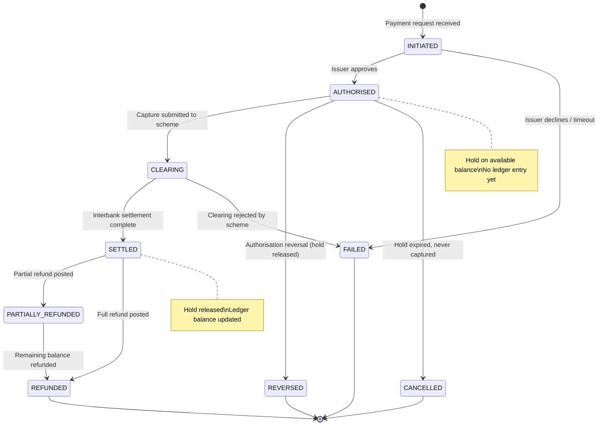
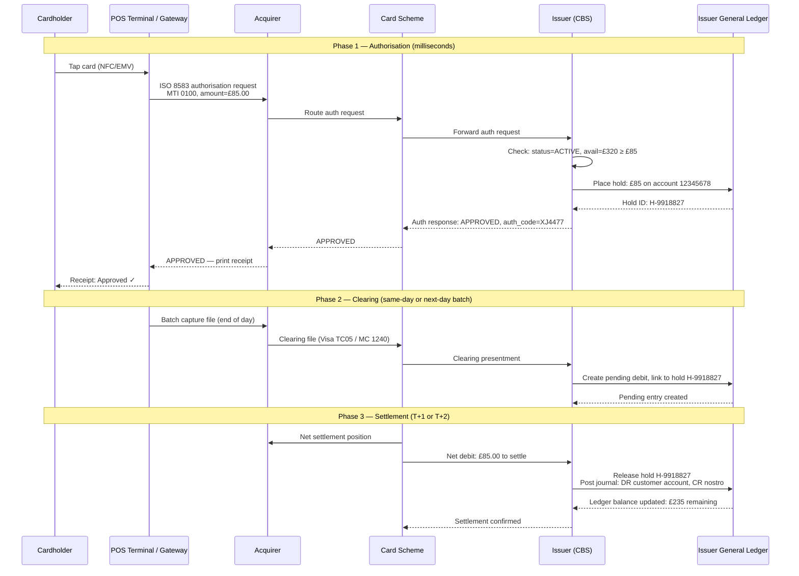
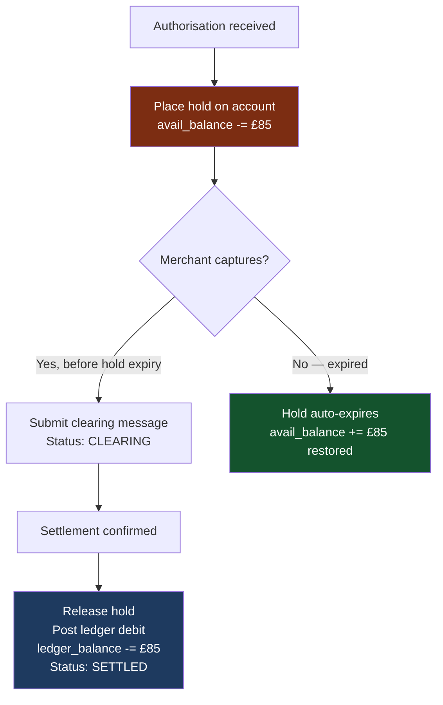

# معالجة المدفوعات — التفويض والمقاصة والتسوية

## نظرة عامة

تقع معالجة المدفوعات عند تقاطع النظام البنكي الأساسي وأنظمة الدفع الخارجية التي تنقل المال بين البنوك. فكل تمرير بطاقة، أو دفع لاتلامسي، أو دفع إلكتروني يطلق تسلسلًا دقيقًا من الرسائل بين التجار، والبنوك المحصّلة (acquirers)، وشبكات البطاقات، والبنوك المُصدرة — وكثيرًا ما يكتمل التفويض المرئي في أقل من 300 ميلي ثانية بينما يستغرق انتقال المال الفعلي أيامًا. وفهم أين ينتهي التفويض وأين تبدأ التسوية، وما يحدث بينهما، أساس كل تكامل دفع ستبنيه.

## أهداف التعلم

في نهاية هذا الدرس ستستطيع:

- التمييز بين التفويض والمقاصة والتسوية كمراحل تقنية ومالية منفصلة
- وصف أدوار البنك المحصّل والبنك المُصدر وشبكة البطاقات في النموذج رباعي الأطراف
- تتبع دفع بالبطاقة من البداية للنهاية عبر دورة الحياة كاملة مع توقيت كل مرحلة
- تنفيذ خدمة `PaymentProcessor` بحراسات صحيحة لانتقالات الحالة
- شرح آلية الحجز والتحرير وأثرها في الرصيد المتاح
- مقارنة دورات التسوية T+0 وT+1 وT+2 وآثارها على التدفق النقدي
- تصميم تدفقات العكس والاسترداد كقيود يومية تعويضية
- تحديد أنماط الفشل في كل مرحلة والتصميم للتعافي عديم التكرار

## سياق العمل

*مثال مركّب (مبني على أنماط فشل شائعة في الصناعة، لا على شركة بعينها):* فشل معالج المدفوعات في بنك رقمي في التمييز الصحيح بين المعاملات المفوّضة غير المسوّاة والمعاملات المرفوضة أثناء تحويل قاعدة البيانات إلى نسخة احتياطية. وعندما عاد النظام للعمل، أعاد تشغيل عشرات آلاف رسائل التفويض — لكن مفاتيح إزالة التكرار كانت محفوظة فقط في الذاكرة المؤقتة للعقدة المتعطلة لا في قاعدة البيانات. والنتيجة: خُصم من عشرات آلاف العملاء مرتين. وأمضى البنك أسابيع في إصدار المبالغ المستردة، وتعامل مع سيل من طلبات الدعم، ودفع تعويضات، وواجه تدقيقًا رقابيًا في أنظمته وضوابطه. والسبب الجذري: غياب عمود مفتاح عدم التكرار (بقيد فريد) في جدول `payments`، وآلة حالات لا تتحقق من الحالة السابقة قبل الانتقال.

## التفويض والمقاصة والتسوية: ثلاثة أشياء مختلفة

يخلط المهندسون الجدد في المدفوعات بين هذه المصطلحات الثلاثة كثيرًا. وهي مراحل مالية وتقنية منفصلة بتوقيت مختلف، ومشاركين مختلفين، وآثار مختلفة على الأنظمة.

| المرحلة | ما يحدث | من يشارك | زمن الإكمال | الأثر في الرصيد |
|---|---|---|---|---|
| **التفويض** | يوافق المُصدر على المعاملة أو يرفضها | التاجر ← المحصّل ← الشبكة ← المُصدر | ميلي ثوانٍ إلى ثوانٍ | يُخفض الرصيد المتاح (حجز) |
| **المقاصة** | تبادل تفاصيل المعاملة بين البنوك | المحصّل ← الشبكة ← المُصدر | اليوم نفسه إلى اليوم التالي | يُنشأ خصم معلق |
| **التسوية** | انتقال الأموال الفعلي بين البنوك | البنك المركزي / تسوية الشبكة | ‏T+0 إلى T+2 | يُحدّث الرصيد الدفتري |

> [!IMPORTANT]
> التفويض **وعد** لا دفع. فالمُصدر يعد بالدفع للمحصّل إذا أرسل التاجر رسالة مقاصة صالحة. والتسوية هي النقل الفعلي للأموال. وقد تُفوّض معاملة ولا تُقاصّ أبدًا (لا يرسل التاجر التحصيل أبدًا)، وفي هذه الحالة تنتهي صلاحية الحجز وتُحرر الأموال — ولا ينتقل أي مال.

### النموذج رباعي الأطراف


- **حامل البطاقة** — الفرد الذي يدفع
- **التاجر** — النشاط الذي يقبل الدفع؛ يدفع رسوم المحصّل
- **المحصّل (Acquirer)** — البنك الذي يعالج مدفوعات البطاقات نيابة عن التاجر؛ يتحمل مخاطر التسوية
- **شبكة البطاقات** — Visa وMastercard وAmex؛ تضع القواعد، وتوجّه الرسائل، وتدير ملفات المقاصة؛ وتحدد رسوم التبادل
- **المُصدر (Issuer)** — البنك الذي أصدر البطاقة لحاملها؛ يوافق أو يرفض؛ ويتحمل مخاطر الائتمان والاحتيال

## آلة حالات الدفع

يتقدم الدفع عبر مجموعة حالات محددة جيدًا. والانتقالات غير المسموحة (مثل الانتقال مباشرة من `INITIATED` إلى `SETTLED` دون مقاصة) تدل على عيب في النظام ويجب رفضها.



```java17
public enum PaymentStatus {
    INITIATED,
    AUTHORISED,
    CLEARING,
    SETTLED,
    CANCELLED,
    FAILED,
    REVERSED,
    PARTIALLY_REFUNDED,
    REFUNDED;

    // Allowed transitions — enforced before every status update
    private static final Map<PaymentStatus, Set<PaymentStatus>> ALLOWED_TRANSITIONS =
        Map.of(
            INITIATED,           Set.of(AUTHORISED, FAILED),
            AUTHORISED,          Set.of(CLEARING, REVERSED, CANCELLED),
            CLEARING,            Set.of(SETTLED, FAILED),
            SETTLED,             Set.of(REFUNDED, PARTIALLY_REFUNDED),
            PARTIALLY_REFUNDED,  Set.of(REFUNDED),
            CANCELLED,           Set.of(),
            FAILED,              Set.of(),
            REVERSED,            Set.of(),
            REFUNDED,            Set.of()
        );

    public boolean canTransitionTo(PaymentStatus next) {
        return ALLOWED_TRANSITIONS.getOrDefault(this, Set.of()).contains(next);
    }
}
```

## تسلسل دفع البطاقة من البداية للنهاية



## تنفيذ خدمة PaymentProcessor

```java17
@Service
@Transactional
public class PaymentProcessor {

    private final PaymentRepository paymentRepository;
    private final AccountHoldService holdService;
    private final LedgerService ledgerService;
    private final OutboxRepository outbox;

    /**
     * Step 1: Authorise — check funds, place hold, record authorisation.
     * Idempotent: a repeated idempotencyKey returns the existing payment.
     */
    public PaymentAuthorisationResult authorise(AuthorisationRequest request) {
        // Claim the key FIRST: INSERT ... ON CONFLICT (idempotency_key) DO NOTHING.
        // The UNIQUE constraint (not a find-then-save check) stops two
        // concurrent retries from both authorising.
        Optional<Payment> claimed = paymentRepository.claimIdempotencyKey(
            request.idempotencyKey(), request);   // empty → key already used
        if (claimed.isEmpty()) {
            Payment existing = paymentRepository.findByIdempotencyKeyOrThrow(request.idempotencyKey());
            return PaymentAuthorisationResult.alreadyProcessed(existing);
        }
        return processNewAuthorisation(claimed.get(), request);
    }

    private PaymentAuthorisationResult processNewAuthorisation(Payment payment, AuthorisationRequest req) {
        // Place hold — reduces available balance immediately.
        // place() must check-and-reserve ATOMICALLY in the database, e.g.
        // UPDATE accounts SET available = available - :amt WHERE id = :id AND available >= :amt
        Optional<HoldReference> hold = holdService.tryPlace(
            req.accountId(),
            req.amountMinorUnits(),
            req.currency(),
            payment.getId(),
            HoldReason.CARD_AUTHORISATION,
            // Hold validity depends on scheme rules and merchant type
            // (e.g. a few days for retail, much longer for hotels/car hire)
            Instant.now().plus(Duration.ofDays(7))
        );
        if (hold.isEmpty()) {
            payment.transitionTo(PaymentStatus.FAILED);
            payment.setDeclineReason("INSUFFICIENT_FUNDS");
            return PaymentAuthorisationResult.declined("INSUFFICIENT_FUNDS");
        }

        payment.setHoldId(hold.get().holdId());
        payment.transitionTo(PaymentStatus.AUTHORISED);
        payment.setAuthorisedAt(Instant.now());

        // Event via the outbox, in the same transaction: published only if
        // this transaction commits (a plain in-process event would fire
        // even if the transaction later rolls back)
        outbox.save(OutboxEvent.of(new PaymentAuthorisedEvent(payment.getId(),
            req.accountId(), req.amountMinorUnits(), req.currency())));

        return PaymentAuthorisationResult.approved(payment.getId(), hold.get().holdId());
    }

    /**
     * Step 2: Capture/Clear — transitions AUTHORISED → CLEARING.
     * The clearing message itself is sent by a relay from the outbox: never
     * call the scheme inside the database transaction (if the call succeeds
     * but the commit fails, the two systems disagree).
     */
    public void capture(String paymentId) {
        Payment payment = paymentRepository.findByIdForUpdateOrThrow(paymentId);

        if (!payment.getStatus().canTransitionTo(PaymentStatus.CLEARING)) {
            throw new IllegalStateTransitionException(payment.getStatus(), PaymentStatus.CLEARING);
        }

        payment.transitionTo(PaymentStatus.CLEARING);
        payment.setClearingSubmittedAt(Instant.now());
        outbox.save(OutboxEvent.of(new SubmitClearingCommand(payment.getId())));
    }

    /**
     * Step 3: Settle — called by the settlement reconciliation job.
     * Transitions CLEARING → SETTLED. Releases hold and posts ledger entries.
     * Idempotent: a settlement file may be processed twice.
     */
    public void settle(String paymentId, SettlementReference settlementRef) {
        Payment payment = paymentRepository.findByIdForUpdateOrThrow(paymentId);   // row lock

        if (payment.getStatus() == PaymentStatus.SETTLED) {
            return;   // already settled — duplicate settlement record, nothing to do
        }
        if (!payment.getStatus().canTransitionTo(PaymentStatus.SETTLED)) {
            throw new IllegalStateTransitionException(payment.getStatus(), PaymentStatus.SETTLED);
        }

        // Release hold — no longer needed after settlement
        holdService.release(payment.getHoldId());

        // Post definitive ledger entries (DR customer account, CR scheme
        // settlement account) — keyed by payment id so a retry cannot post twice
        ledgerService.postDebit(
            payment.getAccountId(),
            payment.getAmountMinorUnits(),
            payment.getCurrency(),
            "SETTLEMENT:" + settlementRef.referenceId(),
            payment.getId()
        );

        payment.transitionTo(PaymentStatus.SETTLED);
        payment.setSettledAt(Instant.now());
        payment.setSettlementReference(settlementRef.referenceId());

        outbox.save(OutboxEvent.of(new PaymentSettledEvent(payment.getId(),
            payment.getAccountId(), payment.getAmountMinorUnits())));
    }
}
```

أهم النقاط في هذا التنفيذ:
- **عدم التكرار بالحجز أولًا**: يُحجز المفتاح بـ `INSERT ... ON CONFLICT DO NOTHING`؛ فالقيد الفريد (لا فحص البحث ثم الحفظ) يمنع إعادتي محاولة متزامنتين من التفويض معًا.
- **الحجز ذري**: يجب أن يفحص `tryPlace()` الرصيد ويحجزه في عملية قاعدة بيانات واحدة. وعند عدم الكفاية تُسجّل الدفعة FAILED مع السبب ولا يُوضع حجز.
- **مدة الحجز** تعتمد على قواعد الشبكة ونوع التاجر (بضعة أيام للتجزئة، وأطول بكثير للفنادق وتأجير السيارات).
- **الأحداث عبر outbox** في المعاملة نفسها: تُنشر فقط إذا التزمت المعاملة.
- **لا استدعاء للشبكة داخل معاملة قاعدة البيانات**: يرسل ناقل من outbox رسالة المقاصة — فإذا نجح الاستدعاء وفشل الالتزام لاختلف النظامان.
- **التسوية عديمة التكرار**: قد يُعالج ملف التسوية مرتين، فالدفعة المسوّاة بالفعل لا يُفعل بها شيء.

> [!WARNING]
> لا تحدّث أبدًا الرصيد الدفتري وقت التفويض لمدفوعات البطاقات. فالحجز على الرصيد المتاح كافٍ. ولا ترحّل القيد الدفتري النهائي إلا عند التسوية. فإذا خصمت من الدفتر عند التفويض ولم يحصّل التاجر أبدًا، يجب ترحيل إضافة تعويضية — فيزداد الضجيج المحاسبي وخطر عدم الاتساق.

## تدفق الحجز والتحرير

آلية الحجز هي ما يسمح للرصيد المتاح بأن يعكس تفويضات البطاقات المعلقة دون لمس الدفتر. فهي نظام حجز فوق الدفتر.



```java17
// Payment entity — balance impact summary at each state
public record PaymentBalanceImpact(
    PaymentStatus status,
    long availableBalanceDelta,  // Negative = reduction
    long ledgerBalanceDelta       // Negative = reduction
) {
    public static PaymentBalanceImpact forStatus(PaymentStatus status, long amount) {
        return switch (status) {
            case AUTHORISED          -> new PaymentBalanceImpact(status, -amount, 0);
            case REVERSED, CANCELLED -> new PaymentBalanceImpact(status, +amount, 0);  // Hold released
            case SETTLED             -> new PaymentBalanceImpact(status, 0, -amount);  // Hold→Ledger
            case REFUNDED            -> new PaymentBalanceImpact(status, 0, +amount);  // Credit back
            // (a partial refund credits only the refunded amount)
            default                  -> new PaymentBalanceImpact(status, 0, 0);
        };
    }
}
```

## توقيت التسوية: T+0 وT+1 وT+2

يختلف توقيت التسوية كثيرًا حسب نظام الدفع. ولهذا آثار حقيقية على التدفق النقدي للتجار ومخاطر نظامية على البنوك.

| النظام | دورة التسوية | الآلية | النهائية |
|---|---|---|---|
| **CHAPS (المملكة المتحدة)** | ‏T+0 (اليوم نفسه، خلاله) | ‏RTGS — تسوية فردية | غير قابلة للإلغاء |
| **Faster Payments (المملكة المتحدة)** | ‏T+0 (ثوانٍ) | تسوية صافية مؤجلة (DNS) | شبه فورية |
| **Visa / Mastercard (المملكة المتحدة)** | ‏T+1 (يوم العمل التالي للمقاصة) | تسوية صافية عبر خدمة التسوية لكل شبكة | نهاية اليوم |
| **BACS (المملكة المتحدة)** | ‏T+2 (دورة 3 أيام: الإدخال، والمعالجة، ويوم القيد) | تسوية صافية مؤجلة | اليوم 3 من الدورة |
| **تحويل SEPA الائتماني** | ‏T+1 (أو فوري عبر SCT Inst) | ‏DNS أو RTGS | اليوم 1 / فوري |
| **ACH (الولايات المتحدة)** | ‏T+0 (Same Day ACH) إلى T+1 | ‏DNS دفعي | اليوم نفسه أو التالي |

> [!NOTE]
> تعني "T+1" يوم **العمل** التالي. فدفعة Visa مفوّضة مساء الجمعة تُسوّى يوم الاثنين. ولا يتلقى محصّل التاجر الأموال حتى الاثنين. وهذا ينشئ تعرضًا لمخاطر الطرف المقابل لعدة أيام — فالشبكة تضمن الدفع، لكن الضمان يمتد عبر عطلة نهاية الأسبوع.

```java17
// Settlement timing calculator
public enum PaymentScheme {
    CHAPS, FASTER_PAYMENTS, VISA, MASTERCARD, BACS, SEPA_CT, SEPA_INST, ACH_US;

    public LocalDate expectedSettlementDate(LocalDate submissionDate, BusinessCalendar cal) {
        return switch (this) {
            case CHAPS, FASTER_PAYMENTS, SEPA_INST -> submissionDate; // T+0
            case VISA, MASTERCARD, SEPA_CT, ACH_US -> cal.addBusinessDays(submissionDate, 1); // T+1
            case BACS                              -> cal.addBusinessDays(submissionDate, 2); // day 3 of the cycle
        };
    }
}
```

## العكس والاسترداد

**عكس التفويض** يلغي تفويضًا قبل تحصيله: يُحرر الحجز ولا ينتقل أي مال أبدًا. و**الاسترداد** يعيد المال بعد التسوية بترحيل إضافة تعويضية — ولا تُحذف المعاملة الأصلية أبدًا. (أما **رد المبالغ (chargeback)** فهو عملية نزاع لدى شبكة البطاقات، يبدؤها البنك المُصدر لحامل البطاقة.)

```java17
@Service
@Transactional
public class PaymentReversalService {

    private final PaymentRepository paymentRepository;
    private final AccountHoldService holdService;
    private final LedgerService ledgerService;

    /**
     * Authorisation reversal — only valid while the payment is AUTHORISED
     * (not yet captured). Releases the hold; no ledger entry is needed
     * because none was posted at authorisation. Once a capture has been sent
     * to the scheme, the money will move: use refund() after settlement.
     */
    public void reverse(String paymentId, String reason) {
        Payment payment = paymentRepository.findByIdForUpdateOrThrow(paymentId);

        if (payment.getStatus() != PaymentStatus.AUTHORISED) {
            throw new InvalidOperationException(
                "Cannot reverse payment in status: " + payment.getStatus() +
                ". Use refund() once the payment has settled.");
        }

        holdService.release(payment.getHoldId());

        payment.transitionTo(PaymentStatus.REVERSED);
        payment.setReversedAt(Instant.now());
        payment.setReversalReason(reason);
        paymentRepository.save(payment);
    }

    /**
     * Post-settlement refund — only valid when status is SETTLED or PARTIALLY_REFUNDED.
     * Posts a credit journal entry — the original debit remains for audit trail.
     */
    public RefundResult refund(String paymentId, long refundAmountMinorUnits,
                               String reason, String refundIdempotencyKey) {
        // Row lock: two concurrent partial refunds must not both pass the check
        Payment payment = paymentRepository.findByIdForUpdateOrThrow(paymentId);

        if (!Set.of(PaymentStatus.SETTLED, PaymentStatus.PARTIALLY_REFUNDED)
                .contains(payment.getStatus())) {
            throw new InvalidOperationException("Cannot refund payment in status: " + payment.getStatus());
        }

        long alreadyRefunded = payment.getTotalRefundedMinorUnits();
        long maxRefundable   = payment.getAmountMinorUnits() - alreadyRefunded;

        if (refundAmountMinorUnits <= 0 || refundAmountMinorUnits > maxRefundable) {
            throw new InvalidOperationException(
                "Refund amount %d outside refundable range 1..%d"
                    .formatted(refundAmountMinorUnits, maxRefundable));
        }

        // Credit the customer's account. The refund's own idempotency key
        // (supplied by the caller and reused on retry) makes the posting safe
        // to repeat — a random UUID here would post again on every retry
        ledgerService.postCredit(
            payment.getAccountId(),
            refundAmountMinorUnits,
            payment.getCurrency(),
            "REFUND:ORIG:" + paymentId,
            refundIdempotencyKey
        );

        payment.addRefund(refundAmountMinorUnits, reason, Instant.now());

        PaymentStatus nextStatus = (payment.getTotalRefundedMinorUnits() == payment.getAmountMinorUnits())
            ? PaymentStatus.REFUNDED
            : PaymentStatus.PARTIALLY_REFUNDED;

        if (nextStatus != payment.getStatus()) {
            payment.transitionTo(nextStatus);   // a second partial refund stays PARTIALLY_REFUNDED
        }
        paymentRepository.save(payment);

        return new RefundResult(paymentId, refundAmountMinorUnits, nextStatus);
    }
}
```

يصح العكس فقط ما دامت الدفعة AUTHORISED (لم تُحصّل بعد)؛ فبمجرد إرسال التحصيل إلى الشبكة سينتقل المال، فاستخدم الاسترداد بعد التسوية. وفي الاسترداد: قفل صف يمنع استردادين جزئيين متزامنين من اجتياز الفحص معًا، ومفتاح عدم تكرار خاص بالاسترداد (يمرره المستدعي ويعيد استخدامه عند إعادة المحاولة) يجعل الترحيل آمنًا للتكرار — فمعرّف UUID عشوائي هنا سيرحّل مرة أخرى في كل إعادة محاولة.

> [!IMPORTANT]
> لا تحذف أبدًا سجل الدفعة الأصلي ولا تعدّله عند معالجة استرداد. فالخصم الأصلي والإضافة التعويضية قيدان يوميان منفصلان — ويجب أن يبقى كلاهما في الدفتر لسجل التدقيق، والمطابقة، والتقارير التنظيمية. فالجهات الرقابية تتطلب السلسلة الكاملة للقيود، لا صافيًا صفريًا.


<!-- KNOWLEDGE-CHECK [
  {
    "id": "kc-pp-01",
    "question": "يفوّض عميل دفعة 120 جنيهًا في فندق (تفويض مسبق). وبعد ثلاثة أيام يحصّل الفندق 95 جنيهًا عند المغادرة. ماذا يحدث للـ 25 جنيهًا المتبقية؟",
    "options": [
      "تضيع الـ 25 جنيهًا نهائيًا — يجب أن تطابق التفويضات المسبقة المبلغ النهائي تمامًا",
      "تنتهي صلاحية حجز 120 جنيهًا الأصلي؛ ويرسل الفندق رسالة مقاصة جديدة بـ 95 جنيهًا؛ ثم يوضع حجز بـ 95 جنيهًا",
      "يُحرر حجز 120 جنيهًا الأصلي عند التسوية؛ ويُرحّل خصم 95 جنيهًا إلى الدفتر؛ ويُستعاد 25 جنيهًا إلى الرصيد المتاح",
      "يجب أن يصدر الفندق استردادًا بـ 25 جنيهًا قبل معالجة التسوية"
    ],
    "correct": 2,
    "explanation": "في تدفق التفويض المسبق للفنادق: يخفض حجز 120 جنيهًا الرصيد المتاح فورًا. وعندما يرسل الفندق التحصيل النهائي بـ 95 جنيهًا، تحرر التسوية حجز 120 جنيهًا كاملًا وترحّل خصمًا دفتريًا نهائيًا بـ 95 جنيهًا. فيُستعاد 25 جنيهًا إلى الرصيد المتاح للعميل (الفرق بين الحجز والمبلغ المسوّى). فقد كان الحجز دائمًا حدًا أقصى — والتسوية تحدد المبلغ الفعلي."
  },
  {
    "id": "kc-pp-02",
    "question": "يعيد عميل بضائع اشتراها ببطاقة Visa قبل يومين، ويوافق التاجر على إعادة المال. وقد سُوّيت الدفعة بالفعل. هل يستخدم النظام عكس التفويض أم الاسترداد، ولماذا؟",
    "options": [
      "العكس — يلغي المعاملة الأصلية بنظافة دون قيود محاسبية إضافية",
      "الاسترداد — فقد سُوّيت الدفعة بالفعل؛ ويجب ترحيل قيد إضافة تعويضي",
      "أيهما — فهما متكافئان وظيفيًا بمجرد تسوية الدفعة",
      "لا هذا ولا ذاك — لا يمكن إعادة المعاملات المسوّاة إلا عبر عملية رد المبالغ في الشبكة"
    ],
    "correct": 1,
    "explanation": "عكس التفويض لا يصح إلا قبل التحصيل (الحالة AUTHORISED): يحرر الحجز ولا ينتقل مال. وبمجرد أن تصبح الدفعة SETTLED يكون القيد الدفتري نهائيًا. والآلية الصحيحة الاسترداد، الذي يرحّل قيد إضافة تعويضيًا؛ ويبقى الخصم الأصلي والإضافة كلاهما في الدفتر للتدقيق. أما رد المبالغ فمختلف: إنه عملية النزاع في الشبكة، يبدؤها البنك المُصدر لحامل البطاقة عندما **لا** يوافق التاجر على إعادة المال."
  }
] -->


<!-- PRACTICAL-CHALLENGE {
  "id": "pc-payment-processing",
  "title": "معالجة المدفوعات: آلة الحالات وتصميم التسوية",
  "description": "نفّذ المكونات الأساسية لمعالج مدفوعات بطاقات بانتقالات حالة وإدارة أرصدة صحيحة.",
  "tasks": [
    {
      "id": "pc-pp-01",
      "description": "صمّم مخطط SQL لجدول `payments` يتضمن: idempotency_key (بقيد UNIQUE)، وstatus، وamount_minor_units، وcurrency، وaccount_id، وhold_id (مفتاح أجنبي)، وsettlement_reference، وdecline_reason، وكل حقول الطوابع الزمنية (الإنشاء، والتفويض، وإرسال المقاصة، والتسوية، والعكس). وأضف قيد فحص يضمن أن amount_minor_units > 0."
    },
    {
      "id": "pc-pp-02",
      "description": "نفّذ الطريقة `PaymentStatus.canTransitionTo(PaymentStatus next)` كتعداد Java 17 مع خريطة الانتقالات المسموحة كاملة. واكتب اختبار وحدة يتحقق من: AUTHORISED ← CLEARING مسموح؛ وAUTHORISED ← REVERSED مسموح؛ وSETTLED ← AUTHORISED مرفوض؛ وFAILED ← SETTLED مرفوض."
    },
    {
      "id": "pc-pp-03",
      "description": "وسّع الطريقة `PaymentProcessor.authorise()` لمعالجة حالة عدم كفاية الرصيد المتاح. يجب أن تعيد `PaymentAuthorisationResult.declined(reason)` بدل رمي استثناء، وأن تسجّل الدفعة FAILED مع سبب الرفض (فالرفض يجب أن يكون قابلًا للتدقيق)، وألا تضع حجزًا. ويجب أن يكون فحص الأموال والحجز عملية قاعدة بيانات ذرية واحدة."
    },
    {
      "id": "pc-pp-04",
      "description": "صمّم مهمة مطابقة تسوية تعالج ملف تسوية دفعيًا من شبكة البطاقات. ولكل مرجع دفعة مسوّاة في الملف: ابحث عن الدفعة، واستدعِ settle()، وعالج ثلاث حالات حدية: (أ) الدفعة غير موجودة، (ب) الدفعة مسوّاة بالفعل (عدم تكرار)، (ج) الدفعة في حالة FAILED."
    }
  ]
} -->
