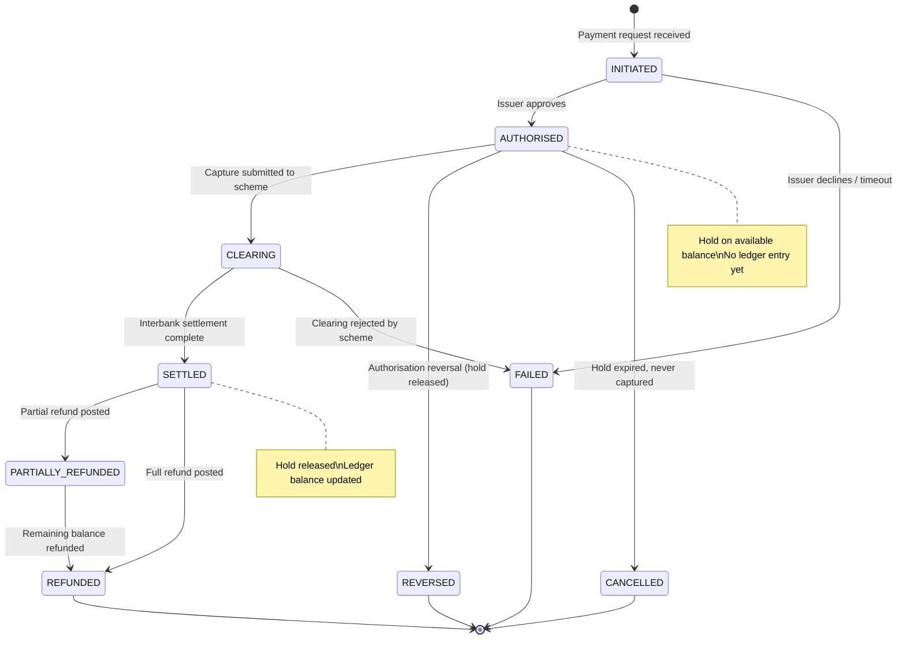
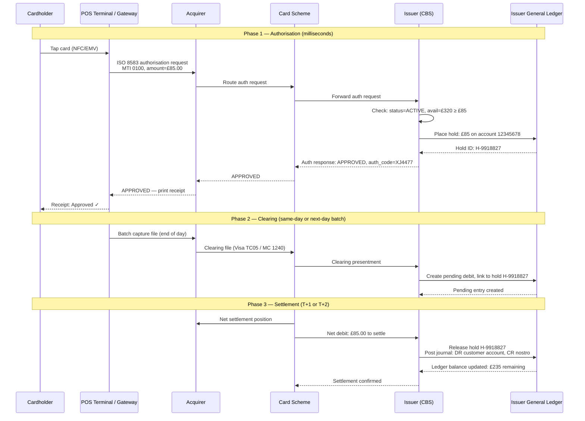
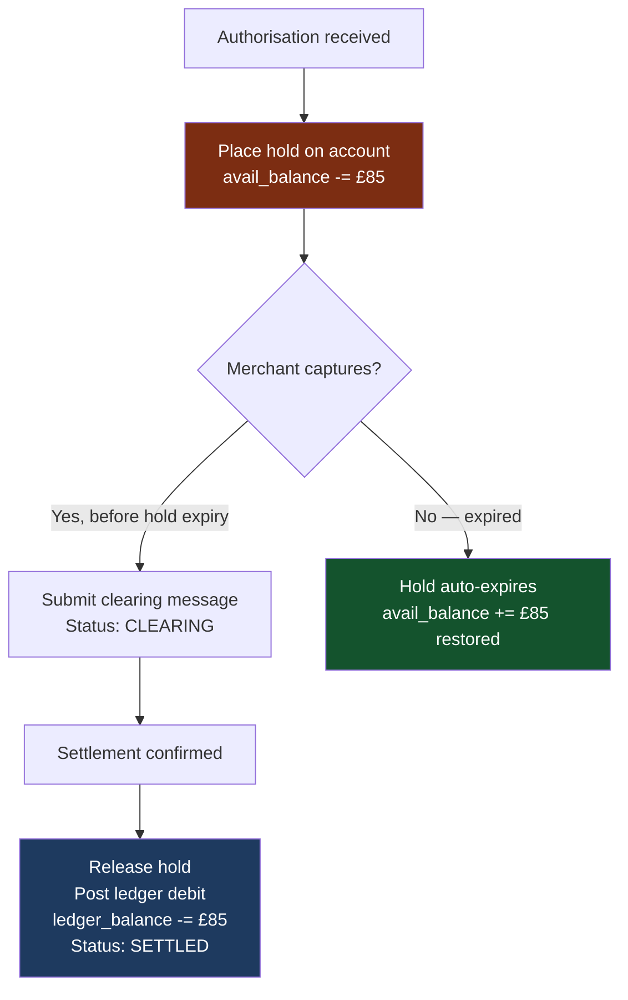

## Overview

Payment processing sits at the intersection of the core banking system and the external payment schemes that move money between banks. Every card swipe, contactless tap, or online checkout triggers a precisely choreographed sequence of messages spanning merchants, acquirers, card schemes, and issuing banks — often completing the visible authorisation in under 300 milliseconds while the actual money movement takes days. Understanding where authorisation ends and settlement begins, and what happens in between, is the foundation of every payment integration you will ever build.

## Learning Objectives

By the end of this lesson you will be able to:

- Distinguish authorisation, clearing, and settlement as distinct technical and financial phases
- Describe the roles of acquirer, issuer, and card scheme in a four-party model
- Trace a card payment end-to-end through the full lifecycle with timing at each stage
- Implement a `PaymentProcessor` service with correct status transition guards
- Explain the hold-and-release mechanism and its impact on available balance
- Compare T+0, T+1, and T+2 settlement cycles and their cash-flow implications
- Design reversal and refund flows as compensating journal entries
- Identify the failure modes at each stage and design for idempotent recovery

## Business Context

*Composite example (based on common industry failure patterns, not a specific company):* a neobank's payment processor failed to distinguish correctly between authorised-but-not-settled transactions and declined transactions during a database failover. When the system came back online, it replayed tens of thousands of authorisation messages — but the deduplication keys had been kept only in the failed node's in-memory cache, not in the database. The result: tens of thousands of customers were double-debited. The bank spent weeks issuing refunds, handled a flood of support contacts, paid compensation, and faced regulatory scrutiny of its systems and controls. The root cause was a missing idempotency key column (with a unique constraint) in the `payments` table and a state machine that did not validate prior states before transitions.

## Authorisation, Clearing, and Settlement: Three Different Things

Engineers new to payments routinely conflate these three terms. They are distinct financial and technical phases with different timing, different participants, and different system implications.

| Phase | What Happens | Who Is Involved | Time to Complete | Balance Impact |
|---|---|---|---|---|
| **Authorisation** | Issuer approves or declines the transaction | Merchant → Acquirer → Scheme → Issuer | Milliseconds to seconds | Available balance reduced (hold placed) |
| **Clearing** | Transaction details exchanged between banks | Acquirer → Scheme → Issuer | Same day to next day | Pending debit created |
| **Settlement** | Actual funds moved between banks | Central bank / scheme settlement | T+0 to T+2 | Ledger balance updated |

> [!IMPORTANT]
> Authorisation is a **promise**, not a payment. The issuer promises to pay the acquirer if the merchant submits a valid clearing message. Settlement is the actual transfer of funds. A transaction can be authorised but never cleared (the merchant never submits the capture), in which case the hold expires and the funds are released — no money ever moves.

### The Four-Party Model


- **Cardholder** — the individual making the payment
- **Merchant** — the business accepting payment; pays acquirer fees
- **Acquirer** — the bank that processes card payments on behalf of the merchant; bears settlement risk
- **Card Scheme** — Visa, Mastercard, Amex; sets rules, routes messages, manages clearing files; earns interchange
- **Issuer** — the bank that issued the card to the cardholder; approves/declines; bears credit/fraud risk

## Payment State Machine

A payment progresses through a well-defined set of states. Illegal transitions (e.g., going directly from `INITIATED` to `SETTLED` without clearing) indicate a system defect and must be rejected.



```java17
public enum PaymentStatus {
    INITIATED,
    AUTHORISED,
    CLEARING,
    SETTLED,
    CANCELLED,
    FAILED,
    REVERSED,
    PARTIALLY_REFUNDED,
    REFUNDED;

    // Allowed transitions — enforced before every status update
    private static final Map<PaymentStatus, Set<PaymentStatus>> ALLOWED_TRANSITIONS =
        Map.of(
            INITIATED,           Set.of(AUTHORISED, FAILED),
            AUTHORISED,          Set.of(CLEARING, REVERSED, CANCELLED),
            CLEARING,            Set.of(SETTLED, FAILED),
            SETTLED,             Set.of(REFUNDED, PARTIALLY_REFUNDED),
            PARTIALLY_REFUNDED,  Set.of(REFUNDED),
            CANCELLED,           Set.of(),
            FAILED,              Set.of(),
            REVERSED,            Set.of(),
            REFUNDED,            Set.of()
        );

    public boolean canTransitionTo(PaymentStatus next) {
        return ALLOWED_TRANSITIONS.getOrDefault(this, Set.of()).contains(next);
    }
}
```

## Card Payment End-to-End Sequence



## PaymentProcessor Service Implementation

```java17
@Service
@Transactional
public class PaymentProcessor {

    private final PaymentRepository paymentRepository;
    private final AccountHoldService holdService;
    private final LedgerService ledgerService;
    private final OutboxRepository outbox;

    /**
     * Step 1: Authorise — check funds, place hold, record authorisation.
     * Idempotent: a repeated idempotencyKey returns the existing payment.
     */
    public PaymentAuthorisationResult authorise(AuthorisationRequest request) {
        // Claim the key FIRST: INSERT ... ON CONFLICT (idempotency_key) DO NOTHING.
        // The UNIQUE constraint (not a find-then-save check) stops two
        // concurrent retries from both authorising.
        Optional<Payment> claimed = paymentRepository.claimIdempotencyKey(
            request.idempotencyKey(), request);   // empty → key already used
        if (claimed.isEmpty()) {
            Payment existing = paymentRepository.findByIdempotencyKeyOrThrow(request.idempotencyKey());
            return PaymentAuthorisationResult.alreadyProcessed(existing);
        }
        return processNewAuthorisation(claimed.get(), request);
    }

    private PaymentAuthorisationResult processNewAuthorisation(Payment payment, AuthorisationRequest req) {
        // Place hold — reduces available balance immediately.
        // place() must check-and-reserve ATOMICALLY in the database, e.g.
        // UPDATE accounts SET available = available - :amt WHERE id = :id AND available >= :amt
        Optional<HoldReference> hold = holdService.tryPlace(
            req.accountId(),
            req.amountMinorUnits(),
            req.currency(),
            payment.getId(),
            HoldReason.CARD_AUTHORISATION,
            // Hold validity depends on scheme rules and merchant type
            // (e.g. a few days for retail, much longer for hotels/car hire)
            Instant.now().plus(Duration.ofDays(7))
        );
        if (hold.isEmpty()) {
            payment.transitionTo(PaymentStatus.FAILED);
            payment.setDeclineReason("INSUFFICIENT_FUNDS");
            return PaymentAuthorisationResult.declined("INSUFFICIENT_FUNDS");
        }

        payment.setHoldId(hold.get().holdId());
        payment.transitionTo(PaymentStatus.AUTHORISED);
        payment.setAuthorisedAt(Instant.now());

        // Event via the outbox, in the same transaction: published only if
        // this transaction commits (a plain in-process event would fire
        // even if the transaction later rolls back)
        outbox.save(OutboxEvent.of(new PaymentAuthorisedEvent(payment.getId(),
            req.accountId(), req.amountMinorUnits(), req.currency())));

        return PaymentAuthorisationResult.approved(payment.getId(), hold.get().holdId());
    }

    /**
     * Step 2: Capture/Clear — transitions AUTHORISED → CLEARING.
     * The clearing message itself is sent by a relay from the outbox: never
     * call the scheme inside the database transaction (if the call succeeds
     * but the commit fails, the two systems disagree).
     */
    public void capture(String paymentId) {
        Payment payment = paymentRepository.findByIdForUpdateOrThrow(paymentId);

        if (!payment.getStatus().canTransitionTo(PaymentStatus.CLEARING)) {
            throw new IllegalStateTransitionException(payment.getStatus(), PaymentStatus.CLEARING);
        }

        payment.transitionTo(PaymentStatus.CLEARING);
        payment.setClearingSubmittedAt(Instant.now());
        outbox.save(OutboxEvent.of(new SubmitClearingCommand(payment.getId())));
    }

    /**
     * Step 3: Settle — called by the settlement reconciliation job.
     * Transitions CLEARING → SETTLED. Releases hold and posts ledger entries.
     * Idempotent: a settlement file may be processed twice.
     */
    public void settle(String paymentId, SettlementReference settlementRef) {
        Payment payment = paymentRepository.findByIdForUpdateOrThrow(paymentId);   // row lock

        if (payment.getStatus() == PaymentStatus.SETTLED) {
            return;   // already settled — duplicate settlement record, nothing to do
        }
        if (!payment.getStatus().canTransitionTo(PaymentStatus.SETTLED)) {
            throw new IllegalStateTransitionException(payment.getStatus(), PaymentStatus.SETTLED);
        }

        // Release hold — no longer needed after settlement
        holdService.release(payment.getHoldId());

        // Post definitive ledger entries (DR customer account, CR scheme
        // settlement account) — keyed by payment id so a retry cannot post twice
        ledgerService.postDebit(
            payment.getAccountId(),
            payment.getAmountMinorUnits(),
            payment.getCurrency(),
            "SETTLEMENT:" + settlementRef.referenceId(),
            payment.getId()
        );

        payment.transitionTo(PaymentStatus.SETTLED);
        payment.setSettledAt(Instant.now());
        payment.setSettlementReference(settlementRef.referenceId());

        outbox.save(OutboxEvent.of(new PaymentSettledEvent(payment.getId(),
            payment.getAccountId(), payment.getAmountMinorUnits())));
    }
}
```

> [!WARNING]
> Never update the ledger balance at authorisation time for card payments. The hold on available balance is sufficient. Only post the definitive ledger entry at settlement. If you debit the ledger at authorisation and the merchant never captures, you must post a compensating credit — creating unnecessary accounting noise and risk of inconsistency.

## Hold-and-Release Flow

The hold mechanism is what allows available balance to reflect pending card authorisations without touching the ledger. It is a reservation system layered on top of the ledger.



```java17
// Payment entity — balance impact summary at each state
public record PaymentBalanceImpact(
    PaymentStatus status,
    long availableBalanceDelta,  // Negative = reduction
    long ledgerBalanceDelta       // Negative = reduction
) {
    public static PaymentBalanceImpact forStatus(PaymentStatus status, long amount) {
        return switch (status) {
            case AUTHORISED          -> new PaymentBalanceImpact(status, -amount, 0);
            case REVERSED, CANCELLED -> new PaymentBalanceImpact(status, +amount, 0);  // Hold released
            case SETTLED             -> new PaymentBalanceImpact(status, 0, -amount);  // Hold→Ledger
            case REFUNDED            -> new PaymentBalanceImpact(status, 0, +amount);  // Credit back
            // (a partial refund credits only the refunded amount)
            default                  -> new PaymentBalanceImpact(status, 0, 0);
        };
    }
}
```

## Settlement Timing: T+0, T+1, and T+2

Settlement timing varies dramatically by payment scheme. This has real cash-flow consequences for merchants and systemic risk implications for banks.

| Scheme | Settlement Cycle | Mechanism | Finality |
|---|---|---|---|
| **CHAPS (UK)** | T+0 (same day, intraday) | RTGS — individual settlement | Irrevocable |
| **Faster Payments (UK)** | T+0 (seconds) | Deferred net settlement (DNS) | Near-immediate |
| **Visa / Mastercard (UK)** | T+1 (next business day after clearing) | Net settlement via each scheme's settlement service | End of day |
| **BACS (UK)** | T+2 (3-day cycle: input day, processing day, entry day) | Deferred net settlement | Day 3 of the cycle |
| **SEPA Credit Transfer** | T+1 (or instant via SCT Inst) | DNS or RTGS | Day 1 / instant |
| **ACH (US)** | T+0 (Same Day ACH) to T+1 | Batch DNS | Same day or next day |

> [!NOTE]
> "T+1" means the next **business** day. A Visa payment authorised on a Friday evening settles on Monday. The merchant's acquirer does not receive funds until Monday. This creates multi-day counterparty exposure — the scheme guarantees payment, but the guarantee spans a weekend.

```java17
// Settlement timing calculator
public enum PaymentScheme {
    CHAPS, FASTER_PAYMENTS, VISA, MASTERCARD, BACS, SEPA_CT, SEPA_INST, ACH_US;

    public LocalDate expectedSettlementDate(LocalDate submissionDate, BusinessCalendar cal) {
        return switch (this) {
            case CHAPS, FASTER_PAYMENTS, SEPA_INST -> submissionDate; // T+0
            case VISA, MASTERCARD, SEPA_CT, ACH_US -> cal.addBusinessDays(submissionDate, 1); // T+1
            case BACS                              -> cal.addBusinessDays(submissionDate, 2); // day 3 of the cycle
        };
    }
}
```

## Reversals and Refunds

An **authorisation reversal** cancels an authorisation before it is captured: the hold is released and no money ever moves. A **refund** returns money after settlement by posting a compensating credit — the original transaction is never deleted. (A **chargeback**, by contrast, is the card scheme's dispute process, started by the cardholder's issuer.)

```java17
@Service
@Transactional
public class PaymentReversalService {

    private final PaymentRepository paymentRepository;
    private final AccountHoldService holdService;
    private final LedgerService ledgerService;

    /**
     * Authorisation reversal — only valid while the payment is AUTHORISED
     * (not yet captured). Releases the hold; no ledger entry is needed
     * because none was posted at authorisation. Once a capture has been sent
     * to the scheme, the money will move: use refund() after settlement.
     */
    public void reverse(String paymentId, String reason) {
        Payment payment = paymentRepository.findByIdForUpdateOrThrow(paymentId);

        if (payment.getStatus() != PaymentStatus.AUTHORISED) {
            throw new InvalidOperationException(
                "Cannot reverse payment in status: " + payment.getStatus() +
                ". Use refund() once the payment has settled.");
        }

        holdService.release(payment.getHoldId());

        payment.transitionTo(PaymentStatus.REVERSED);
        payment.setReversedAt(Instant.now());
        payment.setReversalReason(reason);
        paymentRepository.save(payment);
    }

    /**
     * Post-settlement refund — only valid when status is SETTLED or PARTIALLY_REFUNDED.
     * Posts a credit journal entry — the original debit remains for audit trail.
     */
    public RefundResult refund(String paymentId, long refundAmountMinorUnits,
                               String reason, String refundIdempotencyKey) {
        // Row lock: two concurrent partial refunds must not both pass the check
        Payment payment = paymentRepository.findByIdForUpdateOrThrow(paymentId);

        if (!Set.of(PaymentStatus.SETTLED, PaymentStatus.PARTIALLY_REFUNDED)
                .contains(payment.getStatus())) {
            throw new InvalidOperationException("Cannot refund payment in status: " + payment.getStatus());
        }

        long alreadyRefunded = payment.getTotalRefundedMinorUnits();
        long maxRefundable   = payment.getAmountMinorUnits() - alreadyRefunded;

        if (refundAmountMinorUnits <= 0 || refundAmountMinorUnits > maxRefundable) {
            throw new InvalidOperationException(
                "Refund amount %d outside refundable range 1..%d"
                    .formatted(refundAmountMinorUnits, maxRefundable));
        }

        // Credit the customer's account. The refund's own idempotency key
        // (supplied by the caller and reused on retry) makes the posting safe
        // to repeat — a random UUID here would post again on every retry
        ledgerService.postCredit(
            payment.getAccountId(),
            refundAmountMinorUnits,
            payment.getCurrency(),
            "REFUND:ORIG:" + paymentId,
            refundIdempotencyKey
        );

        payment.addRefund(refundAmountMinorUnits, reason, Instant.now());

        PaymentStatus nextStatus = (payment.getTotalRefundedMinorUnits() == payment.getAmountMinorUnits())
            ? PaymentStatus.REFUNDED
            : PaymentStatus.PARTIALLY_REFUNDED;

        if (nextStatus != payment.getStatus()) {
            payment.transitionTo(nextStatus);   // a second partial refund stays PARTIALLY_REFUNDED
        }
        paymentRepository.save(payment);

        return new RefundResult(paymentId, refundAmountMinorUnits, nextStatus);
    }
}
```

> [!IMPORTANT]
> Never delete or update the original payment record when processing a refund. The original debit and the compensating credit are separate journal entries — both must remain in the ledger for audit trail, reconciliation, and regulatory reporting. Regulators require the full chain of entries, not a net zero.

---

<!-- KNOWLEDGE-CHECK [
  {
    "id": "kc-pp-01",
    "question": "A customer authorises a £120 payment at a hotel (pre-authorisation). Three days later the hotel charges £95 at checkout. What happens to the remaining £25?",
    "options": [
      "The £25 is permanently lost — pre-authorisations must match the final amount exactly",
      "The original £120 hold expires; the hotel submits a new clearing message for £95; a £95 hold is then placed",
      "The original £120 hold is released at settlement; a £95 debit posts to the ledger; available balance is restored by £25",
      "The hotel must issue a £25 refund before the settlement can process"
    ],
    "correct": 2,
    "explanation": "In a hotel pre-auth flow: the £120 hold reduces available balance immediately. When the hotel submits the final charge of £95, settlement releases the full £120 hold and posts a definitive ledger debit of £95. The customer's available balance is restored by £25 (the difference between the hold and the settled amount). The hold was always a maximum reservation — settlement determines the actual amount."
  },
  {
    "id": "kc-pp-02",
    "question": "A customer returns goods bought with a Visa card two days ago, and the merchant agrees to give the money back. The payment has already settled. Should the system use an authorisation reversal or a refund, and why?",
    "options": [
      "Reversal — it undoes the original transaction cleanly with no extra accounting entries",
      "Refund — the payment has already settled; you must post a compensating credit entry",
      "Either — they are functionally equivalent once a payment has settled",
      "Neither — settled transactions can only be returned through the card scheme chargeback process"
    ],
    "correct": 1,
    "explanation": "An authorisation reversal is only valid before capture (status AUTHORISED): it releases the hold and no money moves. Once a payment is SETTLED, the ledger entry is final. The correct mechanism is a refund, which posts a compensating credit entry; both the original debit and the credit remain in the ledger for audit. A chargeback is different: it is the scheme's dispute process, started by the cardholder's issuer when the merchant does NOT agree to return the money."
  }
] -->

---

<!-- PRACTICAL-CHALLENGE {
  "id": "pc-payment-processing",
  "title": "Payment Processing: State Machine and Settlement Design",
  "description": "Implement the core components of a card payment processor with correct state transitions and balance management.",
  "tasks": [
    {
      "id": "pc-pp-01",
      "description": "Design a SQL schema for a `payments` table that captures: idempotency_key (with a UNIQUE constraint), status, amount_minor_units, currency, account_id, hold_id (FK), settlement_reference, decline_reason, and all timestamp fields (created, authorised, clearing_submitted, settled, reversed). Add a check constraint ensuring amount_minor_units > 0."
    },
    {
      "id": "pc-pp-02",
      "description": "Implement the `PaymentStatus.canTransitionTo(PaymentStatus next)` method as a Java 17 enum with the full allowed-transitions map. Write a unit test that verifies: AUTHORISED → CLEARING is allowed; AUTHORISED → REVERSED is allowed; SETTLED → AUTHORISED is rejected; FAILED → SETTLED is rejected."
    },
    {
      "id": "pc-pp-03",
      "description": "Extend the `PaymentProcessor.authorise()` method to handle insufficient available balance. It should return `PaymentAuthorisationResult.declined(reason)` rather than throwing an exception, record the payment as FAILED with the decline reason (declines must be auditable), and must NOT place a hold. The funds check and the hold must be one atomic database operation."
    },
    {
      "id": "pc-pp-04",
      "description": "Design a settlement reconciliation job that processes a batch settlement file from the card scheme. For each settled payment reference in the file: look up the payment, call settle(), and handle three edge cases: (a) payment not found, (b) payment already settled (idempotent), (c) payment in FAILED status."
    }
  ]
} -->
