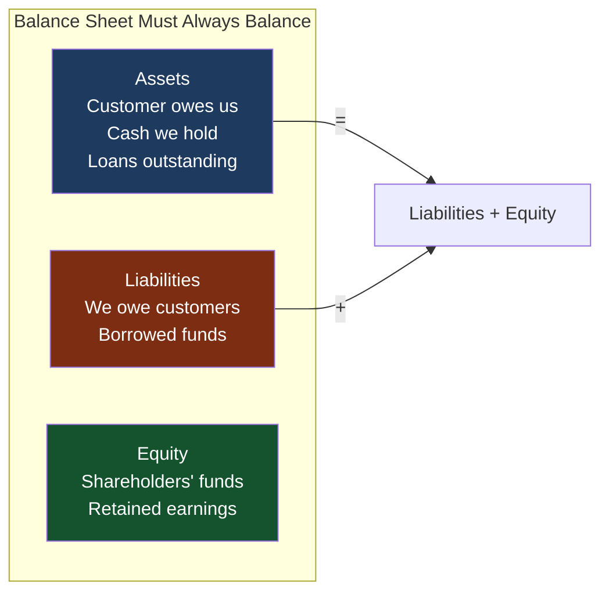

# المحاسبة بالقيد المزدوج — دفتر الأستاذ العام في الأنظمة البنكية

## نظرة عامة

كل نظام مالي مبني فوق نظام بنكي أساسي يكتب في النهاية في دفتر الأستاذ العام. ودفتر الأستاذ العام ليس جدول قاعدة بيانات — بل بنية محاسبية تحكمها قواعد لم تتغير منذ أن صاغها لوكا باتشولي عام 1494. وهذه القواعد — المحاسبة بالقيد المزدوج — هي ما يجعل النظام المالي قابلًا للتحقق: فأي خطأ ينشئ قيمة أو يتلفها يترك أثرًا رياضيًا. وبصفتك مهندسًا رئيسيًا يصمم أنظمة بنكية، يجب أن تفهم القيد المزدوج بعمق كافٍ لمراجعة تصاميم المخططات، وتدقيق تنفيذات الخدمات، والتعرف فورًا على أي تغيير مقترح سينتهك الثابت القائل إن مجموع كل المدين يجب أن يساوي دائمًا مجموع كل الدائن.

## أهداف التعلم

في نهاية هذا الدرس ستستطيع:

- شرح معادلة المحاسبة ولماذا يجب أن تصح دائمًا في النظام المالي
- تطبيق قواعد المدين والدائن بشكل صحيح على حسابات الأصول، والالتزامات، وحقوق الملكية، والإيرادات، والمصروفات
- تصميم مخطط SQL للقيود اليومية ودليل الحسابات يفرض توازن القيود على مستوى قاعدة البيانات
- تنفيذ خدمة `JournalEntryService` ترحّل قيودًا يومية متوازنة ذريًا مع القفل المتفائل
- كتابة استعلام SQL لميزان المراجعة وشرح ما يثبته
- تنفيذ فاحص ثابت توازن بلغة Java يعمل كضابط أمان في نهاية اليوم
- شرح لماذا يُعد الحساب بالأعداد الصحيحة (long) بالوحدات الصغرى للعملة إلزاميًا، وما الذي يخطئ مع الفاصلة العائمة

## سياق العمل

*مثال مركّب (مبني على أنماط فشل شائعة في الصناعة، لا على شركة بعينها):* كانت شركة مدفوعات ناشئة تجمع جولة تمويل جديدة بناءً على أرصدة عملائها المعلنة. وأثناء الفحص النافي للجهالة، شغّل مدير مالي جديد استعلام ميزان المراجعة لأول مرة في تاريخ الشركة. فأظهر فرقًا بمئات آلاف اليوروهات — إجمالي الدائن يتجاوز إجمالي المدين. وكشف التحقيق أن المبالغ المستردة نُفّذت على أنها "تعديل رصيد" يضيف إلى حساب العميل دون ترحيل خصم مقابل في أي مكان. وعلى مدى أشهر عولج أكثر من ألف استرداد بهذه الطريقة، كل منها ينشئ مالًا وهميًا. فكانت أرصدة العملاء الحقيقية أقل من المعلنة، وأُغلقت الجولة بتقييم أقل، ودفع المؤسسون ثمن هذا الاختصار من حصصهم. وخدمة `JournalEntryService` ترفض القيود غير المتوازنة كانت ستكتشف أول حالة.

## معادلة المحاسبة

يقوم بناء المحاسبة المالية كله على معادلة واحدة:

```
Assets = Liabilities + Equity
```

وفي البنك تصح هذه المعادلة دائمًا:

- **الأصول**: النقد المحتفظ به، والقروض للعملاء، والودائع بين البنوك، والأوراق المالية
- **الالتزامات**: ودائع العملاء، والاقتراض من بنوك أخرى
- **حقوق الملكية**: أموال المساهمين، والأرباح المحتجزة

تحفظ كل معاملة هذه المعادلة بلمس حسابين على الأقل في الوقت نفسه. وهذا معنى "القيد المزدوج": لكل مدين دائن مقابل بالقيمة نفسها.



### آلية حساب T

حساب T هو التمثيل المرئي لجانبي المدين والدائن في الحساب:

```
              Customer Current Account (Liability)
              ┌─────────────────┬─────────────────┐
              │     DEBIT       │     CREDIT       │
              ├─────────────────┼─────────────────┤
              │ Withdrawals     │ Deposits         │
              │ Card payments   │ Incoming xfers   │
              │ Bank charges    │ Interest paid    │
              ├─────────────────┼─────────────────┤
              │ Total Debits    │ Total Credits    │
              │ Decreases       │ Increases        │
              └─────────────────┴─────────────────┘
              Normal balance side: CREDIT (liability)
```

## قواعد المدين والدائن حسب نوع الحساب

هذا الجدول أهم ما يجب حفظه. فلكلمتي "مدين" و"دائن" أثران متعاكسان حسب نوع الحساب:

| نوع الحساب | الرصيد الطبيعي | أثر المدين | أثر الدائن | أمثلة حسابات |
|---|---|---|---|---|
| **الأصول** | مدين | يزيد | ينقص | النقد، والقروض، وحسابات نوسترو |
| **الالتزامات** | دائن | ينقص | يزيد | ودائع العملاء، والاقتراض |
| **حقوق الملكية** | دائن | ينقص | يزيد | رأس المال، والأرباح المحتجزة |
| **الإيرادات** | دائن | ينقص | يزيد | إيرادات الفوائد، وإيرادات الرسوم |
| **المصروفات** | مدين | يزيد | ينقص | مصروف الفوائد، وتكاليف الموظفين |

> [!WARNING]
> عبارة "المدين يعني الزيادة" **خاطئة لمعظم أنواع الحسابات**. فالمدين يزيد الأصول والمصروفات، لكنه *ينقص* الالتزامات وحقوق الملكية والإيرادات. ويقع كثير من المهندسين في هذا الخطأ فينتجون دفاتر معكوسة.

### مثال ملموس: إيداع عميل

يودع عميل 500 جنيه نقدًا:

```
Entry: Customer Deposits £500
─────────────────────────────────────────────────────
DR  Cash / Nostro Account         £500   (Asset ↑)
CR  Customer Current Account      £500   (Liability ↑)
─────────────────────────────────────────────────────
Net effect: Total debits = Total credits = £500 ✓
```

يسحب عميل 200 جنيه:

```
Entry: Customer Withdraws £200
─────────────────────────────────────────────────────
DR  Customer Current Account      £200   (Liability ↓)
CR  Cash / Nostro Account         £200   (Asset ↓)
─────────────────────────────────────────────────────
Net effect: Total debits = Total credits = £200 ✓
```

## مخطط دليل الحسابات

يعرّف دليل الحسابات (Chart of Accounts) كل حساب يعرفه دفتر الأستاذ العام. وهو هرمي: فئات الحسابات ← مجموعات الحسابات ← الحسابات الفردية.

```sql
-- Chart of accounts hierarchy
CREATE TABLE account_categories (
    id          SERIAL PRIMARY KEY,
    code        VARCHAR(10)  NOT NULL UNIQUE,  -- 'ASSET', 'LIABILITY', 'EQUITY', 'INCOME', 'EXPENSE'
    name        VARCHAR(100) NOT NULL,
    normal_balance  VARCHAR(6) NOT NULL        -- 'DEBIT' or 'CREDIT'
        CHECK (normal_balance IN ('DEBIT', 'CREDIT'))
);

CREATE TABLE chart_of_accounts (
    id              SERIAL PRIMARY KEY,
    account_code    VARCHAR(20)   NOT NULL UNIQUE,  -- e.g. '1001', '2001.001'
    account_name    VARCHAR(200)  NOT NULL,
    category_id     INT           NOT NULL REFERENCES account_categories(id),
    parent_code     VARCHAR(20)   REFERENCES chart_of_accounts(account_code),
    currency        CHAR(3)       NOT NULL DEFAULT 'GBP',
    is_active       BOOLEAN       NOT NULL DEFAULT TRUE,
    allows_manual   BOOLEAN       NOT NULL DEFAULT FALSE,  -- Can manual journals post here?
    description     TEXT,
    created_at      TIMESTAMPTZ   NOT NULL DEFAULT now()
);

-- Seed account categories
INSERT INTO account_categories (code, name, normal_balance) VALUES
  ('ASSET',     'Assets',              'DEBIT'),
  ('LIABILITY', 'Liabilities',         'CREDIT'),
  ('EQUITY',    'Equity',              'CREDIT'),
  ('INCOME',    'Income / Revenue',    'CREDIT'),
  ('EXPENSE',   'Expenses',            'DEBIT');

-- Example chart of accounts entries
INSERT INTO chart_of_accounts (account_code, account_name, category_id, currency) VALUES
  ('1000',      'Cash and Central Bank Reserves',         1, 'GBP'),
  ('1001',      'Nostro — Bank of England Settlement',    1, 'GBP'),
  ('1100',      'Loans to Customers',                     1, 'GBP'),
  ('2000',      'Customer Deposits — Current Accounts',   2, 'GBP'),
  ('2001',      'Customer Deposits — Savings Accounts',   2, 'GBP'),
  ('2100',      'Interbank Borrowings',                   2, 'GBP'),
  ('3000',      'Share Capital',                          3, 'GBP'),
  ('3100',      'Retained Earnings',                      3, 'GBP'),
  ('4000',      'Interest Income',                        4, 'GBP'),
  ('4100',      'Fee and Commission Income',              4, 'GBP'),
  ('5000',      'Interest Expense',                       5, 'GBP'),
  ('5100',      'Operating Expenses',                     5, 'GBP'),
  ('9000',      'Suspense Account',                       2, 'GBP');  -- Items investigated and cleared daily
```

## مخطط DDL للقيود اليومية

يتكون القيد اليومي من رأس (المعاملة) وسطرين أو أكثر (المدين والدائن). ويجب أن يفرض المخطط توازن القيود.

```sql
-- Journal entry header
CREATE TABLE journal_entries (
    id              UUID         PRIMARY KEY DEFAULT gen_random_uuid(),
    reference       VARCHAR(100) NOT NULL UNIQUE,  -- Human-readable ref: 'JNL-2026-001234'
    description     TEXT         NOT NULL,
    business_date   DATE         NOT NULL,
    entry_type      VARCHAR(50)  NOT NULL,  -- 'PAYMENT', 'REFUND', 'INTEREST', 'FEE', 'MANUAL'
    source_system   VARCHAR(50)  NOT NULL,  -- 'PAYMENT_PROCESSOR', 'INTEREST_ENGINE', etc.
    source_ref      VARCHAR(100),           -- e.g. payment ID, interest batch ID
    status          VARCHAR(20)  NOT NULL DEFAULT 'POSTED'
        CHECK (status IN ('PENDING', 'POSTED', 'REVERSED')),
    reversal_of     UUID         REFERENCES journal_entries(id),
    posted_by       VARCHAR(100) NOT NULL,
    posted_at       TIMESTAMPTZ  NOT NULL DEFAULT now(),
    created_at      TIMESTAMPTZ  NOT NULL DEFAULT now()
);

-- Journal entry lines — each line is one debit or credit leg
CREATE TABLE journal_entry_lines (
    id              BIGSERIAL    PRIMARY KEY,
    journal_id      UUID         NOT NULL REFERENCES journal_entries(id),
    line_number     SMALLINT     NOT NULL,
    account_code    VARCHAR(20)  NOT NULL REFERENCES chart_of_accounts(account_code),
    side            CHAR(2)      NOT NULL CHECK (side IN ('DR', 'CR')),
    amount          BIGINT       NOT NULL CHECK (amount > 0),  -- Minor units; always positive
    currency        CHAR(3)      NOT NULL,
    description     TEXT,
    UNIQUE (journal_id, line_number)
);

-- Database-level constraint: sum of DR lines must equal sum of CR lines.
-- A CHECK constraint cannot see other rows, so it is enforced in the
-- application layer — and can be backed up in PostgreSQL by a DEFERRABLE
-- INITIALLY DEFERRED constraint trigger that checks each journal at COMMIT

-- One journal per source event: a retried posting cannot create a duplicate
CREATE UNIQUE INDEX ux_je_source ON journal_entries (source_system, source_ref)
    WHERE source_ref IS NOT NULL;
-- Index for balance queries
CREATE INDEX idx_jel_account_date
    ON journal_entry_lines (account_code, currency)
    INCLUDE (side, amount);

CREATE INDEX idx_je_business_date ON journal_entries (business_date);
CREATE INDEX idx_je_source_ref    ON journal_entries (source_ref) WHERE source_ref IS NOT NULL;
```

لا يستطيع قيد CHECK رؤية الصفوف الأخرى، لذا يُفرض التوازن في طبقة التطبيق — ويمكن دعمه في PostgreSQL بمشغّل قيد مؤجل (`DEFERRABLE INITIALLY DEFERRED`) يفحص كل قيد عند الالتزام. ويضمن فهرس فريد على (`source_system`, `source_ref`) قيدًا واحدًا لكل حدث مصدر، فلا تنشئ إعادة محاولة الترحيل قيدًا مكررًا.

> [!NOTE]
> المبالغ في أسطر القيود قيم `BIGINT` **موجبة** دائمًا. ويحمل العمود `side` (`DR`/`CR`) دلالة الإشارة. وهذا يتجنب غموض الأرقام السالبة في الأنظمة المحاسبية — فالمدين السالب ليس هو نفسه الدائن الموجب في كل السياقات.

## JournalEntryService — ترحيل متوازن ذري

```java17
@Service
@Transactional(isolation = Isolation.READ_COMMITTED)
public class JournalEntryService {

    private final JournalEntryRepository journalRepo;
    private final JournalEntryLineRepository lineRepo;
    private final ChartOfAccountsRepository coaRepo;

    /**
     * Post a journal entry atomically. Validates:
     * 1. All account codes exist and are active
     * 2. At least two lines (one DR, one CR)
     * 3. Sum of DR amounts == Sum of CR amounts (balanced)
     * 4. All lines use the same currency
     * Throws InvalidJournalEntryException on any violation.
     */
    public JournalEntry post(PostJournalEntryCommand cmd) {
        validateEntry(cmd);

        JournalEntry entry = JournalEntry.builder()
            .id(UUID.randomUUID())
            .reference(generateReference(cmd.businessDate()))
            .description(cmd.description())
            .businessDate(cmd.businessDate())
            .entryType(cmd.entryType())
            .sourceSystem(cmd.sourceSystem())
            .sourceRef(cmd.sourceRef())
            .status(JournalStatus.POSTED)
            .postedBy(cmd.postedBy())
            .postedAt(Instant.now())
            .build();

        journalRepo.save(entry);

        List<JournalEntryLine> lines = new ArrayList<>();
        for (int i = 0; i < cmd.lines().size(); i++) {
            PostJournalEntryCommand.Line l = cmd.lines().get(i);
            lines.add(JournalEntryLine.builder()
                .journalId(entry.getId())
                .lineNumber(i + 1)
                .accountCode(l.accountCode())
                .side(l.side())
                .amount(l.amountMinorUnits())
                .currency(l.currency())
                .description(l.description())
                .build());
        }
        lineRepo.saveAll(lines);

        return entry;
    }

    private void validateEntry(PostJournalEntryCommand cmd) {
        if (cmd.lines().size() < 2) {
            throw new InvalidJournalEntryException("Journal entry must have at least 2 lines");
        }

        // All currencies must match
        Set<String> currencies = cmd.lines().stream()
            .map(PostJournalEntryCommand.Line::currency)
            .collect(Collectors.toSet());
        if (currencies.size() > 1) {
            throw new InvalidJournalEntryException(
                "Multi-currency entries not supported. Use separate entries per currency. Found: " + currencies);
        }

        // All account codes must exist and be active
        cmd.lines().forEach(line -> {
            ChartOfAccount coa = coaRepo.findByCode(line.accountCode())
                .orElseThrow(() -> new InvalidJournalEntryException(
                    "Unknown account code: " + line.accountCode()));
            if (!coa.isActive()) {
                throw new InvalidJournalEntryException(
                    "Account is not active: " + line.accountCode());
            }
        });

        // The critical invariant: sum(DR) must equal sum(CR)
        long totalDebits = cmd.lines().stream()
            .filter(l -> l.side() == Side.DR)
            .mapToLong(PostJournalEntryCommand.Line::amountMinorUnits)
            .sum();

        long totalCredits = cmd.lines().stream()
            .filter(l -> l.side() == Side.CR)
            .mapToLong(PostJournalEntryCommand.Line::amountMinorUnits)
            .sum();

        if (totalDebits != totalCredits) {
            throw new InvalidJournalEntryException(
                "Entry is unbalanced: DR total=%d, CR total=%d, difference=%d"
                    .formatted(totalDebits, totalCredits, totalDebits - totalCredits));
        }
    }

    /**
     * Post a reversal of an existing entry. Creates mirror-image lines (DR↔CR swapped).
     */
    public JournalEntry reverse(UUID originalEntryId, String reason, String reversedBy) {
        // Row lock: two concurrent reversals of the same entry must not both pass
        JournalEntry original = journalRepo.findByIdForUpdateOrThrow(originalEntryId);

        if (original.getStatus() != JournalStatus.POSTED) {
            throw new InvalidOperationException(
                "Can only reverse POSTED entries; current status: " + original.getStatus());
        }

        List<JournalEntryLine> originalLines = lineRepo.findByJournalId(originalEntryId);

        // Build reversal command — swap DR and CR on every line
        List<PostJournalEntryCommand.Line> reversalLines = originalLines.stream()
            .map(l -> new PostJournalEntryCommand.Line(
                l.getAccountCode(),
                l.getSide() == Side.DR ? Side.CR : Side.DR,  // Swap sides
                l.getAmount(),
                l.getCurrency(),
                "REVERSAL: " + l.getDescription()))
            .toList();

        PostJournalEntryCommand reversalCmd = PostJournalEntryCommand.builder()
            .description("Reversal of " + original.getReference() + ": " + reason)
            .businessDate(businessCalendar.today())   // the BUSINESS date, not the wall clock
            .entryType(original.getEntryType())
            .sourceSystem(original.getSourceSystem())
            .sourceRef("REV:" + original.getSourceRef())
            .postedBy(reversedBy)
            .lines(reversalLines)
            .build();

        JournalEntry reversal = post(reversalCmd);
        reversal.setReversalOf(original.getId());   // link the reversal to what it reverses
        journalRepo.save(reversal);

        // Mark the original as reversed. Its LINES stay in the ledger: balance
        // queries must include REVERSED entries too, otherwise the reversal
        // would be counted without the original
        original.setStatus(JournalStatus.REVERSED);
        journalRepo.save(original);

        return reversal;
    }
}
```

يُقفل القيد الأصلي في العكس حتى لا يجتاز عكسان متزامنان الفحص معًا، ويُستخدم تاريخ **العمل** لا ساعة الحائط، ويُربط القيد العاكس بالأصلي عبر `reversalOf`. وتبقى أسطر القيد الأصلي في الدفتر: فيجب أن تشمل استعلامات الأرصدة القيود REVERSED أيضًا، وإلا حُسب العكس دون الأصل.

## استعلام ميزان المراجعة

يثبت ميزان المراجعة أن دفتر الأستاذ العام متوازن — إجمالي المدين يساوي إجمالي الدائن عبر كل الحسابات.

```sql
-- Trial balance for a given business date (cumulative from inception to that date)
-- For each account: net balance = sum(DR amounts) - sum(CR amounts)
-- If normal balance is DEBIT, a positive net = debit balance (expected for assets/expenses)
-- Every journal that has been POSTED counts — including ones later REVERSED,
-- because their reversal entries are counted too. Only PENDING is excluded.

WITH ledger_lines AS (
    SELECT jel.account_code, jel.side, jel.amount
    FROM journal_entry_lines jel
    JOIN journal_entries je ON je.id = jel.journal_id
    WHERE je.status IN ('POSTED', 'REVERSED')
      AND je.business_date <= :asOfDate
      AND jel.currency = :currency
),
account_balances AS (
    SELECT
        coa.account_code,
        coa.account_name,
        ac.code                                        AS category,
        ac.normal_balance,
        COALESCE(SUM(CASE WHEN l.side = 'DR' THEN l.amount ELSE 0 END), 0) AS total_debits,
        COALESCE(SUM(CASE WHEN l.side = 'CR' THEN l.amount ELSE 0 END), 0) AS total_credits,
        COALESCE(SUM(CASE WHEN l.side = 'DR' THEN l.amount ELSE -l.amount END), 0) AS net_balance
    FROM chart_of_accounts coa
    JOIN account_categories ac ON coa.category_id = ac.id
    -- Filtering the lines in the CTE (not in a LEFT JOIN's ON clause) makes
    -- sure lines of PENDING or later-dated journals are really excluded.
    -- No is_active filter: a closed account can still hold a balance
    LEFT JOIN ledger_lines l ON l.account_code = coa.account_code
    GROUP BY coa.account_code, coa.account_name, ac.code, ac.normal_balance
)
SELECT
    account_code,
    account_name,
    category,
    total_debits,
    total_credits,
    net_balance,
    CASE normal_balance
        WHEN 'DEBIT'  THEN net_balance           -- Assets/Expenses: DR balance is positive
        WHEN 'CREDIT' THEN -net_balance           -- Liabilities/Equity/Income: CR balance is positive
    END AS normal_direction_balance
FROM account_balances
ORDER BY account_code;

-- Summary row — this must be zero for the ledger to balance
-- SELECT SUM(total_debits) - SUM(total_credits) AS imbalance FROM account_balances;
-- If imbalance != 0, there is a bug in the posting code.
```

تُرشَّح الأسطر في تعبير CTE (لا في شرط `ON` لربط LEFT JOIN) لضمان استبعاد أسطر القيود المعلقة أو المؤرخة لاحقًا فعلًا. ولا يوجد ترشيح على `is_active`: فالحساب المغلق قد يحمل رصيدًا.

## فحص ثابت التوازن في Java

```java17
@Service
public class LedgerIntegrityService {

    private final JdbcTemplate jdbc;
    private final AlertService alertService;
    private final BusinessCalendar businessCalendar;

    /**
     * Run at end-of-day. If the ledger is unbalanced, this is a P0 incident.
     * The imbalance means money was created or destroyed somewhere in the system.
     * Checked per currency: amounts in different currencies cannot be added.
     */
    @Scheduled(cron = "0 0 23 * * MON-FRI")
    public void runEndOfDayBalanceCheck() {
        LocalDate businessDate = businessCalendar.today();

        jdbc.query(
            """
            SELECT jel.currency,
                   COALESCE(SUM(CASE WHEN side = 'DR' THEN amount ELSE 0 END), 0) AS total_dr,
                   COALESCE(SUM(CASE WHEN side = 'CR' THEN amount ELSE 0 END), 0) AS total_cr
            FROM journal_entry_lines jel
            JOIN journal_entries je ON je.id = jel.journal_id
            WHERE je.status IN ('POSTED', 'REVERSED')
              AND je.business_date <= ?
            GROUP BY jel.currency
            """,
            rs -> {
                // getLong() converts PostgreSQL's NUMERIC sum safely
                String currency = rs.getString("currency");
                long totalDr = rs.getLong("total_dr");
                long totalCr = rs.getLong("total_cr");
                long imbalance = totalDr - totalCr;

                if (imbalance != 0) {
                    // This is a critical financial integrity failure
                    alertService.raiseCriticalAlert(LedgerImbalanceAlert.builder()
                        .businessDate(businessDate)
                        .currency(currency)
                        .totalDebits(totalDr)
                        .totalCredits(totalCr)
                        .imbalanceMinorUnits(imbalance)
                        .detectedAt(Instant.now())
                        .severity(AlertSeverity.P0)
                        .message("LEDGER IMBALANCE DETECTED in %s: %,d minor units. Immediate investigation required."
                            .formatted(currency, Math.abs(imbalance)))
                        .build());
                    log.error("CRITICAL: Ledger imbalance of {} {} minor units for business date {}",
                        imbalance, currency, businessDate);
                } else {
                    log.info("Ledger balance check PASSED for {} {}: DR=CR={}", businessDate, currency, totalDr);
                }
            },
            businessDate
        );
    }
}
```

يُفحص التوازن لكل عملة على حدة: فالمبالغ بعملات مختلفة لا تُجمع. ويحوّل `getLong()` مجموع NUMERIC في PostgreSQL بأمان.

```java21
// Java 21 record for a trial balance line — immutable value type
public record TrialBalanceLine(
    String accountCode,
    String accountName,
    String category,
    String normalBalance,
    long totalDebits,
    long totalCredits,
    long netBalance
) {
    public boolean isBalanced() {
        return totalDebits == totalCredits;
    }

    // Format as pounds and pence for display
    public String formattedNetBalance() {
        long absNet = Math.abs(netBalance);
        return "£%,d.%02d %s".formatted(
            absNet / 100,
            absNet % 100,
            netBalance < 0 ? "CR" : "DR"
        );
    }
}
```

## الحساب بالأعداد الصحيحة للمال

> [!IMPORTANT]
> **لا تستخدم أبدًا `double` أو `float` للمبالغ المالية.** فالفاصلة العائمة IEEE 754 لا تستطيع تمثيل كثير من الكسور العشرية بدقة. فـ `0.1 + 0.2` في الفاصلة العائمة يساوي `0.30000000000000004` لا `0.3`. وفي نظام يرحّل ملايين المعاملات يوميًا تتراكم أخطاء التقريب هذه. استخدم `long` بالوحدات الصغرى للعملة (البنسات، والسنتات، والفلوس) في المكدس كله.

```java17
// WRONG — never do this
double amount = 1.10;  // Cannot be represented exactly in IEEE 754
double fee    = 0.05;
double total  = amount + fee;  // May be 1.1499999... or 1.1500000001...

// CORRECT — always store and compute in minor units (pence)
long amountPence = 110;  // £1.10 = 110 pence
long feePence    = 5;    // £0.05 = 5 pence
long totalPence  = amountPence + feePence;  // = 115 pence, exactly

// Use BigDecimal only when you need decimal display or percentage calculations
// and always convert back to long (pence) before persisting
BigDecimal interestRate  = new BigDecimal("0.025");  // 2.5%
BigDecimal balancePounds = new BigDecimal(totalPence).divide(new BigDecimal("100"));
BigDecimal interestPounds = balancePounds.multiply(interestRate)
    .setScale(2, RoundingMode.HALF_UP);  // Always specify rounding mode explicitly
long interestPence = interestPounds.multiply(new BigDecimal("100")).longValueExact();
```


<!-- KNOWLEDGE-CHECK [
  {
    "id": "kc-dea-01",
    "question": "يتلقى بنك إيداعًا بقيمة 1,000 جنيه من عميل. أي قيد يومي صحيح؟",
    "options": [
      "مدين حساب العميل 1,000 / دائن النقد 1,000",
      "مدين النقد 1,000 / دائن حساب العميل 1,000",
      "دائن النقد 1,000 / مدين الإيرادات 1,000",
      "مدين حساب العميل 1,000 / دائن الإيرادات 1,000"
    ],
    "correct": 1,
    "explanation": "النقد أصل — يزيد بالمدين. وحساب وديعة العميل التزام (البنك مدين للعميل) — يزيد بالدائن. لذا: مدين النقد (زيادة الأصل) / دائن حساب العميل (زيادة الالتزام). فأصبح لدى البنك 1,000 جنيه نقدًا أكثر (الأصول ترتفع) ويدين للعميل بـ 1,000 جنيه أكثر (الالتزامات ترتفع). فينمو طرفا معادلة المحاسبة بالقدر نفسه."
  },
  {
    "id": "kc-dea-02",
    "question": "يُظهر استعلام ميزان المراجعة إجمالي مدين = 4,820,113 جنيهًا وإجمالي دائن = 4,820,250 جنيهًا، أي فرقًا قدره 137 جنيهًا. ماذا يثبت ذلك قطعًا؟",
    "options": [
      "يوجد خطأ تقريب بقيمة 137 جنيهًا في مكان ما في محرك حساب الفوائد",
      "رُحّل قيد يومي غير متوازن في مكان ما — أُنشئ مال أو أُتلف في النظام",
      "في استعلام ميزان المراجعة خطأ — يجب مقارنة الأرقام صافية من الحسابات المعلقة",
      "تسوية معلقة بقيمة 137 جنيهًا لم تُصفَّ بعد من الحساب المعلق"
    ],
    "correct": 1,
    "explanation": "يثبت عدم توازن ميزان المراجعة أن قيدًا يوميًا واحدًا على الأقل رُحّل دون تساوي جانبي المدين والدائن. فهذا ليس خطأ تقريب ولا تسوية معلقة — فالبنود المعلقة المقيدة بشكل صحيح (مدين المعلق / دائن حساب التسوية) تبقى متوازنة. وعدم التوازن يعني انتهاك القيد الأساسي للمحاسبة بالقيد المزدوج: شيفرة ترحيل ما أنشأت قيمة أو أتلفتها دون قيد مقابل. وهذا حادث سلامة مالية بأولوية P0."
  }
] -->


<!-- PRACTICAL-CHALLENGE {
  "id": "pc-double-entry",
  "title": "المحاسبة بالقيد المزدوج: تنفيذ دفتر الأستاذ",
  "description": "ابنِ مكونات القيود اليومية الأساسية لخدمة دفتر أستاذ عام.",
  "tasks": [
    {
      "id": "pc-dea-01",
      "description": "باستخدام المخطط المقدم، اكتب عبارات SQL INSERT لتسجيل رسم بنكي قدره 250 جنيهًا على عميل: مدين ودائع العملاء (2000) 250 جنيهًا، ودائن إيرادات الرسوم والعمولات (4100) 250 جنيهًا. واكتب استعلام SELECT لاحقًا للتحقق من توازن القيد."
    },
    {
      "id": "pc-dea-02",
      "description": "وسّع الطريقة `JournalEntryService.post()` لتتحقق أيضًا من أن القيود اليدوية (entryType='MANUAL') لا ترحّل إلا إلى حسابات فيها chart_of_accounts.allows_manual = true. وأي سطر يرحّل إلى حساب نظامي فقط يجب أن يرمي InvalidJournalEntryException برسالة وصفية."
    },
    {
      "id": "pc-dea-03",
      "description": "اكتب صنف Java 17 باسم `BalanceCalculator` بطريقة `calculateAccountBalance(String accountCode, LocalDate asOfDate)` تعيد الرصيد الجاري للحساب بالوحدات الصغرى. ويجب أن تعالج اتجاه الرصيد الطبيعي للحساب بشكل صحيح (حسابات المدين: المدين ناقص الدائن؛ وحسابات الدائن: الدائن ناقص المدين)."
    },
    {
      "id": "pc-dea-04",
      "description": "اكتب استعلام SQL يجد كل القيود اليومية المرحّلة في آخر 7 أيام التي يكون فيها القيد غير متوازن (مجموع أسطر المدين != مجموع أسطر الدائن). ويجب ألا يعيد هذا الاستعلام صفوفًا أبدًا في نظام يعمل بشكل صحيح — فإن أعاد، فهو يحدد قيودًا معطوبة بعينها للتحقيق."
    }
  ]
} -->
