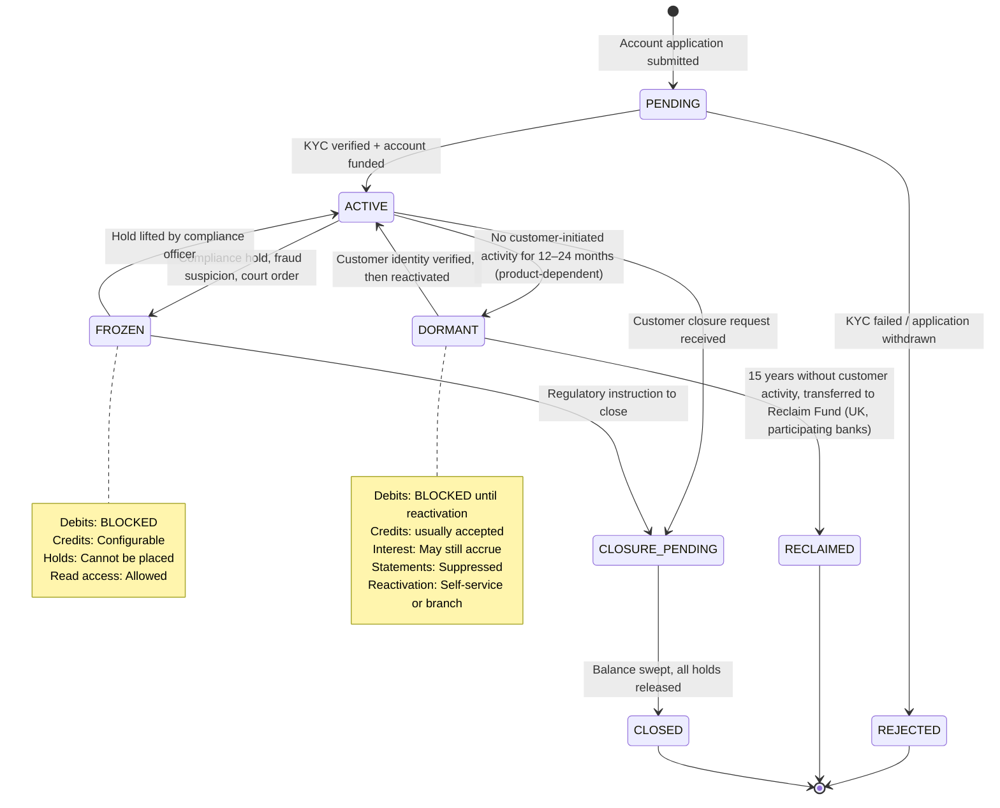
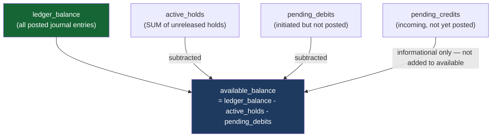

# إدارة الحسابات — أنواع الحسابات ودورة حياتها والأرصدة

## نظرة عامة

الحساب هو ذرّة النظام البنكي — فكل علاقة عميل، وكل التزام مالي، وكل متطلب تنظيمي ينتهي في النهاية إلى سجل حساب له حالة، ورصيد، ومجموعة عمليات مسموحة. وبينما قدّم الدرس 1 مفهوم الحساب في سياق بنية النظام البنكي الأساسي، يتناول هذا الدرس إدارة الحسابات بعمق كامل: كيف ترمّز أنواع الحسابات المختلفة علاقات مالية مختلفة، وكيف تحمي آلة حالات الحساب العميل والبنك معًا من العمليات غير الصالحة، وكيف تبدو دورة الحياة من الفتح إلى الإغلاق في شيفرة Java إنتاجية مدعومة بقاعدة بيانات منمذجة بشكل صحيح.

## أهداف التعلم

في نهاية هذا الدرس ستستطيع:

- تصنيف أنواع الحسابات البنكية وشرح الفروق المالية والتنظيمية بينها
- تنفيذ آلة حالات للحساب بحراسات انتقال صحيحة وسجل تدقيق
- تصميم مخطط SQL لكيان الحساب يفصل الرصيد الدفتري عن الرصيد المتاح
- تنفيذ خدمة `AccountLifecycleService` بطرق للتفعيل، والتجميد، والخمول، والإغلاق
- شرح المتطلبات التنظيمية البريطانية للحسابات الخاملة وتنفيذ استعلام الاكتشاف
- تصميم إجراء تحويل الرصيد (sweep) عند إغلاق الحساب لا يترك أموالًا عالقة
- شرح لماذا يُخزن `available_balance` و`ledger_balance` في عمودين منفصلين بدل حسابهما عند الطلب

## سياق العمل

*مثال مركّب (مبني على أنماط فشل شائعة في الصناعة، لا على بنك بعينه):* كان على بنك بريطاني مشارك في نظام الأصول الخاملة أن يحدد الحسابات التي لم يجرِ عليها العميل أي نشاط لمدة 15 عامًا، لتُحوَّل أرصدتها إلى صندوق الاسترداد (Reclaim Fund) بموجب قانون الحسابات البنكية الخاملة لعام 2008. ووجد تدقيق داخلي مئات الآلاف من الحسابات التي كان يجب تحديدها ولم تُحدد قط. فقد انتقلت الحسابات إلى حالة `DORMANT` بشكل صحيح، لكن المهمة اللاحقة التي تفحص "15 عامًا دون نشاط للعميل؟" كانت ترشّح على `updated_at` — و`updated_at` يتغير كلما طُبقت الفائدة تلقائيًا. فظلت الفائدة الشهرية تعيد ضبط ساعة عدم النشاط. واحتاج الإصلاح إلى تغيير في المخطط — عمود منفصل `last_customer_initiated_at` — وملء ملايين الصفوف من سجل المعاملات، وأعمال معالجة مع الجهة الرقابية.

## تصنيف أنواع الحسابات

ليست كل الحسابات متشابهة. فنوع الحساب يرمّز العلاقة المالية بين البنك والعميل — بما فيها جانب الميزانية الذي يظهر فيه الحساب، ومن يدين لمن، وأي العمليات مسموحة.

| نوع الحساب | الميزانية | الرصيد الطبيعي | هل البنك مدين للعميل؟ | الاستخدام المعتاد |
|---|---|---|---|---|
| **الحساب الجاري** | التزام | دائن | نعم | المعاملات اليومية، والراتب، والفواتير |
| **حساب التوفير** | التزام | دائن | نعم | وديعة بفائدة؛ حدود سحب |
| **الوديعة لأجل** | التزام | دائن | نعم | مقفلة للمدة؛ غرامة على السحب المبكر |
| **حساب القرض** | أصل | مدين | لا — العميل مدين للبنك | الرهن العقاري، والقرض الشخصي، والسحب على المكشوف |
| **حساب بطاقة الائتمان** | أصل | مدين | لا | ائتمان متجدد؛ رصيد الكشف مستحق |
| **حساب نوسترو** | أصل | مدين | لا ينطبق | حساب البنك لدى بنك آخر |
| **حساب فوسترو** | التزام | دائن | نعم (للبنك الآخر) | حساب بنك آخر لدى هذا البنك |
| **الحساب المعلّق** | أيهما | أيهما | لا ينطبق | احتجاز مؤقت؛ يُحقق فيه ويُصفّى، عادة يوميًا |
| **داخلي / مصروفات** | مصروفات/إيرادات | متغير | لا ينطبق | تتبع الأرباح والخسائر، وتحصيل الرسوم |

> [!NOTE]
> حساب نوسترو ("حسابنا" بالإيطالية) وحساب فوسترو ("حسابكم") يصفان علاقة البنوك المراسلة **نفسها** من منظورين متعاكسين. فعندما يحتفظ البنك A بأموال لدى البنك B للتسوية، يسميه البنك A حساب نوسترو؛ ويسمي البنك B الحساب نفسه حساب فوسترو. ويهم هذا التمييز عند تصميم أنظمة الدفع العابرة للحدود حيث يحتاج البنكان إلى مطابقة العلاقة نفسها.

## آلة حالات الحساب



> [!WARNING]
> يجب أن يكون الانتقال من `DORMANT` إلى `ACTIVE` محروسًا — فيتطلب تحقق العميل من هويته (مصادقة إلكترونية أو زيارة فرع)، لا أي حدث نظامي. فإذا رُحّلت الفائدة تلقائيًا وأعادت تنشيط الحساب، ينكسر تتبع عدم النشاط — وهذا بالضبط العيب في سياق العمل أعلاه.

## مخطط DDL لكيان الحساب

```sql
CREATE TYPE account_type AS ENUM (
    'CURRENT', 'SAVINGS', 'FIXED_DEPOSIT', 'LOAN', 'CREDIT_CARD',
    'NOSTRO', 'VOSTRO', 'SUSPENSE', 'INTERNAL'
);

CREATE TYPE account_status AS ENUM (
    'PENDING', 'ACTIVE', 'FROZEN', 'DORMANT',
    'CLOSURE_PENDING', 'REJECTED', 'RECLAIMED', 'CLOSED'
);

CREATE TABLE accounts (
    id                              UUID            PRIMARY KEY DEFAULT gen_random_uuid(),
    account_number                  VARCHAR(20)     NOT NULL UNIQUE,
    iban                            VARCHAR(34),    -- ISO 13616: 'GB29NWBK60161331926819'
    sort_code                       CHAR(8),        -- UK: '60-16-13'
    customer_id                     UUID,           -- NULL for internal/nostro accounts
    product_code                    VARCHAR(50)     NOT NULL,  -- 'CURRENT_STANDARD', 'SAVINGS_FLEX'
    account_type                    account_type    NOT NULL,
    currency                        CHAR(3)         NOT NULL,  -- ISO 4217

    -- Status
    status                          account_status  NOT NULL DEFAULT 'PENDING',

    -- Balances — stored as minor units (pence/cents). Never floats.
    ledger_balance                  BIGINT          NOT NULL DEFAULT 0,
    available_balance               BIGINT          NOT NULL DEFAULT 0,
    pending_credits                 BIGINT          NOT NULL DEFAULT 0,
    pending_debits                  BIGINT          NOT NULL DEFAULT 0,

    -- Limits
    overdraft_limit                 BIGINT          NOT NULL DEFAULT 0,
    daily_debit_limit               BIGINT,         -- NULL = no limit
    single_transaction_limit        BIGINT,

    -- Lifecycle timestamps
    opened_at                       TIMESTAMPTZ,
    activated_at                    TIMESTAMPTZ,
    frozen_at                       TIMESTAMPTZ,
    frozen_reason                   TEXT,
    dormant_at                      TIMESTAMPTZ,

    -- Critical: separate from dormant_at — do NOT use updated_at for dormancy
    last_customer_initiated_at      TIMESTAMPTZ,    -- Updated only by customer actions
    last_system_activity_at         TIMESTAMPTZ,    -- Updated by system (interest, fees)

    closed_at                       TIMESTAMPTZ,
    closure_reason                  TEXT,

    -- Audit
    created_at                      TIMESTAMPTZ     NOT NULL DEFAULT now(),
    updated_at                      TIMESTAMPTZ     NOT NULL DEFAULT now(),
    version                         BIGINT          NOT NULL DEFAULT 0,  -- Optimistic locking

    -- Constraints
    CONSTRAINT chk_ledger_balance_loan
        CHECK (account_type != 'LOAN' OR ledger_balance >= 0),
    CONSTRAINT chk_available_lte_ledger_plus_overdraft
        CHECK (available_balance >= -(overdraft_limit)),
    CONSTRAINT chk_pending_non_negative
        CHECK (pending_credits >= 0 AND pending_debits >= 0)
);

-- Account lifecycle event audit trail
CREATE TABLE account_status_history (
    id              BIGSERIAL       PRIMARY KEY,
    account_id      UUID            NOT NULL REFERENCES accounts(id),
    from_status     account_status,
    to_status       account_status  NOT NULL,
    changed_at      TIMESTAMPTZ     NOT NULL DEFAULT now(),
    changed_by      VARCHAR(100)    NOT NULL,  -- User ID or system name
    reason          TEXT,
    reference_id    VARCHAR(100)    -- e.g., compliance case ID, court order ref
);

CREATE INDEX idx_accounts_customer ON accounts (customer_id) WHERE customer_id IS NOT NULL;
CREATE INDEX idx_accounts_status   ON accounts (status);
CREATE INDEX idx_accounts_dormancy ON accounts (last_customer_initiated_at)
    WHERE status = 'ACTIVE';
```

أهم نقطة في المخطط: العمود `last_customer_initiated_at` منفصل عن `updated_at` ولا يُحدّث إلا بأفعال العميل، بينما يُحدّث `last_system_activity_at` بأحداث النظام (الفوائد، والرسوم). وتُخزن الأرصدة بالوحدات الصغرى، ويسجّل جدول `account_status_history` كل تغيير حالة للتدقيق.

## AccountLifecycleService

```java17
@Service
@Transactional
public class AccountLifecycleService {

    private final AccountRepository accountRepository;
    private final AccountStatusHistoryRepository historyRepository;
    private final HoldRepository holdRepository;
    private final OutboxRepository outbox;

    private static final Map<AccountStatus, Set<AccountStatus>> ALLOWED_TRANSITIONS =
        Map.of(
            AccountStatus.PENDING,          Set.of(AccountStatus.ACTIVE, AccountStatus.REJECTED),
            AccountStatus.ACTIVE,           Set.of(AccountStatus.FROZEN, AccountStatus.DORMANT,
                                                   AccountStatus.CLOSURE_PENDING),
            AccountStatus.FROZEN,           Set.of(AccountStatus.ACTIVE, AccountStatus.CLOSURE_PENDING),
            AccountStatus.DORMANT,          Set.of(AccountStatus.ACTIVE, AccountStatus.RECLAIMED),
            AccountStatus.CLOSURE_PENDING,  Set.of(AccountStatus.CLOSED),
            AccountStatus.REJECTED,         Set.of(),
            AccountStatus.RECLAIMED,        Set.of(),
            AccountStatus.CLOSED,           Set.of()
        );

    /**
     * Activate a PENDING account. Requires: KYC passed, initial deposit verified.
     */
    public Account activate(UUID accountId, String activatedBy) {
        Account account = accountRepository.findByIdWithLock(accountId);
        transitionStatus(account, AccountStatus.ACTIVE, activatedBy,
            "KYC verified and account funded", null);
        account.setActivatedAt(Instant.now());
        account.setLastCustomerInitiatedAt(Instant.now());
        return accountRepository.save(account);
    }

    /**
     * Freeze an account. Debits are immediately blocked.
     * @param reason  Human-readable reason (shown to compliance, not customer)
     * @param caseRef Compliance case reference number
     */
    public Account freeze(UUID accountId, String frozenBy, String reason, String caseRef) {
        Account account = accountRepository.findByIdWithLock(accountId);

        if (account.getStatus() != AccountStatus.ACTIVE) {
            throw new InvalidStateTransitionException(
                "Can only freeze ACTIVE accounts; current status: " + account.getStatus());
        }

        transitionStatus(account, AccountStatus.FROZEN, frozenBy, reason, caseRef);
        account.setFrozenAt(Instant.now());
        account.setFrozenReason(reason);

        return accountRepository.save(account);
    }

    /**
     * Unfreeze a frozen account. Requires authorisation from compliance officer.
     */
    public Account unfreeze(UUID accountId, String unfrozenBy, String reason, String caseRef) {
        Account account = accountRepository.findByIdWithLock(accountId);

        if (account.getStatus() != AccountStatus.FROZEN) {
            throw new InvalidStateTransitionException(
                "Can only unfreeze FROZEN accounts; current status: " + account.getStatus());
        }

        transitionStatus(account, AccountStatus.ACTIVE, unfrozenBy, reason, caseRef);
        account.setFrozenAt(null);
        account.setFrozenReason(null);

        return accountRepository.save(account);
    }

    /**
     * Mark an account dormant.
     * Called by the dormancy detection job — NOT by customer actions.
     * Customer-initiated transactions update last_customer_initiated_at and prevent this.
     */
    public Account markDormant(UUID accountId, String reason) {
        Account account = accountRepository.findByIdWithLock(accountId);

        if (account.getStatus() != AccountStatus.ACTIVE) {
            return account; // Idempotent — no-op if not active
        }

        transitionStatus(account, AccountStatus.DORMANT, "SYSTEM:DORMANCY_JOB", reason, null);
        account.setDormantAt(Instant.now());

        return accountRepository.save(account);
    }

    /**
     * Reactivate a dormant account.
     * MUST be called only after customer identity verification — not by system events.
     */
    public Account reactivateFromDormancy(UUID accountId, String reactivatedBy) {
        Account account = accountRepository.findByIdWithLock(accountId);

        if (account.getStatus() != AccountStatus.DORMANT) {
            throw new InvalidStateTransitionException(
                "Can only reactivate DORMANT accounts; current status: " + account.getStatus());
        }

        transitionStatus(account, AccountStatus.ACTIVE, reactivatedBy,
            "Customer identity verified — dormancy lifted", null);
        account.setDormantAt(null);
        account.setLastCustomerInitiatedAt(Instant.now());  // Reset inactivity clock

        return accountRepository.save(account);
    }

    /**
     * Initiate closure. Validates: no active holds, balance ready for sweep.
     */
    public Account initiateClosureRequest(UUID accountId, String requestedBy, String reason) {
        Account account = accountRepository.findByIdWithLock(accountId);

        if (!Set.of(AccountStatus.ACTIVE, AccountStatus.FROZEN).contains(account.getStatus())) {
            throw new InvalidStateTransitionException(
                "Cannot initiate closure for account in status: " + account.getStatus());
        }

        // Cannot close while active holds exist
        long activeHoldCount = holdRepository.countActiveHoldsByAccountId(accountId);
        if (activeHoldCount > 0) {
            throw new ActiveHoldsException(
                "Cannot close account with %d active hold(s). Release holds first."
                    .formatted(activeHoldCount));
        }

        transitionStatus(account, AccountStatus.CLOSURE_PENDING, requestedBy, reason, null);
        return accountRepository.save(account);
    }

    /**
     * Complete closure with balance sweep to destination account.
     * Posts a journal entry moving the remaining balance before marking CLOSED.
     */
    public Account close(UUID accountId, UUID sweepDestinationAccountId,
                         String closedBy, String reason) {
        Account account = accountRepository.findByIdWithLock(accountId);

        if (account.getStatus() != AccountStatus.CLOSURE_PENDING) {
            throw new InvalidStateTransitionException(
                "Account must be in CLOSURE_PENDING status; current: " + account.getStatus());
        }

        // An overdrawn account cannot simply be swept: the debt must be
        // repaid or moved to a collections process first
        if (account.getLedgerBalance() < 0) {
            throw new InvalidStateTransitionException(
                "Account is overdrawn; settle the debt before closure");
        }

        // Sweep remaining balance if non-zero. The sweep POSTS A JOURNAL ENTRY;
        // the balances change through that posting — never by setting them to 0
        if (account.getLedgerBalance() > 0) {
            sweepBalance(account, sweepDestinationAccountId, closedBy);
        }
        if (account.getLedgerBalance() != 0 || account.getAvailableBalance() != 0) {
            throw new IllegalStateException("Balance not zero after sweep — refusing to close");
        }

        transitionStatus(account, AccountStatus.CLOSED, closedBy, reason, null);
        account.setClosedAt(Instant.now());
        account.setClosureReason(reason);

        Account closed = accountRepository.save(account);
        // Outbox: the event is published only if this transaction commits
        outbox.save(OutboxEvent.of(new AccountClosedEvent(accountId, closedBy, reason)));
        return closed;
    }

    private void transitionStatus(Account account, AccountStatus to,
                                   String changedBy, String reason, String refId) {
        AccountStatus from = account.getStatus();
        Set<AccountStatus> allowed = ALLOWED_TRANSITIONS.getOrDefault(from, Set.of());

        if (!allowed.contains(to)) {
            throw new InvalidStateTransitionException(
                "Invalid transition: %s → %s. Allowed from %s: %s"
                    .formatted(from, to, from, allowed));
        }

        account.setStatus(to);
        account.setUpdatedAt(Instant.now());

        historyRepository.save(AccountStatusHistory.builder()
            .accountId(account.getId())
            .fromStatus(from)
            .toStatus(to)
            .changedBy(changedBy)
            .reason(reason)
            .referenceId(refId)
            .changedAt(Instant.now())
            .build());
    }
}
```

عند الإغلاق: لا يمكن ببساطة تحويل رصيد حساب مكشوف — يجب سداد الدين أو نقله إلى عملية تحصيل أولًا. ويرحّل التحويل قيدًا يوميًا؛ فتتغير الأرصدة عبر ذلك الترحيل — لا بتعيينها إلى الصفر يدويًا. ويُنشر حدث الإغلاق عبر outbox، فلا يُنشر إلا إذا التزمت المعاملة.

## اكتشاف الخمول التنظيمي

بموجب قانون الحسابات البنكية الخاملة البريطاني لعام 2008، تستطيع البنوك المشاركة في نظام الأصول الخاملة تحويل أرصدة الحسابات التي لم يجرِ عليها العميل أي نشاط لمدة 15 عامًا إلى صندوق الاسترداد (ويحتفظ العميل بحقه في استرداد المال). وسواء لهذا النظام أو لقواعد الخمول الخاصة بالبنك، يجب أن تستخدم مهمة الاكتشاف حقل عدم النشاط الصحيح.

```java17
@Service
public class DormancyDetectionService {

    private final AccountRepository accountRepository;
    private final AccountLifecycleService lifecycleService;

    // Run nightly — identify accounts that have crossed the inactivity threshold
    @Scheduled(cron = "0 30 1 * * *")
    public void detectAndMarkDormantAccounts() {
        // Product-defined inactivity thresholds:
        // Current accounts: 24 months; Savings: 12 months
        OffsetDateTime now              = OffsetDateTime.now(ZoneOffset.UTC);
        OffsetDateTime currentThreshold = now.minusMonths(24);
        OffsetDateTime savingsThreshold = now.minusMonths(12);

        // Fetch accounts eligible for dormancy — those with no customer activity since threshold
        // Note: last_customer_initiated_at, NOT last_system_activity_at or updated_at
        // (with millions of accounts, process in pages rather than one big list)
        List<Account> eligible = accountRepository.findDormancyCandidates(
            currentThreshold, savingsThreshold);

        log.info("Dormancy check: {} accounts eligible for dormancy marking", eligible.size());

        for (Account account : eligible) {
            try {
                lifecycleService.markDormant(account.getId(),
                    "No customer-initiated activity since " +
                    account.getLastCustomerInitiatedAt());
            } catch (Exception e) {
                log.error("Failed to mark account {} dormant: {}", account.getId(), e.getMessage());
            }
        }
    }
}
```

```sql
-- Repository query: find candidates for dormancy
-- Uses last_customer_initiated_at — NOT updated_at or last_system_activity_at
SELECT a.id, a.account_number, a.account_type, a.last_customer_initiated_at
FROM accounts a
WHERE a.status = 'ACTIVE'
  AND (
      (a.account_type = 'CURRENT'  AND a.last_customer_initiated_at < :currentThreshold)
   OR (a.account_type = 'SAVINGS'  AND a.last_customer_initiated_at < :savingsThreshold)
  )
ORDER BY a.last_customer_initiated_at ASC;

-- Reclaim Fund candidates: 15 years since the last CUSTOMER activity
-- (not 15 years since the account was marked dormant)
SELECT a.id, a.account_number, a.ledger_balance, a.last_customer_initiated_at
FROM accounts a
WHERE a.status = 'DORMANT'
  AND a.last_customer_initiated_at < now() - INTERVAL '15 years'
  AND a.ledger_balance > 0
ORDER BY a.last_customer_initiated_at ASC;
```

مرشحو صندوق الاسترداد: 15 عامًا منذ آخر نشاط **للعميل** — لا 15 عامًا منذ تعليم الحساب خاملًا.

## الرصيد المتاح مقابل الرصيد الدفتري

يربك هذا التمييز المهندسين غير المعتادين على الأنظمة البنكية. والقاعدة: **خزّن الاثنين دائمًا**.



| الحقل | التعريف | متى يُحدّث | يُستخدم في |
|---|---|---|---|
| `ledger_balance` | مجموع كل القيود اليومية المرحّلة | عند التسوية / ترحيل القيد | التقارير التنظيمية، والكشوف، وحساب الفوائد |
| `available_balance` | الرصيد الدفتري ناقص الحجوزات النشطة والخصوم المعلقة | عند وضع الحجز، وتحريره، والتسوية | تفويض المدفوعات والسحوبات الجديدة |
| `pending_credits` | أموال واردة لم تُسوَّ بعد | عند استلام الدفعة | عرض معلوماتي للعميل |
| `pending_debits` | أموال صادرة لم تُسوَّ بعد | عند بدء الدفعة | مدخل لحساب الرصيد المتاح |

> [!IMPORTANT]
> يجب تخزين `available_balance` كعمود مكرر (denormalised)، لا حسابه في كل طلب معاملة. فحسابه ديناميكيًا من `SUM(journal_entry_lines)` ناقص `SUM(active_holds)` لكل طلب تفويض بطيء جدًا عند التوسع. وحدّثه في المعاملة نفسها مع وضع الحجز وتحريره، بتحديث `UPDATE` شرطي واحد (الفحص والتغيير في عبارة ذرية واحدة)، فلا يستطيع طلبان متزامنان اجتياز فحص الأموال معًا. وطابقه بانتظام مع الدفتر.

```java17
// Atomic available balance update — called when placing or releasing a hold.
// One conditional UPDATE: the funds check and the change happen atomically
// in the database, so READ COMMITTED is enough (no SERIALIZABLE needed)
@Transactional
public void updateAvailableBalance(UUID accountId, long delta) {
    int updated = jdbc.update("""
        UPDATE accounts
        SET available_balance = available_balance + ?,
            updated_at = now(),
            version = version + 1
        WHERE id = ?
          AND available_balance + ? >= -(overdraft_limit)
        """,
        delta, accountId, delta
    );

    if (updated == 0) {
        // No row changed: the account does not exist, or the new balance
        // would break the overdraft limit
        Account account = accountRepository.findById(accountId)
            .orElseThrow(() -> new AccountNotFoundException(accountId));
        throw new InsufficientFundsException(accountId, delta, account.getAvailableBalance(),
            account.getOverdraftLimit());
    }
}
```

التحديث الشرطي الواحد يجعل فحص الأموال والتغيير ذريين في قاعدة البيانات، فيكفي عزل READ COMMITTED (لا حاجة إلى SERIALIZABLE). وإذا لم يتغير أي صف، فالحساب غير موجود أو أن الرصيد الجديد سيتجاوز حد السحب على المكشوف.


<!-- KNOWLEDGE-CHECK [
  {
    "id": "kc-am-01",
    "question": "تستخدم مهمة اكتشاف الحسابات الخاملة `updated_at` لإيجاد الحسابات غير النشطة. ويطبّق البنك الفائدة الشهرية تلقائيًا على كل حسابات التوفير. ما نتيجة هذا التنفيذ؟",
    "options": [
      "لا نتيجة — تطبيق الفائدة يثبت أن الحساب ما زال نشطًا اقتصاديًا",
      "تعلّم المهمة كل حسابات التوفير خاملة فورًا، لأن الفائدة ليست فعلًا من العميل",
      "تعمل المهمة بشكل صحيح لكنها تنتج إيجابيات كاذبة للحسابات بلا فائدة",
      "يحدّث تطبيق الفائدة updated_at، فيعيد ضبط فترة عدم النشاط إلى الصفر كل شهر — فلا تبلغ الحسابات غير النشطة فعلًا عتبة الخمول أبدًا"
    ],
    "correct": 3,
    "explanation": "إذا استخدم اكتشاف الخمول updated_at وطبّق النظام الفائدة شهريًا، فسيُحدّث updated_at كل شهر لكل حساب بفائدة — حتى الحسابات التي لم يجرِ عليها العميل أي نشاط منذ سنوات. فلا تُبلغ عتبة الخمول أبدًا. والحقل الصحيح last_customer_initiated_at، الذي لا يُحدّث إلا عندما يتصرف العميل عمدًا: الدخول والتعامل، أو إجراء دفعة، أو سحب الأموال. ويجب ألا تحدّث الأحداث التي يولّدها النظام (الفوائد، والرسوم) هذا الحقل."
  },
  {
    "id": "kc-am-02",
    "question": "لدى عميل حساب جارٍ فيه ledger_balance = 600 جنيه، وحجزان نشطان بقيمة 100 جنيه لكل منهما، وحد سحب على المكشوف 200 جنيه. ما أقصى حجز إضافي يجب أن يسمح النظام بوضعه؟",
    "options": [
      "‏600 جنيه — الرصيد الدفتري كاملًا",
      "‏400 جنيه — الرصيد الدفتري ناقص الحجوزات الحالية",
      "‏200 جنيه — حد السحب على المكشوف فقط",
      "‏400 جنيه رصيدًا متاحًا زائد 200 جنيه سحبًا على المكشوف = 600 جنيه حدًا أقصى للحجز الإضافي"
    ],
    "correct": 3,
    "explanation": "available_balance = ledger_balance - active_holds = 600 - 200 = 400 جنيه. ويوسّع حد السحب على المكشوف السعة المتاحة بـ 200 جنيه. فأقصى حجز جديد = available_balance + overdraft_limit = 400 + 200 = 600 جنيه. وبعد وضع حجز 600 جنيه يصبح available_balance = ‏400 - 600 = -200 جنيه، وهو على حد السحب على المكشوف بالضبط. وأي مبلغ يتجاوز ذلك سيخرق حد السحب على المكشوف."
  }
] -->


<!-- PRACTICAL-CHALLENGE {
  "id": "pc-account-management",
  "title": "إدارة الحسابات: دورة الحياة وتصميم الأرصدة",
  "description": "نفّذ ضوابط دورة حياة الحسابات وإدارة الأرصدة لنظام بنكي إنتاجي.",
  "tasks": [
    {
      "id": "pc-am-01",
      "description": "أضف ترحيل قاعدة بيانات إلى جدول الحسابات يضيف العمود last_customer_initiated_at (منفصلًا عن updated_at). واكتب مواصفة المشغّل أو منطق طبقة التطبيق التي تضمن تحديث هذا العمود فقط عند حدوث فعل يبدؤه العميل — لا عندما يرحّل النظام الفوائد أو الرسوم أو الحجوزات."
    },
    {
      "id": "pc-am-02",
      "description": "نفّذ خريطة ALLOWED_TRANSITIONS كاملة في AccountLifecycleService كتعداد Java 17 بطريقة canTransitionTo(). واكتب اختبار JUnit 5 بمعاملات يتحقق من: (أ) أن كل انتقال في الخريطة مسموح، (ب) أن CLOSED ← ACTIVE مرفوض، (ج) أن DORMANT ← FROZEN مرفوض."
    },
    {
      "id": "pc-am-03",
      "description": "صمّم الطريقة الخاصة `sweepBalance()` داخل AccountLifecycleService. يجب أن: ترحّل قيدًا يوميًا يخصم من الحساب المُغلق ويضيف إلى حساب الوجهة بكامل ledger_balance؛ وتجعل ledger_balance وavailable_balance صفرًا على الحساب المصدر؛ وترمي استثناء إذا كان حساب الوجهة CLOSED أو FROZEN."
    },
    {
      "id": "pc-am-04",
      "description": "اكتب اختبار تكامل للطريقة AccountLifecycleService.freeze() يتحقق من: انتقال حالة الحساب إلى FROZEN؛ وإدراج صف في account_status_history بالحالة السابقة واللاحقة والسبب الصحيحة؛ وأن استدعاءً لاحقًا لوضع حجز على الحساب المجمّد يرمي استثناءً مناسبًا."
    }
  ]
} -->
