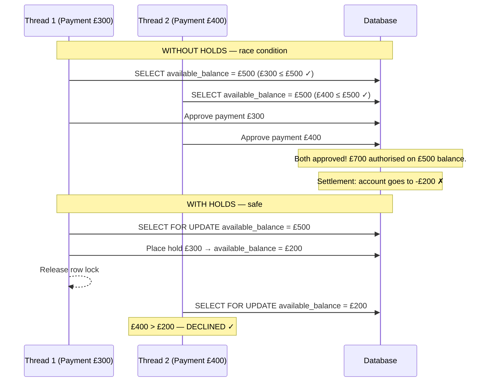
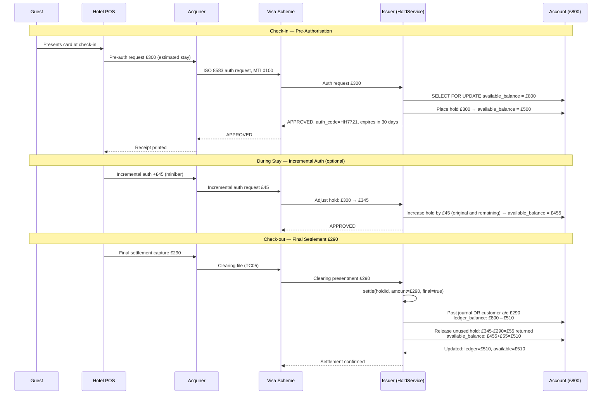

# حجز الأموال — نظام الحجوزات (Holds) والتفويض المسبق

## نظرة عامة

حجز الأموال — أي تخصيص المال لالتزام معلق قبل أن يغادر الحساب فعلًا — هو الآلية التي تسد الفجوة بين لحظة تفويض الدفعة ولحظة تسويتها. فدون حجوزات، قد يرى تفويضان متزامنان لعميل رصيده 500 جنيه أن 500 جنيه متاحة لكل منهما فيوافقان معًا، فيصبح الحساب مكشوفًا بـ 500 جنيه عند تسويتهما. ويتناول هذا الدرس نظام الحجوزات بتفصيل تقني كامل: تصميم المخطط، وعمليتي `place()` و`settle()` الذريتين، وانتهاء صلاحية الحجوزات، وأنماط التسوية الجزئية، والتفاعلات بين الحجوزات وحدود السحب على المكشوف التي تجعل حساب الرصيد المتاح معقدًا على نحو مفاجئ.

## أهداف التعلم

في نهاية هذا الدرس ستستطيع:

- شرح حالة التسابق التي صُممت الحجوزات لمنعها، ولماذا لا تكفي معاملات قاعدة البيانات وحدها
- تصميم مخطط `account_holds` بأعمدة انتهاء الصلاحية والسبب والحالة
- كتابة استعلام SQL يحسب الرصيد المتاح كـ `ledger_balance - SUM(active_holds)`
- تنفيذ `HoldService.place()` و`HoldService.settle()` كعمليات ذرية
- تنفيذ مهمة خلفية لانتهاء صلاحية الحجوزات بمعالجة آمنة للفشل الجزئي
- معالجة التسوية الجزئية — حيث يُسوّى تفويض مسبق بـ 120 جنيهًا بمبلغ 95 جنيهًا
- تتبع تدفق تفويض مسبق ببطاقة في فندق من البداية للنهاية باستخدام مخطط تسلسل Mermaid
- شرح كيف تتفاعل حدود السحب على المكشوف مع نظام الحجوزات

## سياق العمل

*مثال مركّب (مبني على أنماط فشل شائعة في الصناعة، لا على شركة بعينها):* كانت خدمة التفويض لدى مُصدر بطاقات مسبقة الدفع توافق على المعاملات بفحص `ledger_balance >= amount` — دون حجز أي شيء. وفي عطلة نهاية أسبوع مزدحمة، فُوّضت معاملات بطاقات العملاء بالتزامن. وفحص كل تفويض الرصيد الابتدائي نفسه بدل حجز الأموال ذريًا، فوُوفق على معاملات كثيرة تجاوز مجموعها الرصيد. وعندما جرت التسوية يوم الاثنين، بقيت لدى المُصدر أرصدة سالبة على حسابات مسبقة الدفع — خسائر اضطر لتحملها، لأن عملاء البطاقات المسبقة ليس لديهم خط ائتمان. والسبب الجذري: فحص الرصيد دون وضع حجز ذريًا غير آمن تحت التزامن. وكان الإصلاح جدول `account_holds`، مع فحص الأموال ووضع الحجز ذريًا تحت قفل صف.

## لماذا توجد الحجوزات: حالة تسابق التفويض المسبق

لنأخذ دفعتين متزامنتين بالبطاقة على حساب فيه 500 جنيه متاحة:



يحصل `SELECT FOR UPDATE` على قفل على مستوى الصف طوال معاملة وضع الحجز. فلا تستطيع معاملة أخرى قفل صف الحساب أو تعديله حتى يُلتزم الحجز (والقراءات العادية في PostgreSQL ما زالت ترى آخر قيمة ملتزمة). وهذا يسلسل التفويضات المتزامنة ويزيل التسابق. ويحقق تحديث شرطي واحد `UPDATE ... WHERE available_balance >= :amount` الأمر نفسه ذريًا عندما لا تلزم فحوص أخرى.

> [!IMPORTANT]
> ‏`SELECT FOR UPDATE` الأداة الصحيحة هنا، لا القفل على مستوى التطبيق ولا القفل المتفائل (عمود `version`). فالقفل المتفائل يعيد المحاولة عند التعارض — وإعادة المحاولة ستقرأ الرصيد المخفض بالفعل وترفض بشكل صحيح. لكن تحت التزامن العالي تنشئ إعادات القفل المتفائل موجات إعادة محاولة. ولوضع الحجوزات يُفضّل القفل المتشائم (`SELECT FOR UPDATE`) لأن الحجوزات قصيرة الأمد (ميلي ثوانٍ) والتنافس على حساب واحد نادر عمليًا.

## مخطط DDL لجدول account_holds

```sql
CREATE TYPE hold_status AS ENUM ('ACTIVE', 'SETTLED', 'RELEASED', 'EXPIRED', 'PARTIALLY_SETTLED');

CREATE TYPE hold_reason AS ENUM (
    'CARD_AUTHORISATION',
    'WIRE_TRANSFER_PENDING',
    'DIRECT_DEBIT_PENDING',
    'COMPLIANCE_FREEZE',
    'MERCHANT_PRE_AUTH',
    'HOTEL_PRE_AUTH',
    'CAR_RENTAL_PRE_AUTH'
);

CREATE TABLE account_holds (
    id                  UUID            PRIMARY KEY DEFAULT gen_random_uuid(),
    account_id          UUID            NOT NULL REFERENCES accounts(id),
    payment_id          VARCHAR(100),   -- FK to payments table (nullable for compliance holds)
    hold_reason         hold_reason     NOT NULL,
    status              hold_status     NOT NULL DEFAULT 'ACTIVE',

    -- Amounts — always in minor units
    original_amount     BIGINT          NOT NULL CHECK (original_amount > 0),
    remaining_amount    BIGINT          NOT NULL CHECK (remaining_amount >= 0),
    settled_amount      BIGINT          NOT NULL DEFAULT 0 CHECK (settled_amount >= 0),
    currency            CHAR(3)         NOT NULL,

    -- Expiry — holds must not live forever
    expires_at          TIMESTAMPTZ     NOT NULL,  -- Authorisation validity window
    created_at          TIMESTAMPTZ     NOT NULL DEFAULT now(),
    updated_at          TIMESTAMPTZ     NOT NULL DEFAULT now(),

    -- Settlement tracking
    settled_at          TIMESTAMPTZ,
    settlement_ref      VARCHAR(100),   -- Scheme settlement reference

    -- Who placed/released this hold
    placed_by           VARCHAR(100)    NOT NULL,
    released_by         VARCHAR(100),
    release_reason      TEXT,

    version             BIGINT          NOT NULL DEFAULT 0,  -- Optimistic locking

    CONSTRAINT chk_amounts_consistent
        CHECK (settled_amount + remaining_amount <= original_amount),
    CONSTRAINT chk_settled_has_ref
        CHECK (status != 'SETTLED' OR settlement_ref IS NOT NULL)
);

-- Index for available balance calculation — the hot path.
-- A PARTIALLY_SETTLED hold still reserves its remaining amount
CREATE INDEX idx_holds_account_active
    ON account_holds (account_id, currency)
    INCLUDE (remaining_amount)
    WHERE status IN ('ACTIVE', 'PARTIALLY_SETTLED');

-- Index for expiry job
CREATE INDEX idx_holds_expiry
    ON account_holds (expires_at)
    WHERE status IN ('ACTIVE', 'PARTIALLY_SETTLED');
```

الحجز في حالة PARTIALLY_SETTLED ما زال يحجز المبلغ المتبقي، لذا تشمل الفهارس الحالتين ACTIVE وPARTIALLY_SETTLED.

## الرصيد المتاح بـ SQL مع الحجوزات النشطة

الحساب المعياري للرصيد المتاح. ويجب أن يطابق العمود المكرر `available_balance` في جدول `accounts` — فإذا اختلفا فهناك خطأ.

```sql
-- Available balance for a single account
-- This is the source of truth; the denormalised column is a performance optimisation
SELECT
    a.id,
    a.account_number,
    a.ledger_balance,
    a.overdraft_limit,
    COALESCE(SUM(h.remaining_amount), 0)              AS total_active_holds,
    a.ledger_balance
        - COALESCE(SUM(h.remaining_amount), 0)        AS computed_available_balance,
    a.available_balance                               AS stored_available_balance,
    -- These should always match; a discrepancy is a data integrity alert
    a.available_balance = (
        a.ledger_balance - COALESCE(SUM(h.remaining_amount), 0)
    )                                                 AS balances_consistent
FROM accounts a
LEFT JOIN account_holds h
    ON h.account_id = a.id
   AND h.status IN ('ACTIVE', 'PARTIALLY_SETTLED')
   AND h.currency = a.currency
   AND h.expires_at > now()   -- Exclude logically expired holds even if job hasn't run yet
WHERE a.id = :accountId
GROUP BY a.id, a.account_number, a.ledger_balance, a.overdraft_limit, a.available_balance;
```

> [!NOTE]
> المرشح `expires_at > now()` في استعلام الرصيد المتاح شبكة أمان. فحتى لو تأخرت المهمة الخلفية لانتهاء الصلاحية (مثلًا في عطلة نهاية أسبوع بلا تشغيل دفعات)، يجب ألا تخفض الحجوزات المنتهية الرصيد المتاح. وهذا ينشئ عدم اتساق قصيرًا بين الاستعلام والعمود `available_balance` — تصححه مهمة المطابقة عند تشغيلها.

## HoldService — الوضع والتسوية

```java17
@Service
public class HoldService {

    private final AccountRepository accountRepository;
    private final AccountHoldRepository holdRepository;
    private final JournalEntryService journalEntryService;
    private final BusinessCalendar businessCalendar;

    /**
     * Place a hold on an account atomically.
     * Uses SELECT FOR UPDATE to prevent concurrent over-authorisation.
     * Updates available_balance in the same transaction.
     *
     * @throws InsufficientFundsException if available balance + overdraft would be exceeded
     * @throws AccountNotEligibleException if account is FROZEN, DORMANT, or CLOSED
     */
    @Transactional(isolation = Isolation.READ_COMMITTED)
    public HoldReference place(PlaceHoldCommand cmd) {
        // Acquire row lock — serialises concurrent holds on the same account
        Account account = accountRepository.findByIdForUpdate(cmd.accountId());

        validateAccountEligibleForHold(account);

        long maxPermittedHold = account.getAvailableBalance() + account.getOverdraftLimit();
        if (cmd.amountMinorUnits() > maxPermittedHold) {
            throw new InsufficientFundsException(
                "Requested hold of %d exceeds available capacity of %d (available=%d, overdraft=%d)"
                    .formatted(cmd.amountMinorUnits(), maxPermittedHold,
                        account.getAvailableBalance(), account.getOverdraftLimit()));
        }

        AccountHold hold = AccountHold.builder()
            .id(UUID.randomUUID())
            .accountId(cmd.accountId())
            .paymentId(cmd.paymentId())
            .holdReason(cmd.reason())
            .status(HoldStatus.ACTIVE)
            .originalAmount(cmd.amountMinorUnits())
            .remainingAmount(cmd.amountMinorUnits())
            .settledAmount(0L)
            .currency(cmd.currency())
            .expiresAt(cmd.expiresAt())
            .placedBy(cmd.placedBy())
            .createdAt(Instant.now())
            .build();

        holdRepository.save(hold);

        // Update available_balance atomically in the same transaction
        account.setAvailableBalance(account.getAvailableBalance() - cmd.amountMinorUnits());
        account.setUpdatedAt(Instant.now());
        accountRepository.save(account);

        return new HoldReference(hold.getId(), cmd.amountMinorUnits(), cmd.expiresAt());
    }

    /**
     * Settle (part of) a hold — posts the definitive ledger entry for the
     * settled amount. Supports partial settlement: a hotel pre-auth for £120
     * settling for £95. When cmd.isFinal() is true, whatever is left on the
     * hold is released back to available balance.
     */
    @Transactional(isolation = Isolation.READ_COMMITTED)
    public SettlementResult settle(SettleHoldCommand cmd) {
        // Lock order everywhere: hold first, then account (prevents deadlock)
        AccountHold hold = holdRepository.findByIdForUpdate(cmd.holdId());

        // Idempotency: the same settlement record processed twice must not post twice
        if (journalEntryService.existsBySource("HOLD_SETTLEMENT", cmd.settlementReference())) {
            return new SettlementResult(hold.getId(), 0, hold.getStatus());
        }

        if (hold.getStatus() != HoldStatus.ACTIVE
                && hold.getStatus() != HoldStatus.PARTIALLY_SETTLED) {
            // A late presentment for an expired/released hold is NOT rejected
            // here silently — see the note on late presentments below
            throw new InvalidHoldStateException(
                "Cannot settle hold in status: " + hold.getStatus() +
                ". Must be ACTIVE or PARTIALLY_SETTLED.");
        }

        if (cmd.settleAmountMinorUnits() > hold.getRemainingAmount()) {
            // Scheme rules allow some captures above the authorised amount
            // (e.g. tips); real systems handle that as an explicit case
            throw new InvalidOperationException(
                "Settlement amount %d exceeds remaining hold amount %d"
                    .formatted(cmd.settleAmountMinorUnits(), hold.getRemainingAmount()));
        }

        Account account = accountRepository.findByIdForUpdate(hold.getAccountId());

        // Post ledger journal entry for the settled amount.
        // sourceRef = the settlement reference (unique per settlement record),
        // so two partial settlements of one hold are two distinct journals
        journalEntryService.post(PostJournalEntryCommand.builder()
            .description("Card settlement: " + hold.getPaymentId())
            .businessDate(businessCalendar.today())
            .entryType(EntryType.PAYMENT)
            .sourceSystem("HOLD_SETTLEMENT")
            .sourceRef(cmd.settlementReference())
            .postedBy("SYSTEM:SETTLEMENT_JOB")
            .lines(List.of(
                new PostJournalEntryCommand.Line(
                    "2000", Side.DR, cmd.settleAmountMinorUnits(), cmd.currency(),
                    "Card payment settlement"),
                new PostJournalEntryCommand.Line(
                    "1001", Side.CR, cmd.settleAmountMinorUnits(), cmd.currency(),
                    "Scheme settlement")
            ))
            .build());

        hold.setSettledAmount(hold.getSettledAmount() + cmd.settleAmountMinorUnits());
        hold.setRemainingAmount(hold.getRemainingAmount() - cmd.settleAmountMinorUnits());
        hold.setSettledAt(Instant.now());
        hold.setSettlementRef(cmd.settlementReference());

        // Settled part: ledger goes down, the hold goes down by the same amount
        // → available_balance (= ledger − holds) is UNCHANGED for that part.
        // Keep the account's denormalised ledger_balance in step with the journal
        account.setLedgerBalance(account.getLedgerBalance() - cmd.settleAmountMinorUnits());

        // Final settlement: release whatever the merchant did not use
        if (cmd.isFinal() && hold.getRemainingAmount() > 0) {
            account.setAvailableBalance(account.getAvailableBalance() + hold.getRemainingAmount());
            hold.setRemainingAmount(0L);
        }

        boolean fullySettled = hold.getRemainingAmount() == 0;
        hold.setStatus(fullySettled ? HoldStatus.SETTLED : HoldStatus.PARTIALLY_SETTLED);
        holdRepository.save(hold);
        accountRepository.save(account);

        return new SettlementResult(hold.getId(), cmd.settleAmountMinorUnits(), hold.getStatus());
    }

    /**
     * Release a hold without settlement (e.g., cancelled authorisation, expired hold).
     * Restores available_balance; does NOT post any ledger entry.
     */
    @Transactional(isolation = Isolation.READ_COMMITTED)
    public void release(UUID holdId, String releasedBy, String reason) {
        AccountHold hold = holdRepository.findByIdForUpdate(holdId);

        if (!Set.of(HoldStatus.ACTIVE, HoldStatus.PARTIALLY_SETTLED).contains(hold.getStatus())) {
            throw new InvalidHoldStateException(
                "Cannot release hold in status: " + hold.getStatus());
        }

        Account account = accountRepository.findByIdForUpdate(hold.getAccountId());

        // Restore the remaining (unreleased) hold amount to available balance
        account.setAvailableBalance(account.getAvailableBalance() + hold.getRemainingAmount());
        account.setUpdatedAt(Instant.now());
        accountRepository.save(account);

        hold.setStatus(HoldStatus.RELEASED);
        hold.setReleasedBy(releasedBy);
        hold.setReleaseReason(reason);
        hold.setRemainingAmount(0L);
        hold.setUpdatedAt(Instant.now());
        holdRepository.save(hold);
    }

    private void validateAccountEligibleForHold(Account account) {
        if (account.getStatus() != AccountStatus.ACTIVE) {
            throw new AccountNotEligibleException(
                "Cannot place hold on account in status: " + account.getStatus() +
                ". Account must be ACTIVE.");
        }
    }
}
```

نقاط مهمة في التنفيذ:
- **ترتيب الأقفال** في كل مكان: الحجز أولًا ثم الحساب (يمنع الجمود).
- **عدم التكرار**: سجل التسوية نفسه إذا عولج مرتين لا يرحّل مرتين؛ و`sourceRef` هو مرجع التسوية (فريد لكل سجل تسوية)، فتكون تسويتان جزئيتان لحجز واحد قيدين منفصلين.
- **الجزء المسوّى**: ينخفض الدفتر وينخفض الحجز بالمقدار نفسه ← فيبقى `available_balance` (= الدفتر − الحجوزات) **دون تغيير** لذلك الجزء.
- **التسوية النهائية** (`cmd.isFinal()`): يُحرر ما لم يستخدمه التاجر من الحجز إلى الرصيد المتاح.
- تسمح قواعد الشبكة ببعض التحصيلات فوق المبلغ المفوّض (مثل البقشيش)؛ والأنظمة الحقيقية تعالجها كحالة صريحة.

## مهمة انتهاء صلاحية الحجوزات الخلفية

للتفويضات المسبقة نافذة صلاحية قصوى تحددها قواعد الشبكة — مثلًا نحو 7 أيام لمعظم التجار وحتى نحو 30 يومًا للفنادق وتأجير السيارات (تحقق من القواعد الحالية لكل شبكة ونوع تاجر). وبعد انتهاء الصلاحية يُحرر الحجز وتعود الأموال إلى الرصيد المتاح للعميل.

> [!IMPORTANT]
> **التقديمات المتأخرة ما زالت تحدث.** فقد يرسل التاجر التحصيل بعد انتهاء صلاحية الحجز. وعادة ما يظل على المُصدر أن يدفع للشبكة، فيجب ترحيل المقاصة كخصم رغم عدم وجود حجز — وربما ينزل الحساب تحت الصفر. فصمّم `settle()` لمعالجة "لا حجز نشط" كحالة صريحة (رحّل الخصم، وعلّم الحساب)، لا كخطأ يُسقط المعاملة.

```java17
@Service
public class HoldExpiryJob {

    private final AccountHoldRepository holdRepository;
    private final HoldService holdService;

    // Run every 15 minutes — expired holds should not block funds for long
    @Scheduled(fixedDelay = 15, timeUnit = TimeUnit.MINUTES)
    public void expireStaleHolds() {
        List<AccountHold> expired = holdRepository.findExpiredActiveHolds(Instant.now());

        if (expired.isEmpty()) {
            return;
        }

        log.info("Hold expiry job: processing {} expired holds", expired.size());

        int successCount = 0;
        int failureCount = 0;

        for (AccountHold hold : expired) {
            try {
                holdService.release(hold.getId(), "SYSTEM:EXPIRY_JOB",
                    "Hold expired at " + hold.getExpiresAt());
                successCount++;
            } catch (InvalidHoldStateException e) {
                // Hold was already settled/released by another process — safe to skip
                log.debug("Hold {} already in terminal state: {}", hold.getId(), e.getMessage());
                successCount++; // Idempotent success
            } catch (Exception e) {
                failureCount++;
                log.error("Failed to expire hold {}: {}", hold.getId(), e.getMessage(), e);
                // Continue processing remaining holds — do not let one failure block others
            }
        }

        log.info("Hold expiry job complete: {} released, {} failed", successCount, failureCount);

        if (failureCount > 0) {
            alertService.raiseWarning("HoldExpiryJob: %d holds failed to expire".formatted(failureCount));
        }
    }
}
```

```sql
-- Query used by the expiry job
SELECT *
FROM account_holds
WHERE status IN ('ACTIVE', 'PARTIALLY_SETTLED')
  AND expires_at <= :now
ORDER BY expires_at ASC
LIMIT 500;  -- Process in batches to avoid long-running transactions
```

## تدفق التفويض المسبق بالبطاقة: سيناريو الفندق



## التسوية الجزئية

تسوّي الفنادق وتأجير السيارات ومحطات الوقود عادة بمبالغ مختلفة عن التفويض الأصلي. ويجب أن تعالج الطريقة `settle()` ذلك بشكل صحيح.

```java21
// Java 21 — partial settlement result using records
public record PartialSettlementSummary(
    UUID holdId,
    long originalHoldAmount,
    long totalSettled,
    long remainingOnHold,
    HoldStatus currentStatus,
    Optional<Instant> expectedFinalSettlementBy
) {
    public boolean isFullySettled() {
        return currentStatus == HoldStatus.SETTLED;
    }

    public long unusedHoldAmount() {
        return originalHoldAmount - totalSettled - remainingOnHold;
    }

    // For customer display: "£29.50 of £34.00 reserved has been charged"
    // Format from minor units with BigDecimal — never via double
    public String customerSummary() {
        return "£%s of £%s reserved has been charged".formatted(
            BigDecimal.valueOf(totalSettled, 2).toPlainString(),
            BigDecimal.valueOf(originalHoldAmount, 2).toPlainString()
        );
    }
}

// Partial settlement flow for car rental: pre-auth £500, settle £312 and £88 separately
public PartialSettlementSummary processCarRentalSettlement(
        UUID holdId, UUID accountId,
        long firstInstalment, long secondInstalment,
        String settlementRef) {

    // First partial settlement — not final, the rest stays reserved
    holdService.settle(SettleHoldCommand.of(holdId, accountId, firstInstalment,
        "GBP", settlementRef + "-1", false));

    // Second partial settlement — final: any unused remainder is released
    holdService.settle(SettleHoldCommand.of(holdId, accountId,
        secondInstalment, "GBP", settlementRef + "-2", true));

    AccountHold hold = holdRepository.findById(holdId).orElseThrow();
    return new PartialSettlementSummary(
        holdId,
        hold.getOriginalAmount(),
        hold.getSettledAmount(),
        hold.getRemainingAmount(),
        hold.getStatus(),
        Optional.empty()
    );
}
```

يُنسَّق المبلغ للعرض من الوحدات الصغرى بـ `BigDecimal` — لا عبر `double` أبدًا. والتسوية الأولى ليست نهائية فيبقى الباقي محجوزًا، والثانية نهائية فيُحرر أي متبقٍ غير مستخدم.

## تفاعل حد السحب على المكشوف مع الحجوزات

يمد حد السحب على المكشوف السقف الذي يمكن أن ينزل الرصيد المتاح تحته. ويجب نمذجة هذا التفاعل بدقة.

| حالة الحساب | الرصيد الدفتري | الحجوزات النشطة | حد السحب على المكشوف | الرصيد المتاح (الدفتري − الحجوزات) | السعة (المتاح + السحب على المكشوف) | هل يمكن وضع حجز 50 جنيهًا؟ |
|---|---|---|---|---|---|---|
| طبيعي | 500 | 0 | 0 | 500 | 500 | نعم |
| مع حجز | 500 | 200 | 0 | 300 | 300 | نعم |
| قرب الحد | 500 | 450 | 0 | 50 | 50 | نعم (50 بالضبط) |
| عند الحد | 500 | 500 | 0 | 0 | 0 | لا — لا سعة متبقية |
| مع سحب على المكشوف | 100 | 50 | 200 | 50 | 250 | نعم |
| السحب على المكشوف مستخدم | 50 | 200 | 200 | −150 | 50 | نعم (50 بالضبط) |
| السحب على المكشوف مستنفد | 50 | 250 | 200 | −200 | 0 | لا — سيتجاوز سقف السحب على المكشوف |

```java17
// Overdraft-aware capacity check
public long getMaxPlaceableHold(Account account) {
    // Effective capacity = available_balance + overdraft_limit
    // available_balance may already be negative if currently in overdraft
    return account.getAvailableBalance() + account.getOverdraftLimit();
    // Note: available_balance = ledger_balance - sum(active_holds)
    // So: maxPlaceable = ledger_balance - sum(active_holds) + overdraft_limit
}

// In HoldService.place() — the capacity check
long capacity = getMaxPlaceableHold(account);
if (cmd.amountMinorUnits() > capacity) {
    throw new InsufficientFundsException(
        "Cannot place hold of %d. Available capacity: %d (available=%d, overdraft=%d)"
            .formatted(cmd.amountMinorUnits(), capacity,
                account.getAvailableBalance(), account.getOverdraftLimit()));
}
```

> [!WARNING]
> عند وضع حجز على حساب يستخدم بالفعل سحبه على المكشوف (available_balance < 0)، يجب أن يستعيد تحرير ذلك الحجز الرصيد المتاح بشكل صحيح — حتى بعد الصفر وإلى المنطقة الموجبة. فيجب أن يضيف منطق التحرير ببساطة `hold.remainingAmount` إلى `available_balance` دون أي حد أدنى. فالتقييد عند الصفر سيمحو الرصيد المتاح للعميل بصمت.


<!-- KNOWLEDGE-CHECK [
  {
    "id": "kc-fr-01",
    "question": "لحساب ledger_balance = 600 جنيه، وحجزان نشطان بقيمة 150 جنيهًا لكل منهما (إجمالي 300)، وoverdraft_limit = 100 جنيه. ما أقصى حجز إضافي يمكن وضعه؟",
    "options": [
      "‏600 جنيه — الرصيد الدفتري كاملًا",
      "‏300 جنيه — الرصيد المتاح المتبقي",
      "‏400 جنيه — الرصيد المتاح زائد حد السحب على المكشوف",
      "‏100 جنيه — لا يمكن استخدام إلا حد السحب على المكشوف للحجوزات الإضافية"
    ],
    "correct": 2,
    "explanation": "available_balance = ledger_balance - active_holds = 600 - 300 = 300 جنيه. ويمد السحب على المكشوف السعة بـ 100 جنيه. فأقصى حجز إضافي = available_balance + overdraft_limit = 300 + 100 = 400 جنيه. وإذا وُضع حجز 400 جنيه ينخفض available_balance إلى 300 - 400 = -100 جنيه، وهو على حد السحب على المكشوف بالضبط (الدفتري 600 - إجمالي الحجوزات 700 = -100، ضمن سقف -100)."
  },
  {
    "id": "kc-fr-02",
    "question": "تعمل مهمة انتهاء صلاحية الحجوزات فتنهي حجزًا بقيمة 80 جنيهًا. ورصيد الحساب المتاح حاليًا -30 جنيهًا (الحساب في سحب على المكشوف). بعد تحرير الحجز، كم يجب أن يكون available_balance؟",
    "options": [
      "‏0 جنيه — لا يمكن أن يكون available_balance سالبًا بعد تحرير حجز",
      "‏-110 جنيهات — تحرير حجز على حساب مكشوف يزيده انكشافًا",
      "‏50 جنيهًا — available_balance = -30 + 80 = 50",
      "‏80 جنيهًا — يُصفّى السحب على المكشوف أولًا ثم يُطبّق الباقي"
    ],
    "correct": 2,
    "explanation": "يضيف تحرير الحجز ببساطة مبلغ الحجز المتبقي إلى available_balance: ‏-30 + 80 = 50 جنيهًا. ولا يوجد منطق خاص بالسحب على المكشوف — فقد كان الحجز يخفض available_balance عند وضعه، وتحريره يعيد ذلك التخفيض. فيصبح الحساب في منطقة متاحة موجبة بـ 50 جنيهًا. والتقييد إلى 0 أو أي حد أدنى آخر خطأ — سيضيّع على العميل 50 جنيهًا من سعته."
  }
] -->


<!-- PRACTICAL-CHALLENGE {
  "id": "pc-funds-reservation",
  "title": "حجز الأموال: تنفيذ نظام الحجوزات",
  "description": "ابنِ نظام إدارة الحجوزات بما فيه الوضع الذري، والتسوية، وانتهاء الصلاحية.",
  "tasks": [
    {
      "id": "pc-fr-01",
      "description": "باستخدام DDL الخاص بـ account_holds، اكتب SQL لطريقة المستودع `findExpiredActiveHolds` التي تعيد حتى 500 حجز بحالة IN ('ACTIVE', 'PARTIALLY_SETTLED') وexpires_at <= now()، مرتبة حسب expires_at تصاعديًا. وأضف فهرسًا يغطي الاستعلام ويجعله فعالًا."
    },
    {
      "id": "pc-fr-02",
      "description": "نفّذ HoldService.place() كطريقة Spring معلّمة بـ @Transactional تستخدم SELECT FOR UPDATE. واكتب اختبار تكامل متزامنًا يطلق خيطين في الوقت نفسه، يحاول كل منهما وضع حجز ينجح منفردًا لكنهما معًا يتجاوزان سعة الحساب. وتحقق من نجاح واحد بالضبط وتلقي الآخر InsufficientFundsException."
    },
    {
      "id": "pc-fr-03",
      "description": "نفّذ سيناريو التسوية الجزئية لفندق: (1) ضع حجزًا بـ 200 جنيه عند تسجيل الوصول؛ (2) استدعِ settle() بـ 180 جنيهًا عند المغادرة كتسوية نهائية؛ (3) تحقق من تحرير الـ 20 جنيهًا المتبقية من الحجز وإعادتها إلى available_balance؛ (4) تحقق من انخفاض ledger_balance بـ 180 جنيهًا بالضبط. وتحقق أيضًا من أن معالجة سجل التسوية نفسه مرتين ترحّل مرة واحدة فقط. واكتبه كاختبار تكامل Spring مع تأكيدات على حقول الأرصدة الأربعة."
    },
    {
      "id": "pc-fr-04",
      "description": "صمّم استعلام مطابقة يكتشف عدم الاتساق بين العمود المكرر available_balance والرصيد المتاح المحسوب (ledger_balance ناقص مجموع الحجوزات النشطة). ويجب أن يعيد الاستعلام أي حساب تختلف فيه القيمتان بأكثر من 0، مع حجم الفرق. واشرح متى قد يحدث هذا الفرق مؤقتًا بشكل مشروع وكيف ستتعامل معه."
    }
  ]
} -->
