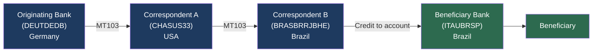

# رسائل SWIFT MT — البنية والتحليل والبنوك المراسلة

## نظرة عامة

تنقل شبكة SWIFT ‏(جمعية الاتصالات المالية العالمية بين البنوك) عشرات ملايين الرسائل يوميًا بين أكثر من 11,000 مؤسسة مالية في أكثر من 200 دولة وإقليم. وعلى مدى عقود كانت صيغة MT ‏(Message Type) العمود الفقري التشغيلي للمدفوعات العابرة للحدود.

> [!IMPORTANT]
> **الوضع في 2026:** انتهت في نوفمبر 2025 فترة التعايش بين MT وISO 20022 لتعليمات الدفع العابرة للحدود على SWIFT. فصارت تعليمات الدفع بين البنوك (MT103 وMT202 سابقًا) تُتبادل كرسائل ISO 20022 ‏(`pacs.008` و`pacs.009` — انظر الدرس 7). ومع ذلك تبقى معرفة MT أساسية: فكثير من أنظمة المكاتب الخلفية والواجهات الداخلية ما زالت تنتج MT أو تتوقعها، والأرشيفات والتحقيقات مليئة برسائل MT، ورسائل الكشوف والتقارير (MT940/MT950) تنتقل ببطء أكبر. ويجب على المهندسين الذين يصونون بوابات الدفع فهم بنية رسائل MT على مستوى البايت، وطوبولوجيا البنوك المراسلة التي تعبرها هذه الرسائل، وكيفية تحليلها والتحقق منها وتوجيهها بموثوقية في Java.

## أهداف التعلم

- وصف طوبولوجيا شبكة SWIFT بما فيها رموز BIC، وخدمة FIN، وسلاسل البنوك المراسلة
- تحديد الكتل الخمس لرسالة MT وشرح غرض كل حقل في الرأس والذيل
- تحليل رسالة MT103 حقلًا حقلًا، وربط أرقام الوسوم بدلالات العمل
- تنفيذ `SwiftMessageParser` في Java باستخدام prowide-core يستخرج الحقول الحرجة للدفع مع معالجة كاملة للأخطاء
- التمييز بين MT103 (تحويل ائتماني للعميل) وMT202 (تغطية بين المؤسسات المالية) وشرح متى يُستخدم كل منهما
- تحليل كشف عميل MT940 للمطابقة الآلية مع دفتر نوسترو
- شرح SWIFT gpi، واستخراج UETR من الوسم 121، وتتبع حالة الدفع عبر واجهة Tracker
- معالجة ردود رفض SWIFT ‏(NAK) وتنفيذ منطق إعادة المحاولة والتصعيد في Java

## سياق العمل

*مثال مركّب (مبني على أنماط فشل شائعة في الصناعة، لا على بنك بعينه):* اكتشف فريق عمليات المدفوعات في بنك أن آلاف رسائل MT103 الصادرة العابرة للحدود لم تصل إلى SWIFT أبدًا خلال يومين. فقد جعل رأس تطبيق مشوّه في الكتلة 2 — خطأ بحرف واحد في حقل الأولوية — الواجهة ترفضها، فبقيت في طابور داخلي. وبلغت القيمة المحتجزة مئات الملايين. ولم تلاحظ المراقبة ذلك، لأن عدد الطابور الداخلي وعدد إقرارات SWIFT كانا يُطابقان في نهاية اليوم فقط. وعندما وجدت العمليات الفجوة كان مستفيدون في عدة دول قد صعّدوا عبر بنوكهم؛ فدفع البنك فوائد تأخير وتكاليف إصلاح وأضر بعلاقاته مع البنوك المراسلة. والسبب الجذري: أداة تسلسل داخلية لم يُتحقق منها قط مقابل معايير SWIFT. ويبيّن هذا الدرس كيف تبني مسار MT صحيحًا ومختبرًا جيدًا لا يفشل بصمت أبدًا.

## بنية شبكة SWIFT

‏SWIFT ليست نظام دفع — بل **شبكة رسائل آمنة**. فلا ينتقل أي مال على SWIFT؛ بل تنتقل التعليمات فقط. وتتم التسوية عبر حسابات البنوك المراسلة أو أنظمة البنوك المركزية. وتُعرَّف كل مؤسسة على SWIFT بـ **رمز BIC ‏(Business Identifier Code)**، ويُسمى أيضًا رمز SWIFT.

صيغة BIC هي `BANKCCLL[BBB]`:
- `BANK` — رمز المؤسسة من 4 أحرف
- `CC` — رمز الدولة ISO 3166-1 alpha-2
- `LL` — رمز الموقع من حرفين
- `BBB` — رمز فرع اختياري من 3 أحرف (الحذف = المقر الرئيسي، و`XXX` = المقر الرئيسي صراحة)

**البنوك المراسلة** ترتيب يستخدم فيه البنك A (الذي لا وجود له في دولة أجنبية) البنكَ B (الموجود فيها) لتنفيذ المعاملات هناك. فيحتفظ البنك A بـ **حساب نوسترو** لدى البنك B ("مالنا في بنككم"). ويسجّل البنك B الحساب نفسه كـ **فوسترو** ("مالكم في بنكنا"). وقد يعبر دفع عابر للحدود بالدولار من بنك أوروبي صغير إلى مستفيد في البرازيل قفزتين أو ثلاثًا عبر بنوك مراسلة.



تضمن خدمة FIN (خدمة الرسائل الرئيسية في SWIFT) التسليم **بالتخزين والإرسال** مع أولوية قابلة للضبط: عاجلة (U)، أو عادية (N)، أو نظامية (S). وتُعطى كل رسالة **MIR ‏(Message Input Reference)** فريدًا عند الإدخال و**MOR ‏(Message Output Reference)** عند الإخراج.

> [!NOTE]
> ‏SWIFT Alliance Gateway وSWIFT Alliance Access وAlliance Connect Virtual السحابي هي منتجات الاتصال الرئيسية. وتشغّل معظم البنوك الكبيرة Alliance Access في مقرها، وهو يكتب الرسائل في قاعدة بيانات محلية قبل إرسالها. ويتكامل تطبيق Java لديك عادة عبر MQ ‏(IBM MQ / ActiveMQ) أو واجهات ملفات، لا مباشرة مع شبكة SWIFT.

## بنية كتل رسالة MT

تتكون رسالة MT من حتى خمس كتل، محددة بـ `{n:` و`}`:

| الكتلة | الاسم | إلزامية | المحتوى |
|-------|------|-----------|----------|
| 1 | الرأس الأساسي | نعم | عنوان LT، والجلسة/التسلسل |
| 2 | رأس التطبيق | نعم | نوع الرسالة، وBIC المستلم، والأولوية |
| 3 | رأس المستخدم | اختيارية عمومًا؛ مطلوبة للمدفوعات (UETR، الوسم 121) | أولوية البنك، وMUR، ونوع الخدمة، وUETR |
| 4 | كتلة النص | نعم | حقول MT الفعلية (الموسومة) |
| 5 | الذيل | تضيفها الواجهة المرسلة / الشبكة | المجموع الاختباري، وعلَم التكرار المحتمل |

تبدو رسالة MT103 دنيا على السلك هكذا:

```
{1:F01DEUTDEDBAXXX0000000001}
{2:I103CHASUS33XXXXN}
{3:{108:REF20241101001}{121:8a562c67-ca16-48ba-b074-65581be6f001}}
{4:
:20:TXREF20241101001
:23B:CRED
:32A:241101USD50000,00
:50K:/DE89370400440532013000
ACME EXPORTS GMBH
FRANKFURT AM MAIN
:57A:BOFAUS3N
:59:/123456789
WIDGETS INC
NEW YORK NY USA
:70:INVOICE INV-2024-00891
:71A:SHA
-}
{5:{CHK:3B4F2D1E9A7C}}
```

**الكتلة 1** ترمّز:
- `F` — معرّف التطبيق (F = FIN)
- `01` — معرّف الخدمة
- `DEUTDEDBAXXX` — عنوان LT ‏(Logical Terminal) للمرسل (BIC من 12 حرفًا)
- `0000` — رقم الجلسة
- `000001` — رقم التسلسل

**الكتلة 2** (نمط الإدخال ببادئة `I`): `I103CHASUS33XXXXN`
- `I` — اتجاه الإدخال (البنك يرسل إلى SWIFT)
- `103` — نوع الرسالة
- `CHASUS33XXXX` — BIC المستلم
- `N` — الأولوية (عادية)

> [!WARNING]
> للكتلة 2 صيغتان: **الإدخال** (بادئة `I`، عندما يرسل البنك إلى SWIFT) و**الإخراج** (بادئة `O`، عندما تسلّم SWIFT إلى البنك المستلم). وتنشأ أخطاء محللات كثيرة من معاملتهما بالشكل نفسه. فصيغة الإخراج تتضمن تاريخ ووقت المرسل وMIR، فتضيف بايتات كثيرة قبل حقل الأولوية.

**الكتلة 4** تحتوي الحقول الموسومة. ويبدأ كل حقل بـ `:TAG:` أو `:TAG/QUALIFIER:`. وتستخدم قيم الحقول متعددة الأسطر قاعدة الاستمرار (الأسطر بعد الأول تبدأ دون نقطتين). وتنتهي الكتلة 4 بـ `-}`.

**ذيول الكتلة 5** تشمل:
- `CHK` — مجموع اختباري من 12 حرفًا ست عشريًا
- `MAC` — رمز مصادقة الرسالة (تبادل مفاتيح ثنائي قديم؛ حلّت محله مصادقة مبنية على PKI)
- `PDE` — علَم الإرسال المكرر المحتمل (يضعه المرسل عند إعادة الإرسال)
- `PDM` — علَم الرسالة المكررة المحتملة (تضعه SWIFT عند إعادة التسليم)

## تفصيل MT103 حقلًا حقلًا

‏MT103 حصان العمل في التحويلات الائتمانية الدولية للعملاء. وهذه أهم الحقول:

| الوسم | الاسم | إلزامي/اختياري | الصيغة | مثال |
|-----|------|-----|--------|---------|
| 20 | الرقم المرجعي للمعاملة | M | 16x | `TXREF20241101001` |
| 23B | رمز العملية البنكية | M | 4!a | `CRED` |
| 32A | تاريخ القيمة / العملة / المبلغ | M | 6!n3!a15d | `241101USD50000,00` |
| 33B | العملة / المبلغ المطلوب | O | 3!a15d | `EUR46200,00` |
| 50a (A أو F أو K) | العميل الآمر | M | ‏50K: حساب + 4*35x | ACME EXPORTS GMBH |
| 52A | المؤسسة الآمرة | O | BIC | `DEUTDEDBAXXX` |
| 56A | المؤسسة الوسيطة | O | BIC | `IRVTUS3N` |
| 57A | المؤسسة صاحبة الحساب | O | BIC | `BOFAUS3N` |
| 59a (بلا حرف أو A أو F) | العميل المستفيد | M | حساب + 4*35x | WIDGETS INC |
| 70 | معلومات التحويل | O | 4*35x | `INVOICE INV-2024-00891` |
| 71A | تفاصيل الرسوم | M | 3!a | `SHA` / `OUR` / `BEN` |
| 71F | رسوم المرسل | O | 3!a15d | `USD25,00` |
| 72 | معلومات من المرسل إلى المستلم | O | 6*35x | `/INS/CHASUS33` |

> [!IMPORTANT]
> يستخدم الحقل 32A **الفاصلة كفاصل عشري**، والفاصلة **إلزامية** حتى عند عدم وجود كسور: `50000,00` و`50000,` كلاهما صالح ويعني خمسين ألفًا. والتحليل بـ `Double.parseDouble("50000,00")` يرمي `NumberFormatException`. فحوّل دائمًا إلى `BigDecimal` (استبدل الفاصلة أولًا)، وتحقق من ألا يتجاوز عدد الكسور ما تسمح به العملة.

و**UETR** ‏(المرجع الفريد للمعاملة من البداية للنهاية) ليس حقلًا في الكتلة 4: بل يُحمل في **الكتلة 3، الوسم `{121:}`**، وهو إلزامي لـ MT103 وMT202 على FIN منذ نوفمبر 2018.

## محلل SwiftMessageParser في Java

مكتبة **prowide-core** مفتوحة المصدر (WIFE سابقًا) هي الخيار المعياري لتحليل MT في Java. أضف الاعتمادية:

```xml
<!-- pom.xml -->
<dependency>
    <groupId>com.prowidesoftware</groupId>
    <artifactId>pw-swift-core</artifactId>
    <version>SRU2024-10.1.0</version> <!-- use the release for the current SWIFT standards year -->
</dependency>
```

محلل بمستوى إنتاجي يستخرج حقول الدفع ويتحقق من القيود الحرجة:

```java
import com.prowidesoftware.swift.model.SwiftMessage;
import com.prowidesoftware.swift.model.mt.mt1xx.MT103;
import com.prowidesoftware.swift.model.field.*;

import java.math.BigDecimal;
import java.time.LocalDate;
import java.time.format.DateTimeFormatter;
import java.util.Optional;

public class SwiftMessageParser {

    private static final DateTimeFormatter SWIFT_DATE = DateTimeFormatter.ofPattern("yyMMdd");

    public ParsedMt103 parseMt103(String rawMessage) {
        SwiftMessage swiftMessage = SwiftMessage.parse(rawMessage);

        if (swiftMessage == null || swiftMessage.getBlock4() == null) {
            throw new SwiftParseException("Null or empty Block4 — message is malformed");
        }

        MT103 mt103 = new MT103(swiftMessage);
        validateMandatoryFields(mt103);

        return ParsedMt103.builder()
                .transactionRef(extractField20(mt103))
                .valueDate(extractValueDate(mt103))
                .currency(extractCurrency(mt103))
                .amount(extractAmount(mt103))
                .orderingCustomer(extractOrderingCustomer(mt103))
                .beneficiary(extractBeneficiary(mt103))
                .accountWithInstitution(extractAwi(mt103))
                .chargeBearer(extractChargeBearer(mt103))
                .remittanceInfo(extractRemittance(mt103))
                .uetr(extractUetr(mt103))
                .build();
    }

    private void validateMandatoryFields(MT103 mt103) {
        if (mt103.getField20() == null) {
            throw new SwiftValidationException("MT103 missing mandatory field 20 (TRN)");
        }
        if (mt103.getField32A() == null) {
            throw new SwiftValidationException("MT103 missing mandatory field 32A (Value/Currency/Amount)");
        }
        if (mt103.getField59() == null && mt103.getField59A() == null && mt103.getField59F() == null) {
            throw new SwiftValidationException("MT103 missing mandatory field 59 (Beneficiary)");
        }
        if (mt103.getField71A() == null) {
            throw new SwiftValidationException("MT103 missing mandatory field 71A (Charge Bearer)");
        }
    }

    private String extractField20(MT103 mt103) {
        return mt103.getField20().getValue().trim();
    }

    private LocalDate extractValueDate(MT103 mt103) {
        String raw = mt103.getField32A().getComponent1(); // yyMMdd
        return LocalDate.parse(raw, SWIFT_DATE);
    }

    private String extractCurrency(MT103 mt103) {
        return mt103.getField32A().getComponent2(); // ISO 4217
    }

    private BigDecimal extractAmount(MT103 mt103) {
        String raw = mt103.getField32A().getComponent3(); // e.g. "50000,00"
        return new BigDecimal(raw.replace(",", "."));
    }

    private String extractOrderingCustomer(MT103 mt103) {
        // Field 50K or 50A or 50F depending on structure used
        if (mt103.getField50K() != null) return mt103.getField50K().getValue();
        if (mt103.getField50A() != null) return mt103.getField50A().getValue();
        if (mt103.getField50F() != null) return mt103.getField50F().getValue();
        throw new SwiftValidationException("MT103 missing field 50 (Ordering Customer)");
    }

    private String extractBeneficiary(MT103 mt103) {
        if (mt103.getField59() != null)  return mt103.getField59().getValue();
        if (mt103.getField59A() != null) return mt103.getField59A().getValue();
        if (mt103.getField59F() != null) return mt103.getField59F().getValue();
        throw new SwiftValidationException("MT103 missing field 59 (Beneficiary)");
    }

    private Optional<String> extractAwi(MT103 mt103) {
        return Optional.ofNullable(mt103.getField57A())
                .map(Field57A::getValue)
                .map(String::trim);
    }

    private ChargeBearer extractChargeBearer(MT103 mt103) {
        return switch (mt103.getField71A().getValue().trim()) {
            case "SHA" -> ChargeBearer.SHARED;
            case "OUR" -> ChargeBearer.SENDER;
            case "BEN" -> ChargeBearer.BENEFICIARY;
            default -> throw new SwiftValidationException(
                "Invalid 71A value: " + mt103.getField71A().getValue());
        };
    }

    private Optional<String> extractRemittance(MT103 mt103) {
        return Optional.ofNullable(mt103.getField70()).map(Field70::getValue);
    }

    private Optional<String> extractUetr(MT103 mt103) {
        // UETR is in block 3 service type identifier or field 121 (GPI)
        return Optional.ofNullable(mt103.getSwiftMessage().getBlock3())
                .map(b3 -> b3.getTagValue("121"));
    }
}
```

```java
// Domain model
public record ParsedMt103(
        String transactionRef,
        LocalDate valueDate,
        String currency,
        BigDecimal amount,
        String orderingCustomer,
        String beneficiary,
        Optional<String> accountWithInstitution,
        ChargeBearer chargeBearer,
        Optional<String> remittanceInfo,
        Optional<String> uetr
) {}

public enum ChargeBearer { SHARED, SENDER, BENEFICIARY }
```

## تحويل المؤسسات المالية MT202

يُستخدم MT202 في **التحويلات بين البنوك**، عادة كدفعة التغطية المرافقة لسلسلة MT103 أو لتسوية المراكز بين البنوك. وهو **لا** يحتوي حقلي العميل الآمر والعميل المستفيد — فهو بين البنوك حصرًا.

الفروق الأساسية عن MT103:

| الحقل | MT103 | MT202 |
|-------|-------|-------|
| 50 (العميل الآمر) | إلزامي | غير موجود |
| 59 (العميل المستفيد) | إلزامي | غير موجود |
| 58A (المؤسسة المستفيدة) | غير موجود | إلزامي |
| 21 (المرجع المرتبط) | غير موجود | إلزامي |
| 72 (من المرسل إلى المستلم) | اختياري | اختياري |

> [!NOTE]
> قُدّم MT202COV (النسخة "المغطاة") استجابة لتوصية من مجموعة العمل المالي (FATF). فعندما يرافق MT202COV دفع عميل، يجب أن يحتوي بيانات الآمر والمستفيد في الحقلين 50a و59a ضمن تسلسل إلزامي لـ "التحويل الائتماني الأساسي للعميل". وهذا سد ثغرة كانت فيها البنوك المراسلة لا تستطيع فحص العملاء النهائيين.

## كشف الحساب MT940 والمطابقة

‏MT940 هو **رسالة كشف العميل** التي يرسلها بنك إلى عميله (أو مراسله) ملخصًا حركات الحساب. وهو المصدر الأساسي لمطابقة النوسترو. (في رسالة إخراج كالتي أدناه، تحمل الكتلة 1 عنوان **المستلم** وتحمل الكتلة 2 عنوان **المرسل** داخل مرجع إدخال الرسالة.)

```
{1:F01DEUTDEDBAXXX0000000500}
{2:O9400900241102CHASUS33AXXX00000000012411020900N}
{4:
:20:STMT20241102001
:25:12345678901234
:28C:00050/001
:60F:C241101USD1250000,00
:61:2411021102C50000,00NTRFREF20241101001//CHREF001
:86:INCOMING WIRE TRANSFER
ACME EXPORTS GMBH
:62F:C241102USD1300000,00
-}
```

| الوسم | الاسم | المعنى |
|-----|------|---------|
| 20 | مرجع الكشف | مرجع فريد لهذا الكشف |
| 25 | تعريف الحساب | رقم الحساب |
| 28C | رقم الكشف / التسلسل | رقم الكشف / رقم الصفحة |
| 60F | الرصيد الافتتاحي | ‏C/D + التاريخ + العملة + المبلغ |
| 61 | سطر الكشف | معاملة منفردة (تاريخ القيمة، وتاريخ القيد، ومدين/دائن، والمبلغ، والنوع، والمرجع) |
| 86 | معلومات لصاحب الحساب | سرد نصي حر للحقل 61 |
| 62F | الرصيد الختامي | رصيد نهاية اليوم |

معالج مطابقة بلغة Java يطابق مدخلات MT940 مع ترحيلات النوسترو المتوقعة:

```java
import com.prowidesoftware.swift.model.mt.mt9xx.MT940;
import com.prowidesoftware.swift.model.field.Field61;

import java.math.BigDecimal;
import java.util.List;
import java.util.stream.Collectors;

public class NostroReconciliationService {

    private final NostroLedgerRepository ledger;

    public ReconciliationResult reconcile(String mt940Raw) {
        MT940 stmt = MT940.parse(mt940Raw);
        String accountId = stmt.getField25().getValue().trim();
        BigDecimal openingBalance = parseBalance(stmt.getField60F().getValue());

        List<StatementEntry> statementEntries = stmt.getField61()
                .stream()
                .map(this::toStatementEntry)
                .collect(Collectors.toList());

        List<NostroPosting> ledgerPostings = ledger.findByAccountAndDate(
                accountId, stmt.getField60F().getComponent2());

        return ReconciliationEngine.match(statementEntries, ledgerPostings, openingBalance);
    }

    private StatementEntry toStatementEntry(Field61 f61) {
        String dOrC     = f61.getComponent3(); // "D", "C", "RD", "RC"
        BigDecimal amt  = new BigDecimal(f61.getComponent5().replace(",", "."));
        // "RC" = reversal of a credit → a DEBIT; "RD" = reversal of a debit → a CREDIT
        boolean isDebit = dOrC.equals("D") || dOrC.equals("RC");
        return new StatementEntry(
                f61.getComponent1(),                     // value date
                isDebit ? amt.negate() : amt,
                f61.getComponent8(),                     // reference for the account owner
                f61.getComponent9()                      // reference of the servicing institution
        );
    }

    private BigDecimal parseBalance(String raw) {
        // Format: C/D + 6-digit date + 3-char currency + amount,cents
        boolean credit = raw.charAt(0) == 'C';
        String amountPart = raw.substring(10).replace(",", ".");
        BigDecimal value = new BigDecimal(amountPart);
        return credit ? value : value.negate();
    }
}
```

انتبه: "RC" عكس إضافة ← فهو **خصم**؛ و"RD" عكس خصم ← فهو **إضافة**. ومكوّن المرجع لصاحب الحساب هو 8 ومرجع المؤسسة الخادمة هو 9.

## SWIFT gpi وتتبع UETR

‏SWIFT gpi ‏(Global Payments Innovation) خدمة تضيف فوق بنية MT تتبعًا من البداية للنهاية، واتفاقيات سرعة، وشفافية في الرسوم. وتتطلب gpi:

1. ‏**UETR** — معرّف UUID v4 — في الكتلة 3، الوسم `{121:}`، يبقى دون تغيير لدى كل بنك في السلسلة (مع نوع خدمة gpi في الوسم `{111:}`)
2. يجب على كل بنك في السلسلة تحديث gpi Tracker خلال **ساعات** (الاتفاقية المعيارية إضافة الدفعة في اليوم نفسه، وتُضاف أغلبها خلال دقائق)
3. تُبلغ رموز الحالة: `ACSP` (مقبول، والتسوية قيد التنفيذ)، و`ACCC` (مقبول، واكتملت الإضافة)، و`RJCT` (مرفوض)

```java
public class GpiTracker {

    private final SwiftTrackerApiClient trackerClient;

    public PaymentStatus queryStatus(String uetr) {
        GpiTrackerResponse response = trackerClient.getTransaction(uetr);
        return switch (response.getTransactionStatus()) {
            case "ACCC" -> PaymentStatus.CREDITED;
            case "ACSP" -> PaymentStatus.IN_TRANSIT;
            case "RJCT" -> PaymentStatus.REJECTED;
            case "PDNG" -> PaymentStatus.PENDING;
            default -> PaymentStatus.UNKNOWN;
        };
    }

    public String generateUetr() {
        return java.util.UUID.randomUUID().toString();
    }

    public void updateTrackerOnCredit(String uetr, String creditedAccountBic,
                                       BigDecimal amount, String currency) {
        trackerClient.postStatusUpdate(GpiStatusUpdate.builder()
                .uetr(uetr)
                .transactionStatus("ACCC")
                .instructedAmount(amount)
                .instructedCurrency(currency)
                .creditedDebtorAccount(creditedAccountBic)
                .acceptanceDateTime(java.time.OffsetDateTime.now())
                .build());
    }
}
```

## معالجة الأخطاء ورموز الرفض

تتحقق SWIFT FIN من كل رسالة عند الإدخال وتجيب بإقرار إيجابي (ACK) أو سلبي (NAK)؛ ويحمل NAK رمز خطأ. ولاحقًا قد يرفض البنك المستلم الدفعة نفسها (برسالة MT199/MT299، أو لـ gpi بحالة `RJCT` في المتتبع). وتأتي رموز الأخطاء في عائلات — ابحث عن الرموز الدقيقة في وثائق رموز أخطاء FIN من SWIFT:

| العائلة | المعنى | المعالجة في Java |
|------|---------|---------------|
| رموز H | أخطاء الرأس (الكتلة 1/2/3) | حرجة — أداة التسلسل معطوبة؛ توقف وأصلح، لا تُعد المحاولة |
| رموز T | أخطاء التحقق من كتلة النص (الحقول) — مثل رمز عملة غير صالح (T52) أو حقل سيئ الصيغة | دائمة — طابور الرسائل الميتة والإصلاح |
| BIC غير صالح في حقل | ‏BIC غير موجود في دليل SWIFT | دائمة — تحقق من رموز BIC قبل الإرسال |
| لا ACK ولا NAK (انتهاء مهلة، أو إجهاض الجلسة) | النتيجة مجهولة | افحص السجل المحلي؛ وأعد الإرسال فقط مع علَم PDE |

```java
public class SwiftSubmissionService {

    private final SwiftGateway gateway;
    private final DeadLetterQueue dlq;

    public SubmissionResult submit(ParsedMt103 payment) {
        String mtRaw;
        try {
            mtRaw = Mt103Serializer.serialize(payment);
        } catch (SerializationException ex) {
            dlq.enqueue(payment, "SERIALIZATION_FAILURE", ex.getMessage());
            return SubmissionResult.failure("SERIALIZATION_FAILURE");
        }

        GatewayResponse response = gateway.send(mtRaw);

        return switch (response.getAck()) {
            case ACK  -> SubmissionResult.success(response.getMir());
            case NAK  -> handleNak(payment, response);
            case TIMEOUT -> {
                // Outcome unknown: check the interface journal before any resend.
                // A resend must carry the PDE (Possible Duplicate Emission) trailer
                // and the SAME field 20 and UETR, so receivers can detect it
                boolean alreadyAcked = gateway.journalHasAck(payment.transactionRef());
                yield alreadyAcked
                        ? SubmissionResult.success(gateway.journalMir(payment.transactionRef()))
                        : SubmissionResult.resendWithPde(response.getCode());
            }
        };
    }

    private SubmissionResult handleNak(ParsedMt103 payment, GatewayResponse response) {
        String code = response.getNakCode();
        if (code.startsWith("H")) {
            // Header error: every message from this serializer will fail — page someone
            alerts.critical("SWIFT header NAK " + code + " — serializer broken");
            dlq.enqueue(payment, "HEADER_ERROR", code);
            return SubmissionResult.failure(code);
        }
        // Field validation and other rejections are permanent for THIS message:
        // repair the data, never auto-retry the same bytes
        dlq.enqueue(payment, code.startsWith("T") ? "FIELD_VALIDATION" : "SWIFT_REJECTION", code);
        return SubmissionResult.failure(code);
    }
}
```

عند انتهاء المهلة تكون النتيجة مجهولة: افحص سجل الواجهة قبل أي إعادة إرسال. ويجب أن تحمل إعادة الإرسال ذيل PDE ونفس الحقل 20 وUETR، ليكتشفها المستلمون.

> [!WARNING]
> لا تُعد أبدًا محاولة NAK تلقائيًا دون تشخيص رمز الرفض أولًا. فـ NAK يعني أن SWIFT استلمت الرسالة ورفضتها: وإعادة إرسال البايتات نفسها ستُرفض مجددًا. ولا يكون غياب الإقرار (انتهاء المهلة) مرشحًا لإعادة الإرسال إلا مع علَم PDE. فابنِ طبقة تصنيف تميز أخطاء الشبكة مجهولة النتيجة عن الرفض الدائم قبل أي منطق إعادة محاولة.

## اختبار المعرفة

**س1: تصل رسالة MT103 حقلها 32A يحتوي `241101EUR1234567,` (لاحظ الفاصلة اللاحقة دون سنتات). ويحوّله محللك إلى `new BigDecimal("1234567.")`. هل يجب قبول هذه الرسالة؟**

ج: نعم. ففي حقول المبالغ في SWIFT تكون الفاصلة العشرية **إلزامية**، والأرقام بعدها اختيارية — فـ `1234567,` مبلغ صالح قدره 1,234,567.00 يورو. والفحوص المهمة: فاصلة واحدة بالضبط، ورقم واحد على الأقل قبلها، وعدد كسور لا يتجاوز ما تسمح به العملة (اثنان لليورو)، والطول الكلي ضمن 15 حرفًا. والمحلل الذي يرفض `1234567,` سيرفض مدفوعات صالحة خطأً؛ وأداة التسلسل التي تكتب `1234567` (دون فاصلة) تنتج رسالة غير صالحة.

**س2: ترسل بوابة SWIFT لديك رسالة MT103 ولا تتلقى ACK ولا NAK خلال نافذة المهلة. كيف يجب أن يتعامل نظامك مع سيناريو الإرسال المكرر المحتمل؟**

ج: عند انتهاء المهلة قد تكون SWIFT استلمت الرسالة وقد لا تكون. وإعادة الإرسال دون ضمانات تعرّض المستفيد لإضافة مزدوجة. والبروتوكول الصحيح: (1) افحص السجل المحلي للواجهة (مثل Alliance Access) بحثًا عن ACK وMIR للرسالة الأصلية، فقد يصل الإقرار متأخرًا؛ (2) استعلم gpi Tracker بالـ UETR — فإذا كانت الدفعة معروفة هناك فقد سُلّمت ويجب منع إعادة الإرسال؛ (3) فقط إن لم يوجد أي أثر، أعد الإرسال مع ذيل PDE ‏`{PDE:}` و**نفس** الحقل 20 وUETR، ليتعرف البنك المستلم على التكرار المحتمل ويتحقق قبل الإضافة.

## التحدي العملي

1. **تنفيذ المحلل:** باستخدام prowide-core، اكتب `SwiftMt940Parser` يقرأ رسالة MT940 ويعيد قائمة سجلات `StatementLine` تحتوي: تاريخ القيمة، وتاريخ القيد، ومؤشر المدين/الدائن، والمبلغ كـ `BigDecimal`، ومرجع العميل، ومرجع البنك. وتحقق من أن مجموع كل مدخلات المدين والدائن يطابق الفرق بين رصيدي الحقلين 60F و62F. وارمِ `ReconciliationException` بقيمة الفرق إذا لم يتطابقا.

2. **أداة تسلسل MT103 مع gpi:** اكتب صنف `Mt103Builder` يبني نص MT103 خامًا صالحًا من كائن نطاق `PaymentInstruction`. ويجب أن: يولّد UETR من نوع UUID v4 ويحقنه في الكتلة 3 كوسم `{121:}`؛ ويصيغ الحقل 32A بشكل صحيح (الفاصلة العشرية الإلزامية، وصيغة التاريخ `yyMMdd`)؛ ويفرض حد 16 حرفًا للحقل 20؛ ويقسم معلومات التحويل في الحقل 70 إلى 4 أسطر كحد أقصى لا يتجاوز كل منها 35 حرفًا (مع رفض النص الأطول أو قصّه بقاعدة صريحة).

3. **خدمة تصنيف الأخطاء:** نفّذ `SwiftNakClassifier` يعيد إحدى ثلاث قيم تعداد: `UNKNOWN_OUTCOME_RESEND_WITH_PDE` (لا ACK/NAK)، و`PERMANENT_HEADER_ERROR` (رموز H)، و`PERMANENT_FIELD_ERROR` (رموز T وحالات NAK الأخرى). واكتب اختبارات وحدة لرمز H، ورمز T مثل T52، ورمز مجهول، وانتهاء مهلة. ويجب أن يقرأ المصنّف قواعده من خريطة إعداد محقونة ليبقى قابلًا للتوسع دون تغيير الشيفرة.

4. **مهمة استطلاع حالة gpi:** اكتب مهمة Spring ‏`@Scheduled` تستعلم SWIFT gpi Tracker عن كل المدفوعات الجارية (الحالة `ACSP`) الأقدم من 4 ساعات. ولكل منها اجلب الحالة الحالية. فإن بقيت `ACSP` أطلق تنبيه مراقبة. وإن كانت `ACCC` حدّث سجل الدفعة إلى `CREDITED` وحرّر أي حجوزات لاحقة. وإن كانت `RJCT` أطلق مسار إصلاح الدفعة. وتأكد من أن المهمة عديمة التكرار وآمنة للتشغيل على عدة عقد باستخدام قفل استشاري في قاعدة البيانات أو قفل موزع عبر Redis.

<!-- KNOWLEDGE-CHECK
{
  "questions": [
    {
      "text": "يحتوي الحقل 32A في رسالة MT103 على `241101EUR1234567,` (فاصلة لاحقة، دون سنتات). وينتج محللك `new BigDecimal(\"1234567.\")`. هل يجب قبول هذه الرسالة؟",
      "options": [
        "نعم — في مبالغ SWIFT الفاصلة العشرية إلزامية والأرقام بعدها اختيارية، فهذا مبلغ صالح قدره 1,234,567.00",
        "لا — الفاصلة اللاحقة دون سنتات تخالف الصيغة ويجب رفضها",
        "نعم — لكن فقط بعد تحويلها إلى 1234567,00 وطلب إعادة الإرسال من المرسل",
        "لا — ارفضها كرمز BIC غير صالح"
      ],
      "correct": 0,
      "explanation": "تحتوي حقول المبالغ في SWIFT دائمًا على فاصلة عشرية إلزامية؛ وأرقام الكسور اختيارية. فـ `1234567,` صالح ويعني 1,234,567.00 يورو. وما يجب التحقق منه: فاصلة واحدة بالضبط، ورقم واحد على الأقل قبلها، وعدد كسور لا يتجاوز ما تسمح به العملة، والطول الأقصى (15). ورفض الفاصلة اللاحقة سيرفض مدفوعات صالحة."
    },
    {
      "text": "ترسل بوابة SWIFT لديك رسالة MT103 ولا تتلقى ACK ولا NAK خلال نافذة المهلة. ما البروتوكول الصحيح للتعامل مع سيناريو الإرسال المكرر المحتمل؟",
      "options": [
        "أعد إرسال الرسالة نفسها فورًا دون أي تغيير",
        "ألغِ الدفعة وأبلغ العميل",
        "افحص السجل المحلي بحثًا عن ACK، وافحص gpi Tracker بالـ UETR، وفقط إن لم يوجد أثر أعد الإرسال مع علَم PDE ونفس الحقل 20 وUETR",
        "انتظر 24 ساعة قبل اتخاذ أي إجراء"
      ],
      "correct": 2,
      "explanation": "عند انتهاء المهلة تكون النتيجة مجهولة. فافحص أولًا السجل المحلي للواجهة بحثًا عن ACK/MIR متأخر، ثم gpi Tracker بالـ UETR — فإذا كانت الدفعة معروفة فقد سُلّمت ويجب ألا يُعاد إرسالها. وفقط إن لم يوجد أثر، أعد الإرسال مع ذيل PDE (الإرسال المكرر المحتمل) ونفس الحقل 20 وUETR، ليكتشف المستلمون التكرار المحتمل قبل الإضافة."
    },
    {
      "text": "أي كتلة في SWIFT تحتوي UETR (المرجع الفريد للمعاملة من البداية للنهاية) الذي يستخدمه تتبع gpi؟",
      "options": [
        "الكتلة 1 (الرأس الأساسي)",
        "الكتلة 2 (رأس التطبيق)",
        "الكتلة 3 (رأس المستخدم)، الوسم {121:}",
        "الكتلة 4 (كتلة النص)، الحقل 20"
      ],
      "correct": 2,
      "explanation": "‏UETR معرّف UUID v4 يوضع في الكتلة 3 (رأس المستخدم) تحت الوسم `{121:}`. وهو إلزامي لـ MT103 وMT202 على FIN منذ نوفمبر 2018؛ ويولّده البنك المنشئ ويجب أن يمرره كل بنك في السلسلة دون تغيير، مما يتيح تتبع gpi من البداية للنهاية."
    }
  ]
}
-->

<!-- PRACTICAL-CHALLENGE
{
  "title": "معالجة SWIFT MT وتنفيذ تتبع gpi",
  "difficulty": "advanced",
  "estimatedMinutes": 45,
  "tasks": [
    {
      "id": "1",
      "description": "باستخدام prowide-core، اكتب `SwiftMt940Parser` يقرأ رسالة MT940 ويعيد قائمة سجلات `StatementLine`. وتحقق من أن مجموع كل مدخلات المدين والدائن يطابق الفرق بين رصيدي الحقلين 60F و62F. وارمِ `ReconciliationException` بقيمة الفرق إذا لم يتطابقا."
    },
    {
      "id": "2",
      "description": "اكتب صنف `Mt103Builder` يبني نص MT103 خامًا صالحًا من كائن نطاق `PaymentInstruction`. ولّد UETR من نوع UUID v4 واحقنه في الكتلة 3 كوسم `{121:}`؛ وصِغ الحقل 32A بشكل صحيح بالفاصلة العشرية الإلزامية وصيغة التاريخ `yyMMdd`؛ وافرض حد 16 حرفًا للحقل 20."
    },
    {
      "id": "3",
      "description": "نفّذ `SwiftNakClassifier` يصنّف نتيجة الإرسال كـ `UNKNOWN_OUTCOME_RESEND_WITH_PDE` (لا ACK/NAK)، أو `PERMANENT_HEADER_ERROR` (رموز H)، أو `PERMANENT_FIELD_ERROR` (رموز T وحالات NAK الأخرى). واكتب اختبارات وحدة لرمز H، ورمز T مثل T52، ورمز مجهول، وانتهاء مهلة. ويجب أن يقرأ المصنّف قواعده من خريطة إعداد محقونة."
    },
    {
      "id": "4",
      "description": "اكتب مهمة Spring ‏`@Scheduled` تستعلم SWIFT gpi Tracker عن كل المدفوعات الجارية (الحالة `ACSP`) الأقدم من 4 ساعات. وحدّث الحالة إلى `CREDITED` عند `ACCC`، وأطلق الإصلاح عند `RJCT`، وأطلق تنبيهات للمدفوعات التي ما زالت `ACSP`. وتأكد من أن المهمة عديمة التكرار عبر عدة عقد باستخدام قفل موزع."
    }
  ]
}
-->
