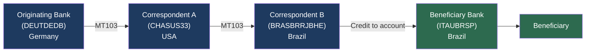

## Overview

SWIFT (Society for Worldwide Interbank Financial Telecommunication) carries tens of millions of messages per day between more than 11,000 financial institutions in over 200 countries and territories. For decades the MT (Message Type) format was the operational backbone of cross-border payments.

> [!IMPORTANT]
> **Status in 2026:** the MT/ISO 20022 coexistence period for cross-border payment instructions on SWIFT ended in November 2025. Payment instructions between banks (formerly MT103, MT202) are now exchanged as ISO 20022 messages (`pacs.008`, `pacs.009` — see Lesson 7). MT knowledge is still essential: many back-office systems and internal interfaces still produce or expect MT, archives and investigations are full of MT, and statement and reporting messages (MT940/MT950) are migrating more slowly. Engineers maintaining payment gateways must understand the byte-level structure of MT messages, the correspondent banking topology those messages traverse, and how to parse, validate, and route them reliably in Java.

## Learning Objectives

- Describe the SWIFT network topology including BIC codes, the FIN service, and correspondent banking chains
- Identify all five blocks of an MT message and explain the purpose of each header and trailer field
- Parse an MT103 message field-by-field, mapping tag numbers to business semantics
- Implement a `SwiftMessageParser` in Java using prowide-core that extracts payment-critical fields with full error handling
- Distinguish MT103 (customer credit transfer) from MT202 (financial institution cover) and explain when each is used
- Parse an MT940 customer statement for automated reconciliation against a nostro ledger
- Explain SWIFT GPI, extract the UETR from field 121, and track payment status via the Tracker API
- Handle SWIFT rejection codes (NAK, NACK) and implement retry/escalation logic in Java

## Business Context

*Composite example (based on common industry failure patterns, not a specific bank):* a bank's payment operations team discovered that thousands of outgoing cross-border MT103 messages had never reached SWIFT over a two-day window. A malformed Block 2 application header — a one-character error in the priority field — made the interface reject them, and they sat in an internal queue. The total trapped value ran into hundreds of millions. Monitoring did not notice, because the internal queue count and the SWIFT acknowledgement count were reconciled only at end-of-day. By the time operations found the gap, beneficiaries in several countries had escalated through their banks; the bank paid penalty interest and repair costs and damaged relationships with correspondent banks. The root cause was an internal serializer that had never been validated against the SWIFT standards. This lesson shows how to build a correct, well-tested MT pipeline that never fails silently.

## SWIFT Network Architecture

SWIFT is not a payment system — it is a **secure messaging network**. No money moves on SWIFT; only instructions move. Settlement happens through correspondent accounts or central bank systems. Every institution on SWIFT is identified by a **BIC (Business Identifier Code)**, also called a SWIFT code.

A BIC has the format `BANKCCLL[BBB]`:
- `BANK` — 4-character institution code
- `CC` — ISO 3166-1 alpha-2 country code
- `LL` — 2-character location code
- `BBB` — optional 3-character branch code (omitted = head office, `XXX` = head office explicitly)

**Correspondent banking** is the arrangement by which Bank A (without a presence in a foreign country) uses Bank B (which has that presence) to execute transactions there. Bank A holds a **nostro account** at Bank B ("our money at your bank"). Bank B records the same account as a **vostro** ("your money at our bank"). A cross-border USD payment from a small European bank to a beneficiary in Brazil may traverse two or three correspondent hops.



The FIN service (the main SWIFT messaging service) guarantees **store-and-forward** delivery with configurable priority: Urgent (U), Normal (N), or System (S). Every message is assigned a unique **MIR (Message Input Reference)** at the input side and a **MOR (Message Output Reference)** at the output side.

> [!NOTE]
> SWIFT Alliance Gateway, SWIFT Alliance Access, and cloud-based SWIFT Alliance Connect Virtual are the main connectivity products. Most large banks run on-premises Alliance Access, which writes messages to a local database before forwarding. Your Java application typically integrates via MQ (WebSphere MQ / ActiveMQ / IBM MQ) or file-based interfaces, not directly to the SWIFT network.

## MT Message Block Structure

An MT message is composed of up to five blocks, delimited by `{n:` and `}`:

| Block | Name | Mandatory | Contents |
|-------|------|-----------|----------|
| 1 | Basic Header | Yes | LT address, session/sequence |
| 2 | Application Header | Yes | Message type, receiver BIC, priority |
| 3 | User Header | Optional in general; required for payments (UETR, tag 121) | Bank priority, MUR, service type, UETR |
| 4 | Text Block | Yes | The actual MT fields (tagged) |
| 5 | Trailer | Added by the sending interface / network | Checksum, possible duplicate flag |

A minimal MT103 message on the wire looks like:

```
{1:F01DEUTDEDBAXXX0000000001}
{2:I103CHASUS33XXXXN}
{3:{108:REF20241101001}{121:8a562c67-ca16-48ba-b074-65581be6f001}}
{4:
:20:TXREF20241101001
:23B:CRED
:32A:241101USD50000,00
:50K:/DE89370400440532013000
ACME EXPORTS GMBH
FRANKFURT AM MAIN
:57A:BOFAUS3N
:59:/123456789
WIDGETS INC
NEW YORK NY USA
:70:INVOICE INV-2024-00891
:71A:SHA
-}
{5:{CHK:3B4F2D1E9A7C}}
```

**Block 1** encodes:
- `F` — Application identifier (F = FIN)
- `01` — Service identifier
- `DEUTDEDBAXXX` — LT (Logical Terminal) address of the sender (12-char BIC)
- `0000` — Session number
- `000001` — Sequence number

**Block 2** (Input mode `I` prefix): `I103CHASUS33XXXXN`
- `I` — Input direction (bank sending to SWIFT)
- `103` — Message type
- `CHASUS33XXXX` — Receiver BIC
- `N` — Priority (Normal)

> [!WARNING]
> Block 2 has two forms: **Input** (`I` prefix, used when a bank sends to SWIFT) and **Output** (`O` prefix, used when SWIFT delivers to the receiver bank). Many parser bugs arise from treating them identically. The output form includes a sender's date-time and the MIR, adding significant extra bytes before the priority field.

**Block 4** contains tagged fields. Each field starts with `:TAG:` or `:TAG/QUALIFIER:`. Multi-line field values use the continuation convention (lines after the first begin with no colon). Block 4 is terminated with `-}`.

**Block 5 trailers** include:
- `CHK` — 12-hex-character checksum
- `MAC` — Message Authentication Code (older bilateral key exchange; replaced by PKI-based authentication)
- `PDE` — Possible Duplicate Emission flag (set by the sender on a resend)
- `PDM` — Possible Duplicate Message flag (set by SWIFT on a re-delivery)

## MT103 Field-by-Field Breakdown

MT103 is the workhorse of international customer credit transfers. The following are the most critical fields:

| Tag | Name | M/O | Format | Example |
|-----|------|-----|--------|---------|
| 20 | Transaction Reference Number | M | 16x | `TXREF20241101001` |
| 23B | Bank Operation Code | M | 4!a | `CRED` |
| 32A | Value Date / Currency / Amount | M | 6!n3!a15d | `241101USD50000,00` |
| 33B | Currency / Instructed Amount | O | 3!a15d | `EUR46200,00` |
| 50a (A, F or K) | Ordering Customer | M | 50K: account + 4*35x | ACME EXPORTS GMBH |
| 52A | Ordering Institution | O | BIC | `DEUTDEDBAXXX` |
| 56A | Intermediary Institution | O | BIC | `IRVTUS3N` |
| 57A | Account With Institution | O | BIC | `BOFAUS3N` |
| 59a (no letter, A or F) | Beneficiary Customer | M | account + 4*35x | WIDGETS INC |
| 70 | Remittance Information | O | 4*35x | `INVOICE INV-2024-00891` |
| 71A | Details of Charges | M | 3!a | `SHA` / `OUR` / `BEN` |
| 71F | Sender's Charges | O | 3!a15d | `USD25,00` |
| 72 | Sender to Receiver Information | O | 6*35x | `/INS/CHASUS33` |

> [!IMPORTANT]
> Field 32A uses a **comma as the decimal separator**, and the comma is **mandatory** even when there are no decimals: `50000,00` and `50000,` are both valid and mean fifty thousand. Parsing with `Double.parseDouble("50000,00")` throws `NumberFormatException`. Always convert to `BigDecimal` (replace the comma first), and check that the number of decimals does not exceed what the currency allows.

The **UETR** (Unique End-to-end Transaction Reference) is not a Block 4 field: it is carried in **Block 3, tag `{121:}`**, and has been mandatory for MT103 and MT202 on FIN since November 2018.

## Java SwiftMessageParser

The **prowide-core** (formerly WIFE) open-source library is the standard choice for MT parsing in Java. Add the dependency:

```xml
<!-- pom.xml -->
<dependency>
    <groupId>com.prowidesoftware</groupId>
    <artifactId>pw-swift-core</artifactId>
    <version>SRU2024-10.1.0</version> <!-- use the release for the current SWIFT standards year -->
</dependency>
```

A production-grade parser that extracts payment fields and validates critical constraints:

```java
import com.prowidesoftware.swift.model.SwiftMessage;
import com.prowidesoftware.swift.model.mt.mt1xx.MT103;
import com.prowidesoftware.swift.model.field.*;

import java.math.BigDecimal;
import java.time.LocalDate;
import java.time.format.DateTimeFormatter;
import java.util.Optional;

public class SwiftMessageParser {

    private static final DateTimeFormatter SWIFT_DATE = DateTimeFormatter.ofPattern("yyMMdd");

    public ParsedMt103 parseMt103(String rawMessage) {
        SwiftMessage swiftMessage = SwiftMessage.parse(rawMessage);

        if (swiftMessage == null || swiftMessage.getBlock4() == null) {
            throw new SwiftParseException("Null or empty Block4 — message is malformed");
        }

        MT103 mt103 = new MT103(swiftMessage);
        validateMandatoryFields(mt103);

        return ParsedMt103.builder()
                .transactionRef(extractField20(mt103))
                .valueDate(extractValueDate(mt103))
                .currency(extractCurrency(mt103))
                .amount(extractAmount(mt103))
                .orderingCustomer(extractOrderingCustomer(mt103))
                .beneficiary(extractBeneficiary(mt103))
                .accountWithInstitution(extractAwi(mt103))
                .chargeBearer(extractChargeBearer(mt103))
                .remittanceInfo(extractRemittance(mt103))
                .uetr(extractUetr(mt103))
                .build();
    }

    private void validateMandatoryFields(MT103 mt103) {
        if (mt103.getField20() == null) {
            throw new SwiftValidationException("MT103 missing mandatory field 20 (TRN)");
        }
        if (mt103.getField32A() == null) {
            throw new SwiftValidationException("MT103 missing mandatory field 32A (Value/Currency/Amount)");
        }
        if (mt103.getField59() == null && mt103.getField59A() == null && mt103.getField59F() == null) {
            throw new SwiftValidationException("MT103 missing mandatory field 59 (Beneficiary)");
        }
        if (mt103.getField71A() == null) {
            throw new SwiftValidationException("MT103 missing mandatory field 71A (Charge Bearer)");
        }
    }

    private String extractField20(MT103 mt103) {
        return mt103.getField20().getValue().trim();
    }

    private LocalDate extractValueDate(MT103 mt103) {
        String raw = mt103.getField32A().getComponent1(); // yyMMdd
        return LocalDate.parse(raw, SWIFT_DATE);
    }

    private String extractCurrency(MT103 mt103) {
        return mt103.getField32A().getComponent2(); // ISO 4217
    }

    private BigDecimal extractAmount(MT103 mt103) {
        String raw = mt103.getField32A().getComponent3(); // e.g. "50000,00"
        return new BigDecimal(raw.replace(",", "."));
    }

    private String extractOrderingCustomer(MT103 mt103) {
        // Field 50K or 50A or 50F depending on structure used
        if (mt103.getField50K() != null) return mt103.getField50K().getValue();
        if (mt103.getField50A() != null) return mt103.getField50A().getValue();
        if (mt103.getField50F() != null) return mt103.getField50F().getValue();
        throw new SwiftValidationException("MT103 missing field 50 (Ordering Customer)");
    }

    private String extractBeneficiary(MT103 mt103) {
        if (mt103.getField59() != null)  return mt103.getField59().getValue();
        if (mt103.getField59A() != null) return mt103.getField59A().getValue();
        if (mt103.getField59F() != null) return mt103.getField59F().getValue();
        throw new SwiftValidationException("MT103 missing field 59 (Beneficiary)");
    }

    private Optional<String> extractAwi(MT103 mt103) {
        return Optional.ofNullable(mt103.getField57A())
                .map(Field57A::getValue)
                .map(String::trim);
    }

    private ChargeBearer extractChargeBearer(MT103 mt103) {
        return switch (mt103.getField71A().getValue().trim()) {
            case "SHA" -> ChargeBearer.SHARED;
            case "OUR" -> ChargeBearer.SENDER;
            case "BEN" -> ChargeBearer.BENEFICIARY;
            default -> throw new SwiftValidationException(
                "Invalid 71A value: " + mt103.getField71A().getValue());
        };
    }

    private Optional<String> extractRemittance(MT103 mt103) {
        return Optional.ofNullable(mt103.getField70()).map(Field70::getValue);
    }

    private Optional<String> extractUetr(MT103 mt103) {
        // UETR is in block 3 service type identifier or field 121 (GPI)
        return Optional.ofNullable(mt103.getSwiftMessage().getBlock3())
                .map(b3 -> b3.getTagValue("121"));
    }
}
```

```java
// Domain model
public record ParsedMt103(
        String transactionRef,
        LocalDate valueDate,
        String currency,
        BigDecimal amount,
        String orderingCustomer,
        String beneficiary,
        Optional<String> accountWithInstitution,
        ChargeBearer chargeBearer,
        Optional<String> remittanceInfo,
        Optional<String> uetr
) {}

public enum ChargeBearer { SHARED, SENDER, BENEFICIARY }
```

## MT202 Financial Institution Transfer

MT202 is used for **bank-to-bank transfers**, typically as the cover payment that accompanies a serial MT103 chain or settles interbank positions. It does **not** contain ordering customer or beneficiary customer fields — those are strictly interbank.

Key differences from MT103:

| Field | MT103 | MT202 |
|-------|-------|-------|
| 50 (Ordering Customer) | Mandatory | Not present |
| 59 (Beneficiary Customer) | Mandatory | Not present |
| 58A (Beneficiary Institution) | Not present | Mandatory |
| 21 (Related Reference) | Not present | Mandatory |
| 72 (Sender to Receiver) | Optional | Optional |

> [!NOTE]
> MT202COV (the "covered" variant) was introduced to address a FATF recommendation. When an MT202COV accompanies a customer payment, it must contain the originator and beneficiary details in field 50a and 59a of a mandatory "underlying customer credit transfer" sequence. This closed a loophole where correspondent banks could not screen end-customers.

## MT940 Account Statement and Reconciliation

MT940 is the **customer statement message** sent by a bank to its customer (or correspondent) summarizing account movements. It is the primary feed for nostro reconciliation. (In an output message like the one below, Block 1 holds the **receiver**'s address and Block 2 holds the **sender**'s address inside the Message Input Reference.)

```
{1:F01DEUTDEDBAXXX0000000500}
{2:O9400900241102CHASUS33AXXX00000000012411020900N}
{4:
:20:STMT20241102001
:25:12345678901234
:28C:00050/001
:60F:C241101USD1250000,00
:61:2411021102C50000,00NTRFREF20241101001//CHREF001
:86:INCOMING WIRE TRANSFER
ACME EXPORTS GMBH
:62F:C241102USD1300000,00
-}
```

| Tag | Name | Meaning |
|-----|------|---------|
| 20 | Statement Reference | Unique reference for this statement |
| 25 | Account Identification | Account number |
| 28C | Statement / Sequence Number | Statement number / page number |
| 60F | Opening Balance | C/D + date + currency + amount |
| 61 | Statement Line | Individual transaction (value date, booking date, D/C, amount, type, ref) |
| 86 | Information to Account Owner | Free-text narrative for field 61 |
| 62F | Closing Balance | End-of-day balance |

A Java reconciliation processor that matches MT940 entries against expected nostro postings:

```java
import com.prowidesoftware.swift.model.mt.mt9xx.MT940;
import com.prowidesoftware.swift.model.field.Field61;

import java.math.BigDecimal;
import java.util.List;
import java.util.stream.Collectors;

public class NostroReconciliationService {

    private final NostroLedgerRepository ledger;

    public ReconciliationResult reconcile(String mt940Raw) {
        MT940 stmt = MT940.parse(mt940Raw);
        String accountId = stmt.getField25().getValue().trim();
        BigDecimal openingBalance = parseBalance(stmt.getField60F().getValue());

        List<StatementEntry> statementEntries = stmt.getField61()
                .stream()
                .map(this::toStatementEntry)
                .collect(Collectors.toList());

        List<NostroPosting> ledgerPostings = ledger.findByAccountAndDate(
                accountId, stmt.getField60F().getComponent2());

        return ReconciliationEngine.match(statementEntries, ledgerPostings, openingBalance);
    }

    private StatementEntry toStatementEntry(Field61 f61) {
        String dOrC     = f61.getComponent3(); // "D", "C", "RD", "RC"
        BigDecimal amt  = new BigDecimal(f61.getComponent5().replace(",", "."));
        // "RC" = reversal of a credit → a DEBIT; "RD" = reversal of a debit → a CREDIT
        boolean isDebit = dOrC.equals("D") || dOrC.equals("RC");
        return new StatementEntry(
                f61.getComponent1(),                     // value date
                isDebit ? amt.negate() : amt,
                f61.getComponent8(),                     // reference for the account owner
                f61.getComponent9()                      // reference of the servicing institution
        );
    }

    private BigDecimal parseBalance(String raw) {
        // Format: C/D + 6-digit date + 3-char currency + amount,cents
        boolean credit = raw.charAt(0) == 'C';
        String amountPart = raw.substring(10).replace(",", ".");
        BigDecimal value = new BigDecimal(amountPart);
        return credit ? value : value.negate();
    }
}
```

## SWIFT GPI and UETR Tracking

SWIFT Global Payments Innovation (GPI) is the overlay service that adds end-to-end tracking, speed SLAs, and fee transparency to the existing MT infrastructure. GPI mandates:

1. A **UETR (Unique End-to-end Transaction Reference)** — a UUID v4 — in Block 3, tag `{121:}`, kept unchanged by every bank in the chain (plus the gpi service type in tag `{111:}`)
2. Each bank in the chain must update the GPI Tracker within **hours** (the standard SLA is payment credited same day, with the majority credited within minutes)
3. Status codes are reported: `ACSP` (accepted, settlement in process), `ACCC` (accepted, credit completed), `RJCT` (rejected)

```java
public class GpiTracker {

    private final SwiftTrackerApiClient trackerClient;

    public PaymentStatus queryStatus(String uetr) {
        GpiTrackerResponse response = trackerClient.getTransaction(uetr);
        return switch (response.getTransactionStatus()) {
            case "ACCC" -> PaymentStatus.CREDITED;
            case "ACSP" -> PaymentStatus.IN_TRANSIT;
            case "RJCT" -> PaymentStatus.REJECTED;
            case "PDNG" -> PaymentStatus.PENDING;
            default -> PaymentStatus.UNKNOWN;
        };
    }

    public String generateUetr() {
        return java.util.UUID.randomUUID().toString();
    }

    public void updateTrackerOnCredit(String uetr, String creditedAccountBic,
                                       BigDecimal amount, String currency) {
        trackerClient.postStatusUpdate(GpiStatusUpdate.builder()
                .uetr(uetr)
                .transactionStatus("ACCC")
                .instructedAmount(amount)
                .instructedCurrency(currency)
                .creditedDebtorAccount(creditedAccountBic)
                .acceptanceDateTime(java.time.OffsetDateTime.now())
                .build());
    }
}
```

## Error Handling and Rejection Codes

SWIFT FIN validates each message on input and answers with a positive (ACK) or negative (NAK) acknowledgement; a NAK carries an error code. Later, the receiving bank may reject the payment itself (with an MT199/MT299 or, for gpi, a tracker status of `RJCT`). Error codes come in families — look up exact codes in SWIFT's FIN error code documentation:

| Family | Meaning | Java Handling |
|------|---------|---------------|
| H-codes | Header (Block 1/2/3) errors | Critical — the serializer is broken; stop and fix, do not retry |
| T-codes | Text block (field) validation errors — e.g. an invalid currency code (T52) or a badly formatted field | Permanent — dead-letter queue and repair |
| Invalid BIC in a field | A BIC that is not in the SWIFT directory | Permanent — validate BICs before sending |
| No ACK/NAK (timeout, session aborted) | Outcome unknown | Check the local journal; resend only with the PDE flag |

```java
public class SwiftSubmissionService {

    private final SwiftGateway gateway;
    private final DeadLetterQueue dlq;

    public SubmissionResult submit(ParsedMt103 payment) {
        String mtRaw;
        try {
            mtRaw = Mt103Serializer.serialize(payment);
        } catch (SerializationException ex) {
            dlq.enqueue(payment, "SERIALIZATION_FAILURE", ex.getMessage());
            return SubmissionResult.failure("SERIALIZATION_FAILURE");
        }

        GatewayResponse response = gateway.send(mtRaw);

        return switch (response.getAck()) {
            case ACK  -> SubmissionResult.success(response.getMir());
            case NAK  -> handleNak(payment, response);
            case TIMEOUT -> {
                // Outcome unknown: check the interface journal before any resend.
                // A resend must carry the PDE (Possible Duplicate Emission) trailer
                // and the SAME field 20 and UETR, so receivers can detect it
                boolean alreadyAcked = gateway.journalHasAck(payment.transactionRef());
                yield alreadyAcked
                        ? SubmissionResult.success(gateway.journalMir(payment.transactionRef()))
                        : SubmissionResult.resendWithPde(response.getCode());
            }
        };
    }

    private SubmissionResult handleNak(ParsedMt103 payment, GatewayResponse response) {
        String code = response.getNakCode();
        if (code.startsWith("H")) {
            // Header error: every message from this serializer will fail — page someone
            alerts.critical("SWIFT header NAK " + code + " — serializer broken");
            dlq.enqueue(payment, "HEADER_ERROR", code);
            return SubmissionResult.failure(code);
        }
        // Field validation and other rejections are permanent for THIS message:
        // repair the data, never auto-retry the same bytes
        dlq.enqueue(payment, code.startsWith("T") ? "FIELD_VALIDATION" : "SWIFT_REJECTION", code);
        return SubmissionResult.failure(code);
    }
}
```

> [!WARNING]
> Never auto-retry a NAK without first diagnosing the rejection code. A NAK means SWIFT received the message and refused it: resending the same bytes will be refused again. Only a missing acknowledgement (timeout) is a candidate for resending — and then only with the PDE flag. Build a classification layer that distinguishes unknown-outcome network errors from permanent rejections before any retry logic.

## Knowledge Check

**Q1: An MT103 arrives where field 32A contains `241101EUR1234567,` (note the trailing comma, no cents). Your parser converts it to `new BigDecimal("1234567.")`. Should this message be accepted?**

A: Yes. In SWIFT amount fields the decimal comma is **mandatory**, and the digits after it are optional — so `1234567,` is a valid amount of 1,234,567.00 EUR. The checks that matter are: exactly one comma, at least one digit before it, no more decimals than the currency allows (two for EUR), and the total length within 15 characters. A parser that rejects `1234567,` would wrongly refuse valid payments; a serializer that writes `1234567` (no comma) produces an invalid message.

**Q2: Your SWIFT gateway sends an MT103 and receives no ACK or NAK within the timeout window. How should your system handle the possible duplicate emission scenario?**

A: When a timeout occurs, the message may or may not have been received by SWIFT. If you retransmit without safeguards you risk double-crediting the beneficiary. The correct protocol is: (1) check the interface's local journal (e.g. Alliance Access) for an ACK and MIR for the original message, since the ACK may arrive late; (2) query the gpi Tracker by UETR — if the payment is known there, it was delivered and a resend must be suppressed; (3) only if there is no trace, resend with the PDE (Possible Duplicate Emission) trailer `{PDE:}` and the **same** field 20 and UETR, so receiving banks can recognise a possible duplicate and check before crediting.

## Practical Challenge

1. **Parser implementation:** Using prowide-core, write a `SwiftMt940Parser` that reads an MT940 message and returns a list of `StatementLine` records containing: value date, booking date, debit/credit indicator, amount as `BigDecimal`, customer reference, and bank reference. Validate that the sum of all debit and credit entries reconciles with the difference between field 60F and field 62F balances. Throw a `ReconciliationException` with the discrepancy amount if they do not match.

2. **MT103 serializer with GPI:** Write an `Mt103Builder` class that constructs a valid MT103 raw string from a `PaymentInstruction` domain object. The builder must: generate a UUID v4 UETR and inject it into Block 3 as tag `{121:}`; format field 32A correctly (mandatory comma decimal separator, `yyMMdd` date format); enforce the 16-character limit on field 20; and split field 70 remittance info into at most 4 lines of at most 35 characters (rejecting or truncating longer text by an explicit rule).

3. **Error classification service:** Implement a `SwiftNakClassifier` that takes a NAK code string and returns one of three enum values: `UNKNOWN_OUTCOME_RESEND_WITH_PDE` (no ACK/NAK), `PERMANENT_HEADER_ERROR` (H-codes), `PERMANENT_FIELD_ERROR` (T-codes and other NAKs). Write unit tests for an H-code, a T-code such as T52, an unknown code, and a timeout. The classifier should read its rules from an injected configuration map to remain extensible without code changes.

4. **GPI status polling job:** Write a Spring `@Scheduled` job that queries the SWIFT GPI Tracker for all in-flight payments (status `ACSP`) older than 4 hours. For each, fetch current status. If still `ACSP`, emit a monitoring alert. If `ACCC`, update the payment record to `CREDITED` and release any downstream holds. If `RJCT`, trigger the payment repair workflow. Ensure the job is idempotent and safe to run on multiple nodes using a database-level advisory lock or a distributed lock via Redis.

<!-- KNOWLEDGE-CHECK
{
  "questions": [
    {
      "text": "An MT103 field 32A contains `241101EUR1234567,` (trailing comma, no cents). Your parser produces `new BigDecimal(\"1234567.\")`. Should this message be accepted?",
      "options": [
        "Yes — in SWIFT amounts the decimal comma is mandatory and digits after it are optional, so this is a valid amount of 1,234,567.00",
        "No — a trailing comma with no cents violates the format and must be rejected",
        "Yes — but only after converting it to 1234567,00 and asking the sender to resend",
        "No — reject it as an invalid BIC"
      ],
      "correct": 0,
      "explanation": "SWIFT amount fields always contain a decimal comma, which is mandatory; the fraction digits are optional. So `1234567,` is valid and means 1,234,567.00 EUR. What must be validated is: exactly one comma, at least one digit before it, no more decimals than the currency allows, and the maximum length (15). Rejecting a trailing comma would refuse valid payments."
    },
    {
      "text": "Your SWIFT gateway sends an MT103 and receives no ACK or NAK within the timeout window. What is the correct protocol for handling the possible duplicate emission scenario?",
      "options": [
        "Immediately retransmit the same message without any changes",
        "Cancel the payment and notify the customer",
        "Check the local journal for an ACK, check the gpi Tracker by UETR, and only if there is no trace resend with the PDE flag and the same field 20 and UETR",
        "Wait 24 hours before taking any action"
      ],
      "correct": 2,
      "explanation": "On timeout the outcome is unknown. First check the interface's local journal for a late ACK/MIR, then the gpi Tracker by UETR — if the payment is known, it was delivered and must not be resent. Only if there is no trace, resend with the PDE (Possible Duplicate Emission) trailer and the same field 20 and UETR, so receivers can detect a possible duplicate before crediting."
    },
    {
      "text": "Which SWIFT block contains the UETR (Unique End-to-end Transaction Reference) used by GPI tracking?",
      "options": [
        "Block 1 (Basic Header)",
        "Block 2 (Application Header)",
        "Block 3 (User Header), tag {121:}",
        "Block 4 (Text Block), field 20"
      ],
      "correct": 2,
      "explanation": "The UETR is a UUID v4 placed in Block 3 (User Header) under tag `{121:}`. It has been mandatory for MT103 and MT202 on FIN since November 2018; it is generated by the originating bank and must be passed on unchanged by every bank in the chain, which enables end-to-end gpi tracking."
    }
  ]
}
-->

<!-- PRACTICAL-CHALLENGE
{
  "title": "SWIFT MT Processing and GPI Tracking Implementation",
  "difficulty": "advanced",
  "estimatedMinutes": 45,
  "tasks": [
    {
      "id": "1",
      "description": "Using prowide-core, write a `SwiftMt940Parser` that reads an MT940 message and returns a list of `StatementLine` records. Validate that the sum of all debit and credit entries reconciles with the difference between field 60F and field 62F balances. Throw a `ReconciliationException` with the discrepancy amount if they do not match."
    },
    {
      "id": "2",
      "description": "Write an `Mt103Builder` class that constructs a valid MT103 raw string from a `PaymentInstruction` domain object. Generate a UUID v4 UETR and inject it into Block 3 as tag `{121:}`; format field 32A correctly with the mandatory comma decimal separator and `yyMMdd` date format; enforce the 16-character limit on field 20."
    },
    {
      "id": "3",
      "description": "Implement a `SwiftNakClassifier` that classifies a submission outcome as `UNKNOWN_OUTCOME_RESEND_WITH_PDE` (no ACK/NAK), `PERMANENT_HEADER_ERROR` (H-codes) or `PERMANENT_FIELD_ERROR` (T-codes and other NAKs). Write unit tests for an H-code, a T-code such as T52, an unknown code and a timeout. The classifier should read its rules from an injected configuration map."
    },
    {
      "id": "4",
      "description": "Write a Spring `@Scheduled` job that queries the SWIFT GPI Tracker for all in-flight payments (status `ACSP`) older than 4 hours. Update status to `CREDITED` for `ACCC`, trigger repair for `RJCT`, and emit alerts for still-`ACSP` payments. Ensure the job is idempotent across multiple nodes using a distributed lock."
    }
  ]
}
-->
