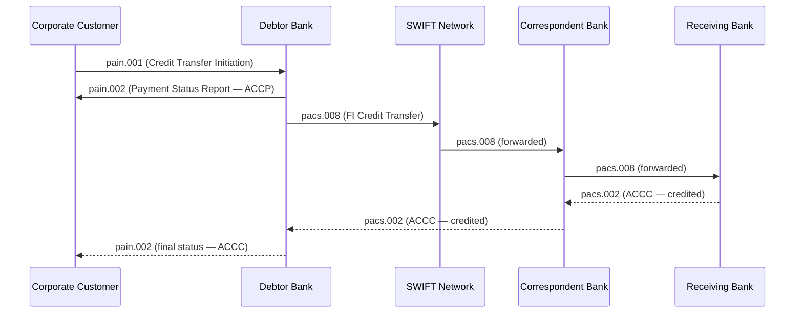

# معيار ISO 20022 — رسائل MX والانتقال من MT

## نظرة عامة

‏ISO 20022 هو المعيار العالمي في الصناعة المالية لتبادل البيانات الإلكترونية بين المؤسسات المالية. فبينما رسائل SWIFT MT برقيات نصية عادية محددة بالوسوم صُممت لعصر التلكس في السبعينيات، يستخدم ISO 20022 (ويُسمى أيضًا MX) لغة XML مهيكلة بمخططات معرّفة رسميًا، وعناصر بيانات غنية، وقاموس بيانات موحد يشمل المدفوعات، والأوراق المالية، وتمويل التجارة، والبطاقات، والصرف الأجنبي. والانتقال من MT إلى ISO 20022 أهم تغيير في البنية التحتية العالمية للمدفوعات منذ 40 عامًا — وقد انتهت فترة التعايش في CBPR+ ‏(Cross-Border Payments and Reporting Plus) لتعليمات الدفع في نوفمبر 2025: فصارت تعليمات الدفع العابرة للحدود بصيغة ISO 20022 (MX) فقط. ويجب على كل مهندس في التقنية المالية إتقان بناء رسائل MX، والتحليل بـ JAXB، والتحقق بالمخططات، ومخاطر فقدان البيانات الدقيقة في الترجمة من MT إلى MX.

## أهداف التعلم

- التنقل في كتالوج رسائل ISO 20022 وتحديد الرسالة الصحيحة لوظيفة عمل معينة (عائلات pain وpacs وcamt وreda)
- قراءة وبناء مستند XML من نوع pain.001.001.11 ‏(CustomerCreditTransferInitiation) بالعناصر الإلزامية والمطلوبة عادة
- تحليل pacs.008 ‏(FIToFICustomerCreditTransfer) باستخدام أصناف مولّدة بـ JAXB واستخراج الحقول الحرجة للدفع
- تطبيق قواعد الحقول الإلزامية في CBPR+ فوق قيود مخطط ISO 20022 الأساسي للتحقق من الرسائل العابرة للحدود
- ربط حقول MT103 بمقابلاتها في pacs.008 وتحديد عناصر MT103 التي لا مقابل بنيوي لها في MX
- تنفيذ `Iso20022MessageValidator` باستخدام JAXB مع تحقق إضافي من قواعد العمل
- شرح مشكلة القص — لماذا يسبب نقل حقول MT النصية الحرة إلى عناصر MX مهيكلة فقدان البيانات — وتصميم استراتيجية للتعامل معها
- شرح فوائد البيانات الغنية في ISO 20022: معرّف الكيان القانوني (LEI)، ورموز الغرض، والعنوان المهيكل، وتحسينات التقارير التنظيمية

## سياق العمل

*مثال مركّب (مبني على أنماط فشل شائعة في الصناعة، لا على بنك بعينه):* في اليوم الأول لإطلاق ISO 20022، رفضت طبقة التحقق الصادرة لدى بنك كبير تلقائيًا نسبة مئوية من تعليمات الدفع العابرة للحدود. ووجد التحقيق ثلاثة أسباب جذرية: (1) معظم الرسائل المرفوضة كانت عناوين المدين فيها محفوظة كأسطر نصية حرة فقط، دون اسم المدينة والدولة اللذين تتطلبهما CBPR+ كعناصر مهيكلة؛ (2) بعض الرسائل كانت رموز BIC لبنك الدائن فيها غير موجودة في دليل BIC — فقد "أُصلحت" البيانات المرجعية القديمة يدويًا أثناء الانتقال؛ (3) وأخرى كانت معلومات التحويل فيها أطول من حد 140 حرفًا للتحويل غير المهيكل، نتيجة دمج ساذج لحقول MT. فدفع البنك ثمن عملية إصلاح ضخمة في اليوم نفسه وتأخرت آلاف مدفوعات العملاء. ويعلمك هذا الدرس بناء مسار MX لا يصل إلى الإنتاج بهذه الفئات من الأخطاء أبدًا.

## نظرة عامة على كتالوج رسائل ISO 20022

تُجمع رسائل ISO 20022 في **مجالات عمل**، لكل منها بادئة:

| البادئة | المجال | الرسائل الأساسية |
|--------|--------|--------------|
| `pain` | بدء المدفوعات | pain.001، وpain.002، وpain.007، وpain.008 |
| `pacs` | مقاصة المدفوعات وتسويتها | pacs.002، وpacs.004، وpacs.008، وpacs.009 |
| `camt` | إدارة النقد | camt.052، وcamt.053، وcamt.054، وcamt.056 |
| `reda` | البيانات المرجعية | reda.001–004 (الطرف، والحساب، والأداة) |
| `fxtr` | تداول الصرف الأجنبي | fxtr.008، وfxtr.014 |
| `auth` | الجهات (التنظيمية) | auth.001، وauth.002 |

صيغة معرّف الرسالة `<المجال>.<مجموعة الرسائل>.<النسخة الفرعية>.<الإصدار>`:
- ‏`pacs.008.001.10` — مقاصة/تسوية المدفوعات (pacs)، مجموعة الرسائل 008 (تحويل ائتماني بين المؤسسات المالية)، النسخة الفرعية 001 (معيارية)، الإصدار 10

> [!NOTE]
> لا تستخدم CBPR+ أحدث إصدارات كل رسالة. فـ SWIFT تنشر إرشادات استخدام CBPR+ تحدد الإصدار المسموح لكل نوع رسالة — مثلًا pacs.008.001.08 وpacs.009.001.08 وpacs.002.001.10 وcamt.056.001.08 وقت كتابة هذا الدرس. فتحقق دائمًا من الإرشادات الحالية قبل تنفيذ نوع رسالة: استخدام الإصدار الخطأ يسبب رفضًا فوريًا. (تستخدم أمثلة الشيفرة أدناه مخطط ISO الأساسي pacs.008.001.10؛ أما لـ CBPR+ فتولّد الأصناف من إصدار CBPR+، وأسماء أصنافه مختلفة.)

**التدفق** لدفع عابر للحدود يبدؤه العميل:



## بدء التحويل الائتماني للعميل pain.001

يرسل pain.001 عميل مؤسسي (أو تطبيق بنكي للأفراد) إلى بنكه لتنفيذ تحويل ائتماني واحد أو أكثر. ويغلّف المستند عنصر جذر واحدًا `CstmrCdtTrfInitn`.

مستند XML تمثيلي لدفعة واحدة باليورو:

```xml
<?xml version="1.0" encoding="UTF-8"?>
<Document xmlns="urn:iso:std:iso:20022:tech:xsd:pain.001.001.11">
  <CstmrCdtTrfInitn>
    <GrpHdr>
      <MsgId>MSGID-20241101-0001</MsgId>
      <CreDtTm>2024-11-01T09:00:00Z</CreDtTm>
      <NbOfTxs>1</NbOfTxs>
      <CtrlSum>50000.00</CtrlSum>
      <InitgPty>
        <Nm>ACME EXPORTS GMBH</Nm>
        <Id>
          <OrgId>
            <LEI>5493001KJTIIGC8Y1R12</LEI>
          </OrgId>
        </Id>
      </InitgPty>
    </GrpHdr>
    <PmtInf>
      <PmtInfId>PMTINF-20241101-0001</PmtInfId>
      <PmtMtd>TRF</PmtMtd>
      <NbOfTxs>1</NbOfTxs>
      <CtrlSum>50000.00</CtrlSum>
      <PmtTpInf>
        <!-- No SEPA service level: the beneficiary is in the US (cross-border) -->
        <CtgyPurp><Cd>SUPP</Cd></CtgyPurp>
      </PmtTpInf>
      <ReqdExctnDt><Dt>2024-11-01</Dt></ReqdExctnDt>
      <Dbtr>
        <Nm>ACME EXPORTS GMBH</Nm>
        <PstlAdr>
          <StrtNm>Mainzer Landstrasse</StrtNm>
          <BldgNb>50</BldgNb>
          <PstCd>60325</PstCd>
          <TwnNm>Frankfurt am Main</TwnNm>
          <Ctry>DE</Ctry>
        </PstlAdr>
      </Dbtr>
      <DbtrAcct>
        <Id><IBAN>DE89370400440532013000</IBAN></Id>
        <Ccy>EUR</Ccy>
      </DbtrAcct>
      <DbtrAgt>
        <FinInstnId><BICFI>DEUTDEDBXXX</BICFI></FinInstnId>
      </DbtrAgt>
      <CdtTrfTxInf>
        <PmtId>
          <InstrId>INSTRREF-001</InstrId>
          <EndToEndId>E2E-ACME-INV-891</EndToEndId>
          <UETR>550e8400-e29b-41d4-a716-446655440000</UETR>
        </PmtId>
        <Amt>
          <InstdAmt Ccy="EUR">50000.00</InstdAmt>
        </Amt>
        <CdtrAgt>
          <FinInstnId><BICFI>BOFAUS3NXXX</BICFI></FinInstnId>
        </CdtrAgt>
        <Cdtr>
          <Nm>WIDGETS INC</Nm>
          <PstlAdr>
            <StrtNm>Broadway</StrtNm>
            <BldgNb>1</BldgNb>
            <PstCd>10004</PstCd>
            <TwnNm>New York</TwnNm>
            <CtrySubDvsn>NY</CtrySubDvsn>
            <Ctry>US</Ctry>
          </PstlAdr>
        </Cdtr>
        <CdtrAcct>
          <Id><Othr><Id>123456789</Id></Othr></Id>
        </CdtrAcct>
        <RmtInf>
          <Strd>
            <CdtrRefInf>
              <Tp>
                <CdOrPrtry><Cd>SCOR</Cd></CdOrPrtry>
              </Tp>
              <Ref>INV-2024-00891</Ref>
            </CdtrRefInf>
          </Strd>
        </RmtInf>
      </CdtTrfTxInf>
    </PmtInf>
  </CstmrCdtTrfInitn>
</Document>
```

> [!IMPORTANT]
> يقبل العنصر `BICFI` صيغتي BIC: **8 أحرف** و**11 حرفًا** — فـ `BOFAUS3N` و`BOFAUS3NXXX` كلاهما يعرّف المقر الرئيسي. والمشاكل تأتي من *مقارنة* رموز BIC: فقائمة عقوبات، أو جدول توجيه، أو ذاكرة مؤقتة مفتاحها `BOFAUS3NXXX` لن تجد `BOFAUS3N`. فوحّد رموز BIC بصيغة قياسية واحدة للبحث والمقارنة (مثلًا دائمًا 11 حرفًا مع `XXX`)، وتحقق منها مقابل دليل BIC — فرمز BIC صحيح الصيغة لكنه غير موجود سيُرفض لاحقًا.

## التحويل الائتماني بين المؤسسات المالية pacs.008

‏pacs.008 هي الرسالة بين البنوك المقابلة لـ MT103 — تحمل تعليمة الدفع بين المؤسسات المالية عبر شبكة المقاصة. وبينما قد يجمع pain.001 معاملات كثيرة في غلاف واحد، يحمل pacs.008 **معاملة واحدة** بالضبط لكل مستند في CBPR+ (يجب أن يساوي حقل التحكم `NbOfTxs` واحدًا).

العناصر الأساسية ومقابلاتها في MT103:

| عنصر pacs.008 | المسار XPath | حقل MT103 | ملاحظات |
|-----------------|-------|-------------|-------|
| `MsgId` | GrpHdr/MsgId | (لا مقابل مباشر؛ أقربه وسم MUR ‏108 في الكتلة 3) | فريد لكل رسالة |
| `InstrId` | CdtTrfTxInf/PmtId/InstrId | الحقل 20 (TRN) | مرجع البنك المُصدر للتعليمة |
| `EndToEndId` | CdtTrfTxInf/PmtId/EndToEndId | (لا حقل في MT103) | مرجع المنشئ، دون تغيير من البداية للنهاية؛ `NOTPROVIDED` إن لم يُعطَ |
| `UETR` | CdtTrfTxInf/PmtId/UETR | الكتلة 3 / الوسم 121 | ‏UUID v4، متتبع gpi |
| `IntrBkSttlmAmt` | CdtTrfTxInf/IntrBkSttlmAmt | مبلغ الحقل 32A | التسوية بين البنوك |
| `IntrBkSttlmDt` | CdtTrfTxInf/IntrBkSttlmDt | تاريخ الحقل 32A | تاريخ التسوية |
| `Dbtr` | CdtTrfTxInf/Dbtr | الحقل 50 (العميل الآمر) | مهيكل |
| `DbtrAcct` | CdtTrfTxInf/DbtrAcct | حساب الحقل 50 | ‏IBAN أو Othr |
| `DbtrAgt` | CdtTrfTxInf/DbtrAgt | الحقل 52A | ‏BIC بنك المدين |
| `CdtrAgt` | CdtTrfTxInf/CdtrAgt | الحقل 57A | ‏BIC بنك الدائن |
| `Cdtr` | CdtTrfTxInf/Cdtr | الحقل 59 (المستفيد) | مهيكل |
| `CdtrAcct` | CdtTrfTxInf/CdtrAcct | حساب الحقل 59 | ‏IBAN أو Othr |
| `InstrForCdtrAgt` | CdtTrfTxInf/InstrForCdtrAgt | الحقل 72 | رموز تعليمات |
| `RmtInf` | CdtTrfTxInf/RmtInf | الحقل 70 | مهيكل أو غير مهيكل |
| `ChrgBr` | CdtTrfTxInf/ChrgBr | الحقل 71A | ‏CRED (=BEN) / DEBT (=OUR) / SHAR (=SHA) |

## التحليل بـ JAXB والأصناف المولّدة

الأسلوب الموصى به توليد أصناف Java من مخططات XSD الرسمية لـ ISO 20022 والتحليل بـ JAXB. ومخطط pacs.008 متاح من كتالوج ISO 20022.

```java
import com.swift.cbpr.pacs008.Document;
import com.swift.cbpr.pacs008.FIToFICustomerCreditTransferV10;
import com.swift.cbpr.pacs008.CreditTransferTransaction62;
import com.swift.cbpr.pacs008.GroupHeader96;

import jakarta.xml.bind.JAXBContext;
import jakarta.xml.bind.JAXBException;
import jakarta.xml.bind.Unmarshaller;
import javax.xml.transform.stream.StreamSource;
import javax.xml.validation.Schema;
import javax.xml.validation.SchemaFactory;
import java.io.StringReader;
import java.math.BigDecimal;

public class Pacs008Parser {

    private final JAXBContext jaxbContext;
    private final Schema validationSchema;

    public Pacs008Parser() throws JAXBException, SAXException {
        this.jaxbContext = JAXBContext.newInstance(Document.class);
        SchemaFactory sf = SchemaFactory.newInstance(XMLConstants.W3C_XML_SCHEMA_NS_URI);
        this.validationSchema = sf.newSchema(
            getClass().getResource("/schemas/pacs.008.001.10.xsd"));
    }

    public ParsedPacs008 parse(String xml) throws JAXBException {
        // Messages come from outside: parse with external entities (XXE) and
        // DTDs disabled — e.g. unmarshal from a SAXSource built on a
        // SAXParserFactory with FEATURE_SECURE_PROCESSING and
        // "http://apache.org/xml/features/disallow-doctype-decl" = true
        Unmarshaller unmarshaller = jaxbContext.createUnmarshaller();
        unmarshaller.setSchema(validationSchema); // schema validation on parse
        unmarshaller.setEventHandler(event -> {
            if (event.getSeverity() == ValidationEvent.ERROR ||
                event.getSeverity() == ValidationEvent.FATAL_ERROR) {
                throw new Iso20022ValidationException(
                    "Schema violation at " + event.getLocator() + ": " + event.getMessage());
            }
            return true;
        });

        Document doc = (Document) unmarshaller.unmarshal(new StringReader(xml));
        return extractPayment(doc);
    }

    private ParsedPacs008 extractPayment(Document doc) {
        FIToFICustomerCreditTransferV10 msg = doc.getFIToFICstmrCdtTrf();
        GroupHeader96 hdr = msg.getGrpHdr();
        CreditTransferTransaction62 tx = msg.getCdtTrfTxInf().get(0); // CBPR+ = 1 tx

        return ParsedPacs008.builder()
                .messageId(hdr.getMsgId())
                .creationDateTime(hdr.getCreDtTm().toGregorianCalendar().toZonedDateTime())
                .endToEndId(tx.getPmtId().getEndToEndId())
                .uetr(tx.getPmtId().getUETR())
                .settlementAmount(tx.getIntrBkSttlmAmt().getValue())
                .settlementCurrency(tx.getIntrBkSttlmAmt().getCcy())
                .settlementDate(tx.getIntrBkSttlmDt().toGregorianCalendar()
                        .toZonedDateTime().toLocalDate())
                .debtorName(tx.getDbtr().getNm())
                .debtorBic(tx.getDbtrAgt().getFinInstnId().getBICFI())
                .creditorName(tx.getCdtr().getNm())
                .creditorBic(tx.getCdtrAgt().getFinInstnId().getBICFI())
                .creditorAccount(extractCreditorAccount(tx))
                .chargeBearer(tx.getChrgBr().value())
                .remittanceInfo(extractRemittance(tx))
                .build();
    }

    private String extractCreditorAccount(CreditTransferTransaction62 tx) {
        var acct = tx.getCdtrAcct().getId();
        if (acct.getIBAN() != null) return acct.getIBAN();
        if (acct.getOthr() != null) return acct.getOthr().getId();
        return null;
    }

    private String extractRemittance(CreditTransferTransaction62 tx) {
        var rmt = tx.getRmtInf();
        if (rmt == null) return null;
        if (!rmt.getUstrd().isEmpty()) return String.join(" ", rmt.getUstrd());
        if (!rmt.getStrd().isEmpty()) {
            return rmt.getStrd().stream()
                    .map(s -> s.getCdtrRefInf().getRef())
                    .findFirst().orElse(null);
        }
        return null;
    }
}
```

الرسائل تأتي من الخارج: فحلّلها مع تعطيل الكيانات الخارجية (XXE) وتعريفات DTD.

## Iso20022MessageValidator مع قواعد CBPR+

يلتقط التحقق بالمخطط الأخطاء البنيوية، لكن CBPR+ تفرض **قيود قواعد عمل** تتجاوز ما يستطيع XSD التعبير عنه. وتشمل:

- يجب أن يوجد `UETR` وأن يكون UUID v4 صالحًا بأحرف صغيرة (قابل للفحص بتعبير نمطي)
- يجب أن يساوي `NbOfTxs` واحدًا في pacs.008 لـ CBPR+
- إذا كان `InstdAmt` و`IntrBkSttlmAmt` بعملتين مختلفتين، يجب وجود `XchgRate`
- يجب أن تحتوي عناوين المدين والدائن على `TwnNm` و`Ctry` على الأقل كعناصر مهيكلة (منذ نوفمبر 2026 لم تعد العناوين غير المهيكلة بالكامل مقبولة)
- يجب أن يكون `BICFI` رمز BIC صحيح الصيغة (8 أو 11 حرفًا) وموجودًا في دليل BIC
- يجب ألا يتجاوز نص التحويل غير المهيكل 140 حرفًا إجمالًا
- رمز `ChrgBr` ‏`SLEV` (مفهوم SEPA) غير مسموح في CBPR+

```java
public class Iso20022MessageValidator {

    // The ISO schema pattern for UETR is lowercase hexadecimal
    private static final Pattern UUID_V4 =
        Pattern.compile("^[0-9a-f]{8}-[0-9a-f]{4}-4[0-9a-f]{3}-[89ab][0-9a-f]{3}-[0-9a-f]{12}$");
    // BIC: 4 letters (or digits) institution, 2-letter country, 2 location,
    // optional 3-character branch — 8 OR 11 characters
    private static final Pattern BIC =
        Pattern.compile("^[A-Z0-9]{4}[A-Z]{2}[A-Z0-9]{2}([A-Z0-9]{3})?$");

    public ValidationResult validateCbprPacs008(ParsedPacs008 msg) {
        List<ValidationError> errors = new ArrayList<>();

        // UETR must be UUID v4
        if (msg.uetr() == null || !UUID_V4.matcher(msg.uetr()).matches()) {
            errors.add(new ValidationError("UETR", "Must be a valid UUID v4; got: " + msg.uetr()));
        }

        // BIC validation
        validateBic(msg.debtorBic(), "DebtorAgt/BICFI", errors);
        validateBic(msg.creditorBic(), "CdtrAgt/BICFI", errors);

        // Settlement amount must be positive
        if (msg.settlementAmount().compareTo(BigDecimal.ZERO) <= 0) {
            errors.add(new ValidationError("IntrBkSttlmAmt",
                "Settlement amount must be positive; got: " + msg.settlementAmount()));
        }

        // Remittance unstructured text 140-char limit
        if (msg.remittanceInfo() != null && msg.remittanceInfo().length() > 140) {
            errors.add(new ValidationError("RmtInf/Ustrd",
                "Unstructured remittance exceeds 140 chars: length=" + msg.remittanceInfo().length()));
        }

        // Settlement date cannot be in the past by more than 1 business day
        LocalDate earliest = BusinessCalendar.minusBusinessDays(LocalDate.now(), 1);
        if (msg.settlementDate().isBefore(earliest)) {
            errors.add(new ValidationError("IntrBkSttlmDt",
                "Settlement date " + msg.settlementDate() + " is too far in the past"));
        }

        return errors.isEmpty()
            ? ValidationResult.valid()
            : ValidationResult.invalid(errors);
    }

    private void validateBic(String bic, String path, List<ValidationError> errors) {
        if (bic == null || !BIC.matcher(bic).matches()) {
            errors.add(new ValidationError(path, "Not a well-formed BIC: " + bic));
        } else if (!bicDirectory.exists(BicNormalizer.toBic11(bic))) {   // compare in one canonical form
            errors.add(new ValidationError(path, "BIC not found in the BIC directory: " + bic));
        }
    }
}
```

> [!WARNING]
> للتحقق بمخطط JAXB والتحقق بقواعد العمل غرضان مختلفان. فالتحقق بالمخطط يرفض XML المشوّه بنيويًا. والتحقق بقواعد العمل يرفض المحتوى غير الصالح دلاليًا رغم أنه XML سليم البنية. فشغّل الطبقتين بالتتابع، وتأكد من إبلاغ أخطاء التحقق بالمخطط مع موقع XPath ليتمكن النظام المرسل من توجيه الإصلاحات بدقة.

## الانتقال من MT إلى MX: مشكلة القص

للحقل 70 في صيغة MT (معلومات التحويل) حد 4 أسطر × 35 حرفًا = 140 حرفًا. والتحويل غير المهيكل في ISO 20022 يسمح أيضًا بـ 140 حرفًا في CBPR+. وهذا يبدو متكافئًا، لكن البنوك المنتقلة تكتشف عمليًا عدة سيناريوهات قص:

| مصدر MT | حد MT | هدف MX | حد MX | الخطر |
|-----------|----------|-----------|----------|------|
| الحقل 70 (4×35) | 140 حرفًا | RmtInf/Ustrd | 140 حرفًا | لا شيء إن كان المحتوى يتسع |
| الحقل 72 (6×35) | 210 أحرف | InstrForCdtrAgt | 140 حرفًا | **قص** |
| اسم وعنوان الحقل 50K | 4×35 | Dbtr/Nm | 140 حرفًا | آمن عادة |
| اسم وعنوان الحقل 50K | 4×35 | Dbtr/PstlAdr | مهيكل | **يلزم التقسيم** |
| اسم وعنوان الحقل 59 | 4×35 | Cdtr/PstlAdr | مهيكل | **يلزم التقسيم** |

أخطر حالة **تقسيم العنوان**. فقد يحمل الحقل 50K في MT103 عنوانًا مثل:

```
ACME EXPORTS GMBH
MAINZER LANDSTRASSE 50
60325 FRANKFURT AM MAIN
GERMANY
```

في pacs.008 يجب تقسيم هذا إلى `StrtNm` و`BldgNb` و`PstCd` و`TwnNm` و`Ctry`. وتضع أنظمة الانتقال الساذجة كل الأسطر في `AdrLine` (العنصر غير المهيكل). ومنذ نوفمبر 2026 لم تعد CBPR+ تقبل مثل هذه العناوين غير المهيكلة بالكامل: فيجب على الأقل أن يكون `TwnNm` و`Ctry` مهيكلين (ويمكن لعنوان "هجين" أن يحتفظ بسطرين `AdrLine` كحد أقصى بجانبهما).

```java
public class AddressParser {

    // Heuristic address parser for migrating MT free-text addresses to structured MX
    public StructuredAddress parse(List<String> mtAddressLines) {
        if (mtAddressLines == null || mtAddressLines.isEmpty()) {
            return StructuredAddress.unknown();
        }
        // Line 0: usually name (already captured in Nm element — skip)
        // Line 1: street + building
        // Line 2: postcode + town
        // Line 3: country (ISO 2-char or free text)
        String street = mtAddressLines.size() > 1 ? mtAddressLines.get(1).trim() : "";
        String postcodeTown = mtAddressLines.size() > 2 ? mtAddressLines.get(2).trim() : "";
        String countryLine = mtAddressLines.size() > 3 ? mtAddressLines.get(3).trim() : "";

        return StructuredAddress.builder()
                .streetName(extractStreetName(street))
                .buildingNumber(extractBuildingNumber(street))
                .postCode(extractPostCode(postcodeTown))
                .townName(extractTownName(postcodeTown))
                .country(CountryCodeNormalizer.toIso2(countryLine))
                .build();
    }

    // Falls back to unstructured AddressLine if heuristics fail
    public boolean isStructuredParseable(List<String> lines) {
        if (lines == null || lines.size() < 3) return false;
        String postcodeTown = lines.get(2).trim();
        return postcodeTown.matches(".*\\d{4,6}.*"); // has a numeric postcode segment
    }
}
```

> [!IMPORTANT]
> لا تقص أبدًا معلومات التحويل بصمت أثناء الانتقال من MT إلى MX. فالتحويل المقصوص يسبب فشل المطابقة لدى المستفيد. وعندما لا يمكن نقل النص كاملًا، يجب **تعليم الدفعة للإثراء اليدوي** أو احتجازها حتى يقدم المنشئ بيانات مهيكلة. فالقص التلقائي إفساد صامت للبيانات.

## فوائد البيانات الغنية

يقدم نموذج البيانات المهيكل في ISO 20022 تحسينات تشغيلية وتنظيمية ملموسة:

**معرّف الكيان القانوني (LEI):** يحمل العنصر `OrgId/LEI` رمز LEI من 20 حرفًا وفق ISO 17442. وهذا يسمح للبنوك بتعريف العملاء المؤسسيين بلا لبس، فيتيح فحص العقوبات آليًا دون أساليب مطابقة الأسماء التقريبية.

**رموز الغرض:** يحمل العنصر `CtgyPurp/Cd` غرضًا معياريًا (مثل `SUPP` = دفع لمورّد، و`SALA` = راتب، و`TAXS` = دفع ضريبة). وتغذي هذه الرموز التقارير التنظيمية مباشرة دون تصنيف يدوي.

**العناوين المهيكلة:** العناوين القابلة للقراءة آليًا تزيل غموض حقول MT النصية الحرة وتغذي أنظمة اعرف عميلك ومكافحة غسل الأموال مباشرة دون معالجة لغوية.

**رموز تحمّل الرسوم:** قيم `ChrgBr` ‏`CRED` و`DEBT` و`SHAR` تقابل `BEN` و`OUR` و`SHA` في الحقل MT71A؛ أما `SLEV` ("وفق مستوى الخدمة") فتستخدمه أنظمة مثل SEPA، لا CBPR+.

**المدين النهائي / الدائن النهائي:** يدعم pacs.008 العنصرين `UltmtDbtr` و`UltmtCdtr`، فيتيح سيناريوهات الدفع نيابة عن الغير التي كانت تحتاج حلولًا التفافية في عالم MT.

## اختبار المعرفة

**س1: تحمل رسالة pacs.008 مترجمة `CdtrAgt/BICFI` = `BOFAUS3N` (8 أحرف). وتعيد خدمة فحص العقوبات لديك — التي تخزن قائمتها المرجعية رموز BIC بصيغة `BOFAUS3NXXX` — "لا تطابق" لهذا البنك. هل رسالة pacs.008 غير صالحة، وما الإصلاح الصحيح؟**

ج: رسالة pacs.008 صالحة: فـ `BICFI` يقبل صيغتي 8 و11 حرفًا، وكلتاهما تعني المقر الرئيسي. والخطأ في المقارنة: فقد قورنت كتابتان للمعرّف نفسه كنصين عاديين. والإصلاح توحيد رموز BIC بصيغة قياسية واحدة (مثلًا 11 حرفًا، بإضافة `XXX` إلى رموز الثمانية أحرف) في كل مكان تُستخدم فيه كمفاتيح — الفحص، والتوجيه، والذاكرات المؤقتة — ويُفضل مرة واحدة عند الاستيعاب. ولا تضف أبدًا شيئًا غير `XXX`: فأي لاحقة أخرى ستسمّي فرعًا غير موجود على الأرجح.

**س2: تصل رسالة pain.001 فيها `NbOfTxs` = 3 و`CtrlSum` = 150000.00، لكن مجموع عناصر `InstdAmt` الثلاثة 148500.00. كيف يجب أن تستجيب طبقة التحقق، وما خطر قبول هذا الفرق بصمت؟**

ج: يجب أن يرفض المحقق الرسالة بحالة pain.002 ‏`RJCT` ورمز السبب `AM10` ‏(InvalidControlSum). فـ `NbOfTxs` و`CtrlSum` حقلا فحص سلامة — يسمحان للبنك المستلم باكتشاف الرسائل المقصوصة أو الفاسدة دون تحليل كل عنصر معاملة. وإذا قبلت فرق مجموع التحكم بصمت، فإنك تخاطر بمعالجة رسالة ناقصة (ربما سقطت معاملة أثناء النقل)، وبإضافة مبلغ إجمالي خاطئ، وبإنشاء فرق مطابقة قد لا يظهر لأيام. والفجوة البالغة 1,500 يورو كبيرة بما يكفي لإحداث كسر مطابقة جوهري في أي حساب نوسترو.

## التحدي العملي

1. **توليد شيفرة JAXB والتحليل:** اضبط إضافة Maven ‏`jaxb2-maven-plugin` لتوليد أصناف Java من مخطط pacs.008 XSD الرسمي (المتاح من كتالوج ISO 20022). واكتب `Pacs008RoundtripTest` يقوم بـ: إلغاء تسلسل رسالة pacs.008 نموذجية، والتأكد من استخراج UETR ومبلغ التسوية وBIC المدين وIBAN الدائن بشكل صحيح، ثم إعادة تسلسل الكائن المحلل إلى XML والتأكد من صلاحية المخرج بالمخطط. واستخدم `xmlunit-core` لمقارنة XML.

2. **مترجم MT103 إلى pacs.008:** نفّذ `Mt103ToPacs008Translator` يقبل `ParsedMt103` (من الدرس 6) وينتج `Document` (كائن JAXB لـ pacs.008). ويجب أن يقوم المترجم بـ: التحقق من رموز BIC مقابل دليل BIC وتوحيدها بصيغة قياسية للبحث الداخلي؛ وتحليل أسطر عنوان MT50K إلى `PstlAdr` مهيكل؛ وربط تعداد `ChargeBearer` بـ `ChargeBearerType3Code` في ISO 20022؛ ونسخ UETR من الوسم 121 في الكتلة 3 لـ MT103 (فالدفعة الجارية تحتفظ بـ UETR الخاص بها؛ ولا تحصل على UETR مولّد جديد إلا الدفعة الجديدة كليًا).

3. **فاحص امتثال CBPR+:** وسّع `Iso20022MessageValidator` بخمس قواعد CBPR+ إضافية: (أ) يجب أن يوجد `UETR` وأن يكون UUID v4 بأحرف صغيرة؛ (ب) يجب ألا يكون `IntrBkSttlmDt` عطلة نهاية أسبوع أو عطلة لعملة التسوية؛ (ج) يجب أن يكون `Cdtr/PstlAdr/Ctry` رمز ISO 3166-1 alpha-2 صالحًا؛ (د) إذا اختلفت عملة `InstdAmt` عن عملة `IntrBkSttlmAmt` يجب ملء `XchgRate`؛ (هـ) يجب أن يحتوي `RmtInf` على `Ustrd` أو `Strd` لا كليهما. واكتب اختبارات JUnit 5 بمعاملات لكل قاعدة تغطي حالة صالحة وحالتين غير صالحتين على الأقل.

4. **أداة تجربة الانتقال:** ابنِ أداة سطر أوامر (Spring Boot ‏`CommandLineRunner`) تقرأ مجلدًا من رسائل MT103، وتمرر كلًا منها عبر مترجم MT103 إلى pacs.008، ثم تمرر pacs.008 عبر التحقق بالمخطط والتحقق بقواعد عمل CBPR+. وأخرج تقرير CSV بالأعمدة: `filename`، و`trn`، و`schema_valid` (Y/N)، و`cbpr_valid` (Y/N)، و`error_count`، و`errors` (مفصولة بخط عمودي). وشغّل الأداة على 100 رسالة MT103 اصطناعية وتأكد من أن مترجمك يحقق صلاحية مخطط 100% وصلاحية CBPR+ بنسبة 95% على الأقل قبل أي إثراء يدوي للعناوين.

<!-- KNOWLEDGE-CHECK
{
  "questions": [
    {
      "text": "تحمل رسالة pacs.008 مترجمة `CdtrAgt/BICFI` = `BOFAUS3N` (8 أحرف). وتخزن قائمة فحص العقوبات لديك رموز BIC بصيغة `BOFAUS3NXXX` فلا تجد تطابقًا. ما الإصلاح الصحيح؟",
      "options": [
        "ارفض رسالة pacs.008 — يجب أن يكون BICFI دائمًا 11 حرفًا",
        "وحّد رموز BIC بصيغة قياسية واحدة (مثلًا 11 حرفًا مع XXX) في كل مكان تُقارن فيه أو تُستخدم كمفاتيح، ويُفضل عند الاستيعاب",
        "أضف أي ثلاثة أحرف إلى BIC قبل الفحص",
        "تخطَّ فحص العقوبات لرموز BIC ذات الثمانية أحرف"
      ],
      "correct": 1,
      "explanation": "يقبل BICFI صيغتي 8 و11 حرفًا، وكلتاهما تعرّف المقر الرئيسي — فالرسالة صالحة. والخطأ مقارنة كتابتين للمعرّف نفسه كنصين عاديين. فوحّد رموز BIC بصيغة قياسية واحدة (بإضافة XXX إلى رموز الثمانية أحرف) في كل مكان تُستخدم فيه كمفاتيح: الفحص، والتوجيه، والذاكرات المؤقتة. وإضافة أي شيء غير XXX ستسمّي فرعًا غير موجود على الأرجح."
    },
    {
      "text": "تصل رسالة pain.001 فيها `NbOfTxs` = 3 و`CtrlSum` = 150000.00، لكن مجموع عناصر `InstdAmt` الثلاثة 148500.00. كيف يجب أن تستجيب طبقة التحقق؟",
      "options": [
        "اقبلها وعالجها — مجموع التحكم استشاري فقط",
        "اقبلها وسجّل تحذيرًا للمطابقة",
        "ارفضها بحالة pain.002 ‏`RJCT` ورمز السبب `AM10` ‏(InvalidControlSum)",
        "اقبلها لكن ضع علامة للمراجعة اليدوية"
      ],
      "correct": 2,
      "explanation": "يجب أن يرفض المحقق بـ pain.002 ‏`RJCT` والسبب `AM10`. فـ `NbOfTxs` و`CtrlSum` حقلا فحص سلامة — والقبول الصامت يخاطر بمعالجة رسالة ناقصة ربما سقطت منها معاملة أثناء النقل، فتنشأ فروق مطابقة."
    },
    {
      "text": "ما `EndToEndId` في رسالة pacs.008، وماذا يحدث عندما لا يقدّم المنشئ مرجعًا؟",
      "options": [
        "يعرّف وكيل التسوية؛ ويُترك الحقل فارغًا حينها",
        "هو رقم حساب المدين؛ وتُرفض الدفعة حينها",
        "هو مرجع المنشئ، يُمرر دون تغيير عبر السلسلة كلها؛ وعندما لا يُقدّم أي مرجع تُستخدم القيمة `NOTPROVIDED`",
        "هو معرّف تولّده SWIFT؛ وتملؤه SWIFT تلقائيًا"
      ],
      "correct": 2,
      "explanation": "‏EndToEndId هو المرجع الذي يحدده الطرف المنشئ (مثل مرجع فاتورة أو رواتب) ويجب أن يمرره كل بنك في السلسلة دون تغيير، ليتمكن المستفيد من مطابقة الدفعة. وهو إلزامي في المخطط؛ وعندما لا يقدم المنشئ مرجعًا تُستخدم القيمة المتفق عليها `NOTPROVIDED`. وتعرّف البنوك الدفعة من البداية للنهاية بـ UETR، لا بـ EndToEndId."
    }
  ]
}
-->

<!-- PRACTICAL-CHALLENGE
{
  "title": "محلل ISO 20022 والمترجم والامتثال لـ CBPR+",
  "difficulty": "advanced",
  "estimatedMinutes": 45,
  "tasks": [
    {
      "id": "1",
      "description": "اضبط إضافة Maven ‏`jaxb2-maven-plugin` لتوليد أصناف Java من مخطط pacs.008 XSD الرسمي. واكتب `Pacs008RoundtripTest` يلغي تسلسل رسالة pacs.008 نموذجية، ويتأكد من استخراج UETR ومبلغ التسوية وBIC المدين وIBAN الدائن بشكل صحيح، ثم يعيد التسلسل ويتأكد من صلاحية المخرج بالمخطط باستخدام `xmlunit-core`."
    },
    {
      "id": "2",
      "description": "نفّذ `Mt103ToPacs008Translator` يقبل `ParsedMt103` وينتج كائن JAXB لـ pacs.008. تحقق من رموز BIC مقابل دليل BIC، وحلّل أسطر عنوان MT50K إلى `PstlAdr` مهيكل (TwnNm وCtry مهيكلان على الأقل)، واربط الحقل 20 في MT بـ InstrId، واربط تعداد `ChargeBearer` بـ `ChargeBearerType3Code`، وانسخ UETR من الوسم 121 في الكتلة 3 (لا تولّد أبدًا UETR جديدًا لدفعة جارية بالفعل)."
    },
    {
      "id": "3",
      "description": "وسّع `Iso20022MessageValidator` بخمس قواعد CBPR+: يجب أن يوجد `UETR` وأن يكون UUID v4 بأحرف صغيرة؛ ويجب ألا يكون `IntrBkSttlmDt` عطلة نهاية أسبوع أو عطلة لعملة التسوية؛ ويجب أن يكون `Cdtr/PstlAdr/Ctry` رمز ISO 3166-1 alpha-2 صالحًا؛ وإذا اختلفت عملة `InstdAmt` عن عملة `IntrBkSttlmAmt` يجب ملء `XchgRate`؛ ويجب أن يحتوي `RmtInf` على `Ustrd` أو `Strd` لا كليهما. واكتب اختبارات JUnit 5 بمعاملات لكل قاعدة."
    },
    {
      "id": "4",
      "description": "ابنِ أداة تجربة انتقال بـ Spring Boot ‏`CommandLineRunner` تقرأ مجلدًا من رسائل MT103، وتترجم كلًا منها إلى pacs.008، وتتحقق من المخطط وقواعد CBPR+، وتخرج تقرير CSV بالأعمدة: filename، وtrn، وschema_valid، وcbpr_valid، وerror_count، وerrors. وحقق صلاحية مخطط 100% وصلاحية CBPR+ بنسبة 95% على الأقل عبر 100 رسالة اصطناعية."
    }
  ]
}
-->
