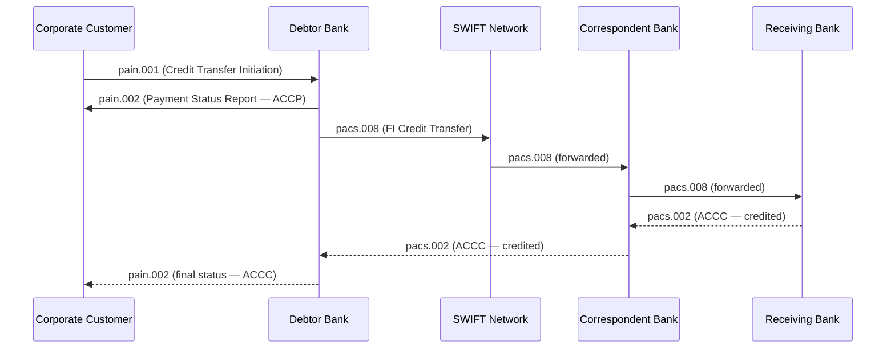

## Overview

ISO 20022 is the global financial industry standard for electronic data interchange between financial institutions. Where SWIFT MT messages are plain-text, tag-delimited telegrams designed for the 1970s telex era, ISO 20022 (also called MX) uses structured XML with formally defined schemas, rich data elements, and a universal data dictionary that spans payments, securities, trade finance, cards, and foreign exchange. The migration from MT to ISO 20022 is the most significant change to global payment infrastructure in 40 years — SWIFT's CBPR+ (Cross-Border Payments and Reporting Plus) coexistence period for payment instructions ended in November 2025: cross-border payment instructions are now ISO 20022 (MX) only. Every engineer in fintech must be fluent in MX message construction, JAXB parsing, schema validation, and the subtle data-loss risks of MT-to-MX translation.

## Learning Objectives

- Navigate the ISO 20022 message catalogue and locate the correct message for a given business function (pain, pacs, camt, reda families)
- Read and construct a pain.001.001.11 (CustomerCreditTransferInitiation) XML document with mandatory and commonly required elements
- Parse a pacs.008.001.10 (FIToFICustomerCreditTransfer) using JAXB-generated classes and extract payment-critical fields
- Apply CBPR+ mandatory field rules on top of base ISO 20022 schema constraints to validate cross-border messages
- Map MT103 fields to their pacs.008 equivalents and identify which MT103 data elements have no structural counterpart in MX
- Implement an `Iso20022MessageValidator` using JAXB and supplementary business rule validation
- Explain the truncation problem — why migrating free-text MT fields to structured MX elements causes data loss — and design a strategy to handle it
- Articulate the rich data benefits of ISO 20022: LEI, purpose codes, structured address, and regulatory reporting improvements

## Business Context

*Composite example (based on common industry failure patterns, not a specific bank):* on the first day of its ISO 20022 go-live, a large bank's outbound validation layer auto-rejected several percent of its cross-border payment instructions. Investigation found three root causes: (1) most rejected messages had debtor addresses held only as free-text lines, without the town name and country that CBPR+ requires as structured elements; (2) some messages had creditor agent BICs that did not exist in the BIC directory — legacy reference data had been "fixed" by hand during migration; (3) others had remittance information longer than the 140-character limit for unstructured remittance, produced by naive concatenation of MT fields. The bank paid for a large same-day repair operation and delayed thousands of customer payments. This lesson teaches you to build an MX pipeline that never reaches production with these categories of error.

## ISO 20022 Message Catalogue Overview

ISO 20022 messages are grouped into **business domains** (called areas), each with a code prefix:

| Prefix | Domain | Key Messages |
|--------|--------|--------------|
| `pain` | Payments Initiation | pain.001, pain.002, pain.007, pain.008 |
| `pacs` | Payments Clearing and Settlement | pacs.002, pacs.004, pacs.008, pacs.009 |
| `camt` | Cash Management | camt.052, camt.053, camt.054, camt.056 |
| `reda` | Reference Data | reda.001–004 (party, account, instrument) |
| `fxtr` | Foreign Exchange Trade | fxtr.008, fxtr.014 |
| `auth` | Authorities (Regulatory) | auth.001, auth.002 |

A message identifier has the form `<domain>.<message-set>.<variant>.<version>`:
- `pacs.008.001.10` — Payments Clearing/Settlement (pacs), message set 008 (FI credit transfer), variant 001 (standard), version 10

> [!NOTE]
> CBPR+ does not use the latest versions of every message. SWIFT publishes CBPR+ Usage Guidelines that fix the allowed version per message type — for example pacs.008.001.08, pacs.009.001.08, pacs.002.001.10 and camt.056.001.08 at the time of writing. Always check the current guidelines before implementing a message type: using the wrong version causes immediate rejection. (The code examples below use the base ISO schema pacs.008.001.10; for CBPR+ you generate classes from the CBPR+ version, whose class names differ.)

The **flow** for a customer-initiated cross-border payment is:



## pain.001 Customer Credit Transfer Initiation

pain.001 is sent by a corporate customer (or a retail banking application) to its bank instructing one or more credit transfers. The document wraps one `CstmrCdtTrfInitn` root element.

A representative XML for a single EUR payment:

```xml
<?xml version="1.0" encoding="UTF-8"?>
<Document xmlns="urn:iso:std:iso:20022:tech:xsd:pain.001.001.11">
  <CstmrCdtTrfInitn>
    <GrpHdr>
      <MsgId>MSGID-20241101-0001</MsgId>
      <CreDtTm>2024-11-01T09:00:00Z</CreDtTm>
      <NbOfTxs>1</NbOfTxs>
      <CtrlSum>50000.00</CtrlSum>
      <InitgPty>
        <Nm>ACME EXPORTS GMBH</Nm>
        <Id>
          <OrgId>
            <LEI>5493001KJTIIGC8Y1R12</LEI>
          </OrgId>
        </Id>
      </InitgPty>
    </GrpHdr>
    <PmtInf>
      <PmtInfId>PMTINF-20241101-0001</PmtInfId>
      <PmtMtd>TRF</PmtMtd>
      <NbOfTxs>1</NbOfTxs>
      <CtrlSum>50000.00</CtrlSum>
      <PmtTpInf>
        <!-- No SEPA service level: the beneficiary is in the US (cross-border) -->
        <CtgyPurp><Cd>SUPP</Cd></CtgyPurp>
      </PmtTpInf>
      <ReqdExctnDt><Dt>2024-11-01</Dt></ReqdExctnDt>
      <Dbtr>
        <Nm>ACME EXPORTS GMBH</Nm>
        <PstlAdr>
          <StrtNm>Mainzer Landstrasse</StrtNm>
          <BldgNb>50</BldgNb>
          <PstCd>60325</PstCd>
          <TwnNm>Frankfurt am Main</TwnNm>
          <Ctry>DE</Ctry>
        </PstlAdr>
      </Dbtr>
      <DbtrAcct>
        <Id><IBAN>DE89370400440532013000</IBAN></Id>
        <Ccy>EUR</Ccy>
      </DbtrAcct>
      <DbtrAgt>
        <FinInstnId><BICFI>DEUTDEDBXXX</BICFI></FinInstnId>
      </DbtrAgt>
      <CdtTrfTxInf>
        <PmtId>
          <InstrId>INSTRREF-001</InstrId>
          <EndToEndId>E2E-ACME-INV-891</EndToEndId>
          <UETR>550e8400-e29b-41d4-a716-446655440000</UETR>
        </PmtId>
        <Amt>
          <InstdAmt Ccy="EUR">50000.00</InstdAmt>
        </Amt>
        <CdtrAgt>
          <FinInstnId><BICFI>BOFAUS3NXXX</BICFI></FinInstnId>
        </CdtrAgt>
        <Cdtr>
          <Nm>WIDGETS INC</Nm>
          <PstlAdr>
            <StrtNm>Broadway</StrtNm>
            <BldgNb>1</BldgNb>
            <PstCd>10004</PstCd>
            <TwnNm>New York</TwnNm>
            <CtrySubDvsn>NY</CtrySubDvsn>
            <Ctry>US</Ctry>
          </PstlAdr>
        </Cdtr>
        <CdtrAcct>
          <Id><Othr><Id>123456789</Id></Othr></Id>
        </CdtrAcct>
        <RmtInf>
          <Strd>
            <CdtrRefInf>
              <Tp>
                <CdOrPrtry><Cd>SCOR</Cd></CdOrPrtry>
              </Tp>
              <Ref>INV-2024-00891</Ref>
            </CdtrRefInf>
          </Strd>
        </RmtInf>
      </CdtTrfTxInf>
    </PmtInf>
  </CstmrCdtTrfInitn>
</Document>
```

> [!IMPORTANT]
> The `BICFI` element accepts both the **8-character** and the **11-character** BIC form — `BOFAUS3N` and `BOFAUS3NXXX` both identify the head office. Problems come from *comparing* BICs: a sanctions list, routing table or cache keyed on `BOFAUS3NXXX` will not find `BOFAUS3N`. Normalise BICs to one canonical form for lookups and comparisons (for example, always 11 characters with `XXX`), and validate them against the BIC directory — a well-formed BIC that does not exist will still be rejected downstream.

## pacs.008 Financial Institution Credit Transfer

pacs.008 is the interbank message equivalent of MT103 — it carries the payment instruction between financial institutions through the clearing network. Where pain.001 may batch many transactions in one envelope, pacs.008 carries exactly **one transaction** per document in CBPR+ (the `NbOfTxs` control must equal 1).

Key elements and their MT103 equivalents:

| pacs.008 Element | XPath | MT103 Field | Notes |
|-----------------|-------|-------------|-------|
| `MsgId` | GrpHdr/MsgId | (no direct equivalent; Block 3 tag 108 MUR is closest) | Unique per message |
| `InstrId` | CdtTrfTxInf/PmtId/InstrId | Field 20 (TRN) | Reference of the instructing bank |
| `EndToEndId` | CdtTrfTxInf/PmtId/EndToEndId | (no MT103 field) | Originator's reference, unchanged end-to-end; `NOTPROVIDED` when none was given |
| `UETR` | CdtTrfTxInf/PmtId/UETR | Block 3 / Tag 121 | UUID v4, GPI tracker |
| `IntrBkSttlmAmt` | CdtTrfTxInf/IntrBkSttlmAmt | Field 32A Amount | Interbank settlement |
| `IntrBkSttlmDt` | CdtTrfTxInf/IntrBkSttlmDt | Field 32A Date | Settlement date |
| `Dbtr` | CdtTrfTxInf/Dbtr | Field 50 (Ordering Customer) | Structured |
| `DbtrAcct` | CdtTrfTxInf/DbtrAcct | Field 50 Account | IBAN or Othr |
| `DbtrAgt` | CdtTrfTxInf/DbtrAgt | Field 52A | Debtor's bank BIC |
| `CdtrAgt` | CdtTrfTxInf/CdtrAgt | Field 57A | Creditor's bank BIC |
| `Cdtr` | CdtTrfTxInf/Cdtr | Field 59 (Beneficiary) | Structured |
| `CdtrAcct` | CdtTrfTxInf/CdtrAcct | Field 59 Account | IBAN or Othr |
| `InstrForCdtrAgt` | CdtTrfTxInf/InstrForCdtrAgt | Field 72 | Instruction codes |
| `RmtInf` | CdtTrfTxInf/RmtInf | Field 70 | Structured or unstructured |
| `ChrgBr` | CdtTrfTxInf/ChrgBr | Field 71A | CRED (=BEN) / DEBT (=OUR) / SHAR (=SHA) |

## JAXB Parsing with Generated Classes

The recommended approach is to generate Java classes from the official ISO 20022 XSD schemas and parse with JAXB. The pacs.008 schema is available from the ISO 20022 catalogue.

```java
import com.swift.cbpr.pacs008.Document;
import com.swift.cbpr.pacs008.FIToFICustomerCreditTransferV10;
import com.swift.cbpr.pacs008.CreditTransferTransaction62;
import com.swift.cbpr.pacs008.GroupHeader96;

import jakarta.xml.bind.JAXBContext;
import jakarta.xml.bind.JAXBException;
import jakarta.xml.bind.Unmarshaller;
import javax.xml.transform.stream.StreamSource;
import javax.xml.validation.Schema;
import javax.xml.validation.SchemaFactory;
import java.io.StringReader;
import java.math.BigDecimal;

public class Pacs008Parser {

    private final JAXBContext jaxbContext;
    private final Schema validationSchema;

    public Pacs008Parser() throws JAXBException, SAXException {
        this.jaxbContext = JAXBContext.newInstance(Document.class);
        SchemaFactory sf = SchemaFactory.newInstance(XMLConstants.W3C_XML_SCHEMA_NS_URI);
        this.validationSchema = sf.newSchema(
            getClass().getResource("/schemas/pacs.008.001.10.xsd"));
    }

    public ParsedPacs008 parse(String xml) throws JAXBException {
        // Messages come from outside: parse with external entities (XXE) and
        // DTDs disabled — e.g. unmarshal from a SAXSource built on a
        // SAXParserFactory with FEATURE_SECURE_PROCESSING and
        // "http://apache.org/xml/features/disallow-doctype-decl" = true
        Unmarshaller unmarshaller = jaxbContext.createUnmarshaller();
        unmarshaller.setSchema(validationSchema); // schema validation on parse
        unmarshaller.setEventHandler(event -> {
            if (event.getSeverity() == ValidationEvent.ERROR ||
                event.getSeverity() == ValidationEvent.FATAL_ERROR) {
                throw new Iso20022ValidationException(
                    "Schema violation at " + event.getLocator() + ": " + event.getMessage());
            }
            return true;
        });

        Document doc = (Document) unmarshaller.unmarshal(new StringReader(xml));
        return extractPayment(doc);
    }

    private ParsedPacs008 extractPayment(Document doc) {
        FIToFICustomerCreditTransferV10 msg = doc.getFIToFICstmrCdtTrf();
        GroupHeader96 hdr = msg.getGrpHdr();
        CreditTransferTransaction62 tx = msg.getCdtTrfTxInf().get(0); // CBPR+ = 1 tx

        return ParsedPacs008.builder()
                .messageId(hdr.getMsgId())
                .creationDateTime(hdr.getCreDtTm().toGregorianCalendar().toZonedDateTime())
                .endToEndId(tx.getPmtId().getEndToEndId())
                .uetr(tx.getPmtId().getUETR())
                .settlementAmount(tx.getIntrBkSttlmAmt().getValue())
                .settlementCurrency(tx.getIntrBkSttlmAmt().getCcy())
                .settlementDate(tx.getIntrBkSttlmDt().toGregorianCalendar()
                        .toZonedDateTime().toLocalDate())
                .debtorName(tx.getDbtr().getNm())
                .debtorBic(tx.getDbtrAgt().getFinInstnId().getBICFI())
                .creditorName(tx.getCdtr().getNm())
                .creditorBic(tx.getCdtrAgt().getFinInstnId().getBICFI())
                .creditorAccount(extractCreditorAccount(tx))
                .chargeBearer(tx.getChrgBr().value())
                .remittanceInfo(extractRemittance(tx))
                .build();
    }

    private String extractCreditorAccount(CreditTransferTransaction62 tx) {
        var acct = tx.getCdtrAcct().getId();
        if (acct.getIBAN() != null) return acct.getIBAN();
        if (acct.getOthr() != null) return acct.getOthr().getId();
        return null;
    }

    private String extractRemittance(CreditTransferTransaction62 tx) {
        var rmt = tx.getRmtInf();
        if (rmt == null) return null;
        if (!rmt.getUstrd().isEmpty()) return String.join(" ", rmt.getUstrd());
        if (!rmt.getStrd().isEmpty()) {
            return rmt.getStrd().stream()
                    .map(s -> s.getCdtrRefInf().getRef())
                    .findFirst().orElse(null);
        }
        return null;
    }
}
```

## Iso20022MessageValidator with CBPR+ Rules

Schema validation catches structural errors, but CBPR+ imposes **business rule constraints** beyond what XSD can express. These include:

- `UETR` must be present and a valid UUID v4 in lowercase (regex-checkable)
- `NbOfTxs` must equal 1 for CBPR+ pacs.008
- If `InstdAmt` and `IntrBkSttlmAmt` are in different currencies, `XchgRate` must be present
- Debtor and creditor addresses must contain at least `TwnNm` and `Ctry` as structured elements (since November 2026 fully unstructured addresses are no longer accepted)
- `BICFI` must be a well-formed BIC (8 or 11 characters) that exists in the BIC directory
- Remittance unstructured text must not exceed 140 characters total
- `ChrgBr` `SLEV` (a SEPA concept) is not allowed in CBPR+

```java
public class Iso20022MessageValidator {

    // The ISO schema pattern for UETR is lowercase hexadecimal
    private static final Pattern UUID_V4 =
        Pattern.compile("^[0-9a-f]{8}-[0-9a-f]{4}-4[0-9a-f]{3}-[89ab][0-9a-f]{3}-[0-9a-f]{12}$");
    // BIC: 4 letters (or digits) institution, 2-letter country, 2 location,
    // optional 3-character branch — 8 OR 11 characters
    private static final Pattern BIC =
        Pattern.compile("^[A-Z0-9]{4}[A-Z]{2}[A-Z0-9]{2}([A-Z0-9]{3})?$");

    public ValidationResult validateCbprPacs008(ParsedPacs008 msg) {
        List<ValidationError> errors = new ArrayList<>();

        // UETR must be UUID v4
        if (msg.uetr() == null || !UUID_V4.matcher(msg.uetr()).matches()) {
            errors.add(new ValidationError("UETR", "Must be a valid UUID v4; got: " + msg.uetr()));
        }

        // BIC validation
        validateBic(msg.debtorBic(), "DebtorAgt/BICFI", errors);
        validateBic(msg.creditorBic(), "CdtrAgt/BICFI", errors);

        // Settlement amount must be positive
        if (msg.settlementAmount().compareTo(BigDecimal.ZERO) <= 0) {
            errors.add(new ValidationError("IntrBkSttlmAmt",
                "Settlement amount must be positive; got: " + msg.settlementAmount()));
        }

        // Remittance unstructured text 140-char limit
        if (msg.remittanceInfo() != null && msg.remittanceInfo().length() > 140) {
            errors.add(new ValidationError("RmtInf/Ustrd",
                "Unstructured remittance exceeds 140 chars: length=" + msg.remittanceInfo().length()));
        }

        // Settlement date cannot be in the past by more than 1 business day
        LocalDate earliest = BusinessCalendar.minusBusinessDays(LocalDate.now(), 1);
        if (msg.settlementDate().isBefore(earliest)) {
            errors.add(new ValidationError("IntrBkSttlmDt",
                "Settlement date " + msg.settlementDate() + " is too far in the past"));
        }

        return errors.isEmpty()
            ? ValidationResult.valid()
            : ValidationResult.invalid(errors);
    }

    private void validateBic(String bic, String path, List<ValidationError> errors) {
        if (bic == null || !BIC.matcher(bic).matches()) {
            errors.add(new ValidationError(path, "Not a well-formed BIC: " + bic));
        } else if (!bicDirectory.exists(BicNormalizer.toBic11(bic))) {   // compare in one canonical form
            errors.add(new ValidationError(path, "BIC not found in the BIC directory: " + bic));
        }
    }
}
```

> [!WARNING]
> JAXB schema validation and business rule validation serve different purposes. Schema validation rejects structurally malformed XML. Business rule validation rejects semantically invalid content that is structurally legal XML. Run both layers in sequence, and ensure schema validation errors are reported with XPath location details so the sending system can target repairs precisely.

## MT-to-MX Migration: Truncation Problem

The MT format has a field 70 (Remittance Information) limited to 4 lines × 35 characters = 140 characters. ISO 20022 unstructured remittance also allows 140 characters in CBPR+. This seems equivalent, but in practice migrating banks discover several truncation scenarios:

| MT Source | MT Limit | MX Target | MX Limit | Risk |
|-----------|----------|-----------|----------|------|
| Field 70 (4×35) | 140 chars | RmtInf/Ustrd | 140 chars | None if content fits |
| Field 72 (6×35) | 210 chars | InstrForCdtrAgt | 140 chars | **Truncation** |
| Field 50K Name + Address | 4×35 | Dbtr/Nm | 140 chars | Usually safe |
| Field 50K Name + Address | 4×35 | Dbtr/PstlAdr | Structured | **Split required** |
| Field 59 Name + Address | 4×35 | Cdtr/PstlAdr | Structured | **Split required** |

The most dangerous case is **address splitting**. The MT103 field 50K can carry an address like:

```
ACME EXPORTS GMBH
MAINZER LANDSTRASSE 50
60325 FRANKFURT AM MAIN
GERMANY
```

In pacs.008, this should be split into `StrtNm`, `BldgNb`, `PstCd`, `TwnNm`, `Ctry`. Naive migration systems put all the lines into `AdrLine` (the unstructured element). Since November 2026 CBPR+ no longer accepts such fully unstructured addresses: at minimum `TwnNm` and `Ctry` must be structured (a "hybrid" address may keep up to two `AdrLine`s alongside them).

```java
public class AddressParser {

    // Heuristic address parser for migrating MT free-text addresses to structured MX
    public StructuredAddress parse(List<String> mtAddressLines) {
        if (mtAddressLines == null || mtAddressLines.isEmpty()) {
            return StructuredAddress.unknown();
        }
        // Line 0: usually name (already captured in Nm element — skip)
        // Line 1: street + building
        // Line 2: postcode + town
        // Line 3: country (ISO 2-char or free text)
        String street = mtAddressLines.size() > 1 ? mtAddressLines.get(1).trim() : "";
        String postcodeTown = mtAddressLines.size() > 2 ? mtAddressLines.get(2).trim() : "";
        String countryLine = mtAddressLines.size() > 3 ? mtAddressLines.get(3).trim() : "";

        return StructuredAddress.builder()
                .streetName(extractStreetName(street))
                .buildingNumber(extractBuildingNumber(street))
                .postCode(extractPostCode(postcodeTown))
                .townName(extractTownName(postcodeTown))
                .country(CountryCodeNormalizer.toIso2(countryLine))
                .build();
    }

    // Falls back to unstructured AddressLine if heuristics fail
    public boolean isStructuredParseable(List<String> lines) {
        if (lines == null || lines.size() < 3) return false;
        String postcodeTown = lines.get(2).trim();
        return postcodeTown.matches(".*\\d{4,6}.*"); // has a numeric postcode segment
    }
}
```

> [!IMPORTANT]
> Never silently truncate remittance information during MT-to-MX migration. Truncated remittance causes reconciliation failures at the beneficiary side. When the full text cannot be migrated, the payment should be **flagged for manual enrichment** or held until the originator provides structured data. Auto-truncation is a silent data corruption.

## Rich Data Benefits

ISO 20022's structured data model delivers concrete operational and regulatory improvements:

**Legal Entity Identifier (LEI):** The `OrgId/LEI` element carries the 20-character ISO 17442 LEI. This allows banks to unambiguously identify corporate customers, enabling automated sanctions screening without name-matching heuristics.

**Purpose Codes:** The `CtgyPurp/Cd` element carries a standardized purpose (e.g., `SUPP` = supplier payment, `SALA` = salary, `TAXS` = tax payment). These codes feed regulatory reporting directly without manual classification.

**Structured Addresses:** Machine-readable addresses eliminate the ambiguity of free-text MT fields and directly feed KYC and AML systems without NLP processing.

**Charge Bearer Codes:** `ChrgBr` values `CRED`, `DEBT` and `SHAR` correspond to MT71A's `BEN`, `OUR` and `SHA`; `SLEV` ("following service level") is used by schemes such as SEPA, not in CBPR+.

**Ultimate Debtor / Ultimate Creditor:** pacs.008 supports `UltmtDbtr` and `UltmtCdtr` elements, enabling payment-on-behalf-of scenarios that required workarounds in the MT world.

## Knowledge Check

**Q1: A translated pacs.008 carries `CdtrAgt/BICFI` = `BOFAUS3N` (8 characters). Your sanctions-screening service, whose reference list stores BICs as `BOFAUS3NXXX`, returns "no match" for this bank. Is the pacs.008 invalid, and what is the right fix?**

A: The pacs.008 is valid: `BICFI` accepts both the 8- and 11-character forms, and both mean the head office. The bug is in the comparison: two spellings of the same identifier were compared as plain strings. The fix is to normalise BICs to one canonical form (e.g. 11 characters, appending `XXX` to 8-character BICs) everywhere they are used as keys — screening, routing, caches — ideally once, at ingestion. Never append anything other than `XXX`: another suffix would name a branch that probably does not exist.

**Q2: A pain.001 message arrives with `NbOfTxs` = 3 and `CtrlSum` = 150000.00, but the sum of the three `InstdAmt` elements is 148500.00. How should your validation layer respond, and what is the risk of silently accepting this discrepancy?**

A: The validator must reject the message with a pain.002 status of `RJCT` and reason code `AM10` (InvalidControlSum). The `NbOfTxs` and `CtrlSum` are integrity check fields — they allow the receiving bank to detect truncated or corrupted messages without parsing every transaction element. If you silently accept a control sum mismatch, you risk processing an incomplete message (one transaction may have been dropped in transit), crediting the wrong total amount, and creating a reconciliation discrepancy that may not surface for days. The gap of €1,500 is large enough to trigger a material reconciliation break in any nostro account.

## Practical Challenge

1. **JAXB code generation and parsing:** Configure the Maven `jaxb2-maven-plugin` to generate Java classes from the official pacs.008.001.10 XSD (available from the ISO 20022 catalogue). Write a `Pacs008RoundtripTest` that: deserializes a sample pacs.008 XML, asserts that the UETR, settlement amount, debtor BIC, and creditor IBAN are correctly extracted, then re-serializes the parsed object back to XML and asserts the output is schema-valid. Use `xmlunit-core` for the XML comparison.

2. **MT103-to-pacs.008 translator:** Implement a `Mt103ToPacs008Translator` that accepts a `ParsedMt103` (from Lesson 6) and produces a `Document` (pacs.008 JAXB object). The translator must: validate BICs against the BIC directory and normalise them to one canonical form for internal lookups; parse the MT50K address lines into structured `PstlAdr`; map the `ChargeBearer` enum to the ISO 20022 `ChargeBearerType3Code`; and copy the UETR from the MT103 Block 3 tag 121 (a payment already in flight keeps its UETR; only a brand-new payment gets a newly generated one).

3. **CBPR+ compliance checker:** Extend `Iso20022MessageValidator` with five additional CBPR+ rules: (a) `UETR` must be present and a lowercase UUID v4; (b) `IntrBkSttlmDt` must not be a weekend or a holiday of the settlement currency; (c) `Cdtr/PstlAdr/Ctry` must be a valid ISO 3166-1 alpha-2 code; (d) if `InstdAmt` currency differs from `IntrBkSttlmAmt` currency, `XchgRate` must be populated; (e) `RmtInf` must have either `Ustrd` or `Strd` but not both. Write JUnit 5 parameterized tests for each rule covering a valid case and at least two invalid cases.

4. **Migration dry-run tool:** Build a command-line tool (Spring Boot `CommandLineRunner`) that reads a folder of MT103 messages, runs each through the MT103-to-pacs.008 translator, then runs the pacs.008 through schema validation and CBPR+ business rule validation. Output a CSV report with columns: `filename`, `trn`, `schema_valid` (Y/N), `cbpr_valid` (Y/N), `error_count`, `errors` (pipe-delimited). Run the tool against 100 synthetic MT103 messages and ensure your translator achieves 100% schema validity and at least 95% CBPR+ validity before any manual address enrichment.

<!-- KNOWLEDGE-CHECK
{
  "questions": [
    {
      "text": "A translated pacs.008 has `CdtrAgt/BICFI` = `BOFAUS3N` (8 characters). Your sanctions-screening list stores BICs as `BOFAUS3NXXX` and finds no match. What is the right fix?",
      "options": [
        "Reject the pacs.008 — BICFI must always have 11 characters",
        "Normalise BICs to one canonical form (e.g. 11 characters with XXX) wherever they are compared or used as keys, ideally at ingestion",
        "Append any three characters to the BIC before screening",
        "Skip sanctions screening for 8-character BICs"
      ],
      "correct": 1,
      "explanation": "BICFI accepts both the 8- and 11-character forms, and both identify the head office — so the message is valid. The bug is comparing two spellings of the same identifier as plain strings. Normalise BICs to one canonical form (appending XXX to 8-character BICs) wherever they are used as keys: screening, routing, caches. Appending anything other than XXX would name a branch that probably does not exist."
    },
    {
      "text": "A pain.001 message arrives with `NbOfTxs` = 3 and `CtrlSum` = 150000.00, but the sum of three `InstdAmt` elements is 148500.00. How should your validation layer respond?",
      "options": [
        "Accept and process — the control sum is advisory only",
        "Accept and log a warning for reconciliation",
        "Reject with pain.002 status `RJCT` and reason code `AM10` (InvalidControlSum)",
        "Accept but set a flag for manual review"
      ],
      "correct": 2,
      "explanation": "The validator must reject with pain.002 `RJCT` and reason `AM10`. `NbOfTxs` and `CtrlSum` are integrity check fields — silent acceptance risks processing an incomplete message where a transaction may have been dropped in transit, creating reconciliation discrepancies."
    },
    {
      "text": "What is the `EndToEndId` in a pacs.008, and what happens when the originator did not supply one?",
      "options": [
        "It identifies the settlement agent; the field is then left empty",
        "It is the debtor's account number; the payment is rejected",
        "It is the originator's reference, passed unchanged along the whole chain; when none was supplied, the value `NOTPROVIDED` is used",
        "It is a SWIFT-generated ID; SWIFT fills it in automatically"
      ],
      "correct": 2,
      "explanation": "The EndToEndId is the reference assigned by the originating party (for example an invoice or payroll reference) and must be passed unchanged by every bank in the chain, so the beneficiary can reconcile the payment. It is mandatory in the schema; when the originator gave no reference, the agreed value `NOTPROVIDED` is used. Banks identify the payment end-to-end with the UETR, not with the EndToEndId."
    }
  ]
}
-->

<!-- PRACTICAL-CHALLENGE
{
  "title": "ISO 20022 Parser, Translator, and CBPR+ Compliance",
  "difficulty": "advanced",
  "estimatedMinutes": 45,
  "tasks": [
    {
      "id": "1",
      "description": "Configure the Maven `jaxb2-maven-plugin` to generate Java classes from the official pacs.008.001.10 XSD. Write a `Pacs008RoundtripTest` that deserializes a sample pacs.008 XML, asserts UETR, settlement amount, debtor BIC, and creditor IBAN are correctly extracted, then re-serializes and asserts the output is schema-valid using `xmlunit-core`."
    },
    {
      "id": "2",
      "description": "Implement a `Mt103ToPacs008Translator` that accepts a `ParsedMt103` and produces a pacs.008 JAXB object. Validate BICs against the BIC directory, parse MT50K address lines into structured `PstlAdr` (at least TwnNm and Ctry structured), map MT field 20 to InstrId, map the `ChargeBearer` enum to `ChargeBearerType3Code`, and copy the UETR from Block 3 tag 121 (never generate a new one for a payment already in flight)."
    },
    {
      "id": "3",
      "description": "Extend `Iso20022MessageValidator` with five CBPR+ rules: `UETR` must be present and a lowercase UUID v4; `IntrBkSttlmDt` must not be a weekend or holiday of the settlement currency; `Cdtr/PstlAdr/Ctry` must be valid ISO 3166-1 alpha-2; if `InstdAmt` currency differs from `IntrBkSttlmAmt` currency, `XchgRate` must be populated; `RmtInf` must have `Ustrd` or `Strd` but not both. Write JUnit 5 parameterized tests for each rule."
    },
    {
      "id": "4",
      "description": "Build a Spring Boot `CommandLineRunner` migration dry-run tool that reads a folder of MT103 messages, translates each to pacs.008, validates schema and CBPR+ rules, and outputs a CSV report with columns: filename, trn, schema_valid, cbpr_valid, error_count, errors. Achieve 100% schema validity and at least 95% CBPR+ validity across 100 synthetic messages."
    }
  ]
}
-->
