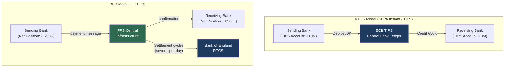
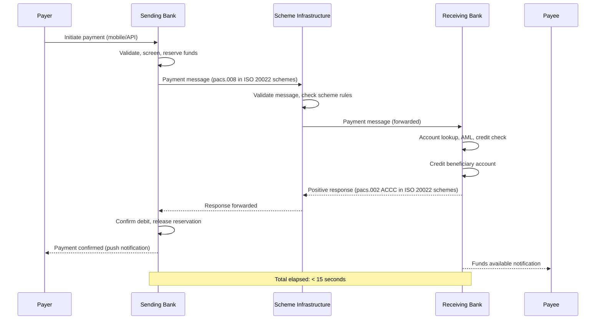

# المدفوعات الفورية — Faster Payments وSEPA Instant وميزانية الزمن

## نظرة عامة

غيّرت المدفوعات الفورية (RTP) توقعات المستهلكين والشركات جذريًا: فالدفعة التي كانت تستغرق ثلاثة أيام عبر BACS أو يومًا عبر ACH صارت تُسوّى نهائيًا في أقل من 10 ثوانٍ على مدار الساعة، كل يوم من السنة. وبالنسبة للمهندسين الذين يبنون الأنظمة التي تقدم هذه القدرة، ليست "الفورية" ادعاءً تسويقيًا — بل قيد هندسي صارم. فكل قفزة شبكة، وكل رحلة إلى قاعدة البيانات، وكل تقييم لقاعدة مكافحة غسل أموال، وكل استدعاء للتحقق من الحساب يجب أن يتسع ضمن ميزانية زمن صارمة. وتفرض أنظمة مثل Faster Payments ‏(FPS) البريطاني، وSEPA Instant ‏(SCT Inst)، وRTP وFedNow الأمريكيين، وPIX البرازيلي إضافةً لا رجعة فيها لا يمكن استرجاعها بعد تأكيدها. وخطأ البنية يعني إما رفض مدفوعات مشروعة (نسب انتهاء مهلة عالية، وتوفر ضعيف) أو إضافة مدفوعات ناتجة عن احتيال لا يمكن استردادها أبدًا.

## أهداف التعلم

- مقارنة الخصائص التقنية لـ FPS البريطاني وSEPA Instant وRTP الأمريكي وPIX البرازيلي من حيث الزمن، والتوفر، وحدود القيمة، ونموذج التسوية
- شرح ما يجب أن يحدث داخل أنظمة البنك ضمن نافذة الدفع الزمنية ولماذا تتنافس كل خطوة على الوقت
- التمييز بين التسوية الإجمالية الآنية (RTGS) والتسوية الصافية المؤجلة (DNS) وشرح النموذج الذي يستخدمه كل نظام
- تنفيذ صنف `FasterPaymentsGateway` بمهلة قابلة للضبط لكل طلب، وقاطع دائرة، ومعالجة آمنة للنتائج المجهولة
- بناء موزّع لميزانية الزمن يقسم الاتفاقية الكلية على مراحل المعالجة الداخلية
- شرح لماذا يُعد عدم قابلية الإلغاء قيدًا تصميميًا لا مجرد قاعدة عمل، وكيف يقود قرارات بنية مكافحة الاحتيال
- ربط حقول pacs.008 بملف ISO 20022 لنظام فوري وتنفيذ تحقق خاص بالنظام
- تحديد متطلبات المشاركة التي يجب أن يستوفيها البنك للاتصال بنظام فوري وآثارها الهندسية

## سياق العمل

*مثال مركّب (مبني على أنماط فشل شائعة في الصناعة، لا على بنك بعينه):* عانت بوابة Faster Payments في بنك من تدهور طويل انتهت فيه مهلة كل المدفوعات الصادرة تقريبًا. فقد جعل تحويل عنقود ذاكرة مؤقتة البحث عن مفتاح عدم التكرار يتباطأ من نحو 2ms إلى قرابة ثانيتين لكل استدعاء؛ فاستهلكت هذه القفزة الواحدة معظم ميزانية الزمن الداخلية، فأبلغت البوابة العملاء بانتهاء المهلة — لكن بعض تلك المدفوعات كان قد أُرسل إلى النظام وعولج. وعندما أعاد المهندسون تشغيل الخدمة أُرسلت المدفوعات المنتهية مهلتها مرة أخرى، ولأن البوابة لم تفحص حالة المدفوعات الجارية أولًا، أُضيف لمستفيدين كثيرين مرتين. ولأن المدفوعات الفورية غير قابلة للإلغاء، تطلب الاسترداد أسابيع من التفاوض بين البنوك وطلبات من المستفيدين لإعادة المال طوعًا. والدرس: صمّم ميزانية الزمن مع وضع أنماط الفشل في الاعتبار — يجب أن يكون فحص عدم التكرار على أسرع مسار وأكثره موثوقية، ويجب التحقيق في النتيجة المجهولة لا إعادة المحاولة بشكل أعمى.

## مقارنة أنظمة المدفوعات الفورية

| الخاصية | FPS البريطاني | SEPA Instant ‏(SCT Inst) | RTP الأمريكي (TCH) | PIX البرازيلي |
|---------|--------|------------------------|--------------|------------|
| الإطلاق | 2008 | 2017 | 2017 | 2020 |
| التوفر | ‏24/7/365 | ‏24/7/365 | ‏24/7/365 | ‏24/7/365 |
| الحد الزمني (المعتاد) | ثوانٍ (يفترض هذا الدرس ميزانية 15 ثانية) | 10 ثوانٍ | ثوانٍ | ثوانٍ |
| الحد الأقصى للمعاملة (النظام) | ‏1,000,000 جنيه (تضع البنوك حدودًا أقل) | لا حد أقصى للنظام منذ أكتوبر 2025 (قد تضع البنوك/العملاء حدودًا) | ‏10,000,000 دولار (منذ 2025) | لا حد للنظام؛ تضع البنوك حدودًا (مثلًا ليلًا) |
| نموذج التسوية | تسوية صافية مؤجلة في RTGS بنك إنجلترا (عدة دورات يوميًا، مغطاة بضمانات) | آنية بأموال البنك المركزي عبر TIPS، أو عبر EBA RT1 | آنية، بحساب مشترك ممول مسبقًا لدى الاحتياطي الفيدرالي | آنية بأموال البنك المركزي (SPI) |
| معيار الرسائل | مبني على ISO 8583 حاليًا؛ وISO 20022 مخطط ضمن بنية المدفوعات الجديدة | ISO 20022 | ISO 20022 | ISO 20022 |
| المشاركة | مباشرة أو عبر مزوّد وصول غير مباشر | عبر TIPS أو EBA RT1 | مباشرة أو عبر مزوّد خدمة | إلزامية للمؤسسات الكبيرة |
| غير قابلة للإلغاء؟ | نعم | نعم | نعم | نعم |
| التحقق من المستفيد | تأكيد المستفيد (CoP) | التحقق من المستفيد (إلزامي في منطقة اليورو منذ أكتوبر 2025) | — (لا اسم مستعار أصيل) | مفاتيح PIX ‏(CPF/CNPJ، والبريد، والهاتف، ومفتاح عشوائي) |
| الاسترداد اللاحق | استرداد بين البنوك؛ وتعويض إلزامي لاحتيال الدفع المفوّض منذ أكتوبر 2024 | استرجاع عبر camt.056 | طلب إعادة الأموال | آلية الإعادة الخاصة MED للاحتيال |

> [!NOTE]
> يمكن أن يُسوّى SEPA Instant عبر TIPS لدى النظام الأوروبي للبنوك المركزية، حيث تُسوّى كل دفعة منفردة بأموال البنك المركزي فورًا. أما FPS البريطاني فيستخدم التسوية الصافية المؤجلة: يُضاف للعملاء خلال ثوانٍ، لكن صافي مراكز البنوك يُسوّى في عدة دورات كل يوم عمل في RTGS بنك إنجلترا، ويجب على المشاركين الاحتفاظ بضمانات تغطي مراكزهم. وهذا مهم للسيولة: فالبنك على TIPS يجب أن يموّل حسابه في TIPS مسبقًا؛ والبنك على FPS يجب أن يموّل ضماناته ويدير صافي مركزه خلال اليوم. وفي الولايات المتحدة صار FedNow (أُطلق 2023) نظامًا فوريًا ثانيًا بجانب RTP.

## ميزانية الزمن من البداية للنهاية

ميزانية الزمن هي الزمن الفعلي الكلي من استلام بنك الدافع لتعليمة الدفع حتى تأكيد بنك المستفيد للإضافة. وتضع الأنظمة حدودها الخاصة (SEPA Instant: ‏10 ثوانٍ)؛ ويستخدم هذا الدرس ميزانية 15 ثانية من البداية للنهاية لـ FPS كافتراض عمل. وداخل تلك النافذة يجب أن يكتمل ما يلي:

```mermaid
gantt
    title Faster Payments 15-Second Latency Budget (Sending Bank)
    dateFormat X
    axisFormat %Ss

    section Validation
    Schema & business rule validation :a1, 0, 1s
    Duplicate / idempotency check     :a2, 1, 2s

    section Screening
    Sanctions screening               :a3, 2, 4s
    Fraud scoring                     :a4, 4, 6s

    section Funds
    Account debit & funds reservation :a5, 6, 7s

    section Scheme
    Scheme submission (pacs.008)      :a6, 7, 9s
    Receiving bank processing         :a7, 9, 13s
    pacs.002 confirmation received    :a8, 13, 14s

    section Response
    Customer notification             :a9, 14, 15s
```



كل مرحلة من تلك المراحل مصدر محتمل للتأخير يجب على المهندسين التحكم فيه. فرحلة إلى قاعدة البيانات تستغرق 50ms منفردة مقبولة؛ لكن 10 رحلات متتالية = 500ms، وهي نسبة ملموسة من الميزانية.

أهم مصادر التأخير:

| المرحلة | الهدف المعتاد | الخطر |
|-------|---------------|------|
| التحقق من المدخلات | < 5ms | كلفة التعبيرات النمطية/JAXB |
| فحص عدم التكرار | < 10ms | إخفاق الذاكرة المؤقتة ← رحلة إلى قاعدة البيانات |
| فحص العقوبات | < 500ms | استدعاء خدمة خارجية |
| تقييم الاحتيال | < 300ms | استدلال نموذج تعلم آلي |
| البحث عن الحساب والخصم | < 50ms | تنافس الأقفال في قاعدة البيانات |
| رحلة شبكة النظام | < 3s | قفزة إلى بنية النظام |
| معالجة البنك المستلم | < 5s | خارجية، غير قابلة للتحكم |
| التأكيد والإشعار | < 100ms | إشعار غير متزامن |

> [!WARNING]
> فحص العقوبات أخطر مجهول في الزمن. فاستدعاء متزامن لخدمة فحص خارجية بمتوسط ثانيتين وP99 بثماني ثوانٍ سيستهلك الاتفاقية كلها وحده. فيجب حساب الفحص مسبقًا (فحص دفعي ليلي للأطراف المعروفة) مع مسار سريع للأطراف الجديدة. ولا تضع أبدًا استدعاء HTTP خارجيًا متزامنًا على المسار الحرج لدفع فوري دون قاطع دائرة بمهلة أقل بكثير من ثانية.

## نموذج التسوية بين البنوك

**التسوية الإجمالية الآنية (RTGS):** تُسوّى كل دفعة منفردة وفورًا بأموال البنك المركزي. فيُخصم من حساب البنك المرسل في TIPS/SPI ويُضاف إلى حساب البنك المستلم ذريًا. فلا مخاطر ائتمان بين البنوك. وتتطلب سيولة ممولة مسبقًا.

**التسوية الصافية المؤجلة (DNS):** تتدفق المدفوعات آنيًا إلى المستفيدين، لكن التسوية بين البنوك (مقاصة المراكز) تتم في دورات تسوية محددة مسبقًا (لـ FPS، عدة دورات كل يوم عمل في RTGS بنك إنجلترا). ويُحد صافي المركز المدين لكل بنك بالضمانات التي أودعها — فعندما يبلغ البنك حده تُرفض مدفوعاته الصادرة الإضافية حتى يسوّي أو يضيف ضمانات. ويتطلب هذا النموذج مراقبة دقيقة للسيولة خلال اليوم.



## تنفيذ FasterPaymentsGateway

يجب أن تتعامل بوابة FPS بمستوى إنتاجي مع مهل النظام، وعدم التكرار، وقطع الدائرة، والنتائج المجهولة بأمان:

```java
import io.github.resilience4j.circuitbreaker.CallNotPermittedException;
import io.github.resilience4j.circuitbreaker.CircuitBreaker;
import io.github.resilience4j.circuitbreaker.CircuitBreakerConfig;
import io.github.resilience4j.timelimiter.TimeLimiter;
import io.github.resilience4j.timelimiter.TimeLimiterConfig;

import java.time.Duration;
import java.util.concurrent.CompletableFuture;
import java.util.concurrent.ExecutorService;
import java.util.concurrent.TimeoutException;

@Service
public class FasterPaymentsGateway {

    private static final Duration SCHEME_TIMEOUT  = Duration.ofSeconds(13);

    private final SchemeClient schemeClient;
    private final IdempotencyStore idempotencyStore;
    private final ExecutorService schemeExecutor;   // dedicated, bounded — never commonPool
    private final CircuitBreaker circuitBreaker;
    private final TimeLimiter timeLimiter;

    public FasterPaymentsGateway(SchemeClient schemeClient,
                                  IdempotencyStore idempotencyStore,
                                  ExecutorService schemeExecutor) {
        this.schemeClient     = schemeClient;
        this.idempotencyStore = idempotencyStore;
        this.schemeExecutor   = schemeExecutor;

        CircuitBreakerConfig cbConfig = CircuitBreakerConfig.custom()
                .failureRateThreshold(50)
                .waitDurationInOpenState(Duration.ofSeconds(30))
                .slidingWindowSize(20)
                .recordExceptions(TimeoutException.class, SchemeUnavailableException.class)
                .build();
        this.circuitBreaker = CircuitBreaker.of("fps-scheme", cbConfig);

        TimeLimiterConfig tlConfig = TimeLimiterConfig.custom()
                .timeoutDuration(SCHEME_TIMEOUT)
                // Cancelling the future does NOT recall a message already sent
                .cancelRunningFuture(true)
                .build();
        this.timeLimiter = TimeLimiter.of("fps-timeout", tlConfig);
    }

    public PaymentResult submitPayment(FpsPaymentRequest request) {
        // Step 1: idempotency check — must be the fastest, most reliable path
        IdempotencyResult idempotency = idempotencyStore.checkAndReserve(request.endToEndId());
        if (idempotency.alreadyProcessed()) {
            return idempotency.previousResult();
        }

        // Step 2: attempt via scheme with circuit breaker + timeout
        try {
            PaymentResult result = circuitBreaker.executeCallable(
                () -> timeLimiter.executeFutureSupplier(
                    () -> CompletableFuture.supplyAsync(
                        () -> schemeClient.submit(request), schemeExecutor
                    )
                )
            );
            idempotencyStore.recordResult(request.endToEndId(), result);
            return result;

        } catch (TimeoutException ex) {
            // Scheme timeout — the payment MAY have been received and credited.
            // Never resubmit or switch rails until the outcome is known
            log.warn("Scheme timeout for E2EId={}, querying status", request.endToEndId());

            PaymentStatus status = querySchemeStatus(request.endToEndId());
            PaymentResult outcome = switch (status) {
                case ACCC -> PaymentResult.alreadyCredited(request.endToEndId());
                case RJCT -> PaymentResult.realTimeFailedOfferAlternative(request.endToEndId());
                // Unknown or still pending: hold for investigation — NO fallback,
                // NO automatic resubmission (that is how double payments happen)
                default   -> PaymentResult.pendingInvestigation(request.endToEndId());
            };
            idempotencyStore.recordResult(request.endToEndId(), outcome);
            return outcome;

        } catch (CallNotPermittedException ex) {
            // Circuit open: the payment was NOT sent, so offering another rail is safe
            log.warn("Scheme circuit breaker open — payment not sent");
            PaymentResult notSent = PaymentResult.realTimeUnavailableOfferAlternative(request.endToEndId());
            idempotencyStore.recordResult(request.endToEndId(), notSent);
            return notSent;

        } catch (SchemeRejectionException ex) {
            // Permanent rejection — return error to customer
            PaymentResult rejection = PaymentResult.schemeRejected(ex.getReasonCode());
            idempotencyStore.recordResult(request.endToEndId(), rejection);
            return rejection;

        } catch (Exception ex) {
            // Any other failure after sending: outcome unknown → investigate
            PaymentResult unknown = PaymentResult.pendingInvestigation(request.endToEndId());
            idempotencyStore.recordResult(request.endToEndId(), unknown);
            return unknown;
        }
    }

    private PaymentStatus querySchemeStatus(String endToEndId) {
        try {
            // Status enquiry to the scheme (in ISO 20022 schemes: pacs.028 → pacs.002)
            return schemeClient.requestStatus(endToEndId);
        } catch (Exception e) {
            log.error("Status query failed for E2EId={}", endToEndId, e);
            return PaymentStatus.UNKNOWN;
        }
    }
}
```

أهم ما في هذا التنفيذ: انتهاء مهلة النظام **نتيجة مجهولة** — فقد تكون الدفعة استُلمت وأُضيفت. فلا تُعد إرسالها أبدًا ولا تحوّلها إلى مسار آخر حتى تُعرف النتيجة: استعلم عن الحالة؛ فإن كانت ACCC فقد تمت، وإن كانت RJCT يمكن عرض بديل، وإن بقيت مجهولة تُحتجز للتحقيق. أما عند فتح قاطع الدائرة فالدفعة **لم تُرسل**، فعرض مسار آخر آمن. ويُستخدم منفّذ مخصص ومحدود لا المجمّع المشترك. ولاحظ أن إلغاء المستقبل لا يسترجع رسالة أُرسلت بالفعل.

> [!NOTE]
> التحول إلى مسار أبطأ (مثل BACS) قرار يتعلق بتجربة العميل، لا متطلب تقني. فاعرضه فقط عندما تكون الدفعة الفورية **معروفًا أنها لم تُنفّذ** (مرفوضة، أو لم تُرسل لأن الدائرة كانت مفتوحة)، وبموافقة العميل. ولا تُعد أبدًا إرسال دفعة فورية انتهت مهلتها على مسار آخر بصمت — فقد تكون أُضيفت بالفعل، وقد يعيد العميل المحاولة يدويًا أيضًا، فيحدث تكرار.

## تسلسل Faster Payments من البداية للنهاية



## عدم قابلية الإلغاء وآثاره على الاحتيال

بمجرد استلام تأكيد إيجابي (pacs.002 بالحالة `ACCC` في أنظمة ISO 20022) **لا يمكن عكس** الدفعة من طرف واحد. وهذه قاعدة أساسية في النظام، لا قيد تقني. وهذا يعني:

1. **يجب إيقاف الاحتيال قبل الإرسال.** لا يوجد بعد الإرسال إلا عمليات استرداد بأفضل جهد (المملكة المتحدة: استرداد بين البنوك؛ SEPA: استرجاع عبر camt.056)، لا آليات عكس مضمونة. وفي المملكة المتحدة يجب أيضًا على مزوّدي الدفع المرسلين والمستلمين تعويض ضحايا احتيال الدفع المفوّض (إلزامي منذ أكتوبر 2024، حتى حد معين)، مما يجعل المنع مسألة كلفة مباشرة للبنوك.

2. **احتيال الدفع المفوّض (APP)** هو نموذج التهديد المهيمن. فيُخدع الدافع لتفويض دفعة مشروعة إلى حساب يسيطر عليه محتال. وعندما يبلّغ الدافع عن الاحتيال يكون المال قد انتقل إلى مكان آخر وقد لا تبقى لدى البنك المستلم أموال لإعادتها.

3. **فحوص اسم المستفيد** وقت الإرسال إذن ضابط هندسي أساسي. ففي المملكة المتحدة يتحقق تأكيد المستفيد (CoP) — المطلوب من معظم مزوّدي الدفع — من أن الاسم الذي أدخله الدافع يطابق صاحب الحساب قبل إرسال الدفعة. وفي منطقة اليورو صار التحقق من المستفيد إلزاميًا منذ أكتوبر 2025 بموجب لائحة المدفوعات الفورية. ويستخدم PIX مفاتيح (أسماء مستعارة) تعرض اسم المستفيد قبل التأكيد.

```java
public class ConfirmationOfPayeeService {

    private final CopRegistryClient copClient;

    public CopResult verify(String sortCode, String accountNumber, String intendedName) {
        CopResponse response = copClient.verify(CopRequest.of(sortCode, accountNumber, intendedName));

        return switch (response.getMatchResult()) {
            case EXACT_MATCH       -> CopResult.proceed(MatchLevel.EXACT);
            case CLOSE_MATCH       -> CopResult.proceedWithWarning(MatchLevel.CLOSE,
                                        response.getActualName());
            case NO_MATCH          -> CopResult.block("Name does not match account holder");
            case BUSINESS_MATCH    -> CopResult.proceed(MatchLevel.BUSINESS);
            case ACCOUNT_NOT_FOUND -> CopResult.block("Account not found in CoP registry");
            case UNAVAILABLE       -> CopResult.continueWithoutVerification(); // degraded mode
        };
    }
}
```

> [!IMPORTANT]
> عندما يكون CoP في حالة `UNAVAILABLE` (لا يمكن الوصول إلى البنك المستجيب)، يمكن عادة أن تمضي الدفعة بعد تحذير العميل بأن الاسم لم يمكن فحصه — لكن يجب أن **يسجّل نظامك ذلك كفحص متدهور** ويعلّم الدفعة لمراقبة معززة. ولا تعامل أبدًا عدم توفر CoP كمرور صامت — بل يجب أن يكون حدثًا ملحوظًا في منظومة المراقبة لديك.

## ‏ISO 20022 pacs.008 لنظام فوري (ملف توضيحي)

> [!NOTE]
> ما زال FPS اليوم يستخدم معيار رسائله المبني على ISO 8583؛ ونقل المدفوعات البريطانية للأفراد إلى ISO 20022 جزء من برنامج بنية المدفوعات الجديدة (NPA) الذي تأخر. والملف أدناه مثال **توضيحي على نمط FPS** يبين كيف يضيّق نظام فوري محلي رسالة pacs.008 الأساسية — فـ SEPA Instant وRTP الأمريكي وFedNow وPIX تستخدم كلها ISO 20022 بكتب قواعد خاصة بها. ونفّذ دائمًا من كتاب قواعد النظام الحقيقي.

قواعد خاصة بالنظام فوق pacs.008 الأساسية (توضيحية):

| العنصر | المتطلب | ملاحظات |
|---------|----------------|-------|
| `PmtTpInf/LclInstrm/Cd` | رمز النظام | يعرّف النظام الفوري |
| `EndToEndId` | يجب ألا يكون `NOTPROVIDED` | يفرضه النظام |
| `Dbtr/PstlAdr/Ctry` | إلزامي | ‏GB للمحلي |
| `DbtrAcct/Id/Othr/SchmeNm/Cd` | `BBAN` لرمز الفرع / الحساب | صيغة الحساب البريطانية |
| `CdtrAcct/Id/Othr/SchmeNm/Cd` | `BBAN` | صيغة الحساب البريطانية |
| `SttlmMtd` | `CLRG` | يُسوّى عبر نظام المقاصة |
| `IntrBkSttlmAmt Ccy` | `GBP` | النظام بالجنيه فقط |

منشئ Java لرسالة pacs.008 متوافقة مع هذا الملف:

```java
public class FpsPacs008Builder {

    public Document build(FpsPaymentRequest req) {
        Document doc = new Document();
        FIToFICustomerCreditTransferV10 msg = new FIToFICustomerCreditTransferV10();

        // Group header
        GroupHeader96 hdr = new GroupHeader96();
        hdr.setMsgId(req.messageId());
        hdr.setCreDtTm(toXmlGregorianCalendar(OffsetDateTime.now()));
        hdr.setNbOfTxs("1");
        hdr.setCtrlSum(req.amount());
        SettlementInstruction11 sttlm = new SettlementInstruction11();
        sttlm.setSttlmMtd(SettlementMethod1Code.CLRG);
        hdr.setSttlmInf(sttlm);
        msg.setGrpHdr(hdr);

        // Credit transfer transaction
        CreditTransferTransaction62 tx = new CreditTransferTransaction62();
        PaymentIdentification7 pmtId = new PaymentIdentification7();
        pmtId.setInstrId(req.instructionId());
        pmtId.setEndToEndId(req.endToEndId());
        pmtId.setUETR(req.uetr());
        tx.setPmtId(pmtId);

        // FPS local instrument
        PaymentTypeInformation28 pmtTp = new PaymentTypeInformation28();
        LocalInstrument2Choice lcl = new LocalInstrument2Choice();
        lcl.setCd("FPS");
        pmtTp.setLclInstrm(lcl);
        tx.setPmtTpInf(pmtTp);

        // Settlement amount in GBP
        ActiveCurrencyAndAmount amt = new ActiveCurrencyAndAmount();
        amt.setCcy("GBP");
        amt.setValue(req.amount());
        tx.setIntrBkSttlmAmt(amt);
        tx.setIntrBkSttlmDt(toXmlGregorianCalendar(req.settlementDate()));

        tx.setChrgBr(ChargeBearerType3Code.SLEV); // FPS: service level charges

        // Debtor
        tx.setDbtr(buildParty(req.debtorName(), "GB"));
        tx.setDbtrAcct(buildUkAccount(req.debtorSortCode(), req.debtorAccountNumber()));
        tx.setDbtrAgt(buildAgent(req.debtorBic()));

        // Creditor
        tx.setCdtr(buildParty(req.creditorName(), "GB"));
        tx.setCdtrAcct(buildUkAccount(req.creditorSortCode(), req.creditorAccountNumber()));
        tx.setCdtrAgt(buildAgent(req.creditorBic()));

        msg.getCdtTrfTxInf().add(tx);
        doc.setFIToFICstmrCdtTrf(msg);
        return doc;
    }

    private CashAccount40 buildUkAccount(String sortCode, String accountNumber) {
        CashAccount40 acct = new CashAccount40();
        AccountIdentification4Choice id = new AccountIdentification4Choice();
        GenericAccountIdentification1 othr = new GenericAccountIdentification1();
        othr.setId(sortCode + accountNumber); // 6-digit sort code + 8-digit account
        AccountSchemeName1Choice schme = new AccountSchemeName1Choice();
        schme.setCd("BBAN");
        othr.setSchmeNm(schme);              // tells the receiver how to read the Id
        id.setOthr(othr);
        acct.setId(id);
        return acct;
    }
}
```

## تفصيل ميزانية الزمن

إدارة ميزانية الزمن انضباط معماري. فيجب توزيع الاتفاقية الكلية (15 ثانية في افتراضنا لـ FPS) على كل مكون في المسار الحرج، مع هامش للتفاوت:

| المكون | تخصيص الميزانية | هدف p50 | هدف p99 | نمط الفشل |
|-----------|------------------|------------|------------|--------------|
| تحليل المدخلات والتحقق | 50ms | 5ms | 30ms | الرفض فورًا |
| فحص عدم التكرار (Redis) | 20ms | 2ms | 15ms | الرجوع إلى قاعدة البيانات (100ms) |
| الفحص المسبق للعقوبات | 500ms | 100ms | 400ms | الحجب عند إخفاق الذاكرة المؤقتة |
| تقييم الاحتيال الآني | 400ms | 150ms | 350ms | استخدام تقييم مخزن إن كان عمره أقل من 5 دقائق |
| خصم الحساب والكتابة في قاعدة البيانات | 100ms | 20ms | 80ms | إعادة المحاولة مرة ثم الفشل |
| شبكة النظام (الإرسال) | 500ms | 200ms | 450ms | — |
| معالجة النظام والبنك المستلم | 7,000ms | 3,000ms | 6,500ms | خارجية — غير قابلة للتحكم |
| تحليل الرد والتأكيد | 50ms | 5ms | 30ms | — |
| إشعار العميل | 200ms | 50ms | 150ms | غير متزامن — غير حاجب |
| **الإجمالي (المسار الحرج المتسلسل)** | **نحو 9 ثوانٍ** | — | — | هامش 6 ثوانٍ للتذبذب |

يتطلب إبقاء p99 ضمن الميزانية: تجميع الاتصالات في كل الاستدعاءات الخارجية، وJVM مُحمّاة مسبقًا (لا بدء بارد على المسار الحرج)، وRedis بنمط sentinel أو عنقود بلا نقطة فشل واحدة، وإشعار العميل بشكل غير متزامن (لا تحجب على توصيل الإشعار).

## اختبار المعرفة

**س1: لبوابة FPS لديك مهلة 13 ثانية لرحلة النظام. تنتهي مهلة دفعة عند الثانية 13 دون رد. ويرسل منطق البديل لديك الدفعة نفسها فورًا عبر BACS. وفي اليوم التالي تكتشف أن دفعة FPS عولجت بنجاح — فقد وصل التأكيد عند الثانية 13.5، بعد انتهاء المهلة. ما الأثر على العميل وأي ضابط هندسي كان سيمنعه؟**

ج: تلقى العميل دفعة مزدوجة: أُضيف للمستفيد مرة عبر FPS ومرة عبر BACS، وخُصم من الدافع مرتين. والضابط الهندسي الذي يمنع ذلك **الاستعلام عن الحالة قبل أي بديل**: فعند انتهاء مهلة FPS يجب أن ترسل البوابة استعلام حالة إلى النظام (في أنظمة ISO 20022: ‏pacs.028 يُجاب بـ pacs.002) وتنتظر الإجابة قبل أن تقرر أي شيء. فإن كانت `ACCC` يُلغى البديل كليًا. ولا يُنظر في بديل إلا إذا كانت الحالة `RJCT`؛ وإن انتهت مهلة استعلام الحالة نفسه فيجب احتجاز الدفعة للمراجعة اليدوية بدل توجيهها تلقائيًا إلى مسار آخر. إضافة إلى ذلك يجب أن يسجّل مخزن عدم التكرار معرّف endToEndId الأصلي على أنه "جارٍ" فتُرفض أي محاولة BACS بالمرجع نفسه كتكرار.

**س2: يستغرق بنك مستلم 8 ثوانٍ في المتوسط لمعالجة FPS لكنه يقفز إلى 14 ثانية عند p99 في ساعات الذروة. والميزانية الكلية 15 ثانية. ويستهلك البنك المرسل 4 ثوانٍ في معالجته. هل هذا الترتيب ضمن الميزانية، وماذا يستطيع البنك المرسل أن يفعل إذا لاحظ بانتظام أزمنة رحلة كاملة تبلغ 15 ثانية حتى عندما تكون معالجته 3 ثوانٍ؟**

ج: الترتيب في خطر. فـ 4 ثوانٍ (البنك المرسل) + 8 ثوانٍ في المتوسط (البنك المستلم) = 12 ثانية، فلا يبقى إلا 3 ثوانٍ لكلفة توجيه النظام. وعند p99 يصبح 4 + 14 = 18 ثانية، وهو يتجاوز 15 ثانية. ولا يستطيع البنك المرسل التحكم في المعالجة الداخلية للبنك المستلم، لكنه يستطيع: (1) مراقبة الزمن لكل طرف مقابل وإبلاغ مشغّل النظام (Pay.UK لـ FPS) بالتجاوزات المستمرة، فهو يستطيع اتخاذ إجراء ضد المشاركين غير الملتزمين؛ (2) تعديل ميزانية معالجته ديناميكيًا؛ (3) تنبيه العملاء مسبقًا عند الدفع إلى أطراف معروف بطؤها بأن الدفعة قد تتجاوز الزمن المعتاد. وفي النهاية، الالتزام بزمن النظام واجب مشترك يفرضه مشغّل النظام، ولا يحققه مشارك واحد بمفرده.

## التحدي العملي

1. **تجهيز قياس الزمن:** جهّز `FasterPaymentsGateway` بمؤقتات Micrometer لكل مرحلة معالجة (التحقق، وفحص عدم التكرار، والعقوبات، والاحتيال، وخصم الحساب، واستدعاء النظام). واضبط `LatencyBudgetMonitor` يطلق تنبيه `LATENCY_BUDGET_EXCEEDED` إذا تجاوزت مرحلة استدعاء النظام تخصيصها البالغ 500ms، وتنبيه `TOTAL_SLA_BREACH` إذا تجاوزت الرحلة الكاملة 14 ثانية (ثانية دون الميزانية). واكتب اختبارًا باستخدام `MockClock` و`Mockito` يحاكي كل مرحلة بقيمة p99 ويؤكد إطلاق التنبيهات بشكل صحيح.

2. **مخزن عدم التكرار:** نفّذ `RedisIdempotencyStore` باستخدام Spring Data Redis. يجب أن: يعيّن المخزن مفتاحًا ذريًا (endToEndId ← `IN_FLIGHT`) بصلاحية 30 ثانية باستخدام `SET NX EX`؛ وعند الاكتمال يحدّث المفتاح إلى النتيجة النهائية بصلاحية 24 ساعة؛ وعند إخفاق الذاكرة المؤقتة (Redis غير متاح) يرجع إلى جدول PostgreSQL مع قفل استشاري. واكتب اختبار تكامل باستخدام Testcontainers ‏(Redis + PostgreSQL) يتحقق من أن إرسالين متزامنين بمعرّف endToEndId نفسه ينتجان استدعاء نظام واحدًا بالضبط.

3. **تكامل تأكيد المستفيد:** ابنِ `CopEnrichedPaymentValidator` يغلّف `ConfirmationOfPayeeService` ويفرض السياسة التالية: `EXACT_MATCH` ← المضي؛ و`CLOSE_MATCH` ← المضي لكن مع اشتراط علَم تأكيد صريح من العميل في الطلب؛ و`NO_MATCH` ← الحجب بالسبب `NAME_MISMATCH` (قد يختار العميل المضي فقط بعد تحذير واضح، وفق سياستك)؛ و`UNAVAILABLE` ← المضي بعد تحذير مع تعيين `degradedCopCheck=true` في سجل الدفعة. واكتب اختبارات JUnit 5 بمعاملات لكل نتيجة CoP.

4. **محاكي نظام FPS:** ابنِ خادم اختبار خفيفًا بـ Spring Boot يعرض نقطة `/fps/submit` تقبل pacs.008 XML وتعيد رد pacs.002 XML. ويجب أن: يتحقق المحاكي من مخطط pacs.008؛ ويجيب عن استعلامات الحالة pacs.028؛ ويعيد `ACCC` للمدفوعات الصالحة بعد تأخير قابل للضبط (الافتراضي ثانيتان)؛ ويعيد `RJCT` بالسبب `AC01` (حساب غير صالح) للحسابات المنتهية بـ `9999`؛ ويعيد انتهاء مهلة (ردًا متأخرًا بعد 13 ثانية) للمدفوعات التي يبدأ `EndToEndId` فيها بـ `TIMEOUT-`. واستخدم هذا المحاكي في مجموعة اختبارات تكامل لـ `FasterPaymentsGateway` للتحقق من تدفقات انتهاء المهلة، وقاطع الدائرة، والبديل دون الاتصال بالنظام الحقيقي.

<!-- KNOWLEDGE-CHECK
{
  "questions": [
    {
      "text": "تنتهي مهلة بوابة FPS لديك عند 13 ثانية دون رد pacs.002، ثم ترسل الدفعة نفسها فورًا عبر BACS. وفي اليوم التالي تكتشف أن دفعة FPS عولجت بنجاح — فقد وصل pacs.002 عند 13.5 ثانية. ما الأثر على العميل؟",
      "options": [
        "لا أثر — سيكتشف BACS التكرار ويرفضه",
        "خُصم من العميل مرتين وأُضيف للمستفيد مرتين",
        "عُكست دفعة FPS تلقائيًا عند تسوية دفعة BACS",
        "رُفضت دفعة BACS لعدم كفاية الرصيد"
      ],
      "correct": 1,
      "explanation": "أُضيف للمستفيد مرة عبر FPS ومرة عبر BACS، وخُصم من الدافع مرتين. فانتهاء المهلة نتيجة مجهولة لا فشل. والضابط الصحيح إرسال استعلام حالة إلى النظام أولًا؛ وتغيير المسار فقط إذا عُرف أن الدفعة رُفضت، واحتجاز الدفعة للتحقيق إذا بقيت الحالة مجهولة. ولأن المدفوعات الفورية غير قابلة للإلغاء، لا يمكن استرداد التكرار إلا بطلب إعادته من المستفيد."
    },
    {
      "text": "يفترض هذا الدرس ميزانية 15 ثانية من البداية للنهاية لـ FPS. ماذا يعني ذلك لبنك مرسل يستهلك هو نفسه 4 ثوانٍ من المعالجة؟",
      "options": [
        "‏30 ثانية إجمالًا؛ ويتبقى للبنك المرسل 26 ثانية",
        "‏15 ثانية إجمالًا؛ ولا يتبقى إلا 11 ثانية لتوجيه النظام ومعالجة البنك المستلم",
        "‏5 ثوانٍ إجمالًا؛ والبنك المرسل تجاوز ميزانيته بالفعل",
        "‏60 ثانية إجمالًا؛ وهناك هامش وافر"
      ],
      "correct": 1,
      "explanation": "مع ميزانية 15 ثانية من البداية للنهاية و4 ثوانٍ يستهلكها البنك المرسل، لا يتبقى إلا 11 ثانية لتوجيه النظام نفسه ومعالجة البنك المستلم. وعند p99، فإن بنكًا مستلمًا يستغرق 14 ثانية سيجعل الإجمالي 4 + 14 = 18 ثانية — فوق الميزانية. ولهذا تحتاج كل مرحلة داخلية ميزانيتها الخاصة، ويجب أن يُبقي البنك المرسل حصته صغيرة."
    },
    {
      "text": "ماذا تعيد خدمة تأكيد المستفيد (CoP) عندما يطابق الاسم المقدم اسم صاحب الحساب تمامًا؟",
      "options": [
        "PARTIAL_MATCH",
        "EXACT_MATCH",
        "VERIFIED",
        "NAME_CONFIRMED"
      ],
      "correct": 1,
      "explanation": "تعيد CoP ‏`EXACT_MATCH` عندما يطابق الاسم الذي أدخله الدافع الاسم المسجل للحساب. والنتائج الأخرى في نموذج هذا الدرس هي CLOSE_MATCH (اعرض الاسم الفعلي واطلب من الدافع التأكيد)، وNO_MATCH (احجب أو حذّر بقوة)، وACCOUNT_NOT_FOUND، وBUSINESS_MATCH (نوع الحساب مختلف)، وUNAVAILABLE (امضِ فقط بعد تحذير، مع تسجيله كفحص متدهور)."
    }
  ]
}
-->

<!-- PRACTICAL-CHALLENGE
{
  "title": "تجهيز قياس الزمن وعدم التكرار في بوابة FPS",
  "difficulty": "advanced",
  "estimatedMinutes": 45,
  "tasks": [
    {
      "id": "1",
      "description": "جهّز `FasterPaymentsGateway` بمؤقتات Micrometer لكل مرحلة معالجة (التحقق، وفحص عدم التكرار، والعقوبات، والاحتيال، وخصم الحساب، واستدعاء النظام). واضبط `LatencyBudgetMonitor` يطلق `LATENCY_BUDGET_EXCEEDED` إذا تجاوزت مرحلة استدعاء النظام 500ms و`TOTAL_SLA_BREACH` إذا تجاوزت الرحلة الكاملة 14 ثانية. واكتب اختبارًا باستخدام `MockClock` و`Mockito` يحاكي كل مرحلة بقيمة p99."
    },
    {
      "id": "2",
      "description": "نفّذ `RedisIdempotencyStore` باستخدام Spring Data Redis. عيّن مفتاحًا ذريًا (endToEndId ← `IN_FLIGHT`) بصلاحية 30 ثانية باستخدام `SET NX EX`؛ وعند الاكتمال حدّثه بالنتيجة النهائية وصلاحية 24 ساعة؛ وعند عدم توفر Redis ارجع إلى PostgreSQL مع قفل استشاري. واكتب اختبار تكامل باستخدام Testcontainers ‏(Redis + PostgreSQL) يتحقق من أن إرسالين متزامنين ينتجان استدعاء نظام واحدًا بالضبط."
    },
    {
      "id": "3",
      "description": "ابنِ `CopEnrichedPaymentValidator` يغلّف `ConfirmationOfPayeeService` ويفرض: `EXACT_MATCH` ← المضي؛ و`CLOSE_MATCH` ← المضي فقط مع علَم تأكيد صريح من العميل؛ و`NO_MATCH` ← الحجب بالسبب `NAME_MISMATCH`؛ و`UNAVAILABLE` ← المضي بعد تحذير مع `degradedCopCheck=true`. واكتب اختبارات JUnit 5 بمعاملات لكل نتيجة CoP."
    },
    {
      "id": "4",
      "description": "ابنِ محاكي نظام خفيفًا بـ Spring Boot يعرض `/fps/submit` تقبل pacs.008 XML وتعيد pacs.002، إضافة إلى نقطة استعلام حالة (pacs.028). أعد `ACCC` بعد تأخير قابل للضبط (الافتراضي ثانيتان)، و`RJCT` بالسبب `AC01` للحسابات المنتهية بـ `9999`، وانتهاء مهلة لمعرّفات `EndToEndId` التي تبدأ بـ `TIMEOUT-` (مع إضافتها فعلًا، فيعيد استعلام الحالة لاحقًا ACCC). واستخدمه في اختبارات التكامل للتحقق من تدفقات انتهاء المهلة، واستعلام الحالة، وقاطع الدائرة، ومنع الدفع المزدوج."
    }
  ]
}
-->
