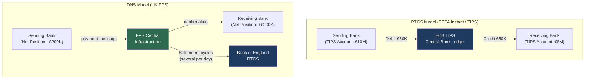
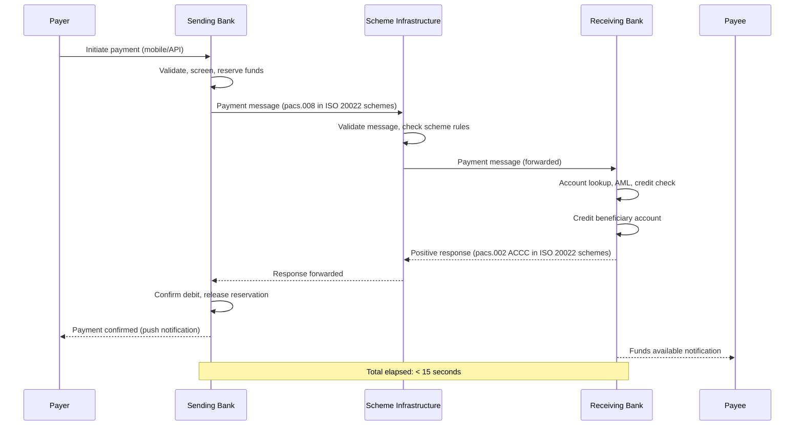

## Overview

Real-time payments (RTP) have fundamentally changed consumer and business expectations: a payment that once took three days via BACS or one day via ACH now settles permanently in under 10 seconds around the clock, every day of the year. For the engineers building the systems that deliver this capability, real-time is not a marketing claim — it is a hard engineering constraint. Every network hop, every database round trip, every AML rule evaluation, and every account validation call must fit inside a strict latency budget. Schemes like UK Faster Payments (FPS), SEPA Instant Credit Transfer (SCT Inst), US RTP and FedNow, and Brazil's PIX impose irrevocable credit that cannot be recalled once confirmed. Getting the architecture wrong means either refusing legitimate payments (high timeout rates, poor availability) or crediting fraud-induced payments that can never be recovered.

## Learning Objectives

- Compare the technical characteristics of UK FPS, SEPA Instant, US RTP, and Brazil PIX across latency, availability, value limits, and settlement model
- Explain what must happen inside a bank's systems within a 20-second payment window and why each step competes for time
- Distinguish real-time gross settlement (RTGS) from deferred net settlement (DNS) and explain which model each RTP scheme uses
- Implement a `FasterPaymentsGateway` class with a configurable per-request timeout, circuit breaker, and fallback to a slower payment rail
- Build a latency budget allocator that partitions the total scheme SLA across internal processing stages
- Explain why irrevocability is a design constraint, not just a business rule, and how it drives fraud architecture decisions
- Map pacs.008 fields to an instant-scheme ISO 20022 profile and implement scheme-specific validation
- Identify the participation requirements a bank must meet to connect to a real-time scheme and their engineering implications

## Business Context

*Composite example (based on common industry failure patterns, not a specific bank):* a bank's Faster Payments gateway suffered a long degradation in which almost all outbound payments timed out. A cache cluster failover made the idempotency-key lookup slow down from about 2 ms to nearly 2 seconds per call; this one hop used up most of the internal time budget, so the gateway reported timeouts to customers — but some of those payments had already been forwarded to the scheme and were processed. When engineers restarted the service, the timed-out payments were submitted again, and because the gateway did not check the status of in-flight payments first, many beneficiaries were credited twice. Because instant payments are irrevocable, recovery meant weeks of bank-to-bank negotiation and requests to beneficiaries to return money voluntarily. The lesson: design the latency budget with failure modes in mind — the idempotency check must be on the fastest, most reliable path, and an unknown outcome must be investigated, never blindly retried.

## Real-Time Payment Scheme Comparison

| Feature | UK FPS | SEPA Instant (SCT Inst) | US RTP (TCH) | Brazil PIX |
|---------|--------|------------------------|--------------|------------|
| Launched | 2008 | 2017 | 2017 | 2020 |
| Availability | 24/7/365 | 24/7/365 | 24/7/365 | 24/7/365 |
| Time limit (typical) | Seconds (this lesson assumes a 15 s budget) | 10 seconds | Seconds | Seconds |
| Max transaction (scheme) | £1,000,000 (banks set lower limits) | No scheme maximum since October 2025 (banks/customers may set limits) | $10,000,000 (since 2025) | No scheme limit; banks set limits (e.g. at night) |
| Settlement model | Deferred net settlement in Bank of England RTGS (several cycles per day, collateralised) | Real-time in central bank money via TIPS, or via EBA RT1 | Real-time, prefunded joint account at the Federal Reserve | Real-time in central bank money (SPI) |
| Message standard | ISO 8583-based today; ISO 20022 planned under the New Payments Architecture | ISO 20022 | ISO 20022 | ISO 20022 |
| Participation | Directly or via an indirect access provider | Via TIPS or EBA RT1 | Direct or via a service provider | Mandatory for large institutions |
| Irrevocable? | Yes | Yes | Yes | Yes |
| Payee check | Confirmation of Payee (CoP) | Verification of Payee (mandatory in the euro area since October 2025) | — (no native alias) | PIX keys (CPF/CNPJ, e-mail, phone, random key) |
| After-the-fact recovery | Bank-to-bank recovery; mandatory APP fraud reimbursement since October 2024 | Recall via camt.056 | Request for Return of Funds | MED special return mechanism for fraud |

> [!NOTE]
> SEPA Instant can settle via the Eurosystem's TIPS (TARGET Instant Payment Settlement), where each payment settles individually in central bank money immediately. UK FPS uses deferred net settlement: customers are credited in seconds, but the banks' net positions are settled in several cycles per business day in the Bank of England's RTGS, and participants must hold collateral to cover their positions. This matters for liquidity: a bank on TIPS must pre-fund its TIPS account; a bank on FPS must fund its collateral and manage its intraday net position. In the US, FedNow (launched 2023) is a second instant scheme alongside RTP.

## The End-to-End Time Budget

The time budget is the total wall-clock time from when the payer's bank receives the payment instruction to when the beneficiary's bank has confirmed credit. Schemes set their own limits (SEPA Instant: 10 seconds); this lesson uses a 15-second end-to-end budget for FPS as a working assumption. Inside that window, the following must complete:

```mermaid
gantt
    title Faster Payments 15-Second Latency Budget (Sending Bank)
    dateFormat X
    axisFormat %Ss

    section Validation
    Schema & business rule validation :a1, 0, 1s
    Duplicate / idempotency check     :a2, 1, 2s

    section Screening
    Sanctions screening               :a3, 2, 4s
    Fraud scoring                     :a4, 4, 6s

    section Funds
    Account debit & funds reservation :a5, 6, 7s

    section Scheme
    Scheme submission (pacs.008)      :a6, 7, 9s
    Receiving bank processing         :a7, 9, 13s
    pacs.002 confirmation received    :a8, 13, 14s

    section Response
    Customer notification             :a9, 14, 15s
```



Each of those stages is a potential source of latency that engineers must control. A database round-trip that takes 50ms in isolation is acceptable; 10 database round-trips in series = 500ms, which is a material fraction of the budget.

The main latency contributors:

| Stage | Typical Target | Risk |
|-------|---------------|------|
| Input validation | < 5ms | Regex/JAXB overhead |
| Idempotency check | < 10ms | Cache miss → DB round trip |
| Sanctions screening | < 500ms | External service call |
| Fraud scoring | < 300ms | ML model inference |
| Account lookup + debit | < 50ms | DB lock contention |
| Scheme network round-trip | < 3s | Scheme infrastructure hop |
| Receiving bank processing | < 5s | External, uncontrollable |
| Confirmation + notify | < 100ms | Async notification |

> [!WARNING]
> Sanctions screening is the most dangerous latency wildcard. A synchronous call to an external screening service with a 2-second average and a p99 of 8 seconds will blow the entire scheme SLA on its own. Screening must be pre-computed (batch screening of known parties overnight) with a fast path for first-time counterparties. Never put a synchronous external HTTP call on the critical path of a real-time payment without a circuit breaker with a timeout well below 1 second.

## Interbank Settlement Model

**Real-Time Gross Settlement (RTGS):** Each payment settles individually and immediately in central bank money. The sending bank's TIPS/SPI account is debited and the receiving bank's account is credited atomically. There is no credit risk between banks. Requires pre-funded liquidity.

**Deferred Net Settlement (DNS):** Payments flow in real time to beneficiaries, but the interbank settlement (netting of positions) happens at pre-defined settlement cycles (for FPS, several per business day in the Bank of England's RTGS). Each bank's net debit position is capped by the collateral it has posted — when a bank reaches its cap, further outbound payments are refused until it settles or adds collateral. This model requires careful intraday liquidity monitoring.



## FasterPaymentsGateway Implementation

A production-grade FPS gateway must handle scheme timeouts, idempotency, circuit breaking, and fallback gracefully:

```java
import io.github.resilience4j.circuitbreaker.CallNotPermittedException;
import io.github.resilience4j.circuitbreaker.CircuitBreaker;
import io.github.resilience4j.circuitbreaker.CircuitBreakerConfig;
import io.github.resilience4j.timelimiter.TimeLimiter;
import io.github.resilience4j.timelimiter.TimeLimiterConfig;

import java.time.Duration;
import java.util.concurrent.CompletableFuture;
import java.util.concurrent.ExecutorService;
import java.util.concurrent.TimeoutException;

@Service
public class FasterPaymentsGateway {

    private static final Duration SCHEME_TIMEOUT  = Duration.ofSeconds(13);

    private final SchemeClient schemeClient;
    private final IdempotencyStore idempotencyStore;
    private final ExecutorService schemeExecutor;   // dedicated, bounded — never commonPool
    private final CircuitBreaker circuitBreaker;
    private final TimeLimiter timeLimiter;

    public FasterPaymentsGateway(SchemeClient schemeClient,
                                  IdempotencyStore idempotencyStore,
                                  ExecutorService schemeExecutor) {
        this.schemeClient     = schemeClient;
        this.idempotencyStore = idempotencyStore;
        this.schemeExecutor   = schemeExecutor;

        CircuitBreakerConfig cbConfig = CircuitBreakerConfig.custom()
                .failureRateThreshold(50)
                .waitDurationInOpenState(Duration.ofSeconds(30))
                .slidingWindowSize(20)
                .recordExceptions(TimeoutException.class, SchemeUnavailableException.class)
                .build();
        this.circuitBreaker = CircuitBreaker.of("fps-scheme", cbConfig);

        TimeLimiterConfig tlConfig = TimeLimiterConfig.custom()
                .timeoutDuration(SCHEME_TIMEOUT)
                // Cancelling the future does NOT recall a message already sent
                .cancelRunningFuture(true)
                .build();
        this.timeLimiter = TimeLimiter.of("fps-timeout", tlConfig);
    }

    public PaymentResult submitPayment(FpsPaymentRequest request) {
        // Step 1: idempotency check — must be the fastest, most reliable path
        IdempotencyResult idempotency = idempotencyStore.checkAndReserve(request.endToEndId());
        if (idempotency.alreadyProcessed()) {
            return idempotency.previousResult();
        }

        // Step 2: attempt via scheme with circuit breaker + timeout
        try {
            PaymentResult result = circuitBreaker.executeCallable(
                () -> timeLimiter.executeFutureSupplier(
                    () -> CompletableFuture.supplyAsync(
                        () -> schemeClient.submit(request), schemeExecutor
                    )
                )
            );
            idempotencyStore.recordResult(request.endToEndId(), result);
            return result;

        } catch (TimeoutException ex) {
            // Scheme timeout — the payment MAY have been received and credited.
            // Never resubmit or switch rails until the outcome is known
            log.warn("Scheme timeout for E2EId={}, querying status", request.endToEndId());

            PaymentStatus status = querySchemeStatus(request.endToEndId());
            PaymentResult outcome = switch (status) {
                case ACCC -> PaymentResult.alreadyCredited(request.endToEndId());
                case RJCT -> PaymentResult.realTimeFailedOfferAlternative(request.endToEndId());
                // Unknown or still pending: hold for investigation — NO fallback,
                // NO automatic resubmission (that is how double payments happen)
                default   -> PaymentResult.pendingInvestigation(request.endToEndId());
            };
            idempotencyStore.recordResult(request.endToEndId(), outcome);
            return outcome;

        } catch (CallNotPermittedException ex) {
            // Circuit open: the payment was NOT sent, so offering another rail is safe
            log.warn("Scheme circuit breaker open — payment not sent");
            PaymentResult notSent = PaymentResult.realTimeUnavailableOfferAlternative(request.endToEndId());
            idempotencyStore.recordResult(request.endToEndId(), notSent);
            return notSent;

        } catch (SchemeRejectionException ex) {
            // Permanent rejection — return error to customer
            PaymentResult rejection = PaymentResult.schemeRejected(ex.getReasonCode());
            idempotencyStore.recordResult(request.endToEndId(), rejection);
            return rejection;

        } catch (Exception ex) {
            // Any other failure after sending: outcome unknown → investigate
            PaymentResult unknown = PaymentResult.pendingInvestigation(request.endToEndId());
            idempotencyStore.recordResult(request.endToEndId(), unknown);
            return unknown;
        }
    }

    private PaymentStatus querySchemeStatus(String endToEndId) {
        try {
            // Status enquiry to the scheme (in ISO 20022 schemes: pacs.028 → pacs.002)
            return schemeClient.requestStatus(endToEndId);
        } catch (Exception e) {
            log.error("Status query failed for E2EId={}", endToEndId, e);
            return PaymentStatus.UNKNOWN;
        }
    }
}
```

> [!NOTE]
> Switching to a slower rail (such as BACS) is a customer-experience decision, not a technical requirement. Offer it only when the real-time payment is **known not to have been made** (rejected, or never sent because the circuit was open), and with the customer's consent. Never silently resubmit a timed-out real-time payment on another rail — it may already have been credited, and the customer may also retry manually, leading to a duplicate.

## End-to-End Faster Payments Sequence



## Irrevocability and Fraud Implications

Once a pacs.002 with status `ACCC` is received, the payment **cannot be unilaterally reversed**. This is a fundamental scheme rule, not a technical limitation. It means:

1. **Fraud must be stopped before submission.** Post-submission recovery exists only as best-effort processes (UK: bank-to-bank recovery; SEPA: recall via camt.056), not guaranteed reversal mechanisms. In the UK, the sending and receiving PSPs must also reimburse victims of APP fraud (mandatory since October 2024, up to a set limit), which makes prevention a direct cost question for banks.

2. **Authorised push payment (APP) fraud** is the dominant threat model. The payer is tricked into authorising a legitimate payment to a fraudster-controlled account. By the time the payer reports fraud, the money has moved onward and the receiving bank may have no funds to return.

3. **Payee name checks** at submission time are therefore a key engineering control. In the UK, Confirmation of Payee (CoP) — required for most payment providers — checks that the name the payer typed matches the account holder before the payment is sent. In the euro area, Verification of Payee has been mandatory since October 2025 under the Instant Payments Regulation. PIX uses keys (aliases) that show the payee's name before confirmation.

```java
public class ConfirmationOfPayeeService {

    private final CopRegistryClient copClient;

    public CopResult verify(String sortCode, String accountNumber, String intendedName) {
        CopResponse response = copClient.verify(CopRequest.of(sortCode, accountNumber, intendedName));

        return switch (response.getMatchResult()) {
            case EXACT_MATCH       -> CopResult.proceed(MatchLevel.EXACT);
            case CLOSE_MATCH       -> CopResult.proceedWithWarning(MatchLevel.CLOSE,
                                        response.getActualName());
            case NO_MATCH          -> CopResult.block("Name does not match account holder");
            case BUSINESS_MATCH    -> CopResult.proceed(MatchLevel.BUSINESS);
            case ACCOUNT_NOT_FOUND -> CopResult.block("Account not found in CoP registry");
            case UNAVAILABLE       -> CopResult.continueWithoutVerification(); // degraded mode
        };
    }
}
```

> [!IMPORTANT]
> When CoP is `UNAVAILABLE` (the responding bank cannot be reached), the payment may usually proceed after the customer is warned that the name could not be checked — but your system **must log this as a degraded check** and flag the payment for enhanced monitoring. Never treat CoP unavailability as a silent pass — it must be an observable event in your monitoring stack.

## ISO 20022 pacs.008 for an Instant Scheme (illustrative profile)

> [!NOTE]
> Today FPS still uses its ISO 8583-based message standard; moving UK retail payments to ISO 20022 is part of the New Payments Architecture (NPA) programme, which has been delayed. The profile below is an **illustrative, FPS-style** example of how a domestic instant scheme narrows the base pacs.008 — SEPA Instant, US RTP, FedNow and PIX all use ISO 20022 with their own rulebooks. Always implement from the real scheme rulebook.

Scheme-specific rules on top of the base pacs.008 (illustrative):

| Element | FPS Requirement | Notes |
|---------|----------------|-------|
| `PmtTpInf/LclInstrm/Cd` | Scheme code | Identifies the instant scheme |
| `EndToEndId` | Must not be `NOTPROVIDED` | Scheme enforced |
| `Dbtr/PstlAdr/Ctry` | Mandatory | GB for domestic |
| `DbtrAcct/Id/Othr/SchmeNm/Cd` | `BBAN` for sort code / account | UK account format |
| `CdtrAcct/Id/Othr/SchmeNm/Cd` | `BBAN` | UK account format |
| `SttlmMtd` | `CLRG` | Settled through the clearing system |
| `IntrBkSttlmAmt Ccy` | `GBP` | FPS is GBP only |

A Java builder for FPS-compliant pacs.008:

```java
public class FpsPacs008Builder {

    public Document build(FpsPaymentRequest req) {
        Document doc = new Document();
        FIToFICustomerCreditTransferV10 msg = new FIToFICustomerCreditTransferV10();

        // Group header
        GroupHeader96 hdr = new GroupHeader96();
        hdr.setMsgId(req.messageId());
        hdr.setCreDtTm(toXmlGregorianCalendar(OffsetDateTime.now()));
        hdr.setNbOfTxs("1");
        hdr.setCtrlSum(req.amount());
        SettlementInstruction11 sttlm = new SettlementInstruction11();
        sttlm.setSttlmMtd(SettlementMethod1Code.CLRG);
        hdr.setSttlmInf(sttlm);
        msg.setGrpHdr(hdr);

        // Credit transfer transaction
        CreditTransferTransaction62 tx = new CreditTransferTransaction62();
        PaymentIdentification7 pmtId = new PaymentIdentification7();
        pmtId.setInstrId(req.instructionId());
        pmtId.setEndToEndId(req.endToEndId());
        pmtId.setUETR(req.uetr());
        tx.setPmtId(pmtId);

        // FPS local instrument
        PaymentTypeInformation28 pmtTp = new PaymentTypeInformation28();
        LocalInstrument2Choice lcl = new LocalInstrument2Choice();
        lcl.setCd("FPS");
        pmtTp.setLclInstrm(lcl);
        tx.setPmtTpInf(pmtTp);

        // Settlement amount in GBP
        ActiveCurrencyAndAmount amt = new ActiveCurrencyAndAmount();
        amt.setCcy("GBP");
        amt.setValue(req.amount());
        tx.setIntrBkSttlmAmt(amt);
        tx.setIntrBkSttlmDt(toXmlGregorianCalendar(req.settlementDate()));

        tx.setChrgBr(ChargeBearerType3Code.SLEV); // FPS: service level charges

        // Debtor
        tx.setDbtr(buildParty(req.debtorName(), "GB"));
        tx.setDbtrAcct(buildUkAccount(req.debtorSortCode(), req.debtorAccountNumber()));
        tx.setDbtrAgt(buildAgent(req.debtorBic()));

        // Creditor
        tx.setCdtr(buildParty(req.creditorName(), "GB"));
        tx.setCdtrAcct(buildUkAccount(req.creditorSortCode(), req.creditorAccountNumber()));
        tx.setCdtrAgt(buildAgent(req.creditorBic()));

        msg.getCdtTrfTxInf().add(tx);
        doc.setFIToFICstmrCdtTrf(msg);
        return doc;
    }

    private CashAccount40 buildUkAccount(String sortCode, String accountNumber) {
        CashAccount40 acct = new CashAccount40();
        AccountIdentification4Choice id = new AccountIdentification4Choice();
        GenericAccountIdentification1 othr = new GenericAccountIdentification1();
        othr.setId(sortCode + accountNumber); // 6-digit sort code + 8-digit account
        AccountSchemeName1Choice schme = new AccountSchemeName1Choice();
        schme.setCd("BBAN");
        othr.setSchmeNm(schme);              // tells the receiver how to read the Id
        id.setOthr(othr);
        acct.setId(id);
        return acct;
    }
}
```

## Latency Budget Breakdown

Latency budget management is an architectural discipline. The total SLA (15s for FPS) must be allocated across every component on the critical path, with margin for variance:

| Component | Budget Allocation | p50 Target | p99 Target | Failure Mode |
|-----------|------------------|------------|------------|--------------|
| Input parsing + validation | 50ms | 5ms | 30ms | Reject immediately |
| Idempotency check (Redis) | 20ms | 2ms | 15ms | DB fallback (100ms) |
| Sanctions pre-screening | 500ms | 100ms | 400ms | Block on cache miss |
| Fraud real-time scoring | 400ms | 150ms | 350ms | Use cached score if stale < 5min |
| Account debit + DB write | 100ms | 20ms | 80ms | Retry once then fail |
| Scheme network (send) | 500ms | 200ms | 450ms | — |
| Scheme processing + receive bank | 7,000ms | 3,000ms | 6,500ms | External — uncontrollable |
| pacs.002 parse + confirm | 50ms | 5ms | 30ms | — |
| Customer notification | 200ms | 50ms | 150ms | Async — non-blocking |
| **Total (serial critical path)** | **~9s** | — | — | 6s margin for jitter |

Maintaining p99 within budget requires: connection pooling on all external calls, pre-warmed JVM (no cold start on critical path), Redis sentinel or cluster with no single point of failure, and async customer notification (do not block on push notification delivery).

## Knowledge Check

**Q1: Your FPS gateway has a 13-second timeout for the scheme round-trip. A payment times out at second 13 and you have no pacs.002 response. Your fallback logic immediately submits the same payment to BACS. The next day you discover the FPS payment was processed successfully — the pacs.002 was delivered at second 13.5, after your timeout fired. What is the customer impact and what engineering control would have prevented it?**

A: The customer received a double payment: the beneficiary was credited once via FPS (£X) and once via BACS (£X). The debtor was debited twice. The engineering control that prevents this is a **status inquiry before fallback**: on FPS timeout, the gateway must send a status enquiry to the scheme (in ISO 20022 schemes, a pacs.028 answered by a pacs.002) and wait for the answer before deciding anything. If pacs.002 returns `ACCC`, suppress the fallback entirely. Only if status is `RJCT` or if the status request itself times out should a fallback be considered — and in the latter case, the payment should be held for manual review rather than auto-routed to another rail. Additionally, the idempotency store must record the original FPS endToEndId as "in-flight" so that any BACS submission with the same reference is rejected as a duplicate.

**Q2: A receiving bank's FPS processing takes 8 seconds on average but spikes to 14 seconds at p99 during peak hours. The scheme SLA is 15 seconds total. The sending bank consumes 4 seconds on its own processing. Is this arrangement within SLA, and what can the sending bank do if it regularly observes 15-second total round-trip times even when its own processing is 3 seconds?**

A: The arrangement is at risk. 4 seconds (sending bank) + 8 seconds average (receiving bank) = 12 seconds, leaving only 3 seconds for scheme routing overhead. At p99, 4 + 14 = 18 seconds, which exceeds the 15-second SLA. The sending bank cannot control the receiving bank's internal processing, but it can: (1) monitor per-counterparty latency and report persistent breaches to the scheme operator (Pay.UK for FPS), which can act against non-compliant participants; (2) adjust its own processing budget dynamically — if scheme routing overhead is known to be low, the sending bank can trade some of its 4-second budget for scheme monitoring; (3) pre-emptively alert customers when paying to known slow counterparties that the payment may exceed the standard SLA. Ultimately, scheme SLA compliance is a bilateral obligation enforced by the scheme operator, not achievable by one participant alone.

## Practical Challenge

1. **Latency instrumentation:** Instrument `FasterPaymentsGateway` with Micrometer timers for each processing stage (validation, idempotency check, sanctions, fraud, account debit, scheme call). Configure a `LatencyBudgetMonitor` that fires a `LATENCY_BUDGET_EXCEEDED` alert if the scheme call stage exceeds its 500ms allocation, and a `TOTAL_SLA_BREACH` alert if the full payment round-trip exceeds 14 seconds (1 second below scheme SLA). Write a test using `MockClock` and `Mockito` that simulates each stage taking its p99 value and asserts that alerts are triggered correctly.

2. **Idempotency store:** Implement `RedisIdempotencyStore` using Spring Data Redis. The store must: atomically set a key (endToEndId → `IN_FLIGHT`) with a 30-second TTL using `SET NX EX`; on completion, update the key to the final result with a 24-hour TTL; on cache miss (Redis unavailable), fall back to a PostgreSQL table with an advisory lock. Write an integration test using Testcontainers (Redis + PostgreSQL) that verifies that two concurrent submissions of the same endToEndId result in exactly one scheme call.

3. **Confirmation of Payee integration:** Build a `CopEnrichedPaymentValidator` that wraps `ConfirmationOfPayeeService` and enforces the following policy: `EXACT_MATCH` → proceed; `CLOSE_MATCH` → proceed but require explicit customer confirmation flag in the request; `NO_MATCH` → block, with reason `NAME_MISMATCH` (the customer may still choose to proceed only after a clear warning, under your policy); `UNAVAILABLE` → proceed after a warning and set `degradedCopCheck=true` on the payment record. Write parameterized JUnit 5 tests for every CoP result.

4. **FPS scheme simulator:** Build a lightweight Spring Boot test server that exposes a `/fps/submit` endpoint accepting pacs.008 XML and returning a pacs.002 XML response. The simulator should: validate the pacs.008 schema; answer pacs.028 status enquiries; return `ACCC` for valid payments within a configurable delay (default 2s); return `RJCT` with reason `AC01` (invalid account) for accounts ending in `9999`; return a timeout (delayed response beyond 13s) for payments with `EndToEndId` starting with `TIMEOUT-`. Use this simulator in an integration test suite for `FasterPaymentsGateway` to validate the timeout, circuit breaker, and fallback flows without connecting to the real scheme.

<!-- KNOWLEDGE-CHECK
{
  "questions": [
    {
      "text": "Your FPS gateway times out at 13 seconds with no pacs.002 response, then immediately submits the same payment to BACS. The next day you discover the FPS payment was processed successfully — the pacs.002 arrived at 13.5 seconds. What was the customer impact?",
      "options": [
        "No impact — BACS would detect the duplicate and reject it",
        "The customer was debited twice and the beneficiary was credited twice",
        "The FPS payment was automatically reversed when the BACS payment settled",
        "The BACS payment was rejected due to insufficient funds"
      ],
      "correct": 1,
      "explanation": "The beneficiary was credited once via FPS and once via BACS, and the debtor was debited twice. A timeout is an unknown outcome, not a failure. The correct control is to send a status enquiry to the scheme first; switch rails only if the payment is known to have been rejected, and hold the payment for investigation if the status is still unknown. Because instant payments are irrevocable, the duplicate can only be recovered by asking the beneficiary to return it."
    },
    {
      "text": "This lesson assumes a 15-second end-to-end budget for FPS. What does that mean for a sending bank that itself consumes 4 seconds of processing?",
      "options": [
        "30 seconds total; the sending bank has 26 seconds remaining",
        "15 seconds total; only 11 seconds remain for scheme routing and receiving bank processing",
        "5 seconds total; the sending bank is already over its budget",
        "60 seconds total; there is plenty of headroom"
      ],
      "correct": 1,
      "explanation": "With a 15-second end-to-end budget and 4 seconds used by the sending bank, only 11 seconds remain for the scheme's own routing and the receiving bank's processing. At p99, a receiving bank taking 14 seconds would make the total 4 + 14 = 18 seconds — over budget. This is why every internal stage needs its own budget and why the sending bank should keep its own share small."
    },
    {
      "text": "What does the Confirmation of Payee (CoP) service return when the name provided matches the account holder's name exactly?",
      "options": [
        "PARTIAL_MATCH",
        "EXACT_MATCH",
        "VERIFIED",
        "NAME_CONFIRMED"
      ],
      "correct": 1,
      "explanation": "CoP returns `EXACT_MATCH` when the name the payer entered matches the name on the account. The other results in this lesson's model are CLOSE_MATCH (show the actual name and ask the payer to confirm), NO_MATCH (block or strongly warn), ACCOUNT_NOT_FOUND, BUSINESS_MATCH (account type differs) and UNAVAILABLE (proceed only after a warning, logged as a degraded check)."
    }
  ]
}
-->

<!-- PRACTICAL-CHALLENGE
{
  "title": "FPS Gateway Latency Instrumentation and Idempotency",
  "difficulty": "advanced",
  "estimatedMinutes": 45,
  "tasks": [
    {
      "id": "1",
      "description": "Instrument `FasterPaymentsGateway` with Micrometer timers for each processing stage (validation, idempotency check, sanctions, fraud, account debit, scheme call). Configure a `LatencyBudgetMonitor` that fires `LATENCY_BUDGET_EXCEEDED` if the scheme call stage exceeds 500ms and `TOTAL_SLA_BREACH` if the full round-trip exceeds 14 seconds. Write a test using `MockClock` and `Mockito` that simulates each stage at its p99 value."
    },
    {
      "id": "2",
      "description": "Implement `RedisIdempotencyStore` using Spring Data Redis. Atomically set a key (endToEndId → `IN_FLIGHT`) with a 30-second TTL using `SET NX EX`; on completion, update with final result and 24-hour TTL; on Redis unavailable, fall back to PostgreSQL with advisory lock. Write an integration test using Testcontainers (Redis + PostgreSQL) verifying two concurrent submissions result in exactly one scheme call."
    },
    {
      "id": "3",
      "description": "Build a `CopEnrichedPaymentValidator` wrapping `ConfirmationOfPayeeService` enforcing: `EXACT_MATCH` → proceed; `CLOSE_MATCH` → proceed only with an explicit customer confirmation flag; `NO_MATCH` → block with reason `NAME_MISMATCH`; `UNAVAILABLE` → proceed after a warning with `degradedCopCheck=true`. Write parameterized JUnit 5 tests for every CoP result."
    },
    {
      "id": "4",
      "description": "Build a lightweight Spring Boot scheme simulator that exposes `/fps/submit` accepting pacs.008 XML and returning pacs.002, plus a status-enquiry endpoint (pacs.028). Return `ACCC` after a configurable delay (default 2s), `RJCT` with `AC01` for accounts ending in `9999`, and a timeout for `EndToEndId` starting with `TIMEOUT-` (while still crediting it, so the status enquiry later returns ACCC). Use it in integration tests to validate the timeout, status-enquiry, circuit breaker and no-double-payment flows."
    }
  ]
}
-->
