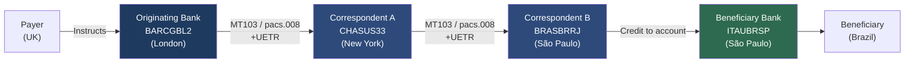
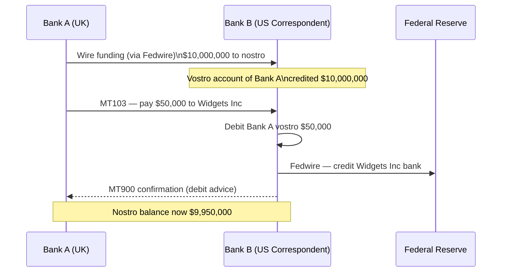
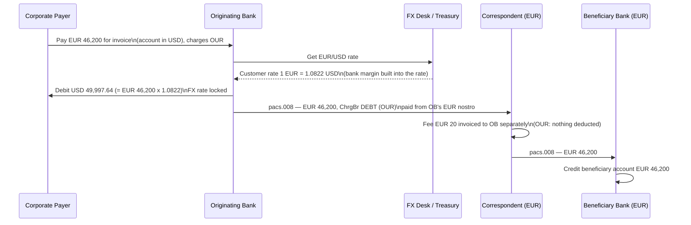
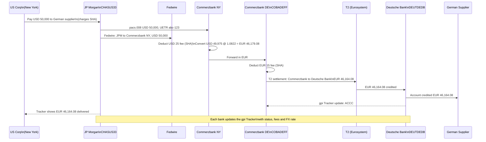
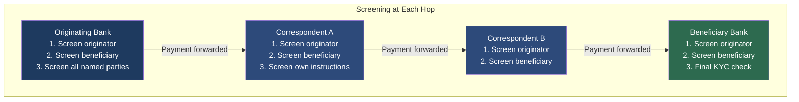

# المدفوعات العابرة للحدود — البنوك المراسلة والرسوم والتتبع

## نظرة عامة

المدفوعات العابرة للحدود — نقل المال من حساب في دولة إلى حساب في دولة أخرى — من أعقد العمليات في القطاع المالي. فعلى خلاف المدفوعات المحلية التي تعمل على بنية مقاصة واحدة، تعبر التحويلات الدولية سلاسل من البنوك تربطها علاقات مراسلة ثنائية، يطبق كل منها رسومه وأسعار صرفه وضوابط امتثاله. ورغم أنها جزء صغير من حجم المدفوعات الكلي، فإنها تولد نصيبًا غير متناسب من التعقيد التشغيلي والتدقيق الرقابي وشكاوى العملاء. وتضع خارطة طريق مجموعة العشرين أهدافًا لنهاية 2027: متوسط كلفة لا يتجاوز 1% للمدفوعات بالجملة والتجزئة، وإضافة 75% من المدفوعات خلال ساعة وكلها تقريبًا خلال يوم عمل — إضافة إلى شفافية أفضل (التتبع والإفصاح عن الرسوم) ووصول أوسع. ويجب على المهندسين الذين يبنون أنظمة معالجة هذه المدفوعات فهم السلسلة كاملة: من اختيار توجيه البنوك المراسلة، مرورًا بإدارة حسابات النوسترو، وتحويل العملة، وخصم الرسوم، حتى فحص العقوبات في كل عقدة.

## أهداف التعلم

- تتبع دفعة عابرة للحدود عبر سلسلة بنوك مراسلة متعددة المراحل وتحديد ما يفعله كل مشارك
- شرح الفرق بين حسابات النوسترو والفوسترو ووصف كيف تقلل المقاصة متطلبات السيولة
- استخراج UETR من رسالة SWIFT gpi، واستعلام gpi Tracker، وتفسير حقول حالة g4c لتحديد هل أُضيفت الدفعة ضمن الاتفاقية
- حساب صافي مبلغ المستفيد لكل خيار من خيارات تحمّل الرسوم الثلاثة (SHA وOUR وBEN) بناءً على جدول رسوم البنوك المراسلة
- تحديد أين يحدث تحويل العملة عادة في سلسلة الدفع وشرح آليات هامش السعر وتثبيته
- تنفيذ `CorrespondentPaymentRouter` يختار مسار التوجيه الأمثل بناءً على علاقات المراسلة وجداول الرسوم وبيانات الزمن
- شرح لماذا يستطيع SEPA تجاوز سلسلة المراسلة لمدفوعات اليورو داخل الاتحاد الأوروبي وحساب التوفير
- وصف نموذج فحص العقوبات متعدد الطبقات (بنك المنشئ، والمراسل، وبنك المستفيد) والأثر الهندسي لتطابق في منتصف السلسلة

## سياق العمل

*مثال مركّب (مبني على أنماط شائعة في الصناعة، لا على بنك بعينه):* بعد موجة شكاوى من العملاء، حلل بنك متوسط الحجم كلفة مدفوعاته العابرة للحدود بالدولار لعملائه من الشركات. فوجد أن نحو ثلث المدفوعات كانت توجَّه عبر ثلاث قفزات مراسلة رغم وجود مسارات بقفزتين — فلم يُحدّث جدول التوجيه منذ أكثر من عام، ولم تُفعّل في محرك الدفع قط ممرات مع شريكين مراسلين جديدين. وكان مسار القفزات الثلاث يكلف نحو ضعف رسوم المراسلة لمسار القفزتين، فيكلف العملاء ملايين سنويًا في رسوم زائدة، يتحمل البنك جزءًا منها ليبقى منافسًا. إضافة إلى ذلك، كانت آلاف المدفوعات شهريًا تصل بخصوم لم يتوقعها العملاء (رسوم SHA يأخذها الوسطاء)، فتولد مئات الاستفسارات اليدوية لخدمة العملاء كل شهر. ويعلمك هذا الدرس بناء محرك توجيه وحاسبة رسوم تجعلان هذه التكاليف مرئية وقابلة للتحكم.

## سلسلة البنوك المراسلة

**علاقة البنوك المراسلة** ترتيب تعاقدي يستخدم بموجبه البنك A (المستجيب) البنكَ B (المراسل) للوصول إلى خدمات مالية في أسواق لا وجود مباشرًا للبنك A فيها. ويحتفظ المراسل عادة بأموال نيابة عن المستجيب في بنية حسابات نوسترو/فوسترو.

لدفعة من شركة بريطانية إلى مستفيد في البرازيل قد تكون السلسلة:



تتضمن كل قفزة:
1. استلام تعليمة الدفع (MT103 أو pacs.008)
2. فحص العقوبات للمنشئ والمستفيد وكل الأطراف المسماة
3. خصم رسوم المراسل (ما لم يُحدد OUR)
4. ربما تحويل العملة (إذا كان الممر بعملة مختلفة)
5. تمرير التعليمة إلى القفزة التالية أو الإضافة إلى الحساب النهائي
6. تحديث gpi Tracker بالحالة الجديدة

> [!NOTE]
> يتحدد عدد القفزات في الممر بوجود علاقات مراسلة ثنائية وقواعد الوصول إلى البنوك المركزية. فالمقاصة المباشرة بالدولار تتطلب وصولًا إلى Fedwire أو عضوية CHIPS. والمقاصة المباشرة باليورو تتطلب وصولًا إلى T2 (خليفة TARGET2)، أو TIPS، أو أنظمة EBA Clearing ‏EURO1 أو STEP2 أو RT1. والبنوك التي لا تملك وصولًا مباشرًا يجب أن توجّه عبر مراسل يملكه. واكتساب الوصول المباشر مكلف (بنية امتثال، وكيان قانوني محلي، ومتطلبات سيولة) — فتبقى بنوك أصغر كثيرة مشاركين غير مباشرين عن قصد.

## آليات حسابات النوسترو والفوسترو

**حساب النوسترو:** حساب للبنك A لدى البنك B بالعملة المحلية للبنك B. ومن منظور البنك A: "مالنا المحتفظ به في بنككم". ويستخدمه البنك A لتمويل المدفوعات الصادرة بتلك العملة دون تحويل عملة عند كل دفعة.

**حساب الفوسترو:** الحساب نفسه من منظور البنك B: "مالكم المحتفظ به في بنكنا".

دورة التمويل:



**المقاصة** تقلل مقدار التمويل المسبق المطلوب. فإذا أرسل البنك A ‏500 دفعة يوميًا بمتوسط 20,000 دولار = 10 ملايين صادرة، لكنه يتلقى أيضًا 8 ملايين واردة إلى حساب النوسترو نفسه، فإن التدفقات الواردة تعيد ملء الرصيد ولا يحتاج إلى تمويل جديد إلا صافي التدفق الصادر البالغ مليوني دولار. وتدير البنوك حسابات النوسترو بنشاط، فتسحب الفوائض وتعيد التعبئة عندما تنخفض الأرصدة تحت حدود دنيا.

مدير أرصدة نوسترو بلغة Java:

```java
@Service
public class NostroBalanceManager {

    private static final BigDecimal MINIMUM_BUFFER_MULTIPLIER = new BigDecimal("1.20");

    private final NostroAccountRepository nostroRepo;
    private final FundingTransferService fundingService;
    private final AlertService alertService;

    public FundingDecision checkAndFund(String nostroAccountId, BigDecimal paymentAmount) {
        NostroAccount account = nostroRepo.findById(nostroAccountId)
            .orElseThrow(() -> new NostroAccountNotFoundException(nostroAccountId));

        BigDecimal availableBalance  = account.getBalance().subtract(account.getReservedAmount());
        BigDecimal minimumRequired   = account.getDailyThreshold().multiply(MINIMUM_BUFFER_MULTIPLIER);

        if (availableBalance.compareTo(paymentAmount) < 0) {
            alertService.criticalAlert("NOSTRO_INSUFFICIENT_FUNDS",
                Map.of("account", nostroAccountId,
                       "available", availableBalance,
                       "required", paymentAmount));
            return FundingDecision.INSUFFICIENT;
        }

        BigDecimal postPaymentBalance = availableBalance.subtract(paymentAmount);
        if (postPaymentBalance.compareTo(minimumRequired) < 0) {
            // Trigger pre-emptive top-up — do not block payment
            BigDecimal topUpAmount = account.getStandardTopUpAmount();
            fundingService.scheduleTopUp(nostroAccountId, topUpAmount, Urgency.SAME_DAY);
            alertService.info("NOSTRO_TOPUP_TRIGGERED",
                Map.of("account", nostroAccountId, "topUpAmount", topUpAmount));
        }

        return FundingDecision.PROCEED;
    }
}
```

## SWIFT gpi وتتبع UETR

‏SWIFT gpi خدمة فوق شبكة SWIFT ‏MT/MX القائمة. فكل دفعة gpi تحمل **UETR** — معرّف UUID v4 — ينتقل دون تغيير عبر سلسلة المراسلة كلها. وكل بنك في السلسلة ملزم تعاقديًا بتحديث **gpi Tracker** ضمن نوافذ زمنية محددة.

رموز حالة gpi:

| الرمز | المعنى | الإجراء المطلوب |
|------|---------|----------------|
| `ACSP` | مقبول، والتسوية قيد التنفيذ | لا شيء — الدفعة في الطريق |
| `ACCC` | مقبول، واكتملت الإضافة | سُلّمت الدفعة — حالة نهائية |
| `RJCT` | مرفوض | حقق في رمز السبب، وأعد الأموال |
| `PDNG` | معلق | بانتظار اجتياز الامتثال |

وتحمل gpi أيضًا **حقول g4c ‏(gpi for corporates)** التي تعرض بيانات التتبع للعملاء المؤسسيين عبر واجهات بنوكهم — الرسوم المخصومة حتى الآن، وأسعار الصرف المطبقة، واسم كل بنك عالج الدفعة.

```java
@Service
public class GpiPaymentTracker {

    private final SwiftTrackerApiClient trackerClient;
    private final PaymentRepository paymentRepo;

    public TrackingReport getTrackingReport(String uetr) {
        GpiTrackerResponse response = trackerClient.getTransaction(uetr);

        List<ProcessingStep> steps = response.getTransactionStatusDetails()
            .stream()
            .sorted(Comparator.comparing(GpiStatusDetail::getStatusTimestamp))
            .map(detail -> ProcessingStep.builder()
                .bankBic(detail.getFromBic())
                .status(detail.getTransactionStatus())
                .statusTimestamp(detail.getStatusTimestamp())
                .chargesDeducted(detail.getChargesInformation() != null
                    ? detail.getChargesInformation().stream()
                        .map(c -> new ChargeDeduction(c.getCurrency(), c.getAmount()))
                        .toList()
                    : List.of())
                .fxRate(detail.getExchangeRate())
                .build())
            .toList();

        boolean withinSla = isWithinGpiSla(steps);
        return new TrackingReport(uetr, steps, withinSla);
    }

    private boolean isWithinGpiSla(List<ProcessingStep> steps) {
        // gpi rule: credit the beneficiary on the same business day (subject to
        // cut-off times and compliance checks). A simple 24-hour window is an
        // approximation — production code uses each bank's business calendar
        return steps.stream()
            .filter(s -> "ACCC".equals(s.status()))
            .findFirst()
            .map(s -> {
                ProcessingStep firstStep = steps.get(0);
                Duration elapsed = Duration.between(
                    firstStep.statusTimestamp(), s.statusTimestamp());
                return elapsed.toHours() < 24;
            })
            .orElse(false);
    }

    public void markSlaBreached(String uetr, String lastKnownBic) {
        paymentRepo.updateStatus(uetr, PaymentStatus.SLA_BREACHED);
        alertService.escalate("GPI_SLA_BREACH",
            Map.of("uetr", uetr, "lastKnownBic", lastKnownBic));
    }
}
```

قاعدة gpi: إضافة المبلغ للمستفيد في يوم العمل نفسه (مع مراعاة أوقات القطع وفحوص الامتثال). ونافذة 24 ساعة البسيطة تقريب — والشيفرة الإنتاجية تستخدم تقويم العمل لكل بنك.

> [!IMPORTANT]
> تراقب SWIFT الالتزام باتفاقيات gpi، وقد تؤدي التجاوزات المستمرة إلى مراجعة وضع عضوية gpi للبنك. فإذا كان بنكك مراسلًا يعالج مدفوعات gpi الواردة متأخرًا كثيرًا، فهذا يضر بعلاقات المراسلة لديك. ابنِ مراقبة تتتبع زمني p50 وp99 لمعالجة gpi حسب ممر العملة وتنبّه عند تدهور أي منهما.

## خصم الرسوم: SHA وOUR وBEN

تحدد تعليمة تحمّل الرسوم في الحقل 71A ‏(MT103) أو `ChrgBr` ‏(pacs.008) من يتحمل رسوم المراسلة عبر السلسلة:

| الرمز | MT103 | pacs.008 | المعنى |
|------|-------|----------|---------|
| SHA | 71A: SHA | SHAR | رسوم البنك المرسل على المرسل؛ ورسوم الوسطاء والبنك المستلم على المستفيد (يقل المبلغ) |
| OUR | 71A: OUR | DEBT | كل الرسوم على المرسل؛ ويتلقى المستفيد المبلغ المطلوب كاملًا |
| BEN | 71A: BEN | CRED | كل الرسوم على المستفيد (غير شائع عمليًا) |

مع SHA (الأكثر شيوعًا) يتلقى المستفيد المبلغ المطلوب **ناقصًا** أي رسوم يخصمها المراسلون على طول السلسلة. وقد يفاجئ هذا المستفيدين الذين يتوقعون مبلغ الفاتورة كاملًا.

```java
public class CorrespondentChargeCalculator {

    private final CorrespondentFeeScheduleRepository feeRepo;

    public ChargeCalculationResult calculate(PaymentInstruction payment,
                                              List<String> correspondentChain) {
        BigDecimal instructedAmount  = payment.getAmount();
        BigDecimal totalCharges      = BigDecimal.ZERO;
        List<ChargeDeduction> deductions = new ArrayList<>();

        for (String correspondentBic : correspondentChain) {
            CorrespondentFeeSchedule schedule = feeRepo.findByBic(correspondentBic)
                .orElseThrow(() -> new UnknownCorrespondentException(correspondentBic));

            BigDecimal fee = calculateFee(schedule, instructedAmount, payment.getCurrency());

            if (payment.getChargeBearer() == ChargeBearer.SHARED) {
                // SHA: each correspondent deducts from the payment amount
                totalCharges = totalCharges.add(fee);
                deductions.add(new ChargeDeduction(correspondentBic, fee, payment.getCurrency()));

            } else if (payment.getChargeBearer() == ChargeBearer.SENDER) {
                // OUR: correspondent invoices the sender's bank separately; amount unchanged
                deductions.add(new ChargeDeduction(correspondentBic, fee, payment.getCurrency(),
                                                    ChargeRoute.INVOICE_SENDER));
            }
            // BEN: same as SHA but sender's bank charges also added to deductions
        }

        BigDecimal beneficiaryAmount = payment.getChargeBearer() == ChargeBearer.SHARED
            ? instructedAmount.subtract(totalCharges)
            : instructedAmount;

        return new ChargeCalculationResult(instructedAmount, beneficiaryAmount, totalCharges, deductions);
    }

    private BigDecimal calculateFee(CorrespondentFeeSchedule schedule,
                                    BigDecimal amount, String currency) {
        // Typically: flat fee + percentage, with min/max caps
        BigDecimal percentageFee = amount.multiply(schedule.getPercentageRate())
            .setScale(2, RoundingMode.HALF_UP);
        BigDecimal totalFee = schedule.getFlatFee().add(percentageFee);
        return totalFee.max(schedule.getMinFee()).min(schedule.getMaxFee());
    }
}
```

## تحويل العملة في سلسلة الدفع

قد يحدث تحويل العملة عند نقاط مختلفة في سلسلة الدفع العابرة للحدود:

1. **عند البنك المنشئ:** يحوّل بنك العميل المرسل وقت التعليمة. ويرى العميل سعر الصرف مسبقًا. وهو أبسط نموذج للعميل.

2. **عند بنك المستفيد:** يحوّل البنك المستلم عند الإضافة إلى الحساب النهائي. فلا يُعرف السعر عند البدء، مما ينشئ عدم يقين للمستفيد. وهذا شائع في ممرات الأسواق النامية.

3. **عند مراسل:** يحوّل مراسل بالدولار تلقى تعليمة بالجنيه إلى الدولار قبل التمرير. ويكون هامش الصرف مضمنًا في تحويل المراسل وقد لا يُفصح عنه بشفافية.

**دورة حياة سعر الصرف** في دفعة عابرة للحدود (هنا يحوّل البنك المنشئ، والرسوم OUR):



> [!WARNING]
> عندما يحوّل مراسل العملة في منتصف السلسلة، **لا يُفصح عن سعر الصرف والهامش** للبنك المنشئ أو العميل ما لم تُملأ حقول g4c في SWIFT gpi. ومع SHA قد يؤدي التحويل لدى وسيط إلى تلقي المستفيد أقل بكثير مما يتوقع إذا استخدم المراسل سعرًا غير ملائم. وتشترط الجهات الرقابية (مثل EBA في الاتحاد الأوروبي، وFCA في المملكة المتحدة) على مزوّدي خدمات الدفع الإفصاح عن كل التكاليف وأسعار الصرف قبل التنفيذ. فابنِ طبقة حساب الرسوم لديك لتستهلك حقول g4c وتُظهر أسعار الصرف في منتصف السلسلة في الإفصاح عن الرسوم قبل الدفع.

## CorrespondentPaymentRouter

يختار محرك التوجيه السلسلة المثلى من المراسلين لدفعة معينة بناءً على ممر العملة، والعلاقات الثنائية المسجلة، وجداول الرسوم، واتفاقيات الزمن:

```java
@Service
public class CorrespondentPaymentRouter {

    private final CorrespondentRelationshipRepository relationships;
    private final CorrespondentFeeScheduleRepository fees;
    private final CorrespondentLatencyRepository latency;

    public RoutingResult route(PaymentInstruction payment) {
        String sourceCurrency   = payment.getDebtorCurrency();
        String targetCurrency   = payment.getCreditorCurrency();
        String targetCountry    = payment.getCreditorCountry();

        // Check for SEPA eligibility first (cheapest path)
        if (isSepaEligible(sourceCurrency, targetCurrency, targetCountry)) {
            return RoutingResult.sepa(buildSepaInstruction(payment));
        }

        List<CorrespondentChain> candidates = relationships
            .findChainsForCorridor(sourceCurrency, targetCurrency, targetCountry);

        if (candidates.isEmpty()) {
            throw new NoCorrespondentRouteException(
                "No correspondent route for " + sourceCurrency + " → " +
                targetCurrency + " to " + targetCountry);
        }

        // Score each candidate chain
        CorrespondentChain optimal = candidates.stream()
            .map(chain -> new ScoredChain(chain, scoreChain(chain, payment)))
            .min(Comparator.comparingDouble(ScoredChain::score))
            .map(ScoredChain::chain)
            .orElseThrow();

        return RoutingResult.correspondent(optimal, buildRoutingHeaders(payment, optimal));
    }

    private double scoreChain(CorrespondentChain chain, PaymentInstruction payment) {
        // Weighted score: lower is better
        double totalFeeUsd = chain.getHops().stream()
            .mapToDouble(hop -> estimateFeeUsd(hop, payment.getAmount(), payment.getDebtorCurrency()))
            .sum();

        double p99LatencySeconds = chain.getHops().stream()
            .mapToDouble(hop -> latency.getP99LatencySeconds(hop.getBic()))
            .sum();

        double hopCountPenalty = chain.getHops().size() * 10.0; // prefer fewer hops

        double feesWeight    = 0.60;
        double latencyWeight = 0.30;
        double hopWeight     = 0.10;

        return (totalFeeUsd   * feesWeight) +
               (p99LatencySeconds * latencyWeight * 5) +
               (hopCountPenalty  * hopWeight);
    }

    private boolean isSepaEligible(String srcCcy, String tgtCcy, String tgtCountry) {
        return "EUR".equals(srcCcy) && "EUR".equals(tgtCcy) &&
               SepaCountries.SEPA_ZONE.contains(tgtCountry);
    }
}
```

## دفعة عابرة للحدود ثلاثية المراحل من الدولار إلى اليورو

تتبع كامل لدفعة بالدولار تُحوّل إلى اليورو من شركة أمريكية إلى مورّد ألماني (برسوم SHA، والتحويل لدى المراسل):



## SEPA للمدفوعات داخل الاتحاد الأوروبي

أنشأت منطقة الدفع الموحدة باليورو (SEPA) بنية دفع موحدة لمعاملات اليورو عبر نحو 40 دولة وإقليمًا أوروبيًا (ينشر مجلس المدفوعات الأوروبي القائمة الحالية). وللمدفوعات باليورو داخل الاتحاد الأوروبي، تلغي SEPA الحاجة إلى سلسلة مراسلة كليًا:

| الخاصية | عبر المراسلة | عبر SEPA SCT |
|---------|------------------|-------------|
| عدد القفزات | 2–4 | 1 (مباشر) |
| الرسوم المعتادة | ‏15–45 دولارًا | ‏0.00–0.50 يورو |
| التسوية | اليوم نفسه/التالي | ‏T+1 ‏(SCT) أو أقل من 10 ثوانٍ (SCT Inst) |
| الشفافية | محدودة (لا gpi في MT القديمة) | رسائل حالة من البداية للنهاية |
| التغطية | أكثر من 200 دولة | دول SEPA فقط، باليورو فقط |

يجب أن يفحص محرك التوجيه أهلية SEPA قبل النظر في سلاسل المراسلة. فلدفعة باليورو من فرنسا إلى بولندا يكون SEPA SCT Instant أرخص وأسرع وأكثر شفافية من أي سلسلة مراسلة.

```java
public class SepaEligibilityChecker {

    private static final Set<String> SEPA_COUNTRIES = Set.of(
        "AT","BE","BG","CY","CZ","DE","DK","EE","ES","FI","FR","GR","HR","HU",
        "IE","IT","LT","LU","LV","MT","NL","PL","PT","RO","SE","SI","SK",
        "IS","LI","NO","CH","GB","MC","SM","VA","AD",
        "AL","ME","MD","MK","RS"   // newer SEPA members — load the list from the EPC, don't hard-code it
    );

    public SepaEligibility check(PaymentInstruction payment) {
        if (!"EUR".equals(payment.getCreditorCurrency())) {
            return SepaEligibility.NOT_ELIGIBLE_CURRENCY;
        }
        if (!SEPA_COUNTRIES.contains(payment.getCreditorCountry())) {
            return SepaEligibility.NOT_ELIGIBLE_COUNTRY;
        }
        if (!isValidIban(payment.getCreditorAccount())) {
            return SepaEligibility.NOT_ELIGIBLE_NO_IBAN;
        }
        // Check creditor bank is reachable for the scheme (e.g. via STEP2, RT1 or TIPS)
        if (!sepaReachabilityRegistry.isReachable(payment.getCreditorBic())) {
            return SepaEligibility.NOT_ELIGIBLE_NOT_REACHABLE;
        }
        return payment.isUrgent()
            ? SepaEligibility.ELIGIBLE_INSTANT
            : SepaEligibility.ELIGIBLE_STANDARD;
    }
}
```

## فحص العقوبات في كل قفزة

يفحص كل بنك في سلسلة المراسلة الدفعة مستقلًا مقابل قوائم العقوبات (OFAC، والاتحاد الأوروبي، والأمم المتحدة، وخزانة المملكة المتحدة). وهذا ينشئ بنية فحص متعددة الطبقات بآثار هندسية مهمة:



يطلق التطابق المحتمل في أي قفزة **احتجازًا** للدفعة أثناء التحقيق. فإذا تأكد التطابق، قد يُلزم البنك قانونًا **بتجميد** الأموال وإبلاغ جهة العقوبات (مثل OFAC في الولايات المتحدة وOFSI في المملكة المتحدة)؛ وقد يتطلب الاشتباه في غسل الأموال أيضًا تقرير نشاط مشبوه (SAR). وفي حالات أخرى تُرفض الدفعة وتُعاد (pacs.004 / إرجاع MT103) بسبب مختار بعناية. ثم يجب على البنك المنشئ:

1. إبلاغ الدافع بأن الدفعة محجوبة
2. إعادة الأموال إلى الدافع إذا رُفضت الدفعة (الأموال المجمّدة لا يمكن إعادتها)
3. تجنب "تنبيه" الشخص موضوع التطابق (حظر قانوني في معظم الولايات القضائية)

```java
@Service
public class SanctionsScreeningService {

    private final SanctionsListRepository sanctionsRepo;
    private final FuzzyNameMatcher nameMatcher;
    private final AuditLogger auditLogger;

    public ScreeningResult screen(PaymentInstruction payment) {
        // Screen EVERY party and free-text field, not just debtor and creditor:
        // agents, intermediaries, ultimate parties, addresses, remittance text
        List<ScreeningEntity> entitiesToScreen = List.of(
            ScreeningEntity.of(payment.getDebtorName(), payment.getDebtorCountry(), EntityType.PARTY),
            ScreeningEntity.of(payment.getCreditorName(), payment.getCreditorCountry(), EntityType.PARTY),
            ScreeningEntity.ofAccount(payment.getCreditorAccount(), payment.getCreditorCountry())
        );

        for (ScreeningEntity entity : entitiesToScreen) {
            // Do NOT filter candidates by the party's country: a sanctioned
            // person is sanctioned wherever they bank. Country (and date of
            // birth, etc.) may raise or lower the score, never exclude a hit
            List<SanctionsMatch> matches = sanctionsRepo.search(entity.getName())
                .stream()
                .filter(candidate -> nameMatcher.score(entity.getName(), candidate.getName()) > 0.85)
                .toList();

            if (!matches.isEmpty()) {
                auditLogger.logHit(payment.getUetr(), entity, matches);
                return ScreeningResult.hit(entity, matches, ScreeningAction.HOLD_FOR_REVIEW);
            }
        }

        auditLogger.logClear(payment.getUetr(), entitiesToScreen.size());
        return ScreeningResult.clear();
    }
}
```

افحص **كل** طرف وحقل نصي حر، لا المدين والدائن فقط: الوكلاء، والوسطاء، والأطراف النهائية، والعناوين، ونص التحويل. ولا ترشّح المرشحين حسب دولة الطرف: فالشخص المعاقب معاقب أينما يتعامل مع البنوك. فالدولة (وتاريخ الميلاد وغيره) قد ترفع النتيجة أو تخفضها، لكنها لا تستبعد تطابقًا أبدًا.

> [!WARNING]
> الإيجابيات الكاذبة في فحص العقوبات — مدفوعات مشروعة تُعلّم بسبب تشابه الأسماء — مكلفة وتضر بعلاقات العملاء. فعتبة 0.85 في مطابقة الأسماء التقريبية ستنتج إيجابيات كاذبة للأسماء الشائعة في لغات معينة (مثل "Mohammed" و"Wang"). فابنِ **سجلًا للأطراف الموثوقة** للعلاقات المفحوصة مسبقًا و**مسار مراجعة بشرية** للتطابقات التقريبية بين 0.75 و0.95. ولا تحجب تلقائيًا إلا التطابقات الدقيقة الواضحة أو التطابقات المؤكدة في القوائم.

## اختبار المعرفة

**س1: يطلب عميل مؤسسي دفعة 100,000 دولار إلى مستفيد في الهند بتحمّل رسوم SHA. ويُظهر جدول رسوم المراسلين لديك: المراسل A (الولايات المتحدة) = 30 دولارًا ثابتة + 0.02%، والمراسل B (الإمارات) = 20 دولارًا ثابتة + 0.015%، ويفرض بنك المستفيد الهندي 500 روبية (نحو 6 دولارات). كم يتلقى المستفيد بالدولار، وما إجمالي الرسوم المخصومة؟**

ج: رسوم المراسل A = ‏30 + (100,000 × 0.0002) = 30 + 20 = 50 دولارًا. والمتبقي بعد A = ‏99,950. ورسوم المراسل B = ‏20 + (99,950 × 0.00015) = 20 + 15 = 35 دولارًا. والمتبقي بعد B = ‏99,915. ويخصم بنك المستفيد الهندي ما يعادل 6 دولارات. فالمبلغ النهائي للمستفيد ≈ ‏99,909 دولارًا. وإجمالي الرسوم = ‏50 + 35 + 6 = 91 دولارًا. ومع SHA يتلقى المستفيد 99,909 دولارًا بدل 100,000 المتوقعة. فإذا كان غرض الدفعة سداد فاتورة 100,000 دولار بالضبط، فإما أن يحدد العميل OUR (يدفع المرسل كل الرسوم — كلفة إضافية عليه) أو يرفع المبلغ المطلوب إلى نحو 100,100 دولار لامتصاص خصوم SHA المتوقعة.

**س2: يختار `CorrespondentPaymentRouter` لديك سلسلة بقفزتين لدفعة من الدولار إلى الدولار السنغافوري. تُرسل الدفعة عبر SWIFT، وبعد 6 ساعات يُظهر gpi Tracker الحالة `ACSP` وآخر بنك حدّثها هو المراسل A. ماذا تعني `ACSP`، وما الإجراءات التي يجب أن يتخذها نظامك عند علامة 6 ساعات و24 ساعة؟**

ج: تعني `ACSP` ‏(مقبول، والتسوية قيد التنفيذ) أن بنكًا واحدًا على الأقل في السلسلة قبل الدفعة لكنها لم تُضف بعد إلى حساب المستفيد — فهي ما زالت في الطريق. وعند 6 ساعات يجب على النظام: (1) فحص هل هذا الزمن ضمن p95 المتوقع لممر الدولار إلى الدولار السنغافوري (قد يستغرق مشروعًا 6–12 ساعة)؛ (2) إطلاق تنبيه مراقبة إذا كانت اتفاقية الممر تحدد التسليم خلال 4 ساعات؛ (3) جعل الحالة الحالية مرئية للعميل عبر واجهة التتبع حتى لا يتصل بخدمة العملاء. وعند علامة 24 ساعة يكون توقع التسليم في يوم العمل نفسه قد فات على الأرجح. فيجب على النظام: (1) التصعيد إلى فريق عمليات الدفع؛ (2) فتح استفسار مع آخر بنك معروف (المراسل A) يطلب الحالة — عبر إدارة الحالات في gpi Tracker أو رسالة تحقيق MT199/camt.027 (أما gSRP، "الإيقاف والاسترجاع"، فهو لإلغاء دفعة فقط لا لملاحقتها)؛ (3) إبلاغ العميل بتأخر الدفعة وتقديم وقت حل متوقع؛ (4) تسجيل التجاوز لتقارير أداء النظام الشهرية.

## التحدي العملي

1. **‏CorrespondentPaymentRouter مع تحسين الرسوم:** وسّع `CorrespondentPaymentRouter` ليحمّل سلاسل المراسلين وجداول الرسوم من ملف إعداد YAML عند البدء. ويجب أن يدعم الموجّه: ممرات معرّفة بـ `sourceCurrency` و`targetCurrency` و`targetCountryPattern` (تعبير نمطي)؛ وجداول رسوم بـ `flatFee` و`percentageRate` و`minFee` و`maxFee` و`currency`؛ وقيدًا على أقصى عدد قفزات (الافتراضي 3). واكتب اختبارات وحدة تتحقق من: (أ) أن مدفوعات اليورو إلى اليورو المؤهلة لـ SEPA توجَّه دائمًا عبر SEPA؛ (ب) أن مسارًا بقفزتين وإجمالي رسوم 40 دولارًا يُفضّل على مسار بثلاث قفزات وإجمالي رسوم 38 دولارًا عندما يكون وزن عقوبة عدد القفزات 0.15؛ (ج) رمي `NoCorrespondentRouteException` لممر عملة بلا سلاسل مسجلة.

2. **مستطلع تتبع gpi مع فرض الاتفاقية:** نفّذ حبة Spring ‏`@Scheduled` باسم `GpiSlaMonitor` تعمل كل 15 دقيقة. ويجب أن: تستعلم كل المدفوعات بالحالة `ACSP` الأقدم من ساعتين؛ ولكل منها تستدعي واجهة gpi Tracker؛ وتحدّث الحالة إلى `ACCC` أو `RJCT` إذا أكد المتتبع الاكتمال؛ وتطلق تنبيه `GPI_SLA_WARNING` للمدفوعات بين 4 و24 ساعة؛ وتطلق تنبيه `GPI_SLA_BREACH` وتفتح طلب تحقيق للمدفوعات الأقدم من 24 ساعة. وتأكد من أن المهمة تحصل على قفل موزع (استخدم Redisson أو `JdbcLockRegistry` من Spring Integration) لمنع طلبات تحقيق مكررة عند التشغيل على عدة عقد.

3. **تقرير شفافية الرسوم:** ابنِ `ChargeTransparencyService` ينتج، من `PaymentInstruction` و`CorrespondentChain` محددة، كائن `FeeDisclosure` يوافق متطلبات الإفصاح قبل الدفع في توجيه خدمات الدفع الأوروبي (PSD2). ويجب أن يتضمن الإفصاح: المبلغ المطلوب، وكل رسوم المراسلين المنفردة (المبلغ والعملة)، وسعر الصرف إن وُجد، والمبلغ المتوقع للمستفيد، والكلفة الإجمالية كنسبة من المبلغ المطلوب. واكتب اختبارًا يتحقق من صحة حساب نسبة الرسوم الإجمالية لدفعة من الدولار إلى اليورو بثلاث قفزات.

4. **فحص العقوبات مع إدارة الإيجابيات الكاذبة:** وسّع `SanctionsScreeningService` بسجل `TrustedCounterpartyRegistry` يخزن أزواج الأطراف المفحوصة مسبقًا (debtorBic، وcreditorAccountHash). وللأزواج المفحوصة مسبقًا، تجاوز المطابقة التقريبية وأجرِ فقط بحثًا دقيقًا في القوائم. واكتب اختبار تكامل باستخدام Testcontainers ‏(PostgreSQL للسجل + واجهة عقوبات محاكاة) يتحقق من: (أ) أن الطرف المفحوص مسبقًا يتجاوز المطابقة التقريبية؛ (ب) أن طرفًا جديدًا بنتيجة تشابه اسم 0.90 يوجَّه إلى طابور المراجعة البشرية بدل الحجب التلقائي؛ (ج) أن تطابقًا دقيقًا في قائمة OFAC SDN يطلق دائمًا حجبًا صارمًا أيًا كانت حالة السجل.

<!-- KNOWLEDGE-CHECK
{
  "questions": [
    {
      "text": "دفعة 100,000 دولار بتحمّل رسوم SHA. يفرض المراسل A ‏30 دولارًا ثابتة + 0.02%، والمراسل B ‏20 دولارًا ثابتة + 0.015%، وبنك المستفيد الهندي ما يعادل 6 دولارات. كم يتلقى المستفيد؟",
      "options": [
        "‏100,000 دولار بالضبط — SHA تعني أن المرسل يدفع كل الرسوم",
        "نحو 99,909 دولارًا — كل مراسل يخصم من مبلغ الدفعة",
        "‏99,970 دولارًا — تُخصم الرسوم الثابتة فقط",
        "‏100,000 ناقص 6 = 99,994 دولارًا"
      ],
      "correct": 1,
      "explanation": "مع SHA تُخصم رسوم المراسلين من مبلغ الدفعة في الطريق. المراسل A: ‏30 + (100,000 × 0.0002) = 50، فيتبقى 99,950. والمراسل B: ‏20 + (99,950 × 0.00015) = 35، فيتبقى 99,915. وبنك المستفيد: 6، فيتبقى نحو 99,909. وإجمالي الرسوم = 91 دولارًا."
    },
    {
      "text": "يختار `CorrespondentPaymentRouter` لديك سلسلة بقفزتين لدفعة من الدولار إلى الدولار السنغافوري. وبعد 6 ساعات يُظهر gpi Tracker الحالة `ACSP` وآخر بنك حدّثها هو المراسل A. ماذا تعني `ACSP`؟",
      "options": [
        "مقبول، وتمت التسوية — أُضيفت الدفعة للمستفيد",
        "مقبول، والتسوية قيد التنفيذ — الدفعة في الطريق ولم تُضف بعد",
        "إقرار، ومعالجة في النظام — الدفعة في طابور النظام",
        "تنبيه، دفعة مشبوهة — الدفعة قيد مراجعة الامتثال"
      ],
      "correct": 1,
      "explanation": "تعني `ACSP` ‏(مقبول، والتسوية قيد التنفيذ) أن بنكًا واحدًا على الأقل في السلسلة قبل الدفعة لكنها لم تُضف بعد للمستفيد — فهي ما زالت في الطريق. وإذا بقيت ACSP عند 24 ساعة يكون توقع اليوم نفسه قد فات: صعّد وافتح استفسارًا مع آخر بنك حدّث المتتبع (gSRP للإيقاف والاسترجاع، لا للملاحقة)."
    },
    {
      "text": "مع تعليمة تحمّل الرسوم OUR، من يدفع رسوم البنوك المراسلة؟",
      "options": [
        "يدفع المستفيد كل الرسوم من المبلغ المستلم",
        "يخصم كل مراسل رسومه من الدفعة في الطريق",
        "يدفع المرسل كل الرسوم؛ ويتلقى المستفيد المبلغ المطلوب كاملًا",
        "تُقسم الرسوم بالتساوي بين المرسل والمستفيد"
      ],
      "correct": 2,
      "explanation": "مع OUR يدفع المرسل كل الرسوم — فيجمع بنكه كل رسوم المراسلين مسبقًا ويتلقى المستفيد المبلغ المطلوب كاملًا. وهذا يختلف عن SHA (يدفع كل طرف رسوم بنكه، فتُخصم مبالغ في الطريق) وBEN (يدفع المستفيد كل الرسوم، فيكون الخصم الأقصى من مبلغه المستلم)."
    }
  ]
}
-->

<!-- PRACTICAL-CHALLENGE
{
  "title": "موجّه البنوك المراسلة ومراقبة اتفاقيات gpi",
  "difficulty": "advanced",
  "estimatedMinutes": 45,
  "tasks": [
    {
      "id": "1",
      "description": "وسّع `CorrespondentPaymentRouter` ليحمّل سلاسل المراسلين وجداول الرسوم من ملف إعداد YAML عند البدء. وادعم الممرات حسب `sourceCurrency` و`targetCurrency` و`targetCountryPattern` (تعبير نمطي)؛ وجداول الرسوم بـ `flatFee` و`percentageRate` و`minFee` و`maxFee`؛ وقيد أقصى عدد قفزات. وتحقق من توجيه SEPA، ومقايضات عدد القفزات مقابل كلفة الرسوم، و`NoCorrespondentRouteException` للممرات غير المسجلة."
    },
    {
      "id": "2",
      "description": "نفّذ حبة Spring ‏`@Scheduled` باسم `GpiSlaMonitor` تعمل كل 15 دقيقة. استعلم كل مدفوعات ACSP الأقدم من ساعتين، وحدّث الحالة من gpi Tracker، وأطلق `GPI_SLA_WARNING` للمدفوعات بين 4 و24 ساعة، وأطلق `GPI_SLA_BREACH` وافتح طلب تحقيق للمدفوعات الأقدم من 24 ساعة. واستخدم Redisson أو `JdbcLockRegistry` من Spring Integration لمنع طلبات التحقيق المكررة عبر العقد."
    },
    {
      "id": "3",
      "description": "ابنِ `ChargeTransparencyService` ينتج، من `PaymentInstruction` و`CorrespondentChain` محددة، كائن `FeeDisclosure` يوافق متطلبات الإفصاح قبل الدفع في PSD2. وضمّنه المبلغ المطلوب، وكل رسوم المراسلين المنفردة، وسعر الصرف إن وُجد، والمبلغ المتوقع للمستفيد، والكلفة الإجمالية كنسبة. وتحقق من صحة حساب نسبة الرسوم لدفعة من الدولار إلى اليورو بثلاث قفزات."
    },
    {
      "id": "4",
      "description": "وسّع `SanctionsScreeningService` بسجل `TrustedCounterpartyRegistry` يخزن أزواج الأطراف المفحوصة مسبقًا. وللأزواج المفحوصة مسبقًا تجاوز المطابقة التقريبية وأجرِ بحثًا دقيقًا فقط في القوائم. واكتب اختبار تكامل يتحقق من: تجاوز الطرف المفحوص مسبقًا للمطابقة التقريبية؛ وتوجيه نتيجة تشابه 0.90 إلى المراجعة البشرية؛ وأن التطابق الدقيق في OFAC SDN يطلق دائمًا حجبًا صارمًا أيًا كانت حالة السجل."
    }
  ]
}
-->
